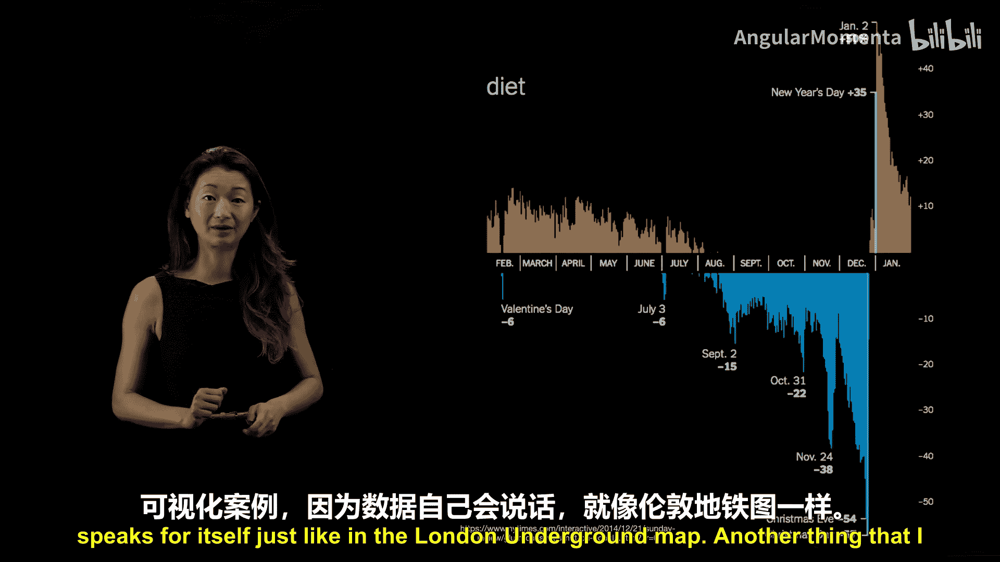
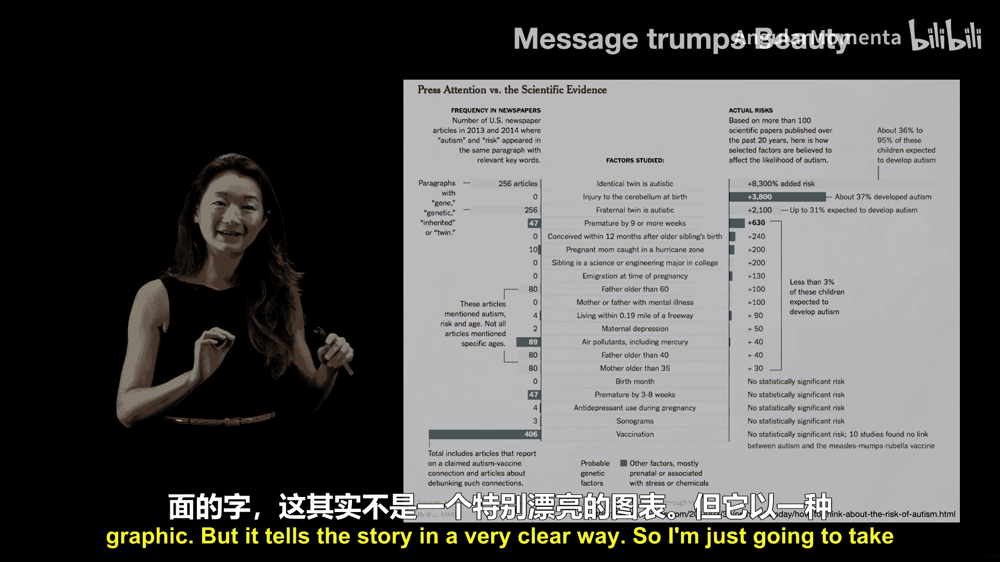
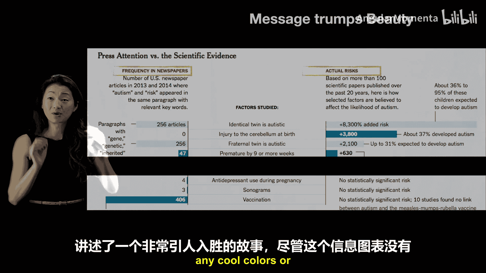

# 【精译】数据密集型工程导论-p14-14-用数据可视化讲故事--BV1J8G3z1EHF_p14-

Data visualization is also storytelling with data in this video we're going to be looking at a couple of examples of particularly effective ways of communicating data by making plots that speak for themselves。

😊，The first one I will point out is a philosophical story。

 which is the idea that sometimes when you're making a plot。

 you actually want to make it less accurate because that's what matters here as an example here we see a version of London Under map from 1908 Now those of you who are familiar to London Underground might see that this is an accurate portrayal of this metropolitan area of London there's the river here is all the neighborhoods and those where are all the stops in terms of where they actually are in physical reality。

 however， this was a really confusing map for a couple of different reasons One。

 it was impossible to see the middle of town where there's lots of stops because they were all crammed up together and was really small In fact all of the space out here was taken up by all of these far flung stations and there's a ton of white space that's not useful in terms of conveying to people where the stops actually are and how do you get from one place to another So this type of map became obsolete with this following map that was made by Harryback in 1931 this is a type of underground。

That has been popular adopted by every other subway map in the entire world because it actually focused on what was important in terms of underground map。

 what the stations were and what's the relationship between how do you get from one to the other and it actually does a really piss for job of telling you where the stations actually are in physical reality so by ignoring information and making false information about where these places actually are it's actually becoming more useful because it more concisely convey the information that an underground writer actually wanted to know which is how do you get from one station to another where do I have to exchange stations this type of underground map is a really interesting way of saying concisely what is important and ignoring things or even misconstruing things that are not important for that particular audience for the story that is being told at that particular moment。

The second thing I wanted to say is that usually just like in the L underground map。

 sometimes you make a data of visualization， and the best thing that you can do is to stand back and not explain it and let the plot speak for itself。

We're going to look at this plot here。And I think the story very much speaks for itself。

 I'm going to explain it a little bit， but hopefully you've already seen it and you can kind of see what's going on here。

 what we're looking at here is the relative frequency of the search term diet in Google sorted by the days of the year starting from January 1 over there all the way back here onto the next January 1 So what you'll see as this plot very does very well conveying in a self-explanatory way is that there's a huge spike in the incidence of people searching for the word diet on January 1 this then dips down a couple of times during the year dips down to Valentine's Day in the United States it dips down in July 3 which is right before Independ Day in July 4 and then for the second half of the year it goes down precipitously until it hits it's all time low on New Year's Eve and on Christmas Eve on Christmas Day going back up again on January 1 the story that's being told here is super duper obvious and it does not need to be explained。

 So this is a really。😊，Great data visualization because the data speaks for itself。

Just like in the London underground map。

Another thing that I wanted to emphasize is this mantra that messaged Trump's beauty So we've seen you've probably seen lots of really pretty graphics before。

 lots of people are making really beautiful infographics and I have a huge fan of those but one of my favorite data visualizations is actually this following one which came out and on New York Times looking at press attention of autism versus the scientific evidence of actual risk of autism Now if you just look at it maybe withla we can't read the words。

 this actually it's not a particularly it's not a particularly pretty graph but it tells the story in a very clear way。

 I'm just going to take out a couple of rows of this data graphic here we're going gonna look into it and talk about exactly why this is such a clear graphic So what we're doing here is looking on the lefthand side the frequency of those words factors are occurring in newspapers on the right-hand side the actual risk in terms of how those factors are known to cause autism Factor studied including that identical twin is is autism。

😊。

And so this this is mentioned often in newspapers， but not nearly as often as the word vaccination is mentioned in newspapers。

 whereas there's absolutely no scientific study that shows that there is a risk of vaccination for autism and so by this dichotomy of things on the left and things on the right and the number of factors in the middle it tells a really compelling story。

 even though the infographic doesn't have any gimmicky graphics and doesn't have any doesn't have any cool colors or whatever。

 it just does a really clear way of conveying the message by itself。

So storytelling with data， I mean， I can talk about this all day long。

 but in terms of making a short video， I just wanted to emphasize two key points in terms of storytelling with data that I hope to have given you some examples of here。

 The first one is that the plot should make the message pop you decide in advance what the message is and that message had better be the most visually salient thing when you look at the plot。

 it should be self explanatory。 It shouldn't need a caption。

 It shouldn't need somebody standing there explaining it。

 It should be the thing that pops off the page。 the first thing it's a takeaway message from the plot that you're making whatever the message is that you are trying to convey with with that graphic with that plot。

 Now sometimes a data set can support multiple stories。

 and so you actually make separate plots that tell different stories read the same data set。

 but the same different the same general strategy applies the message should be the thing that pops off the page。

And it should not be something that takes a lot of digging around for you to be able to convey。

The second thing is that message trumps beauty。 You do not have to make the most glossy infographic ever to make your message the thing that is popping off the page。

 So at all times， my recommendation is to stick to the three Cs， clear， concise and compact。

 something that is the message should be clear， It should not be impossible to misunderstand。

 it should be concise， if it could be said with fewer words do。

 if it could convey with fewer lines do， and it should be compact。

 if it doesn't have to have a bunch of white space， make it smaller。

 if it could be done with two colors instead of five， make it smaller。

 something that is the minimal version that you can actually use the convey your message should be the thing that is the first and the foremost in terms of storytelling with data。

 It doesn't need to be the most beautiful thing in the world。

 It just has to actually convey the message and tell the story you're trying to tell with your dataset。

