# 【精译】数据密集型工程导论-p15-15-人工智能和机器学习的新进展--BV1J8G3z1EHF_p15-

Welcome back So in this short video I'm going to talk about the art of the possible in machine learning。

 so specifically trying to give you case studies of the development of the capabilities of machine learning over the last 10 years and this kind of moving goalpost of what is easy medium and hard in the field of machine learning。

So we call this the art of the possible， this is continually unfolding。

 continuously changing and what I'm going to do is go through a number of little vignettes and examples of problems that used to be hard for machine learning and now are easy and set up some of the problems that are still hard that we hope will be more possible to solve more easily in the future so I'm going to jump right in。

 this is broadly speaking， we're talking about general topics in applications of machine learning。

 so image sciences， audio sequences， natural language processing。

 not so much engineering applications， but we'll get to those soon。😊。

So there's this nice XKCD comic you know when a user takes a photo。

 the app should check whether they're in a national park。

 this is an idea for an app someone's thinking about。

 okay so the programmer says sure easy you know geospatial lookup give me a few hours okay so easy to tell from a photo whether or not they're in a national park and the app should check whether the photo is of a bird okay I'll need a research team in five years so this is a joke that you know some problems are trivially easy if you have the right data if you have this kind of geotag。

 other tasks might be full on research level project， you know five years in a team of researchers。

Now what's funny。Is that this comic is not that old and when this comic was made telling whether or not the photo has a burden it was a hard problem。

 a hard research problem that would need a team in five years now telling if a photo has a burden and it is trivially easy this is commodity off the shelf machine learning it's in all of our phones right now basically so in a very short amount of time kind of this comic becomes more interesting in that meta but that's really what I want to get to today is what are things that are easy。

 medium and hard and things that are easy now might have been hard only five years ago。

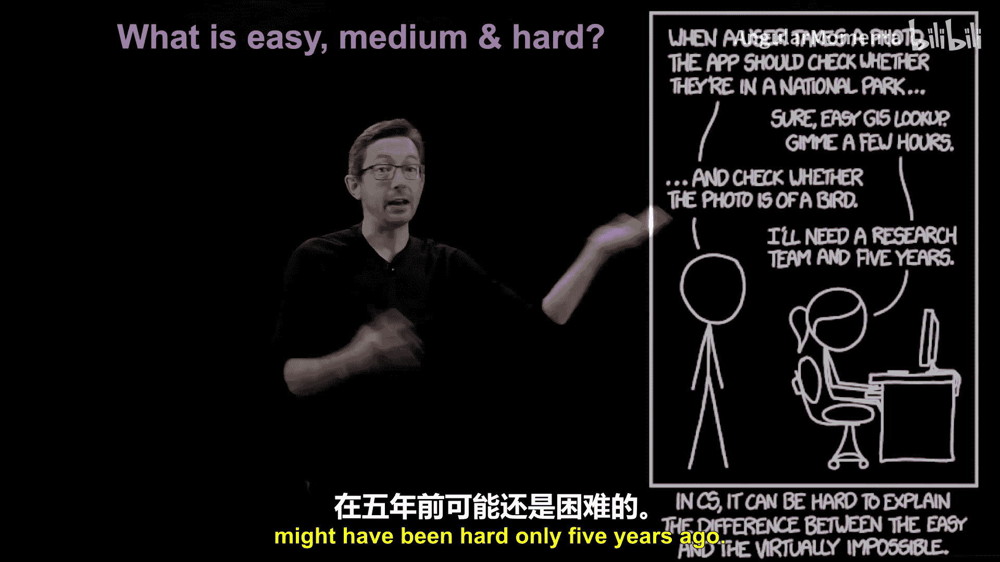

So facial recognition and image recognition in general is one of these fields that in the last 10 years has went from being kind of the frontier challenge to being a solved problem broadly speaking in machine learning so you can very accurately tell if an image has faces and you can classify who those faces belonged to so we just went to our daughter's school musical and my wife held up her phone to take a picture of all of the hundred people in the cast and in real time immediately it saw from this tiny tiny image which one was our daughter and recognized her out of all of these people in real time that's essentially a solved task 10 years ago that was the frontier of modern machine learning research。

The reason this has essentially become a solved problem is because of the development of INet and the training of a deep neural network to solve the imagenet classification problem in the 2010 to 2012 timeframe。

 where essentially and what I want to point out almost all of the attention goes to the INe trained neural network that actually classified all of these images that essentially was a neural network model to classify all of these images into their various categories。

 in my opinion， the real hero of this revolution 10 years ago where we got humanlel classification performance with a machine learning model was actually because of the INe data set in 2009 so this was Feif Fei Lee's group。

And essentially they put together this very， very large labeled training data。

 I believe it was millions of images， thousands of categories， many。

 many examples per category of handlabeled training data that then enabled the training of the Inet neural network。

 and so both of these are important， but it all started with this painstakingly meticulously labeled training data。

 so I think that's a really important thing for us to remember is it usually all starts with the data。

 and then training the model I would say you the neural network that built the classifier was inevitable once that training data was on the market。

Now what has happened， why was this possible in the 2010 timeframe to make such a big leap in training neural networks。

 just a couple of years before nobody was talking about neural networks as a serious machine learning paradigm。

 all of industrial machine learning was essentially decision trees， support vector machines。

 things like that。So in this timeframe。There was this rapid acceleration of compute power。

 especially paralleled compute power in the form of graphics processor units that are very well suited for neural networks。

There were dramatically better algorithms to train and optimize the weights of these neural networks to fit the training data in that time period。

And a huge amount of industry investment into the open source software and pipelines like TensorFlow and Pytorrch。

 again， around the last 10 years， and this culmination of a massive， massive。

 increasingly large data sets， high performance computing。

 better algorithms to train these models and industry investment have really been the catalyst that has caused this huge acceleration of machine learning we've seen in the last 10 years。

 and this is where most people would say that the modern era of machine learning started was this imageNe breakthrough in image classification。

Now it's not perfect， there are still issues with automated classifications。

 so you know the blueberry Chihuahua or the fried chicken dog are two kind of good examples where you know maybe it's not perfectly able to classify all of these images。

 but I would argue that you know definitely humans don't have perfect ability either。

 okay and this is more just a joke to show kind of things have gotten so far that you really need to look at edge cases before these algorithms even remotely break。

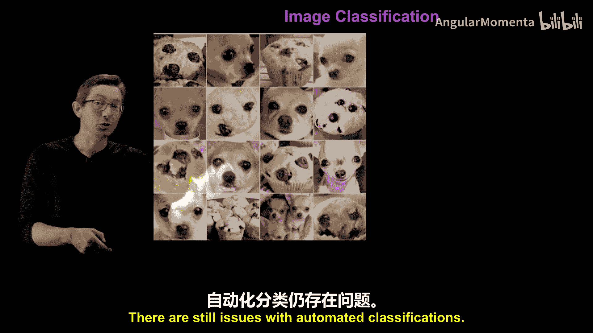

So image classification was a major breakthrough you know just over 10 years ago。

 surveillance then became a target because it's easy to classify images but moving sequences of images。

 movies， it's a lot more data so it's a lot more data intensive to process that in real time now surveillance is essentially a solve problem。

 it's easy to segment images in real time into different components and track objects and tell what changes and what's novel。

 things like that。嗯。Generative images was a big push in the last 10 years as well。

 so the left column these are real images， kind of the left and third column are real images and the second and fourth column are computer generated。

Versions of those categories， so these are all fake flowers， fake harvesters， and fake broccoli。

And unless you look really closely and zoom in， it actually does a really good job of kind of fooling at least your broad sense。

 if I look at it out of the corner of my eye， these do look like you know。

 tractors and harvesters and things like that and you have to look closely before you can see that they're actually not real and this one's even better。

This image is at least five years old， things have gotten way way better in the meantime for image generation。

 now we have deep fakes， you can completely generate a fake movie of a person that's pretty hard to tell fake from reality。

And again， about five years ago， image captioning became kind of an interesting topic。

 so you would show a picture to one of these machine learning algorithms and it would try to come up with a sentence thats summarized or captioned the image。

 and you can see here it does a really good job， man in black shirt playing guitar。

 it's definitely a man in a black shirt playing a guitar。

 construction worker in Orange safetyfe us working on road and so on and so forth。

But in 2017 it wasn't perfect。 there were plenty of examples where it failed miserably。

 This is not a young boy holding a baseball bat。 this is the ugliest cat I've ever seen and there is no horse to speak of standing in the middle of the road so not perfect circa 2017 but again in that last five years something that was hard has become dramatically easier to the point that this is almost a solved problem and we are now working on the inverse problem so taking a prompt or a sentence。

 machine learning algorithms like Dolly can now generate very。

 very compelling original images that fit that caption so Dolly too I started playing around with this you know over the summer just typing in random prompts and I didn't do anything special to get these amazing images so guitar monster。

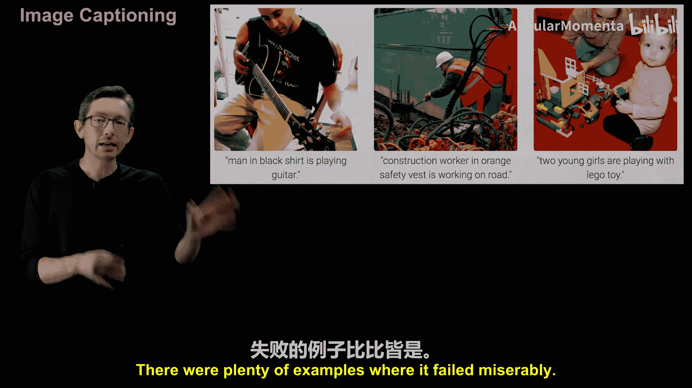

And a cat submarine chimera， these are the images that Dolly generates just from those prompts and I'll point out there are two ends here because my old laptop。

 the N key stuck， so I think that the double n is essential for the texture of this guitar monster。

But all joking aside， if you think about how impressive this is right this is a very cool artist' rendition of a monster playing the guitar。

 notice that the guitar is also a monster， it's really a guitar double end monster very。

 very cool so something that was unthinkable five years ago is now commodity right you can you can log on to Dolly to and do this yourself right now today currently I think you know it's very。

 very cheap to generate an image from a text sequence so used to be impossible now it's easy。

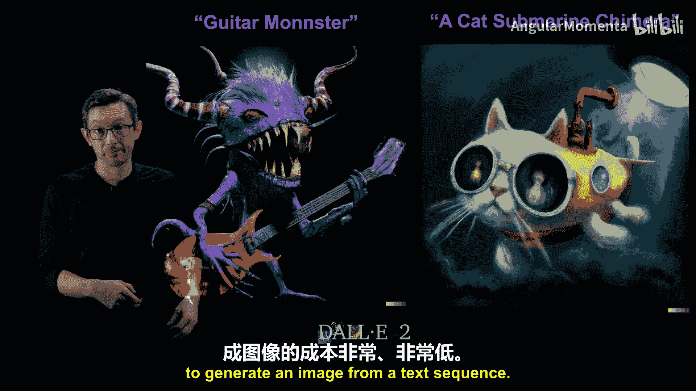

And this is the trend in pretty much all of image sciences， so this is actually from 2019。

 the Samsung。Skulcovo Institute of Science and Technology collaboration where they essentially showed you could take a single still image like the Mona Lisa and you could essentially do this transfer learning and kind of texture transfer where now you can make this come to life as if the Mona Lisa was speaking so 2019 pretty recent but also a lot has happened since then。

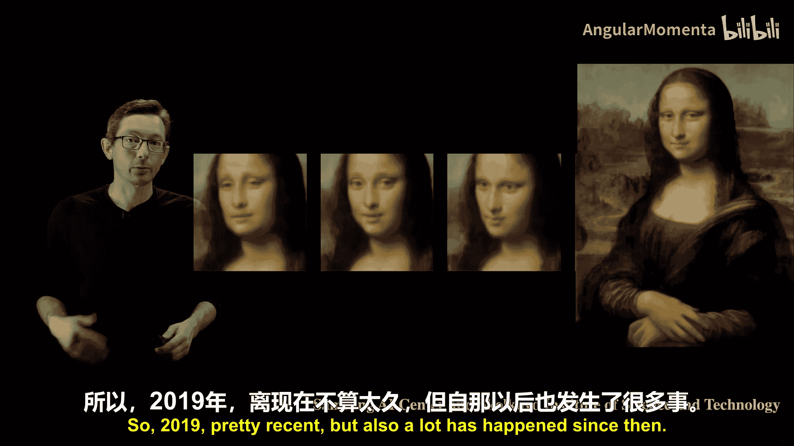

I like to think about this if I go back in time， I remember when Google came out with their deep dream。

 which is this deep generative dream kind of before all of this technology I just showed you。

 where it would make these really weird pictures， you could take an image and kind of decompose it and recompose it so it was made out of geckos or lizards or puppies or flowers。

And it hearrkkenens back this idea to this Archimbaldo's La Pria Vera， so he was around in the 1600s。

 he was in Emperor Rudolph II court， essentially supported by that dynasty。

And it's this really interesting idea that you can decompose a complex image into its abstract pieces。

 and now this is something that is relatively standard capability with machine learning is to transfer the texture over so you could paint this in the style of Van Gogh or any famous painter you like。

And so we're thinking about this， this is kind of the deep dream of this archimaldo's La Primavea by Calhoun Press I really like this if you actually download this Gif and pause the frames。

 you'll see that there are different decompositions of this in terms of like peacock feathers or puppies or things like that。

And so one of the open problems today， one of the things we're actively active research that's hard today that we hope is going to be easy in five or1 years。

 is this same idea of kind of texture transfer we want to start applying to physical systems like fluid flows and engineering systems。

So here I have a really low Reynolds number， simple simulation of a simple fluid flow past an obstacle pasta circular cylinder。

 this is our you warm up benchmark problem in fluid dynamics to compute lift and drag and things like that。

And with commodity off the shelf algorithms， you can do a texture transfer I can repaint this picture in the style of famous artists and so that's easy what we want to do is we want to repaint this fluid flow in the texture of a much higher Reynolds number fluid flow so what I want to do is I want to know from this base image what would the flow look like if I cranked up the flow velocity to something that is realistic for an aircraft or if I cranked up the mock number to something that's realistic of an aircraft that's much harder to do and we not only want to do it so it looks good to the eye we wanted to be quantitatively accurate as well so for example we want you know mass momentum and energy to be conserved when we do this style transfer。

And so that is currently hard today， but researchers across the world are working on solutions to do that for fluid flows。

 for materials， for all kinds of physical systems where we have both f equals MA physics。

 and we have lots of training data where we might actually have examples of this flow at low speed and high speed to do that transfer。

Hard today， hopefully not tomorrow。

Lots of other things that are difficult for computers。With showing you lots of image examples。

 there's also natural language and text and speech and things like that。

 so I think the next great American novel is going to be something that will be quite challenging for an AI agent to generate I think it's unlikely for a computer to have the kind of deep insights into society that。

 for example F Scott Fitzgerald could have had in his era。

 unless that AI has a body and has the ability to go and interact。

That's not to say it can't generate some types of fiction we don't know who knows。

 maybe in five years this will become much easier than I thought it would be。

 maybe it's still going to be much harder than we thought it would be we don't know。

 but you know writing the next great American novel。

 I'm going to be you know cautiously pessimistic about that capability。

This is actually machine learning generated fan fiction for Harry Potter。

 bunch they took all of Harry Potter and they took a bunch of fan fiction and basically generated an algorithm that would generate new fan fiction Harry Potter text It's not terrible。

 it's not very good， but it's not terrible， you can always pause this and read some of the lines are awful some of them are actually kind of cute Ron's Ron sure it was just as bad as Ron himself I don't hate that that's not bad but you know there's still a long way to go and this was a couple of years ago。

Earlier than that， it was shown that you actually can use kind of these generative algorithms to build fake conference papers。

 academic papers that would get accepted to top journals and conferences。

 and so it's unclear to me if this says more about the machine learning algorithms or more about the state of academic publishing。

 but there are absolutely you know anything that is really rigid and formulaic and structured like writing an academic paper。

 you have more of a shot of being able to automate and train an algorithm to kind of recognize those patterns and regenerate those patterns。

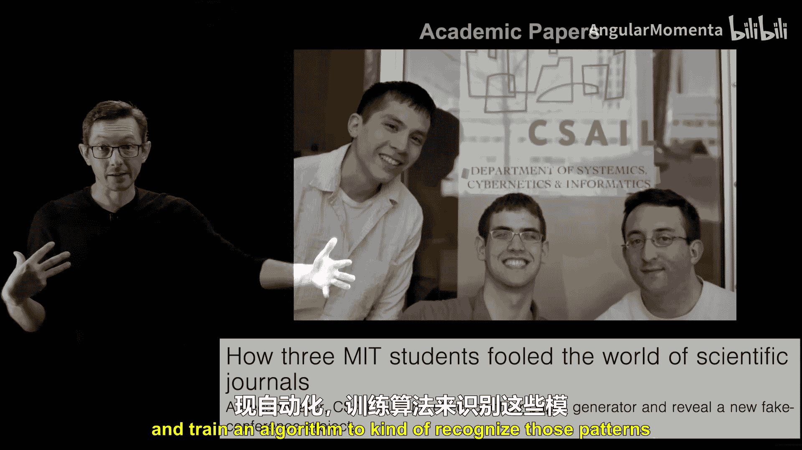

But again， these are all old examples， just in a very recent time。

 chat GT and large language models have kind of revolutionized the art of the possible dramatically advancing our ability to generate human consistent natural language in a way that is much much faster than we thought would be possible。

 we being kind of the general community， I think it surprised most of us。

 so here's a cool example I got from from Bing Brenton。

 there's this famous Samuel Taylor Colleid poem about Xannadu。

In Xnadu did Kublican a stately pleasure dome decree。

 where Allf the Sacr River ran through cavern's measureless toman down to a sunless sea。

 beautiful little stanza of a poem， Now the way the story goes。

 Samuel Taylor Coleriddge wrote this down just before falling into an opium stupor and when he woke up。

 he couldn't remember the rest of the poem， so this is a famous unfinished poem and lots of people have speculated how this might go。

 what it could have been like。But some researchers ran this through chat GPT3 and it actually completes the poem in the style of Colleidge starting with this prompt。

 and again， it's not perfect， but it's really not bad at all。

 you can pause this and you can read it yourself， but this is a major breakthrough these large language models are a major breakthrough in the capabilities of the art of possible with natural language processing and human realistic generative text and this is likely going to change。

Many， many of our daily pursuits， right if you want to write a technical manual。

This can help write that technical manual faster if you want to write unit tests for your codes or auto documentation for your codes。

 this is going to help do that faster， this helps us write emails faster autocomplete codes as a kind of copilot tons and tons of things and we're just scratching the surface of what these large language models are capable of and again this slide is only a couple of months old。

 already out of date right now we're on GPT4 and these are only going to increase in their complexity and sophistication in the years to come。

So something that was really， really hard。A couple of years ago。

 now it's accelerating at really rapid pace。Okay， large language models， huge， huge field。

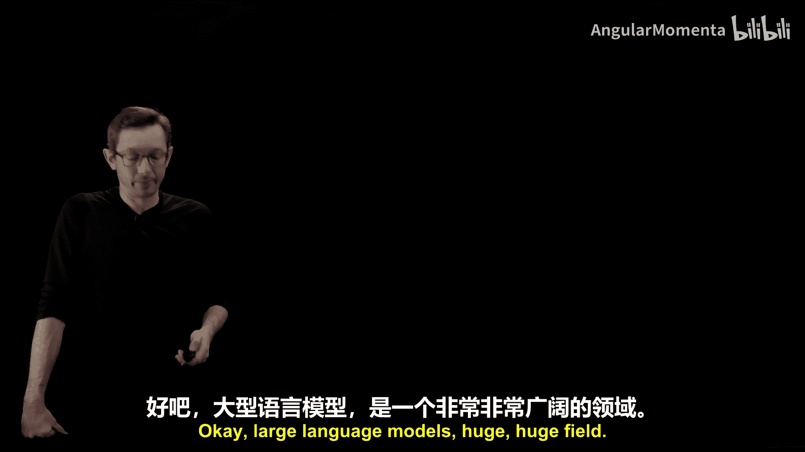

Moving to other systems， I think this is kind of interesting。

 there is this more of X paradox which is it's easier to build a computing system that will beat a human at chess than it is to actually pick up the chess piece and move the piece dexterously across the board so I think there's an example of you know a competition between a boy and a computer chess agent and the computer chess agent also had a robotic body that would move the chess pieces。

And at some point， it accidentally broke the kid's arm and that's how the game ended。

 not because it beat it at chess， but because it was so horrifically bad at moving the pieces that it kind of disqualified itself through gross bodily harm。

So things AI is good at， it's good at math， it's good at games， now it's very good at language。

 things it is not good at yet are sensing and interacting with the world and so there's this idea that you know this kind of AI brain it definitely is developing the capabilities are advancing rapidly。

 but the kind of body sided things are not advancing nearly as quickly robotics you know super exciting area。

 lots of progress， but the advances in the robotic body are not happening as striking or as fast as the advances in the kind of robotic mind and I think this is going to be in the future a big distinction。

Is that there are certain things you need to interact with the world to gather the information。

 to be curious， to really enrich your models beyond math。

 games and language we'll see again currently hard。

 maybe in five years this will be easier than we think it is。

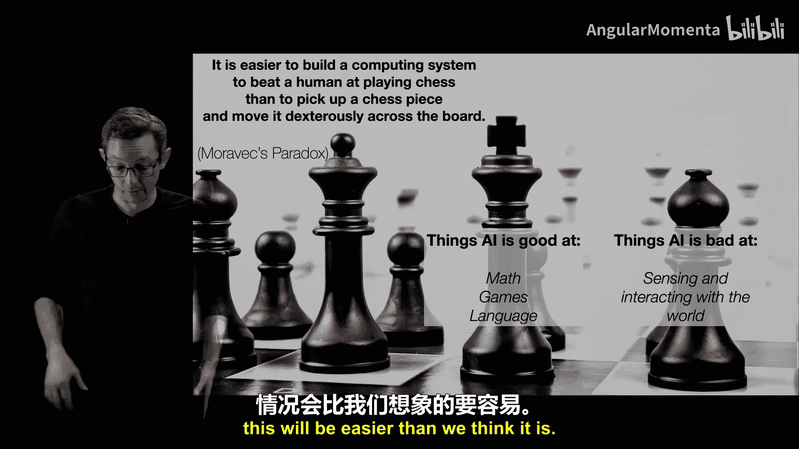

And there's a lot of good examples of machines being very， very good at games， so 2015。

 there were these extremely advanced demonstrations of reinforcement learning by Deep Mind。

 essentially a deep neural network Q learning algorithm showed that it was possible。

To play most old Atari games at or above human level performance， this was pretty impressive。

 so this is a classic game。I think it's called blockout where essentially it's like pong。

 but it's a one player pong and you're trying to break this rainbow array of bricks by bouncing this dot back and forth。

So， you know， after a few minutes of gameplay， it can play poorly， but it can at least， you know。

 the hit the ball with the paddle you know， moderately often after two hours。

It is very reliably able to position the paddle to hit the ball and it's able to eventually get a respectable score in this fairly repetitive task game。

 you know it's doing probably better than I could do with a similar amount of practice。

What I think is remarkable though is after four hours of training。

 that's not a lot of training right， like when I was a kid I would play four hours in one sitting。

It learns something that only expert humans get， which is that if it just drills this left side here。

 watch it， it's just really trying to focus on this left side over here。

 if it drills this left side then the physics of the game take over and solve the problem for it that is in my opinion an actual kind of interesting innovative leap in the learning process。

 that's a form of weak form of intelligence when you learn kind of the physics of a system and how to help it assist your goals。

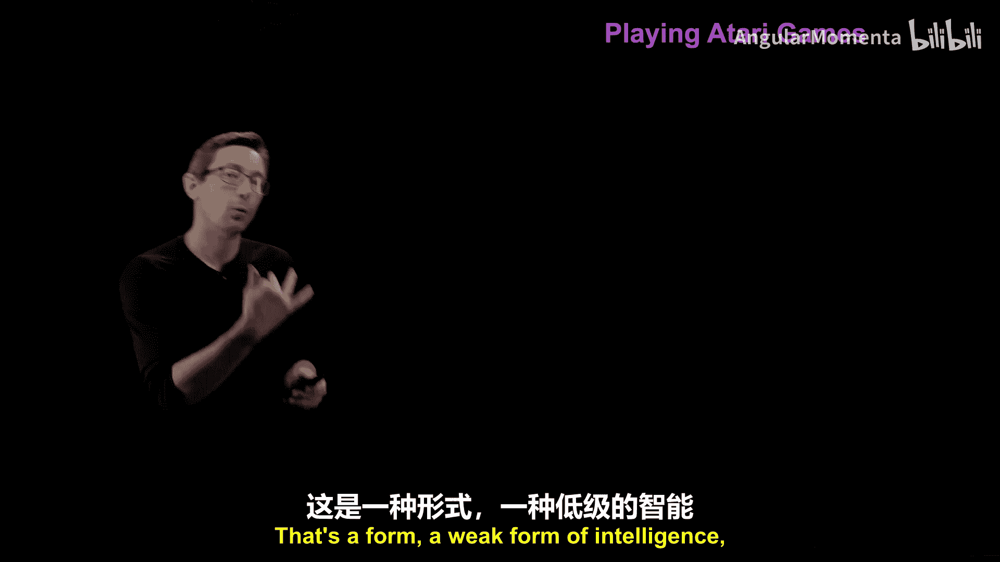

Reinforcement learning in general is a really exciting area， lots of progress。

 this is not going as fast。As many of the other fields。

 but you know humans no longer can beat computers at chess or go because of reinforcement learning。

 reinforcement learning is getting to the point where it can help us in robotic scenarios as well in robotic control systems。

 so this is a form of imitation learning。

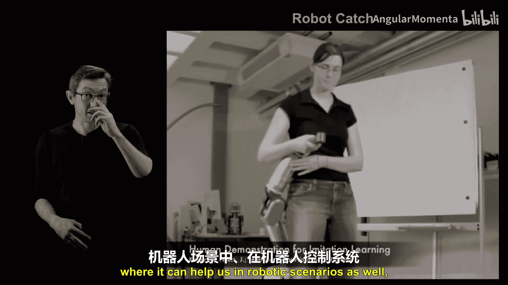

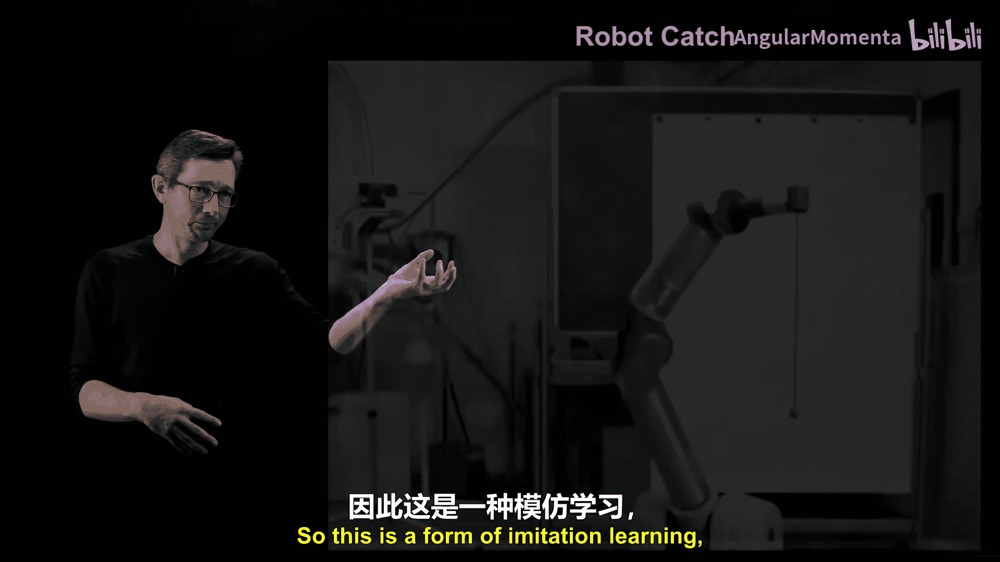

Where're essentially the robot is trying to do this catch a ball and a cup maneuver。

And with a little bit of human guidance and a number of repetitions。

 here's the policy after 15 trials， it can actually do a decent job。

 it can get close to catching the ball in the cup after 25 I think it's something like after 50 or 100 trials it'll actually be able to get the ball on the cup。

 it's not perfect yet， but that's actually pretty close to what I would call human level learning rates if you give a ball and a cup to a you know seven year old。

 I bet it's going to take them 50 or 100 times before they reliably can learn how to get the ball in the cup。

Now they're not going to have to be against a white background with a high resolution camera mounted perfectly。

 they're going to be able to do this while they're you know walking down the street or in a new environment。

 but still baby steps for the robot。

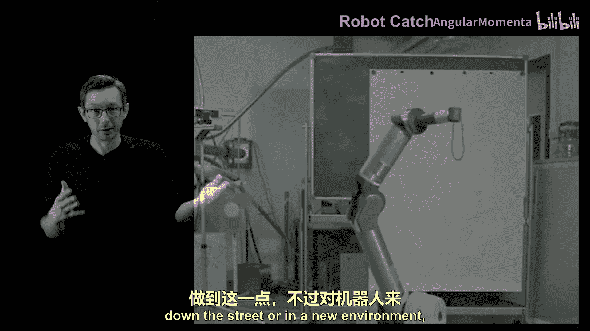

And there's plenty of examples， for every example of a new innovative reinforcement learning algorithm actually working on a game or on a robot。

 there are a million examples of things failing， this is 2015 so there has been a ton of progress。

 you know Boston dynamicsynas is way better than it used to be。But robots are hard。

 robots are one of these very challenging cases， especially for machine learning。

 we'll talk about this later systems like Boston Dynamics are largely physicsbased models painstakingly tuned learning algorithms struggle in robotics and in the last five years there have been major advances so it's not all just falling over when it tries to open a door but I just want to remind us that a very short time ago this was an impossibly hard challenge and the field is moving very rapidly it's getting a lot better but there's still a long ways to go。

Good so we've covered images， we've covered language we've covered robotics and games I just want to point out there are some things that are always going to be hard。

 they are mathematically hard and there's no way around it so predicting chaotic systems there are limits to what we possibly can do regardless of how good the model is to how well we can predict the evolution of a chaotic system like the path of a hurricane or like what the weather is going to be like next Thursday these things are kind of hard by the mathematics and the physics of the situation and so there is a bound on how good you can do given certain measurement fidelities and things like that。

😊。

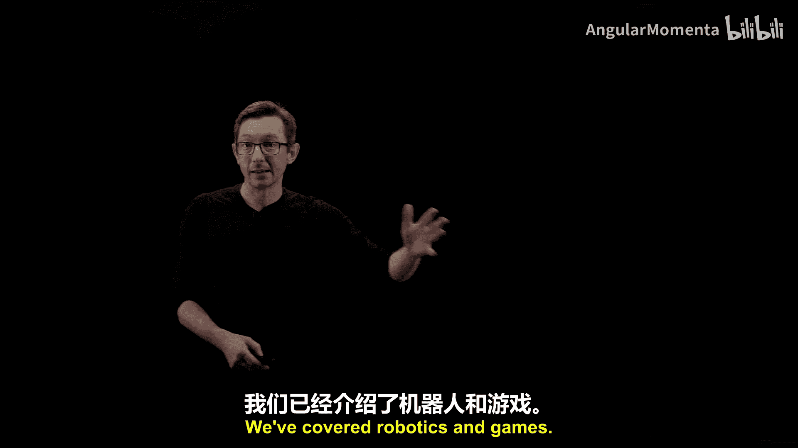

There's also caveats， sometimes there are unexpected consequences to our machine learning models。

 so this is just a kind of cute example I found where you know on Amazon， let's say you want to buy。

This item will'll let you imagine what this item is and it automatically suggests that you probably want magnesium ribbon and aluminum powder in addition to this item now I can tell you from my checkered past that this is a suggestion for the recipe to Theite so you know and the reason is is because this was a pattern that was in the data enough people that bought this we're actually going to make Themite that this algorithm suggests for you hey maybe you want to be making themite without thinking about the consequences so there are certainly other dimensions to this easy medium and hard there are things like can we put you know guardrails on these technology so that they don't give us unethical or dangerous solutions this is especially topical now in the chatGptT and large language model realm where you know there are real issues with having these language models be as eloquent and compelling as a skill。

HumanWhat could go wrong with that okay that's something we're working on now。

But I think that understanding just the landscape and the context of what is easy， medium and hard。

 how fast these have changed over the last 10 years and what are the current challenges we face today。

 I think that gives us a good chance of understanding how we can use these technologies where we need to develop these technologies and what are some of the ethical and kind of safety。

 critical ramifications of these technologies。Maybe just a parting thought for the engineers and the audience。

 for me， one of the big exciting frontiers in this machine learning research is taking all of these technologies that have been developed for things like image sciences and language models and transferring these over into the world of physics。

 systems governed by F equals MA systems that have rules and guidelines like aircraft or automobiles and you know for me that's a really。

 really exciting next。Task is advancing machine learning to solve scientific and engineering challenges。

 so of course that's my personal prerogative and that's where you know my lab works on our research but I think that is going to be a really compelling set of examples in the next5。

 10， 20 years。All right， thank you。

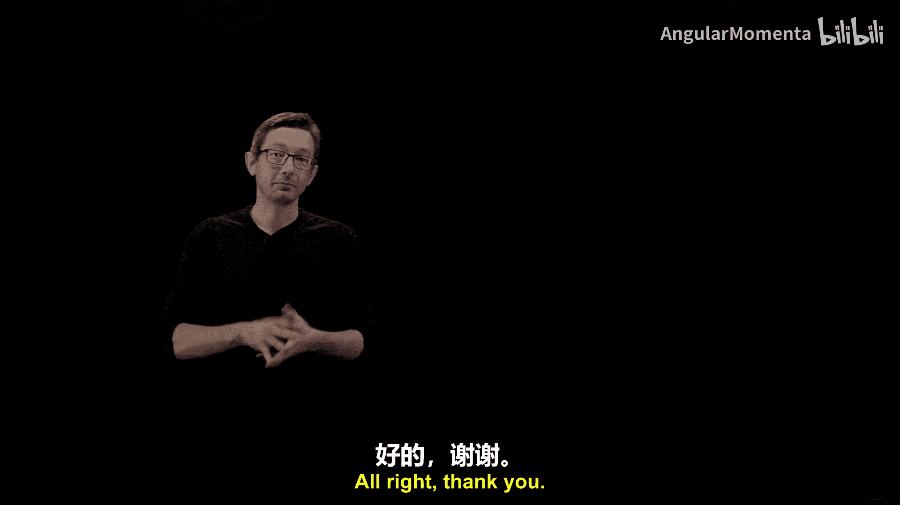