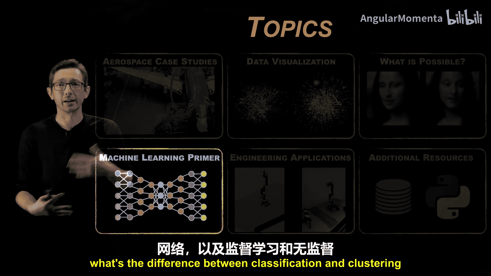
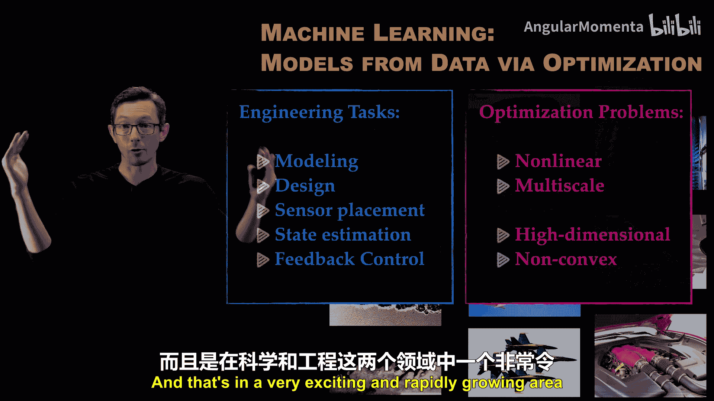
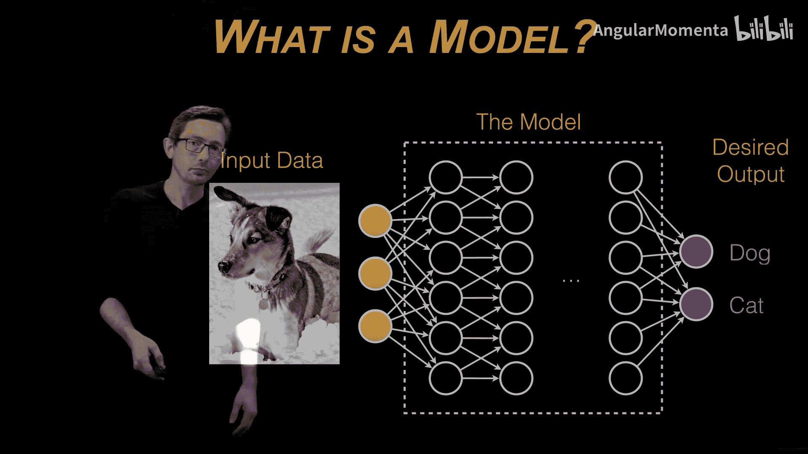
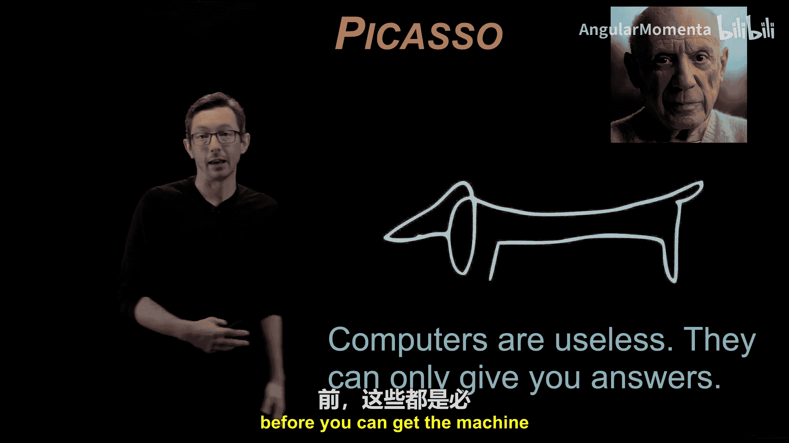
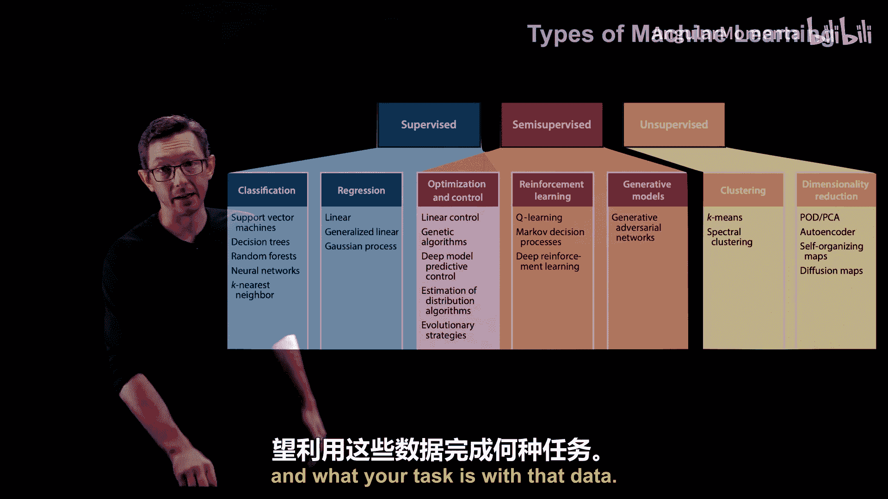
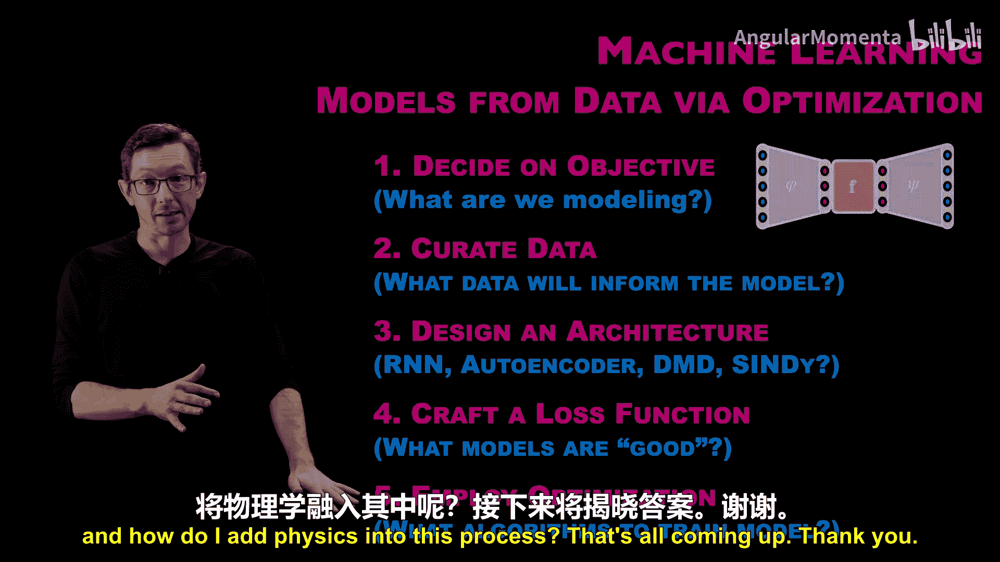

# 【精译】数据密集型工程导论-p16-16-机器学习入门：如何构建ML模型--BV1J8G3z1EHF_p16-

Welcome back。So I'm really excited in this next short sequence to walk you through a machine learning primer so essentially giving you the building blocks the kind of nuts and bolts of how machine learning works。

 how you build a model， really demystifying machine learning so that you can see kind of how these models are built。

 how they're trained， what are the types of models that allow us to do the amazing things we've seen like you know image classification large language models and so on so I'm going to dive in with an overview of all of the types of machine learning and kind of what it means。

 and then we'll talk about neural networks in particular。

 what's the difference between classification and clustering， supervised and unsupervised learning。

 things like that。

So I like to kind of show this joke movie really to give this idea that often when I talk about machine learning to a general audience。

 there is this feeling that machine learning is magic and there's this great Arthur C Clark quote any sufficiently advanced technology is indistinguishable for magic so my iPhone to some extent is magic to me because I take it for granted。

 it does amazing things and I don't really know how I know enough that I know that it's built on transistors and antennas and there's a battery and there's software like it's not totally magic but it can sure feel like magic and so what we want to do is rapidly demystify what we mean by machine learning。

I'm going to oversimplify。That machine learning in general is just the process of building models from data。

 and typically we use either optimization or regression algorithms to build those models from data。

Now when we say it this way， it demystifies what machine learning is。

 machine learning is just kind of input output models that perform some task。

And they are trained from real- worldor data using optimization and regression algorithms so that's not 100% true。

 but that's close enough to true most of the time that it's a good working definition and we've been building models from data for decades so this is something that we understand how to do even though machine learning is new and interesting because we have so much more data and so much better optimization algorithms and so much more representative and flexible models like neural networks that we can finally train on highper computing architectures。

 the idea of building models from data is something that makes sense to us。

And typically we build these models from data by solving an optimization problem and again。

 most of our engineering tasks that we think about on a daily basis， like modeling design。

 sensing estimation control at the end of the day those are hard optimization problems that have the same characteristics of high-dimensional nonconvex characteristics that most machine learning models have when we train them。

 when we train a deep neural network， it's also high- dimensionsal and nonconvex。

 and so these really do go very well together that we can use tools for machine learning to solve engineer and optimization problems。

 and that's in a very exciting and rapidly growing area of both science and engineering。

Good， so what is a model， I said the machine learning is a process of building models from data。😊。

A model is essentially， I think of it as a function that takes in input data and there are some output values that humans care about and the inner guts of how that function evaluates that input output model there is a million different ways you could represent that model in a computer in a program as a function but at the end of the day it's an input output program so in this example the input data might be a high resolution image of either a dog or a cat。

 this is our dog Mordecai。😊，And the input data would get fed into the model。

 the model would be some function of x where x is my input data。

And this model would do a number of computations on that data。

 it might run a little convolutional filter across it， it might look for ears and snouts。

 who knows what it does， it might be some complicated function and after doing all of this numerical evaluation at the output is going to be some desired output so for example。

 if I'm trying to build a classifier that tells dogs and cats apart。

 then my output might be a two vector with my probability of it being a dog and the probability of it being a cat and if I do a really good job when I put in an image of Mort the dog。

 then this vector should return a10 because it's very confident that it's a dog that's the kind of model we're talking about with machine learning。

And again the inner guts don't have to be a neural network， you could use a decision tree。

 a random for as a support vector machine， there's lots of different ways of training this input output function of representing this input output function it turns out neural networks are one of the most flexible ways of representing functions and so they're very widely used today。

 but neural networks is not all that there is to machine learning so that's a really important thing to take away as well。

I got this example in this image from my friend Nathan Cus and I really like this ever since he presented this example it's been in my head this picasso quote Comps are useless。

 they can only give you answers I think that's such an insightful connection Nathan made between this Picasso quote and machine learning it's the same with machine learning machine machine learning is useless。

 it can only give you model outputs you're the one who has to decide what are you trying to model what are the inputs and what are the outputs of that model okay and so there's still a lot of human expertise and human guidance in this procedure in this process of building these machine learning models you get to design the architecture you get to design what the model is trying to achieve you get to curate the training data and how the optimization is run these are all human questions that have to be asked before you can get the machine to generate those answers for you。

So。There are many types of machine learning and this is again only paltry classification into all of the different types there are more types of machine learning than just what I'm showing you here。

 but this is a rough categorization so some of the big breakdowns are between supervised and unsupervised algorithms and I'll talk a lot more about those later but the idea is supervised algorithms。

 the training data has labels so if I have a bunch of images of dogs and cats and I'm trying to build a classifier if all of those training data images are labeled by hand someone labeled them。

 this is a dog this one's a cat this one's another dog if they're labeled then the machine learning algorithm that you develop to tell dogs and cats apart is a classifier so supervised learning has labels and if I want to tell dogs and cats apart from labels I would build a classifier lots of techniques to do that support vector machines decision trees。

 random forests neural networks is a very。Powful way we do this today。

 but there's lots of options depending on how much data you have， what types of data you have。

 how interpretable you want it to be， things like that。In the unsupervised world。

 when I don't have labels， if I give you just a mountain of images of dogs and cats。

 but I don't tell you which ones which you might still be able to pull information out of that mountain of data and tell that there are these two large categories of different animals。

 but without the labels， this would be more of a clustering algorithm。

 maybe I would learn a cluster that mostly corresponds to dogs and another cluster that mostly corresponds to cats。

 but it's a different task， this is more like data mining from that data。

 what are the patterns without knowing the labels。And then there's a lot of stuff in the middle that we call kind of semiupvised where there's partial knowledge or partial labels or some of the datas labeled。

 things like reinforcement learning and generative models typically are in this kind of nebulous middle ground here。

And again， we'll talk more about all of these， but I just wanted you to know that there are lots of different types of machine learning。

 and it usually depends on what kind of data you have and what your task is with that data。

So before I end this kind of piece of this module on the machine learning prim where I just want to talk very at an abstract level what goes into training and building a machine learning model okay。

 so machine learning is the process of building models from data usually by solving an optimization problem and so I want to kind of just very briefly walk through these steps because later。

😊，We remember we are engineers and scientists， we are going to be doing physicsinform machine learning and building physical models from data。

 so I want you to understand all of the stages and remember you're going to be able to put physics you're going to be able to bake your prior knowledge of the physics and engineering principles into all of these steps。

So by far the first step， remember go back to that Picasso quote。

 the first thing you have to do is you have to decide on the question you're asking you have to decide on the objective。

 what are we actually modeling what are the inputs and the outputs of my machine learning model given what data。

 what decision do I want the model to make based on that data， that's a human thing to decide。

 this is where a human expertise goes into deciding this objective。

The second piece of this training is you have to get training data。

 it's not machine learning if you're not building this model from training data。

 so what data will inform the model， what training data do you have access to。

 is it labeled or not does it have the output of the function that you're looking for。

 what is the data I'm going to use here。The third step and this is kind of like the exciting step that a lot of attention goes into is designing the architecture am I going to use a neural network if so which type of neural network am I using a recurrent neural network or an autoencor am I going to use a linear regression technique like DMD What is the actual architecture I'm going to use to represent that input output function so I've decided on a function。

😊，Now I'm going to decide what is the architecture that could possibly represent the input output relationship that I'm trying to learn。

 is it a recurrent neural network or an auto encodecoder or so on and so forth？

Once we have an architecture， so this is kind of an example of an architecture。

 it's a specific neural network with a specific shape and structure that I think might be good for learning certain types of input output relationships。

😊，And once I've done that now I get to write down a loss function or an objective function that I'm going to optimize over。

 so this is how we tell if a model is good or bad is how well it scores on this loss function so low loss is better high loss is bad and so what I'm going to be doing is writing down essentially a mathematical expression。

In terms of my data and my input output function， how well it matches the training data that tells me if my model did a good job or a bad job。

 and then finally we actually have to employ some optimization algorithm。

 maybe I have to write my own optimization algorithm or maybe I use an offthe shelf optimizationr that essentially minimizes this loss function by changing the weights。

 tuning the weights of this architecture to best fit the data to satisfy this objective。

So this is all kind of a big procedure here that fits together。

 you have to choose what you're modeling you have to find data that will inform that model。

 you pick an architecture that you think can represent the function you're trying to approximate you write down a loss function or an objective function that tells if you did a good job after the training and then you optimize the weights of the architecture to minimize that loss function over the data that's the whole procedure of machine learning in a nutshell and all of these pieces are ripe with opportunities for a human expert to come in and flavor and steer this process。

 this is not an automated process， this is not turnkey no matter how much it looks like it from the outside。

 machine learning is a human endeavor， this is a tool for humans to model the real world from actual data and we get to guide all of these steps and the last point is。

If I have a physical system， if I have a system governed by F equals MA or some kind of engineering first principles。

 I often have opportunities to put in those first principles in each of these stages and make my machine learning model better and more physical bycon that's called physics informed machine learning and we're definitely going to talk about that in the context of engineering systems that's where there's a huge opportunity to really dramatically improve machine learning for physical systems and also to get lots more like performance and insights out of those you know maybe I want my model to be energy conservative if I'm modeling a fluid flow。

 I get to put that into different stages of this process。Okay。

 that's it for the overview we're going to start diving into what is a neural network。

 what are those differences between you know supervised and unsupervised learning and how do I add physics into this process that's all coming up thank you。

