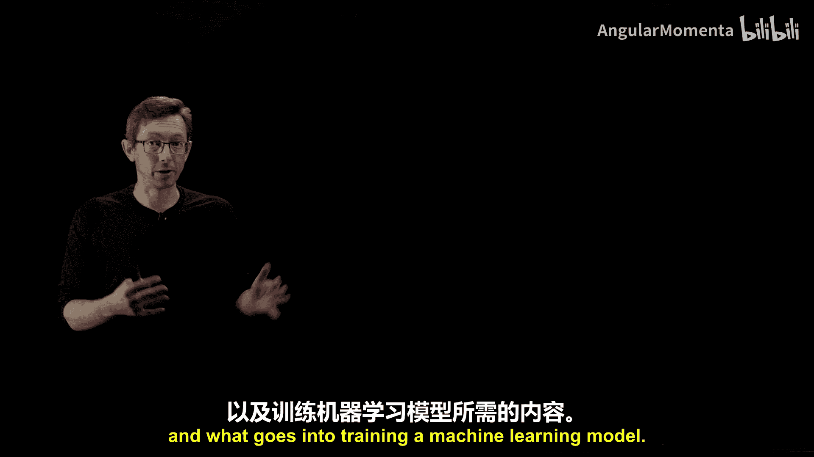
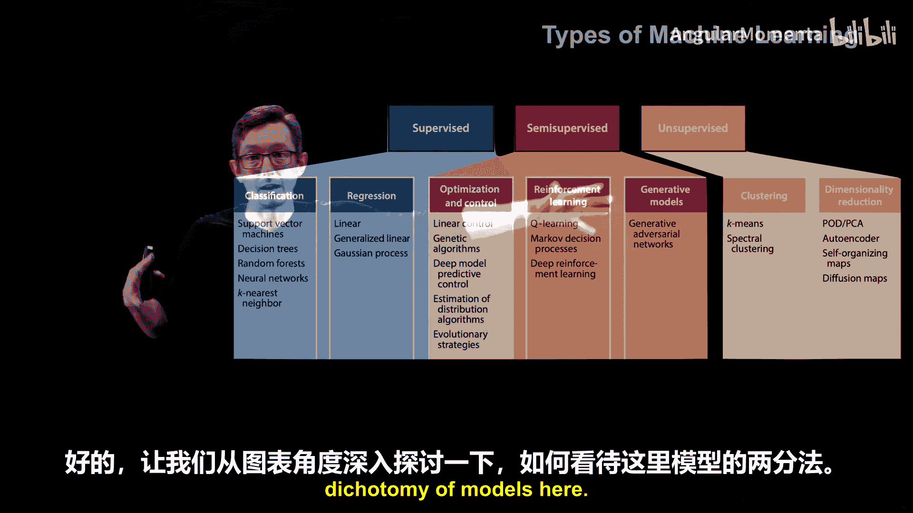
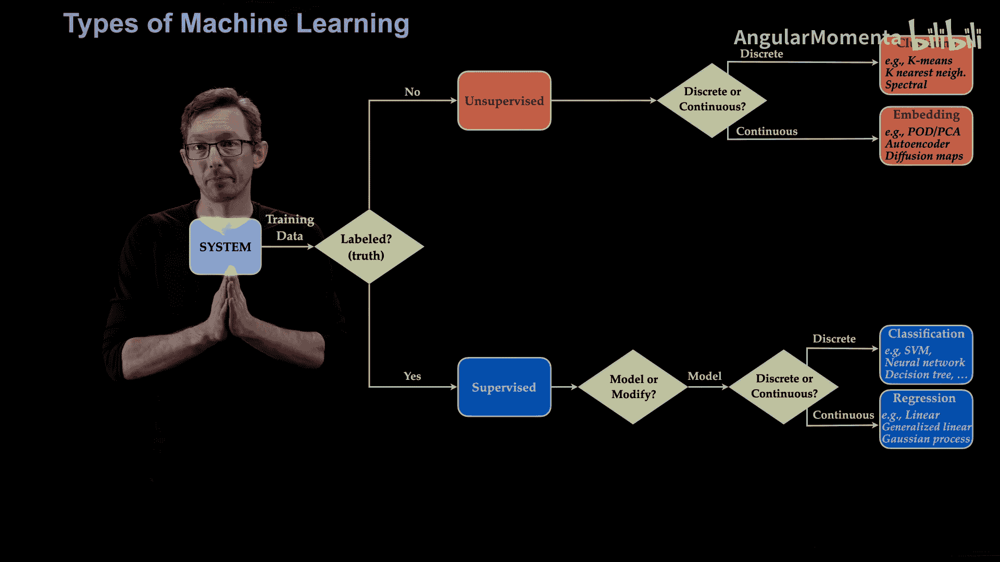

# 【精译】数据密集型工程导论-p17-17-监督和无监督机器学习--BV1J8G3z1EHF_p17-

Welcome back。So we are in our module on a machine learning primer and we're breaking down the different types of machine learning and what goes into training a machine learning model。

So I want to dig a little bit deeper into these different broad categorizations of what types of machine learning there are and what kind of factors go into choosing if you're doing a supervised classification problem or an unsupervised clustering problem。

 things like that so this is a very broad categorization and you'll notice that the kind of large dichotomy is between supervised and unsupervised learning supervised means that your training data has labels of the things you're trying to predict with your model。

 unsupervised means you don't have labels of the things you might want to predict with your model and I'll point out that there is this large kind of nebulous gray area in the middle between supervised and unsupervised learning and in fact this is where a lot。

And the most exciting research is happening is in this middle kind of semiupervised area。

 things like reinforcement learning， generative models。

 and so I'm going to dive into these different classifications。

Really important point oftentimes nowadays machine learning has become synonymous with neural networks。

 but you'll notice that in each of these subcategories of things you could do for each of these types of machine learning。

 it's not like there's just one big bold lettering that says neural networks all across all of these categories there are many。

 many types of machine learning model for classification or regression or reinforcement learning some of them use neural networks。

 some of them don't it depends on your problem so let's dive into kind of diagrammatically how do we think about this dichotomy of models here。

So machine learning always starts with a kind of system you're trying to analyze that is generating data。

 so we have a system， for me this might be you know a wing that I'm modeling in a computer you know simulation environment and the training data might be the lift and drag on that wing something like that okay。

 so you have a system and it's generating data。And the different dichotomies of what types of machine learning algorithm you get to use depend on the nature of this training data。

So for example， if the thing I want my model to predict is part of my training data。

 if I have labels on my training data that have not just the input data。

 but also the thing I'm trying to predict with my model which I call a label if I have a labeled truth if the answer is yes。

 then I'm doing supervised learning this is a whole category of machine learning called supervised learning。

 where I'm trying to build a model to recapitulate a knownlabeled truth on my training data。

 so that in the future I can deploy that algorithm on new data and it will give me similar labels as if it was labeled by an expert human。

If I do not have access to those labels of what I want my output to be。

 then this is an unsupervised machine learning task and this is much more like data mining。

 so supervised learning is more like trying to mimic or automate an expert system。

 unsupervised learning is more like data mining， I'm trying to learn patterns from my data that I can then use to build models to analyze future data。

And then let's just zoom into this supervised branch for a little while。

 then I ask myself the question if I do yes have labeled training data。

 now I ask is my label is the thing I'm trying to model on the output is it a continuous or a discrete variable and what I mean by that is specific。

 so by discrete label I mean if I'm trying to classify between dogs and cats that is a discrete categorization between two classes of object dogs and cats that's a discrete label and those tasks supervised learning with discrete labels are called classification tasks I classify between dogs and cats or between person A and person B。

If my label， if the thing I'm trying to model is a continuous variable， like the lift on an airfoil。

 which can be any numerical value， presumably。Then that is what's called a regression task I'm trying to regress to a continuous variable like the lift or drag on an airfoil and those regression techniques there's lots and lots of algorithms for regression there's linear regression。

 logistic regression， Gaussian processes and so on and so forth and so this is the main dichotomy is do I have labeled truth data or not。

 for example in that example of a lift and drag。If I had a bunch of simulations of different airfoils and I also had the lift and drag for those simulations that would be labeled so I'd be doing supervised learning。

 and I have a continuous label so it's a regression model that I'm building I would be building a machine learning regression model to predict Lyft or drag from future airfoils。

If I had that labeled training data for dogs and cats classification。

 I had a bunch of images of dogs and cats and I knew which ones were dogs and cats that would be supervised learning。

 and my model has a discrete label， just dog or cat and so that would be a classification task。

Similarly， if I take this other large path where I don't have labeled data and I'm doing unsupervised learning。

 I have the same question is my do I believe that the structure in my data is discrete or continuous and the way I think about this is if I kind of imagined plotting all of this data even if I don't have labels if I plot all this data。

 does it live in discrete groups or clusters or is it kind of continuously spread out in a distribution。

If I believe that my data lives in these discrete clusters。

 then my algorithm would be called a clustering algorithm going to try to learn the clusters that the data lives in。

And for example， if I had a bunch of images of dogs and cats， but I didn't have labels。

 I forgot or I lost my labels， I could still run it through this algorithm and use a clustering algorithm。

 maybe to learn that there is a large group of objects that are correlated with each other and another large group of objects that are correlated with each other。

 and I might in fact learn that there is such a thing as a dog and a cat。

I wouldn't know which ones called which you'd have to choose the names of these clusters。Similarly。

 if I believe that my data is not living in these distinct groups， kind of these clusters。

 but rather there is a distribution of data that would be called an embedding problem this one is a little bit more nebulous and there's not as well agreed upon nomenclature for this。

 I call it embedding， sometimes you just call this data mining in general or distribution learning that's another way to say it so for example。

 if I had a bunch of。😊，Data of flow fields from different airfoil geometries。

 but I didn't have the lift in the drag， I might believe that that data is still going to follow a continuous distribution and so even if I didn't have labels。

 I would still be doing this continuous embedding to learn the structures of those flow fields from data。

So those are the big two dichotomies is your data labeled or not。

 that tells me if I have supervised or unsupervised and is my label is my distribution。

 is my data or it's label continuous or discrete， that'll tell me if it's a regression or classification or an embedding versus a clustering algorithm。

Cool that's the main thing to remember here in the types of machine learning and there is this very important middle ground that's becoming more important every day if I have partial labeling partial labeled training data and this can mean a few different things it can mean that there is a larger label that I want to estimate and I only have some of the numbers of that like maybe I only have the lift but I don't have the drag。

Or maybe only a fraction of my training data has labels， maybe only 20% of my data has labels。

 that is also a type of partial measurement and there's many。

 many other ways you could have partial labels or partial measurements here and this is called semi superervised and it's kind of this nebulous middle ground between these two。

And here the dichotomy is not necessarily discrete or continuous， in my mind， it's more。

 am I just trying to model the system or am I also trying to modify the system because in a lot of cases I use machine learning models to then try to manipulate the system for some kind of a control objective or an optimization objective。

So if I'm only trying to model that distribution from this kind of semisupervised partial labeled data。

 those models are generally called generative models， so GNs fall under this category。

 things like deep fakes are essentially generative models based on partial labeled data。

If I want to modify my system， if I want to actually interact with my system and change the system for some engineering objective。

 that would be， for example， something like reinforcement learning and generally speaking that involves a feedback signal that actually takes the output of my algorithm and then modifies the system and changes how that data is being generated in closed loop so this is kind of an advanced but very exciting area of machine learning where it's really at the intersection of machine learning and control。

 you're actively modifying the system for some objective and you're also building models of that system as you're collecting data and modifying it in real time。

😊，And then you you can also have this model or modify dichotomy here in supervised learning so for example。

 if I just want to model the system that's the classical machine learning we talked about before。

 but if I want to modify my system I can use those same algorithms for optimization and control and so reinforcement learning I think of as being kind of a partially measured version of classical nonlinear optimization and control algorithms again this is not a hard dichotomy this is just something I found useful to kind of straighten things out in my head some of these lines are blurred depending on what algorithm you use。

😊，But the main headline here， kind of if you want one key takeaway。

 this is the main canonical picture of machine learning is that you have supervised and unsupervised learning and you have discrete or continuous labels or discrete and continuous data and that determines the kind of four major types of tasks that we typically think about in classical machine learning。

 things like classification， regression， clustering and embedding or distribution learning。

 and then there's this kind of fancier stuff you can do in the middle with generative models and reinforcement learning。

Okay good so again notice I have not drawn a neural network。

 I haven't really even talked about neural networks。

 many of these tasks you can solve with neural networks。

 many of these tasks there are lots of other powerful machine learning algorithms you can also employ depending on what kinds of data you have and what your objectives are so we'll talk about all of that coming up thank you。

