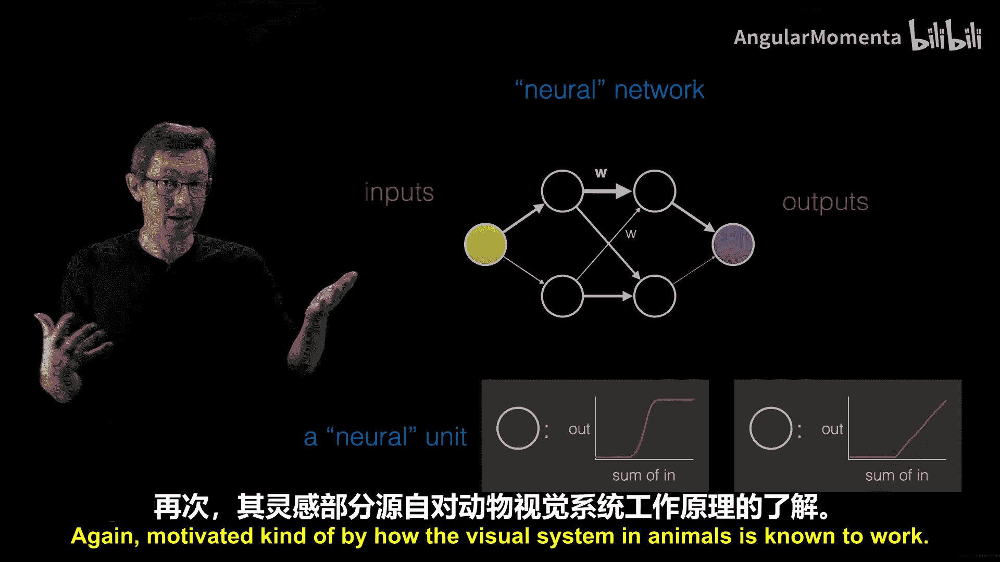
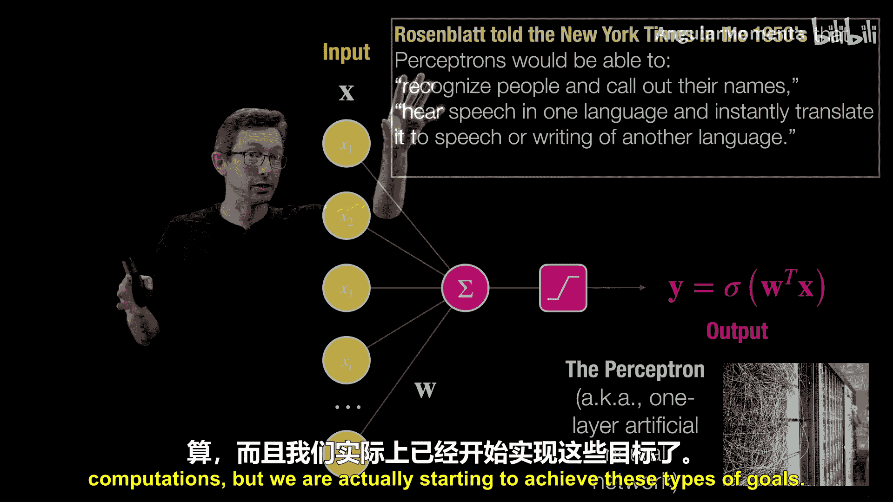
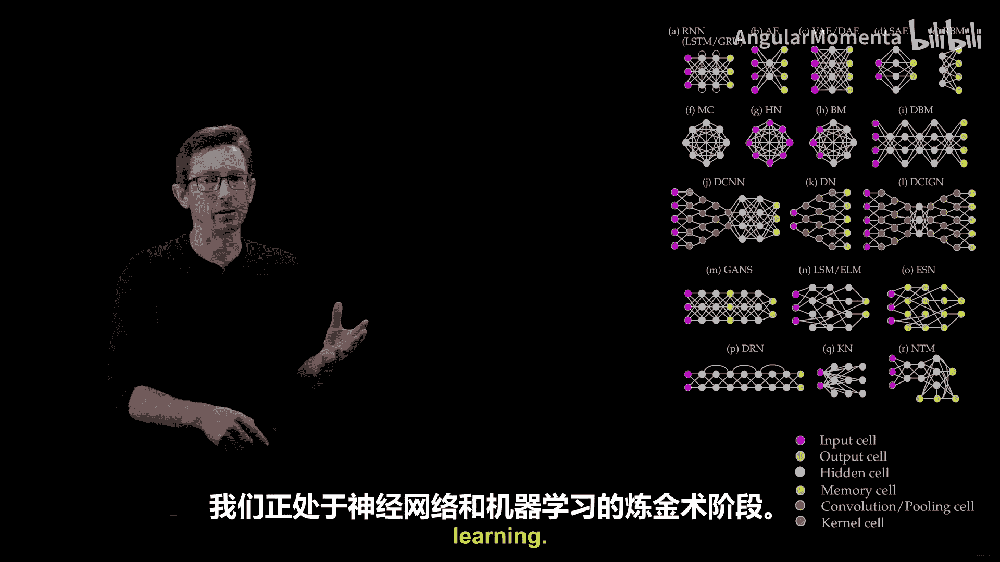
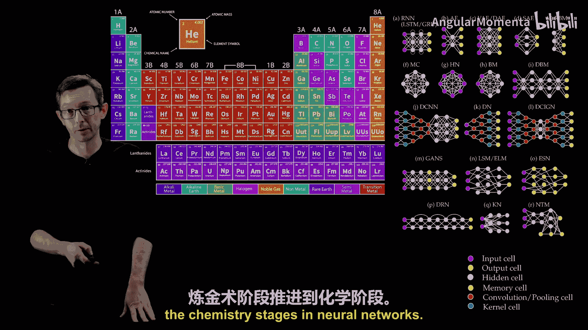
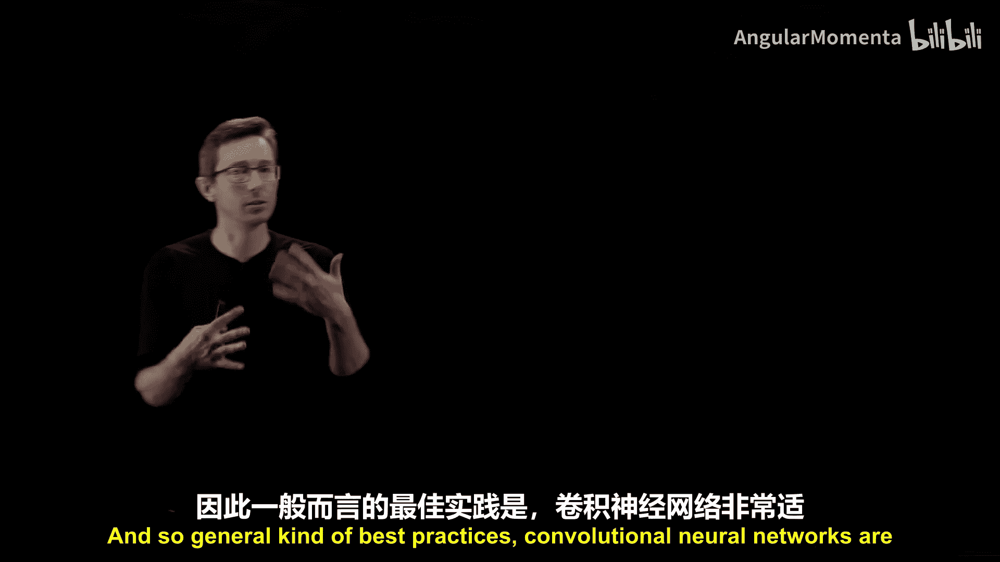
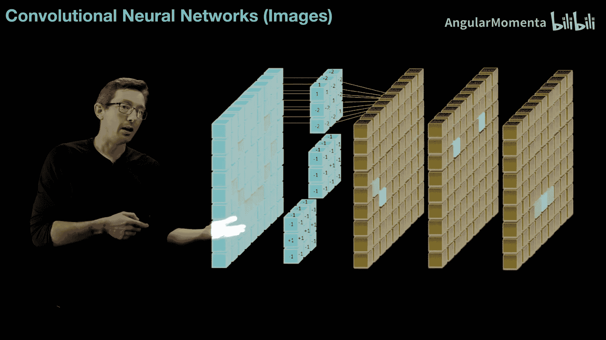
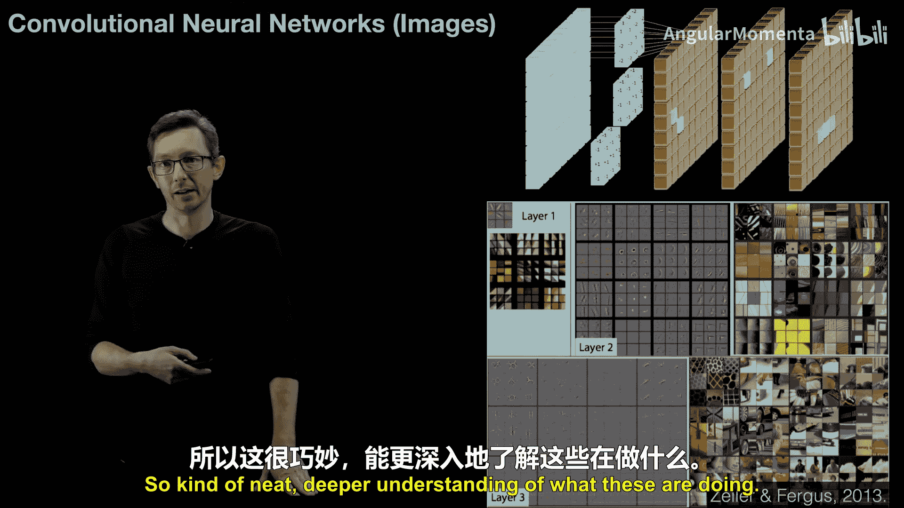
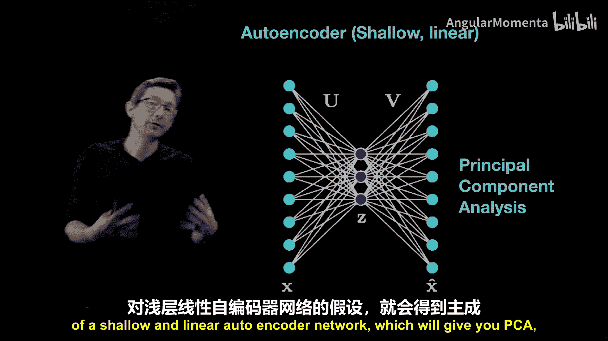
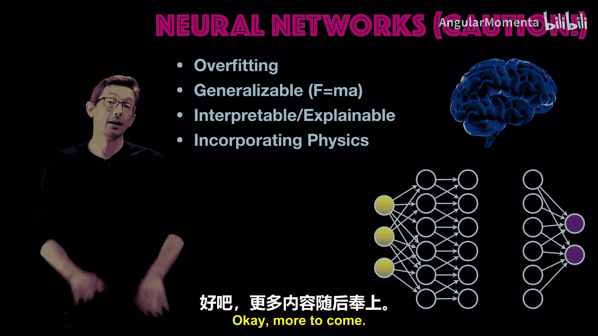

# 【精译】数据密集型工程导论-p18-18-神经网络入门--BV1J8G3z1EHF_p18-

Welcome back So we're talking about machine learning and the different types of machine learning。

 what is a machine learning model， and in this video I'm going to introduce you to neural networks。

 which is one of the most powerful architectures in machine learning。

So we're going to talk about neural networks， which interestingly， just about 10 years ago。

 these were barely talked about just over， you know in 15 years ago。

 these were barely talked about as a type of machine learning。

 most industrial machine learning was based on support vector machines or decision trees or some kind of other basic regression。

 and in the last 10 years neural networks have come to absolutely dominate most types of machine learning。

 most machine learning tasks from image classification to large language models to many physics and engineering applications。

 neural networks are a standard。Now neural networks are not the only type of machine learning。

 they are a very important type of machine learning One of the reasons that they're so useful is because they have this arbitrary function approximation property which means with a sufficiently deep neural network you can essentially approximate any function if you have enough training data and a large enough network that's really useful so they're very very expressive。

 they can capture multiscale features like for facial recognition or image recognition they can play on large and small features and they're very very expressive。

They've been around for a long time since the Perceptron in 1958 by Rosenblatt。

 but they really really took off recently in the last 10 years or so with the imageNe in 2012 again。

 this 2012 powerful demonstration that kind of revived neural networks was based on a massive trained labeled sorry labeled data set that allowed this to be trained so the data is equally important。

 but again with enough data， these are very， very expressive and powerful function appximators。

 so good candidates for machine learning。So what is a neural network。

 essentially a neural network is designed to be biologically inspired。

 at least originally you was inspired by trying to learn how animal learning occurs through a literal network of coupled neurons in a brain or in a nervous system。

And so the idea is that you have inputs and outputs。

 each of these circles is what's called a node or a neural unit。

 and essentially each of those nodes does some basic mathematical computation on its inputs and it gives an output。

 so a single neural unit will take data in the sum of its inputs and it will give an output that is a function of those inputs。

Classically the neural unit would be something like a sigmodoidal function or a hyperbolic tangent function because again that's biologically motivated our neurons。

 you know if they get little enough signal they don't spike at all if they have enough signal it's not like they can spike infinitely fast so there's some saturation and there's some region of kind of linear response in the middle but again that's just biologically inspired and that's not your only type of neural unit。

 there are other types of neural units， modern neural networks often use this thing called a a re。

 a rectified linear unit that essentially looks like this it's zero up to some minimum input and then it's linear afterwards。

And so each of these kind of neurons or nodes is stacked together into a neural network into a sequence of computations that builds an output from the inputs。

So you'll see that this data on the input and whatever this input signal is。

 it goes into these two neurons which do a computation。

 the output of those two neurons go into two other neurons。

 and the sum of these inputs is weighted and then goes through this nonlinear function and that gives me the output here similarly with this neuron and then those two are the input to this final neuron。

 which again does some weighted computation and that gives the output。So at its heart。

 this is really just a kind of nested composition of functions with some weighting that tells me how strongly these should be connected。

And usually these weights are the free parameters that you actually learn when you train a neural network model。

 you start， maybe initialize these with random values or something like that and you use。

The learning process to update these weights to update how this neural network is connected together。

And you know this one is a pretty simple one， you can have very， very tall layers， you can have many。

 many， many layers， and the idea is that each of these layers kind of does an abstraction of a computation。

 it kind of abstracts a very， very big computation into smaller pieces， again。

 motivated kind of by how the visual system in animals is known to work。😊。

So the Perceptron， which is the one layer neural network proposed decades ago。

 essentially takes an input vector， so you take your input data， whatever it is。

 maybe it's an image or a time series。It takes a weighted sum of that inputs。

 it runs it through this nonlinear function and it gives an output so that output is literally that sigmodal function sigma times a weighted sum of the inputs that's just a weight vector times x so mathematically this is very simple to write down。

嗯。It's kind of this cool quote that I learned from Bing Brenton， Rosenblatt， New York Times 1950s。

 saysperceptrons in the future will be able to recognize people and call out their names。

 hear speech in one language and instantly translate it to speech a writing of another language。

It took a long time for that vision to come to fruition。

 but this is very much like the technology that we're seeing today with modern deep neural network architectures。

 so they're not these shallow kind of one layer perceptrons now we have many。

 many layers doing this kind of hierarchical set of abstract computations but we are actually starting to achieve these types of goals。

Which is really cool and so the revolution between then and now is really the deep neural network or deep learning as we call it today and again。

 deep means different things to different people but generally speaking having multiple layers of abstraction of the computation allows you to have much more expressive architectures and much higher performance the caveat is now all of these free parameters that you have to learn require a lot of training data and really big really fast computers to train and to learn all of these free parameters。

 all of these connection weights to train this model to fit that data。

 so you need much larger data sets and much faster computers but we live in a wonderful time and we do have that data and we do have those computers and so we can train very deep very large neural networks。

😊，Usually you're only limited by how much memory you have on your graphics processor unit to fit all of these free parameters and modern architectures we're learning how to train in a distributed way across many computing platforms so you can have even larger models like these large language models like ChatGptT that we're seeing today。

So much more expressive because of this depth and complexity of the computation and again we know from how animals process information。

 for example in their visual system there are layers。

 literal actual layers you can see when you dissect of abstraction that maybe will identify you know translations or corners or features or edges and then they might abstract into bigger and bigger features that's kind of what the layers of this neural network do so one layer might find you know small features and then another layer might say。

 okay well I have these eyes and they're this distance apart and then the next layer might do another computation and you can imagine this thing getting hierarchically more complex with depth so deep neural networks are currently the strategy we use to solve really hard machine learning modeling problems in a lot of cases。

😊，And so there are many， many， many architectures out there， many different types of neural networks。

 this is actually an outdated figure， this is a figure from our book Data drivenrive science and engineering by myself and Nathan Cutz。

 this is inspired by the Ne Network zoo from the Asimov Institute and you can see this is just a small selection from the large menagerie of possible neural network Tos to solve different problemsble。

 so different architectures are suited for different problems。😊，And depending on your system。

 you might choose one of these。And so one of the big issues today。

 and this is an open outstanding problem， even though neural networks are super powerful。

One of the big open challenges today is currently picking and choosing and designing a neural network and tailoring it to a particular problem is very much like alchemy we're kind of in the alchemy stages of neural networks and machine learning what we would like to do is learn the chemistry kind of the we'd like to go from the alchemy of neural networks to the chemistry of neural networks and understand what are the physical principles that mean that an autoencor is better for one type of task than another or that I should use a recurrent neural network。

 but not this kind of recurrent neural network， this kind and so we are trying very hard in the physical sciences and an engineering to learn principles of how to pair machine learning models。

 neural network models with different types of modeling tasks， especially in science and engineering。

where we don't just want to try all of the algorithms and see which one works and kind of cherry pick the best one okay that's fine if you're trying to increase ad revenue and you know click through。

 but we really want better principles than that in the future。

And this is actually a really interesting motivation。

 so we feel like there is an opportunity to apply machine learning to physical systems。

 we can maybe build better fluid simulators or design better supermaterials with machine learning。

But there is also a dual benefit that when we apply machine learning to systems that have physics in some cases where we kind of know the answer that can give us a real ground truth that we don't have in other machine learning applications to really start to in a principled way understand and dissect what that machine learning model is doing and why one algorithm or architecture might be better than another。

 so this is an ongoing process trying to go from the alchemy stages to the chemistry stages in neural networks。

Now it's not like we don't know anything， we definitely are learning lots about what neural networks are good for what types of data and in what circumstances and so general kind of best practices。

Convolutional neural networks are great for images。

 If your data looks like an image and there's kind of spatial correlated structures。

 you probably want some kind of a convolutional architecture in your neural network。

 This is really good when you have any kind of。😊，Multi scale hierarchical organization in your image and also if you have things like translational invariance so if I have a classifier and I'm trying to classify if an image has a dog in the image。

It shouldn't matter if the dog is in one corner or the other corner or the middle and convolutional neural networks have this kind of built in translational invariant because you're taking these little filters and you're sliding them across your image looking for features anywhere in the image really good for images。

 convolutional neural networks， so that's pairing。嗯。

And you know there have been a lot of really interesting studies that have shown that these CNNs kind of again。

 just like what we vaguely understand about animal visual systems。

 they hierarchically pull out different kinds of features in different layers。

 so they might pull out know corners and edges and you know things like that in one layer。

 they might pull out shapes and abstractions in another layer and these representations might get more complicated as you have additional layers of these CNs。

 so kind of neat deeper understanding of what these are doing。

If you have audio data or data that evolves in time time series data。

 typically we want recurrent neural networks， so most of the neural networks we think about。

 most of the ones I've shown you are what are called feed forward networks so the information starts out on one side and just trickles down or flows for left to right in a feed forward fashion recurrent neural networks what they do is they take information from future from downstream nodes and they feed those back so that you get this feedback loop and feedback loops allow you to do things like have memory and model and learn and memorize time series trends that you would see in audio and general temporal data so modeling differential equations and systems that evolve in time you're going to want to use recurrent neural network architectures very useful。

Another one of my favorites is an autoencoder network。

 so if you have really high dimensional data like big images or flow fields or you scanning electron microscope images or acoustic data。

 whatever， large， large data， acoustic images。You might believe that there is low dimensional structure in that data。

 in which case， if you would have normally done something like principal components analysis or singular value decomposition to find those patterns。

You can also use an auto Encor network to learn those types of patterns。

Now I would not recommend training a neural network to do the principal components analysis。

 it's a very inefficient way of doing something that you can do more efficiently with linear algebra。

 but the reason I show this is because the classic principal components analysis that we've been doing for over 100 years can be visualized as a very simple neural network。

That has essentially one middle layer where you take your high dimensional data。

 you can press it down through this information bottleneck to a low dimensional state that is as small as possible so that you can reconstruct an estimate of the state from these very few variables in Z。

This gives you a lot of interpretability because these few numbers are possibly understandable by a human。

 and you can visualize these encoding and decoding matrices V with pictures。Now。

The reason I'm showing you this is because if you relax these assumptions of a shallow and linear autoencoder network。

 which would give you PCA if you allow yourself to have a deep nonlinearar autoencoder you can generalize principal components and instead of learning a lowdiional subspace Z。

 you can learn a lowdiional submanifold where your dynamics live or where your system lives on Z and often you can get much better compression and you still have highly interpretable models So autoencoders essentially are the generalization。

 a non nonlinear generalization of principal components analysis that allows you to find really useful interpretable lowdimenional correlated structures in your highdiional data so I use this all the time for physical systems one of my favorite architectures。

Okay， so that's just a mile high view of neural networks， what they are， how they're built。

 what are neurons， what are these computations， you know we do understand broad categories like CNNs and autoencors and you know recurrent neural networks。

 but there's still this very much an alchemy flavor to neural networks and so we need more principles to understand how to pair specific architectures with specific problems。

😊，Systems with physics， engineering systems might help us actually develop kind of those principles of how to apply them。

And I think I'll just end with some cautions because everyone gets so excited about neural networks myself included。

 we should remember that they're not built for everything and they're not perfect neural networks are notoriously prone to overfitting。

 which again， if I have a big enough network and enough training data， not that big of a problem。

They are often struggle with generalizability so if I train a neural network on images of a pendulum oscillating。

 it will learn to generate new images of penduula oscillating or if I generate you know if I train it on images of apples falling it'll learn to generate new movies of apples falling it's not going to learn f equals MA it's not going to be useful when we land you know design rockets to land humans on the moon you need to go beyond a simple neural network to get this generalizability that is a hallmark of physics interpretability and explainability these are very very complicated。

 they often have millions or billions of free parameter so it's very hard to understand how they work and how they come to their conclusions that can be a really big challenge when we're talking about safety critical systems like you know designing an aircraft or an autopilot or a self-driving car I really need interpretable explainable models and even more than。

Sometimes I need certiifiable models。I need to bound the possibility of what these models are actually going to do so that I can design safety certiifiable controllers and things like that。

And a lot of these issues of overfitting generalizability。

 interpretability can be partially solved by trying to incorporate physics into the learning process into the architecture into the training into the loss functions and optimization algorithms you use to train these and so that's a big area of research we're actively involved in it。

 I'll definitely talk about it a bit more in this series， but know if you want more interpretable。

 explainable， generalizable neural networks， generally speaking。

 we should take a cue from physics because when I say interpretable and generalizable。

 know you should be thinking， hey F equals MA is a pretty good example of that。

 how do we bake that kind of model into a neural network。Okay， more to come， thank you。

