# 【精译】数据密集型工程导论-p19-19-机器学习的高级工程应用--BV1J8G3z1EHF_p19-

Welcome back so we've been talking about data intensive engineering in this short focused intro series and now we're talking about engineering applications so we know what machine learning is and data visualization in general and we've looked at some motivating examples and case studies in aerospace now we're going to zoom into some advanced engineering applications in general and think about things like the importance of embedding physics into the machine learning process and what it looks like to do machine learning for physical system data okay。

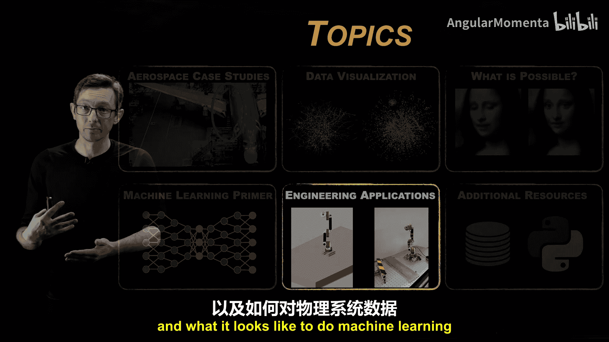

So we've already seen cool examples from materials discovery like designing super alloys from training data。

 this is one of many examples of kind of advanced engineering。

 relevant technology that can be developed with machine learning technologies。

 highdimensional nonconvex optimization space if you want to design an advanced material that is heterogeneous。

 anisotropic and multiscale like biological materials like teeth and bones and hair and fingernails。

 and you can start solving those optimizations using machine learning models。

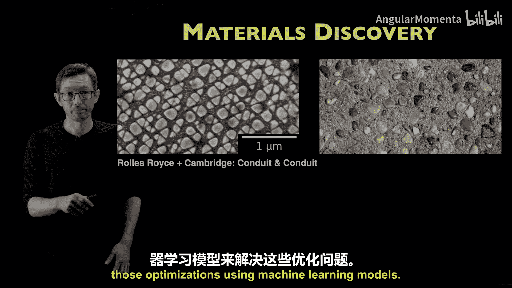

And。There is kind of another motivating example in engineering of where machine learning fits in。

 so we have these two classical paradigms of autonomy。

 you have the physics-based paradigm which is what has typically been used for things like robotics。

 if think Boston dynamics mostly painstakingly derived physics equations that are used for these controllers whereas for self-driving cars usually this is much more of a machine learning paradigm computer vision and things like that。

 so you know really advanced and impressive performance in both systems but two almost completely different paradigms of physicsbased and machine learning based autonomy。

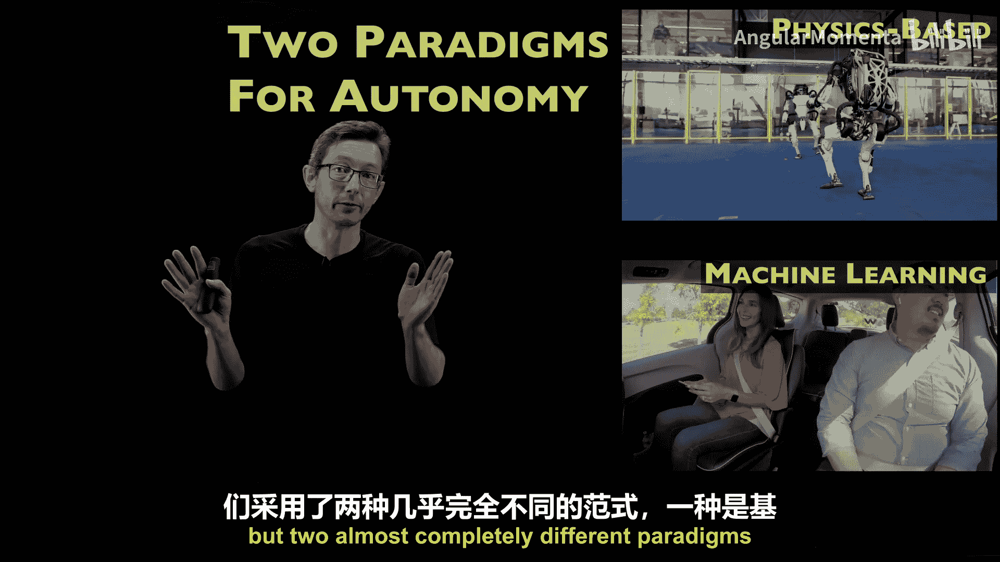

But when you start thinking about the next generation of you know aerospace systems and autonomy in flight。

 I think we're going to start seeing really the merging of physicsbased and machine learning solutions and in you robotics and self-driving cars also you're going to start seeing physics come over to the machine learning side and machine learning come over to the physics side。

 really trying to get the best of both worlds and so understanding what are the pros and the cons and the strengths of these methods is really important and something we're going to drill into in this sequence but also in future sequences。

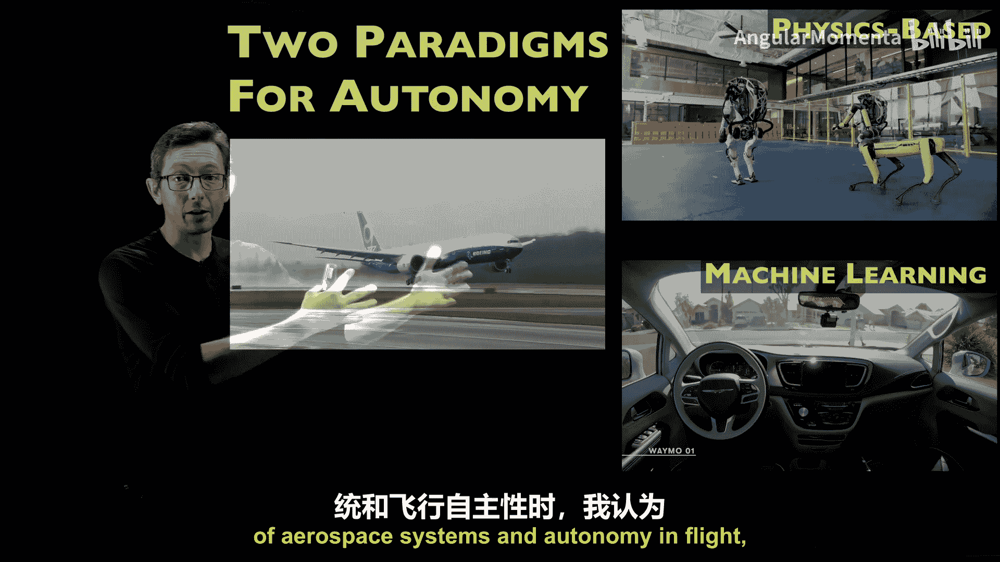

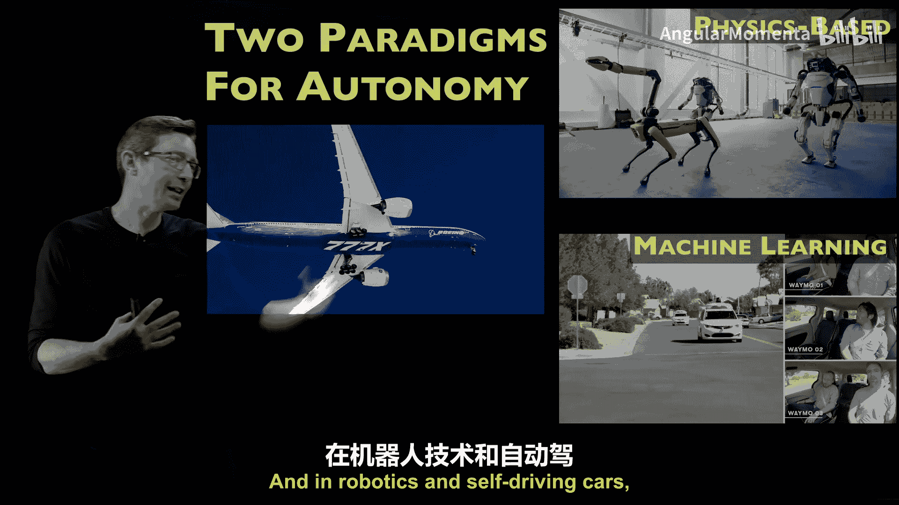

In my field of fluid mechanics， which I love and Im passionate about there are a lot of cool opportunities to use machine learning to improve our models and our controllers and our ability to understand and predict and manipulate fluid flows。

 this is just one really cool example done by Benjamin Herman in collaboration with Richard Zeieman's lab at TU Brantriig where they use relatively kind of modern interpretable machine learning technologies to build very。

 very good models from experimental turbulence data so this data is really cool。

 this is experimental data from the wake of a Dshaped body。

 this is kind of like a model for a transport truck that you might see on a highway and this model is forced periodically at the trailing edge either in phase or I think out of phase with periodic blowing。

And at different frequencies and intensities， you get different lock on phenomena where the wake will entrain to that blowing frequency and it changes the lift and the drag and all of the aerodynamic profiles of this behavior。

So this is kind of a cool frequency versus frequency plot where the bright lines show regions where you get kind of frequency lock on and entrainment。

And with a machine learning model that is essentially a human interpretable differential equation。

 Benjamin was able to almost perfectly match those various regions where we get intrain and lock on and so that machine learned model can be used as a surrogate model to design controllers and sensor placement and things like that。

 so tons of applications in fluid dynamics， this is just one of my favorite examples。😊。

And I think what I'm going to do now is I'm going to start going into some vignettes of how we are taking classical machine learning methods and applying those to engineering systems。

 and this will motivate the need for embedding physics into the process。

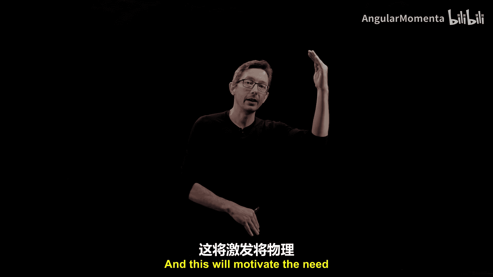

So one of my favorite examples and this of course is not a physics or engineering system。

 this is just facial recognition， but what we're going to do is we're going to take this off the shelflf technology from robust image classification and we're going to use it for a physics type system a fluid flow estimation problem and so this is an algorithm that was developed about 10 years ago by Candas and collaborators called the robust principal components analysis The idea is pretty simple。

If you have a large training data set， for example， of human faces。

 so I've got all of these different individuals， 36 people， for each of those 36 people。

 I've got 64 images with different lighting conditions and different shadows。

 so a really big database of people。From the statistical correlations in that data。

 you can learn those statistical patterns and if I have a new image like person X here where they are trying to be clever and obscure themselves with an incognito mustache this algorithm can essentially find from this image what are the patterns that it's most correlated to in this kind of statistical distribution and what are the pieces of that image that are not correlated with any of the patterns in this statistical distribution and by doing so you can take this image and decompose it into the sum of two images。

 L where L is kind of statistically in this distribution and S is everything else this is classical technology。

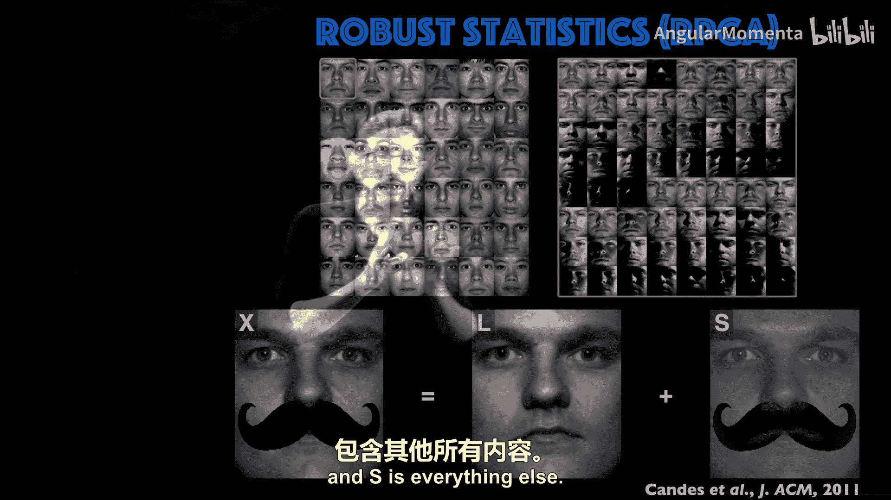

And so what I'm going to show you is what happens when you apply this to a physics system。😊。

So this is worked by Isabel Sherll when she was a PhD student with myself and Brian Plagi here at UW。

 she's now a postdoc at Caltech and Isabel applied this to fluid flow field data like what you might get from an experiment experimental data often has kind of salt and pepper noise and outliers。

 this is kind of an exaggeration of the kind of noise you might see if you collected fluid flow fields from an experimental laser sheet measurement like particle image fellowos symmetry。

嗯。And when Isabel applies this robust principal components technique to this data。

 she is able to decompose this flow field into the sum of two movies L and S。

 where L has all of the low dimensional features and patterns。

 and S are the sparse matrix of all of the outliers and corruption and salt and pepper noise。

Now this is not a dramatization， this is the actual output of Isabel's algorithm applied to this data。

 you can even see the little teeny artifacts where it wasn't perfect at removing the noise。

And whenever you see a result like this， I want you to be asking yourself。

 is this too good to be true， will this work on my system？

And the reason this is not too good to be true， it sounds too good to be true because there are infinitely many ways I can add up to movies to get the movie X。

 there are infinitely many ways of decomposing X into the sum of two movies L plus S。

And this is the particular solution that decomposes it into the correct clean flow field and all of the sparse noise。

So the reason we think this is not too good to be true is because there is statistical correlated patterns in the data you can look at this and by eye。

 you can tell that there is a flow field under all of that salt and pepper noise。

 your brain is doing it， this algorithm can do it。And specifically。

This is the single unique solution to this optimization problem out of all of the infinitely many ways I can add up L and S to equal x。

So I want you know L and S that add up to x addom all the infinitely many L's and ss that do that I specifically want the solution that minimizes the rank of L that means this has lowdimenional structure and the zero norm of S that means S is as sparse as possible。

 it only has a few entries as few entries as possible so this is the optimization we want to solve from robust principal components but this is nonconvex。

 this doesn't scale with Moore's law， we can't solve this for arbitrarily large systems just by waiting for computers to get faster。

So the trick is that there are convex relaxations of this optimization problem。

So I can replace rank of L with the nuclear norm， just the sum of the singular values and the zero norm of s with the one norm。

 just the sum of the absolute values， and these are convex norms that do scale with Moore's law。

 this is no longer a brute force NP hard problem like this optimization here。

And one of the big advances in applied math and statistics in the last 20 years is a set of very powerful conditions where you can take nonconvex very hard NP hard brute force optimizations that we want to solve and relax them into things that we can solve that with high probability converge to the same solution so this is the actual algorithm that Isabel implemented to get this almost perfect cleaning of our noisy data into this clean data L。

Now she applied this to a lot of interesting test cases。

 fully turbulent channel flow to see if the turbulent scales were filtered。

 and if you want to learn more about this you can read about it in her paper in physical review fluids。

 very interesting。But。Important key takeaway here is that if your data looks like a movie or an image or an audio sequence or a natural language sequence。

 try an offthe shelflf algorithm first， there are extremely powerful algorithms you'll get tens of billions of dollars of free technology for image data and audio data and things like that and sometimes it works like a charm so this is one kind of example and this is the same technology essentially that went into you how we think of recommender systems and the Netflix Pri and matrix completion so this is just kind of a cool example I think you might be interested in。

😊，You can imagine。The Netflix database， so there are a bunch of people subscribed to Netflix。

 let's say it's in the you know millions and you have a bunch of movies that exist。

 let's say there's 100，000 movies and 100 million people making these numbers up。

And I haven't seen every single movie， you know， no one has。

 but I might rate a certain subset of these movies， you know， thumbs up， I liked it， thumbs down。

 I didn't like it。And。By finding correlation patterns across all of this data。

 you might find that there are certain kind of eigen viewers and eigen movies。

 you might discover that there are action movies and ro comms and all of these different categories。

 and you might also discover that there are a relatively small number of kind of eigen viewers。

And you can use that robustifying property even though most of these values are not filled in。

 you can cross reference， well， if these two people liked these two movies。

 maybe Gina is also going to like I don't know if that's blade Runner right so you can kind of imagine how this algorithm might work and that by leveraging the patterns you can kind of fill in this matrix。

 very similar algorithm to what Isabel did for that fluid flow field。

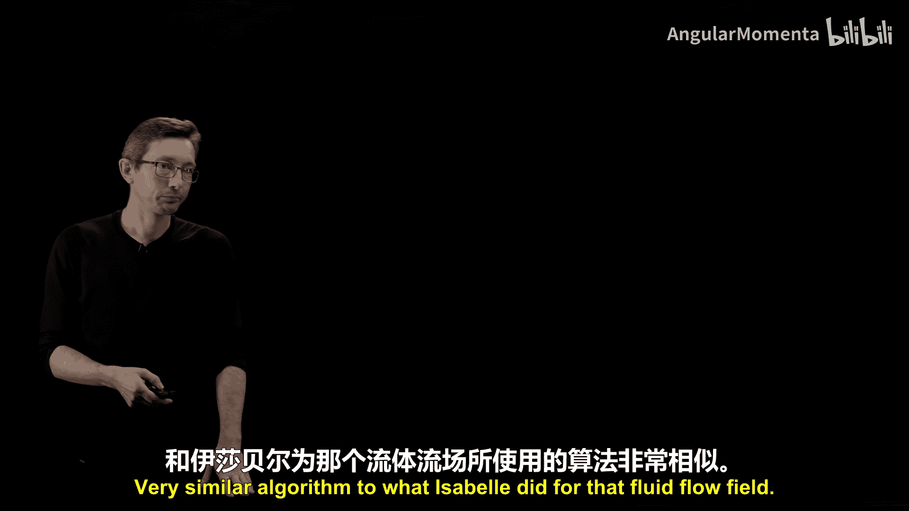

Okay， good。 That was one vignette。 Now， another vignette。

 And this is gonna to start motivating why we need physics in these models because this isn't going to work perfectly off the shelf quite as well。

 But another technology that's been developed in high tech industry like Google and Facebook and Microsoft and Amazon for a long time is this notion of super resolution。

 So super resolution is where you take a low resolution image。

 and you try to infer what the high resolution version of that image would be that would be consistent with those low resolution measurements。

😊，Again， you should be asking yourself， is this too good to be true Now， in this case， again。

 there is a ton of statistical correlation and patterns in what a human eye looks like so you can kind of convince yourself that maybe。

You could fill in some of these details to be consistent with the statistical distribution of all human eyes in fact if I take off my glasses these two start to look very。

 very similar and so in my mind I can start filling in of course I know what the distribution of eyelashes and eyebrows and cornea patterns look like and so I can fill in the details myself and that's kind of what we're doing and that's kind of what this algorithm is doing。

This is probably an artist's dramatization， I don't think it's this good。

 but the idea would be you would start with a bunch of high res images。

 you would downs sampleample them to low res images。

 and with those image pairs you would train something like a neural network to fill in the details and learn that distribution。

So we can apply this to physics systems as well in fact this is one of the most exciting highpri areas of research in physics informed machine learning is how do you do the same super resolution trick but for things like fluid flows and materials and things that are you know multiscale and really hard to simulate at full resolution can I simulate the climate at low resolution and paint in all of the details of all of the microscale substructure that I actually need to resolve correctly to predict how the climates going to evolve things like that okay it'll save us a lot if we could run low resolutions simulations and super res the outputs so lots of groups are working on this our groups included and so I'm just going to highlight one example out of many there's tons of good super resolution papers out there this one's by Ben Erickson who was a postdoc with us with Nathan Cuzson myself。

😊。

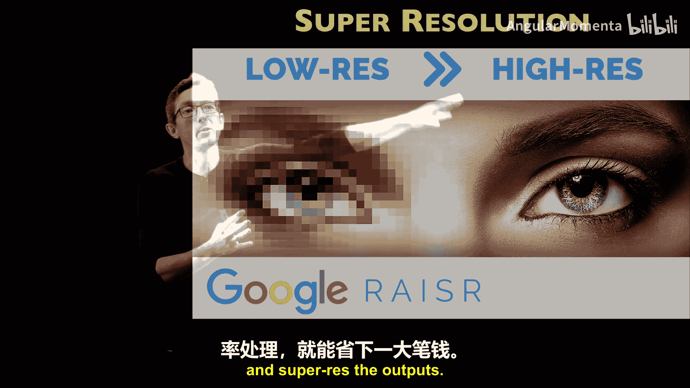

Where。Essentially we take the high resolution turbulence data from the Johns Hopkins turbulence database。

 that's this high resolution data here we downs sampleample that data。

 pretend it's crummy low res data and we train a shallow decoder to fill in from low res to high res details okay very simple super resolution challenge applied to a fluid flow data set。

And when you look at the results， they're pretty remarkable， they actually very。

 very accurately reconstruct the true flow fields from these downsled images。But。

The first test we did when Ben showed us these results。

 the first test was done in the classical machine learning way， which is。

 so this is a movie of the flow field it changes in time it evolves in time and the training data was essentially sampled randomly in time throughout that movie so these dark gray columns in time represent the training data。

 the light blue columns represent the testing or validation data。And on the testing data。

 when it's randomly interspersed with training data， we do an almost perfect job。

 the ground truth and these reconstructed fields look identical to each other。

 I'm not showing both because these are identical to the ground truth。

But you'll notice that this is an interpolation task all of these light blue columns are sandwiched between training data。

 they're very close to things I've seen in the past that I've seen in my training data so and this is one of the really important lessons I want everyone to internalize deeply neural networks are great at interpolation tasks they are amazing if you have enough data that your future deployment can be viewed as an interpolation of your training data neural networks are going to work beautifully。

They're not great for extrapolation。 So we ask Ben， okay， well， this is， you know great。

 this is going to convince machine learning people。

 But when I build a fluid model and I want to deploy it into the future。😊。

What I'm really doing is I am going to train on the first 70% of my data and then I'm going to hope that it actually works as I deploy it into the future。

 so let's try to train on the first 70% of the data without doing this random shuffling or random sampling of our training data and then try to predict on the next 30% into the future。

And here you see that for times right after the training data for the first blue column。

 we do a pretty good job， not as good， but pretty good， and then very。

 very rapidly our prediction degrades until it is nothing like the true flow field。

So this points out that these neural networks are often not good at extrapolation into the future。

Now this was kind of an easy test case because we believe that this data is statistically stationary。

 if you want to use super resolutionution for something like the climate。

 it's going to be even worse because I don't think we all believe that the next 30 years is going to be statistically like the previous 70 years。

 things might actually drift and not be stationary in time。

 which would compound this challenge of extrapolation even further。

And so this is a moral or cautionary tale， first off says interpolation works like a charm。

 extrapolation is hard for neural networks， but that's often what we want our models to do。

 we often want models that kind of generalize beyond the training data to new scenarios。

 and that's what we mean by extrapolation。😊，And physics models are models that tend to extrapolate that's a pretty good working model of physics or working definition of physics is a model that generalizes to new conditions that I haven't seen before and so I would argue that the only way that you can really get this extraolatory performance into your neural network or machine learning model is to somehow bake in some prior knowledge of the physics into that procedure for example I know that these are incompressible flows that conserve energy and mass and momentum and if I can bake that into this algorithm。

 maybe I'll get a better extrapoatory performance in the future so that's a really important moral story and motivation for baking physics into this procedure。

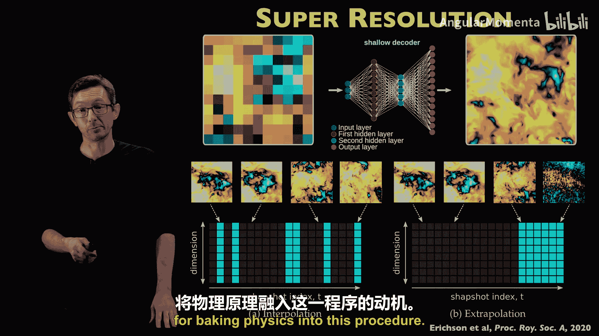

Okay kind of another vignette this is probably the last one I'll talk about is how machine learning can be used for what's called discrepancy models and digital twins and things like that。

 so this is kind of a cool simulation of a robot based on first principles and this is an actual robot measured in a lab at UW and you'll notice that they agree pretty well for a while eventually they'll start to diverge because of very small differences。

 really small differences in this model and the ground truth will cause these to diverge eventually。

And especially things like if our model ages over time， if these joints get a little stiffer。

 it happens to all of us， if there islinear bearing chatter or wind resistance。

 those are very hard to put into a first principles's physics model and those discrepancies between our physics model and our actual system can be modeled with machine learning。

 and that's a really important concept in this larger picture of a digital twin is that all of kind of the pieces of the larger asset that we're trying to model。

 whether it's a factory or an aircraft or an automobile。

 you're going to have models that are imperfect， and data that's going to help us update those models maybe with machine learning。

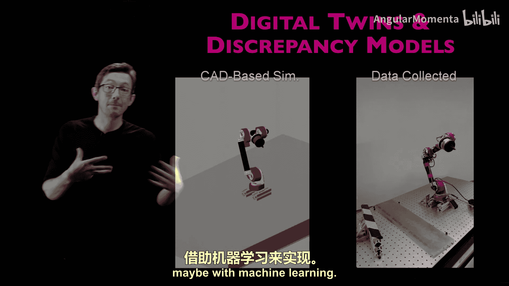

And so the idea here is that instead of trying to discover the model for that robot arm entirely from scratch with machine learning。

 which would be very hard。We often start with partial knowledge of the physics。

 we might have an idealized equation， a Hamiltonian or Lagrangian system。

 we might know the constraint equations or the constraint manifold， conservation laws or symmetries。

 and so what we want to do is get the best of both worlds and start with our physics model to model the things that we know constraints and conservation and symmetries that are very hard for machine learning to model and then we want to use machine learning to model the discrepancies that are very hard for physics to model。

 so it kind of looks like we start with this imperfect differential equation from you know classical physics that have a lot of the right features。

And then we use machine learning to model that last bit that's hard to get with physics。

 and in doing so we get the best of both worlds。

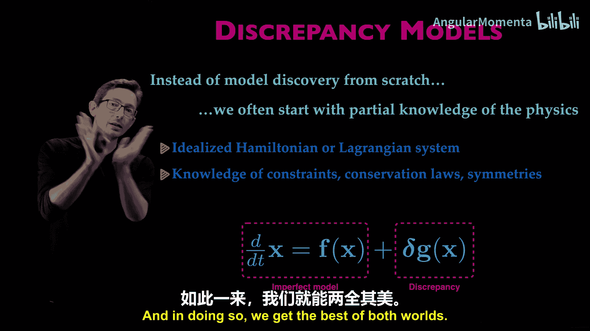

So I like to show this video， this is from Cardi Cayman when he was a PhD student in my lab。

It shows this double pendulum on a cart experiment this is in one of the side rooms in my lab。

 trying to develop a controller， a model predictive controller based on an idealized Hamiltonian or Lagrangian model it gets you super close to being able to swing this up but it's not quite perfect because there's discrepancies because the bearing chatter and the wind resistance and friction that are not in that model。

 but when you add that discrepancy model to kind of the f equals MA or the Lagrangian or Hamiltonian model。

 that additional piece of the model allows you to do this perfect control so sometimes it's a very small difference is the difference between success and failure in a controller。

Really cool work， he actually has specs on how to build this yourself if you're interested。

 it's a super cool paper。

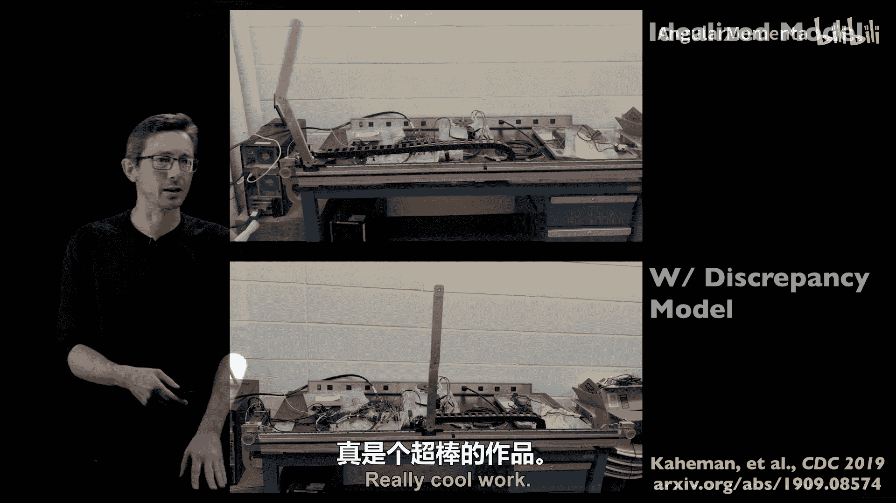

And so the idea here is that there are kind of these two axes， there are things that are really。

 you know， modeling disturbances and unknown physics are very hard from first principles。

 very hard to write down a wind resistance model for vortex shedding from first principles physics。😊。

And there are things that are hard incorporating known physics is hard for machine learning but easy to do by a pencil and paper。

 so writing down that my know pendulum has an angle theta and it's constrained to be between zero and2 pi。

 easy for physics， that's actually really hard for a machine learning model to learn from scratch is that you're constrained to live on a circle。

And so we hope that the class of models is not just a straight line between these。

 but there are some models in this kind of Pareto optimal frontier where you can get the best of both worlds where it's easy。

 you get the things that are easy for machine learning and the things that are easy from first principles。

 and that's where these discrepancy models live， so things like constraint equations and conservation laws。

 you model with first principles physics， things like bearing chatter and wind resistance you model with machine learning。

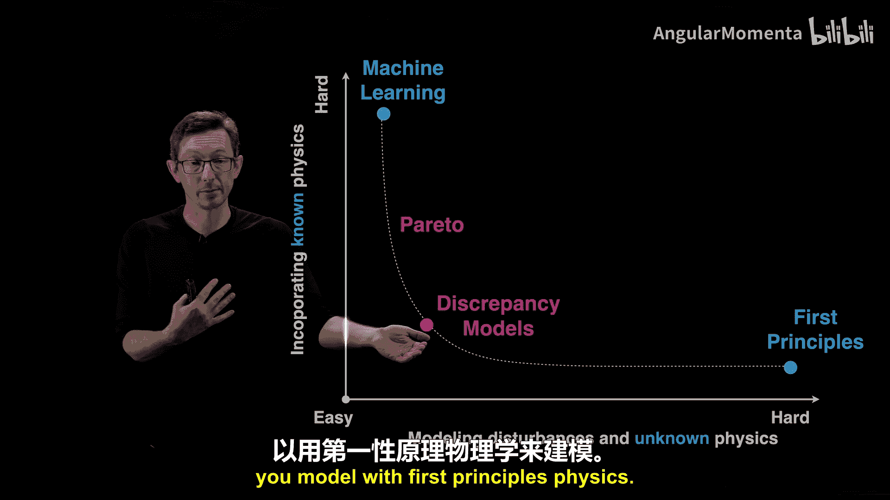

And again， that's the paradigm we use here for robot manipulation。

 people have used this for quad rotors to capture those nasty aerodynamic forces close to the ground effect。

In the bigger picture this is going to be useful as we start to develop these larger models of models of models for these digital twins where some of these are going to be physics-based。

 some of these are going to be machine learning， some of them are going to be hybrid and we're going to constantly be collecting data as our system ages and evolves and changes and pendingning these models modeling that discrepancy to match the data so this is just a number of examples of kind of advanced engineering systems where physics informed machine learning can be useful sometimes you can just use off the shelf techniques。

 lots of advantages and benefits in material science， in fluid dynamics in robotics in autonomy。

 in digital twins， very exciting outlook。Tons of opportunities。

 and we're going to talk about all of these in a lot more detail in subsequent series all right。

 thank you。

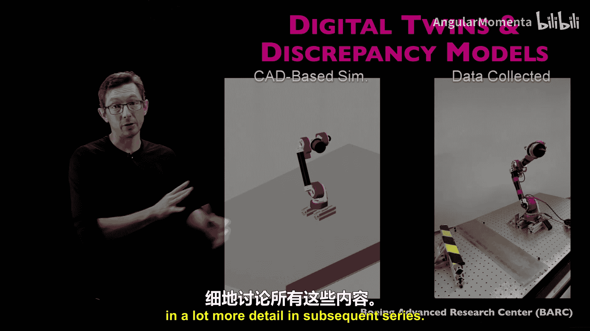