# 【精译】数据密集型工程导论-p20-20-物理信息机器学习--BV1J8G3z1EHF_p20-

Welcome back。So we have seen what is possible with machine learning in the last。Two years。

 five years， 10 years， dramatic advances in machine learning。

 and we understand now kind of the process of you know what machine learning is essentially building models from data with optimization。

Today I want to talk about some of these kind of advanced ties to physics and engineering and scientific systems。

 specifically how do we do physics informed machine learning and build physical models from data via optimization。

 very， very important when we want to have our systems be more generalizable beyond their training data。

 more interpretable to a human， more likely to be certifiable and safe for use in safety critical systems like self-driving cars and autopilots and designing you jet engines and aircraft wings。

 things like that。This is a passion of mine， there's going to be a whole series probably a whole kind of like short course or boot camp on physics informed machine learning maybe several。

 but this is just the very high levelve overview so oftentimes you can get a lot of benefit just by building models from data with optimization you know just from data you can build models of physical systems but usually it's the case that when you bake in some prior physical knowledge into these machine learning algorithms you usually get much better performance and robustness with much less training data and simpler models okay so a lot of benefits here。

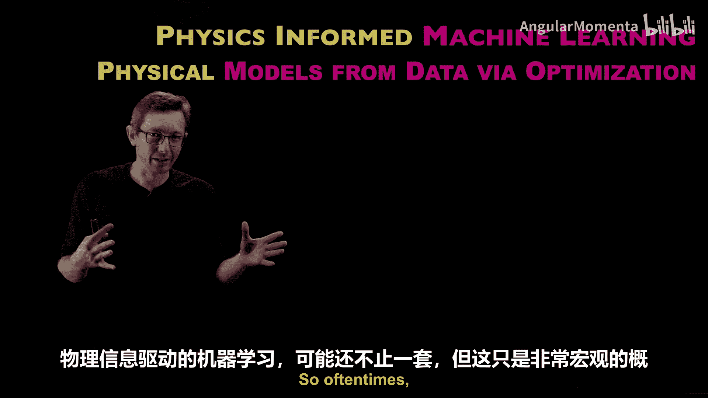

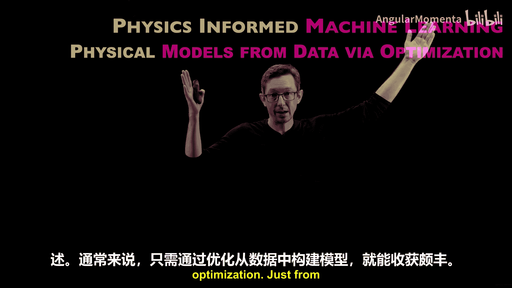

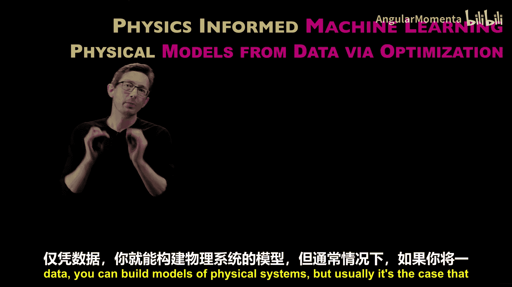

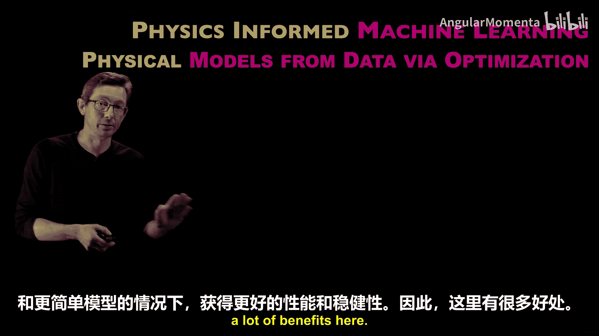

So we'll just recap kind of the five key pieces of building a machine learning model and these are all human endeavors right so machine learning is not just a turnkey automated process。

 this is a human tool for humans to build models so you have to choose what you're modeling you have to decide what data you're going to use or you have available to train that model。

 you pick an architecture like a neural network a specific neural network that you think is going to do a good job of modeling that input output function that you're trying to model。

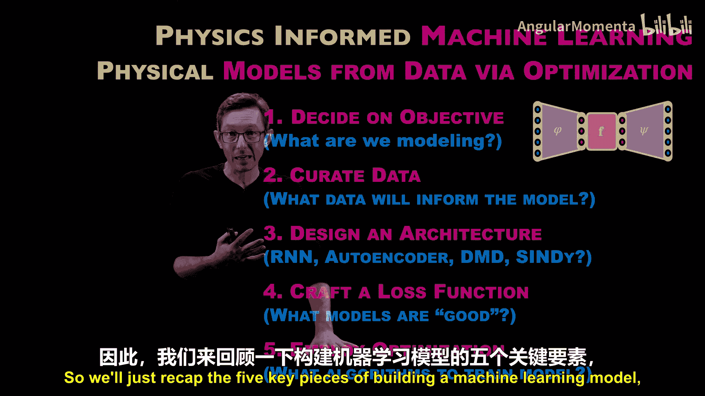

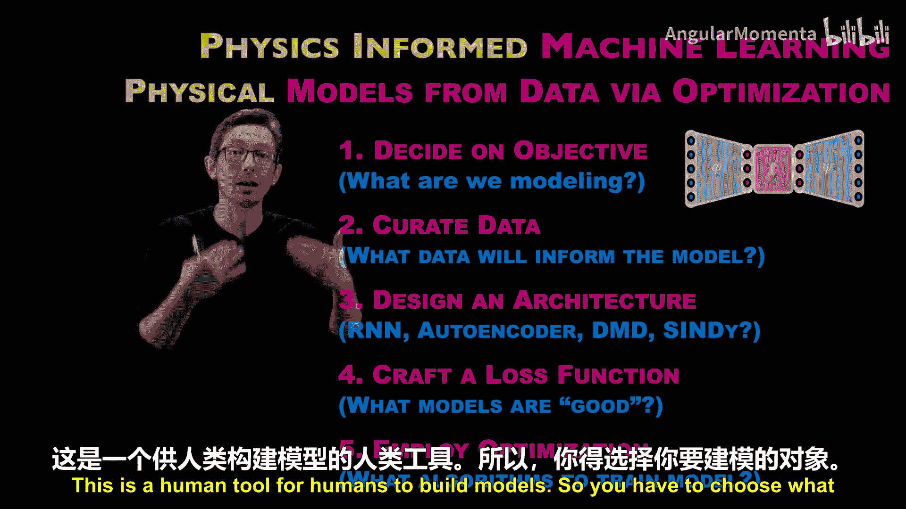

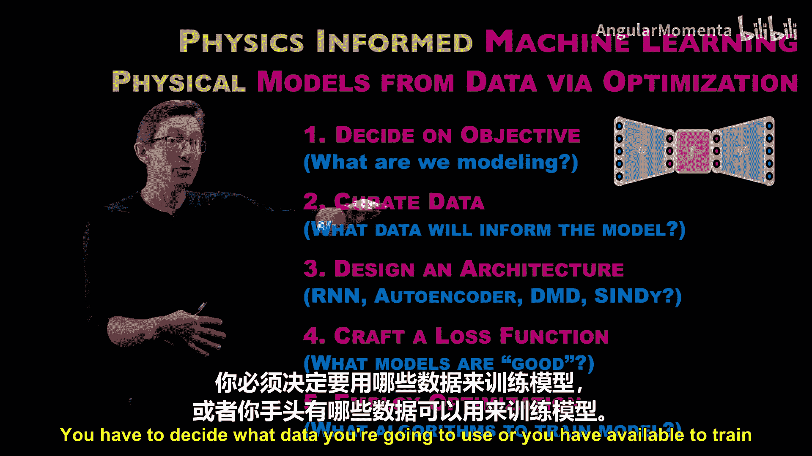

You choose a loss function， you write down an optimization problem。

 something that you're going a function you're going to try to minimize or maximize that tells you if you did a good job。

 and then you employ some optimization algorithm to essentially train the parameters。

 the free parameters of this architecture to minimize this loss function averaged over the training data。

 that's what machine learning is。

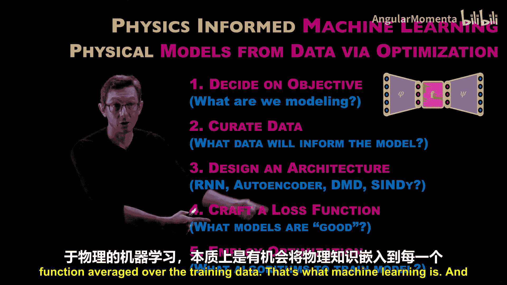

And physics informed machine learning， essentially there are opportunities to embed physics into every single one of these steps and so I could give a whole lecture on how you embed physics into every single one of these pieces I'm going to I'm going to have a whole series on this but at a very high level I just want to motivate what this might look like okay。

😊，First off， what do I mean by physics？There's a lot of definitions of physics and the kinds of physics you can bake into these models physics could mean mass is conserved or mass or momentum or energy are conserved。

 lots of systems， you know if I'm trying to use machine learning to improve a computational fluid dynamic solver。

 I know that my fluid has mass momentum and energy conservation and so I might want that physics to be preserved or embedded。

In my machine learning model， somehow at some stage in my process。

I might know that my system has a symmetry， so conservation laws are deeply related to invariance。

 so essentially anytime I have an invariant， it is something that is conserved and know there's theorem from classical physics。

 one of the best， you my favorite theorems in all of mathematical physics。

 no there's theorem says that every fundamental symmetry gives rise to an invariant or a conserved quantity。

And so symmetries are another way that we embed or represent physics that we want to enforce in these models。

 okay and you can think that almost every class of physics is essentially defined by symmetries and how the system responds and acts and transforms under different symmetries。

 classical mechanics。Has its own set of symmetries typically things like rotations and translations。

 my physics should be invariant to rotations and translations quantum mechanics has a different set of symmetries。

 general relativity has its own set of symmetries physics is essentially defined by the symmetries that are preserved in that system and so symmetries is another notion of physics that I want to be able to embed in my models another good example and this is a little bit more nebulous is the notion of simplicity or parsimony most of our physical laws if they don't overfit if they generalize tend to be quite simple Newton's second law f equals M Einstein's e equals m squared these are very simple expressions in fact they are the simplest expressions required to describe our observations and you can't make them simple or very easily and so that notion of parsimony or simplicity tends to allow our models to generalize and to be more interpretable and understandable。

😊，Philosophical， you know， it begs the question why， but it happens to be true。

 And so I might want parsimony or simplicity to be a design feature in some of these stages of machine learning。

 So I'll just give you a couple of examples。Deciding on an objective is probably the easiest way to embed physics I'm just going to decide to model a physical system if I'm modeling the trajectories of cannon balls。

 kind of I'm already modeling a physical system so that's physics modeling in its simplest case Oftentimes I try to model differential equations X dot equals f of X and you know that inherently has some kind of physicality because you're dealing with time series data that has rules according to a dynamical system。

Data， how do I embed physics into the data， this is what I loosely think of as kind of the Google approach to embedding physics in your system。

 which is if I know that I want my model to have an invariance to rotations and translations。

 let's say I'm doing an image classifier， and I know that the cat that I'm trying to classify is still a cat if it's rotated or translated in the image。

The kind of big data approach would be to augment your data with many， many。

 many examples of that rotated translated training data so you can take your data。

 maybe it's a little bit meager and you can augment it with rotated translated versions of that data if you know that your model should be invariant to that I'd say that's fairly expensive and fairly brute force but it does kind of work and if your training data is large enough like you have all of Google images or all of Facebook you know data then your data might already have those symmetries kind of built in or baked into the data oftentimes we don't have the luxury of that you know data augmentation or nearly infinite data。

 we have to get away with less data so that's why I actually like to enforce physics in these last three steps。

Designing an architecture is a really good way。 so for example。

 the auto encodecor architecture that has this information bottleneck where you choke down to a small dimension that has a lot of nice regularizing properties of promoting simple models that have less degrees of freedom and less variables which is kind of a physical concept there are architectures like you can take。

Something like this autoencoder。 and you can constrain that the middle layer that that F function there。

 maybe it has the structure of the Euler laggrange equations or Hamilton's equations。

 Maybe by construction， I can enforce that my system looks Hamiltonian in that latent variable Z。

 thereby forcing it to be energy conservative。 so by construction。

 I can often choose an architecture that has kind of physical properties baked into it。

 If I think about a convolutional neural network， it has translational invariances baked into it。

 So by construction， I'm going to get translationally invariant models。

 And there's a whole class of machine learning where you essentially have input layers and output layers that are designed specifically to be kind of invariant under certain symmetry transformations called equivariant neural networks。

 very， very powerful class of architectures。By construction satisfies certain symmetry properties。

So crafting the loss function is another great place to bake in physics。

 let's say again I'm a fluids person so I think about estimating a flow field。

 I want my flow fields to be divergence free if it's an incompressible fluid。

So what I can do is I can add a term in my loss function that has the divergence of my estimated flow field and again if that's non-zero。

 that's a penalty and so I'm trying that forces my optimization to try to minimize the divergence of my flow field as a term in the loss function and you you don't have to just do divergence anytime you know your partial differential equation。

 you can essentially add a loss term that says that PDE should be satisfied by the solution。

 that's the basis of the physics informedform neural network or pin architecture， very。

 very popular very， very useful architecture。Now。Adding a penalty term the loss function is a great idea。

 but it only gives the suggestion of being physical because it's still competing that loss term with all of the other loss terms like getting a good model error and model fit。

 and so you will definitely get this compromise solution where it is more physical。

 but it's not perfect divergence free， like you would get from a classical numerical solver。

And then finally， oftentimes you can actually design optimization algorithms directly so that if you know that there is a subclass of parameters in your architecture that are physical that adhere to certain symmetries。

 you can often do constrained optimization to force yourself to enforce those symmetries or those conservation properties so I personally in my line of work and lab like to you mostly focus on three and five。

 but they do require like a bit more effort， you know designing an optimization algorithm is sometimes challenging。

 choosing an architecture to be structure preserving。

 know it definitely requires some knowledge of the structure that you're trying to preserve the fourth one is a really good kind of middle ground where it's easy to implement and it does promote physicality。

 maybe not in as hard of a constrained rigid way as three and five lots of options big big field changing and evolving every day。

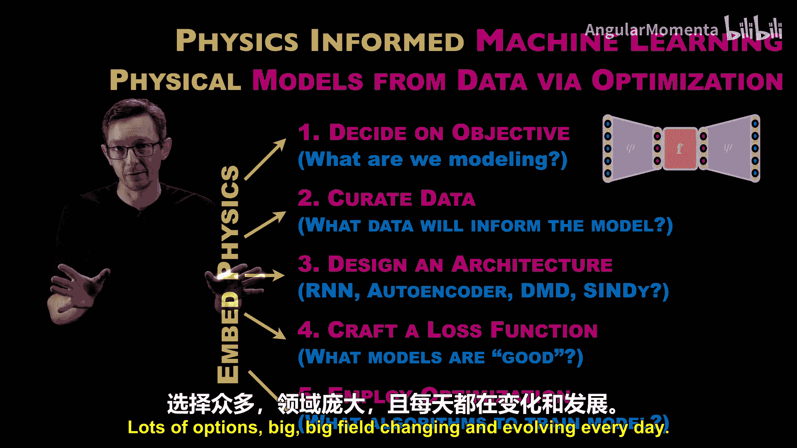

And so you know it's an exciting field but it's also in its infancy right now。

 so you can definitely improve machine learning models by you know adding physics loss functions and things like that and constraints and symmetries but our ability to actually learn what we would call physics from data is still in its infancy and this is a lot of what my lab works on and our colleagues and collaborators labs across the country and across the world but the state of the art is still you know we're still really taking baby steps right now so this is a video of a pendulum oscillating pretty simple mechanical system。

 you know we could write down the differential equation for this it's very very simple nonlinearar oscillator for small amplitude that's a linear oscillator。

And so what we might want to do with a physics informed machine learning algorithm is try to learn from this megapixel image from these million measurements every instant in time。

 we might want to compress this down to a lowdial latent space and learn that there are only a few degrees of freedom that actually characterize the system。

 in this case there should be two variables that matter theta and theta dot from theta and theta dot I can perfectly reconstruct this field。

 so I should be able to compress this down to two numbers and then use those two numbers to reconstruct the full image。

😊。

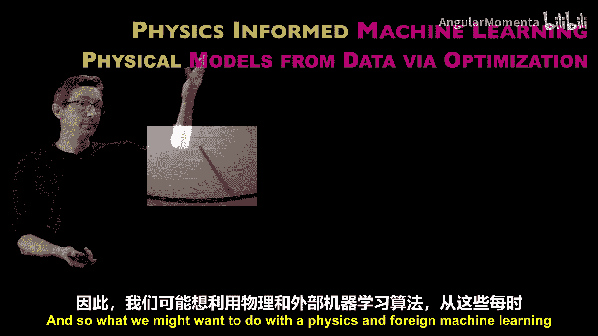

And from those two numbers I don't just want a compression and I don't just want a predictive model that's a huge deep neural network that a human can't understand what I would really like is for there to be some simple parsimonious human interpretable differential equation。

 a physics model in the middle that actually describes how those variables evolve in time Now this we can actually do we can take videos and learn the latent variables and actually learn with machine learning the differential equations that govern that behavior。

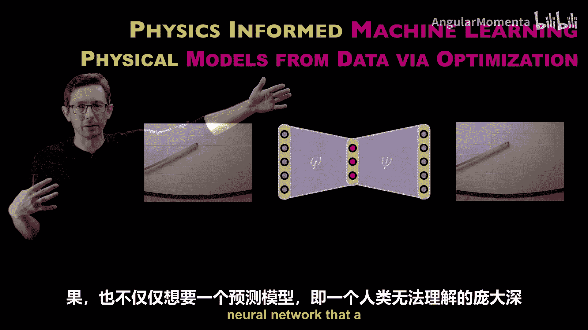

But currently only for relatively simple systems， this is kind of you know I might be exaggerating a little bit。

 but this is you know near the frontier of what we can do。

 so we're trying to push the boundaries of this to learn really hard physics that we don't know the answer to so you we want to take images from active matter。

 non-nutonian fluids， you know disease dynamics， flocking behavior。

 brain data and we want to be able to do the same thing。

 learn the latent representations and the differential equations that describe the data that a human could then understand and read and that would have some chance of generalizing let's say I increase the angle of this thing a classical neural networks probably going to fail。

 but if I learn the physics I'll be able to handle that new initial condition that wasn't in my training data。

So that's kind of what I'm talking about with physics and form machine learning， again。

 still the frontiers of our knowledge， still an active area of research。

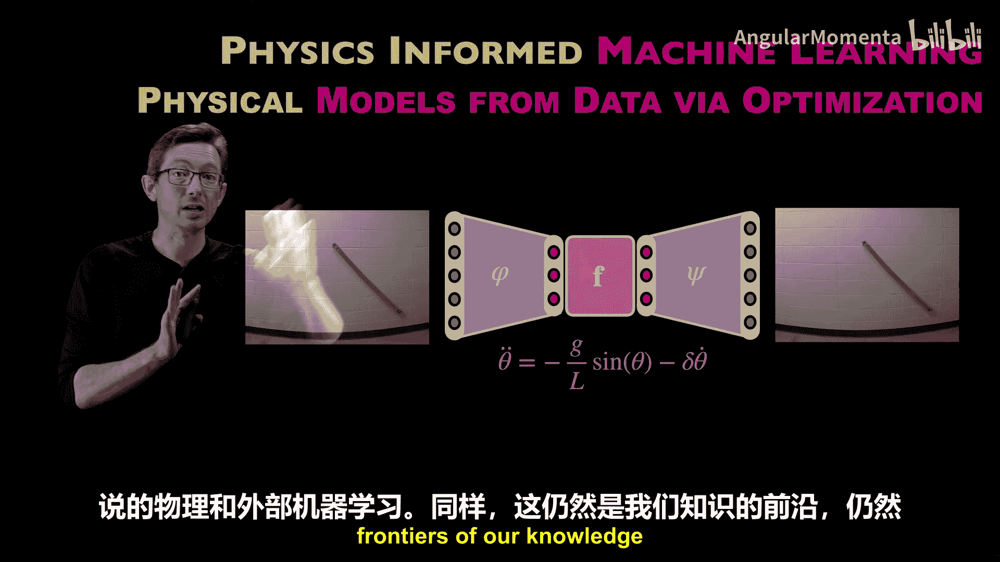

Just to recap， stage one is set up the problem， stage two is find the training data。

 stage three is pick an architecture that can represent the input output function and it can be parameterized by some free parameters theta that you're going to tweak。

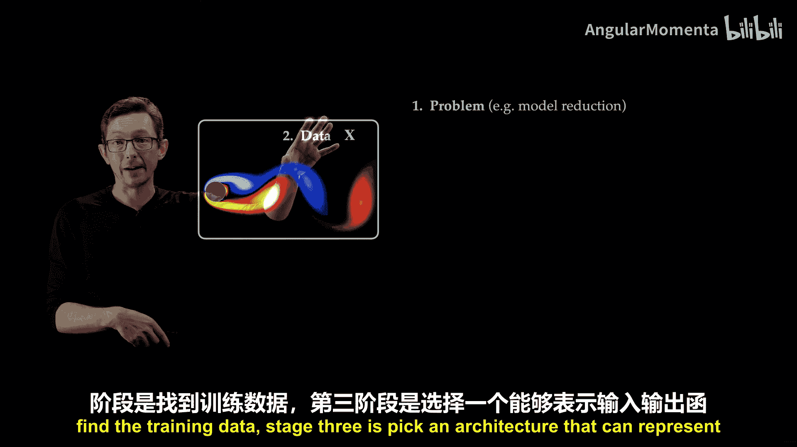

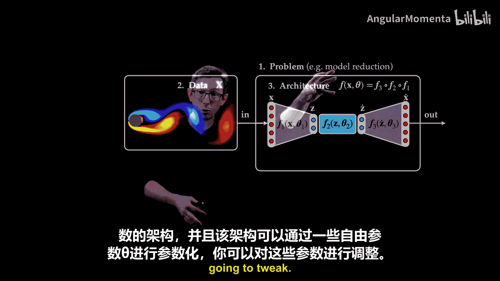

Step four is design some loss function that you're going to try to minimize to tell you if you did a good job。

And step five is optimize over those parameters， tune those free parameters to minimize that loss function across the training data okay that's the state like kind of the stages of machine learning and you have an opportunity to embed physics in every single stage of this process Okay。

 we're going to have a lot more we're going to dig into each of those subcategories。

 lots of physical examples we're going talk about what works and what doesn't work but that's you know a longer story so this is just the intro overview All right。

 thank you。😊。

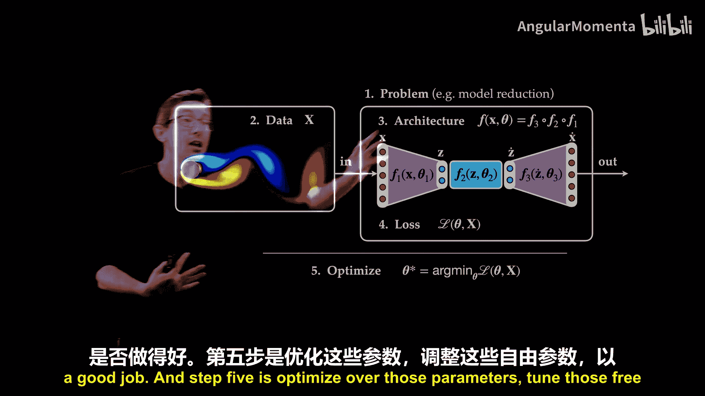

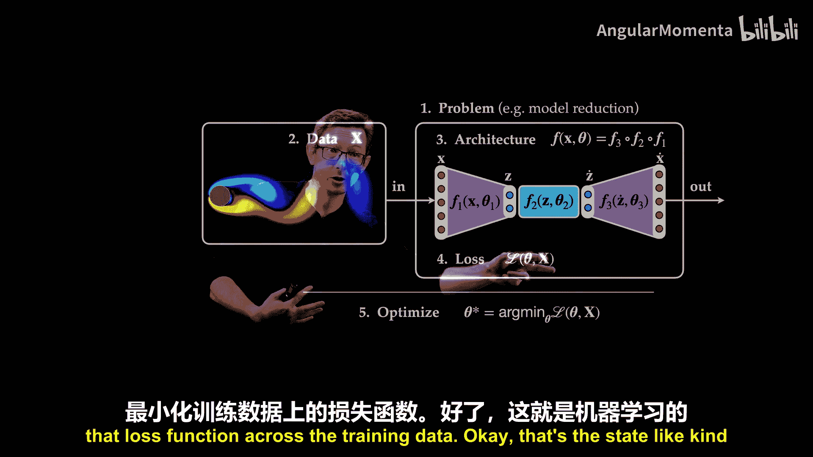

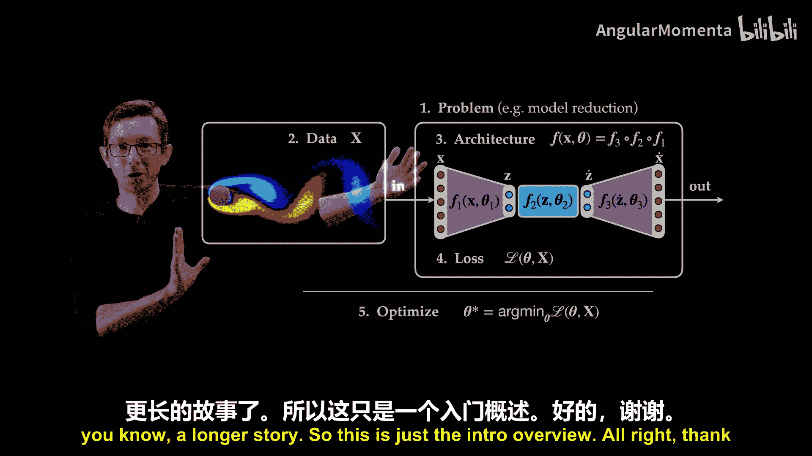