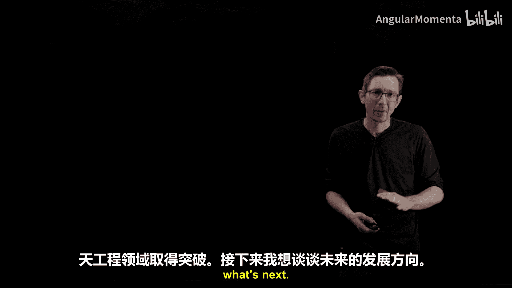
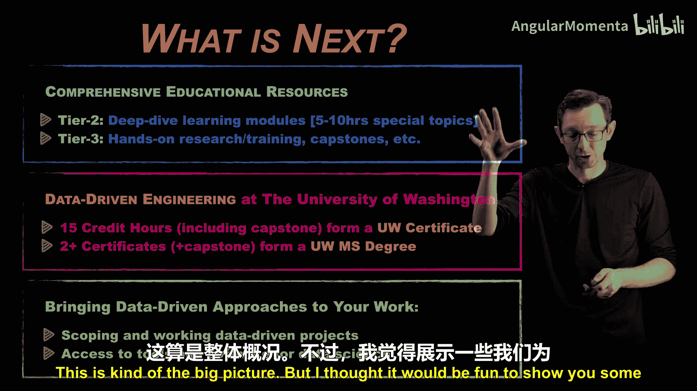
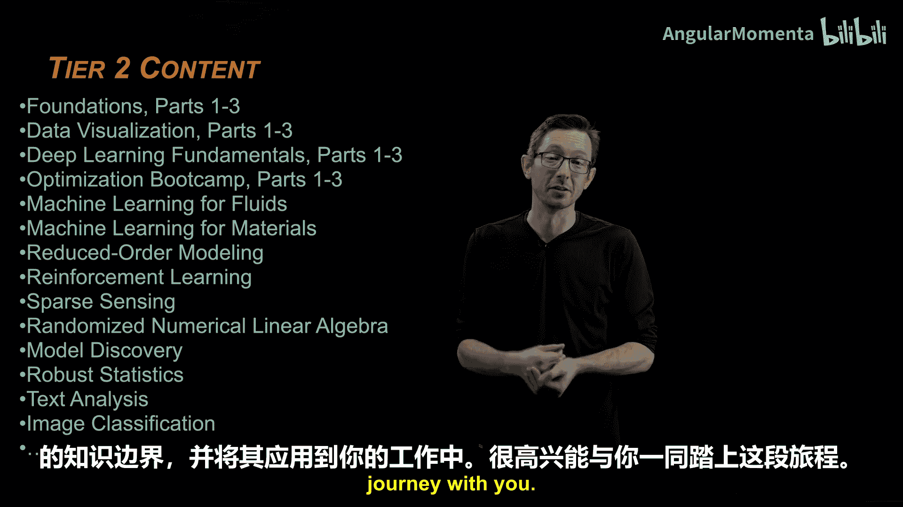

# 【精译】数据密集型工程导论-p21-21-二级“深度潜水”教育模块的预告片--BV1J8G3z1EHF_p21-

Welcome back so we've been talking about data intensive engineering， machine learning。

 data visualization， how you can move the needle in aerospace engineering by leveraging this massive wealth of data that you have access to and I want to talk a little bit about what's next so we've already covered this a little bit。

You know this short course was meant to be a rapid introduction to the topic。

 very high level kind of motivating， giving you the language and the key ideas。

 helping you understand what is possible and not possible in machine learning and how these can be applied in aerospace engineering。

And what's next is that there are many， many more educational resources if you found any of these topics interesting。

 there will be these deep dive kind of tier2 modules。

 five to1 hour special topics classes in specific focused areas that will you know hopefully appeal to many of you things like machine learning for fluids or you data- drivenriven optimization and things like that。

 and then hopefully you take those short course ideas and actually apply those in a handson way to research in your everyday life I mentioned before that there is an opportunity if you really like this material and you actually want credentials。

 you can stack these deep dive modules into certificates and master's degrees。

With the ultimate goal of actually bringing this into your daily life to improving how you actually do data intensive engineering。

 scoping and working on data driven problems with teams of experts。

 what are the actual specific tools and software you need to incorporate this into your daily life。

 this is kind of the big picture。

But I thought it would be fun to show you some of the ideas we have for these tier2 deep dive modules and this is going to be developed know largely at the University of Washington in collaboration with various partners and collaborators so a lot of my favorite topics are on here we've you used this as an opportunity to kind of add in some of our favorite things we think you should know。

 things like you know there's foundations， what are the basic basic foundations， linear algebra。

 differential equations， things you need to know to really be proficient with machine learning to really be proficient with the most advanced cutting edge tools today。

Data visualization I can't emphasize enough how important it is to be able to tell a very effective story with your data。

 to be able to tell if someone's trying to mislead you with their data so deep deep dives into data visualization fundamentals of deep learning optimization boot camp there will be you know beginner intermediate and advanced what are the tools of optimization today that enable machine learning and this machine learning revolution we'll have specific focus areas like what are opportunities for machine learning in the field of fluid mechanics or in the field of material science reinforcement learning is essentially what are the opportunities for machine learning in the field of control theory and many。

 many more you know we talk about that predictive shimming example we'll talk about the mathematical underpinnings that went into those algorithms robust statistics。

 text analysis natural language processing we're building out this very large comprehensive curriculum。

Specifically tailored。For engineers to pick up the data science and machine learning and data visualization tools needed to advance the field and really capitalize on this exciting movement。

 so I'm super excited to have you kind of on board I hope you find some of these topics and really dive in and really you know push the frontiers of your knowledge and bring this into the work that you're doing so I'm excited to be on this journey with you thank you very much。

