# 【精译】蒂宾根大学《机器学习中的数值方法》-p01-1-——-引言-——-菲利普·亨尼格--BV1WMYHzAEcL_p1-

。

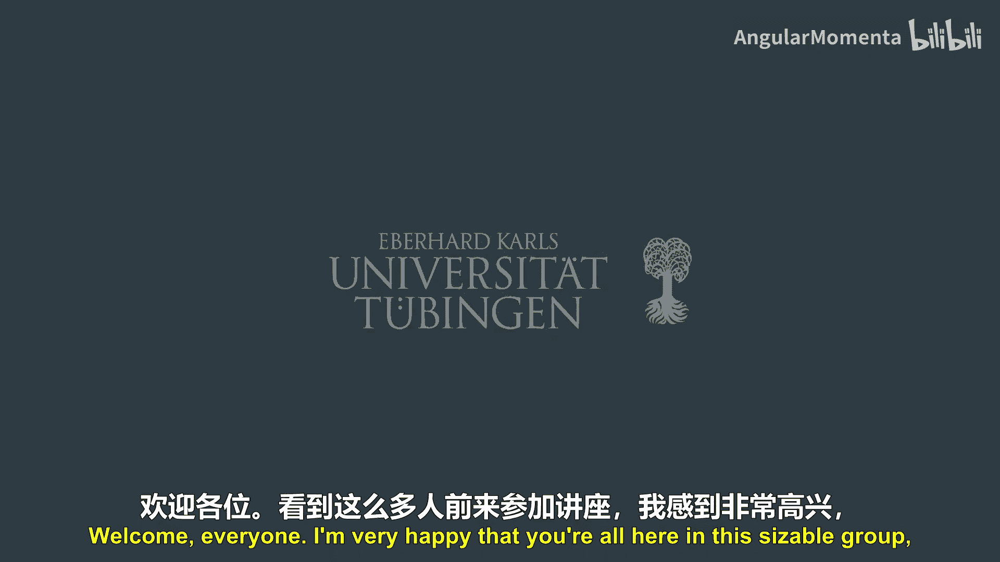

Welcome， everyone。 I'm very happy that you're all here in this sizable group。😊。

Especially for a specialist lecturer that isn't even mandatory for anyone。

And I'm really looking forward to do this introductory lecture for this numerics of machine learning class。

😊，So before we get started， F， S have to tell you why you should care about numerical algorithms。

 And then you can start talking about what they actually are。

So maybe we can close some of the windows， Not all of them， but maybe to get some of the。

We have to find some， some balance between noise and oxygen。そ不事。

And heating later in the year is gonna be heating as well。 So if you ask， you know， the media。

 if you read about AI in the media， you'll learn that machine learning algorithms are computer programs that take data。

 so。Statements about the world， numbers that are listed somewhere on a piece of paper。

 and they turn them into models that you can use to predict something about the world or maybe even to act in the world。

 for really AI， right， so interestingly。😊，The first thing is the input。

 And the second thing is the output。But what actually happens in between is the stuff that you do because you're the computer scientist。

 right， the machine learning engineers。 So what's the thing that actually happens inside of the machine。

That's a a computation。That's the pit that the computer does。When it learns。

And in contrast to classic AI， rule based AI。Contemporary machine learning algorithms use numerical algorithms as the primitives for these computations。

What do I mean by that？ Well， so classic AI algorithms are。

Algorithms like maybe nearest neighbor or alpha beta search。 So algorithms that just run。

 and then they find an answer。 And then you know that they've done the right thing and you're done。

Nmerica algorithms are algorithms。 I can already tell you what they are。

 We're going to talk about them for the whole lecture today。 They are linear algebra methods。

Simulation methods， integration methods and optimization methods。

All of these algorithms are methods that。Estimate and。A quantity。

 a mathematical quantity that doesn't have a closed form solution。

 at least not one that is tractable in reasonable time。And that's maybe a subtle distinction。

 But I'm actually going to make it a little bit formal。 And then I'll tell you why。

 So it's not a proper mathematical definition。But it's sort of a vague idea of what the difference is between these。

What I might call an atomistic algorithm。Something you might have used for a classic AI solution and a numerical algorithm。

Put simply a。Atomistic or an atomic operation is something that can't go wrong。

And an American algorithm is something that can go wrong in subtle ways。So here's a an attempt to。

 to define something。 Asum you have some function that you care about， that you'd like to compute。

It maps from some input space to the real numbers， because that's the only thing computers can actually do。

 And it has some input space。😊，And you， this function is kind of intractable。 It's complicated。

 right。Now， you might call an algorithm a map that's implemented on the computer。

 or the touring machine that computes。Takes an input and computes an output。

 such that we hope that this output is an approximation to the true value of this function。

I'm going to call an algorithm， an numerical method。 If there are points in the input domain。

Such that the algorithm accepts it。 It runs。 It decides， right， It terminates， it puts out an output。

 and that output is wrong。 It's beyond some error， some machine precision error where machine precision is up to your definition of what you mean by machine precision。

So， in short。An atomic algorithm is something that just always works。

 And an numerical algorithm is one that can go wrong。 So why is this important。

It's important because。If you're using a tool that can break。You need to worry about it。

If you're using something that always works。You don't have to spend brain cycles on it。

 You just call it and done。While if it's an algorithm that can go wrong。

 you are now in charge of making sure that it actually works。

And the fact that these algorithms are central to machine learning means that you。

 as the machine learning person， have to think about it。 So here are some examples。

 Atomic operations， are the stuff that comes from the Lips C， like the exponential function。

 the sign function， but also， you know， more obscure things like。😊，what is this。

 The complement of the  error function or the gamma function or the log gamma function。

 stuff like this。 And they tend to come， you know， as just functions They are in， you know。

 in s P special or even in like based non or even in the like， you know。

 the mathematical library of Python itself。 So they are straightforward。😊。

While numerical algorithms are methods that tend to have their own library。 So it's like， you know。

 spi spa as Linuxux s pi is optimize。 And there' are stuff in there。

 And there are several different subroutines。 So that's already your problem。

 There's several different choices to make。 They all do apparently the same thing。 And you know。

 you need to figure out which one it is。So what do these algorithms actually look like。

 I want to give you a feeling for what we are talking about。 Here is an example of an algorithm， who。

😊，It's on the Internet。 This is a prototypical numericalic algorithm。

And here are a few things to notice about this。 First of all。

 can someone guess what kind of programming language this is。It looks like this。It's not Matlab。

 but it's the language that Matlab was inspired by。 It's fortn。So it's actually41， I think，95。

 which you can tell， because of the weird indentation。 I think in 77， you can't end it this way。

 So it's old。 This algorithm was written in 1993， maybe a little bit before that by a Swiss guy in Geneva。

 and it implements an algorithm that was invented by two guys that are quoted here at the top called dormment and prints in。

 I think1975， I might be wrong about this though。 So it's a while ago。 and。😊。

It actually is an instance of a class of numerical algorithms called Huuta methods。

 which were invented in 1905 by two German mathematicians。 Hu and Kuta hands up。

 who has heard of Hukua methods before。 Im already trying to gauge a little bit what the audience is like。

 Okay， that's about a third of you。 And so this is the first thing to note about numerical algorithms that they are old。

😊，These people are not machine learning engineers。 They use algorithms that were invented over 100 years ago。

 They implement them very carefully and implement them carefully means that this algorithm has a very precise interface。

 There's a lot of things you have to provide to it。 So you need to know what you're doing。

 if you call this algorithm。 And I'm gonna tell you in a moment。 actually。

 what this is that you have to provide here。 and they have a really intricate structure。

 So if you look through this code。 I mean， obviously， there's not time to actually read it。

 But if you've ever looked at code like this before。

 you'll notice that it does something like really fancy stuff， there is， for example， early on。

 theres some numbers being being added up， I had a nice example somewhere。😊，here like this。

 prepare entry points。 And then at the very end， there's a bunch of numbers。戴了啊。

And they're important。So maybe if you've implemented the math algorithms before。

 someone has has showed you a piece of code like this and then told you exactly what you need to do。

 So these are the numbers that you have to use， and they are magic。😊，You cannot change anything。

 If you go in and change one of those numbers， know the -56 over here。

 If you change that to that to -50， the algorithm is not going to work anymore。So that's。

 it may sound like a silly thing to observe， but it actually has a very tangible effect。

 It means that if this method doesn't do exactly what you want it to do， you're out of luck。

There's nothing you can change about it because your， your， you know。

 the marital analysis professor has told you， this is it。 That's the algorithm。

 Don't touch it because invented invented in 1975， worked fine so far。So。

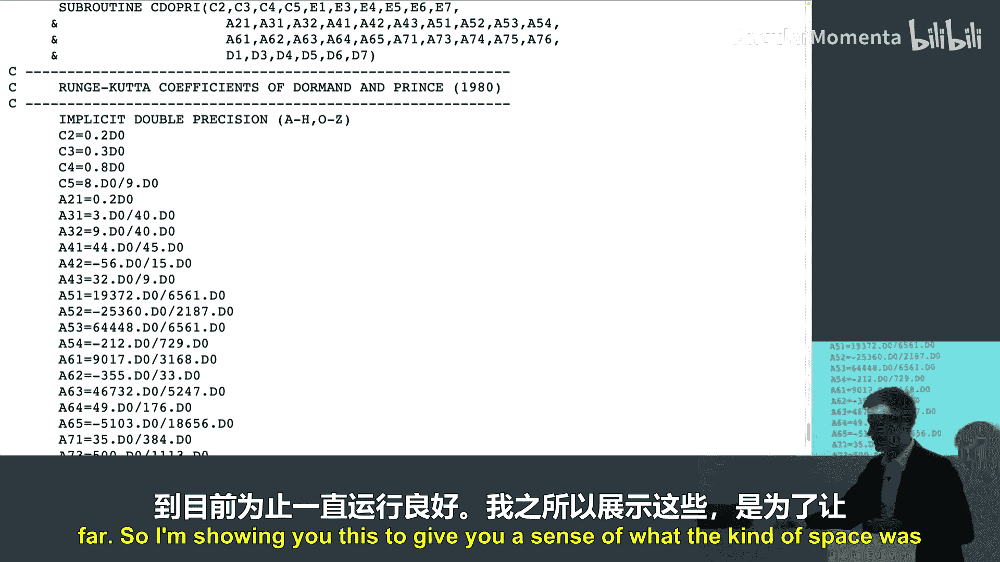

I'm showing you this to give you a sense of what。The kind of space was that machine learning engineers encountered when the field emerged。

 So machine learning is much younger than these methods。

 The first international conference on machineine learning was in the 80s。

 Maybe the field kind of emerged in the early 200s as a proper subfield of computer science。😊。

And whenever people encountered these numerical tasks within their newde models that they were trying to train。

 they always inevitably noticed that there is already a method for it out there。

 It was invented by other fields， by。Economists， computational physicists。

 mathematicians and so on and so on。And it already did what they were supposed to do。

So that was really convenient because it meant people could just use the old code。

 It could take this fancy old code that was clearly very complicated to develop and just use it and not touch it。

 It's convenient because it's fast， right， It saves you a lot of time。

 But it's also a little bit tricky because it means that。😊。

If the task we' are trying to solve isn't exactly what this method is trying to do。

We are out of luck， and I'm going to show you over the next few minutes examples of how this can go wrong。

😊，So， those are。The numerical the kind of this maybe gives an intuitive picture of what the kind of algorithms are were talking about。

 Now， we should think about what are actually these numerical algorithms that we need within machine learning。

 and why are they a little bit different than the classic ones and why should we care about how they work。

😊，And I'm going to use this opportunity to do double duty and also introduce you to give you basically an overview of the content of the lecture course that we're going to cover over the course of this term。

 So everything I'm showing you is like a little sneak preview of stuff that's going to come。😊。

The first class of numerical algorithms we will look at linear algebra methods。😊。

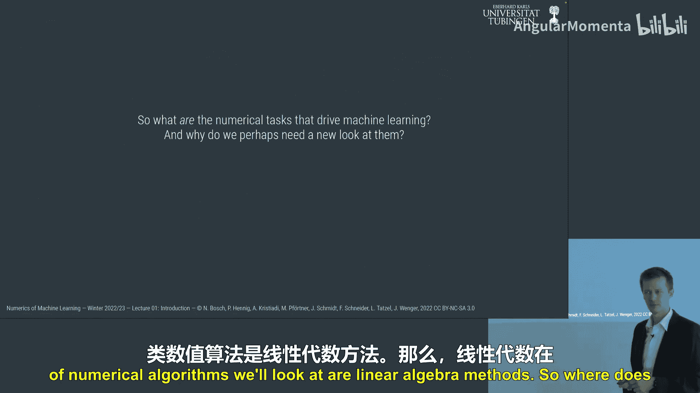

So where does linear algebra show up， It's obviously the most elementary thing ever。

 right you learned about it in high school。 Here is where actually， actually。

 I should have asked you， but maybe it's too easy， right。

 Here is where linear algebra shows up in in machine learning in the elementary algorithms。

 the base layer of everything else， basically。😊，So hands up， who is taken， and this is， again。

 me trying to understand what the audience is， who has taken the probabilistic machine learning class already last year by Yaob Ma。

 Okay， that's over half， but also not much more than half who has not taken it。 okay。

 so it's probably half half。 So if you've taken the class。

 then you've heard about Gaussian process regression as a base case of Bayesian inference。

 It involves this thing up here， learning a function。 This is this red thing from some observations。

 which is this black stuff and interpolating between those points with uncertainty。

 as you can see here。 So you do that， Bayesian inference by multiplying a prior with a likelihood。

 The prior is a Gaussian process。 And if the likelihood is independent Gaussians。 So。😊。

II D observations or function values over here。 Then you multiply those two。

 You get back a Gaussian process post。 If you haven't heard about this before， it doesn't matter。

 You don't have to understand if you， if you've heard about it before， it's pretty obvious， right。

 And then you've learned that this object con is defined by two。Objects， again， right， two functions。

 a posterbior mean function and a posterior covariance function。Those define。

 So this this M of x is this thick red line here in the middle for those who don't know。

 And this V of x is a bivariate function that is basically the source of these samples here。

 are these golden lines。So， these objects。You've written them down in your class。

 If you've taken this， they look like this。 So M of this positive mean involves taking the data Y。

 So that's a vector。And multiplying it with， at least that's the way you see it in the slides。

 the inverse of a matrix。 and that matrix arises by filling the。

 the entries in that matrix by evaluating a function called the kernel。 So these are kernel methods。

 Another way of thinking about these algorithms is that they are kernel methods。😊。

Then you invert that matrix。 you multiply from the left to this vector。

 multily with another matrix that also arises from filling up a matrix with with values of a function。

 And that's your function。 That's what this thing looks like。 That's this red curve over here。😊，So。

That's the stuff you see on the slide when you go into a polylistic machine learning class。

 It's not the stuff you do when you do your homework in that class。So。

There's anyone who's taken the class already can tell me what the knee York reaction is to this line。

 What you should you do if you implement it。です。Use the Choleski decomposition， right？

 So Professor Mac probably told you， if you ever write Ny dotlinar dot inf， like invert a matrix。

 it's already a bug， right， You should never， ever have a reason to compute the invert of a matrix。

 Instead， you should use something called the Cleski decomposition。 So I've lost focus of my slides。

😊，So the code probably looks like this。 This is the elementary piece of Python code you would use。

 So you import some fancy stuff called Cho factor and show solve from Ni。 And then。

 so you fill up this matrix。 You build this matrix that we need to operate on。

 And then you call this fancy method。😊，And this fancy method returns something。

 which is called the Tusky factorization。 and that you can use that to compute this object that we care about。

 So you can compute， use this to solve this issue here by like solving。For G inverse times y。

 basically， right， So find the vector。A such that G times a is y。😡。

And then you multiply from the left。 Okay， so that's fine。 So this piece of code is， again。

 one of these instances of this sort of fancy。😊。

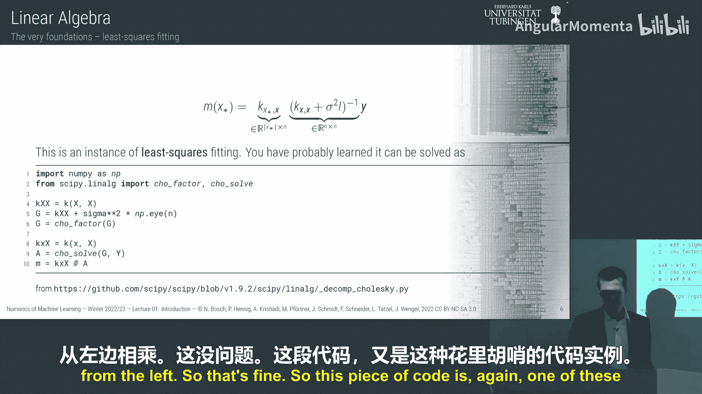

Fancy code。 So this is Lina Cholesski in Nai。 If you have a look at this。

 then and you try to figure out what's going on， you'll see that this is what is it actually doing。

 Let's go Cho factor。 Okay， that's nice。 This is what we were looking for。 What does it do。

 it does Anoscorre Choleski Anaos Choleski was somewhere up here。😊，But the what I you do， it calls。

 oh， it does this。 So it calls a function that does all the work。 That's called to。

Does anyone know what this stands for？Okay， and that's exactly the problem。 right， So is， okay。

 that's it。 So the rest， if you read it through the rest of the code。

 it's just all entry input checking， right， There's nothing other。

 nothing else happening in this Python code。😊，It just calls something called and that's the thing。

So has anyone heard of LepEC？Or blast。Yeah， so what this is。

 is it calls one of these elementary blast operations。

 underneath actually is not elementary is level 3。 So what this is is P O is positive definite because this matrix is positive definite。

 And then it does a triangular factorization。 And what as you do that， Well。

 you can try for yourself to hunt for this piece of code that does this， You won't find it。

 It's Fort one code that's hidden away in a library that's already installed on your machine。

 So you can't even look at the source code on Github。😊，At least not in this gatetreple。So again。

 we're in a situation where we can't really think about what to do about this algorithm。

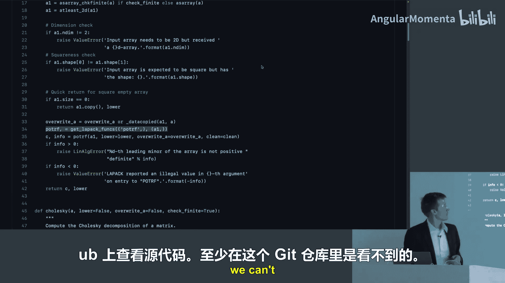

So why is this a problem， Well， So maybe if you've heard about Gaussian processes before。

 what's the problem with kernel machines。Maybe you heard that they are not particularly。

Common and contemporary machine learning anymore。 why。They don't scale well too much。Yes。

 they don't scale well to large amounts of data。 So if， so this matrix here is of size n by n。

s a size number of data points by number of data points。

 How expensive is it to compute solar decomposition。😊，Just shouted out， someone already said it。

And cubed。 Yeah， so y and cubed， does anyone remember their high school days of solving linear systems of equations。

😊，So it doesn't actually matter how yourlesky works。 You're going to learn about that next week。

What what you can think of is the stuff you did in you in high school。 So you write down。

 this is probably not going to work。 But， you know， let me just wave minds around。

 So you write down your， your， the， the equation you're trying to solve eight times。Now。

 G times a is y。 And then you multiply on the left with a matrix until you have on the left hand side。

 a unit matrix。 And on the right hand side， you have the solution。So to do that。

 you start with the first row of your matrix， which is n long。

 and you want to have a one and then lots of zeros。

 So you divide by the first entry and subtract that line from all the lines in the matrix。

 right So the line has length n and there are n rows that you have to subtract it from that costs n square。

 And then you have to do that for every row。 So that's n cubed。😊，Right。

 so how many data points do we have in a reasonable data set these days。A million。

 maybe it's not a really big data side， but it's reasonable。 So a million is 10 to the 6。

10 to the 6 cubed is 8，10 to 18。 How many seconds does a year have。10 to the 7， pi times 10 to the 7。

 How many operations does your computer do per second。10 to the 9， right， maybe 10 to the 10。

 depending on how P your GPU is。 So let's say 10 to the 9，9 plus 7 is 16。 It's 100 years。

So we're not going to do this， right。 So people say kernel methods don't work。 It don't scale。

 actually， as you said， right。But they don't scale because you call this function。

And that's cubly expensive。 And it's one of these methods that just runs。

 And you have to wait for it to finish。 And before it's finished， it doesn't do anything。

So in lecture number 1，2， and 3， from Marvin and Jonnaan， who are sitting at the back over there。

 youre going to learn that there are actually other linear algebra algorithms。😊。

And those are the kind of algorithms you actually need to understand to use。 Otherwise。

 they won't work for you。 You have to babysit them a little bit。

 They are not like classic algorithms。 But if you do， they can speed up computation massively。

For example， if you know something about your dataset， if you know that it has structure。

 you can use that to make the computation way faster。 In the most extreme cases。

 even exponentially faster， not always， but sometimes。

And if you' are happy with the algorithm not returning the perfect solution。

 but just an approximation。😊，The algorithm isn't even cubic to begin with。 It's all very faster。

And you don't have to wait 100 years for your method to train。

 which is really not a surprise because you may have learned in your theory class that what this algorithm actually does is it solves the least square problem。

 So it minimizes a function。Just like， deep learning。It minimizes a very simple function。 Actually。

 a quadratic one。 Why should it be harder to minimize a simple function than to minimize a complicated nonlinear function。

 like a deep neural network。So the argument that kernel machines are too expensive is way stopping way too short of the truth。

 It's much more tricky， actually， much more detailed。 And if you know about why this is。

 you can actually build solutions with Gausian process regression with all the nice properties of Gausian process regression that scale to very large data sets。

That was instance number one， linear algebra。Let's do setting number  two， simulation。

So simulation for me， and this is the moment where okay， heads up。

 have there anyone in the room who has taken on a medical analysis class？😡，Okay。

 who is studying or used to study math in a previous life。Well still does。 It's different people。

 interestingly， actually， So some overlap。 Okay， so here's my definition of a simulation algorithm。

 And， you will have your， hold your nose while I do that because it's quite weak。 So I'm。

 I'm gonna call a simulation method an algorithm that simulates the trajectory of a dynamical system through time。

😊，So in a sort of abstract sense， this involves equations like this。

 which are statements about a curve， X of T， a multivariate curve， actually。

 So x might be a vector that doesn't actually like doesn't have x as a free variable anywhere in the equation。

 It's an implicit equation， right， So there's something wrapped around it on the left hand side。

 there may be something we might call a differential operator or on the right hand side。

 there might be some nonlinear function of this curve。😊。

This includes the special case where this linear operator on the left is actually， sorry。

 but this operator on the left is is simply that that the derivative operator operating at time。

 Then this is called an ordinary differential equation。

 or it may be a more complicated thing where the operator on the left is a potentially nonlinear differential operator that also involves partial derivatives of x with respect to its entries。

 Then this is called a partial differential equation。

 And it may be even more actually general setting。 What is just one equation on the left hand side that operates on all the derivatives and on the right hand side。

 it just says equal to 0。 that's called the differential algebraic equation。😊。

So methods that solve these problems that estimate X， you may call simulation methods。

 and they show up in machine learning in two actually quite different kind of。

Almost orthogonal domains。 On the one hand， they show up whenever we build acting agents。

So AI is also about building machines that can live on on their own， right。

 So a robot or a self driving car or a reinforcement learning agent that plays a game。😊。

Have to be able to predict what's going to happen next。So that they can change their behavior to， to。

Like create a beneficial future， right， to create a trajectory that they are happy about。

 You could call that control or reinforcement learning or robotics or whatever。 right。

 It's all the same thing。😊，So these methods need to predict the future。

 So they need to predict the behavior of dynamic systems。

And then there's another setting that's currently actually emerging as a really big threat within machine learning。

 that's called scientific machine learning。Which uses simulation tools to encode physical knowledge about the world。

Differential equations。 so physics and chemistry and most natural sciences encode knowledge about the world in laws of nature。

 And these laws tend to be differential equations。 partial differential equations， typically。

 you know， Schchroding' equation。Plack goals for economics。

Nav your stocks for climate models and so on。 So if you want a machine learning algorithm that makes use of this physical insight。

 then you need to be able to solve differential equations。

 And I'm going give you gonna give you a very simple example of such a setting to tell you why you need to know about how these algorithms actually work。

 So by the way， what are these like O D E the solves for this O D E for setting like this。

 That's exactly this algorithm that I showed you before。 Actually。

 this is the prototypical method for solving these kind of problems。😊。

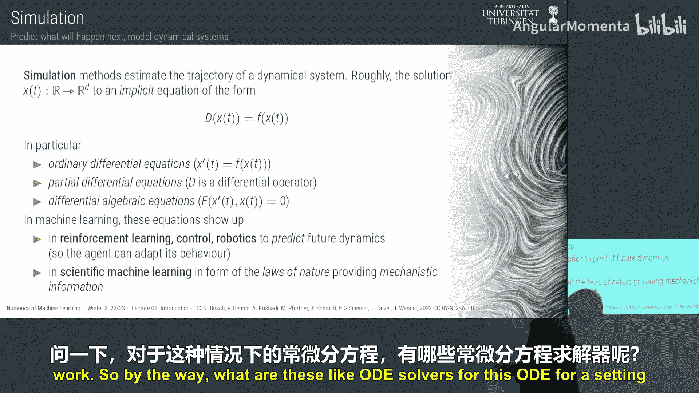

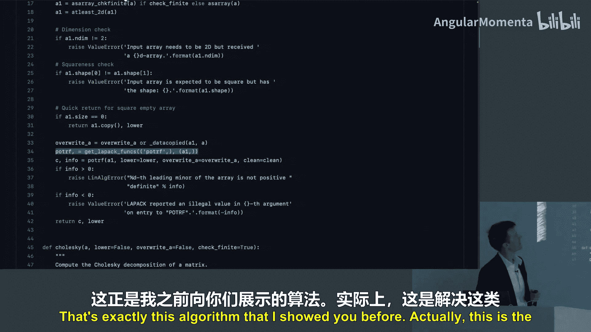

So here's an example from our own work。 This is from a paper that was published in New Ris a year ago by Rononna Tchmt was also sitting there in the back。

 This is， a data set that everyone knows。😊，Maybe you haven't seen this plot before。

 but you know what this is about， right， These are Covid cases in Germany over the first one and a half years of the pandemic。

So you may remember back then， the thing that everyone cared about that you went to bed looking at before falling asleep was。

 how does this curve continue， as you keep going up， Is it coming down。

 What's the next thing that's going to happen， right。So this is a prediction problem。

It's exactly the thing that machine learning is made for。 It's even a very simple prediction problem。

 It's just about 500 points on a one dimensional axis。 It doesn't get any easier than that。 right。

 If you have AI systems that can invent images like the stuff on the right。 clearly。

 you can go through that line and predict what's gonna happen next， right， So if you are， you know。

 machine learning expert， not an American mathematician， your first approach， might be harm。

'm gonna use one of my fancy machine learning algorithms。

 What's your first favorite machine learning algorithm， deep neural network， right。

 let's use a real network to regress on this function and predict what the next thing is。😊。

This doesn't work。 And actually， if you've learned about video networks。

 you may know that they extrapolate linearly。 So it's not a surprise that this looks like this。

 It doesn't have to be at0。 It could also go up。 It's just a bit of an accident with this data set of where I stopped。

 It could also have been a linear extrapolation upwards。 It doesn't matter。 It's equally useless。

 right， You could use some fancy Gaussian process with a cool kernel。 It's not gonna work either。

 It just produces some line。 maybe an exponential increase， maybe a straight line， whatever， right。

 None of this is useful。😊，So what we need。Is mechanistic knowledge。

 scientific knowledge of what what's going on。 There is a causal structure behind this data set that we need to use to predict。

 And a causal structure is that people are getting infected with a virus， right。

 So there are differential equations that model this systems。 The most simple one， actually。

 the one that everyone uses， even though in a somewhat advanced。

 more advanced version are these S IR models。 Hence up， who has heard of S IR before。😊，O， okay。

 so I'll tell you。 So the very， very basic idea。 So this is actually the model that that even the most fancy simulations used。

😊，The ones that we looked at all over the world， it's just that in the fancy versions。

 it's not just three lines。 It's like 1000 lines， but they do the same thing。

Which is that we we separate society into three groups， people who haven't had the disease yet。

 people who currently have it and people who have already had it。 We call them susceptible。

 infected and recovered S I R。 And you move from one group to the next。

 So if you're still susceptible， you're in the top group。

And then there's a chance if you're getting infected。 If there is many infectious people。

 if I is large， then a lot of and a lot of susceptible people。

 then a lot of people get infected and they move over to the infected group。

 So these two terms are the same。 P is the size of the population。 It's just a constant。

And then once you have the virus， you can infect people。 Now。

 you're in the lucky group that gets to stay at home and you move out of this group by recovering with a certain rate。

 So if many people are infectious， many people will recover。 And if no one is infectious anymore。

 no one can recover anymore。😊，That's a differential equation。

 It's one of these ordinary differential equations。

 So this is exactly the kind of thing I can apply this fancy algorithm to that is up here。

 And actually， I can tell you what I need to do。 So I need to in encode this cool function。

 That is this three lines of differential equation。 I need to tell it where to start the integration。

 what the initial setup， what the initial value of all three values are。

 where up until where I wanted it to solve what the end point is of the simulation and then a lot of tolerance is for how it should actually work。

 So this is exactly what the numericalmer mathematician told us to do。😊，It's just。

 you notice something about this equation that I haven't told you yet。

There's two numbers in there theyre called Pita and Gamma。What are they。😡，We don't know。

So I set pizzata to 0。1 and Gama to 0。1， and I let it run。 It looks like this。😊，That's useless。

 It's just as useless as the machine learning algorithm before。So what is the problem？

You can play around with this Peter and camerama。 Actually， I did。 I hopefully up down a little bit。

 So that curve looks like this。 But no matter how you choose Peter and Kama。

 you'll always get one hump coming back down again， never2 or3。😊，Why。Because the contact。

 this beta is called the contact weight， change through time。

 And we all remember because we have to take stay at home to to reduce beta。

 That was the entire point。😊，So people， there were lockdowns， people at home。

 and they came back again。 People didn't quite follow。

 And there was another wave and so on and so on。 All this dynamic has to go to beta。

So how do we get this into this equation though into this。

 into this algorithm that's supposed to do this simulation。

So here is why it's bad that some applied mathematician in 1905 came up with this setting。

 It's called an initial value problem。 It assumes that you know what the differential equation is。

 and we don't。Now we have something that could tell us what the differential equation is。

 We have this red line。 Notice how this red line has nothing to do with the algorithm we use to solve。

 There is no way to put it in because this fancy algorithm。Doesn't have。An entry for data， right。So。

What could we do？ Well， oops。We could make be time dependent。

 So making a tiny event is already all were going to do that。 Oh， I don't know。

 let's make it the output of a neural network because we're machine learning engineer。

 So that's the best idea we have， right， so it's a parameterized function。

 It has a bunch of parameters data。 and we're going to optimize through the O E solver。

 There's just a problem that。😊，This code。Doesn't have derivatives。 There's no backwards。

 It's For van called from 198 what，1993， people didn't know about automatic differentiation back then。

 There's no alternative。Right， well， thank God for Google。

 someone implemented this algorithm for us in JackX。

 It's I think actually originally Jake Wanda plus， this guy or Matt Johnson， main developer of Jackx。

 They've actually， as you can see， maybe committed to this repository two days ago。

 So here is there OD E solver， Jackx experimentali dot O D E， What kind of O D E solve is it， Oh。😊。

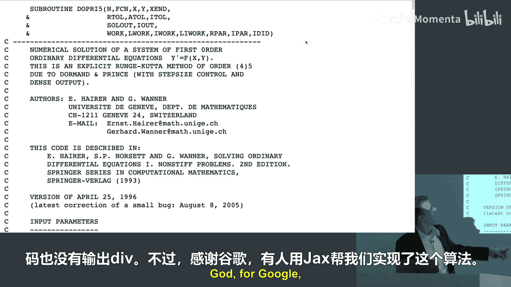

It's exactly the same method。 It's just now implemented in fancy Js。And it still has。

 let me go and refine it。😊，嗯。It still has those numbers in there。

RightSo the first one is a one over5， let me see。

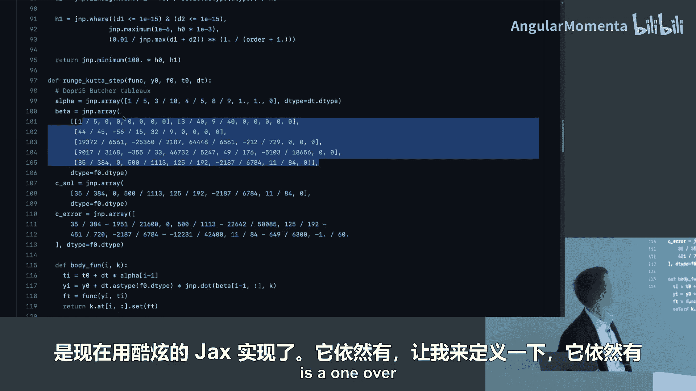

The first one。Is a one over 5 or。2， right？ I'm sure Matt and Jake actually went through this original For one code and they copied in the exact。

 exact correct correct values。 because if you change one of those numbers。

 the algorithm doesn't work anymore。

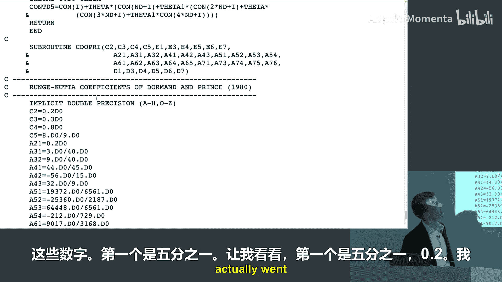

Right。So even though we now have fancy contemporary machine learning toolboxes。

 we haven't changed anything about these algorithms yet。So why is this a problem。 Well。

 the problem comes that he we defined is whenkuta step。 That's a single step of this algorithm。 step。

 Well， it does steps。 Yeah， it does steps。 So where is the main algorithm that。

 I think this is always the point where I have to hop around a little bit。 and hope that I find it。

 There we go。 This is the magic line。😊，Where。The steps are performed。 So this is Js。 or actually。

 yeah， So you there a scan。 It's a sort of。😊，Funny way of hiding a full loop。

 This algorithm actually does a full loop inside。 So when we call gradient descent on fitting this。😊。

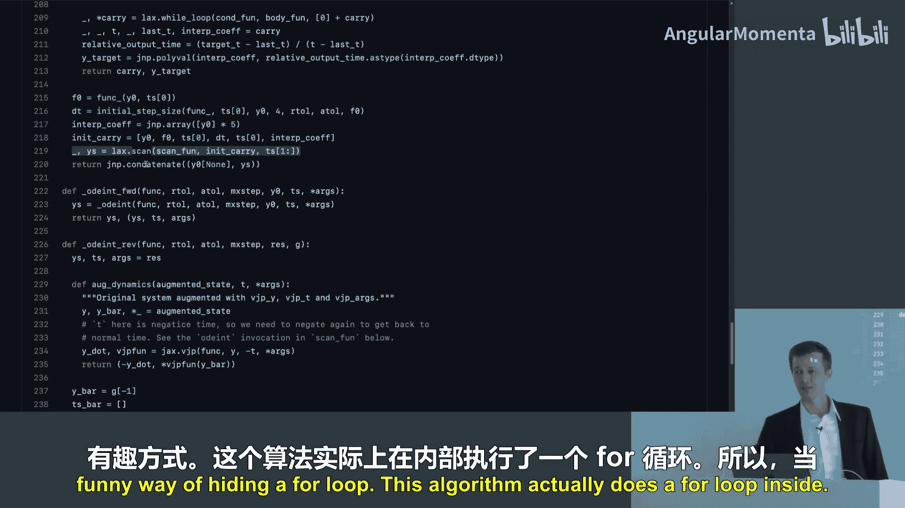

The curve that we originally had onto our data， we're actually calling a full loop inside of the full loop。

And every computer scientist knows that nested follow loops potentially a dangerous thing。 right？

 So this approach is called simulation based inference or approximate patientian computation。

 And it's actually a meaningful way of solving these kind of problems。

 It's actually the current way of solving these kind of problems。

 And some of you here in the room are working on these methods。

 So you know very well how to use them not even more fancy。

 I it's a bit silly to use it on a simple problem like this。

 You would actually use it on a much more challenging problem， right， but。😊。

What I can tell you is that this innerfo loop actually evaluates this function F that we don't know many times over。

😊，And then once it has evaluated them many times over， it steps outside， returns the gradient。

 does a gradient this step， and then starts again， calling F many， many times over。

 And you'll learn exactly how it does that from your Na and Natanana Ya。

 We're going to teach lectures number  what，4，5 and 6。😊，And。嗯。

What they will tell you is that you can build your own algorithm。A method that constructs these fan。

 this fancy list of numbers inside of the Fort one code。In a procedural way。And adapts them。

Maybe in light of this data。And the way this is going to work is。

 and I'm only spoiling it a little bit that I're going to tell you that you can start with something you could think of as a spine in your algorithm。

😡，That spine that you can hang operators onto。 That spine is going to be a markov chain。

 Anyone have Markov chains before。Not vigorously if you have， not everyone has。

 So if you'll learn about Markov chains Very good， not everyone's nodding because the time is going to give an entire lecture inference in Markov chains。

 And it's going to tell you that you can think about the states that you're trying to simulate as a sequence of probability distributions and that you can then condition these probability distributions on what something we'll call information operators。

😊，That can provide information。Right， some one kind of information could be that there is an ordinary differential equation。

 and it holds。So some states in this big X will be derivatives。

 and well find out that the value of this derivative is given by the value of some function F evaluated at the curve x。

😊，But you can also plug in other operators。 like， for example， that， you know that the data。

 that you have observed data that tells you the curve goes through some points。

And you can plug those in within the same fur loop。

And you can use this extra data to inform the algorithm about stuff that you don't know yet。

 like our contact rate beta。And you can do that all in a single solve， forward through time。

Without calling a full loop over and over and over again in an outer loop。

And you'll get a plot like this that at the same time infer the contact rate through time in a nonparmatic fashion。

 between Gaus process， posterior and predicts into the future。

 They'll tell you how to actually do this。😊，And then this result is obviously gonna be an algorithm that runs potentially much faster and more。

 maybe more importantly is way more flexible than this primordial piece of code that has been handed to us from 19。

 what893 or 75 or 1905， depending on who you're asking， actually。😊。

And we need to do that because these days we have data。

So when mathematicians built these numerical algorithms。They didn't have data。 So in 1905。

 data consisted of some guy outside walks around with a notebook， writes down some numbers。

 comes back into the lab， draws onto a plotting paper， draws a curve through it and says。

 this is the law of nature that we're going to use。Data never entered。 There was no computers， right。

 No hard drive。 But these days， machine learning has created a data centric view on computation。

 and the algorithms that we use， even at fancy Google are still 100 years old。

 So it's time to change them。😊，You want to find out from Yoonnatan and Datanil and then also afterwards for Marvin。

 again who you've already seen on the previous slide that you can build these spines。

 these algorithmic spines that can operate on different information operators that they can actually provide algorithms that have the same computational complexity and efficiency as the classic algorithms if you run them on the classic setting。

 but create new functionality in the form of various information operators。

 And if you're really careful about them once you know how they work。

 you can even use them to solve partial and even differential algebra equations。😊，Okay。

 that was simulation。 So now we had linear algebra and simulation now。

We are right before Christmas in the two weeks before everyone goes home。😊，Actually。

 one week where everyone's still here。 And then one week where everyone's at home。

 we're gonna talk about integration。And you're gonna see me during that time。

 which is actually has a reason。 The reason is， I don't have a PhD student working on integration at the moment。

And that's because I currently don't know how to make it any better。

That's why I'll have to do the lecture。And so in integration， we're not actually。

 I'm not actually going to introduce you to particularly fancy new algorithms like in the previous two chapters。

 But instead， we're gonna talk a little bit about what actually happens to in computation and get a good feeling for like the most elementary kinds of operations and willll also cook some food。

 So briefly tell you why integration is important though， for machine learning。

 it is actually an elementary operation of patient inference。

 So for the probabilistic side of machine learning， the elementary operation is this thing up here。

 Comp a postib distribution。 or you could call this a conditional distribution。😊。

And you do that by taking a joint distribution and dividing by a marginal， right。

 and marginals are integrals。So if you want to do Bayesian inference in a generic fashion。

 you need to be able to solve these kind of integrals。Yeah， typically of this kind of form。

 that's very in ways of thinking about them。And spoiler alert。 The simple story is going to be that。

The standard way to do this in， in Bay inference is called Macov Che Monte Carlo。

 And it's actually the worst of all possible algorithms。 It's sadly。

 also the only really proper possible algorithm。 And we'll find out why。

But we'll realize that there are special settings， in particular。

 low dimensional integrals or very structured integrals。

 where they are much faster algorithms that also have really nice properties。

 And they'll tell us something about the relationship between the good old classic algorithms that Ive shown you before and maybe a new way of thinking about computation。

😊，And then。In January。After the Christmas break。We'll move to what's arguably the most central numerical operation of machine learning。

 which is。Anyone what to guess？Second。Mticsmatic O， me certificationification would， for me。

 would be a lower layer of linear algebra。 So we will talk about megasification next week。😊。

Optimization， yeah， So the maybe like the。I don't know。

 Foundational operation of machine learning is empirical risk minimization or maybe a basic template of machine learning。

 So this involves computing a value theta of some parameters that minimizes some loss function where a loss function happens to people to have the property that it's a big sum over many terms where each term at the sum depends on all the parameters。

😊，But only one dayt in your data set。There various ways of thinking about these problems。

 You could call them exchangeable models or empirical risk minimization。

And what the loss function actually is depends on your model。

 So But the photototypical one is a deep neural network。

 right Where theta are the weights of the network and the Y I are a placeholder for the data。

 which could be inputs and outputs for a supervised problem， right not just outputs。And。Actually。

 why are these algorithms so important， Because they are a basis for something that。

I think it's synonymous with machine learning now， but some people actually think of it as like maybe a more general class of algorithms。

 which are differentiable programs。 So programs for which you can hope to compute the gradient of this function。

😊，By applying a gradient operator， and if your programming language is rich enough and it's like after 2007 or so。

 you can compute this gradient automatically and apply to the individual terms in the sum。😊，So。

Algorithms for this purpose， are called optimization algorithms。

 and just for the other domains we spoke about before， there are classic methods for them。

And they are stored in s P dot optimize， right。So。What would be such algorithms？😡。

What's your favorite optimizer。S GD。Adam。What about mathematicians that raised their hand before went math classes。

Adam。BFGS， I was hoping for someone。 So if you going into S on optimize， actually。

 maybe there's now an S GD。 I don't know。 I think in Cy optimize， there are methods called minimize。

😊，And they call algorithms， like B， FGS。Who's used BFGS before。

 like actually written code that calls BFGS。 Okay， did you like it？good Okay。

 so it's interesting because BFS is a wonderful algorithm。 It doesn't have a learning rate。😊。

It stops on its own。 You never have to stop it。 It just stops that it's done。

 You can start it from pretty much anywhere。 just converges to a minimum。

And it works on pretty much any differentiable program。A problem。But somehow。

 when I ask a machine learning class in 2022， what your favorite optimizer is nobody uses PFGS anymore。

So why is this？This is actually an interesting case of in the previous。

 previous two chapters or three chapters。I showed you old algorithms that are that are sort of being used without reflection。

 right， where someone just takes the code from 1984 and applies it in 2022 and just ports it line by line into into from Fort1 to jacks。

In optimization， we are much further。 Their machine learning is noticed that the old algorithms don't work。

 and they've built new methods。But in doing so。He lost a few things。

So if you' have trained a deep network before， you know that you have to choose a learning rate。

 that you have to watch this method run。 You have to look at。 You have to restart it 50 times。

 see which one works best。 You have to decay the learning rate after a while。

 do all sorts of weird fancy tricks to make it stable。

 And then you have to figure out when youre done。 The thing doesn't even stop on its own。

 You have to wait。 And then you have to say， stop。 Let's see what it looks like。😊，That's weird。So。

Why is this， Well， it's because no one actually does this。😡，That is up here。

 No one actually minimizes the empirical risk。What you do instead is you realize that。It's 2022。

 and N is big。Right， N is a billion， maybe data points。 and your， the cache of your GP can hold 4。

Of these terms in L。Right， because you have to load Y and they are images and they're big。

 And so you have 8 GPs。 And， you know， you can hold 32 or so。 So what you do is instead。

 when your optimizer asks for a gradient of the thing， you don't actually compute a gradient。

 Instead， you'll have lost focus again， instead。😊，You draw a batch。So you ask your machine， Actually。

 there's a fancy piece of code for it called the data loader。

 which you ask to provide a random sample from your data set from the disk。Right。

 and then you compute a much， much smaller sum。Over a a lot less terms， maybe4， maybe 1632，265。

 something like this。And if you do that， right。😊，That's actually a good idea。

 because if you manage to draw these data points。 I I D so independent identity distributed from your dataset。

 then this is an unbiased estimator of this thing。 It's a random variable now。😊。

But its expectation is the same as the thing you're interested in。And in fact。

 actually it's a sum of ID random variables， so if M is big。😊，It's almost Gaussian distributed。 Now。

 annoyingly， M isn't actually big。 It's 4， right， But if it were big。

 it would be Gaussian distributed。So in our computation， inside of the computation， in the GPU。

 When we ask you to compute a number now， we're not getting back the number we actually want。

 We're getting back a random variable that is distributed around。The thing we care about。

 the loss function， according to some complicated probability distribution， that is。

 even if you're lucky， a Gaussian distribution。And Gaussian distributions have two parameters。

 They have a mean and a standard deviation or a covariance。 Actually， right。

 So here's the thing we want to know。 We don't know it though We can compute this thing。

 That's our gradient。 But there is something else， which is the noise around this observation。

 the covariance。😊，So if you've trained the D network before and all of you have。

 I guess I'm not even going to ask because this is gonna be embarrassing for the three people who haven't。

 You， you're probably calling something like this。 So this is the torch code for this。

 if you're using for something else。And so you define， you load your data。

 This is the bit that does the random batching， right？

 Then you define your model and your loss function。

 And then you call the fancy thing that computes the gradient。 And then you can ask for a gradient。😊。

In the parameters。That's this part of this likelihood of this computation。What about this part。

Where is it。Have you ever thought about why this is not part of Param？It's oddno。

 There's a probability distribution in our computation。 It's a stochastic computation。

Probbilably measures have statistics， not just the mean。Why is it not。

 Why as torch not tell you the variance。Sagan。doesnぞ。It doesn't know。 So why does it no， no。

What we need， Is it expensive， maybe。Maybe it's too expensive。 Maybe the smart people。At Facebook。

 writing in Torch。Have decided that this would be too difficult to do。So they've left it out。

How expensive would the P to computer variant so。Here is a thought。 right。

 So this is the thing we're currently computing。Here's our gradient。 So we do this over a batch。

 So there's actually an array in memory kind of， right， there's a long gradient。

 And then there is M of those for each element in the batch， right。😊。

And they've been computed because clearly， we can do that。 That's what your computer does。

When you've done that， which is the fancy back prop pass。

 That's the expensive thing that you use your GPU for。

 You might as well just use those numbers in the array and square them element wise， right。

 That will give you a nonstandardized second moment estimate， which is the estimate， right。

 But the mean is also an estimate。 I mean， these are both estimates of the same type。😊，Right。So。

Why not do that？ It's not expensive。It's just you take numbers that are already in your Ram anyway or your V Ram or whatever or your cache。

 You just square them。Squaaring is not expensive。 and then you sum them up and you return back that number。

 That gives you the diagonal of this covariance matrix fine。 Okay。

 so the big matrix would be too expensive。 But still will be good， no。

 to have anarrow bar on each gradient element。😊，Might have we not do that？And I think。

 so here's my hypothesis of why we don't do that。 It's because we still think。

 like the numerical analyst in 1905。I think optimization is about computing a gradient。

 And then that gradient goes into a function called you know。

 P FG S update or gradient descent or whatever。 It's like a one line contractive operator that uses the current gradient and applies it to the weights。

 And that's it。 That's what optimization is， right。😊，That's how all the optimizers work。

But they ignore the fact that they don't actually have access to the number they are trying to compute。

 They only have access to a random variable。 So the random variable should show up。

 the fact that it's a random variable should be part of your deliberations when you build the algorithm。

So we actually build a piece of code。 I mean， I say we Felix and Fred wrote a piece of code in 2019。

 There was an aura that IQ 2020 to show that you can compute the variance。

 and you just change your line a little bit。 You import this cool Python package for Pytorrch。

 backpack for Pytorrch。 You extend everything。 And then you say， do the backward pass。

 but give me the variance。 And here it comes panm。😊，So if we can do that。We've done it now， right？

And now we can start thinking about what to do with this。 Well， it was 2020。 two years since then。

 It's a lot of tall order to make， you know。To solve deep learning， basically， training。

 So we don't quite have the answer to it yet。 but we're going to tell you a little bit about it。

 So after Christmas， you're gonna hear lectures by Frank， who is at the back of the camera and Lucas。

 who is sitting at the best seat of the house。 And Agusinos， who is， he actually here。😊，No， so G。

 who is probably going to do the lecture from Toronto， where he's gonna move next。 And Julia。

 who is at the back of the room about how to think about optimization or actually maybe not to think about optimization。

 But instead， how to think about training a deep neural network and not even trying to use the about optimization anymore because it's misleading。

 We're not actually trying to find the minimum of a function。

 We're trying to use random variables that we can probe to find a point that generalizes well and gives a welltrained deep neural network。

 They are going to tell you that uncertainty arising from this randomness in the computation is extremely important。

 It's actually maybe not even randomness because randomness sounds like you can't control it。

 You sampling from your dataset。 So you have a lot of control over it。

 that this is very core to the issues of how to train deep neural networks。😊。

They'll tell you that you can compute various observables and that you can use those to understand better what goes on inside of your deep neural network。

And to build therefore， better training setups for your deep neural network。And yeah。

 so spoiler alerts， they are not going to tell you exactly how to do it。

 And it's always going to work because at the moment， no one in the world knows。

I know for effect fact， because I personally am off the opinion that very few people in the world know more than frank about how to train at even neural network。

 And he doesn't know either， I think， so。But they'll also point out that you can use these observables that you may want to use to for。

 for training to add new functionality to your deep neural network。 For example。

 you can add uncertainty to the output。 You can make it a Bayesian deep neural network without using the fancy Markov chain ontekalo algorithms that are so expensive。

😊，But instead， do that in a way that doesn't basically doesn't add any cost。

 It just provides uncertainty without pain。And then there are still gonna be a few things that you can't do in this way for which you have to do the laborious bit of building an outer loop and optimizing your hyperpara。

 But even that is something you can think about properly。

 And Julia is going to tell you about how to do that in the very last content lecture before the end of term。

😊，So， that's the outlook。Yes。Your doctor。Why do you think。Yes。So then。Sple from。没有。You're getting a。

 you're getting a population。 So the question is， if youre up， if you're moving。

 if you optimize a moves while it calls， you get， you get a different distribution every time you take a step。

 yes。And you have to deal with that。But you can still call in one of these lines every time your。

 the method you're building has access to the gradient and the variance。 And actually。

 it has access to every single value in this table。 It does， you can use every row of this array。

 right， every term and the sum。And operate on those。 And then you can do even more things。

 You could compute second derivatives of this in certain directions， and so on and so on。

So these are the sort of the， that's， that's the detailed story that those were some sneak previews of what you can expect over the next term。

But I want to use a few more minutes to point out a few high level points。So， maybe。

You've noticed that there is a bit of a theme。Running through all of the stories I've now told you。

So I said at the beginning， an numerical method is a method that estimates something such that it can go wrong。

And maybe you've know， you know this experience from your own experience with machine learning algorithms that there are methods that estimate something that can go wrong。

I've told you that linear algebra methods can be much faster if you're willing to accept that they are imprecise。

If you're willing to ex， to accept a rough estimate。

Maybe you know this from the analysis of machine learning algorithms that if you are willing to accept a small data set。

 Sorry， you can get away with a smaller data set if you're willing to accept imprecision in the estimate。

I've told you that simulation methods can be realized in the form of Bayesian filters conditioned on information operators。

 which doesn't sound like an numerical algorithm at all。 actually。

 right That sounds like a machine learning method。And now I've just told you that when we do deep learning or actually。

 when we do differentiable programming on large data sets。

That the computation involves a probability distribution that I've written down as a likelihood in your computation。

Likelihoods are also not really terms that show up in the numerical analysis class。

 but they do show up in a machine learning class。So actually。

 it seems like these numerical algorithms that we use as the tools to train machine learning algorithms。

😊，They actually are machine learning algorithms themselves。And。

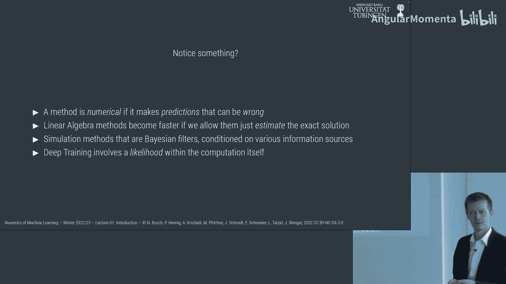

There is a real deep philosophical insight behind that。

 numerical algorithms of this type that I defined are algorithms that estimate an unknown quantity。

 You could call that a latent variable。 Let's call it Z， like the location of a minimum。

 the value of an integral or the curve that solves a simulation problem。😊。

And they estimate this latent quantity that you can't directly write down by evaluating tractable observations like values of the integrated various points。

 matrix vector products or these random variables that come out of GPus。

 if you evaluate gradient on the batch。😊，So they estimate a latent quantity。😊，From data。

And that's exactly what inference is。They are performing inference。

 They are estimating a latent quantities Z。Given that they have observed the result of some computation C。

The only difference to Bayian inference， as we know of it in machine learning。

Is that they collect their data not from the hard drive， by reading data points from a data loader。

 but by calling the processing unit。So they use the computer as a data source。But in the end。

 it's just numbers coming in。 And in the example of simulation。

 you've even seen that we can use those numbers very tangibly coming into the estimation process from two sides。

 data and compute。So it's possible to think of numerical algorithms as learning machines。

And actually， if you think of them as tools， that kind of makes sense， right。

So if you think of the tools that an engineer uses。

 a mechanical engineer uses to build mechanical machines， They are also machines。 right。

 A power drill is a machine or a CNC lathe is also a machine。

 but you can use it to build more machines。😊，So if you' are a good engineer。

 you don't just know the machine you're building。 You also know the tool。

The machine you use to build the machine。So。If you want to would be a good machine learning engineer。

And build pick fancy machines。 that do fancy stuff， like make this image of。

 of tools in the background。 You should probably know what the tools are。

that you use to build these machines。 and in which sense。

 they are machines and how you should set up。This is the idea behind an even bigger mathematical step。

 which is to say， well， if you can already think of what the numerical algorithm does as patient inference。

Why don't we just build numerical algorithms from the ground up， phrased as spatial inference。

As numerical algorithms that perform this operation here in the middle。And these methods are called。

Probabilistic numerical algorithms。 and they are algorithms that take a probability distribution describing their task and then use the CPU or the GP as a data source to refine their estimate of what the solution to that numerical task is and return a posterior distribution over that task。

😊，Such that epi distribution hopefully has good properties。

 It's ideally centered around the true solution with a spread that has something to do with how far the center is from the true solution so they quantify uncertainty。

These algorithms are discussed， not just in this lecture， but also in a book。

That you don't have to buy at all。 It came out a few months ago。 If you want to。

 you can check a free PF under this URL， but you don't even have to read the book to come into this class。

 The book is not going to be a foundation of this。 I mean， the stuff we're gonna discuss。

 is largely in this book。 But they're not going to refer to individual chapters of this book at all。

 You can just still look at them if you want to。 This is mostly just。You know。

Sneak way of introducing this book。What you're going to learn in this class is the in the overarching theme from the first to the last lecture is that when you think of computation as machine learning。

 you can do cool stuff with computation。 And that cool stuff is the same cool stuff you can also do with your learning machines。

 For example， you can combine different sources of information。😊。

Empirical data from the disk and computational or mechanistic。 So physical knowledge， for example。

 and data from compute investing resources， either into collecting data or into computing more numbers。

 which is also resource incentive to find a good solution。

 You can add uncertainty to the result of a computation。😊，And use that to， for example。

 do these trade offs between how much data and how much compute you invest。

And you can do what in Bayian infants， you would call type 2 maximum likelihood or evidence maximization。

 So you can try and find parameters of your computation， hyperparameter， like learning rates。

By some kind of outer inference loop around the inner inference loop。

 that's also a of patientian inference。So。This class。As you may have noticed by now。

Is definitely not your average numerical machine numerical analysis class。

 We're not in the math department。 We， you are rarely going to see proofs in these slides。

 and we're not going to talk about numerical algorithms in the language that you may have encountered in a numerical analysis class。

 And that is on purpose。 It's not because we don't know how to do it because we're not mathematicians。

 Well， also that。 but。😊，It's because we think that if you're doing machine learning and you want to understand how the machine works inside。

 you need to think about a machine inside like a learning machine。

 So it makes sense to think in the language of machine learning。

 It's also really convenient for you because that's the sort of。Mental toolbox you already have。

 So you might as well use it to build new algorithms。It is a computer science class。

 So you're going to write a lot of code。 And I'm going to tell you about that in a moment how we're going to do that。

 But maybe most importantly， it is a very idiosyncratic class。😊，In fact。

 I think this is the very first instance of a dedicated numerics of machine learning class in the whole world。

 I've looked around a little bit。 I've tried to Google for it。

 I couldn't find anything other than my own book。😊。

So this is an opportunity for you to be right at the moment when these ideas kind of emerge as something we could try out in as one more way to improve learning machines。

 not to solve everything， but to contribute meaningfully to how our algorithmic landscape evolve。😊。

That means you're gonna learn how what actually happens inside of the box。 So you'll look at these。

 these old algorithms and try to understand how they actually work。

 Sometimes that means looking at old algorithms， not inventing new ones。

 just understanding what they do， because that's important。But then once you know。

 you'll learn how to change them， how to move away from algorithms that contain matching numbers。

 And instead compute those matching numbers on the fly as the algorithm runs and adapt them to。

 for example， data so that you build new models that play more nicely with their surroundings。

 That's important because people out there， for example， in the industrial world。

 have now realized that。😊，Machine learning algorithms tend to be a bit difficult to employ in the bigger pipeline。

 And if， if we want them to play nicely with surrounding infrastructure。

 they need to have these kind of properties。And last but not least。

 expert knowledge in numerical algorithms or in the of the algorithmic side of machine learning is maybe one of the most you know highest expert levels of machine learning engineers。

 So if you want to be a well employable engineer or even researcher。

 it's a good idea to know exactly how learning machines work on the inside。😊。

I've also already mentioned。 and at this point， were sort of slowly moving towards admin that。

I'm actually not going to teach most of the lectures。 Instead。

 they are going to be taught by PhD students from my group。

 these eight people that are all here in the room， except for Augusts。And that's also on purpose。

 I'm actually going to be here as well most of the time， except for， I think， once or twice。😊。

And it's。Not， this is not not because I wanted to take some time off。 Well， maybe， but actually。

 because I think that for many of these， of these settings we'll talk about。

 these people are really the experts on these algorithms because they've spent now several years。

 typically of their lives already， really thinking about my new details of these algorithms。😊，So。

 for example， I think Euroonatan is at the moment， one of the maybe 10 people in the world who best understand how to solve these squares problems。

We've actually been at workshops together where  five of these 10 other people were around， I think。

 and。Natanana Hill has been traveling the world， thinking about all the ways in which this can go wrong。

 And he'll tell you。But he's still doing it。 So it can't be all that wrong。

 And Frank is in a collaboration with people at Google Brain trying to figure out if there's any way to train deep networks better。

 And if all the people he's in， he's in a constant video chats with there don't know how to make it better than than he does。

 And I don't know who would。 So I think we have to write people here to really tell you exactly what's going on。

 And you can ask them the hardest questions you can think of。 And if they don't know the answer。

 then， well， that's a good guess that this might be an interesting research topic to work on。😊。

So I hope that you're gonna be excited about getting lectures from real experts， not a professor。😊。

So， that's the content bit。My proposal is that I just use briefly a few minutes to tell you about the admin part that。

 of course， has to be part of a first intellectual all the time。

 And then there's still time for questions if you want， that maybe you can use that time tool。

 if you have questions to have them bubble up in your head。So the first question， of course。

 is how is this going to work， How are we。

Like， what is the day to day life and like in this in this lecture。 So we already。

 you already know we have lectures every week on Thursday。

 And there's gonna be a tutorial every week on Friday。

 There's no tutorial this week and also no tutorial next week。

 The tutorials will be here in this room Friday at noon。😊，We'll hand out exercise sheets。

 starting next week。And every week， the exercise sheet will consist of two parts。

The first one is just a service to you。 So I know that when a class is taught for the first time in this format。

 like this one is， there's always the question。 Oh， but what's gonna be in the exam。

 I want to know what the exam is like， There's no old the exams to look at。

 Please tell me what's in the exam。 So we're not going to answer those questions。 But instead。

 we'll give you an answer every week。 We'll give you one exercise。😊，On the top of the sheet。

 that is actually an a question that could be in the exam。 Of course。

 we're not going to ask that question in the exam。By questions like it。

You don't have to hand in that question at all。And， in fact。

 we're not going to correct it if you submit a solution。But you can ask about it in the tutorial。

The second part is the one that's actually the work。

 So that example question obviously shouldn't shouldn't take you more than 10 minutes to solve。

 because if it's gonna be in an exam and the exam is 90 minutes long。

 and there's gonna be 10 also of these questions。Right， so。The other part of the exercise is coding。

 So every week， you'll get a Jupyter notebook。So I've learned， I didn't realize actually before。

 but I've learned how that Jupiter stands for Julia， Python， something and R。

 So there'll be sometimes Python code and sometimes Julia code。

 And you're going to solve an actual numerical problem。😊，And typically。

 those questions will consist of at least two parts。And we're not going to， you。

 you'll submit solutions。 You submit that， by the way。

 by exporting the notebook as a P DF with the outputs and just uploading the P D F。

 because otherwise， we'll have the depend hell with everyone submitting from different， you know。

 environments。And those exercises will not be， will not be。They。

 they'll only be grade in a binary way。 So for each question will like the。

 the tutor who is going to be the PhD student who gave the corresponding lecture is just gonna make a tick mark if it's okay as a solution or cross it。

 make across if it's not a good solution。And to get a tick mark。

 you have to make an an earnest attempt to solve the problem。You don't have to solve it perfectly。

 but it's not okay to just say， why it didn't work。Right， every time you get a sufficient。

 every time you get a tick mark。You get。A bonus point in the exam。TheEx have 100 points。

 So if you get all of the exercises correct， you have 26 points because there are 13 sheets。

 And that's like halfway to passing the exam。You also have to get 5。 And actually， that's a typo。

 I'm gonna correct this afterwards，5 exercise sheets。So， that's just。

A bit over a third of all the exercise sheets。Created as sufficient to be admitted to the exam。

 but that should be easy to do。 So basically， you have to do some coding。 Otherwise。

 you can't go to the exam。It's important because we think it's important for you to code when you're learning about stuff。

 And you can only learn really about algorithms if you actually use them yourselfs。

Then there will be an exam。 Of course， that exam will be on the 13th February for the first exam in here and on the 31 of March next year。

 also in here for the second exam。You don't have to take the first exam。 if you don't want to。

 you can just come and do the second exam。 However。

 if you don't take the first exam and then come for the second exam and fail it。

 Don't come afterwards and ask us for a third attempt。Right。

We are not going to teach this class again， a year from now。So if you fail this last completely。

 this term， it's going to be very difficult to resetit it。 It you're gonna have to wait a while。

So I recommend that you take the first exam。And if you fail the first exam。

 you can still take the second one。 But， of course， I would hope that no one fails the first exam。

 And then it's all good。😊，Okay。嗯。Yeah， then some。Simple point I I probably don't have to point it out。

 but you've already noticed we're recording this lecture。 There's a person with a camera in the back。

If you're coming into this room， youre by being here， you're consenting to being recorded。

Don't worry about it， though。 We're not recording the audience actually。

 So I've have had a look before at the cutout。 It's only me。 So you can't really be seen。

 But if you ask a question， you may be just about all audible on this microphone。

We're not going to put the recordings on Iliaas or anywhere or on YouTube right after the lecture。

 We're going to do so at some point after we've cleaned up the recordings and made them into a bit of a structure thing。

 we also want to think about how to release them on the YouTube channel。

 So this recording isn't actually for you to follow along during the lecture because we want you to be physically here and ask questions。

I've learned from experience that once we do this virtually， people don't come anymore。

 The room is suddenly empty， but there's 40 people on Zoom， and you just talk to a wall。

 And there are not really questions。 And it's particularly even for people who should ask the questions。

 Let's be in a room together。And the final point I want to make is that this is a specialist lecture。

 as you may have noticed， It's not exactly found like standard start out knowledge for machine learning。

 So if you're interested in doing a master's thesis or maybe maybe even a PhD on。😊。

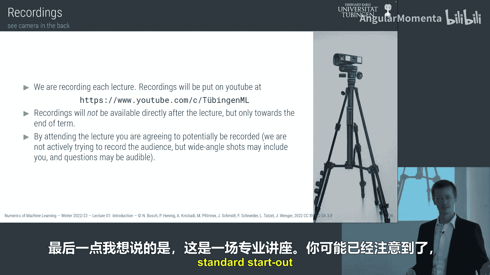

Nummerical algorithms for machine learning or for datacentric computation， if you like。

 then it may be a good idea to take this class and let us know if once you're a little bit accustomed to the content。

 once you've seen what we've done that you' interested。

 You're basically going to get advertisements for interesting stuff to work on in every single lecture。

 and we're currently looking for both masters students and Ph T students to work on both applications。

 like， for example， climate and weather forecasting and algorithmic solutions， like， for example。

 integrating simulation and deep learning in a more holistic way that it's currently being done by。

 for example， nodes and other kinds of algorithms。 and even to develop new software engineering tools for deep learning。

 you here in a later lecture by Frank and look us about what that actually means。😊，With that。

 I'm at the end。 maybe if we summarize and there's time for questions， I've。

Trying to convince you that numerical algorithms are really important for machine learning。

They are what drives the learning machine。 They are the engines of machine learning。

So if you want your engine to run well， you need to understand it。

And you're lucky because it turns out that this engine。

 the tool that you use to build a learning machine， actually is a learning machine itself。

 because it estimates。😊，An unknown quantity from observations。

 And that means you can phrase it in the language of Bayian inference。

 which is the language of machine learning， really。

So by embracing this viewpoint and taking it seriously。

You can learn how to build machine learning solutions that work faster。That are more reliable。

 They don't break down as easily what they know when they do。

 and they are easier to use because they provide information to the user that other methods can't do。

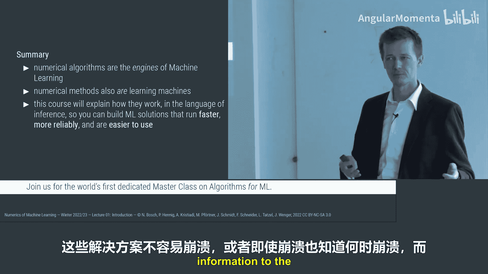

To do that， we're not going to ignore classic numerical algorithms。

 We're not going to throw them out and never think about them again。 That would be bad。 It would be。

Throwing away over 100 years of very hard work by mathematicians and other people。

But we're also not going to savishly follow the viewpoints of classic numerical analysis。

 But instead， we're going to adopt the viewpoint of machine learning and think about these algorithms as learning machines。

Now， I hope you want to join us on this right。 It's the very first time that a class like this is taught this way。

 And it's also an unusual setup with these nine different people teaching it。

 So I think it's gonna be an exciting experiment。 And I hope that most of you will want to stay。😊。

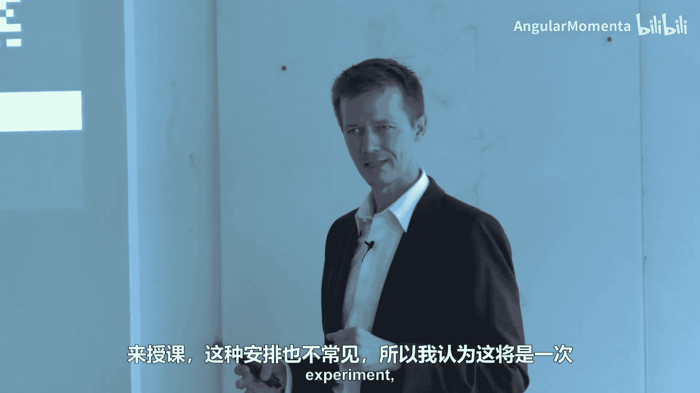

F。

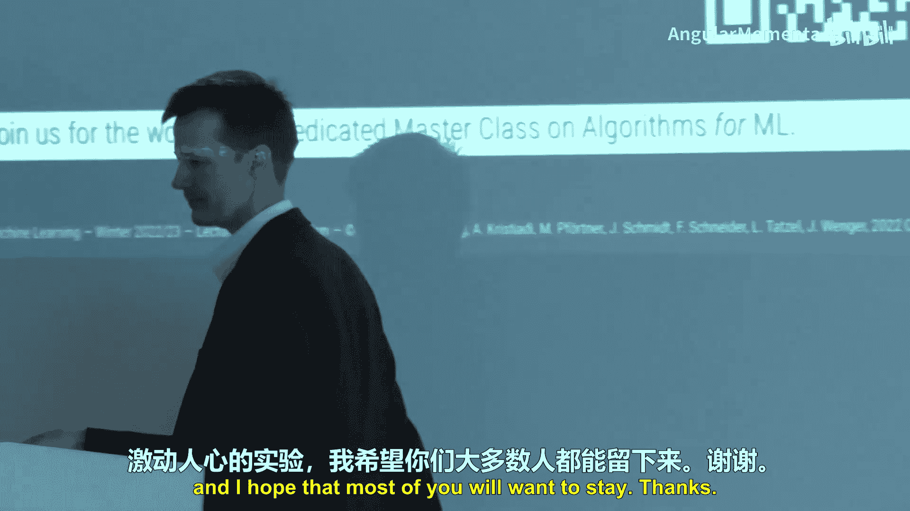

