# 【精译】蒂宾根大学《机器学习中的数值方法》-p02-2-——-数值线性代数-——-马尔文·普福特纳--BV1WMYHzAEcL_p2-

。

All right， hi everyone， I'm Avin， I'm a PhD student in Philips Group and I work on partial differential equations and Gaussian processes。

 but today I'll tell you a little bit about numerical linear algebra and also will commence which what will be relatively deep dive into numerical linear algebra for machine learning and Gaussian processes in particular。

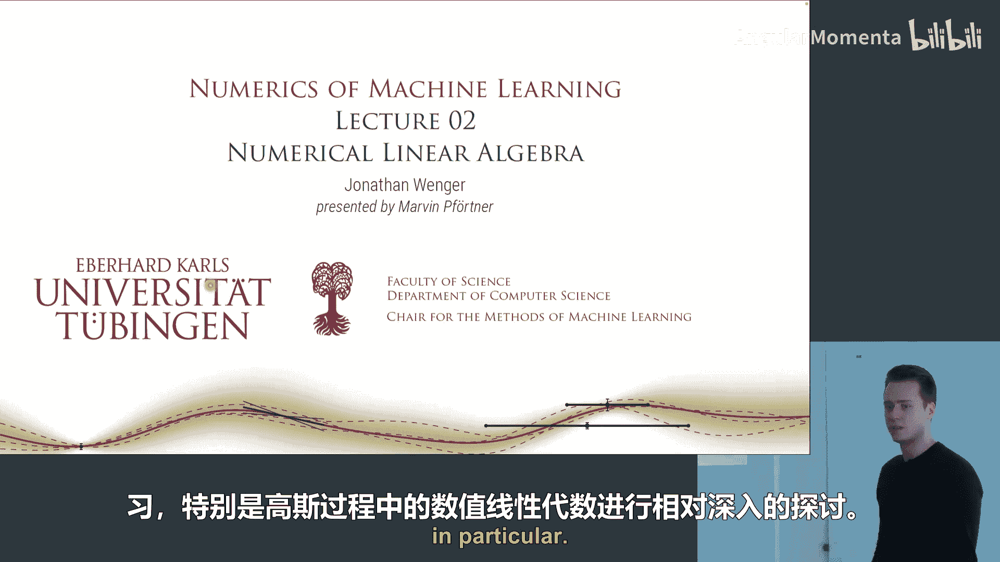

So there would be mostly two parts to today's lecture。 First of all。

 we're gonna take a bit of a step back and look at the bigger picture and。

That'll answer the question， why we should even care about numerical linear algebra in the first place。

And then we'll see some fundamental tasks in numerical linear algebra。

 which are important for machine learning in particular。And then。We become a little more practical。

 and we'll see that implementation of a lot of mathematical operations matters quite a lot。

 and you can make quite a lot of errors there。嗯。And see some practical example where we'll see how to implement Gaus process regression properly in a way。

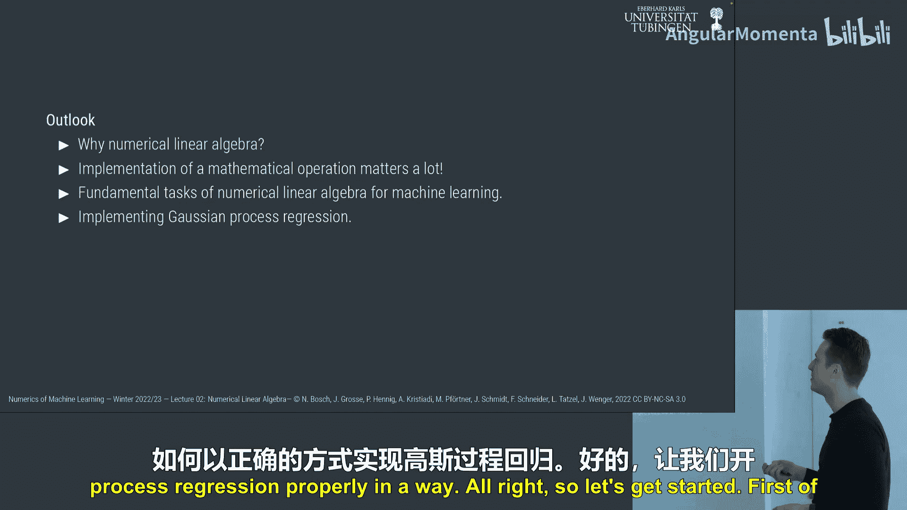

All right， so let's get started。First of all， let me start by saying that numerical linear algebra is absolutely central to machine learning。

 It's probably one of the most fundamental sets of tools in your machine learning toolbox that you need to implement these algorithms。

 And you can probably already see that by sort of this multitude of different areas on the slide。

 Once you see all of these together， you probably know that the concept is quite important。嗯。

Just a quick note here。 I'll flash some examples at you know。

 It's not important to understand all of them in details just to motivate a little bit what they'll be doing today。

So let's start with， yeah， basic probability theory。 So here already。

 where we look at the probability density function of a multivariate normal distribution。

 we already see。Two quite important parts of today's lecture， namely for one part。

 the the inverse right here of the covariance matrix。And the determinant here。

 And these are probably。Yeah， the， the two concepts we cover most today。 So， yeah。

 you already have these two here。Maybe a more， in some sense。

 more practical example is a general linear model， which if you attach， well， it's。

 it's it's essentially just a linear hypothesis class of， of functions that you use in regression。

 right and。If you attach a square loss to that and then solve the accompanying optimization problem across form。

 we also see that there's a matrix inverse popping up here， but it's not just some matrix。

 but the matrix actually has quite a lot of structure in that it is an outer product of two matrices。

 in a sense。嗯。It's reasonably large， depending on the number of features you're actually using。

 and it's symmetric and positive definite。 So we're going to talk a lot about how we're exploiting structure to make numerical linear algebra algorithms fast and reliable。

 specifically in machine learning。Yeah， here you can just see you know what what the model produces with some data set using polynomial feature functions。

Another quite well known base case of an of a machine learning algorithm is principal component analysis where。

Sort of the， the core of it is to compute what's called a truncated eigen decomposition。

 So a factorization of the covariance matrix， the data covariance matrix here into three matrices where。

Essentially， these， these three matrices also have some， some prescribed structure。嗯。

And we can also see another very fun fundamental operation in numerical linear algebra machine learning。

 which is matrix vector products。 It's very。😊，You know， almost。It seems almost too simple。

 but there is quite a lot of meat here to be discussed today， I guess。 And this。

 what this essentially does this algorithm is it does dimensionality reduction。

 So it takes a high dimensional data set。 And in this case finds a linear subspace。

 So a lower dimensional vector space to embed this data in which still captures a lot of structure of the data。

 And you can see that here being applied to pictures of of faces。

 And then these images here are essentially seeing these pictures as vectors in a vector space。

 the the basis vectors of that lower dimensional vector space where here we reconstructing。

These two images with successively more elements from that lower dimensional subspace。嗯。hy is it not。

Oh， here we go。嗯。The main subject for today will arguably。

 be arguably be the model of a Gaussian process。 We're gonna talk about this in a lot more detail。

 But just the quick version here， it's a Bayesian nonparmetric method for regression。 So， of course。

 we're gonna place a prior。😊，Over the thing we care about prior probability measure。

 which in this case， is this Gaussian process。嗯。And then we observe some data。

 which is essentially just。Evaluations of the of the unknown function corrupted by some Gaussian noise here。

And then we in， in a Bayesian fashion， we， we're just gonna condition this Gaussian process。

 this probability measure on these observations to retrieve a， a posterior distribution。

 which in this case is also a Gaussian process， which has some mean and covariance matrix given here。

 It's not really important about the structures， but also thing to note here is。

There's inverses here。 And again， there's quite a lot of structure in the matrix we're looking at。

 So this， what's called the kernelogram matrix here。嗯。We can see that is generated by a function。

 So we have what you could refer to as generative information about the matrix。

 where we have a function that produces every single entry。Of this matrix。

 which we can leverage to actually make our algorithms a lot Yeah， quicker， more efficient。

 more reliable。And it's also a symmetric and positive effort。

 just as in the Gaussian mod Gaussian density case。

So this is something we'll focus on today quite a lot。 Return to that， in a little bit。

Let me just say。Even though we just show a Gaussian process here。嗯。A similar version of these。

 these equations applies to a larger class of models， which are called kernel methods。

 kernel machines。 And I guess the most direct contender in statistical machine knowing this would be rigid regression。

 if you've heard of that， so。Even though we talk about Gaussian processes here a lot。

These techniques apply to a larger class of models。

Something that has arguably just sort of come into machine learning relatively recently。

 at least with larger attention is differential equations。

 And here we're showing the solution of a particular partial differential equation。

Which is linear and linear。 partial differential equations can be written essentially as linear systems in infinite dimensional vector spaces of functions。

 So what's usually the matrix in that linear system is， is a differential operator。

 a linear operator， a linear map between vector spaces of functions。And。Qu。

 a quite common method to actually solve these equations is to take that linear operator equation and discretize the spaces of functions between which the operator maps。

 So essentially choose finite dimensional bases or choose finite dimensional subspaces of these vector spaces。

Which then turns this， this linear operator equation into a just a finite dimensional linear system。

 which is usually quite large because essentially for every。node of one of these triangles here。

 You get an entry in that matrix。 And it's also， again， highly structured。

 and we have generative information available because we know it comes from this infinite dimensional linear system。

 And this is something we can also will discuss that maybe a little bit later on when we actually talk about differential equations use to to build specialized algorithms for this sort of a situation。

😊，嗯。And finally， and this is probably。I would imagine everybody has sort of seen variance of this。

 This optimization also has quite a lot of linear algebra to deal with， namely， essentially。

 every iterative optimization methods for local optimization of， in this case， some loss function L。

 depending on some parameter theta。Has a form similar to this right here。

 where D is a direction in which to step。 And M is a matrix that does essentially does a correction to this。

 So think about D， as， for example， a gradient in just stochastic or just regular gradient asccent。

And then M could be， for example， the inverse of the Hassian matrix for the Newton method。

 which converges quite a lot faster。 But it's also quite a lot more expensive to。

 to evaluate this update rule in the case where this is a hesian matrix。

There's quite an important characteristic， know， in a sense， hidden in here for these systems in。

 in machine learning， which is。Since specifically in deep learning。

 we evaluate this loss function on a batch instead of evaluating it on the whole data。

 There's some stochasticity here。 And this propagates onto the gradient。

 but both the gradient and the Hessian matrix。 So in a lot of cases。

 linear systems and matrices and machinery are actually noisy。

 We don't have access to the true matrix with which we want to solve。

 If we just have a noisy estimate of。 Philip already talked about this last lecture。

 And this is something we'll just have to deal with。 Not today，😊，We're sort of gonna ignore it。

 And actually for the rest of the lecture， too， But this is something to look out for and。

The newton method is just one choice here。 So， for example。

 if you choose the inverse of the fier information matrix。

 you get natural natural radi descend and so on， so。Yeah， and this is actually quite ubiquitous。

 I would say nowadays。And then the last example is deep learning， right， so。

I realized there's already quite a lot of Mafia just just realized that there's matrix vector products in the definition of a feed forward newer network。

Then if we do， if you compute gradients on， on these sorts of functions。

 then what we call back propagation is essentially just a vector Jacobian product。

Computed in a very efficient way。 So there's also a matrix vector product there。 Similarlyly。

 the forward mode of automatic differentiation is just Jacob and vector product。

 So Autotod has quite a lot to do with matrix vector products。

And then if we actually move on to Bayesian deep learning。A very common tool to。

 to deal with Bayesian neural networks is the so called Laplace approximation。

Where we optimize the loss function of the neural network until we assume。

 at least we find a local minimum of the loss， which under some loss function。

 assumption the loss function corresponds to。Essentially find finding the maximum posteriity estimate。

 And then we approximate around that point with a Gaussian distribution。

 And this approximation involves computing the hessian of the neural network。

With respect to its parameters at that maximum posterior point and then inverting it to obtain a covariance matrix。

 You're actually gonna hear a lot more about this in the lecture given by Augustustinos。 But yeah。

 you already see linear new algebra will already play also play a role there。

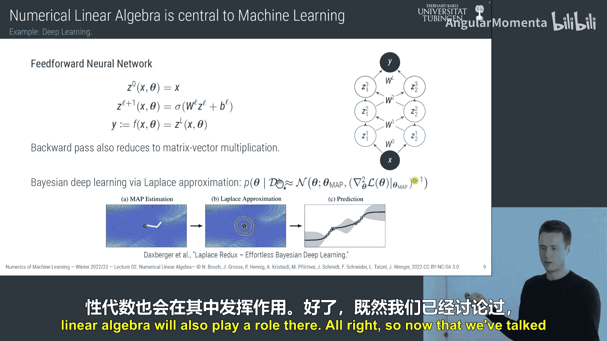

Alright， so now that we've talked about， or you've seen all these methods。 Again。

 it's not important to understand all of them。 just you need to realize that these four fundamental operations are quite important for machine learning。

 They appear everywhere。 They are in a low in a lot of different models， which is on the one hand。

 matrix vector multiplication。 and usually we need quite a lot of those。

 So they it should be reasonably efficient， both in terms of computation time and in terms of memory。

And you've seen that in deep learning and optimization also。

 where we need the product of the inverse of the Hessian with the gradient。 and in kernel methods。

 we'll also need that mostly in the coming two lectures。Then， and probably。

 this is what youd argue think about if you think about linear algebras。

 the solution of linear systems。We've seen that in the Gaussian density， and。By extension。

 also in the Gaussian process case and linear regression。

 also an optimization and nus method and so on。嗯。To achieve this and also to solve tasks like PC A。

 we'll need what's what I called matrix de composition。 So yeah。

 factorizations of matrices into matrices that have some sort of prescribed structure。 For example。

 a lower triangular in an upper upper triangular matrix。 we actually look。😊。

Into this matrix decomposition in a lot more detail later。

Then there's something like a singular value decomposition。

 which you can also use to solve the PCA problem， which are essentially orthogonal matrices。

 U and V or unitary matrices。 And then a diagonal matrix or the Q R decomposition。

 which is an orthogonal matrix and an upper triangular matrix。 And we need that。 We've seen it in。

 in PC A to do G P inference its also， we'll see quite。😊。

Efficient to use one of these decompositions and to do command filtering。

 which you'll see just in a couple of lectures。Finally。

 specifically in the Gaussian density case and also for。G P regression will need log determinants。

 And in the specific case of a symmetric positive definite matrix。

 this lock of the determinant can be transformed into the trace of the matrix logarithm of， of a。

 in general， it's also sometimes interesting to estimate the trace of just an arbitrary matrix function of the matrix。

 So matrix function could be something like an exponential of the matrix， something like that。Yeah。

 and we， we'll need that specifically for G P hyperparameter optimization。

 which we'll also talk about today。Alright， now that we've seen that linear algebra is clearly very important for machine learning。

Let's start with some practical aspects of it。 So， first of all。

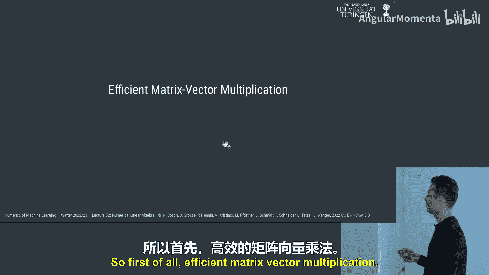

Efficient matrix ex multiplication。嗯。I've already said that。 it's actually。Quite important。

 how you implement a numerical operation on a computer。

 And here we just have a very sort of toy example to show you that even with very。

 very simple tasks where you think， yeah， what could go wrong。

 There's actually quite a lot that can go wrong。So we're given the， the task of， well。

 we're given the matrix A。With dimensions， N and K。And a vector in R K。 actually， that's， no， sorry。

 N， sorry， that's， that's correct。 where n is substantially larger than。Than K here。

 And we're given the task of computing， essentially the outer product of。

 of a with itself and then multiing might multiplying X with that product。嗯。Yeah， so far so easy for。

 for the mathematical part of it。 These， these sorts of products appear quite a lot， for example。

 in parametric regression， where you actually choose spaces functions。 and also in PC A。

 if you want to reconstruct your data in the， the lower dimensional subspace， for example。

 So this is something that will come across the machine learning。 And I guess， you know。

 you can just write it down。 Python。 It's reasonably nice for writing down mathematical expressions。

 And you can just write it down like this， right， And then we can evaluate it。😊，Bm。Didn't work。

What's the problem here， It's actually a little bit hard to read。

 But does anybody have an idea what's going on。Okay。Yeah。Why is it too large， though。Exactly。

 so what's happening here is Python is。Yeah， essentially since we。

 since we don't sette any parentheses here， right， Python has left to write operator precedence。

Of all things being equal here。 And so what it does is it first computes the matrix A A transpose。

 which is an n by N matrix。And then it multiplies x by that matrix。That's a problem。 Just， you know。

 some some back off the Nekin math here。10 to the 5， times some to the five times the， the， the。

 the bit width of the， the data type here is actually 80 GB for。This matrix extract product。

 And that's， you know， not really reasonable to do。 So what's the， what's the solution here。Exactly。

And this reasonably thing， simple fix here。Yeah， brings that town to much more， much more quick。

 I mean， you can already see it's like 03 seconds to execute， which。

I'm sure there's a lot of overhead by the notebook。 It's running。 So very， very quick implementation。

 essentially， of this operation， which was impossible to do in the other implementation。

 So it really matters a lot how you transform a formula， a mathematical expression into an algorithm。

We're going to see quite some examples of that over the course of the lecture， I guess。

So the algorithm implementing a mathematical operation has a huge impact on performance。

 stability and memory consumption。嗯。Let's look at bit more in graphical terms， what's going on you。

 right， You have a essentially。What's， what would be called a low rank matrix， right？

 So you have by the structure， you have at most rank K in the matrix。 and that's。

Sort of going into direction of identifying what structure in the matrix you're dealing with， right？

 So we， in， in a sense， we already learned that for low rank matrices， there's a。

 there's a more efficient way of multiplying with the low rank matrix than just to compute the matrix。

 and then essentially multiply a vector with that， right。嗯。In terms of asympttic notation。

 you can see that we have a square in here， right， So n squared instead of N， K， if n is large。

 think about。Either a large data set for regression or， you know， A PC A on an。

 on a two megapixel image， something like that。 This is gonna。Hit you quite substantially。

 if you implement the wrong way。 And also， I mean， space was the thing that， that killed us here， so。

There you can see where that came from。And this brings me to this bigger point of。

If you know something about the structure in your matrix。Generally speaking。

 the algorithm can't know， but， you know。 So you should tell the algorithm that you have some sort of a structure in the matrix。

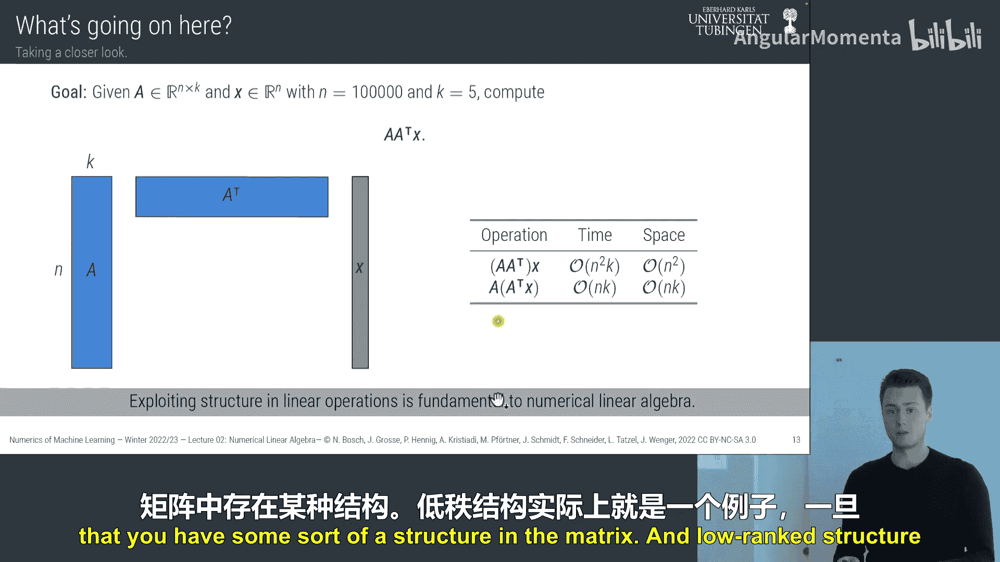

And lowering structure is actuallyah。

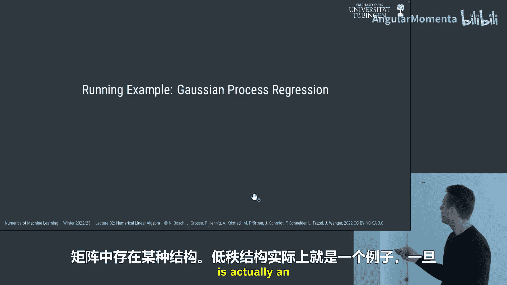

Loering structure is actually an example of something that the algorithm。

 like once you've computed A A transpose， is quite quite expensive to actually figure out post hoc。

 So if you know you have longing matrix， use methods special to lowering matrices。Mm。That like。Yeah。

 that's， yeah， that's actually kind of a tricky point， right， Because if you， if you just have the。

 the complete matrix， like the product of the two lowering factors， essentially。

 then it's quite costly to actually separate them。 But if you， like， if you write down your math and。

 you know， well， actually， there is lowering structure here， don't just multiply the matrix out。

 right， you， you， if you already have the factors use them。

And well actually see an example of how to actually do that a little bit later。Yeah， and then。

 I mean， lowering is just one type of structure。 There's loads of different matrix structures here。

 There's just a very incomplete list here to show you what I， what I mean by structure， so。

The base case is， okay， you don't really know anything about what's going on with that matrix。

 It's just a general matrix to you。 And then you can really get away with in terms of at least matrix vector products。

Can't get away with anything quicker than M N in time and space asymptically， at least。

And this is sort of what like a little bit of a pictographic depiction of what that might look like in a specific matrix。

 If you look at the sort of heat map of its entries。嗯。We've just seen the lowering matrix。

 and actually， for specifically the case of lowering plus the diagonal matrix。

 which then can also be inverted， right， because lowering matrices are actually singular。

 You can't invert those。 They don't have an inverse。 But if you add a diagonal term， which。

 for example， also pops up in regression with for example， a L 2 regularizer。

 you get this diagonal term with the regularizer weight on the。Yeah， as it's scaling， essentially。

 you can get away with。The scaling that's essentially N K， where K is the。

 the rank of this low rank matrix term。 So the essentially the smaller dimension in the example we just saw。

Sparse matrices depend a lot on the number of nonze entries in the matrix， and。

And that actually kinda makes sense， right， is also the scaling you get for both matrix vector products and the space requirements of these matrix depends also a lot on how you represent the sparse matrix。

 But yeah， we'll actually not talk about spars matrixes too much。

 You just so you've seen that this is also one of these types of structure we're talking about。

Colonnel matrices。 and we've also seen these already in this， you know。

 where flashed GPration I quite quickly are structured in the sense that you have generative information。

 So you have the kernel。 They're positive definite， and they're symmetric。And usually， because。

That's not really useful in terms of time requirements for the matrix vector product。

 You don't really get any speed ups here， but you can get quite substantial memory savings。

 Think about M being， you know， hundred thousand00 as in the example we just had。

 And is the number of data points in your regression data set in this case。

 if you're using kernel methods。Then。You get2 N D， instead of。And square D， by the way， is the。

 the number of dimensions， essentially， the input dimensions of your regressor， the。

 the function you wanna， you wan to learn。嗯。Yeah， and。For specific kernel functions。

 you can maybe already see here that there might be more structure to the matrix than， you know。

 just it being kernel matrix， by the way。How do you actually store a kernel matrix such that you get this space scaling the space complexity。

Does anybody know。Yeah， but that， that would just be， you know， half n squared， right， So n squared。

 after all。Yes， so this is memory wise。 it's。Obviously， loads cheaper。 I mean。

 it also depends on what the is， right。 So if your input dimension is loads bigger than the number of data points you have。

 then this obviously doesn't work anymore。 But yeah， so this is exactly how you do。

 you store the data points。 And you， you know the function。

 which generates the entries of the kernel matrix。 And so you just， you know。

 evaluate it while you compute the， the the matrix vector product。

 And there's actually libraries for that， which do exactly this thing and you know。

 realizing it very efficiently， also using GPUus and writing very efficient ka kernels for this sort of thing。

 which then enables you to compute， you know， Gaussian processes on。😊，Essentially。

 hundred thousands of data points on a laptop， which of obviously takes quite a Sil quite a lot of compute time in the general case。

 But at least you don't get memory overflows anymore。And finally。

 there's matrices with more general functional form。 Think about something like outive graphs here。

 So the essentially the Jacobian chain rule， you apply when you， when you do back through。

 through an neural network。 And in general， these are also you know。

 can be relatively unstructured and you kind of need same time and space requirements here。

 But if you put specific assumptions on the compute graphs you deal with。

 then you might be able to save some time here and， and compute these。

 these things those quicker and also the matrix structure products incidentally。😊。

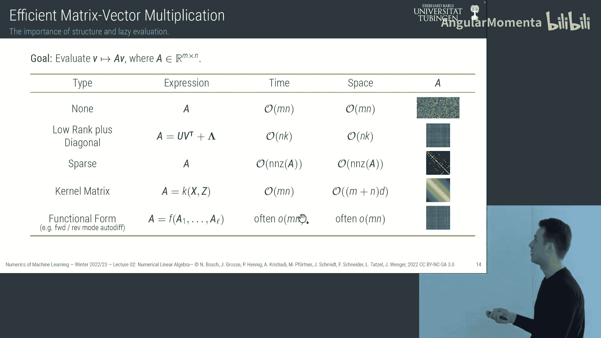

Alright。 So now to concrete algorithm。 and we're gonna start a sort of line of。

Methods here that apply。Or did that usually apply to Gaussian process regression。

 Also in the next two lectures。 So we're gonna focus on this a little bit。 Just， you know。

 recall that this applies to other kinds of methods And you can transfer what you learn from these methods to other algorithms to notably kernel rid regression。

 if you just compute the essentially the， the， the posterior mean of a Gaussian process。

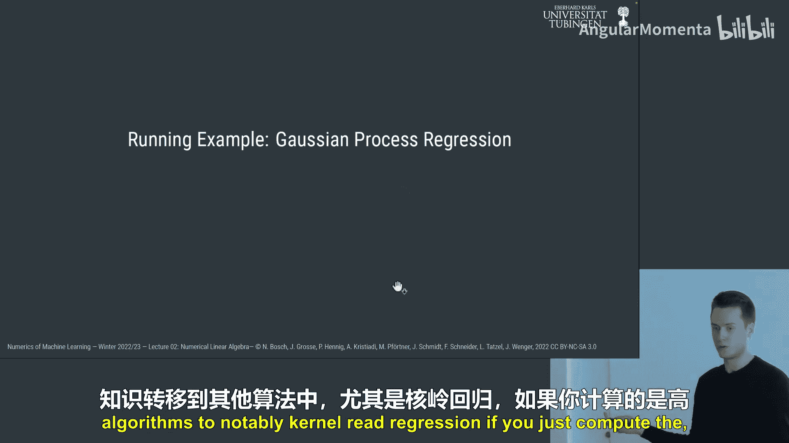

All right， so in a little more detail。😊，Our goal is to learn an unknown function。

F star from a D dimensional input space in this case over the reels。

 But it doesn't actually really matter what， what input space you have as long， you know， as you can。

 you， you have a kernel on it。 And then a scalar valued function here can also extend that。

 But let's just keep it relatively simple for now。And then since this is a Bayesian regression method。

We place a prior on the thing we don't know。 In this case， the unknown function。

 So this is a probability measure over functions。 already said that it has a mean function mu and a kernel function。

 which is the covariance of that Gaussian measure， essentially between two points of。

 of the of the unknown function。And then we have a likelihood。

 which essentially tells us how we got our data from the unknown function， how we observe the。

 the unknown function。 In this case， we just add homochoastic Gaussian noise。To all of the。

120 data points。Which are just evaluations of the functions。 And we observe。

A couple of these function values， Y under this noise。 And then if we。Essentially。

 apply base rule to this combination of prior and likelihood。

 We get a posterior measure posterior process over the function。

 Given that we observed these data in an experiment。And these are the， the moments。 So the。

 the posterior mean function， the posterior covariance function。Yeah。

 and this is sort of what it looks like， right， You get a， you get a mean estimate。

 which under some assumptions is essentially the same you get from kernel rich regression。And。

You have in this case， we just plot the， the marginal， credible interval。

 So essentially twice the marginal standard deviation of that process。

 which predicts how uncertain your regression estimate is about the unknown function you're looking for。

And， you know， in this case， it works， you know， reasonably well。 The， the。

 the true function is plotted in this dash gray line here。And the with essentially。

 since you take twice the standard deviation with，96 point， whatever percent。Confidence the， well。

 the， the， the process predicts。This true function。

 this true unknown function in its 95% confidence interval。 So that's quite good。 It works。 The。

 the uncertainty quantification works reasonably well here。嗯。But this。Bit of a problem here。

 since we need to compute this inverse and。I guess we already talked about this in the last lecture。

 This scales quite prohibitively。 Can somebody recap how， how much it costs to do this naively。

 in a sense。To compute a， A， A， a kernel gra matrix from n data points where n is quite large to。So。

O， N3， Yeah， exactly。 So it's cubically expensive。 And that's just prohibited。 I mean。

 you already saw that it might be difficult to compute n square for large data sets。 So there's that。

嗯。Yeah， another thing we need to solve for Gaussian processes， though， is you can。 Well， I mean， I。

 I've sort of hidden it here。 But there's usually parameters to this kernel。 This the output scale。

 which is essentially how wide this， this interval is。嗯。Theres a length scale， which。

 which usually a length scale， which sort of says how quickly the prior assumes the function to vary。

 So how how， how high the frequency is essentially here or the frequencies are。Things like this。

 And these are hyperpar of the algorithm。 We need to do some sort of hyperparameter cuning or solve a。

 a model selection problem。And to do that， theres a。The a bayesian way to do this is to just compute。

What's going on。To just compute the。What's called the the lock marginal likelihood。

 So what that is is essentially。Here， the， the probability of the data， y。The observed data Y。

 which are corrupted by noise， as I've said。Given the， the hyperparameter。

 we are essentially trying to trying to look for。 We're maximizing that because we want our prior to explain the data set we observed pretty well。

 right， So， so if we actually try to compute this， we can see that by factorizing this。

Lock margin likelihood into essentially via， via the the joint distribution of the noise corrupted。嗯。

Observations， and then just the function evaluation and then integrate over the value of the function evaluation。

 We exactly arrive at that， that term。 Don't worry if you didn't understand that。

 It's just this is the， this is the duration how how you， how you get there。 And in the end。

 you end up。😊，After some algebra with the function you can see here。

 which is essentially a loss function you need to minimize now。 Well， maximize in this case now。

And there's two terms here。 So one of them describes the， the model fit。

 So how well the model actually approximates the data comes from the exponent and the Gaussian distribution。

 So it's essentially， if you look at it， just that。嗯。And then there's another term。

 which comes from the normalization factor of that Gaussian， which essentially。

 since it's a determinant， it measures a volume of the rows of a matrix。 So in this case。

 what it essentially does it measures the complexity of your。

 of your prior how many functions in a sense， the， the hypothesis class， you。

 you're positing by that Gaussian prior contain。 And these are contrast to each other。 right。

 So theres， there's a tradeoff here。 and just to show an example here。

 we have quite some severe underfitting over generalizing going on。嗯。And。

What's what essentially these terms do here， right， you fit the data quite poorly。

The the red line is what's。What's fitting the data。 Well， in this case doesnt， does not fit the data。

 And so this will be relatively la small。 sorry， small。嗯。But this term。嗯。Will be large， right。

 because you， you have a minus here。 So there will， there will be a small capacity of the model。

 Minus that is at least compared to the model fit term a relatively large term。 So， yeah。

 this is one direction of it。 And then the other term here is。Yeah。

 quite some substantial overfitting， I would say。 And here， the model it is obviously， in this case。

 probably perfect。 didnn't really check。 but it looks like it just fits the points perfectly here because it you know。

 has all these bumps here to just directly go through the measurement。😊，But then again， the， the。

 the model that stands behind this because there's a lot of variation in the function。

 There's a lot of degrees of freedom， essentially。Yeah， it's quite complex。 So this term。

Will be large， and the negative of it will be quite small。 So you。

 you need to find the trade off between these two。And here， the lock determinant shows up again。

 right， so we need to compute。

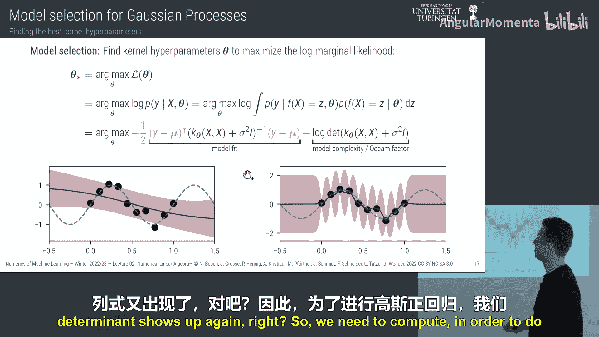

In order to do Gaussian positive regression， we need access to。The solution of a linear system。

 And in this case， actually not just one solve， but M plus one solve。

 where M is the number of data points at which we want to evaluate your regressor afterwards。

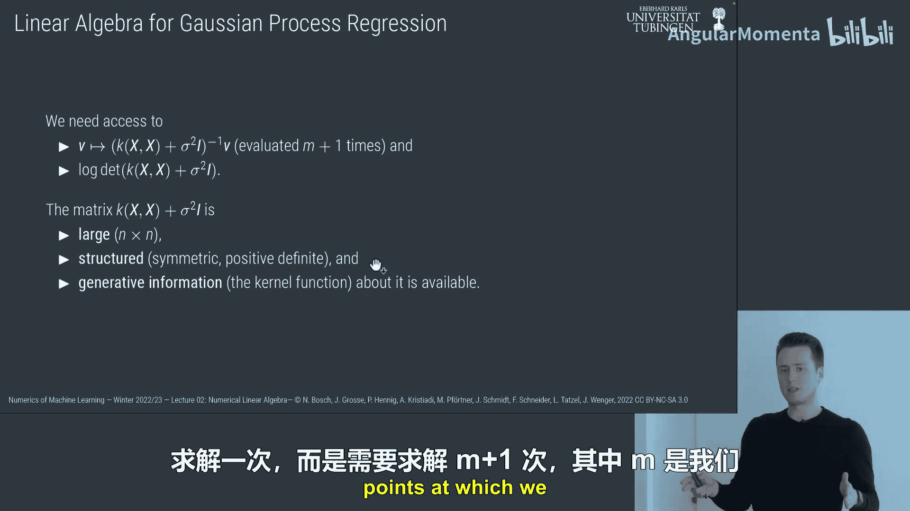

Can you see where that comes from？And here。Anyone。So obviously， one solve is here， right？

 So it this is a vector of observations。 So we need to solve this vector。 Well solve this system。

 So this matrix times some， let's say W。😊，Should equal this one solve？

And then if we evaluate the posterior process at M points。

 then we need to evaluate the posterior covariance for these M points。

 So there's M right hand sides here。For1 x， this is just one linear system。

 But if there's an M of these points， maybe need just solve at M times。Alright。

 now I've been preaching that structure is very important。

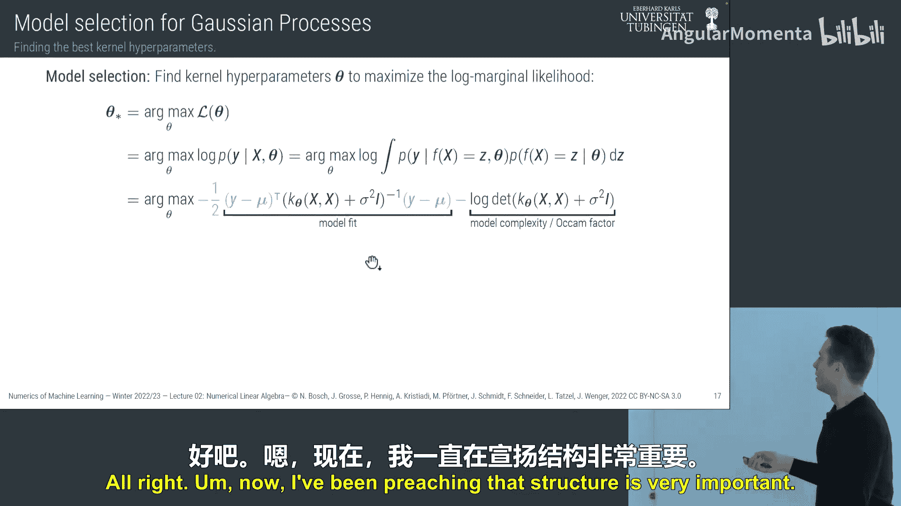

What structure do we have here， just to recall it。In the。OhIt actually says that or right， sorry。

So it's symmetric and positive definite in the most general case。

 but there might be additional structure， which we should also leverage because the system is。Huge。

 and we usually can't solve this， at least for extremely large data sets， just like that。

 And there's also this generative information， which you can leverage to push down on the。

 on the memory consumption a little bit。Allright， so how do we do this。

Do you know any algorithms that might apply here， We have already heard， I think， last time。

 what one of them is。What's the base case， how should you implement this？

I believe somebody last time said Clesky。 So this is the way we're gonna go here。 But first。

 since Cleski is already sort of a special case of another algorithm。

 we talk about the more general class of matrix decompositions and one very important matrix decomposition in particular。

 which is the so called L U decomposition。😊。

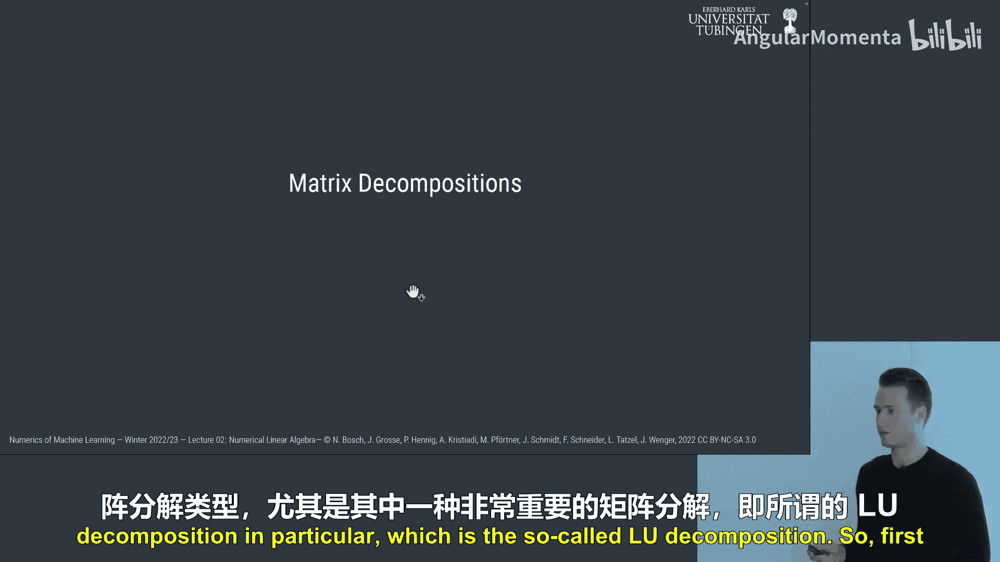

So， first of all。Pretend that the system we're trying to solve is a lower triangular matrix。

 So only the， like， essentially the entries on the diagonal and below the main diagonal of the matrix。

 In this case， we're looking at a square matrix are actually nonze。

And you probably already know an algorithm from school， which actually does this。

 maybe not in this name， but it's called forward substitution。

And we're gonna introduce it in a divide and conquer fashion。

 So pretend you already know how to solve linear systems of size n-1。

 where the the system matrix is lower triangular。 Just assume we already know that。 You know。

 divide and conquer。We're gonna show how to use this knowledge， essentially。

 how to to solve a system n by N instead of n -1 by n -1。So if we have a lower triangular system。

 orll should this。Would actually be useful to have a point or no。Okay， I don't know what's going on。

Does something。P we already have this we have， have a lower triangular system。

 Well then what we can do is we can decompose the matrix into four parts。Which is。

We take the scalar in the， in the lower right corner。Then the column above that will be 0， right。

 because it's lower triangular。So the， this is the last entry of the main diagonal。

Then there will be a vector， a row vector left to that。

 And then another triangular part in this case is called L Min L I -1。Above it， this is also。

 as I said lower triangular。 We can do the same thing with the vectors。

 So why is the solution of our system。And， B。Is the the right hand side vector。There we go。

 B is the right hand side vector。Of the system。 and we， we decompose them in the same way。

 We just split off the， the last century of it。Well， then we want that L Y equals B。Essentially。

 so if we multiply this out with this decomposition。We get that。

L I -1 times Y I -1 plus 0 times this， right， is supposed to equal L I -1。 is it supposed to equal B。

 B I -1。And we， we said that we， we we assumed that we can already solve systems where the system matrix is lower triangular。

Which have dimension n -1。 So this， because we split off the last row has dimension n -1。

 so we can just solve that。 We have， we， we， we have some magical algorithm to do that for now。😊。

So this is， this way， we can figure out what Y I -1 is。And then we look at the。

 the last entry where the last row essentially of the system， which is L I -1 transpose times Y I -1。

La得。Times gami。And this is supposed to equal beta I。Now， I said， we already know why I -1。

 but just by， you know， decomposing the metrics， we know this vector。 and we know these two。 Well。

 actually， sorry， we， we know these two， Lada and beta。 we just don't know this。

 So we rearrange the equation in terms of why I。Rrrive at this and。

Under the assumption that we know how to solve L I -1， Y I -1 equals B， I -1。

We can solve this system。And now we just supply essentially the same decomposition to the smaller matrix all the way down until we reach the scalar case until there's just。

 you know， a scalar left， which is like a one by one matrix。

 which is essentially a lower triangular matrix， right and as a trivial case。

And there we can just divide， right， This is how we solve a one dimensional linear system。

 So now we just go back up essentially and insert this into the expression。Yeah。

 and we solve that system recursively by dividing conquer。

This is one of these situations where you need to understand recursion， to understand recursion。

 So maybe go over this little bit at home if you didn't understand right now。

It takes some getting used to someone else， I would say。Oh yeah。 So actually I already showed it。

 So how expensive is， it's， it's n squared， right， Because in every iteration or in every on every step of the recursion。

You need to compute this formula， essentially， where this is the dominating part。 So this needs。

Because。嗯。Sort of when I is set to n。This needs。N-1。Mulplications and。

 n-2 additions to compute this term。And then if we add them up for sort of varying I。

 you can use the summation formula here and， and arrive at n squared。 And this is， this。

 this notation is supposed to say to leading order。

 which means we forget everything that is of less order than n squared。

 So if there's a linear term in there， we forget about it。

 because it doesn't really matter if n grows large。It's a little bit different from。

 from all notation， because we actually look at the constant of， on the leading term。 So there's the。

 there's the difference there。And you can do exactly the same thing if the matrix is upper triangular。

 just you do it in essentially the opposite direction， right， you， instead of splitting the last。

Tm off here。 You split the first one often it and do exactly the same recursion you did here。

 And these two techniques are called forward and backward substitution respectively。 there also。

 you already notice that low is cheaper than inverting just the full matrix。

 We already heard that's in general， O of and cubed。 This is O。 this is， yeah， also O of n squared。

 But yeah， the to leading order n squared。嗯。But we don't have a lower triangular system。

There's a little bit of a caveat there。 So how do we get to a lower triangular system。

And this is exactly where what I call the L U decomposition comes in。 right。

 We split the matrix into a lower triangular into product of a lower triangular matrix and an upper triangular matrix。

 And this is actually possible for square matrices， if they're invertible。So let's look at about。

 look at how we do this。 And it's essentially a very similar construction。

 We're also using essentially divide and conquer recursive definition， right。

 So assume we can already decompose a。Mattrix a in of shape n -1 times n -1。

We have a magical algorithm to do that。How do we decompose a N by n matrix。In this case， yeah。

 let's call it AI or a one in this case here。 such that we also get this this factorization into a lower in an upper triangular part。

Again， we're just gonna split off。Essentially scalar here。 And then column， okay。

 row vector and a column vector here。 And then there's a remainder。N by n。

 n-1 times n -1 matrix here。嗯。And we also do this essentially to what will be the lower and upper triangular factor in the end。

So。Assume， there is。Such an a lower triangular factor and upper triangular factor。

 This is what it should look like， right， at least here。

 because you can also decompose this in essentially the same way。 And because it's lower triangular。

 you know that this row vector here will be 0。Now， we choose the， the diagonal entries of the。

 of the left part of the lower triangular part to be  one。 We can just do that。

 Well see in a little bit。And then there will be， essentially， for now。

 an arbitrary column vector here。And on the right hand side。

 we just use essentially the same row as the， the upper triangular part here。

So if you just copy that over。But then also here will be a zero block。

 And this will also not be equal to B， right， because this thing needs to be。Upper triangular。Now。

 we want this decomposition to hold。 So if we actually multiply L I times U I。

 we get the following equations。 We get for the first row。Of the matrix， we just get。Afi。

Times alpha I 0， essentially， times 1，0。 So this will be just alpha I in the upper left hand corner。

 This is already good because it needs to be alpha I。And then it's gonna be U I。

 essentially an entry of U I times 1 and the the other part。 So the the。

 the lower part is zeroed out。 So the first row of L I U I is by construction。 The first row of a。

 So that's already good。 We just need to pay attention to the， the， essentially lower block of it。

 the， the the lower rows。For the vector L I， we find that。Alpha I times L I must be B， I。

For this to match in the， in the matrix product。And by just rearranging term。

 we can see that we need to choose L I as B， I。Divided by alpha I。And then for the sort of this。

 this， this， this block in the lower right hand side， we get。L I in outer product with。U I transpose。

 So L times U I transpo。And then L I plus1 times Ui plus 1。Since we don't。

 since we already know what L I and U I are， we need to find out what L plus  one times U I plus 1 are。

And essentially， apply the factorization here， but。We know that it needs to be equal to B， I。

 So B I needs to be equal to U I sorry L I times U I transpose plus L I plus 1， U I plus 1。And we。

 if we rearrange terms here， we will see that L plus 1。

 Ui plus1 needs to be equal to this thing here。Now。

 we already assumed that we can decompose a smaller matrix。 So an n by n -1 by n -1 matrix。

Into a lower triangular and upper triangular part， right， This is， again。

 this recursion step we're doing here。So if we were to factorize this in this way， we would be done。

 right， we have this decomposition。 If we use our magical algorithm here and the magical algorithm is just to to use the same routine all the way down until we reach the scalar case again。

😊，Where since we set the diagonal entries to one is is trivial， right， we just like， if， if the。

 if the， if a is one by one， then we just as L take one and as you take the entry of a。 we w to get。

 Then wait done。So this is what's called the L U decomposition。

Can you guess how much that costs to compute。Or can you reason about it？Yeah， but yeah。

 So it's unced。 There's actually， it's。For also for the homework。

 it will be reasonably important to see what the constant in front of that is。

 because there's some gains to be there。 But you essentially， oh， sorry， actually。I forgot that。

 So obviously， something can go wrong here， right， We're dividing by something。

 and we don't have any constraint on what the values of Al I can be。 It can be 0。

So what we do in the case where， where alpha I is 0。This alpha I element is usually called a pivot。

 We can just swap rows in the matrix until we find an element that is non zero to， to by。

 to divide by。And。This is called partial pivoting in numeric speak。 So if you read that somewhere。

 this is what that is。 And usually as a heuristic for this algorithm to be sort of stable。 So。

 so robust to， to noise。 essentially， you choose the。

 the entry in the remaining rows you need to look at， which has the largest absolute value。😊。

So that's essentially， you know， you。You don't get huge error amplification by dividing by a small。

 noisy value and just blows up。嗯。And by that， you can actually show， I mean。

 this is kind of a constructive proof of that。 that this this decomposition always exists if the matrix is invertible。

So， that's cool。And for the。For the computation time of this， we need to， again， just look at this。

 right， because this is an O of n iteration。 We just divide a vector by a number for， for sort of。

 well， actually I of I maybe or n minus n minus I rather。 So this is the。

 this is the biggest part that each。Recursion step。 And this is， this matrix has size n -1。

Times n -1， right， Because you in the I step， you've already cut off I entries of the。

 of the original matrix。And you need to compute this to， to compute the out product。

 You need n-1 square multiplications to compute every entry of that。

And then the subtraction itself is also n -1 squared operations。

 because this is that many numbers you need to sub。And that way。

 you get a summation over two times n -1 squared。 And if there's a summation formula for the squares of numbers。

 essentially， by doing like an index shift thing here， you see that to leading order。

 you arrive at two thirds and cubed。嗯。With some structure in the matrix。

 you can push that down quite a lot。 And you're gonna see how much in the exercises。嗯。Yeah。

 so that's a U composition。 Maybe some of you noticed the， the。

 the strategy we choose here is essentially， we subtract the row U from all rows below it。

To compute this upper triangular matrix。 And this is exactly what some of you might know is Gaussian elimination。

 So this is a very， in a sense， efficient。 And， and we'll also see that it's。

Clever way of doing Gaussian elimination to resolve linear systems。嗯。Since we actually choose these。

 these upper sorry， these diagonal entries to be one here， we don't really need to store them， right。

 We just know their one。So we can save some memory here。

 And this is actually how you implement this sort of algorithm。😊，You can do it in place。 essentially。

 you， you compute the L U factorization inside the array you give in which you give a to the algorithm。

 because you always only touch sort of the outer， this outer。Part of the matrix。 and。Of course。

 modify this part， but you can， but you can store L and U in the same matrix， essentially。嗯。

And I'm actually going show you with， with an example how that looks like， so。嗯。

Let's start with some matrix。 I'll keep it small， so that we actually。Can do it in sector。呃。

So it's  one，2，2。4， for2。And 4，6。four。Alright， now our goal is to。Essentially。

 always or arrive at a matrix where these three entries contain the nontrivi part of L。

 So right the L without the， the one on the di， the ones on the diagonal。

 because they are implicitly there。And this upper triangular part will contain U， essentially。

 minus0 parts， yeah。Yeah， that's actually a problem。 We don't really have a better marker。

 Let's see if the green one works better。Is that better。Okay， cool。All right。And we'll。

 we'll essentially keep everything in the same memory buffer。

 So write keep everything in this matrix， essentially。Okay。

 so first step we can see here is we keep the first roll。Because the first role will be the。

 in this case， the first row you also so。We just copy over。嗯。1，2，2。Next。We need to compute this L L。

And it's just， you know， dividing the， the， the B vector， which is。This vector right here。

In the decomposition。By that， sorry， By that entry。And it since it's one， you know， it's just。

 the same vector Yeah。 Allright， so now we've computed almost every quantity at this stage of the recursion。

 we just need to compute B， I。Minus L I U I。And then apply the same algorithm on that again。

 But you can see here。We don't need these entries of， of A anymore once we've computed B I。

 and we have exactly the right amount of space to fill that in。

 So we're just gonna compute it in here， essentially。And that will be。So the first entry is L I。

 So it was the first entry of L I 4 times 2。 the first entry of U I transpose。

And then we're gonna sub that from B， I， which is 4。Right， so minus-4。

Then it's gonna be four times 2， subjecttract at。2， minus-6。Four times 2。8 subjecttractor from 6 -2。

And then  four times 2。 So check it from 4 is -4。So now we've， we've essentially done the。

I equal one step of the algorithm we。The， the next step would be to is essentially recurs， right。

 App the same trick or the same algorithm to just this two by two square here。And with that。

 we actually already terminate them because we already arrive at the the scalar case， so we。

We just copy these， right， because we we don't touch this part as the memory buffer in this step。

And then we copy that， because we take。EUI transport is also as the first role。

 essentially if U I and the alpha。 So it's -4 is the alpha。And then  -6 is the U。嗯。We divide。The B。

 I entry， essentially， by the alpha。So， we get。in5。And then it's going to be B， so -4。Minus。LI。Times。

Uai。In this case， this is just the number 6。 So this is-3。 and then--3 is 3 so。-1 here。

And now what we have is in the， in these upper entries。We have the U。We， we needed to compute。

 And these lower three entries， we have。All but the diagonal of L。

So this is how L U decomposition is computed。 Also if you just call L U factor in sippi。

This sort of leaves out this， this pivoting， the pivoting itself。You know。

 would also be implemented by swapping around the rows if you needed to。 In this case。

 we didn't need to， really。But this amounts to the decomposition。

 just getting another matrix P to the left of LN U， which is a permutation matrix。

 which just swaps back the rows essentially。Which， performs that swap。

 because swapping rows is a linear operation so you can represent it as a matrix。All right。

So now we know this decomposition， but what do we do with it。

 So we know how to invert triangular linear systems。So what we do is， you know， since a is。

Now equal to L U， because we constructed the L U decomposition that way。

We just write instead of A X equal B， L U L U X equal B。Which is two linear systems， essentially。

 So its we， we need to solve for some y， such that L and y is equal to U X in this case， equal B。

 And then we solve the second linear system。Luckily， both of these are base cases。

 which we already know， which is， you know， backward and forward substitution respectively。

So we can compute those and。What's nice about this is once we've computed the L UD composition of a particular matrix A。

😊，We can very efficiently solve multiple linear systems with multiple right hand sitess for that matrix。

A， right， because we， we only once need to spend two thirds and cubed to computer decomposition。

 But then for every additional linear system that we need to solve。

 it just costs two n squared for one forwards， one's backward substitution。

If you're wondering if there's a matrix P here， which is a permutation matrix。

 the inverse of a permutation matrix is just a transpose。 It's an orthogonal matrix。

 So it's also extremely cheap to compute that。 You can actually do it in linear time because it's very sparse。

So even in this case， you can still invert here。And then， for。

K solves of with the same system matrix， A， which is exactly what we're doing in Gaussian process regression。

 right， We have the same system matrix， The ground matrix， and just solve m plus one systems with it。

We just pay cubically， and then。2 K N squared for K linear systems。So that's a very。

 very efficient way of solving multiple linear systems with the same matrix。

Which you could say is amortizing costs here。So there's just one。

 essentially one task left that we need to do， which is the computation of the log determinant。

But it turns out you can actually also do that with an L U decomposition。So。

The determinant of a matrix A， Any know how much it costs to compute that directly。

 like without knowing any structures about a。What。Yeah， exactly。

 It's also cubically expensive as much as inverting system because so it's a naive way of doing it is Gaussian elimination。

 too。 So yeah。嗯。Since we know， assuming that we know an L U decomposition， we can just say， well。

 the determinant of a is the same as the determinant of L U。Determinants distribute into products。

 So it's the product of the two determinants of the two matrices。

And then we can use the fact that essentially， you can see that via like La plastic expansions or also Gaussian elimination that the pro the determinant of a either lower or upper triangular matrix holds for both is just the product over the diagonal entries。

It just a。Linear algebra effect。 You can check that by different means， right。

And so this means given an L U do composition， we can actually compute the deter in a linear time。

So we only need to compute one object， which is expensive， which is cubly expensive。

 and then solve all other problems from that structure。

 It's a very efficient way of representing a linear system such that you can， Well， a matrix。

 such that you can do all sorts of interesting linear algebra tasks with it。All right。

Questions so far。Cool。So I've been hammering on this point that， that。

We need to use structure in order for our algorithms to be efficient， Right。

 And we have structure that we didn't use yet， which is the fact that our kernel gram matrix is actually positive defin。

 symmetric and positive definite， right。There's a specialized version of the L U decomposition。

 which is called the Tulesky decomposition。Which uses exactly that effect。

 And it uses it to make the algorithm faster。 Again， how much faster you see in the exercise。嗯。

Where we essentially do the same construction。 So it's。Basically all the same。

 Instead of using once on the diagonal here， we use the same values for both， which then means that。

 you know， since we want the matrix to be symmetric。It needs to be the square here。 Instead then we。

 we also use the same factor for left and right， right， because we， if we know it's symmetric。

 then we can use， just use the same factor to encode that symmetry， essentially in our decomposition。

 But other than that， you ex essentially get exactly the same formulas yeah。

And the fact that you can actually take this route here， you don't need to do any pivoting because。

 you know， if it's strictly positive definite。All the， essentially。The inner products。

 by definition with the unit vectors， are positive， strictly positive。And these are。

Amount to exactly these entries。 So you don't need pivoting in this case because it will just go through。

And by giving that algorithm， you also essentially gave the the proof that a Tulesky decomposition exists and is unique for all positive。

 strictly positive definite matrices a。😊，And this is， of course。

 what we should use because it's teaser， it's faster。 how much faster is see。

But this is sort of the go to tool to solve G， P regression， at least in small scales。

 because it has all these nice properties。 obviously。嗯。Inherits a lot of the properties of L U。

 and some of， some， some of them are even much nicer。 So again。

 here's the moments I've been flashing at Q for quite a bit now。 Now we're actually gonna solve them。

 So， as I said， we use sleski decomposition。 So we compute。😊。

The decomposition of this kernelogram matrix。The kernel matrix in this case looks like this。

 And then。The Cleski de composition。Of it looks like this。It's， of course。

 the same factors just transpo。 And then we， we're gonna insert this L， L transpose。In place of the。

 the kind the kindogram matrix here。 And since matrices flip order， if you sort of drag the。

 the inverse into a product of matrices。You arrive at this thing here， which means that。

For to obtain the post mean， you need to solve one system by forward substitution， right。

 This is lower triangular。 So it's forward substitution and one system by backward substitution because this is upper triangular and then essentially do the same thing for the covariance here。

嗯。Theres something to note here about these factors。

 How would you sort of describe this structure you can see here。In the covariance， or in the。

 in the tlesky factors of the covariance matrix。Any ideas。

It's a bit difficult because I didn't put the scale here， right， but。It's。Of first。

Factors might approximatey。And that would， what kind of structure would that sort of at least approximately impose on the matrix itself。

What。So， So you said maybe the first three columns， right。

 maybe approximate the matrix already quite well。So what type of structure would that help exactly。

There might be， And I'll show you in， in what sense there there is actually that lowering approximation。

 a good lower rank approximation to this matrix already。All right， questions。So yeah。

 that's what you get from that。 I guess I already showed you that plot before now。Yeah， we can。

Sort of see the result of her work here。And specifically。

 to compute the log determinant which you need in an optimization loop to find the optimal hyperparameter of that that model。

 So you need that also quite， quite often。 you can just use that formula I gave you earlier。

 So the log determin， the log determinant of this things。

 the log of the determinant of the L U decomposition。

 which I just showed you is just the product over the two diagonals of the two matrices。

 And you can just drag in the logarithm into the product and see， well， actually。

 I just need to compute one diagonal， obviously， because it's the same factor and just， you know。

Double it， essentially。

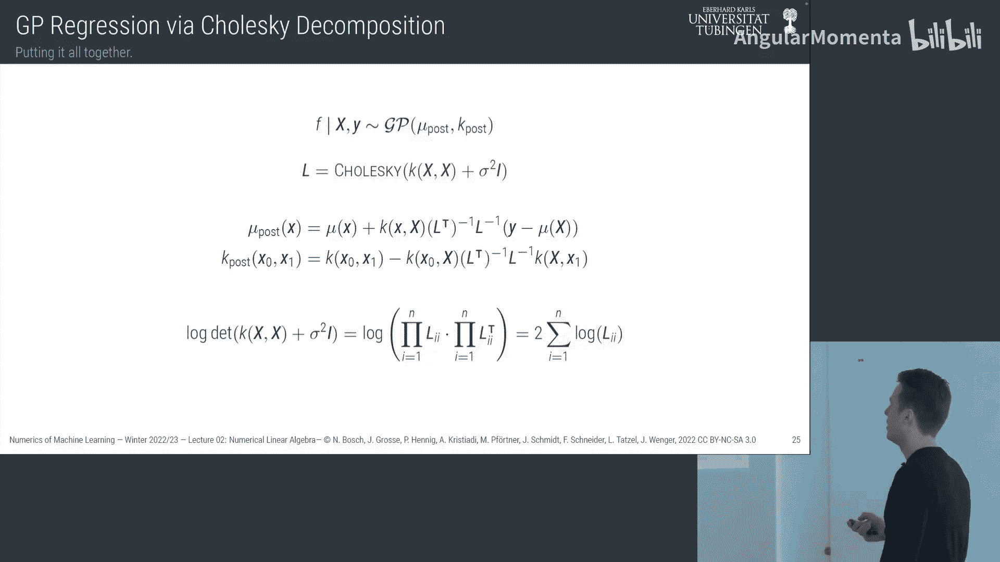

We still have a problem， though。 We already see all in， in， in the earlier slides that a matrix。

Assuming that our data set is 100，000 data points。Meaning that our kernel matrix is actually 100000 times 100000。

 is not gonna fit in memory。So what do we do here， And there's a couple of different ways of approaching this That doesn't mean we can't use Gaussian processes In these cases。

 We just need to take more care in how we use linear algebra to solve these problems。

And I'm gonna show you two。Maybe not contrary approaches。

 but two different approaches to solving this。 And Yonaan is gonna continue the next two lectures。

 which with much more detailed descriptions of methods that you can actually use here。

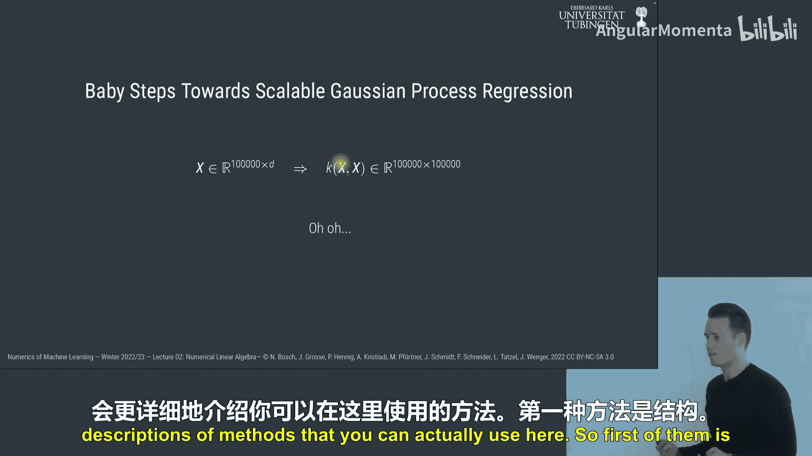

So， first of them is。Structure。So we can， we can just use structure we have in the kernels we employ to invert the system much。

 much quicker。And this usually boils down to choosing specific kernels。

 which are sort of amenable to， to linear algebraEssential。

 one of the examples here is just using a parametric prior。 So instead of having a Gaussian process。

 which is essentially infinitely many features， if you， if you will。

 or as many features as you have training data points。You can just choose。

The finite number Well P features here where P is in comparison to the data set， reasonably small。嗯。

And then use these kernels。 And what this amounts to this， this。

 this structure of these kernels is just， you say you have some， some Gaussian。

 multivariate Gaussian prior on some， some， some weights some。

 essentially what are coordinates in a functions in a finite dimensional function space。

 And then you， you you you use these as to to weight to weigh the different。

Feature functions with one another in a linear fashion。 And this is， you know。

 by applying the rules of， of linear Gaussian inference here， you see that with this construction。

 you， you're essentially getting this mean and kernel function。

 So this is the G P analog of linear regression。As compared to Rige regression。嗯。Yeah。

 and then you're obviously also gonna get。The this essentially the same form of a posterior。

 But now the kernelogram matrix looks like this。What structure does that have。So remember。呃。

P is a lot smaller than N。And this means that， obviously， sigma is P times P。And the。

 the training set features are n times P。 So phi x。Just do it。So， this product。It's essentially a。

Tall matrix times the small。Bm。A square matrix， and then a Y matrix。Exactly。

 this is lowering plus diagonal。 So here we see。A real world example of where we。

 we get lowering plus diagonal matrices in a in a machine learning algorithm。But we。

 we only know how to multiply with that matrix efficiency。

We need still need to figure out how to invert these matrices efficiently。 And that the actually。

 yes。 So， sorry， before I start with that， a possible choice here is。

I generated well this is a data set generated from a sinussoal function from a sign with a specific frequency corrupted by some。

 some Gaussian noise。 And obviously， if I know there's sinusso will like  four year structure。

 essentially in my， in my data set， I can just use a finite  four year basis basis for this。

 So this is， I think 10 the 10 first。Or some of the 10 first four year features， essentially。

 signs and cosines with different frequencies like increasing frequencies。

 starting from signine itself and then always doubling frequencies， I believe。

 So you get a reasonably good fit， also from a nonparmetric modeling。

 because you know something about your data。 And this essentially comes from the generative structure。

 right， if you know， you have a periodic data set， something that comes from a。

 from a periodic latent function， essentially， you can choose kernels， which on the one hand。

 reflect that knowledge modeling wise， but also are extremely efficient in terms of computation。😊。

So there's a fusion essentially， of modeling and computation here。

 which already hints at some of the core messages of the lectures， I guess。Alright。

 so how do we actually invert that system， It's still an n by N system。

 So if you just threw L U on there， it would be N cube。 we wouldn't win anything， right， But I said。

Essentially， you shouldn't mod multiply just these factors together and just throw it in a in a generic solver which doesn't know anything about the structure。

And a tool you can use here is the so called matrix inversion demo。 This， I realized this is quite a。

 quite a bit of mathfi here， but。Hang on。 It's actually reasonably simple to understand what's going on。

 so。What the matrix inversion M essentially says is if you had have a matrix A。

And you add a bit of a disturbance to it。 You， you perturb it in。

 in a low rank matrix in just a very small number of its， of its subspaces， essentially。

 if the subspace that it's， it's constructed of。Then the inverse of that perturbation will be the inverse of the matrix A minus also a bit of a perturbation。

And the the key thing to notice here is this matrix。If C is P times P。

So see is sigma essentially here。Then this matrix is a P times P inverse。

 And P is a lot smaller than， in， in our case here， usually。

So this means that once we have computed V transpose a inverse U， which is a。NP squared operation。

Can check that。Then。Assuming that we know how to invert a efficiently。 And it's。

 it's essentially trivial to invert a diagonal matrix。 It's just， you know， the the。

 the same diagonal matrix with the scaling factor inverted。嗯。

We can evaluate this expression also very efficiently。 In this case， O N P squared， right。

 because the P is a lot smaller than the N。 We would have N P squared plus P to the third。

So that Per just vanishes in this case， into the cost of computing this thing here。

Which makes this feasible。 And what's quite cool about this is we also don't actually need to form this whole matrix in memory。

😊，So we also don't have the same memory costs to invert that system。

 We don't even need to form the matrix。This is just one way of using structure。

 There's many different approaches to this， many， many specific kernels， which lead to。Essentially。

 kernel gra matrices that are very amenable to， to linear algebra operations。

 Were actually gonna hear about a particular form later in this lecture。

 which is common filtering for very specific kernels。

 You can express Gaussian inferences common filtering and compute this thing actually not just in N square。

 but in linear time of the data set。 So Naana and you Nana are gonna tell you a lot about this later。

And there's all sorts of other linear algebras， which if you're interested in that， just just ask me。

 but I'm gonna go over this right now。嗯。But yeah。 And actually。

We also need to compute the determinant， right， in order to do hyperparameter optimization。

 But there's an analog essentially of the matrix in version for determinants。

 which is called the matrix determinant lemma， which is essentially has has the same cost。

 So we're good there。 again， determinant of a， of a diagonal matrix is trivial。 And then。This is。

 this is again， N P squared to compute。 And then these both are piece P cubed。 So same runtime here。

Actually， this is， this is one of the names maybe you've also heard of the Sherman Moron Woodby formulas。

 This is exactly the same thing。The other general approach of scaling G P regression to larger data sets is essentially what I call here approximate inversion。

 You're gonna hear the proper term in the next lectures。 But for now， this should suffice。

 And this goes back to the point we made earlier about maybe the tlesky factors are essentially a lowering approximation of the matrix。

 So you can write down the tleski algorithm as an iterative algorithm。 I did that here。

 And you can see it's essentially again， the the same object。 right。

 there's this what what previously was B I minus L I U I transse in the in the。

In the LU decomposition。But an interesting thing to note here is that in a way。

 you collect information about your system matrix A by multiplying it from the right with a normalized unit vector。

And since we iterate over this system，1 to n。What Cleski does is it processes the data set。

Represented in the kernel matrix in a， just in a， in a， in an iterative fashion， in， in a， in。

 in the given order， the， the order you give it to the algorithm。And since。

We add rows to the tleski factor。 You've already seen that， right， We， we' in when we did L U here。

 we first added sort of the， the first column to the trileski factor。

 sorry to the to the L factor in the L U decomposition。 And next iteration， we added this one。

 And this one。 So we iteratively construct a low rank。😊，Approxiation to these two factors。

 in this case， it's the same factor， right。嗯。We actually get access to this lower rank characteristic this this this lower rank appximator to the matrix on the fly。

 so we don't need to compute the whole tlesky factorization of a matrix。

 We can just stop the algorithm。 And then we have a lower rank approximation of the matrix。

 How good is it depends， right， depends on the kernel matrix。

 But this general scheme we can use to stop the algorithm。

 And I've actually done that and can show you what the sort of approximate matrices look like。

 So if we take a dense kernel matrix。😊，With。I' going be some some structure here。And then just。

Terminate the tlesky decomposition after one iteration。

 So this is just an outer product of two vectors here。 Thiss the first L， essentially the， this。

 this first。columnn right here。Then we just get this。 It's quite a poor approximation， I would say。

Now， if we add four more vectors。 So it's then rank 4 approximation。It gets a little bit better。

 And it's sort of。呃。Moves this， this blob up here moves a little bit down or or。

 or extends down because that's how we process the data points， right。

 It the rows in here correspond to the data points。And we just approximate data point by data point。

 approximate the data set better this way。Adding another 5 gets a little bit better。 And， you know。

 it just creeps all the way down here until this is actually a 30 by 30 matrix。

 So it would be the true vector at L 30。😊，So arguably， what youd call。

 what you could call something like the convergence of this approximation is relatively poor。

But this is because we process the data points。In a linear order。And since the。

 the sort of the length scale of the kernel actually already like given the data point or it contains quite a lot of information about closely adjacent data points。

 the information game from at from processing the next data point in the next iteration is relatively low。

 where we don't explore anything about the， about the space in which we are trying to learn a function。

So what you can do is choose the order of the data points in which Schleski deals with them。

 in which Schleski approximates the kernel matrix。And that I've done here。

 So I just pre multiplied the。The ground matrix with a permutation matrix。

 which is essentially what's called full pivottization。 So you， instead of just swapping rows。

 you swap rows in columns simultaneously。嗯。And this then would be called a pivoted tlesky decomposition。

Essentially， the analog of a pivoted L UD composition here， which is。

 which is what we discussed earlier。And then computers lowering approximation after only four terms。

 You get this。And this is looks close to perfect， right， It's very。

 very close to the full kernel matrix。 So here we can actually see that there is arguably some lowering structure in the matrix。

 which needs to be corrected for it。 also for it to be full rank， which we need to invert it。

 actually， but。😊，There's some point to be added that maybe we don't actually need all those gilesky iterations if we choose the order of the data points in a clever way。

And you could say that this ordering。Could be considered something like an active learning problem。

 right， Because after one iteration of Cdessky， you already already know what your predictor is for the data points。

 And you know how much of the matrix you have explored。 So from that information， you can。

 in an online fashion， select which data point。😊，To observe essentially， to。

 to compute in the triky iteration。At the next iteration。嗯。This can be these。

 these P matrices here can also be essentially constructed in an online fashion so that this is actually possible to。

 to realize in， in code。That's a question。よつ。For example。For example， a row zero。

But you're reordering them。 So you would actually， if you ran the algorithm to completion。

 you would deal with them later。Yeah。5。Your original letters。working here。Yeah， essentially。So。

 so essentially by， by terminating tlesky early while using a permutation matrix。

 you're actually skipping rows。But that's sort of the point， right， If you process the first row。

 you don't want to process the second rule because you already have a lot of information about what's happening in the second row。

 So that's essentially what's what what the the point of this whole business is， yes。Thisよ。It basic。

Very good question。 So the question was whether the optimal permutation is just to sort of。

Cover as much space， I guess， right？ So， so， so find essentially an an even decomposition。

 And the answer is， it depends on the kernel and essentially whether you have a uniform grid or whether your data are scattered。

 right？ So the， the， the， the in some sense， the initial covering， right。

 the size of these blobs here depends on the length scale of the kernel about how much you assume。

The， how， how wide the influence of the kernel function is how much it correlates close by points and then。

With a shorter length scale， this blob becomes smaller。And that that way。

 you also need a denser covering to get this initial result， right？ So it depends on the kernel part。

 But again， generative structure， right， we know a lot of about the generative structure。 So our。

 our linear algebra algorithms should be informed about the general structure the the generative structure of the matrix they're working with。

 which classical linear algorithm rhythms are arguably not。 They're just given an area of numbers。

And they can't know that。 You need to inform them。And this is also the wider point here， right。

Maybe for machine learning， because we look， we're looking at very， very specific problems。

We should design our own algorithms， which leverage these information， which。

Maybe there are classical algorithms to deal with that。 Maybe not。 But we shouldn't be， you know。

 just following the canon of given an arbitrary matrix。

 you should apply that that method because you can learn a lot from that structure。有先力。

Because Cholesky decomposition， what you're doing is you're matching those。W。

Just the vanilla chales cake。So you're churn out the factors by iteratively like going from。

While for approximation， we already have a decomposition for that which is singular value decomposition where you kind of solve an optimization problem。

why why， why do we have a SVD given。 So I'm not saying you have an S Okay， Yeah。

 so basically the point is when is likeleski when with theleski factors。

 the order in the order that they are coming， they are going to be a good approximation for the。

 for the matrix so。The best approximation would be or the best factors would be the similar。

The factor is given by the similar value decomposition， which solves an optimization problem to get。

In those factors。 So you're kind of doing a heuristic to like。

Yeah advantage it's a little bit different from， from a singular value decomposition， though。

 because in a singular value decomposition， you posit。 Sorry。

 the question was whether this is actually essentially approximating what a singular value decomposition is doing。

 or truncating and SVD is doing， right when youre applying heuristic to like get more information。

Because it could be arbitrarily bad right， because all you're doing is you're matching the first few rows so you don't know like matching the first few rows will give you really good factors for the matrix but。

With your heuristic， the way I understood is like you're trying to like get。

 which is what you are saying using the spatial structure know getting all that information。

 But like， yeah， I mean， that's got to be some kind of problem。Well， I mean， the difference here too。

 So， so， okay， let me just try to rephrase that again。

 So the question is whether this has something to do with approximate SVD， right。

 whether which by using that heuristic， trying to approximate the SVD。

 which is like the optimal thing to do。 So in this case。

 we would actually be trying to compute an eigen decomposition， essentially， right。

 Because we have a。Yeah， we， we have a， we have a square matrix。 We have asymmetric matrix。

 and in this case。For all intents and purposes， these two are the same。And。Yes， in some sense。

 the eigen decomposition is actually the optimal thing to do here。

 but just note that these rows aren't necessarily orthogonal。

 which they would need to be for anigen decomposition。So。Yes。

 you're essentially trying to find the eigen directions because these in some metric。

 which I'm not really wanting to go into right now is optimal。

But you're not taking into account that you would need to orthogonalize these to actually have the eigen decomposition here。

Right， so yeah。This sort of prevents you from actually finding the eigenvectors。

Because you know they are orthogonal， or they form an orthogonal basis of the space。

Any other questions？Actually， one thing I also didn't。

Mention yet is there's actually a third thing we need to do to， to。

 to use Gaussian processes in practice， right， We usually don't。

You only take interest in the mean and the variance or the standard deviation。 of course。

 we also usually want samples from it。 And for that。

 you also need an object which is called a matrix square root and。The tleski decomposition is。

A matrix square root。Because it's essentially the same， in a sense。

 the same matrix just transpose multiplied with with itself to to produce the matrix。 again。

 this unit need for sampling， you can look up look that up in either the probabilistic machine learning class on YouTube or just any textbook and this lower rank sampling could also be useful for that。

 right， because even though you can directly invert a lower rank matrix。

 you can at least use it for sampling in an approximate Min， which is also then a lot faster。Alright。

 with that， I actually come to an end here。 Just a quick summary。

 We've seen that numerical linear algorithms are very fundamental to machine learning。

 They pop up in almost every machine learning algorithm and。😊。

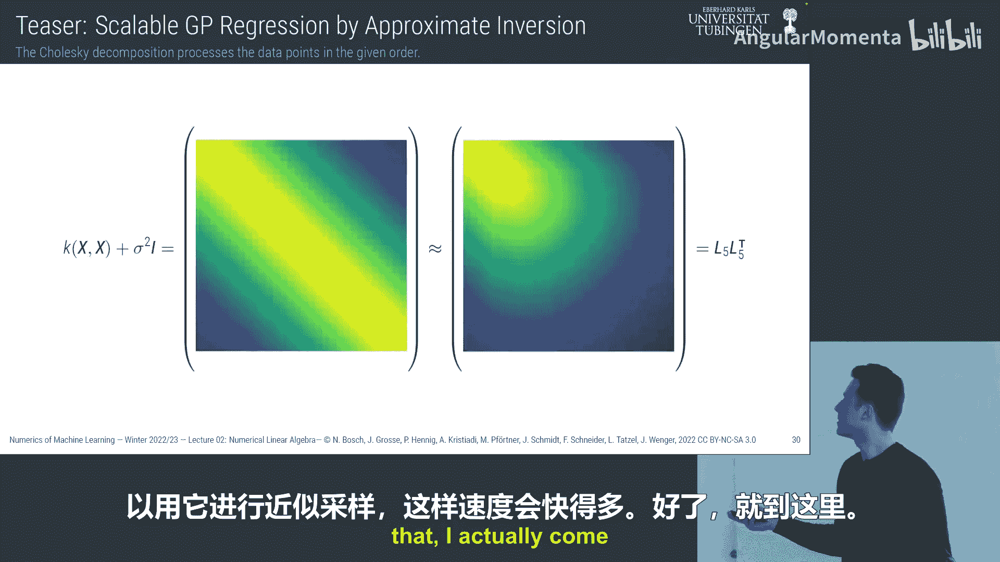

Why should we even care about numerics specifically as machine learners？ Well。

 we've seen that implementing this， these algorithms can be a lot faster if you take into account structure。

 You need to be very careful implementing these algorithms in practice。 Yeah。

 we should deal with that。We mostly dealt with four tasks， which is。

Very efficient matrix vector multiplication， which will also be important for the next two lectures。

 So keep that in mind。 The solution of linear systems。

 which we've seen loads of examples of over the course of the lecture。

 We've done that and other tasks by computing a matrix decomposition。

 Learn about L U and Cleski here。 And the computation of log determinants and matrix space is important to solve hyperpara optimization problems in Bayesian。

😊，Machine learning。We've seen loads of examples of how to use structure。

 And that structure is really important to get fast algorithms for machine learning。

 And we will continue to see how this structure affects Gaussian process regression in particular。

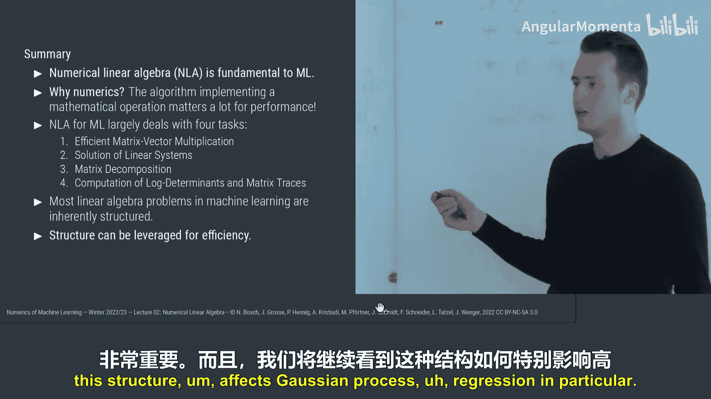

Thank you， and that's next。

