# 【精译】蒂宾根大学《机器学习中的数值方法》-p03-3----高斯过程的扩展----乔纳森·韦格--BV1WMYHzAEcL_p3-

。

Welcome， everybody。'm very happy to pick up where Marvin left off last week。 I'm Jonathan。

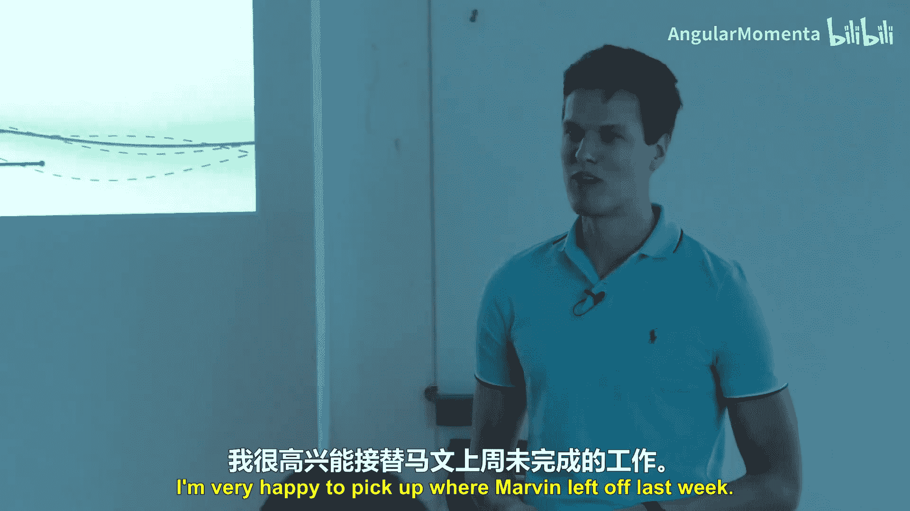

And I have the distinct pleasure to today tell you about how to scale Gausian processes to large data sets。

And what we'll see today is that we' will use a lot of the tools that we've developed last week。

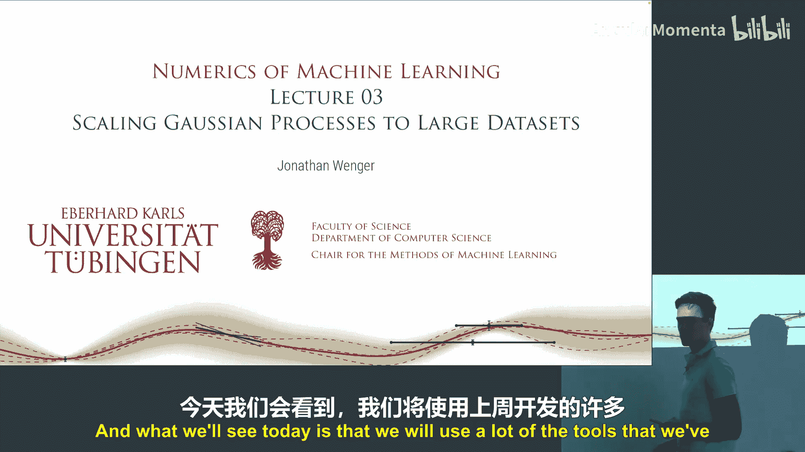

In particular， last week， we talked about kind the textbook way to solve linear systems using the telesky decomposition。

 And we applied that to T P regression。Today， to give you kind of context where we are in the course。

Today， we are essentially developing the modern way to solve such linear systems with kernel matrices。

😊，And apply that to scale gastion processes。And then next week。

 we'll give you the probabilistic numerics interpretation。 So the。

How do I learn about the machines that I use to build learning machines， Okay。

 so next week will be the learning machines view。 Today will be kind of the preparation for that。

 Now I'll start to use language that interprets these numerical methods as learning methods， as well。

😊，All right， so today。GP on large data sets。We'll do that by using iterative methods to solve linear systems。

We'll see， in particular that these methods can be viewed as learning algorithms for the matrix andverse。

 which is the primary object that we need to compute the G posterior。

And then we'll develop a method to do quadratic time as opposed to cubic time。Infer for GPS。

And finally， at the very end， I'll give you kind of a hint at that you can actually do this faster in linear time in the size of the data set。

 But that might come with some drawbacks。 And then we'll talk more about that next lecture。😊，Okay。

 so now that we've situated us。Please sing the lecture at any point。

 If you don't understand anything， just ask me。 I'll do my best to answer。And with that。

 let's get into it。Okay， quick recap about gassian processes。

 talked about them last week a little bit。

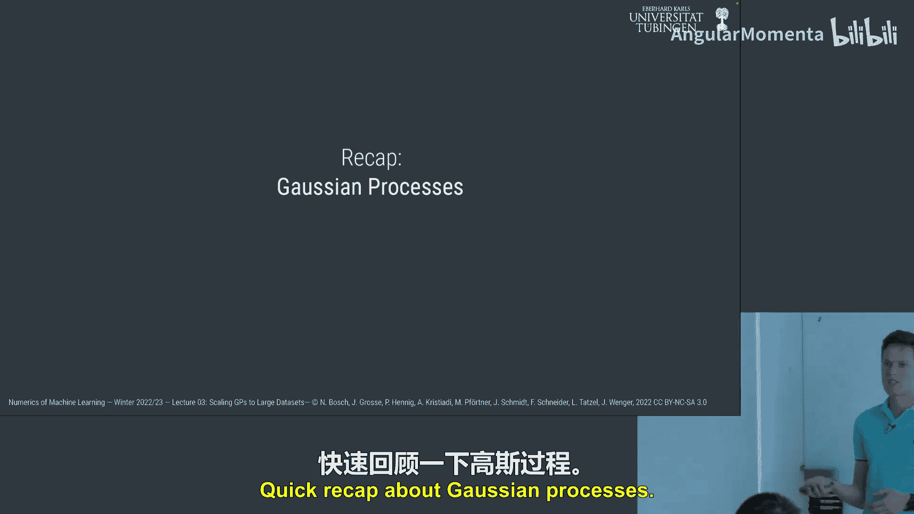

Why do we kind of focus on them as， as a base case so much？

 So the main goal for regression is we are trying to learn an unknown function。 In this case。

 at star from a training data a set of examples， right。😊，It's kind of the the basic example of。

 of regression。 And what do we want from our model if you do regression， ideally。

Maybe the most important thing is we wanted to generalize to data that we do not have in our trying to。

But there might be some other goals as well， alongside this generalization goal。 So second of all。

 we might want our model to be sufficiently simple or interpretable that we can actually understand what's going on after training。

 what the model has actually learned。Then third， we really would also like to know how much to trust the prediction。

 right， if you just get a point estimate。We might be。

Not actually sure how much we should trust in that point estimate is that a good prediction far away from the data。

And then， finally。We really want this to be fast， right， If it doesn't help us。

 if our model trains for， let's say， 300 days， then we can use that really well in in practice。

 And GPS are really kind of the， the prime example where we can all hit all of these points。 So。

 for example， of course， you want generalization， that's just。What we need for regression。

 But then G in some way are simple and imperpeable because we can reason about what the kernel kind of encodes。

 with assumptions about the data。We get an uncertainty estimate that tells us how much we should trust the prediction。

Assuming our model is correct。 And then finally。As we learned last week。

 it's actually very expensive to train them and do inference， right。

 So what do we do about that last point， And that's what were will deal with today。Alright。

 so just as a reminder， this is what the Gaussian process posterior looks like in the mean。

We have kind of an error to between the data and our prior mean， our prior prediction。

That gets scaled by the inverse of the gram matrix。 You can think of that as home。嗯。Strictured。

 I interpret this error。 So if my uncertainty， my prior uncertainty is very large。Maybe it's。

Fine if I'm far away from the true data， right， But if my uncertainty is actually very concentrated。

 I should make a big update to be closer to the， to the training data。And then the， the。

Covariance evaluated at data points also involves this inversion of a matrix of the size of the dataset。

Now， really， G regression actually is two parts。 right， It's not just computing the postuserior。

 You also need to find the kernel hyperparameter。 So do model selection in a way。

So this would be your， your training loop during deep learning， for example。

And the loss that we optimize for GPS is the。Is the log marginal likelihood。 So given this。

Colonnal hyperfermeter are these kernel hyperfras。How likely is it that the data were generated from this model？

And you can see that it will we underfi， for example， here。

 the length scale of the model is actually much wider than the true length scale that generated the data in black from the true function in grey dashed。

Versus the opposite end of the spectrum here， our length scale of the kernel。

The distance in which we assume data points to be related is much too short and we kind of overfit。

 right， We should expect to be actually。As， as we move away from a training data point， very quickly。

 our model says we don't actually know anything about where the true function lies。Okay。

 so those are the two tasks。 And last week， we talked about the tlaki decomposition。

So just as a reminder， the Juky decomposition。m sorryrry for GP regression。

 What we need is we need to do linear solves with this gradient size of the data set。

 the kernel matrix plus a noise。And we need to do that both for the posterior mean， and then。For the。

ECovariance as well， depending on how many data points we evaluate at here M data points。

And then for model selection， we need a log determinant。 We just saw that right here。

 the complexity term。It's kind of a regularization。And then we also need its gradient。

 If you do gradient based hyperparmeter optimization to find the hyperparmeter。And last week。

 we developed that you can use acomposition for this， right， Is this great problem solved， right。

 Does everything computes a log terminalminant， computes linear solves perfect。😊。

Here's an illustration of that。 On the left， we have a kernel matrix。

 I believe this is a mat 3 half kernel。 And you get these tulaki factors， L and L transpo。Now。

 just as a quick aside， kernel matrices don't always look this nicely ordered， right。

 This is the one dimensional data set where the data is actually。

 you can order the data just from smallest value to largest value。 But in general。

 for high dimensional data sets， or if your data is just not ordered。

 your kernel matrix doesn't necessarily look the structured because。

The correlation between two data points depends on that distance。

And two data points that I order next to each other don't have to be proximal in input space。Okay。

But。Here's a big issue with the Cki composition。 And you might have seen that in the homework already。

 I asked you to use your G P implementation to train on a large data set，0000 data points。

 And you should have probably found this， depending on your system。Right。

 you're not gonna be able to form， even form that kernel matrix in memory because it takes about 80 GB。

So。Maybe you have a very， very big machine with a lot of Ram， and you have 80 gigaby of Ram。

Then you probably still face this problem。A modern G P CPU， excuse me， has about 1 GB about 。

1 gigab flop per second， so。10 to the9 floating point operations per second。

If we plug that into the number of as we need for the Tuscu decomposition  one over three times N cube brainness the size of the data set。

It'll take you about 83 hours to do that Mo overhead。 Okay， that's kind of not acceptable。

Later in the lecture， I'll show you what I did this morning。

 You can do this in 7 and1 a half minutes。To desirable accuracy。Okay， so clearly。

 the Clasky decomposition is prohibitive both in time and space for large data sets that we might care about。

😊。

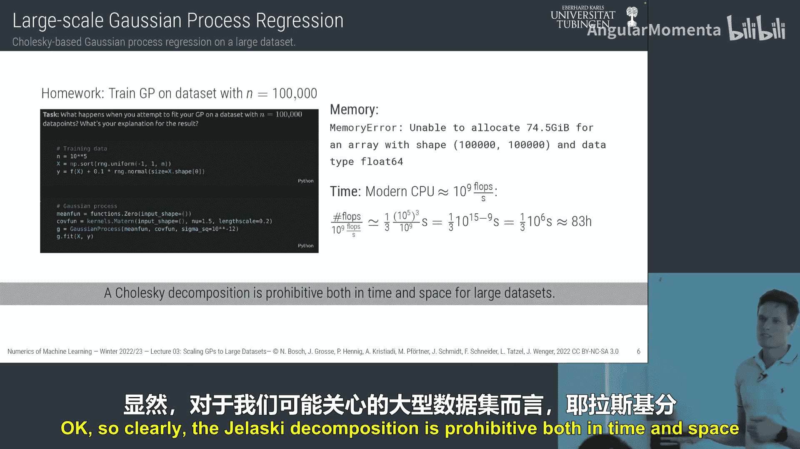

What can we do instead。We'll talk about iterative methods today。

 and we'll try to reduce the complexity to。Squared in the number of theta points。

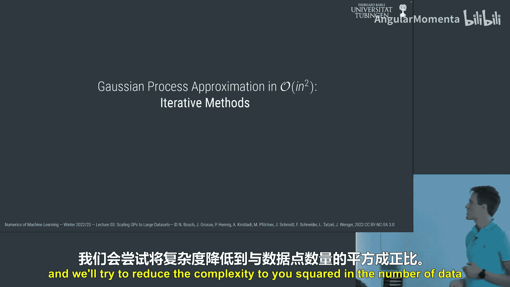

You've already seen this as well。 This is， again， the Schulaki decomposition。

 And now I only show a couple of。😊，Columns in the low rank。Sorry。

 a couple of columns in the Chilesity factor， which gives me a lower rank approximation for the kernel matrix。

If I do I iterations of the Chisky， it's iterative form。That's a rank I matrix。

But that's not really what we need for G P regression， right。

 We need an approximation to the inverse， not the kernel matrix itself。So is there a way。

Now we can also interpret the iterative formulation of the Cleski， where we stop it early。

As an approximation to the precision matrix is another name for the inverse of the kernel matrix。

Can we do this， right？ Can we approximate the linear solves here。Oh。

Down here with the inverse Grian Gramian， which is I plotted here somehow by a matrix that's called it C I。

Such that somehow， if I apply the matrix C I to a some vector。

That this is close to the linear solve of the kernel matrix。Alright。

 let's take a closer look at this iterative form of the giscu decomposition on the left here that we've seen last time。

So just as a reminder， we put in a symmetric positive definite matrix A， in our case。

 that's just a kernel matrix plus the noise。And we get out a lower triangular factor。

 And if we stop it after I iterations， that only has I columns that are non0。

And then we get an approximation to the kernel matrix。 So what happens here？ So really。

 there's only two things going on， kind of。Down here。A prime is sort of like the residual。

 The part of the kernel matrix that we haven't learned。You can see that by。

 You can reformulate that as just a minus the current approximation of the matrix L times L transpo。

 So this is kind of a matrix to residual， let's call it。And then there's a second thing going on。

 where。As Marvevin developed last week。This step here。

 you can interpret as multiplying this residual with a vector。In this case。

 the unit vector up to scaling that selects a data point of the kernel matrix site that just selects a column of the matrix。

And depending on how you choose these， you might get a worse or better approximation after I iterations less than n。

Okay。Now， can we kind of rewrite this algorithm by tracking a few more quantities to also get an inverse approximation out of this。

First， our goal is to develop or to to find such a C an inverse approximation。

And we know we have this matrix approximation L I times L transposed。

Can we somehow kind of wrangle our algorithm to also get an inverse approximation。

And what we could do， for example， if I just take this。Equation。

 and I multiply from the left and right with a inverse。Right， then obviously。

 on the right right side， I have a inverse here。And on the left side， I have mysski factors。嗯。

That I multiply from the left with a inverse。Now， that didn't really get me much because I'm trying to solve or I'm trying to invert the matrix A。

 So if to， to get an approximation for the inverse。

 I need the inverse itself that doesn't really solve the problem。

 But let's see what actually the entries of this matrix look like。So clearly。

 the C I is actually a low rank matrix， right， because L I and L transpo are both only have I columns。

And the last column is just a inverse times this L vector that we constructed。In step 7。

 and we just put into the next column of the tululaki factor。Okay。So if I just evaluate or just。

Plug in the formula for L， which is just a prime times this scaled unit vector。 Remember。

 a prime is kind of the residual。 The thing that we haven't learned about a。

And I plug in my definition for the residual。 right， That's the the。

 the matrix itself minus the part that I've learned in the last iteration。

And then I multiply a inverse into this。 So I get an identity matrix here。

 That's what you can see here。And then I get a inverse times L -1。

And then I can also just introduce a identity matrix on the right hand side by adding a inverse times a。

Okay， and now what I have in here is just a inverse times L -1 times a inverse times L -1 transposed。

But， that's just。The inverse approximation from the previous iteration。

So now I've reduced this last column。Of this gisky factor to something that I computed in the previous iteration。

So I can recursively also construct the inverse approximation。

 and that inverse approximation is actually also low rank。

In the same way that I construct the low rank approximation to the matrix A。Okay， so really。

 the Schlesky is actually。Also。An approximate matrix and versionin algorithm。Okay。

 so now I added some terms into this Chilaki to kind of show what we need to track to compute this inverse approximation as well。

 So， first of all， we select a unit vector that corresponds to selecting a data point。

 If we do if a is a kernel matrix。 And let's call that action。😊，Then， I。Do a bunch of stuff。

 And let's focus on the bottom party， first。So， you've seen that。Here， we update the matrix residual。

 and now I found a way to also compute。This。嗯。Approrxiation to the inverse C I， okay。

And by definition of C I， we， we said it was a inverse times L， A inverse times L transposed。

I can rewrite this update also in terms of C I。 And what we'll find is that。If I just， know。

Take out a out of this of these parentheses。 I just get a times a inverse minus C I times a。

 So in here。Is the residual for the inverse matrix。In the same way that out here， right。

 I have a minus some low rank factor， Low rank approximation in here。

 I have a inverse minus some low rank approximation of inverse。So hidden in here is kind of this。

 this residual。And then if I multiply A in from the right， I get this I minus CIA factor。

And now that pops up again up here in the algorithm。

 So I modify my action a little bit with this factor here。 And then I multiply with this modified。

vector D I with the matrix A。 And if I do that， what I essentially do is take this residual matrix。

 right， A times this factor times the unit vector E I。

 So that's the observation that you previously did in Schlesski。 Let's take a step back。

 That's this right， residual times E I。😊，Question。Sure。そしの？オケーション。ESo for us， sorry， for us。

 residual is the thing that we care about minus our approximation。Okay。嗯。Okay。Alright。

 so we have a way to。EMoifier our action to get some vector D。

 And it turns out that this inverse approximation is just at each iteration。

 I add an outer product of these vectors D I。😊，Okay。And we see that down here as well， right now。

This I minus C minus1 times a times E I just gets replaced by the vector D。

And let's do a quick complexity analysis。 Is that actually more expensive than doing the Chilaky by itself。

We know that the trilosky periiteration takes of n squared。And's take a look at the。

 the actions at the， the the computations that we added。Okay， so here。We have。

And matrix vector multiplication and another matrix vector multiplication that's still n squared in this Eta I normalization constant step。

 we also just do matrix vector multiplication。 And then down here， this is a low rank matrix。

 So we can actually just track the low rank factors by saving storing the Ds。

 Or even if we multiply this out with is an outer product。 This is also just O n squared。😊，Okay。

 so per， you just pay n squared to do this。 So asymptically。

 it's just as expensive as if we just approximate the matrix itself。All right。

Let's take a look at what this looks like if you apply to Gaussian process progression。So， remember。

For just computing the posterior， we need these two matrix inverses of the kernel matrix size n by N。

Now， we have an approximation to this inverse。 So what happens if you just replace that with this inverse approximation。

I get this。 So this is three iterations of the partial Cleski， partial because we don't run to。

Convergence。And the data points that we selected or the unit vectors for our actions are just selecting the data points in blue here。

 So in sequence from the left to right， the first three。Now， clearly。Not the greatest approximation。

 right， Like basically， back here， you haven't learn anything about the true function in grey dashed。

😊，Now。You might notice also that this kind of looks like GPU regression if you only did GPU regression on the first three data points。

Right。And， in fact。Doing the part of Schlaski。With no noise is equivalent to GP P regression if you're and you're selecting the data points that your pivoting strategy selects。

 So your unit vectors。And if you add noise， it's almost the same not quite， okay。

So you can think of the partial Schlesski as something like doing chipe regression。

 but conditioning only on a few data points。So。Last time we already saw that it really matters。

What pivots you choose or in other language， what unit vectors you choose。

 what data points you select， right， It's just all names for a different thing。 all the same。

All different names for the same thing。And it turns out that。Here， that's also the case。On the left。

 I just chose。I think this is 10 iterations of the partial Schlaski。And as unit vectors has actions。

 I chose those actions that selected the first 10 data points on the left here。

And can see that in this region， Mybial have learned the true。Poerior mean in black， quite well。

All the way over here， we essentially have learned nothing about the troop posterior that we're trying to approximate。

Now， on the right， I just chose a random order for the actions。

 So a random selection of data points that I。Consider a random selection of columns of the kernel matrix that I look at in the partial of Schlesski。

And you can see that this looks much better， right。

 The the posteri is much closer to the true posterior and dashed in black lines。 And also。

 we can imagine that we've learned quite a lot more about the function。

 and we're much more certain about where it is。😊，So。

This choice of data points not only matters for approximating the kernel matrix。 In particular。

 it also matters if you approximate the inverse and thus for G。Approxiation， okay。

 so you can think of this selection of actions， the selection of unit vectors for the Culaki as a kind of act of learning。

In the sense that if I had a strategy。That while I do this at each iteration picks kind of better data points to。

 to condition on。 I can actually learn much faster as is exemplified here by the random order。😊。

But you could also think of a different strategy that selects data points in a smaller way。

 And we'll see that later， okay， so。The selection of data points that you choose really matters for how quickly you converge to this inverse approximation and thus to the G people theory。

So how do we do this smarter， Can we find better actions to do this。So， on the left。

There's another illustration of this。 So inside the part of Clesski。

 there's a step where we take the residual， a prime。

So the thing that we haven' the part of the matrix that we haven't learned yet。

That we can rewrite via this。So via this part where we correct our action with the inverse approximation from the previous step。

And this looks like this。 So this is the residual。After also ten durations of the partial of Schlaski。

And every time I select， I shows a unit vector that selects one of these data points。

 And you can see that。Most of the data points here have been selected。

 the ones here and the ones down here。 I think those are maybe 30 data points or something like that。

So in each step， I chose choose a data point and the residual of the matrix look like this。

But why do I have to restrict myself to a vector that looks like this， right， the operation。

The corporation cost per iteration is。Squared in the number of beta ones anyways。

 So I can afford a matrix vector multiplication here。 right， I can choose any vector。

 I't have to select a column。So what if we found a better vector with some different entries。

 maybe even more than one。To more quickly approximate the kernel matrix or the inverse。

 which we just learned， you know， is kind of the same。And here。

 I chose some strategy that I'm going to tell you about in a moment。 And clearly， just visually。

 you can see that it's more close to the true matrix， right， the true can matrix。

So what's a better way， more efficient way。To chose， choose these actions。

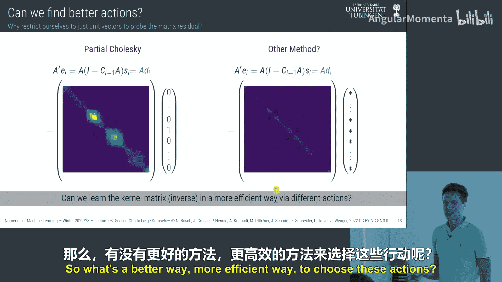

Okay， so this is the second part of the talk。And we'll talk about a method called a method of conjugate gradients that's originally been designed to solve linear systems as they pop up。

 for example， in G P regression。With symmetric positive definite matrices。

 kernelal matrices are symmetric， positive definite。 So that's great。😊。

And I will dive in kind of a little bit to the classic view of how this method works。

 And then I'll pull you back into this。

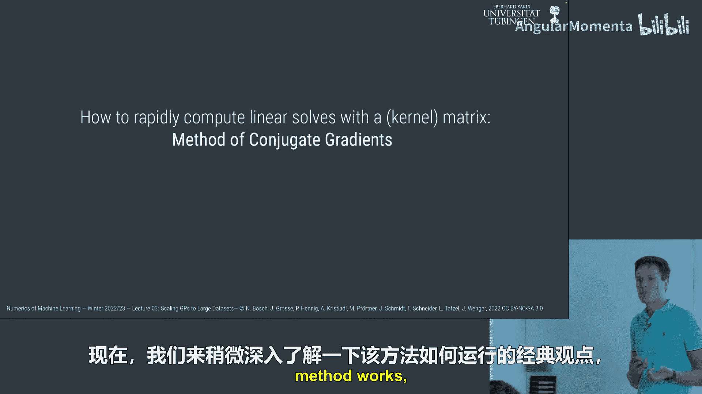

View of actually learning。About the matrix or learning about the inverse， as we've already seen。Okay。

 so method of conjugate gradients。Our goal is to solve a linear system。 X equals B， so。A。

 you can always just think of as a kernel matrix for our purposes。And you want to do that。With。

Ideally， very few matrix vector multiplies。 So just a few quadratic cost operations and the size of the data set to quickly approximate the posterior。

Now， a different way of thinking about this problem， A X equals B。

 where A is a matrix and B is a vector of size N。You can rephrase this as a quadratic optimization problem。

 And let me show you how that works。 So take this quadratic function。😊。

Where the argument x is a vector of size n。If you take its gradient。Then setting the gradient to 0。

 So solving this or optimizing this quadratic， which is a convex optimization problem。

 So as a global minimum。Is actually equivalent to solving the linear system A X equals B。Okay。

 so taking the gradient of this， just this a x minus B setting to 0 means equivalent to a x equals B。

And now I can also define something another residual here。Which is B minus a X。

 So if I plug in something for x that。Time tells me how well I've solved the system or equivalently。

Is my current negative gradient。Of this system。 Okay。

 so it points in the direction of steepest descent。 So what's your favorite optimization algorithm。

Just shout it out。Nobody has a favorite optimization algorithm。Alright， so what if you just。

Throw gradient descent at this problem， right， Why not？ gradient descent super easy。

 We can compute the gradient。 It's just a X minus B minus A X for the current position X。

 Why don't we do gradient descent。Alright， so here on the right in blue， these contour lines。

the active potential lines， So， at which the function is this at the same value。

So the blue contraour lines are the function F of x。The minimum。So the solution is here， x。

Which is equivalently the minimizer of this function。 And as we just learned。

 the solution to this linear system。So if I do gradient descent。

I follow the direction of steepest descent。 What I get is the green line here。 So I started x 0 here。

The direction， the green line is orthogonal to the potential to the echo potentialential lines。

Take one step， and I can actually minimize the one dimensional quadratic along this distance en closed form。

So I land here， right， if I step any further， I would actually increase my function value again。

 So that's great。 And then I do it a bunch of times。 So 1，2，3，4，5， maybe6 times，6 steps。😊，Fine。

 right。So one observation here。These gradient steps for this quadratic。

Are always orthogonal to each other in the Euclidean in a product， okay。Can I do any better。

Anybody have any ideas。What if I slightly modify the directions that I walk in not to be。

Aphagonal with respect to the Euclidean product， so。The inner product that induces the spin two norm。

But that are orthogonal with respect to the a norm where a。Is our matrix。ok。What does that look like。

 So here in red， we have one example of this。So take one step。And then。

The next step is orthogonal in the geometry that's induced by these blue lines。

 So what does that mean， Imagine you could squish this。Landscape， this blue landscape。

 such that the blue lines are actually a circle。 Okay， you can squish everything。😊。

In this squished space。What the red path does is it takes right angle steps， okay。 of course。

 we don't have this squished。Kin of space。 We have this elongated space。 So in this elongated space。

 taking orthogonal steps actually seems to be a fine idea， but take  six。

6 steps versus if I take right angle steps in the squ space， it seems to be just take two steps。

 And that's actually a general result that you can show here that。😊。

If you follow such conjugate directions， let's call them conjugate being another word for orthogonal in it。

Arbitrary in a product， the effect on arbitrary in a product。I can converge it at most end steps。

And now let's do a slight modification of this， because for the first step， we don't have。

Decided yet where we should go， right， We can go in any direction。

 Why don't we just take our gradient， negative gradient as a first step。

Walk into the direction of steepest descent and then just modify our steps always to satisfy this conjuacy con condition。

For which we then know， we can actually converge for these two dimensional problems in exactly two steps in。

Exact arithmetic。Okay。So， that's the idea。And this is what the algorithm looks like。

Don't get too intimidated by the all the symbols。 I just want you to kind of get the。

 the gist of what the。Individual steps do in this graphic。 Okay。

 so I'm just gonna explain kind of the high level parts of this。

 It's not super important to know exactly how to derive these steps。 We'll。

 we'll do that next lecture in a more general form。So， my algorithm gets。A matrix A， a vector B。

 and an initial guess for the solution X 0。I have some stopping criterion， for example。

 based on the gradient， right， the gradient norm。 If that's 0 were。At the end here。

And then in the beginning， I compute the residual， which we just learned is just a negative gradient。

 right， So I， I compute the steepest thecent direction。

Then to actually figure out in which looks in which direction I should search。

 in which direction I should walk。Call the search direction。 I take my negative gradient step R I -1。

And then I do some correction。 And that correction in this case depends on the previous step。

 So that's the intuition that when I take a gradient step in green here， I can。

 and I can take the next gradient step， I have to slightly correct it for what I've done previously。

 Okay， so that's this correction part here。 this minus， depending on the previous search direction。😊。

And then finally， based on the search direction， I can update my estimate for the solution with some step length and the step length。

😊，Is the exact minimizer along this direction。 And you can see here by the a potential lines。

 if I would walk farther， I would actually increase the function value again。 Okay。

 so this is the minimum along this direction。😊，All right。

 so this is the method of conjugate gradients， great。😊，But， remember。

We're looking for a method that approximates the inverse because we don't only have to solve one linear system for the mean。

 but also multiple ones。For the。Poserior covariance， right， Because we have this right hand。

 right hand side is is a kernel evaluate at new at the training data set and new data points。Okay。

 so can we also do the same thing or similar thing as we did for the partial Schlaki。

By interpreting this C G method as one that also constructs an approximation to the universeverse。

And the answer is， yes， of course。 Otherwise， I wouldn't be telling you。 So now we also want。

A matrix C that approximates the inverse。From this method。

 and we'll see that this is also low rank in the same way that it was low rank for the partial of Tulesski。

And in black， I just carried over the steps and maybe slightly reformted them。 So take。

 let's take a look at that。So if for the search direction。Sorry， I， in the beginning。

 I compute the residual again， Sam thing。And then I just call that residual my action， Okay， S I。

And now， correcting this residual。As we did here。Turns out we can write as。Just the residual itself。

 minus the correction that depends on。The previous inverse approximation。 Okay， so this term here。

 it looks very complicated。 can rewrite with the same structure as we had for the partial Schlaki。

That's the conjugacy correction。And it turns out that。The， this search erect。

 if we take the outer product up to scaling and sum that up。

 that turns out to be this inverse approximation。And to give you intuition。

 sort of very high level intuition of why that works。

So if I take this form of the approximation of the inverse， and I multiply。

The right hand side vector B， right， up here。It kind of should make， or if this was consistent。

 this inverse approximation with my solution estimate X I。It should be the case that。

If I multiply C I the inverse approximation with B， I should get X I。 right Otherwise。

 I'm actually sort of developing two different estimates for the solution of this linear system。

 So it only makes sense。If the C I actually is equal to X I。

 if I multiplied with the right hand side， because it's an approximation to the inverse。

So now we know that the update for the solution estimate involves this。Conjugate direction D I。

 right， That's the update up to scaling。So this matrix C here， if that is to make sense， has to。

Or if it's low rank， has to have the form。All previous search directions stacked into columns times all the vector stacked into rows。

 because then I get a linear combination of these search directions D I as updates here。

 And that's exactly the form that we see here。 right， we。

 we get one D I times row vector D I transposed per iteration。😊。

So I realize that that's a lot to take in， but it's actually not so important to understand where this comes from because we're doing that next week。

 But think of the， what I want you to get is this intuition here， okay。

I can select actions that actually solve this linear system very quickly。

 And we'll see that in a moment。😊，Okay。Quick comparison to the partial Schlaki that we saw before。

 You'll recognize now a bunch of things here。 right， here， we selected a unit vector as an action。

Here we're selecting the residual or negative gradient。Here， we're slightly modifying our action。

Ting the same thing over here for the residual to get the search direction。

We're estimating an inverse here with a low rank， actually rank one update。Same thing over here。Now。

 of course， for the Tski， we didn't actually solve a specific linear system。

 So we didn't have a step where we estimate a solution， but actually， we could。Compute the。

Solution here as well by doing the same thing， multiplying the inverse approximation with the right hand。

Okay， so these algorithms are actually very similar。 We just typically。

Understand them from very different angles。Okay， so let's compare them for G P inference。

 So we just again replace the kernel matrix inverse with this C， the inverse approximation。

 And on the left here， we have the partial Schlaki for tenor durations with randomly sampled data points。

You can see that， where we pick data points， the uncertainty is contracted。

And here is conjugate gradient。Which automatically。

 we don't even have to specify what data points to pick because of this residual action strategy。

Actually， is much more contracted and matches the true posterior in black dash lines and the true posterior mean in black。

 much better。 The red is our approximation。 The black is what we want。😊。

So this intuitively kind of shows。That the method of con gradient seems to converge much。

 much faster。And why what is this interpretation of this？These actions。

 So the actions you can think of as。Probing。The matrix that we care about that we want to invert in a certain way。

 And however， you structure that action。Probes the， the matrix in a different way。

 So here for this G P approximation， we kind of probe at this point that we probe at this point。

 that we probe at this point and then at this point。

 and the GPS P approximation contracts around them。For CG， our residual vector in general。

Probes were our estimate。Of the posterior mean。Is still far away from the data set。

 So it probes globally at every single data point in general and scaled with how far away I am from the data point。

 That's exactly what the residual is。 If you take a look back here， it's。For GPS。

 it's the data B is is is data Y minus the kernel matrix times the representative ways。

So that's the intuition why this works so well for GPS。So notice。

 I'm already using terms that you might know from kind of other machine learning courses。

 action in terms of deciding where to evaluate or where to observe。Learning about the inverse matrix。

And we'll see a a lot more of this language later。

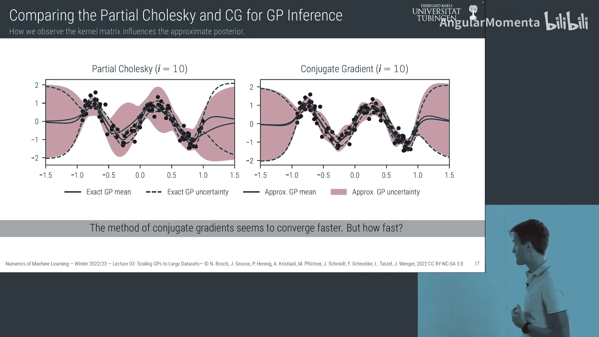

Okay。So。We saw that。Hologies。

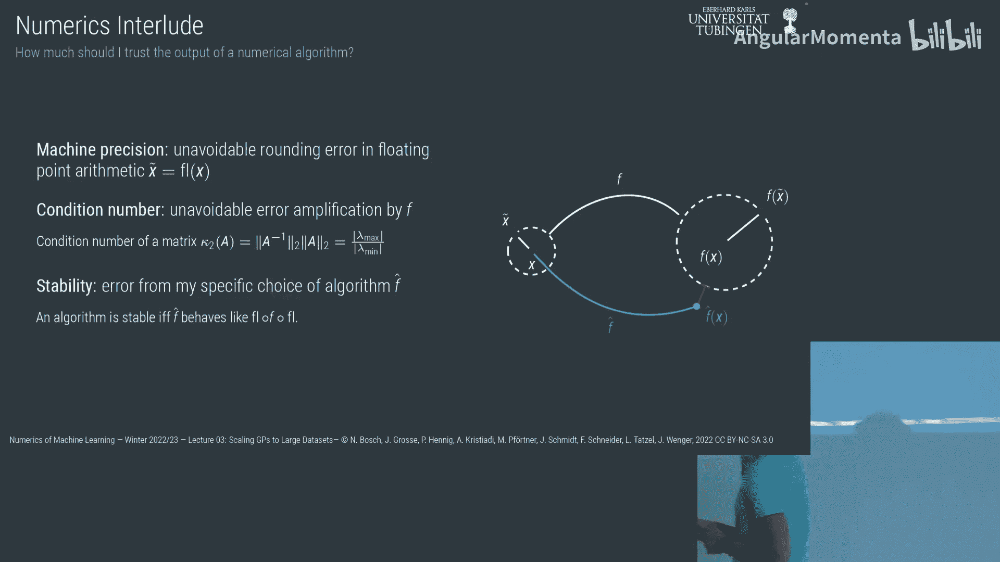

所咁。So。We kind of intuitively， or based on this picture， it seems like the。

 the method of conju gradients converges much faster。 But actually how fast does it converge。

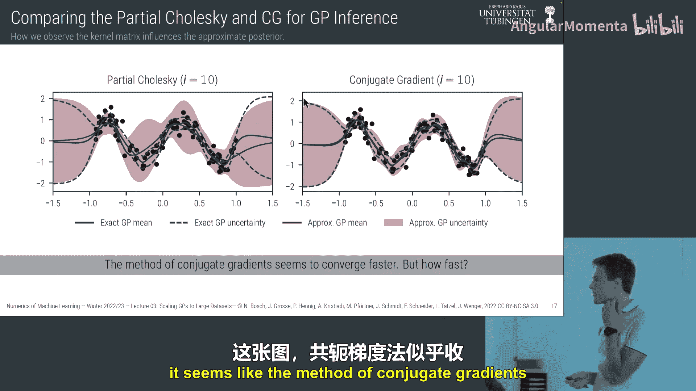

And now I have to take a quick numerics interlude to actually analyze this。

For those of you that haven't been in contact with numerics too much。

 here is a quick slide for the three most important concepts from your numerics lecture。

 I hope I'm not stepping on anybody's posees here。 So the first one is。Machine precision。

 whenever we're。Working on a computer and not just in abstract mathematics。

 there's unavoidable rounding error because I store。

 I can only store my numbers on my machine up to a certain precision。

So I call that here just a floating point rounding error F L of some theoretical quantity X that I can store my machine as X。

Children。Now。Whenever I have such a distortion on my disk。And I apply some operation to it。

 for example， solve a linear system， and I store my matrix and my right hand side on my computer。

 Those are suddenly slightly distorted。Potentially。

And if I apply the exact algorithm for inversion So the theoretical mathematical operation that inverts that matrix。

I still have unavoidable error that is gets introduced， right。

 because my inputs are slightly distorted。So also， my outputs get distorted。

 this bigger white circle here。And one way to measure this unavoidable error amplification through the mathematical operation that I'm trying to implement in an algorithm。

For the case of solving linear systems， that is called the condition number。So it's technically。

 it's avoidavoidable relative error amplification， but you can think of it as just unavoidable error amplification。

And that turns out to be the maximum， the largest eigenvalue。Divided by the smallest eigenvalue。

 in absolute terms。Okay， so kind of the， if you think of the matrix representing a quadratic function。

 as we had just a few slides ago here， the blue lines。

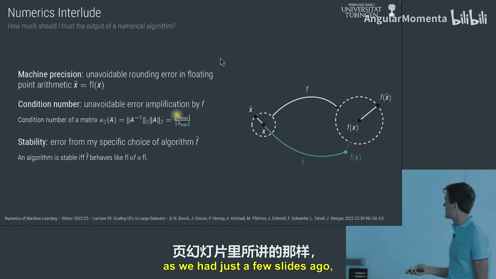

In this case。How elongated this quadra is in its largest elongation direction。

 divided by its smallest elongation direction。

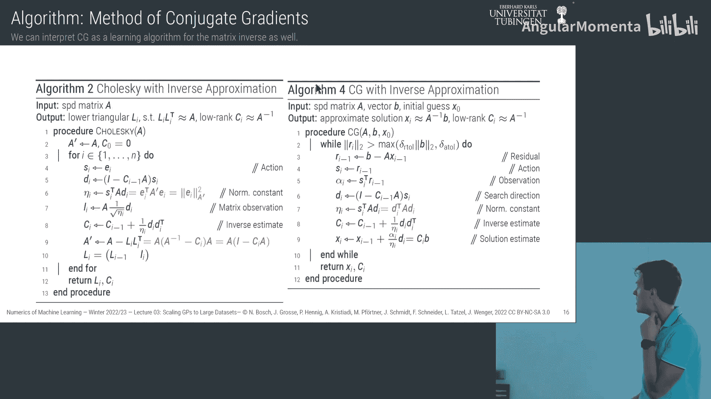

Sorry， the other way around， small is divided by largest。But it's largest aig developer smallest。

Okay， then there's a second quantity。 and this is just as a service。 Now。

 what happens if I actually try to implement this theoretical mathematical operation in an algorithm F had。

Like the conjugate gradient method or the triulaki。

 Then there's additional error coming from this implementation。

 maybe doing rounding in between or just not being。True to the true mathematical operation。

And if then my error is not too large， not too far away from this unavoidable amplification。

 I call that stability。Okay。Now， for example， the Ceski is a stable algorithm。The。

 if you solve the linear system on your computer with a tlaki decomposition。

 the error you should expect is on the order of the condition number。

 depending on what norm you measured in。Okay， so that's really large。

No algorithm in the world is going to be able to solve that linear your system to machine precision。

Mine machine precision。 So in， double precision is roughly 10 to the -16。 Okay。

 so if my condition number is 10 to the 16。Good luck finding an algorithm that's going solve that linear system to some precision that you desire that's smaller than one。

Okay。

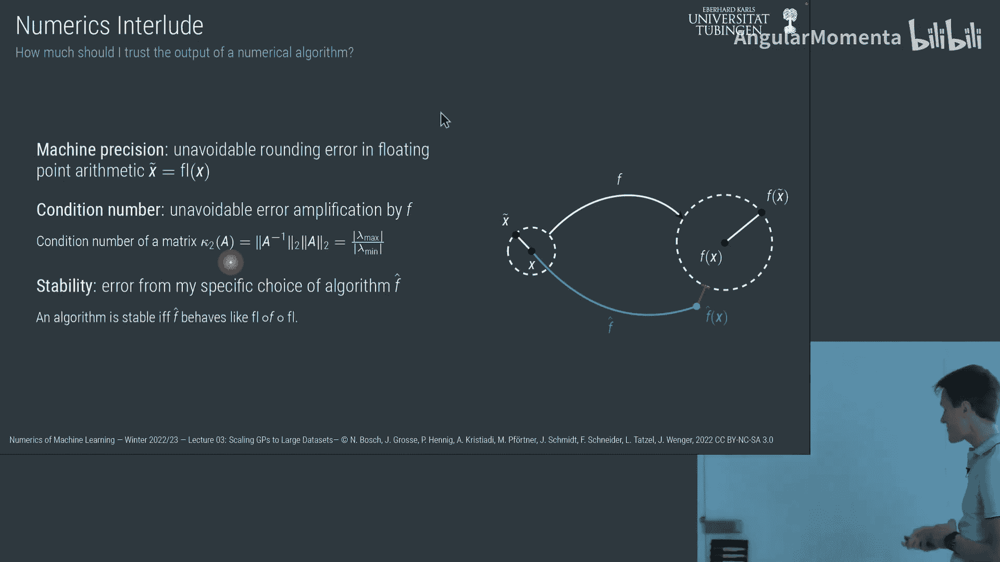

Alright， so now we can analyze the convergence behavior of the method of conjugate gradients。

Here on the left here， I have a system with a kernel matrix that has 1000 data points。

And has a moderately large condition number，10 to the five。And in the X axis。

 I have the number of iterations I run for C G。And on the Y axises， I have the error in a norm。

 So that's。The true solution of the linear system， minus my approximation。In a norm。

And it turns out that， so， first of all， let's observe that。We can't actually reach the。

Double machine precision accuracy at roughly 10 to the-16。

 because our condition number is pretty large。嗯。Now， it's not exactly that we can just add， you know。

5 orders of magnitude to this， because technically， this is in two norm。 and this is an a norm。

 but certainly we cannot reach 10 to -16 here。What it turns out for this。

measure method of conjugate gradients， the convergence rate。

 So how quickly it converges to the true solution is given by。

This condition number of the matrix A by the largest， divided by the smallest eigenvalue。

To some power I。 So if a is very close to one。Does this converge faster or slow。If a is close， k。

 sorry， if the condition number of a is close to one。

Does this term decrease fast with I or slow with I。What is， what is the。嗯。Numerator。

If cup of I is close to one。Just shout it out。Close to 0。 Okay， what about the denominator。

Cllos to two。So this is almost what？So if now I take that to a power。

 does it decrease faster or slow。Compared to if， let's say cup of a is a million。

What is the fraction here？Roughly。Almost one。So what converges faster if K is a million or if cap is one。

1， right， because then this thing here is almost 0。 So this  error decreases really fast。Okay。

Becauseuse if this is a million， then this is almost one。 And if it's one。

 it doesn't decrease at all。So the closer to1， V are， the slower we converge。So here。

 I should expect actually not such fast convergence， right， The condition number is quite large。

 turns out it， it convertverges still quite O in a few hundred iterations relative to the problem size 1000。

 that's not too bad。By the way， I only chose this such a small problem here because I actually need to compute the true solution to evaluate this。

Right， so I need to be able to compute a Chilaki to get a solution that's within mission。

Unavoidable error。So we can see that CG converges fast if the condition number of my system is small。

But doesn that mean it converges fast for all cases that we care about， for example。

For the current matrices。Here， similar example。Thousand data points。 A is a kernel matrix。

 and I vary the damping。 So the observation noise of my model。

I increase it from blue to blue from red to blue。 sorry， I decrease it from red to blue。

 So I assume less and less noiseisy observations。And you can see that the convergence of C G actually slows down as I decrease the observation noise。

And the reason is。Let's take a look。Here's the kernel matrix。

 K plus stigma squared I K is an SBD matrix。Or at least symmetric positive semi definite。

 because it's a kernel matrix。 So we can do an eigen decomposition where Q the eigenvectors and lambda is a diagonal matrix with the eigenvalues on the diagonal。

😊，Now， we can find a eig decomposition where Q has orthogonal eigenvectors。

 actually often normal eigenvectors。So I can just introduce an identity matrix here。

 Q times  Q transpos identity。And I can pull in the sigma squared I。

To actually find the eigenvalues of K plus sigma squared I。

And they are the eigenvalues of K Lada is a diagonal matrix with the eigenvalues。

That where each eigenvalue gets a sigma squared added to it。

So now if I want to compute the condition number of this kernel matrix at the beginning。

I just need the largest eigenvalue of the kernel matrix。 Sorry。

 if this stamped kernel matrix in the beginning， I just need the largest eigenvalue of the kernel matrix without damping。

Plus， the damping， okay。And now you can see what happens if I。Take sigma squared to be very。

 very small。 What if what happens if I take sigma squared to 0 to what does this term converge。

Just shout。Take this term。 Let's Sigma squared go to 0。What does it converge to？

Just the condition number of K， right， Lambda marks of。K divided by lamb the min of K。

 It turns out that for most kernels， these are very， very different numbers。Such matrices are very。

 very badly conditioned。 So Lada X is is much higher， much larger than Lada in。

So if I increase sigma squared， the opposite happens， right， in the extreme case。

 if I let that go to infinity， then this converges to one。 Obviously。

 then I assume that I have very large observation always， So I don't learn anything about my problem。

 So there's this kind of trade off going on。The more noise I assume the easier my numerical problem gets。

 but the less I actually learn about。😊，The function that I'm trying to learn。

And to give you an intuition， why this。Condition number of K is large。

The condition number is something like the largest is is the largest eigenvalue divided by the smallest eigenvalue。

 Now， if I have two data points in my data that are the same。

Two rows in my kernel matrix are the same， right， because the row of a kernel matrix are the kernel evaluated at the current data point。

And all other data points。So if I have two rows， where I have the same data points。

 I just have the same rows。And obviously， then that matrix has。A0 eigenvalue has low rank。 right。

 doesn't have sorry， has rank less than n。And if it has rest rank less than n。

 then this eigenvalue has to be 0。So as data points get closer to each other。

 the condition number of a kernel matrix blows up and close to each other is relative to the kernel length scale。

So if observation noise is small， So sigma squared， let's say is very close to 0。

 and I have close data points in input space。I have a problem。Because MCCG converges course slowly。

So what can we do about this？The answer to this is preconditioning。

So assume we have a computational tractable approximation P to the matrix A。

 So we know something about this matrix。 in this case， the kernel matrix。😊。

And we assume that theoring this matrix is rather cheap relative to storing the matrix A。

 we can actually efficiently evaluate its inverse。Or pseudo inverse。 And maybe you know。

 even though it's detert。So we know a lot about this， this matrix。 That's approximately a。

 And the idea is， we solve an equivalent linear system where we just multiply from the left with P inverse。

And this system still has the same solution。 X， right， I haven't changed anything。

Except that I multiply from the left。 But this equation still holds。

 So X is still a solution to the linear system。 P to the P inverse a。

As a matrix and P B at the right hand side。And now， if I can choose my preconditioners， such that。

 this condition number is much， much， much smaller than the conditional of the original matrix。

 I've gained a lot， right， because I've replaced my original problem with an easier to solve problem where my method C。

 G converges much faster。😊，And the intuition you should have about this preconditioner is it's like prior knowledge about my problem。

I sort of know something about this system that I'm trying to solve that makes it easier for me to solve in the same way that let's say I。

 I take a。Proboistic learning method， if my p is very concentrated around the true quantity that I'm trying to infer。

 I can learn very quickly， or I don't have to actually collect a lot of data。

And preconing is is the same intuition。 And geometrically， what preconing does is this is a。😊。

2D linear system， again， with a。Interpretation as an optimization of a quadratic were blue lines are the contrat liness。

 And I have a large eigenvalue and a small eigenvalue。 That's why it's kind of elongated。Now。

 if I have if my precondition is just the inverse itself， it immediately snaps。

The matrix a to an identity matrix。 And I don't have to do anything because it just says x equals p inverse B。

 and I have a solution， right， So P kind of transforms my problem in such a way that it's slightly closer to the identity matrix and then easy to solve。

And it turns out that because of this property here。

That the condition number of the system gets lowered， it actually accelerates C G。

And in fine precision actually makes it also more stable， but we won't go into that。

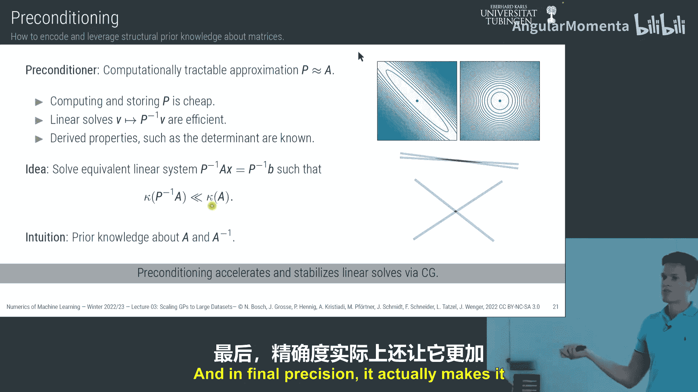

Okay。So let's try to get an intuition for how we can use this form of prior information。

 And I use that termul loosely Next， Next time， we'll make it precise。

To quicklyel to solve the linear systems， quickly forG P regression。

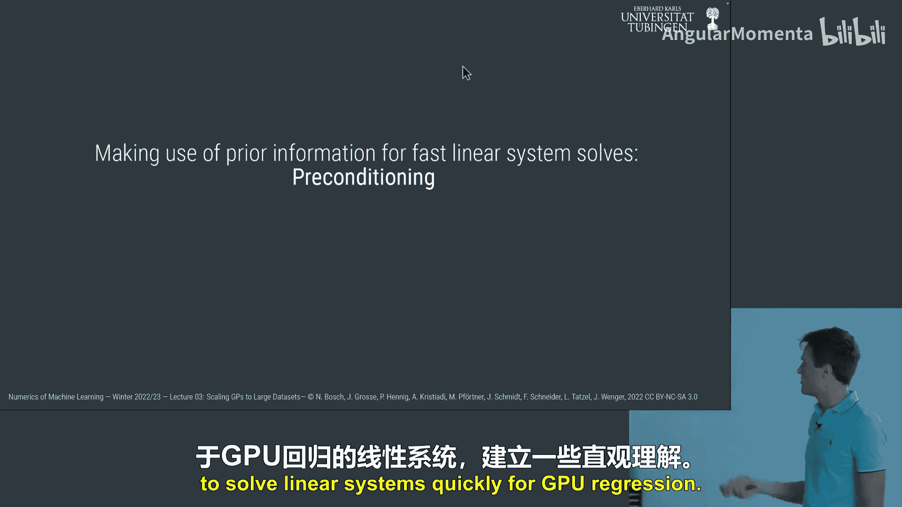

Okay。So if I now use C G with a preconditioner， it's actually very simple。

 The only thing I have to change is。I don't look into the direction of steepest descent。 R I -1。

 So the residual negative gradient。But I slightly warped that based on this preconditioner。And。

What happens is， here's， again， number of iterations of CG in lu space and the error in a norm to the true solution。

As I increase the quality of my preconditioner here。

I'll explain the type of precondition of a moment。And can see that I actually converge faster， right。

 the error decreases。 And this is in log space。 So I need a factor， two orders of sorry。

1 order of magnitude for iterations for this problem is organic kernelome。😊。

How do we get this reconder？Well， we can actually use the partialsian Schleski that we already introduced here。

 So one way to precondition kernelnal matrices is to。😊，Approximately。Approximate the kernel matrix K。

Add the noise。 and then this is a low rank approximation of rank L， right。

 I just run the Port Schlesky for a iterations。And then I can store this thing in。

It's just L vectors of size N。 So it's O of N L， which is cheap compared to the。So that's the matrix。

 And this is a low rank plus diagonal。Preconditioner。 So as you learned last week。

 you can invert it via the matrix in version Lamma。😊，Okay。

 so we can also compute the inverse pay P inverse here very quickly。 And last week。

 we learned that's O of N L squared。 So even linear time。

 and we can afford periodic time per iteration。😊，So that's also the precondition that we use up here。

Yeah。So。今ちで。Compo， also like our main concern for developing this。Was that you were not getting。

So hence you。Yeah so if you want the good preconition。Usleski。It's true。 You have that。

 So you could even construct an even better preconditioner by selecting better data points。

 Very true。 But it turns out even you know， doing a very dumb strategy。

 just randomly sampling really accelerates my method。And the issue is。

 if I would just run C G without preconditioning。It doesn't converge us fast because of the converges statement。

 Okay， so somehow that's a really good method。 But we have to warm start it maybe a little bit to get that benefit。

That's kind of the intuition。Okay， so now let's try that out。 Here's a large scale in solve。

 And I promised you in the very beginning。That I'm gonna reduce the time of 83 hours of solving a large scale linear your system with 100000 data points to about 7 minutes。

Here is such a data set matrix of size，100000。This is a kernel matrix。 It's a mat turn3 half kernel。

 I use a preconditioner。 I run it the par tleski for 20 iterations。

 That takes about1 and/ half minutes on my machine upstairs。

And then I run the precondition Schulasky。And what you see is that the residual。

Converges to about10 to the -8，10 to the -9 in 60 iterations。Okay， so actually。

 we could have stopped this even earlier maybe in about three minutes and would have gotten a very accurate solution。

I one quick side note。 I' not showing the error and A norm here。

 because I would have to compute the exact solution， but I can't do that。

Because the system is too large。Right， so I can only show you the residual norm。

 but that's the proxy that we use to track how accurate we are。

 And the residual norm is almost the same thing as the error and A norm。

 It the error and a transpose a norm。😊，Okay， so you can see that。I can now do。

 I can compute a G P posterior for 100000 data point data set in maybe 7 minutes on my desktop machine upstairs。

Now， you might ask， well， I have to do more than one solve， right？ I have to。

 maybe during hyperper optimization， do multiple solves。Actually。

 you might be able to reuse preconditioners for this。

 Or if you actually have multiple systems and you need to solve this cost alsoorizes because you only have to compute the preconditional ones。

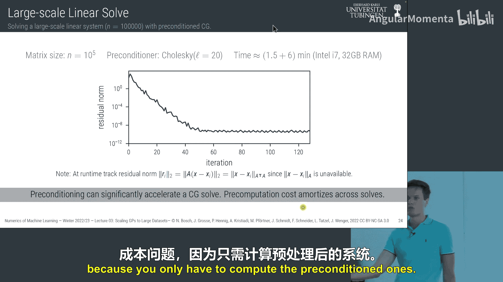

ok。But what about hyperparmeter optimization， I've only told you how to solve in your system。

 I haven't told you anything about how we actually do hyperparmeter optimization For Chilaki。

 Movin told you they can just compute the log determinant by taking the product of the diagonal of the lower rank。

 sorry of the lower triangular factor。How do we do this for C G。

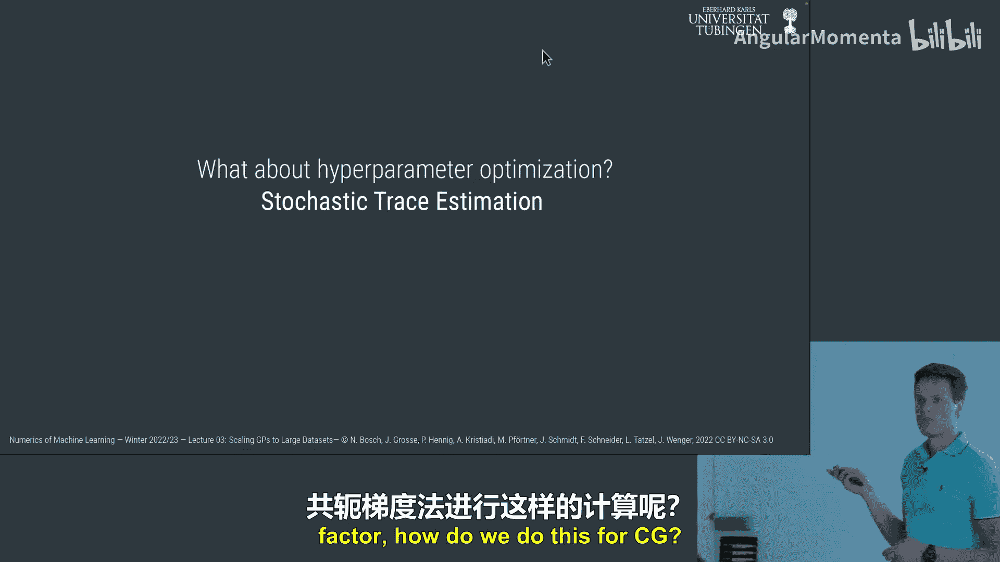

We need to。Remember。We need one to optimize。 We want to find parameters theta of the kernel。

 like the length scale。2。Optimize the log marginal likelihood。 That's our loss。

 or objective function。So we need to evaluate the loss to kind of check how good we are。

And most importantly， we need to compute its gradient end so we can actually optimize with a gradient based optimizer。

So it turns out that the， the gradient of the log marginal likelihood here。 Remember。

 it has a fit term here that involves a linear system solve and a log deterant。

If I take the gradient with respect to the hyperparameters， I get。This term for the fit。

 So that's again， two linear system solves。But the data。And。

A trace term here as the derivative of the log determinant of the kernel matrix that also involves a linear system solve。

So。We have two costly operations to do this type of render optimization。

We need to solve linear systems。 K hat inverse times of vector。 Most of the time。

 it's the data minus R。Prior mean。And in this case， it's also。

A linear system solved with the derivative the kernel matrix。 But weve solved this。 right。

 We can use C G。 That seems to be really fast。 We have to precondition fine， But actually。

 we can scale that up to， as you just saw 10000 data points。😊，But。What do we do about these things。

We also have to compute traces。 Arrguably， maybe we could say we can get away with not evaluated the log marginal likelihood and just terminate when our gradients are vanishing。

 right， Maybe that's fine。 But that still involves the trace of a linear system solve。😊，Now。

 how do we compute these choices。Let's take a step back and look at the definition。

So the trace of a matrix is the sum of its diagonal。Okay， so the sum over the diagonal elements， AII。

One way I could write this using matrix vector multiplication is just multiply from the left and right with unit vectors that select。

The diagonal element， right。Actually， it's also equivalent to the sum of the eigenvalues。

 But this is the the， the thing that well want to look at for now。But our problem is。We don't can。

 We can't afford cubic computation。 We can't afford n matrix vector multiplies because that would be n times n squared cubic。

We want to ideally approximate this thing to high accuracy with L much fewer than n。

Major vector multiplies， because if you can do that。

 you can solve linear systems with small number of iterations， I。

And we can compute traces with a small number of iterations L。

 And hopefully I plus L is much smaller than N。 Then we found a method that approximates s process regression in quadratic time on very large scale dataset sets。

 as we just saw saw。😊，So。Let's make an observation about this trace of a matrix。Say。

 we had an orthogonal。嗯。Matx Z， so that C times Z transposed is just the identity matrix。

Then we can just rewrite the trace of a as the trace of a times its identity matrix。

 which is introducing introducing a one。And by trace rotation。

 I could just pull this matrix to the front and I get the trace of Z transpose Az。

And if I just use the definition of the trace as selecting kind of the diagonal elements。

What I get is it's selecting Z I transpose A Z I or I get terms that are Z I transpose A Z I。

And that's also actually the proof for this being the sum of the eigenvalues， because if you choose。

Of the normal eigenvectors for this， you just get back the eigenvalues。Right， because a。C I。

 if Z I is an eigenvector is lambda I times the eigenvector and Z I transpose Z I is just one because it's an orphanormal system。

Okay， but that still doesn't get it get us all the way there because that's still in。Actually。

2 n matrix， sorry， N matrix vector to multiplications。Okay， crap。我。

What do we do if we don't know what to do。Why don't we just randomize。Why don't we just draw？

A small number of random vectors with a certain distribution， in this case，0 mean。

And covariance such that if I scale it with the square root of the dimension。

 I get the identity covariance。Maybe I can hope。That that's actually a good approximation of this thing up here。

And let's see whether that works。So the trace of a， I again， can introduce just an identity matrix。

 Now， I posit that the covariance of squared of n times Z I equals the identity。😊。

Then this squared of n。Get squared and pulled out。 traces linear。

I get an n up here and the trace of a times the covariance of Z I。

 But the covariance of Z I is nothing but the expected value of its square for vectors that Z I times Z I transpose minus the squared of the expectation。

 but the expectation is 0。So I just get the first term here。And now。I can pull out。 Sorry。

 I can pull in。Since the expectation is linear， my matrix A。So I get a times Z is Z transposed。I can。

Flip the expectation and the trace， because they're both linear。

And I can do trace rotation to pull up the Z I transpose to the front。

 So I get the trace of a scalar now。And of that， the expectation。 Now。

 the trace of a scalar is just the scalar itself。 So n times the expectation of this quadratic form。

 Z I transpose A Z I。And。Now， I can approximate this expectation with。Montic Carlo。

 so I only draw L random vectors to get an approximation of this trace。That's the idea。

The intuition you can take from up here， right， If I just choose a bunch of Z I。

 maybe that's already a good approximation to the trace。

 And that's the idea of this randomized approximation。So now， I found a way。2。Also。

 reduce this problem of trace estimation to matrix vector multiplication。

 which is the operation that I know is quadratic time。 I can do really fast on a computer。😊。

And hopefully， I only need a small number of these0 vectors。But。

I don't need a small number of random vectors。Here is a plot that shows the number of random vectors on the X axis。

For the estimation of the log determinant。Now， remember。

 last time you saw that you can rewrite the log determinant as a trace。

 I'll show you that again one second here。 the log determinant of the kernel matrix。

 you can rewrite as the trace of the matrix logarithm of the kernel matrix。

So if I could evaluate the logarithm of the kernel matrix。

 I could just do this trace estimation strategy that we just outlined。

Let's assume we can just compute this function of a kernel matrix for us。 It's always the log。

 if we care about the log determinant。And not care so much that we also have to estimate this in the middle。

 Let's just say we， we can do that。And what you'll find is here if I。

Look at the number of random vectors that I take from my Monte Carlo estimate。

The estimate for the log determine that I get through the stochastic trace estimate actually has a lot of variance at the beginning。

 right， You can see that I'm qualitatively pretty far away from the true value in grey dashed。

That I want to ask them。And I literally need tens of thousands of random vectors。

 And this is actually a problem of size 10000。 So I。

Found a strategy to solve my problem that is just as expensive as Cleski。

 which I can't do on large dataset sets， so。Crerap， right what do I do？Well。

This is a property of Monte Carlo estimators that they just converge at this rather slow speed。

 one whether squared of the number of random vectors or random samples。

This is gonna be an issue because it really slows down my hyperpar optimization。

 And I just simply can't afford to do that。So what can you do。You can， again。

 use something that we already know。We have a preconditioner for our linear system solve。

 So we know something about approximately how the kernel matrix looks like。And its inverse。

 Can we use that to solve this issue here。You can do that by if you look at the log determinant。

We can introduce a one identity matrix by just。Introducing the preconditioner can think of a partial chillulaki if you want。

And it's inverse。And then。Using the rules of the matrix logarithm。

 I can pull out this log determinant of the preconer， And we assumed that that was known， right。

 So we have some part about this log determinant。Kay hat， that we already know。

And then I get a residual here， again。That's something like， you know。

 the trace of the difference between the matrix logariths。

And you can already see that if the precondition of P had。Gets close to K hat。

 This term becomes very insignificant， right， And my log determinant of。

 of the preconditioner is very close to the true log determinant。So the strategy is。

 use the part that you that we know。Our p information， pull it out。

And estimate this trace back here via the stochastic trace estimate。And we can do that。

 And what we'll find if you do that is that the estimator converts much， much quicker。

 Li a difference between tens of random vectors and tens of thousands of random vectors to reach a qualitatively similar level。

 And that's the same kind of behavior。You expect from C G， right， if you have a good preconditioner。

 you convert much， much faster， as we saw previously。

Tn out you can also use the same information that you have about the matrix。

 also for this trace estimation。Now， for the gradient of the log determined。

 you can do the same thing。 You just differentiate once through this thing。

And all the quantities that you need are available， for example， through automatic differentiation。

 If you have， if you implement this and let's say Pytorch。And you recover。

 and it is not super important。 You recover the same rate at which the preconditional approaches the kernel matrix for this estimate to get a speed up。

 And qualitatively， you see this here， right。Tends to 100 random vectors is what we need to get the second error level。

And this is how G Ptorrch， which is the most popular library in Pytorr Python for Gaussian processes。

 works internally。 So it uses C G if you just use a vanilla。

Exact gaussian process from G P torch uses C G to compute the linear system solves precondition C G。

 And then it uses this preconditioned， log your term estimation and。

Dirivative of the log determined estimation to。To hyperparmeter optimization。And with that。

You can scale to data sets。 These are all data sets on the X axis from the U I machine Learn repository。

 I think some of them are not， but。They have data set。

 data set sizes between 25000 and a million data points here。

And now this is on a GPU because even matrix vector multiplies get significantly difficult if。

Your system is just large enough， but you can parallellyze them easily。

 So with these strategies that we just showed you。You can。You know， within。

About an hour train on a data set with roughly 250。

80000 data points and up to a day for a million data points。 if you have GPUus available。Okay。

 and internally， that works exactly how I just showed you。Now。

 just to give you a notice about what pre training and not pre training is， pre training is just。

Sample a small dataset of the dataset that you're training on to get hyper parameters that are approximately good and then start from there。

 Start opt placing from there。Yeah。Sure。So。So， the question was。

Can I explain again how essentially this part， right， Why do we get this increase in the rate so。

Clearly， if the preconditioner， if it's a low rank preconditioner。

 it depends on the rank L of the lower rank part。 If that gets close to K hat， this part goes to 0。

 right。But to actually figure out how good our estimate is turns out this contribution depends on how quickly the preconditional converges to the kernel metrics。

 Yeah， could imagine that。You need to take a lot of pre computationut to get a good estimate of the kernel matrix。

 Then that would not help you very much because it's very costly to do that。

If this thing converts very， very quickly to the kernel matrix。

 you can invest very small amount of pre computationutation。To do this variance reduction strategy。

 to this quicker convergt strategy， okay。And it turns out that if typically。

 you know something about how fast your preconditional converges。And you。

Inherit this rate specifically also for the Monte Carlo estimate。

 So instead of one over square root of the number of random vectors， you con mergege with a speed up。

 that's polynomial， sometimes even exponential。And what that means is， yeah。

You convert to the true value much， much， much faster。Okay。

 so now you know how you can do this large scale。With iterative approaches。

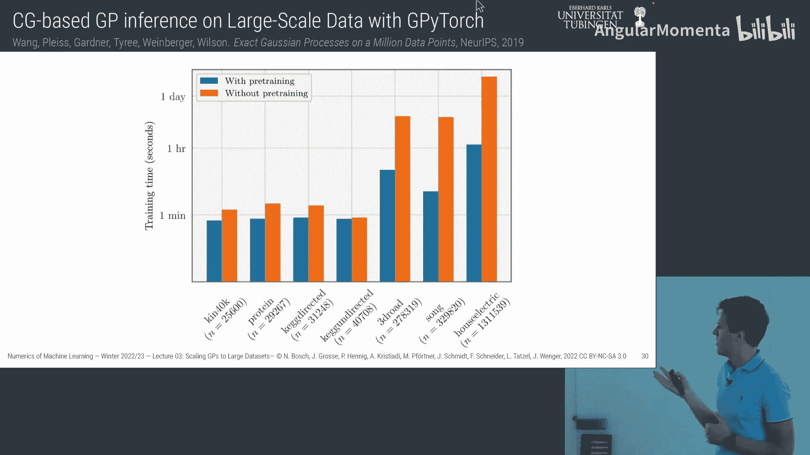

You can scale Gaussian processes to large data sets。

Let's do a quick reabbin of observations before we move to the final part。So。You've seen that。

 we kind of used language of。Iterative solvers choose these things called actions。

 which are vectors that essentially determine。How to observe my matrix， my kernel matrix in our case。

This choice of how to observe the kernel matrix through the matrix vector multiply really affects how fast we converge。

Okay， we saw that because C G， which used a different strategies used residual vectors。

 converged much， much faster in just a few steps relative to the problem size， which was。

100000 for the example that I showed we had what 60，80 iterations。Now。

 choosing these actions can kind of be interpreted as the solver choosing itself what to observe about the numerical problem。

 In this case， solving the linear system。And we know that if we。

 if you put in more information about our problem， if we already know an approximate inverse of the matrix through a preconditioner。

We can。Accelerate these methods， either for linear system solve。

 like for C G or for this preconditioned log determined estimation。

Through the stochastic trade system。So in conclusion。

For these to develop fast numerical algorithms for these for the Gaussian process case。

 you really need some sort of domain expertise in the sense that these solvers need to know something about the problem that they're solving。

Through with the precondition， ideally or through with the choice of actions to quickly converge。

 If you just do naively Par Cleski， you saw that that didn't really look like the G posterior。

If you just selected the data points in order。So the algorithms themselves need to know something about the problem to converge fast。

 but。We can tell them how to collect that information， to warm start themselves。

But can we do this even faster。I said now we have a method that uses a small number of quadratic operations。

 matrixtri X multiplies to scale to large data sets。But can we do this even faster in linear time。

In the size of the data。Our inference method scales， not。With the problem size for the power of two。

 but just with the problem size itself。

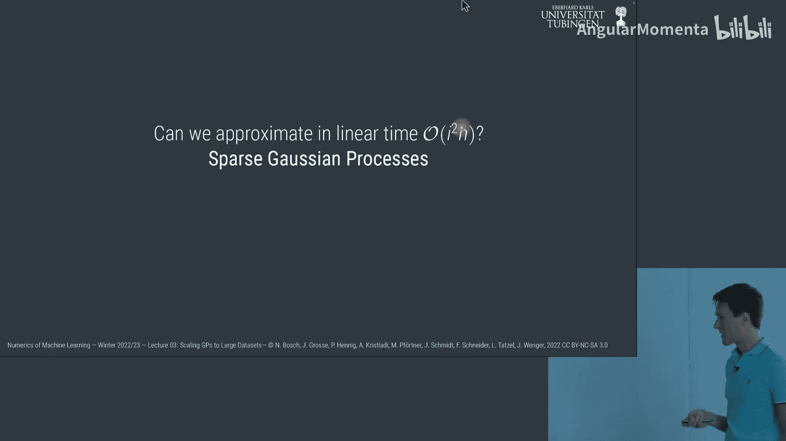

So this idea is actually a little bit older than the iterative methods approach。

Not the specific idea， but the idea of linear time G， P and friends。

 And I'll show you kind of the most modern version of it。And here again。

 this is just to give you a kind of a slight quick overview。 We won't go too deep into this。So。

One observation you can make about any data set， basically。Specifically。

 theyre low dimensional that the data points in them are often quite similar， right。

 You often have data points that are quite redundant。

 You get training examples where the example that you get is similar to one that you've seen previously。

And wouldn't it be great？If we could compress that data into a smaller training data set。

 let's call it inducing inputs because it's induced from the training data。

That kind of summarizes the training data， in a way。 right， So if I have a million data points。

 what if I could find 100。Or 1000 data points that just really well summarize the data that I have in my data。

So the idea is we can do this through something called variational approximation。

 So we directly approximate the posterior instead of。😊，Using numerical algorithms to compute。

The mathematical operations in the posterior。 Okay， so this is changing the model。

For your Gaussian process。 So you're not actually doing P regression anymore and approxiating that。

 But you're using a different model to get as close as possible to the Gausian process posterior。

And one way to do this is called stochastic variational gas processes。And what they do is they。

Posit a different Gaussian process that depends on Z。 These inducing inputs。

 the summary of the training data。And the posterior here。Looks very similar to the one。

 you know for GPS， right， So let's ignore this correction term for a moment。

 Then this part here looks like G P regression without noise on these inducing inputs because we have。

Colonnal function evaluated new data points。 And then here。

 kernel matrix evaluated all the inducing inputs inverted。Times。Something。And for the。Colonnal。

 we have prior kernel minus an update term that again。

 involves something that is the kernel matrix evaluated at the inducing inputs inverted。

 So if we had no noise， this looks almost like standard G P regression just on the inducing inputs。😊。

Now， it turns out that。For this to be。Kind of and。Smart， you actually have a correction term。

 and you can already think about that。 actually， the observation noise pops up nowhere here， right。

 So how does that enter turns that it enters here。So there are two more parameters of this term。

 One is the。Vectctor mu here。 And then this correction term。

It kind of dampens the or adds more uncertainty。So I have three things that I can modify to get a good approximation to my Gaussian process posterior。

 That is the summary of the training data。😊，This vector mu here that plays a role like the observations。

 the label vector。And a term that adds additional uncertainty through sigma here。

And what we can do is we can evaluate the K L divergence。

 which is a statistical distance between the approximation and the true G people Syria。

And we can do that。To optimize the summary of the training data。第一。

Vectctor that represents kind of our observations at Z。

And this additional uncertainty term that corrects for that we are only looking at a small data set。

 a small summary data set。And we can do this in O of I squared n。And。Oh。Sorry。

 I lost the mouth pointer。And let's take a look at how this comes about。So。In black。

 you can see that we have to invert the kernel matrix at the inducing inputs。

We only have I inducing inputs a small number， maybe 1000 instead of 100 thousand00 data points。

 So this inverse is really cheap because it's only of size I by I。

Any other terms that we find in there are just。Evaluating。The kernel matrix at these I data points。

 And then maybe at the training dataset set during training。Okay， so all the operations that we need。

R。Either I cubed。Or I squared times n because n is the size of training data。

Well the one exception is evaluating， oh，With the one exception being。

Evaluating the kernel matrix at the entire training dataset set。

 But that doesn't pop up during optimization of this。So。The idea is， summarize the training data。

 find a direct approximation to the posterior and that direct approximation only。

Takes over I squared n。Great， right， Should we forget about iterative methods now。Yeah。

So there's different ways you can do this。 The， the。

 the reason for the naming schastic here is typically you do something like batch optimization or SGD。

 So you can really quickly optimize this with your favorite optimizer， typically。😊，アリショがで。

So the most expensive operation is asymptotically in this。 But there's， you know。

 a number of optimization steps that you do。 But the most expensive operation in the training dataset set sizes in。

Okay。Remember， for iterative methods， we also have to do hypermeter optimization。

 So we also have to solve multiple problems。Had created a complexity for one for each hyper parameter optimization step。

But the number of hybrid parameter optimizationization steps is typically way， way。

 way smaller than the problem size。Okay， so。Great， right。Now。

 I spent maybe an hour telling you about iterative methods。 And now I'm telling you。

 you shouldn't use them。Well， this is what happens。For example。

 if you do stoastic variation gaussian processes。So here in blue。

Is the exact GP P on this small data。So that we can visualize it。In black X's are the observations。

 So these are our training data。In blue， light blue is the uncertainty of the exact Ep。

And in gray lines here， are they inducing inputs， so。

This is where we initialize our summary of the training dataset set。

 Here's a summary at a point here， here， here， here， here and here and here。And now。

 during optimization， I said we optimize both the mean as these parameters， mu and and sigma。

 but also the inducing inputs。 And you can see here。And。As I optimize， here is where I start。

 These inducing inputs find a location that summarizes the data well。But。There's one issue。

If you look at the。And certainly quantification。Away from the inducing the inputs。It's very。

 very different from the true gasian process， from the exact cation process， right。

And even where I have inducing inputs， my posterior mean doesn't necessarily。Approximate the。True。

 exact posteror mean well。Now， for iterative methods， I haven't shown you such。

 I have shown you such plots， but I have also quant how close it is， right to the true solution。

So the question is。Is this a problem for these linear time methods and how much of a problem is it for iterative methods。

The one thing we have going for us with iterative methods is we can online。

Control the accuracy of our approximation， right， We can just keep running the method until we have no more time。

And then。Stop， and that's how accurate our G approximation is。The inducing point method， typically。

 you have to set the number of inducing points a priori。For your data。And then you。

 you optimize them。 Now， you can run the optimizer for how however long you want。

 But the number of inducing points stay the same。So you have to kind of control the fidelity of your approximation before you start optimizing。

So， but what if this is just way faster， right。We saw that the theoretical of complexity is way faster。

And we see now this has an issue with uncertainty quantification。

So the question that I leave you with today。Is can we design a method。

Where we can trust the uncertainty quantification。Just as much。Doing any part of the approximation。

 no matter how much computation we've done， whenever we stop， can we trust the uncertainty here。

 clearly， we cannot trust the uncertainty quantification of our method， right。

 It's way far away from the exact E P， assuming our model is correct。All right， with that。

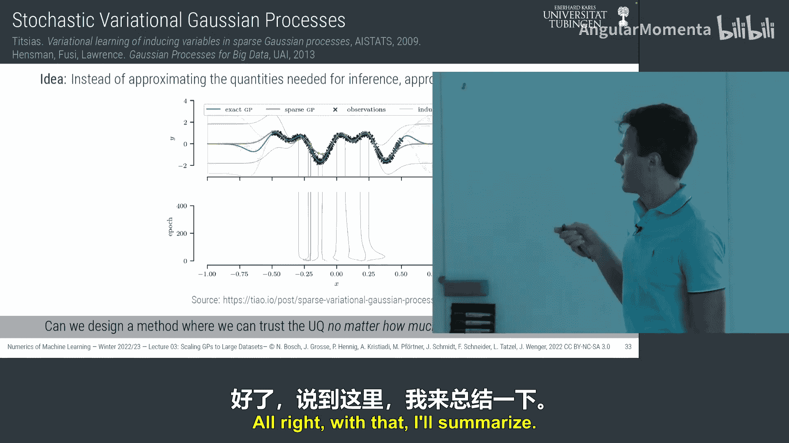

I'll summarize。We've seen that。Clearly， scaling Gaussian processes to large data sets requires approximation。

 They are memory and。Time， complexity costs associated with it。Iterative methods。

 like the partial of Schlaki ECG。Enable us to approximate the posterior and do hyperpar optimizationization in quadratic time in the size of the data。

😊，There's also an interpretation of these methods as active learning algorithms。

 And we like that precise next time。Preconditioning is a way to accelerate these methods。

And that can be interpret as a form of prior information。

 something I already know about the problem that I put in to make my method faster， to learn faster。

And then finally， Spe CP approximations enable inference in linear time。 So way faster。😊。

But there might be an issue of uncertainty quantification， right。And really， for GPS。

 that's the entire point why we've use gausian processes because we want to be know， want to know。

How much we should trust our prediction？Okay， so next week。I'll actually make that precise。

 In what way are these iterative methods actually learning machines。

 in what ways are the tools we use。To approximate learning algorithms like the Gaussian process。

Learning algorithms。

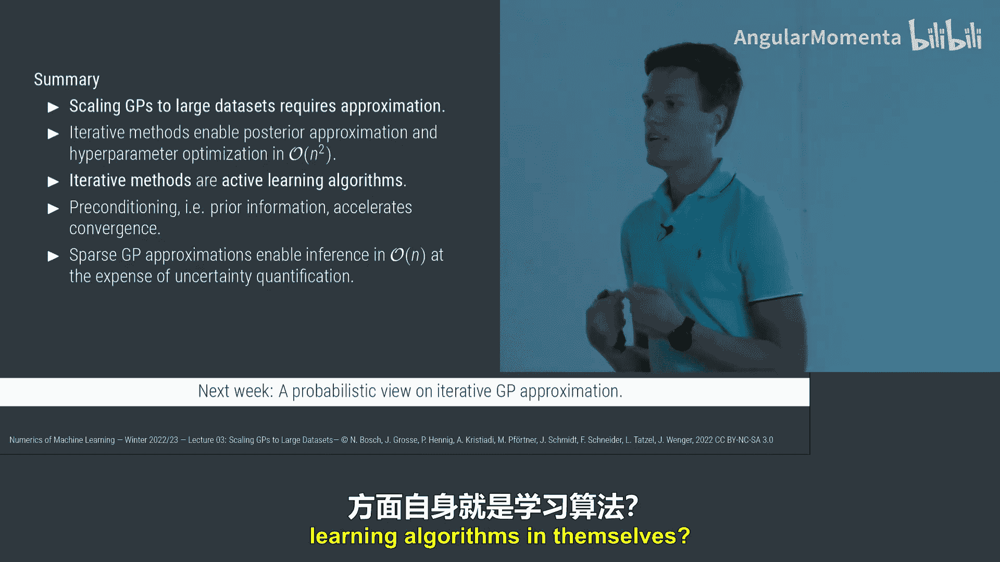

In themselves。 And I won't only use kind of language that alludes to that。

 but I'll actually show you exactly。And with that， I'll close today five minutes early。

 So that's perfect for you to now fill out the。😊，Feedback form。I very much appreciate that。

 And if you have any questions， raiseise your hand。 I'm happy to answer anything。😊。

To the best of my ability。 Thank you。

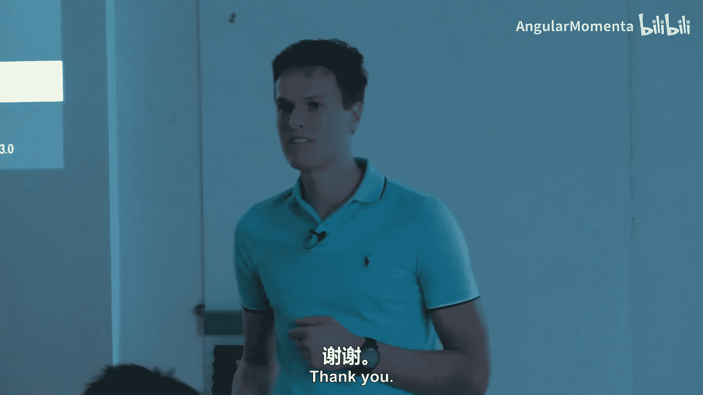

