# 【精译】蒂宾根大学《机器学习中的数值方法》-p04-4-——-计算感知高斯过程-——-乔纳森·韦格--BV1WMYHzAEcL_p4-

。

All right， welcome everybody。Welcome to the fourth lecture on numerics of Maine learning。

Last time we saw it look took a closer look at iterative approximation algorithms for Gaussian processes。

Today is the culmination of this first sequence in Gaussian processes。

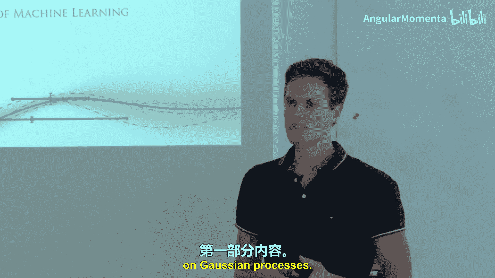

What if I told you？That today。You'll see how to do exact uncertainty quantification。

In arbitrary time。 So no matter how much computation you put in。Whatever your budget is。

You can still quantify。How far away you are from the function that you're trying to learn。Okay。

 so we'll take a look at that。 And today will be the the first real lecture on probabilistic numerics。

 actually， Okay， so last week， we saw kind of the contemporary way of solving linear systems in the large scale regime。

😊。

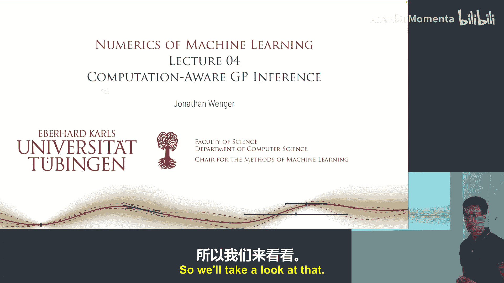

Specifically applied to Gaussian processes。 So we saw that how G torch works internally。

Very popular library on Gaussian processes in Python。And today。

 we'll put our probabilistic numerics hats on and reinterpretted how these algorithms that we saw last time actually are learning agents。

😊，And we'll see a very concrete benefit of this view that we can also quantify the approximation error。

Since we're approximating。Undoubtedly， there will be some error introduced into our posteri into our prediction。

 And we'll see that with this view， we can actually keep track of this error， exactly。Okay， so。

We'll also see a very interesting， almost philosophical of debate about what it means to observe data。

About some latent phenomenon， Let's say， trying to。L in some weather pattern。

 you model it with the Gaussian process， you want to predict what temperature the ocean will have in a certain time frame in the next few months。

You want uncertainty around your prediction。And we'll see what it means if you actually now take observe this data through maybe buoys in the ocean。

 make some measurements。Store that on some hard drive。

 And you're trying to make a prediction to the computer。

 In what sense is that data on your hard drive any different to computing on that data。

 So we'll discuss that a little bit。Okay， so let's get into it。 We'll start with a quick recap。

About what we talked about last time， because much of that will reappear in some way today。

As last time， whenever you have any questions， simply raise your hand or just shoutut。

 I'll try to answer them to the best of my ability。

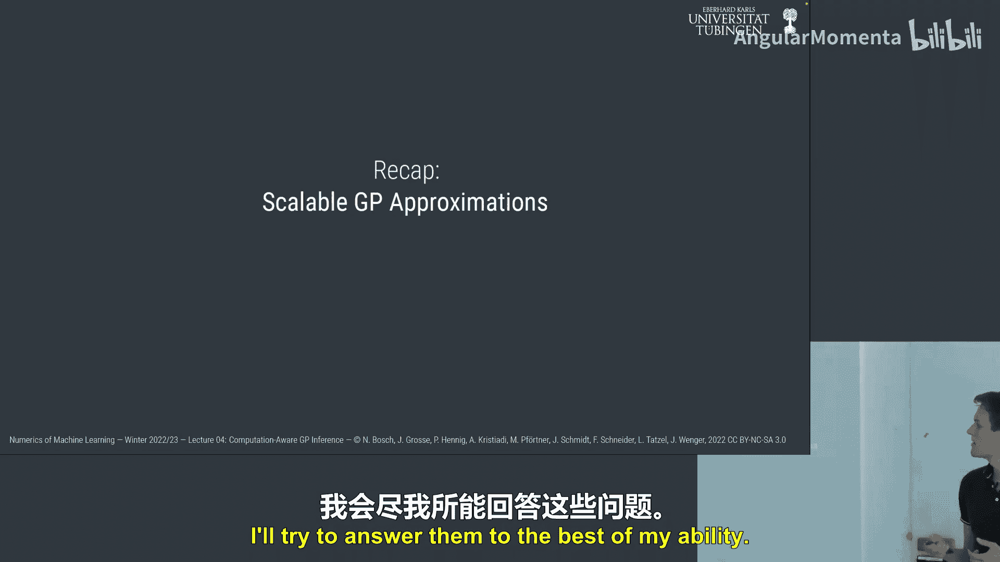

Okay。So we're still on this problem。 Gausian process regression is kind of a prototypical example of a regression problem。

 trying to learn a function。F from R D to R。 And we have some observation noise of the size sigma squared。

 And we can compute a D people theory that quantifies our prediction with how certain we should be in that prediction。

😊，And as we saw， you know， there's a very expensive operation in there。

 A matrixtri inverse has cubic complexity in the size of the data point， a data。

What do we see What we saw， you can use iterative algorithms。

 algorithms that do one matrix of vector multiplly per durationeration to compute an approximation to the precision matrix。

 So the inverse of the kernel matrix。 And that matrix is actually low rank。

 exactly of rank the size of the。😊，A numberumb of iterations that you've done。

Here at the bottom is one example， the partial Schlesski， where you select。

A bunch of data points through so called actions。So here's the Claki as an algorithm。 again。 Let's。

 let's recap the the most important elements of it。 So in the very first， in the second lecture。

 we saw that Schlaki is kind of prototypical algorithm to invert a or decompose a symmetric。

 positive definite matrix。 We saw last time we can also interpreted it as an approximation algorithm to the inverse of the matrix。

 So it builds up this matrix C I low rank matrix as an approximation to the universeverse。😊。

And it does that， roughly。Did a rough complexity analysis in cost n squared per duration。

 So if you do a small number of iterations， we can do this in quadratic time。

And there was one specific kind of important choice。 This choice of the action。

 which is a unit vector that selects a certain data point。

 So if I go one slide back here in the first three iterations， we selected these three data points。

Okay。So high level， I， I use a lot of language that refer to learning problems， taking an action。

 making an observation about this numerical agent。 And today， we'll see make that precise。 How。

 how is that actually really a learning learning machine。Okay。

 we also saw that it really matters what choice of actions you choose chose， right。

 So here on the left， the actions target the first 10 data points from the left。

 And you can see that。The marginal variance， so。How certain we are in our prediction here in dark or in red shaded versus the exact U P posterior computed with O and cubed operations。

And of reduces your uncertainty very locally in this region。But I can do better if I， for example。

 just choose my actions randomly， so I select randomly chosen data points。

Roughly spread out through this data set。 I actually reduce my uncertainty about what the true function is。

Much， much quicker。 right， There's certainly a lot more reduction happening here， even though。

It costs exactly the same。So， the choice of action。

Matters in the same way that it does for a learning problem。

 It really matters where you observe data。The more new data you observe。

 that's not similar to the data that you'll be seen， the more you learn about。

The function of the phenomenon that you're trying to predict。

 And we're seeing very similar things here for this numerical method。Okay， so the natural question。

 natural follow up to this is， well， can we find better actions， Right。

 Do we have to select data points。 So can we do something different。

 Can we do something more maybe smarter。On the left here for the partial of Sulaki， this is the。

Residial matrix。 So the part about the kernel matrix that we haven't learned yet。

When we choose unit actions。It's just a single one in this vector and the rest is all0。

And here we've observed you， in this part of the input this part of the matrix in the middle and then down here。

 where there are still large values in the residual。

 We haven't really learned what the kernel matrix looks like。

And then I showed you that theres actually a different strategy where I choose dense actions。

 So vectors that have some entry in every single。Some， some number in every single component。

Where I can more quickly learn the curl matrix， The residual is much smaller， right。

 They are done the same scale， color white。So。How will we choose these actions？

 What actions can we choose that do this better。And the method that we came up with or that we looked at was the method of conjugate gradients。

So there's one kind of important。Conceptual switch that we did。

That we can interpret solving a linear system。 So for us， a is always a kernel matrix。Also。

 similarly， as。Minimizing a quadratic function here， F。我。A is of in the quadratic form， okay。

And if you take the gradient of this with respect to x and set it to 0。

 So solve this convex optimization problem， that was equivalent to solving the new system。

 So that's a equivalent perspective on the same problem that we're trying to， to solve。

To get the solution of the。Linear system with the kernel matrix and the labels。

So we introduced a different name for the gradient， because in this setting。

 you can also view it as a residual of if I plug in some estimate of the solution X here。

 the right hand side minus A X is how is is a measurement of how close I am to the true solution。

And the idea of Conjugate gradient now is， well， I could do gradient descent on this problem， right。

 Maybe the， the simplest optimization algorithm that you know。And that would be fine。

 I would get the green line here。 and I take a bunch of steps through this optimization landscape where the blue lines are the equal potential lines。

😊，But it turns out I can do something smarter。I can take into account the geometry of this problem。

 So what that means is， I notice that， you know， this is， in a way。

 a space that is stretched and the stretching direction is given。

 You can see this by the equitential lines， right， It's like a circle。

Concentric circles that are stretched。And if I take that into account。I can。

 instead of walking orthogonally with respect to the Euclidean in a product。

I can walk orthogonally with respect to the inner product that's induced by the matrix A。

And what that looks like in。Xspace is， I take the green steps here。 sorry， the red steps here。

 So I only take two steps。 And this angle here is a right angle。

 If I would squish my blue line such that they would look like a circle。Okay。

 so it's a right angle step in a different geometry。

And it turns out that these kinds of methods all converge in at most n step size of the problem。

And in particular， if I choose the residual as an initial step， you can see that the gradient method。

 the， the gradient descent method and conjugate gradient actually take the same first step， right。

 green and blue green and red are the same。Then if I do that。

 these actually converge typically in a very small number of steps relative to the size of the problem。

So here again is the conju gradient method as an algorithm。

 And the most important thing we saw is that we recognize a lot of elements that we also saw in partialshasulaski。

So， we saw。There was a choice of action。 In this case， the residual。

There was a estimate of the inverse C I。 That's a lower rank matrix constructed from the same vectors。

Or similar vectors？And additionally， of course， now that we're interested in a solution to the linear system。

 not just an inverse approximation。 There's also the solution estimate that gets built up from these search directions。

 So directions in input space that I follow when I walk。O。

Just saw that very similar elements in the partial of Claski inverse approximation as well。

Action as well。 here the action is different。 unit vector versus residual。Okay。

 and then at the very end， we said， okay， Parlaski。Conjugate gradient。

 if it to a rough complexity analysis。 What's the most expensive operation in both of both of these algorithms。

What's the most expensive operation in one iteration。Any ideas。

What type of operation is the most expensive。It's a matrix book to multiply size with the matrix of size。

At most。And n by n。 No， okay， so the most expensive operation in both。

 both of these iterations are matrix vector multiplies with this matrix A of size n by N。

So we look at these could say， okay， they're both quadly expensive。Can we do this cheaper。

Can be founded even faster approximation to a Gaussian process。 And at the very end。

 I very quickly just teased。That there are linear time G P approximations。

 most of them based on inducing points。 So summary data points of the training data set。

And typically。You optimize where these summary data points in gray actually lie。 So from the。

Bottom to the top， we kind of optimize the locations of data points that summarize our data。And then。

I can approximate my blue。Mathematical exact Gaussian process that I would only have access to with O of N cubed operations with this orange Gaussian process approximation to be called the sparse approximation。

In orange。What was a big issue that we pointed out at the very end with this plot。

 Would you be satisfied with the orange approximation for the blue1。No。

People are shaking their heads， right， So one problem with this is， of course。

 we can't expect this to be exact because we're only investing a certain amount of computation。

 but certainly also the uncertainty is very miscalibrated， right。

 So in regions where we know nothing about the data set。😊，We are not sufficiently uncertain。

 as we should be， based on the kernel。And in regions where we have a lot of data， for example， here。

 it's a little hard to see。 But there is no uncertainty， essentially in this point。

 even though the data and also the exact posterior mean is far away。 right。

 So this linear time approximation tells me。You should really trust your prediction here。

 but actually， it's wrong。And you should。Somewhat trust your prediction here。 But in actualology。

 we should be even more uncertain about what the true function lies。Okay， so can we fix this？

 Is there a way to get around this problem， which is the reason to use Gaussian processing in the first place。

 right， one of the big reasons， one is we can really nicely input what we know about the function we're trying to learn。

By the kernel。 and the second is。We get an uncertainty estimate。

 so we know how much to trust our prediction， given our model。And this second point here is。

In this illustrative example， it validated it， right。

 I shouldn't really trust the uncertainty quantification there。

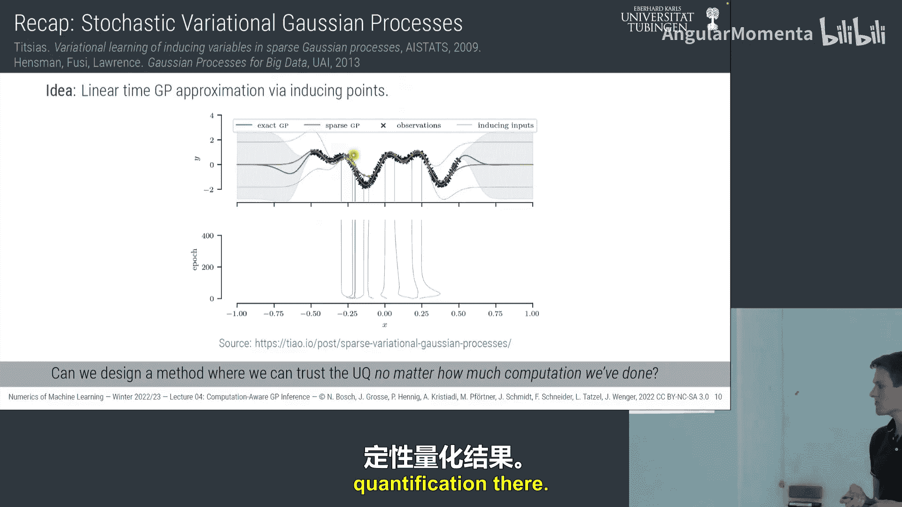

So can we do this and we'll see how to do this today。So we'll see in what sense。

We can actually get exact uncertainty quantification。

 no matter how much computation we have available。And we'll double this computation of where GP inference。

Before I get into it， questions about the recap。Okay。All right， so quick disclaimer。

I said last time you saw the state of the art。 What you're seeing today is in a way of the future。

 Okay， so this， all of the press， all of what I'm going to present today is gonna be presented in nervebs later this year。

 So this is as cutting edge as it could be because this research paper has not even published yet。

 technically， okay。😊，So， but take it with a grain of salt， because this is my work。

 Philip's work and in collaboration with。😊，Jeff Kliice， Mavin and John Cunningham。

 and Jeff is the author of G P Torch， the principal maintainer。

Okay。Let's jump back to the very beginning of this talk。

We took a take a look at the Gaussian process posterior。

 and we always focused on that there is this matrix inverse here。But really。

 let's take another look at this。 and let me rewrite this。

Inverse times the labels minus the prior prediction as just a vector。 Okay， so I can。

 this is just a vector， right， There's just a solve of a linear system， which is a vector。

 And I'll give it a name， represent weights。And the reason why we give it this name is。

 let's take a look at what it actually does， so。This。The evolution of this kernel is。

A bunch of functions。K of x。That are centered at the training data。

 It's evaluated at all the training data points on the right the right， in the right argument。

 And on the left， there's an arbitrary X that I evaluate。So one way to rewrite this。

 just writing out the inner product is。A bunch of kernel functions center at data points X J。

 So that's in the plot， the gray vertical lines here。And in each of them， there is in red。

 a kernel function that has the same shape。 You can see all of these red shapes are looking the same。

That is weighted in some way by this entry of the representative weights。

 the corresponding entry of the Re weights。 Okay， so if you think of the kernel functions as being representative of the shape of the true function。

That motivates the name that I weight these representations of the true function in a certain way。

 And then I sum them up to get my prediction。 Okay， so the posteror mean is a linear combination。

Of these representative functions defined by the kernel。

And here is also very clear that the kernel encodes assumptions about what the true function looks like。

 right， If the shapes that I defined for my kernel here look very similar to the function。

 I can trust my G P to model it very well。Now， what happens if I use an iterative method to approximate these representative weights。

 because that's what we always talked about， right。

 We talk about solving the linear system with the kernel matrix and the labels or labels minus prediction。

 minus prior prediction。With an iterative solver。 So we get some kind of estimate of this linear system solve。

It's called it VI。So we don't really get the exact mathematical plus I mean。

 And I call it mathematical， because。You have to there's an operation in here that we have to do mathematic operation。

But we only get an approximation V I of these representatives V star。

And what does it look like in this。Schematic。Illustration of the sum of kernel functions。

 So I don't get the true red。And so I don't get the true red dashed。Weighted kernel functions。

 So if you go slide back。Now， the red lines are dash lines because I don't have access to them。

 I have to approximate them。And instead， I get these solid red approximations of them。

And you can see that here， for example， this one is pretty well scaled， right。

 It's almost equal to the dashed line。Same on the， for the outer data point here。

 but for the centered。Weighted kernel functions。 You can see that the approximation is so bad。

I'm not even close to the true。Clonnal function centered at this data point weighted by roughly -1。

Okay， so in this view， we can think of。These iterative solvers。

And approximateoximate these weights for these kernel functions that construct our posterior。

 our prediction。Now。What if。We found a way。To quantify this approximation error between the true representative weights。

An our approximation。And ideally， we could do this probabilically because we're dealing with a probabilistic model。

 So maybe there's hope that we can。Add this additional uncertainty coming from estimating these weights。

To our prediction， to our posterior。Okay。So that's the， that's the idea。Estimate these weights。

 but keep track of the approximation error， the distance to the true representative weights。

 and add that to our uncertainty。

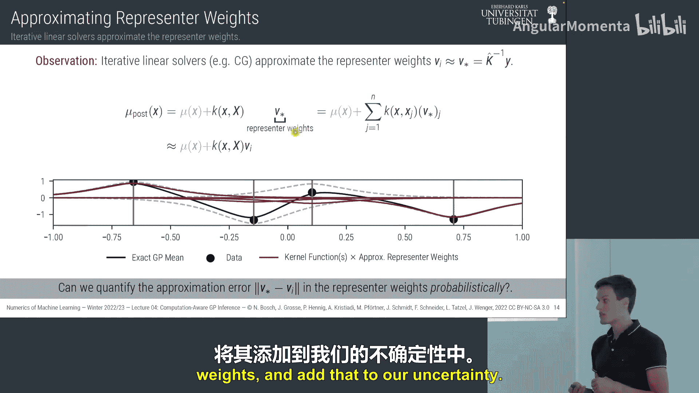

Alright， quick interlude recap for those of you that maybe haven't had that much connection with the linear algebra of Gaussians or the linear algebra of inference。

 as we like to call it。So。Gausian distributions have a ton of nice properties that make them really easy to work with。

In probability theory， specifically when it comes to conditioning and observations。

 and we've seen a little bit of that with ga processes。

 but we'll recap one important property that we'll need to derive our algorithm algorithm。

So first of all， some simple ones。 So if I have a Gausian distribution over a random vector Z。If I。

Take a matrix vector multiply of that random vector。

 The result is a random vector that still has a Gaussian distribution。

 and I can actually directly give its parameters， matrix times the mean。

 And then the covariance matrix wrap from the left and right of the matrix。

So we can think of this in the very simple case of a scaling， right。

 if you just scale your random vector up。Of course。

 your mean prediction also gets larger but also the variance in your random variable increases。

And the second important property is marginalization。 So if I have a joint Gaussian random variable。

 So X and Y， they are jointly Gaussian。I can。Marginalized away， in this case， the。R variable Y。

 And I can just take a look at the entries of this vector， essentially， and take out。第一。

Piararameters of the Gaussian to find out what the dis distribution of the randomback is。

And I can combine these properties to get a nice result that you can also use to。

Prove what the guessstion process plus two is。From a weight space perspective。

If I have a prior over a variable x here with prime mean covariance mu sigma。

 and I have an observation model。So I make observations of this random variable。

Through a model by y here， where I think y is an aine。Map of x。 Okay， so matrix factor。Plus。

 some bias。Then if that's the case， I can simply write down the posterior distribution over this X。

 given these observations y。And let's take a quick look at what elements pop up here。

 and you might recognize some of them of G P in France， from G P in France， so。

Here in the very front， mu is my prior mean， right， And。

 and let's think of the matrix B as just the identity for now。So I have my prior prediction。

Back here， I have my observations， why。And subtract from them My prior prediction A times mu。

 because remember， y is observed through A is X observed through a。And then I scale this observation。

 how much I should update how surprised I should be by my prior uncertainty sigma。

 my observation noise Lada and my prior uncertainty。

 I have to multiply from the left and right with a， because that's how I observe why， right。

 That's this rule back here。😊，So。You should recognize this a little bit from just Gausian inference。

 okay。But we'll now use it in a different fashion。So。It's like one step back， our goal is。

 can we quantify the approximation error in our estimate of the representative ways。

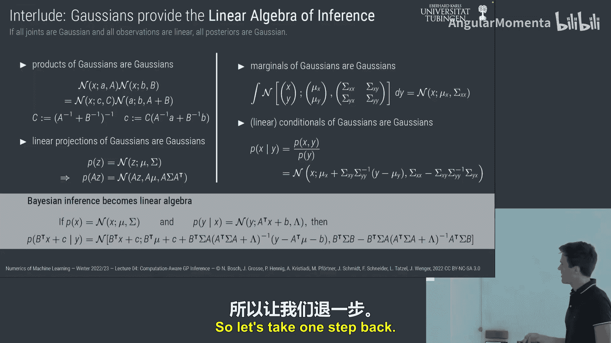

And we want to do so ideally， probabilistically。 So what does that mean， So in。This graphic here。

 the red dot is our estimate of the representatives V after I iterations。

And in black are the true representative。 And this is a 2D example。 So this is actually the， the。

 the very initial point。If I haven't。Gauussian distribution over this red dot。

 So where the true representative V star are So So a Gausian distribution over V star。

 my belief where V star is。What that looks like is I have a mean estimate V I。 That's the red dot。

 And then I have this。These concentric ellipses that represent my Gaussian bell curve in 2D。

So the closer I am to the stock， the more intense the colors。

 the more certain I that the true representatives lie in this direction。So you can see that this is。

A way to quantify error， right， The spread of this Gaussian is how far away。

 I think the true representative rates are。 And then its orientation and squishing give me kind of an。

Id and what direction I should look for the true representatives。 It's less likely to be。

Up towards the right。And then it's more likely to be。Towards the top left and towards the top。

Bottom right。Okay。So let's say we had a prior like this。

 just a Gaussian distribution that somehow quantifies how far away I am from the representative weights。

How can I update it？How can I find out more where the true representatives V star are。

 I might just start with a guess of 0， but I want to figure out how do I learn these representative ways。

 So what I can do is I cant directly observe the representative V star， right， that's to get them。

 I would have to solve this。Linear system inverse。And Philip up maybe could help me for a second with a pointer。

嗯。So。I can't directly observe this dot。 this is the black dot here。

 But what I can do is indirectly observe it， okay。And I can do that in the following fashion， so。

Remember that the residual， we talked about that earlier with C G is。The labels minus the prediction。

 Pri prediction minus the kernel matrix times my estimate for the represent weights。 Okay。

 so this is the residual。 And then let's say we have some vector S I。

 It doesn't matter what it is for now， just some vector。

Then I can pull out this kernel matrix K hat here to get S I transpose times K hat。

 That's just another vector。Times。The difference between the true representatives and my guess for them。

Where have we seen。三。Lineium map times the quantity that we care about that we have a Gausian distribution over just a few slides ago。

This is just an estimation problem， right， This is just Gaussian inference。

 and we observe through a linear map so we can apply our nice theorem that we just saw at the bottom。

😊，嗯。Just a few slides ago。

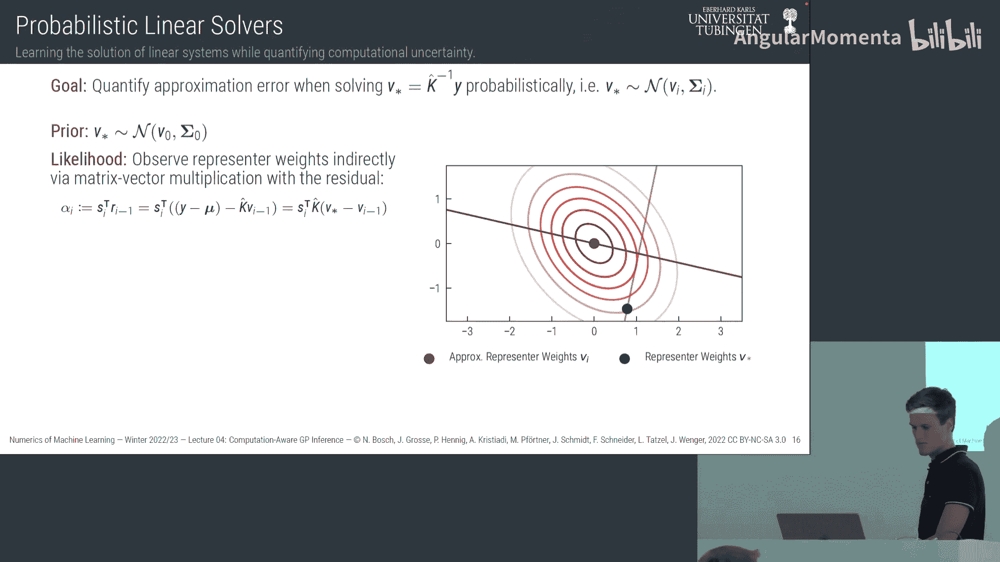

Namely， bat down here， right， we have a。Represent a weight quantity。 In our case， it's P star。

 and we have a linear projection of it。

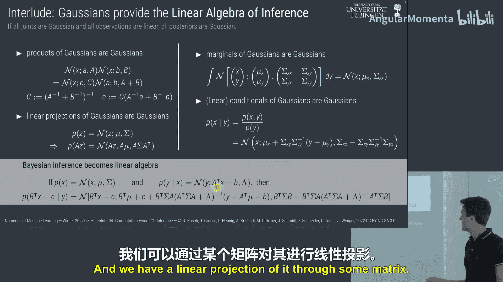

Through some matrix so we can update our belief， our Gausian belief over these representative ways。

So what does it look like geometrically， So I have my representative Wait estimate V I in red here。

And I pick。Some direction induced by the selector S。 That's the action again。Times the kernel matrix。

And that gives me a direction in this。Space of the representative weights， the red line。And now。

 if I。Observe my representative weight。 What that corresponds to is I project the distance between。

The guests and the true representatives onto this line。

So I get this distance here between the two on that line。And as we said。

 that's just F I Gausian inference。 right， That's just the theorem that we saw two slides ago。

 So we can apply directly this nice F I Gaussian inference theorem。

To update our belief about whether true representatives are。So what happens now is。

From this initial Gaussian be， we actually observe without noise， right。

 We have a observation that's exact。 There's no noise in this observation Al I。

 We directly get this matrix vector product exactly。So， our belief。

Collapses onto this line in which we haven't actually observed it。 We only observe in this direction。

 the distance。 we only have the distance here。 We don't know how far away we are in this direction。

So belief collapses onto。This orthogonal line of the line that we looked in， and we get a new belief。

 That's one dimension。Less， one dimension， less in this case， one dimensional。

 And this orange here is the Gaussian bell curve in 1 D that's on this line。 So I think my belief。

 my estimate is here that my true representatives are there at the red dot。

And I think there within roughly this region， maybe that's one or two standard deviations。Okay。

 so now I have a。Actual learning algorithm。So just a probabilistic belief update， right。

 That's the probabilistic learning algorithm to find these representative。

 And I can do the same update again now by choosing a new search direction。

Before we look at the form that this takes， observes something。

Is this red line in the way it's oriented the best choice here。

Do you think there's a choice that's more informative。Remember。

 what I get is the distance between the red dot and the projected black dot。

 The projection is given by this light red line。 So I observe this distance。And then I update。

 and I move towards this intersection， with my point。What would be a better choice。You think。

Can you draw a red line here that would be more informative about where the true representative weights are within one step。

 So remember， we move from。This point to the intersection of this。These two， for the projected。

Point in this one dimensional subspace。the。能别。The line that goes through the actual representatives。

 right， That would be a direct step to the solution。Okay。

 but anything that's kind of more aligned with this ellipse， right。

 with our prior belief here would be a better choice， yeah。Yeah， so in this case。

Thats as most represented by in this direction， right。

 But it could be that our prior belief kind of looks differently， right。

 It could be slightly rotated。 But you're right， The best step obviously would be directly to step to the solution。

 But that's probably just as costly as solving the system itself。Okay。

So let's take a look at what the posterior after the update actually looks like。

 So now we have an algorithm。That updates a belief about the representatives。

With an observation that we can make， just。An action times a residual to get a updated belief about where representative rates are。

 And this updated belief。You can directly derive through this F and Gaussian inference。

 And we'll look at the elements that we saw before again here， so。

VI-1 is my guess for the Re Waits currently。My prior mean。Here's an update term。

 That's the difference between the quantity that I care about and the quantity that I estimate it to be。

Scaled by。How certain I should be or how surprising I think I I I。

 I should ex how surprising this difference should be to me， right， if I'm very。

 very uncertain at the beginning and I see a large difference。

 maybe I shouldn't be that surprised that I don't know where the true solution is。

 If I'm very concentrated。 I think I really know where the representatives are。 And suddenly that。

True representatives are far away， I should make a big update to actually get to the true representatives。

But that's not the entire story， right， because we have this linear。

Map in between S I transpose K hat。 So that's in the linear Gaussian inference theorem。

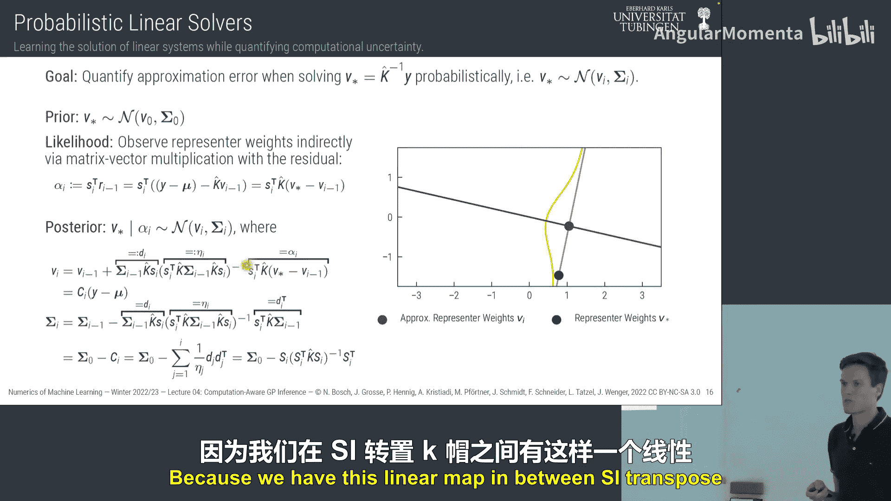

That's this matrix A here。 The projection of our representative。 So we only Z see a projection of it。

 We only see。

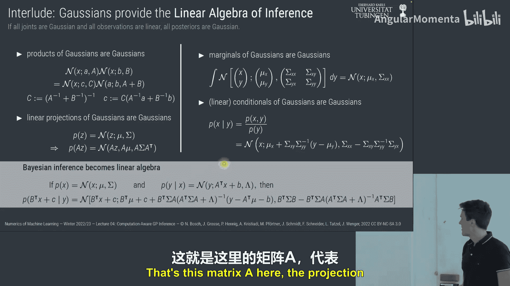

On this red line were the black dots。 That's how projection of it。Okay。

AndNow I gave names to these quantities， and we should start to recognize some of these from the previous lectures。

Here， that's just the projector residual。 We had that up here， right。

 S I transpo R I -1 is S I transpo K hat times the difference between the representative weights。

That's my observation。 I can compute that， great。Now。

 what's in the middle here is that a scalealar matrix。What， what dimension does that have。This。

 the thing that I invert。It's a scalar， right， because I multiply from the left and right with two vectors。

So that's also easy to invert grid。 And then the final thing here is my previous uncertainty times Khead S I。

 So the map that I project through。😊，Okay， and I rewro， I gave all these quantities names。

 I gave this quantity， the name D I， and it pops up again， also in the。

Update to how certain I am about my approximate， about my representatives。

My previous uncertainty is reduced by。A quantity that depends on what I already know about my representative weight in the direction that I'm looking。

And these same vectors D I transpo。 So that's an outer product。 again， of vectors。

 That's a one rank one update。 And it has the same form that we've seen for C G and for the parts of Schulaki。

 Okay， remember， that's also an outer product of vectors D I。And down here。

 we just rewrite it as collecting these actions S I in columns of a matrix。 So this。

 this matrix capital S I is just all the actions。Collected into columns。All right。

So now I have a way to learn the representatives。 right， I have an actual learning algorithm。

 and it looks like it seems very， very similar to C G and Parswaski。But what have I not told you yet。

I haven't told you yet how we should choose the prior， right， How do we get this ellipse。

 How do we get this error estimate。We have to start somewhere with our belief， right。And。

 and this seems to like a hard problem because it has to be related to where the true representative weight are。

 Otherwise， that's not， not really a great error estimate， right， So at the very beginning。

 before I observe anything， I already kind of have to know。

Were the true representative lies to get a good ellipse here。So， that seems kind of。Backwards， right。

So how the heck do I choose this prior。Well。First。Let's think about what problem they're actually trying to solve。

 They're not trying to solve within your system。 They're trying to reduce peer regression。

 They're trying to learn representative ways， so。We have a Gaussian process prior already。

And the representative weights are certainly related to the assumptions that we make because theyre involved the inverse of the kernel matrix。

 So they're related to this prior assumptions through the G， P prior。Specifically。

Our observation model for the GPS。We have some latent function F that we're trying to learn that we place a prior over。

Plus， some noise， epsilon。 that's independent。 So if I make a vector valued observation， a bunch of。

Labels y， y 1， by 2， and so on。I assume that to be generated from the true function。

 evaluated the training data plus some noise that's independent。Now。

 so before I make any observations with my G P。How do I think these， the data was generated， right。

 I can use my prior to。Try to understand what distribution data was generated from。

And according to the prior。If I。Assume I have a distribution over F。

 Maybely the question process prior。 what I get is。

The labels are distributed according to with a 0 mean。 if I zoom a zero mean Gaian prior。

And they vary according to the kernel matrix， plus this independent noise。

Because because that's part of my observation model。So。A priori， before observing any data。

 this is what I think the data looks like。Now， the representation weights we said are just a reparametricization of the data。

 right， They're just inverting the kernelron matrix times to the data。 So before observing anything。

What I believe the representative rates to look like is just Khead inverse times this distribution over y。

My prior predictive distribution for the labels。Or regressiongress observation values。

So if I multiply for with Khab inverse from the left。Remember。From the rules of Gaussians。

 I can just from the left and right， multiply with Khad inverse。Up here。

 so what I get is a Gaussian with0 mean and K head inverse covarits。

So now I have my prior for my representative ones， right。

 because that's what I wanted before I observe anything， V star， I have a。😊。

Belief over what we star is。 But where's the problem。Yeah。

 it involves the thing that we're trying to learn， right， So did we just go in circles。

 Did I just waste like 10 minutes，50 minutes of your time。

To get an algorithm that updates the belief to find the representative weights that actually quantifies its own error that has this nice ellipse here that is elongated in the direction of the true representative weights。

I actually need the thing that I'm trying to compute。 I need to invert the kernel metrics。

 So what do we do。Well， again， we're not trying to estimate the representative only We're trying to do G P regression。

So let's take again a look at the problem that we're trying to solve。So we have a gaussian process。

 Our posteri evaluated at a new data set。 It's called it X diamond。Is just。

The mathematical posterium mean is the prior mean times these kernel functions centered to data points times the representatives。

 We've seen that a bunch of times now。Similarly， for the Gaussian。For the。Posero kernel。

 pursue convariance function。 I have my prior kernel minus this update。That's。Given by K headingers。

Now， we also just now found a way to learn representatives。A probabilistic learning algorithm。

That given a prior over the representatives。Updates this prior。

With by projecting onto actions and for I iterations。

 I get a Gaussian belief over the representative weights。And the Gaussian belief has a。

Mean estimate of the representative weights。That's。Given by this inverse approximation times。

 the labels minus the。Predictive mean。And an uncertainty represented by this covariance matrix。

 that is。です。Errow estimate。And this。Convariance matrix gets updated。By the inverse approximation。

 So here we can see that C I really is an inverse approximation， right。

 because the more I learn about V star， the closer C I gets to K headverse。

But how do we solve this problem of needing Khad inverse as our prior， as our calibrated prior。Well。

 let's take a look at now what if we。Now， we quant the uncertainty that comes from approximation。

 What happens if we try to push it to the posterior。 And what I mean by that is。This function。

The new star， the posterior mean。Is a function of V star。 It's a linear function of V star。

And we have a Gaussian belief over Re。So what we can do is， first of all。

We now can compute a distribution of a new star evaluated at some data point， right。

 because it's just a linear map of a Gaussian。 That's one of the properties of Gaussians。

But we can also do is we can marginalize our belief。

So we can consider all possible representative weights， according to our belief。

 So dots all around these ellipses and more con like more of them in the middle and then less on the outside。

I can consider all of them and compute a posterior immune prediction that takes all of these possible representatives estimates into account。

And what happens if I do that if Im marginalized now， linear marginalization just means。

If this is a Gaussian V star， I just replace in the mean。

The variable v star with my mean estimate for the Gaussian random variable。 Yeah。

 that's just marginalization。Okay， and then for the covariance。

 I get additional uncertainty coming from this marginalization because there are multiple options for V star。

 right， So I need to consider all of them。 So I should be more uncertain about what the true。

Value of mu mu star is。So I get an additional term here。

Additional to the mathematical uncertainty from a peer。That is the computational uncertainty。

 And that's precisely。The matrix times the random variable that I care about is V star。

And now to get the uncertainty of the covariance of K of validate some dot comma X times v star。

 that's just multiplying。The same。Linear map from the left and right to the covariance matrix。

 that was。Jump back a little bit。

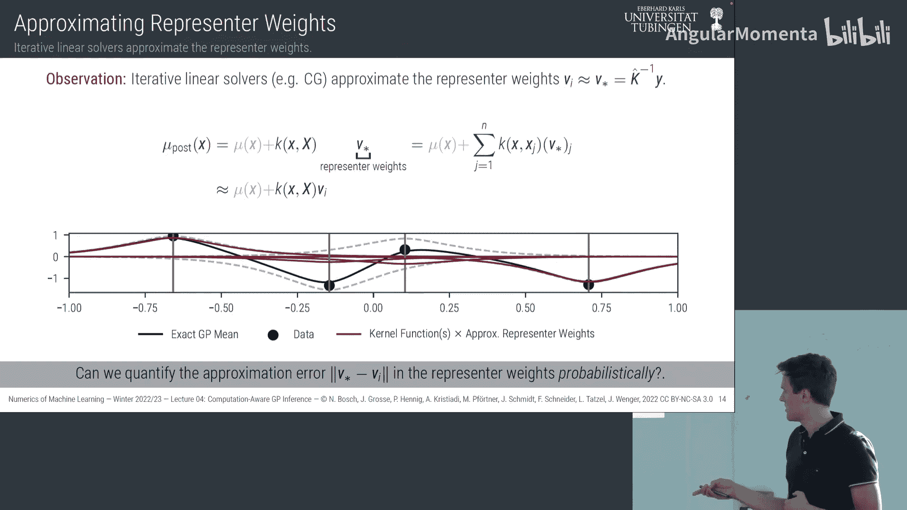

This rule here， right， If I have V star， in this case， Z， and I look at A Z， in our case。

 K dot co X of V star， I get my covariance matrix from the left and right multiplied by this matrix。

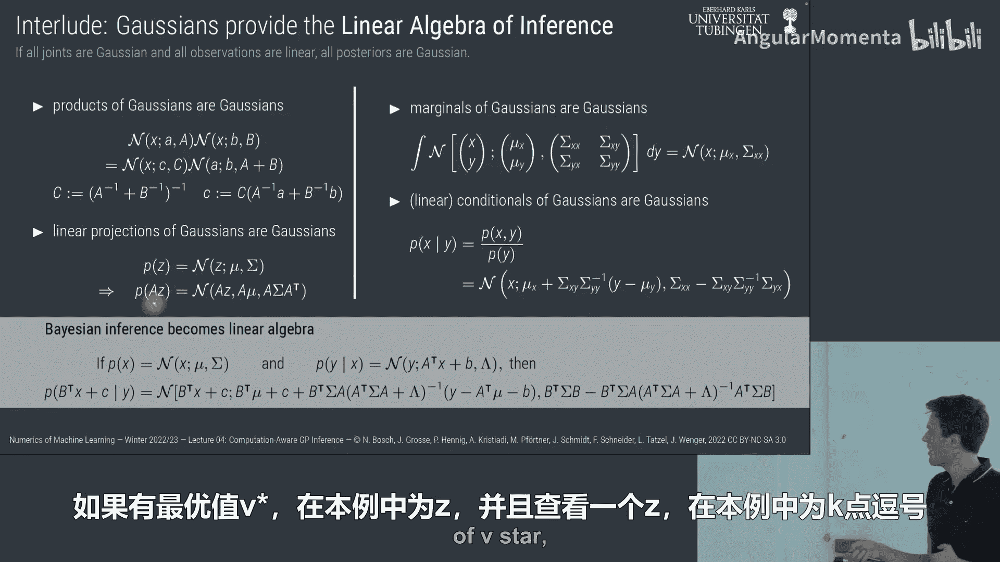

Let's jump back。That's precisely what we z down here， right， Sigma I， that's our。

Uncertainty about the representative weights multiplied from the left and right with the linear map in front。

And now something happens， right， because sigma。Actually， is K had inverse minus C。

So what I get is the K hat inverses here and here， they just cancel because here it's a minus sign in front。

 So what I get is what we call the combined uncertainty that includes。The error to the true function。

 And then I'll make that precise in a moment。 and the error in the representative weights into one single estimate。

 And the clue is， the nice thing is， I can compute the C I。

 I don't need K head inverse to compute the C I。I just need these vectors。D I。

That are involve the Sigma I -1。 But remember， Sigma I -1 is。Sigma 0。

So K head inverse minus some update terms。 So the K head inverse with K head cancels again here as well。

 So we don't actually need it to compute。Our precision matrix estimate。And。

Even if you don't fully understand the derivation， it's really as simple as replacing Kheadd inverse with the learned inverse approximation。

 right？ It's a one to one correspondence here。 And similarly， I replace。

The representative waits with。My estimate of the reoids。

Now let's take a look at why this is really motivated。Clearly， marginalization results in this。

 But let's take an interpretation of of these terms。

 Let's take a look at the interpretation of these terms。 So remember。

 the covariance of a random process F for our K that's the Gaussian evaluated at some point X。

With itself， is。The expect， the expected error， squared error between。The random process。

 F valued at x minus。It's expectation。So for us， that's。F of x minus nu of x。

 New of x is our prior mean， okay， so。If I look at what the posterior covariance。

 what kind of interpretation it has it。Actually， the。

Squared error between the true function F that I'm trying to learn， minus my。

Poserior mean prediction。 So F is， is far is a random object I have a distribution over it。

 And mu star is my posterior mean prediction。 That's why we call it mathematical uncertainty because there's a mathematical operation to arrive at it。

 but it might be too expensive in practice。Okay， so in this sense。

 the uncertainty of my GPS is an error estimate。That's a mean error estimate， right。

 because it's an expected value。In the same way。This term here。

 the computational uncertainty is called it K I comp。

Is also an error estimate because we said that sigma I。Is the covariance over the representative。

 So my belief about。The represent weights， How certain I am。

 I actually know the true value of the representative weights。 So it's the expected error。

 squared error between the true representative weights minus my estimate of it， my， the me。So。

 if I now。Consider not v star， but K of x comma capital x times v star。 my。

 the expected error that I get here is between。K comma x of capital x times v star。

 That's just the postior， the mathematical posterior mean minus the same replace with V I。

 which is the approximate posterior mean。 Okay， so this is the error between。

The thing that I'm trying to learn， the posterior mean in the exact one。

Minus the one that I'm estimating my estimation of it。So if I combine these two。

What I do is I consider the error that comes from not having observed enough data。

To learn the true function。Plus， the error that comes from not having done enough computation。

To actually learn what my prediction should be for the data that I have。Okay。

 and I can just combine them up here。Into one combined uncertainty that I can actually compute。

What does that now look like？Let's take a look at the at Cesppi actions。

 So we take unit vector actions。Here' is a plot where I， in black dash lines。

 have the true latent function。Which is a sign here。I have the data in black dots。

 the mathematical pursue I means。 So the object that I'm trying to learn if I had cubic amounts of computation。

And my approximation of it in blue。So that's the blue line is mu I。

And then I have the two mathematical and computational uncertainty。In here in this plot。 And at the。

 at the top， I show two standard deviations。 And at the bottom， I show the variances。 So at the top。

 I would expect that the true function that I'm trying to learn。

 black dashed always lies within both shaded regions。 So within the sum of the shaded regions。

And what happens is if I now run my algorithm， you can see that。I， at the bottom。

I kind of reduce my uncertainty about where the true function lies and the blue line。

 my posteriorine approximation， gets closer to the black line， the mathematical posterine。😊，Okay。

 so that was tlaski for five iterations。So， observe how。The black dash line always lies within these。

2 sigma region with high probability。And observe also at the bottom how my computation uncertainty gets carved out。

 right， the more I compute， the less computation that certain I am。 But I always remain。

Mathematically answered， because obviously， I only have observed a finite amount of data。

 so I can't be fully sure what the true function is。But I can reduce this green uncertainty。

 which is comes from not having computed enough by computing more。It's take another example。

 Let's take C G actions。 So residual actions。Before I do any computations， same situation， right。

So you mean approximation。Vararianance at the bottom。 I do one iteration。

And that looks a little bit different。Right。So。do two iterations。Already after iterations。

 my approximate posterior mean in blue is much closer to the true posterior mean as we saw than we saw for the Chiulaki。

😊，And my uncertainty reduction is much more global， right，Previous， let's jump back a little bit。

It was very local， actually centered at the data points。Now， with C G， it's much more global。

 even in the first iteration。That's because we actually target compute。To all data points。

 we look at the residual。 We don't only look at a single data point。And also。

The posterior mean converts very quickly to the true posterior mean。

But that doesn't mean necessarily that I already have learned everything about the true function。

Right， so after five iterations， my computational uncertainty is very much reduced almost everywhere。

And very close to the troe Pa I mean。And the true function that I'm trying to learn lies within nicely within these two regions。

Okay。Now， let's take a look at the algorithm。 So essentially now。This method that we proposed。

 called interGP。Really just wraps this representative weights estimate。

This learning algorithm for the represented way it's into one that computes the G people steor。

 So we'll go through the steps 1 by one。 It looks quite complicated， but it's actually very simple。

 And you've seen it in different forms already for the Clesian for the C G。

So we start with the representative's belief， where。We， for example。

 initialized the representative weights to 0。 our estimate of them and our precision matrix approximation also。

Cause we don't know what the actual kernel matrix universeverse is。

And we don't really actually instantiate the belief。 We just virtually track。

The uncertainty about the representative weight through C Z C I。 Okay。

 so we don't compute K head inverse。 You only track the update because we never actually need to invert the kernel matrix to use the belief in the way that we use it。

Then we we choose one line here in action。In which to look。So。And that is S I transpose times K hubb。

To observe how close we are to the true representatives in the subspace that we've chosen。

And here you can see that the policy really makes a difference of how quickly we converge to the true representative weight。

 as we've seen for C G， right， because I can show to certainly very informative actions in this direction。

And I can choose very uninformative actions in this direction， right， if I projected。

The true representative V star along this line here。It would lie directly。On my。Approximation of it。

 So I didn't wouldn't really learn anything about the representatives in that step。

But I do learn something about。The inverse。Just not in the subspace that。W。Okay。

Then we observe our projected residual。 We observe the distance between these。

 the star and V I-1 along this line。 So the distance between the red dot and this shaded。

Intersection。And I compute the direction in which I have to walk。

To update my representative estimate。And then also， I compute this lower rank approximation。

 And also in memory， I don't actually formed us because if we have a lower rank matrix。

 as we've learned in the various in the second lecture and in the first exercise。😊，I just， you know。

 track。The low rank matrices individually， plus maybe some diagonal scale。

 times some diagonal scaling。And here's an illustration on the left is the。

 the true precision matrix。 I think that's actually the example of C G that we saw before。

In a few iterations of C G that has learned the position matrix approximation。 And you can see that。

Yeah， in the bottom here， for example， it's learn some structure on the diagonal as well。

 But there are some regions， for example， here。Where we don't really know what the true uncertainty should be。

 There is still computational uncertainty left about it。Okay。So now we have an algorithm。

 and you recognize all of these quantities， right， Quaity action is from same language that we used last time。

And then finally， of course， we update our estimate of the representative weight。

 and we update our precision metrics approximation。😊。

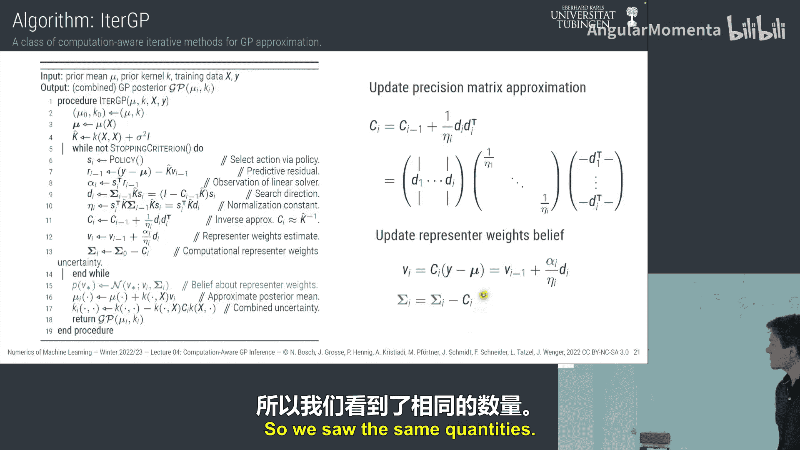

So we saw the same quantities。 Does the partial Sla and C G actually fit into this framework。 And。

 of course， it does。 Otherwise， I wouldn't have showed you。

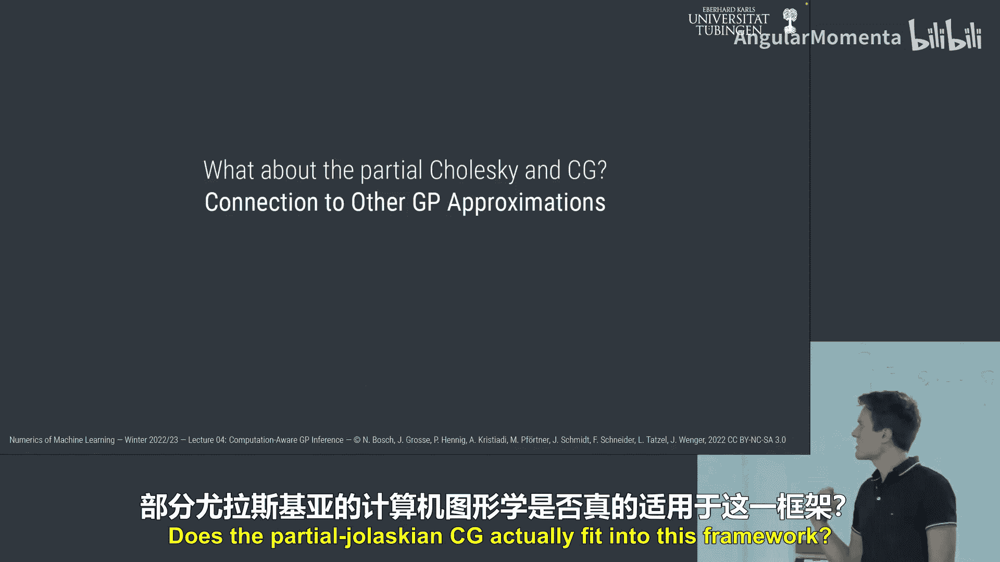

We can choose unit vector actions to recover the parts of Claki， or also called subset of data。

We can select preconditioned， potentially residual actions to recover preconditioned C G。

It's actually a second way to recover that by already choosing conjugate actions instead of just residuals。

 because they automatically made conjugate。And finally。

 we can also design a method that looks very similar to this linear time method that we saw previously by choosing actions that are actually kernel functions。

😊，So that weight data points， according to。A kernel function that's centered at an inducing point。

So let's go through these two dimensional view of what happens if I chose choose certain actions and what the interpretation of choosing an action is。

So if I choose for Chiusski。Certain unit vector actions。

 What I'm doing is I'm selecting data points here in red for iterations。And around these data points。

You can see that the computational uncertainty in green is reduced。So where I target my computation。

I more quickly learn about the thing that I actually care about at the mathematical uncertainty。

 And if I sum these two up， this is the object that I can actually get。So for Igi Pulaki。

 where I target my computation， I reduce combined uncertainty。Now， for C G， I target globally。

 I just target some data points more and some less。Okay。

 I use a vector where I have entries that correspond to how much I target my computation。

And you can see that in regions where I target more。 So we're。The data points are more red。

 That corresponds to the。Magnitude of the entry in the action vector。

 I get much more of a reduction of combined uncertainty on the left versus where I don't target my computation where math computational uncertainty remains high。

Okay， and then finally， this kind of。As we do P similar method， I。

Sort of center kernel functions around this data point and weigh the data point。

 the data points in the input space。 Sorry around this aucing point。

 according to what the kernel function says。 So the magnitude given by the kernel。

 and I reduce my uncertainty near these。😊，Place kernel functions。And that results in a method that。

Kind of fixes the problems of SVGP On the left here， you have another SVGP posterior。

 and you can very clearly see。It's I get my mouse back。

You can very clearly see at the top that in some regions， the uncertainty is very small。And clearly。

 the red posterior mean， approximate  one is very far away from the black line。

 the true posterior mean。 In fact， we can measure that error in the variance and in the mean in the bottom panels。

 and sometimes we underestimateest the mean， overest the mean and similar for the variance。

 Sometimes we're undercon。Compared to the mathematical posterior， and sometimes we are overcon。Now。

 if you choose these kernelnal vector actions， what we actually get on the right hand is inter G P。

 So you can see that， first of all， if you look at the top plot。第。

Exact posterior mean in black lies within the green region of computational uncertainty。 right。

 That's where I think the true posterior mean could lie。Compared to the approximate poststeramine。

And then also， if you compute the variance error。 So how over undercon our method is。

 it's always less confident if it doesn't， if we haven't computed enough exactly as it should be。

 right， If you don't know exactly where the trueosor mean is。

 we should add additional error to our estimate。But。This kernel。Vctor actions are dense。Generally。So。

 our complexity is。Of N squared penetration durationeration。 We said that previously。

 if one of you said， you know， the most expensive operation is a matrix vector product。

So we pay over and squared for this， right。So。Is that great， then， Okay， we fix the problem。

 but we paid a lot more for it。Is that necessary。Let's take another look at what the actual cost of this algorithm is。

The three points where the kernel matrix actually appears。Is。In the observation。

 So computation of the residual。Times stay action。In the search direction where we take the action and correct it。

 similar as we did for C G， a conjugate to correction。And then in the normalization constant。

 that ensures we walk。And only as far as we should walk in this quadratic。

And let's take a look at the first one。 So what is V I -1 actually made up of。 Well。

 V I -1 is just sum over all the search directions as it is for C G， right。

 the steps that I've taken。 It's just a linear combination of these steps。 So really。

 it's all the terms that appear in there are。😊，Action， times， kernelonnal matrix。

 times steps that I've taken。Now， similarly， for the search directions。

My inverse approximation C I -1 is an outer product of these search directions， D。J。So。

All the terms that appear in here。That involve Khat are also of this form。

S I transpose K hatd times this search direction vector from all the previous ones or the current one。

And clearly， an normal constant also has this form。 It's just definedest way。So。

What if it shows actions？That only。Target part of the data points， as we do for C G。Effor for Tulaki。

So what if it shows action vectors。S I。That have a bunch of entries。For。Some data points， So 1，2。

 and so on。 And then have a bunch of zeros。And all the actions that we choose only ever have entries。

 not negative entries up here。Well， what happens is， clearly。

 we only need to look at if we multiply from the left with S transposed。

At the upper part of this matrix， because all the rest down here get 0 every anyway。

But let's take a look at DJ。So， TJ is。The action。Minus。Previous search directions。

So in the very first step in particular， it's just the action。So on the very first step。

 I really only need the upper quadrant。Of this kernel matrix。

And it turns out that now the actions inherit this， right， Because in the first step。

 D1 is just the action itself。 So it also has。A bunch of zeros down here。D1 looks the same。And。Now。

 if I take D2。I get S 2 for S 2。 we just posited。 This only has entries， non0 entries up here。

 only targets this top quadrant。And。I subtract the previous D vector。

That also only has entries up in this upper corner。And recursively， that stays true。So actually。

 if we have actions of this form where we never have。None， negative。

 never have non zero entries down here。 We only ever need the entries of the kernel matrix in the upper quarant。

So what is the actual complexity I've already showed it。 I'll take it away。

What is the actual complexity per duration for all of these。Vector matrix， vector products。Yeah。

S size K is the the block size K。K square K squared， yeah。Or L actually size L， L squared。So。

 we can actually decide。How much computation we want to expandend per iteration。

By defining a policy that defines actions that only have targets certain data points with compute and the magnitude of how much they targeted is the magnitude of this entry。

Okay， so we can。Design a method that has arbitrary。Choseable。Computational cost。But always， has this。

Arero quantification property。And， in fact。We don't even。

 not even limited to some data set that we have available。

 We can technically work with infinite data。Cause nobody stops you from just， you know。

 extending this kernel matrix to infinity。ELosely speaking。If you never actually target it。

You never actually need the entries。So this is just a formal version of this statement that。If I。

Choose actions。 S I， Tilde that have a bunch of zeros down here。

And I run my algorithm inter G P on some extended data set。

 X plus x prime where x prime is you can think of as。

 an in infinitely extendeding data set of observations that I can make。😊。

It's the same as if I had run it G P on the left here， on the small sub matrix at the top。

So virtually， I can run on an。Data set of arbitrary size， if I want to。And that gets us to。

And slightly philosophical interpretation of this algorithm， so。

Think of what actually happens when we collect data for G P regression。

 So we go out into the world on the left， make a bunch of measurements。

 I collect my buoys out of the ocean， to measure the temperature。😊。

And then I make notes of that and maybe store that on my disk on my computer。

But when in the modern age， nobody actually you know。

 hand writes a prediction and computes the G serial by hand。 What you do is you use your machine。

To operate on that data， to make a prediction。But。😡。

It doesn't matter whether the data is on your disk or in the world。

 If you haven't targeted it with computation， as we just saw here， right。

 it's the same as if I operate on some virtually larger maybe even infinite data。

If I only target a subset of the data that I have available。So， only really。

Data that I compute on is an observation that I make。

So I can think of this as either all of it is data。Whatever I target is the observations that I make。

 the linear projections that I make。the data。Or everything is computed。

 Just the action of going out into the world and making an observation is part of my。

Computation to make a prediction。Okay， so there's really no real distinction anymore。

 except that we have this disk in the middle that I load my data from。Or a lower part of my data。

And if you take this view seriously， we can also model this situation just with the Gaussian process model。

We can take a prior as we did all the time。But now。

 instead of observing data point after data point after data point as we。Assume， if you just。

Do a standard Gastion process requester。We only observe。Linear projections through these actions。

 S I transpose。I only。Observe data with this linear projection。

 So I target computation to certain data points， not to some others。And however much I targeted it。

 that much influences my posterior。F given x comma y t and Gaussian processes。

 you can just condition on projected data as well。 We saw that with the linear F Gaussian inference theor。

 right， That was the finite dimensional version of this。

And it turns out that if you take the situation。That's precisely the combined procedure that you get。

So you can think of E G P。Not as you can think of it in one way as we put our probabilisticmers hats on。

 we quantify the error that gets introduced through approximation。

 and we take that into account our prediction。Or you can think of it as just a more accurate model of what's actually going on If you're making a prediction nowadays today with your computer。

Cause you actually have to。Load the data into your model。And maybe only part of it。Okay， so。

In some sense， it's actually just a more accurate model of what's going on in the。

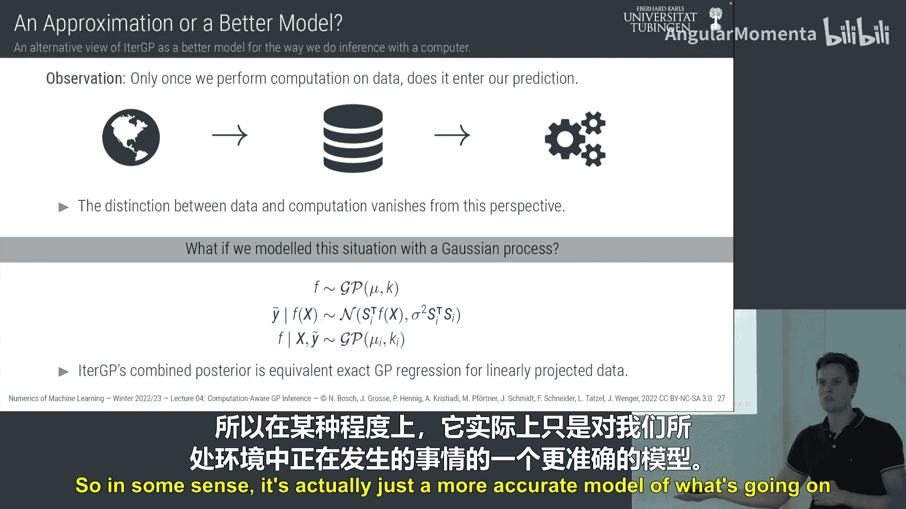

Our setting。Now， we've talked a lot about computational and combined uncertainty。

And we talked about this interpretation as squared errors。

 If we quantify this squared error probabilistically。

Can we make that even more precise of what that means。

 of what if we now use the combined posterior as a prediction。

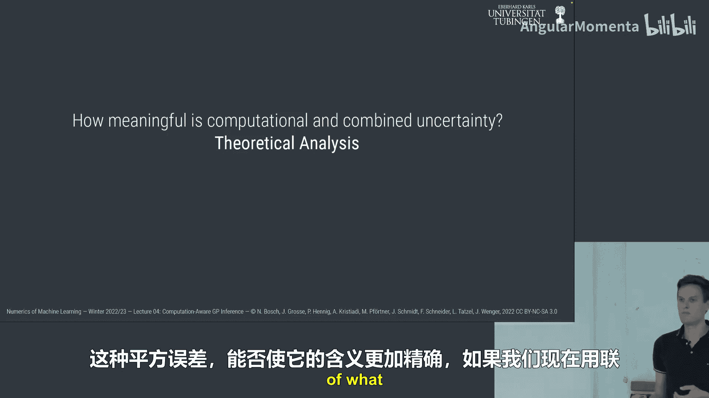

From the illustrations。Here。We had the intuition that。

If our combined posterior is a good error estimate。

The true function in black dashed should lie within the combined posteri。 So blue plus green。

And if our computational uncertainty is a good error estimate the。Black line， the true。

P Uamine should lie within the green region。Our error estimate for how far our approximate posteramine is from the true posteramine。

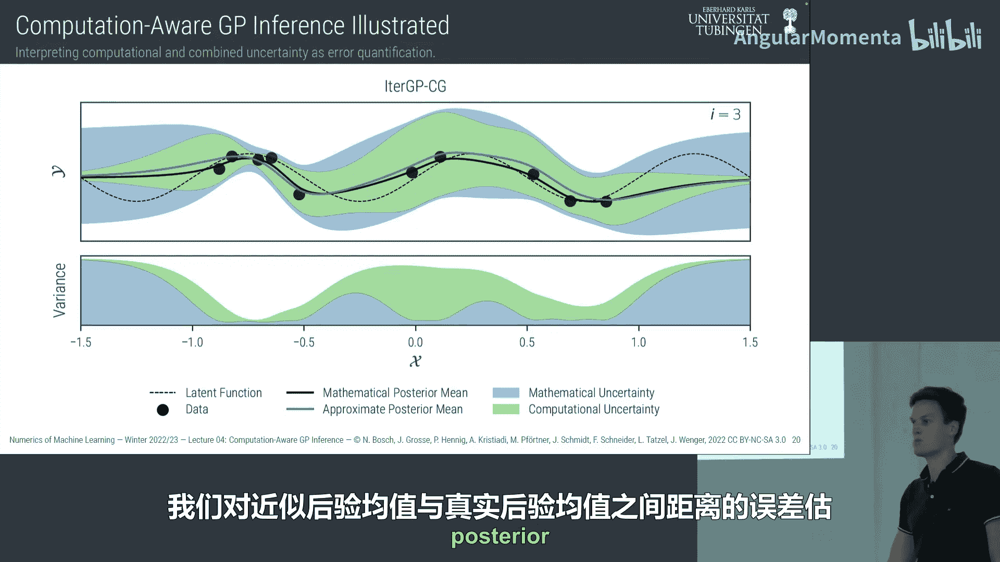

Okay， so let's see whether that's actually true。And， of course， that's the way we derived it。

 So it should be true。 But we can make very strong statements about what this actually means。

And I promised you in the very， very beginning。That I'll show you a way how to do exact。

 and quantification。But an approximate model。And this is the。Fllfil promise， now。

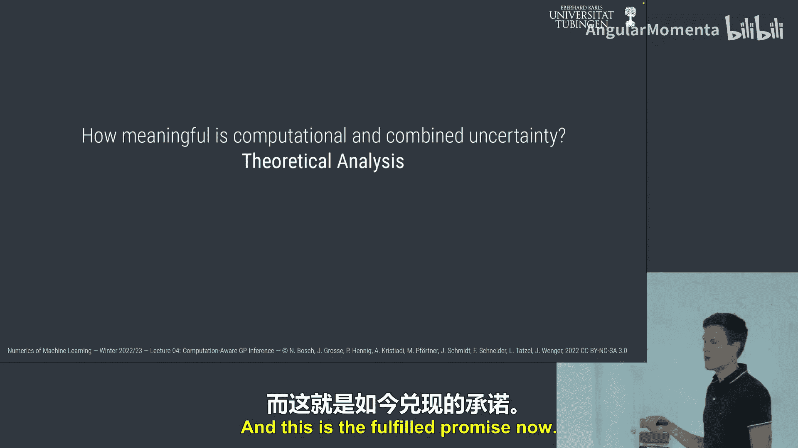

So at the top， you just have a similar plot with a different policy in this case。

 but it doesn't matter。True function， black dashed。

 black line is mathematical postseer mean blue line is that approximation。

And what holds for a Gaussian process， you can actually interpret。

The standard preerior predictive standard deviation， so。啲二。Poserior。

Covariance function evaluated at the same data point。Plus， my noise。And then the squared of that。

 So that's the standard deviation。That is a bound on the relative error between the true latent function that I don't know。

 can evaluate。And the mathematical postulerior mean， that it's a relative error， okay。So。

 the uncertainty。In one way is a mean squared error， as we saw in the very beginning。

 But it's also actually a worst case bound。If we normalize this latent function。

And I realize this is。Just。Written words， I， I'll show an exact mathematical statement after this。

 But this is the intuition I want you to take away from this。And。Now， the。

 the thing about AirGB is it fulfills the same statement， the same strength of statement。

Just by replacing the mathematical poster we we don't have access to with your approximation that you can compute in arbitrary time。

Okay。And this is now bounded not by obviously the posterior predictive standard deviation。

 which we don't have access to， because it also involves an inverse。

But this combines standard deviation， which just requires the inverse approximation。

 which is low rank。Okay， so we basically get the exact same。

 We can trust our uncertainty quantification exactly the same way we trust the gasian process。😊。

And we can do it in however much computation we have available。And now。

 for those of you that want a precise statement。This is the actual theorem in the paper。

 So feel free to read up on it。 I'll get go through it very quickly， so。😊。

Supreum of the difference between all the functions。

 truee functions G that could have generated the data。Minus our。Approximate post mean at a point x。

Is actually exactly the square root of the。Combined variances。Plus， the notes。And within that。

 and this object， we don't have access to because we would require the K at inverse。

 but we don't need that， right， We just need the distance to the true function。

We can think of the computational error as the distance between the true mean for that latent function G minus our approximation。

And now in the image， this gives the justification of why up here。The black dash line lies within。

The blue and green region， right， That's the， it's actually take one step back。

That's the combined standard deviation。Up to scaling。 So I scale this plot here to satisfy that。

And then the distance between the blue and the black line， approximate posteroramine。

 exact posteroramine lies within the green region。 That's the computational uncertainty。

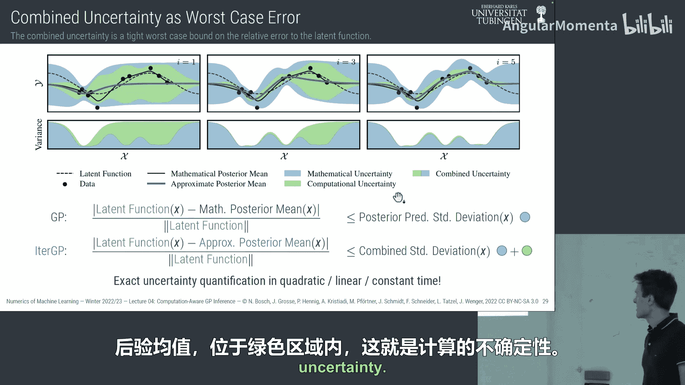

Okay。And with that。I'm actually at the end a little bit early today。

 but I'll quickly summarize so we can approximate GPS。By devising a learning algorithm。

 probabilistic learning algorithm for the representatives。

We can quantify the error of this algorithm， of this learning machine。Probabilistically。

And we can actually push that error onto our G people Syria that we're using to protect anything。Now。

 variance， there are different variants of this method exist that might converge more quickly or have different properties。

 But all of them， no matter what policy you choose， as long as your actions are linear independent。

Give you exact uncertainty quantification， no matter how much compute is。And we even。

Looked at the situation of one way to think about this energy P algorithm is it's really just a better model for what's going on when we make up of Asians。

And then use a computer to make a prediction。Okay， with that。I'm at the end next week。

 you'll see Jonathan another Jonathan to talk to you about the situation。

 We always said we only have measurements of the latent function that we're trying to learn， right。

 And we're using a gastion process model to learn that。😊，Now， what if you actually have some。

Maybe partially known physical law that also governs this latent function。 Think of the dynamics of。

A disease， for example，So somehow， you know， a physical law， this case。

 an ordinary differential equation that governs the behavior of the function that you're trying to learn Additionally to observations from it。

 We only talked about observations next week， Jonathan is gonna extend that。

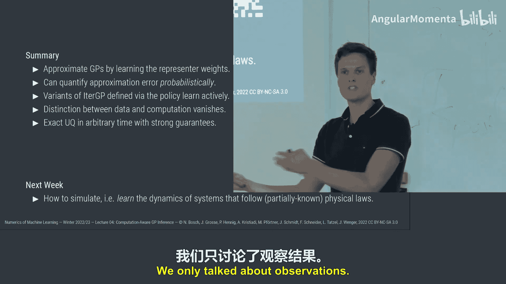

With that， I'm at the end， I would love if you give me feedback and please do not get up yet。

 because Professor Henck also wants to say something after that。 So。

 so take two minutes to give feedback。 and then we'll have a quick word from Philip。 Thank you。😊。

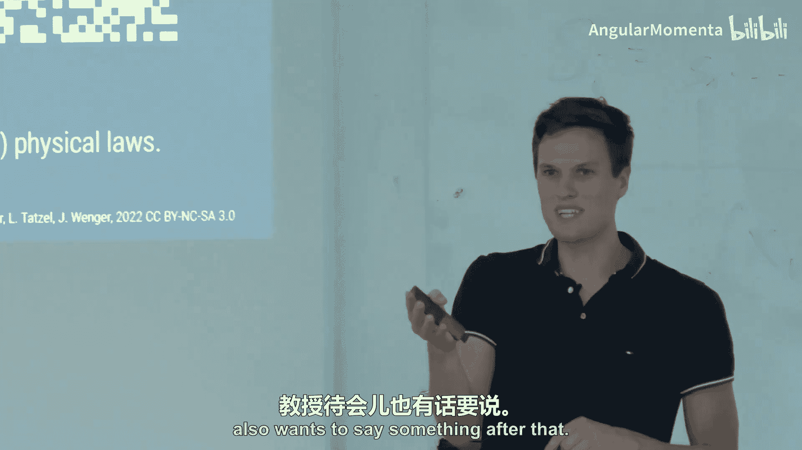