# 【精译】蒂宾根大学《机器学习中的数值方法》-p05-5-——-状态空间模型-——-乔纳森·施密特--BV1WMYHzAEcL_p5-

。

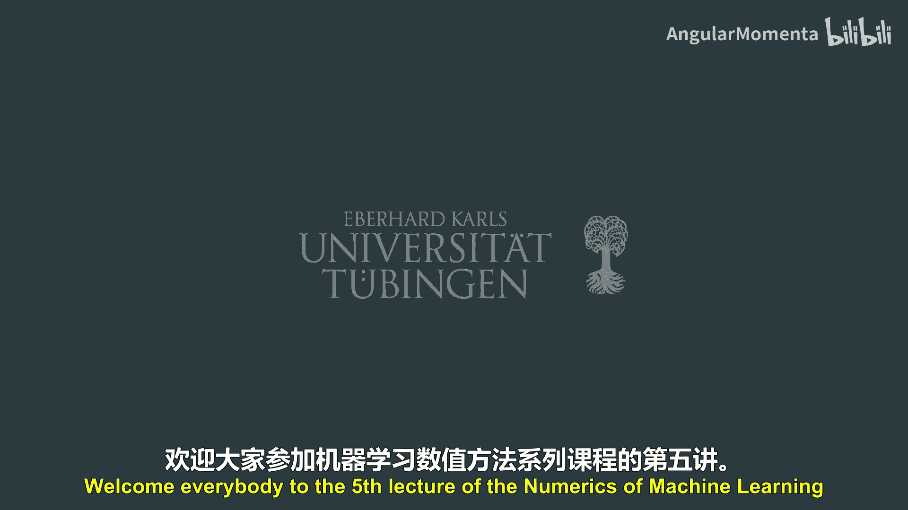

🎼Welcome everybody to the fifth lecture of the nuummerics of Machine learninging lecturecture course。

 my name is Jonathan I'm a PhD student in Philipics group as well。

 and today I'm going give you a lecture called statebased models which we will open a new chapter so to say in this lecture series and we are going to dive into a topic that is actually a very hot topic at the moment and quite emerging。

What we are going to talk about in detail are dynamical systems。

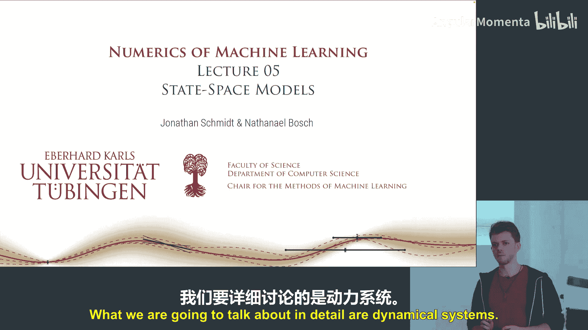

So over the next three or four lectures， we are going to talk about systems that evolve over time。

 This is what dynamics really means。 we have an evolution over time。

And these systems are quite interesting。 We can do a lot of stuff with those systems。 And today。

 what we are going to start off with。Is the task of estimating the temporal unrollings or the temporal evolution of such a dynamic system from observations that we assume to be coming from such a dynamic system。

What we are ultimately working towards Bars is the simulation of such system。

 because this is a very interesting task that we can do with probabilistic methods。

 as we will learn in two weeks。So similar to the structure that Unattan Bener and Marvin chose for the linear algebra and Gaussian process lectures。

 we first have to kind of chew through a bit of theory and we have to look at stuff that has been around for quite a while actually。

 in order to get to know what cool stuff we can use this for。So this is what we're going to do today。

 We are going to establish a bit of groundwork。 We are going to construct a language in which we will describe dynamic systems。

And on top of this language， we are going to build an algorithmic framework that allows us to discover latent components of such systems from parts that are actually observable so from data。

To put this lecture now content wise a bit into context。

 So previously you learned about linear algebra and Gaussian processes。

 So basically a regression task trying to find a posterior over a function that describes a fixed set of data。

 Theyre given a data set you' trying to find a function or posterior over a function that describes this data well。

 and Yuonnatan then showed us last week and in particular。

 how to make these technique scale on huge data sets。

 maybe so huge they don't even fit onto your computer anymore。Today， we are going to。

 as I already said， open a bit of a new chapter。 Today， we are going to shift the setting。

 which we think about a bit to settings in which we are dealing not with fixed data sets。

 but rather with streams of information。So maybe we don't even know all of the data we are going to see or how how big the data set in the end will be。

 But there's really information trickling it trickling in one at a time。

 We want to estimate the state of our system in an online fashion。O， and to start off。

 let us look at a few examples of such system I've been going on about now。

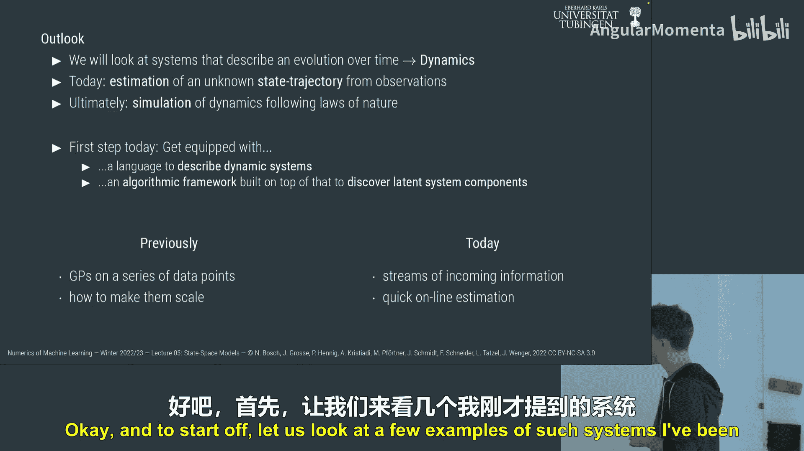

And while looking at those examples， I'm not only going to tell you that these systems are actually useful because otherwise I wouldn't be telling you about those。

 but we are going to extract from this example， a few key characteristics of dynamical systems。

And of this model or the characteristics we really want to be reflected in the model we chose to model those dynamics。

So let us start off with this example you saw already in the very first lecture given by Professor Henock。

 it's data from the CoVId-19 pandemic and not only data we see here in this red line。Let's test this。

 Yeah， it actually works。 And this red line， we see a Gaussian process posterior fit through this data and a bit of a prediction afterwards。

 It's the number of infected case counts per every day in this Covid-19 pandemic and on the bottom。

 you see this beta parameter， which is also an evolution over time。

 which is interpreted in in these kinds of model interpreted as a contact rate between individuals in a population。

And there， of course you see， as I already said， the key characteristic of dynamical system is we have this temporal structure。

 we have this temporal evolution， right？😊，But what you can also think about is that we can only observe parts of this system。

 We can measure the infected case counts because we have COVD tests， maybe they are unreliable。

 but still it's a means of gaining information about a part of our system。

But we don't have any means of measuring this contact rate。 At least I hope so。

 It would be really questionable if we had means to measure the contact rate between individuals。

 So this is a part of a system that is hidden to us。 It's a latent force。Okay。

 moving on to the next example， which is a bit different in the way at the speed that data basically trickles in。

 because why we maybe get a new estimate for the infected case counts in in Covid-19 pandemic once a day。

If you think about an application that estimates the orientation of your smartphone in three dimensional space。

 probably you're going to have to process a rapid fire of information coming from the census in your device。

 Maybe there are some kind of accelerometers built in there and some application on your device analyzes this data and has a build in model for these dynamics and estimates the orientation of your device。

 So we really have an online estimation task here at hand in which we have to quickly update our estimate。

And as I already promised we are working towards a test that is called simulation simulation of dynamical system。

 this is a really very interesting task here on the right hand side you see a fancy animation of a very difficult to simulate dynamical system and we are not going to talk about such difficult to simulate systems because this is a spatial temporal dynamic system so it not only evolves over time but also over two-dimenional space and this is also a very difficult model to simulate it's a fluid dynamical system I just wanted to show you where this might be leading in the future。

So。What are the characteristics now that we learned about， right。

 we already talked about this evolution over time， and we talked about models being only partially observable。

Then we have in these， especially in these simulation tasks， we are faced with very complex dynamics。

 So we might be dealing with highly non nonlinear functions and interactions。

 So we have to find a way to deal with those。But I think the thing which I want you to keep in mind over the next couple of slides in particular。

 is really this online estimation setting。So we need an algorithmic framework on top of our modeling language。

That allows us to build upon the most recent piece of information that trickles in and update our belief accordingly。

Okay， but now that we know what we want to do， let us actually look at how we are going to do this。

 And we're， first of all， going to look at a graphical representation of the modeling language we choose。

And this is also a figure you saw in the very first lecture already， Philip introduced this。

 Professor Henck introduces in the first lecture。😊。

And I'm going to walk you through this step by step now。

What you see here in this red box is a sequence of white nodes。

 and these white notess represent random variables modeling our system state。 Okay， first of all。

 what is the system state in order to define this， I think you could look at 100 different definitions in 100 different books。

 but I chose one of them， because it's actually it carries everything that I want to say about these systems。

 So the definition reads。The state of a dynamic system is a set of physical quantities。

 the specification of which completely determines the evolution of the system。Okay。

 so there's a lot to be learned from the definition。 First of all， a state is not only one quantity。

 It's not something， one number which we want to model， not one trajectory。

 but really a set of physical quantities that are trapped in the same state and are expected to interact in a potentially very complicated way。

So we have to specify this。😊，Set of physical quantities， and。Actually。

 I brought some examples what these quantities could be， so for example。

 in a very canonical dynamical system that is often used to teach about dynamical system。

 it's a penduular model there you model the angle of the pendulum and the angular velocity at every time step。

😊，So this is quite simple， it's just two quantities that naturally interact with each other， right？

But in this CoVID example， it might be a little bit more difficult。

 So you have to track the amount of susceptible infectious deceased people in a population during a pandemic。

 but also maybe even more than it first appears。 Maybe you want to model such such a thing like this contact rate or like a recovery rate。

 and all of these are potential components of your state。Or X， Y，C positions， velocities。

 accelerations in three dimensional space to do something estimationim with your smartphone。Okay。

Now that we know what a state is， we have to define how we observe the state。

 and as I already told you。In these models， they are often called partially observable。 We have。

Observations y， so we collect these observations on a random variable Y that somehow depends on the present state。

So， and there's a lot we have to take care of in this plot at the moment。 because I， for example。

 used different indices here for we have Y sub n and X Z K。 So this is kind of con confusing， right。

 But this is just to visually represent the fact that we don't have to collect a measurement at every state or every point in time that we model the state。

 So we can have trajectories of states where there are no observations available。

 and we can still model them。However， I'm in the future or in the remainder of the lecture。

 I'm just going to drop these different indices。 I'm always going to write X K and Y K so that we just assume we have a measurement for every state of the model。

😊，But that is actually not a restriction。So if we now take a step back and look closely at this graphical model。

 we can actually read off the properties that we want this model to have before we actually go ahead and define it properly。

 mathematically。The first thing I want you to notice is that there are only  errorss going from one state to the next。

 Theres no error going from X K -1 to X K plus 1。 Only two subsequent states are。

Connected with an arrow going forward。 This is a property of a socalled Markov chain。

And this is probably also what the person who wrote this book I read this definition definition in meant by。

The specification of our current state completely determines the evolution of the dynamic system in the future。

And we are also only going an arrow from X， K to our current measurement。

 This measurement is not dependent on any future or past states。Okay， but enough with the talking。

 let's actually make this form。 This definition this。

 this property with only an arrow being between two subsequent states is called the markov property。

 Probably all of you know this。 The markov property basically says that if we have a conditional distribution over our current state variable。

 it is independent of everything else。But the immediate previous state variable。

 this is what this equation here says。 So it often reads， given the present。

 the future is independent of the entire past。The second property I just highlighted is this of conditionally independent measurements。

 So our measurement random variable by K is only dependent on X K。

 This is just an assumption we make， which will make computations and derivations later on way easier and very elegant。

😊，These two our two properties， which I want you to keep in mind。

 And they are actually quite intuitive to think about when having the in the back of your head。

 this graphical model， the mark of property and conditionally independent measurements。 Furthermore。

 I want to highlight something that I didn't write down here on the slide。 But by extension。

 it you can also read this up read this up from the graphical model。

The current measurement is also independent of all future states and all future measurements。Okay。

With everything that we just learned so far， you can actually now go ahead and write down the definition of a probabilistic state based model。

And this is just a Bayesian model that defines three things。 First。

 an initial distribution P of x 0 over the very first state in our trajectory。

And then for every state X K in the sequence we are considering and for every measurement Y K。

 it defines， okay， first of all， for X K defines a dynamics model as the of as the conditional probability distribution P of X K given X K -1。

 So here you see already this uses the mark of property already。And for the measurements。

 it defines a generative model for our observations。 So a likelihood， if you will。

 it's often called a measurement model。 It's just a conditional distribution of Y K， given X K。

 It's independent of everything else。 And this is the entire definition of a probabilistic statespace model。

 The language we are going to use to model dynamical systems。Are there questions so far？I'm going to。

Pring up these distilled components of the state space model throughout the lecture from time to time。

 because these are really what we are going to use is to build our algorithmic framework。Yes。

 for this lecture， state is the same as a Markov state。Yeah。

 a Markov state depends on the definition of a Markov state。

 but if the Markov state for your definition is a state that is given its previous state。You know。

 it fulfills the market property then yes。 In this case， we are considering states in a market model。

 yes。So the question was if the state can be used interchangeably with the term markov state， yes。

s to k。嗯哼。😊，マイマナス九ス。Thanksす。Yes。All these that happens should be already in there。Implicitly， yes。

 So the question is， if X K is independent of X K -2， but X K -1 is dependent on X K -2。

 and X K is dependent on X K -1。 isn't then X K also dependent on X K -2。 And yes。

 it is possible because otherwise， the the we could carry the knowledge onward。 But yeah。

It is implicitly dependent on the past， yes。Okay。Yeah。Excus， excuse。そ不是。one。sure。Yeah， exactly。 Yeah。

 thanks for the remark。 You can also read us off actually from the graphical model。 So these。

 these models are they are so the arrows and the nodes kind of have an in conditionally independent structure encoded in them。

 So， yeah。😊，This is something that's for example， taught in probabilistic machine learning。

Thanks for the questions and the remarks。😊，Now， let's move on。

To what we are actually going to do with this definition now。

In order to analyze such systems as dynamicss using these state based models。

 we are basically computing four different。4 different conditional probability distributions that we can。

 So to say label。 So， first of all， we are going to predict we are going to compute prediction distribution。

 which is just a conditional distribution of our present state， given all previous measurements。

 not including the present measurement。We are also going to compute the filtering distribution。

 which then is basically the updated prediction distribution。

 P of Xk given all the measurements up until k， so including K now。

Along the way we have to compute this quantity， which I call data likelihood。

 is tested the probability of the current measurements， given all the previous measurements。

 this is something that is not really of high relevance in this lecture。

 but we have to compute it anyway along the way。 So I'm going to show you how because it's going to be maybe relevant in later lectures。

And last but not least， we are going to compute a smoothing distribution。

 which is the current state estimate given all the data we have。 So if we at some point。

 say we have an entire trajectory finished and we want to compute using future data。

 the current state estimate。 that's called smoothing。

 but we are going to do that a little bit later in the lecture。

And these four probability distributions we want to now compute for every step K in a potentially infinite sequence。

Of course， an infinite， but， you know， an ongoing sequence。First of all。

 we are going to derive how we compute the filtering distribution。

And in order to compute a filtering distribution， we have to learn how to compute a prediction distribution because those two distributions are computed from each other。

😊，So maybe this might seem confusing at first， how can we compute one thing from the other？

That's basically just saying we compute a recursive algorithm。

Which are recursion starting at the initial time step x0。

So we are not going to start a derivation at X0， we are making this a bit more general and we say we have one filtering estimate available at time step K。

 given all the previous data and the including one so we have a current filtering estimate。

 and from that we computer prediction distribution。So how are we going to do this？

And this is a recurring theme and deriv these kinds of probability distribution。

 You just basically introduce the quantity you care about。 So from this distribution。

 you build a joint distribution of what you already have together with the quantity you you are looking for。

 So the joint distribution between P of X K plus1 and X K， given y12 K。This joint distribution。

 you can split up into the product of two conditional distributions。Why do we do that。

 Because we notice that we actually know both of these distributions。

 The left one is just our dynamics model， as defined by the probabilistic statespace model。

Does this given。And the right one is the previous filtering distribution。

 we know is given because we assume it's given。In the very beginning。

 this is just P of x0 because theres no data to be written down on the right of your conditioning bar。

Okay， so now we have to get rid of that of this X K because we really don't care about it， right。

 We want to compute P of X K plus one， given y 1 to K。 So what do we don， are we gonna do。

 Were just gonna marginalize it out。Uiting this equation， P of x k plus 1， given y1 to k。

It's the integral where we integrate over X， K。Of this product of conditional distributions。

 our dynamics model and our previous filtering distribution。This equation is so important。

 it has a fancy name。 It's called the Chapman Kmoography equation。

 usually so this is a convention from the research field of signal processing。

 and it's a really important equation。 It gives us the possibility to predict into the future。

 giving past measurements。Cool。So in order now to compute our filtering distribution。

 which was our initial goal。We have to， as soon as the new data point X Y K plus one comes in。

 we have to have a tool to correct for this newly gained knowledge。It's called the correction step。

 This is just the copied overchp and Gmargorov equation from the previous slide。

And now we have a new data point， P of Y K plus 1。 And now we are going to integrate this into our estimate of X K plus 1。

 How are we going do this based theorem。 So we just write it down。😊，P of X K plus 10。

 probability of the next state， given all the data up until this state is proportional to the product of a prior in the likelihood term。

 so to say。The likelihood term is easy。 This is just given by our statespace model。 if you see。

 it is the measurement model that we defined in our probabilistic statespace model。😊，The left term。

 which can be interpreted as the por。It's just the predict distribution we computed using this chapman commmoography equation。

 So this is what I meant by we compute one distribution from the other。

 And then we have this scheme of predicting and updating， predicting and updating。And， of course。

 since of is by theorem， we have to divide by a normalizing constant that we compute using this integral。

 which is some called sometimes called the evidence in order to get a valid posterior distribution。

And some of you may have looked closely and noticed that this is actually this term that I phrased data likelihood in the beginning。

 So we have to compute this quantity anyway along the way。

 This's just the probability of observing the next data point， given the previous ones。K cool。

 in order to put some structure into this， yes。那 we有修的。Every。Yes。

I told you earlier that this doesn't have to be the case。 I just use this convention， if you will。

 such that not too many indices are flying around because then I would have to use a different index for n and a different index for x。

 so it makes everything a bit more confusing and hard to look at。

But you don't have to have a measurement for every state your model。So。在道。Doing the one step。Exactly。

 actually， we are going to see this later on， but I just basically neglect this here a little bit because。

Yeah， the algorithm is usually phrased in a way that you don't predict between measurements。

 but we are going to see this later， thanks。Okay， let's give this a little bit of structure。

 So in form of pseudocode， because this is actually a Bayesian filtering algorithm in its general form。

 We start at a time step 0。 and then we entered this y loop。

 This is not a follow loop because we don't have a finished data set or a fixed dataset because new observations could trickle in at any time。

 right， and we just predict up until the next step using the chapman chrommoography equation and we correct using base theorem。

 These two equations you just saw these are the prediction and correction equations。

 We increase our time step and go on and so on。Notice that we never go backwards in this algorithm。

As soon as we see the next data point， we don't update our previous state estimates。

 even though we could provide them with more information。

 but we are still in this online estimation setting， we want to be quick with our estimates。

And our most recent state always saw all previous measurement。 so we can't get better than this。

We have one linear time loop here。 and if we decide at one point that we stop our state estimation algorithm。

 we just return this sequence of distributions， of filtering distributions。

The distributions over the current state， given all the previous measurements。

 I say this so often because it's very important。Okay。

What I didn't show you yet is how to actually compute those things， right。

 because there are integrals flying around there。 and there's also an integral hidden in disproal sign。

 So， and we don't even know what our model is yet。 So we cannot really compute anything with that。

 It's just a general collection of formulas。

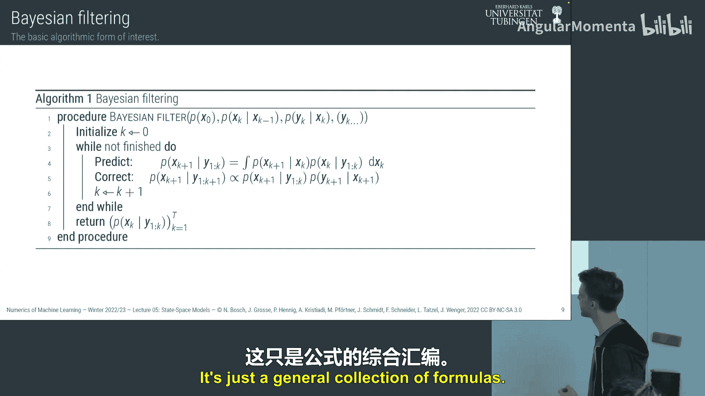

And the next step I'm going to take is actually build a model that can produce plots like this where you see here on the right hand side of this vertical bar denoting our time step K our current time step currently being at0。

 The right hand side is the prediction。 The left hand side is then the filtering estimate。

 which is currently not visible。I'm not。 I have not told you so far how to produce this plot。

 but I'm going to tell you on the next slide。 And this is roughly what it's going look like。

 You see here always on the right hand side the prediction into the future。

 you would not compute this prediction normally， because it's just not really。Informative。

 this is just for visual reasons such that you can look at how these predictions could look like under a certain assumption of a model。

Which we are now going to look at。

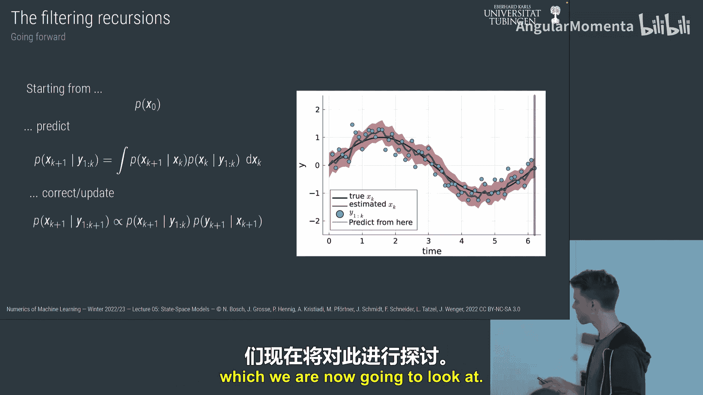

Okay， back to our general setting， we have our state space model， we have those distributions。

 we want to compute， we cannot compute yet because we don't know what our model is。

 so let's insert actual models into this and we are going to choose Gaussian。

 a linear Gaussian state space model。 we're going to start off with an initial Gaussian distribution distributed according to some mean mu 0 and a covariance metric sigma 0。

And now it gets really interesting because we are going to consider linear transformations of the previous state。

😊，To get a distribution over our next state。 So X K given X K -1 is a Gaussian distribution that arises from a linear transformation of our previous state。

 I say linear。 It's actually fine。 We have this plus B here。 But anyway。

 I would confuse it so much that I trust stick to linear now， but I mean Fine。

 I say when I say linear because it's more general than that。Under a。

Additive Gaussian process noise given by this Covariance matrix Q。These two metricsrices have names。

 A is called the transition metrics， and Q is called the processed noise covariance metrics。

 and I will call them that in the remainder of the lecture， just the convention from signall Proces。

And we are going to choose the same kind of model for our measurements as well。

 we are going to consider linear Gaussian models。😊。

We have this measurement matrix H and this measurement covariance metrics R。

 and this is our state space model we are going to choose。

Most of you probably know why we are going to choose this kind of model because linear transformation of a Gaussian random variable is a Gaussian random variable。

 and you could think。That all those distributions then are also Gaussian random variables with different moments。

We going to call the prediction moments you know with a superscript minus。

 we have this filtering moments in UK and Sigma K。 this data likelihood is computed along the way。

And later on， we are also going to see that the smoothing distribution is actually also Gaussian。

 so this is quite convenient。How do we know this， we know it by Gaussian inference。

 by the theorem of Gaussian inference， you already saw this probably more than once。

 and I think also that all of you understood it because otherwise you would have had trouble to understand the previous three lectures because Gaussian process is really built on this theorem。

But I want to read it out very quickly again， because later on。

 I want to you to recognize these terms again in our algorithm。

If we have a Gaussian distributed random variable x distributed it according to some mean and covariance metrics。

And we have an F and transformation of that。And we have this P of y given x as this Gaussian random variable with this F N transformation of x。

 Then we can compute P of y， which is a Gaussian， But I'm not really interested in this right now。

 What I'm interested in is this posterior distribution， P of X given y。

 And it's this really complicated collection of terms that you probably also we see here that we add to our prior mean。

 this product of this gain term。😊，Times this residual term。

And we have here for our posterior covariance， we subtract from the prior covariance。

This product of sigma times as pose times this cr metrics。

 And then from the others from the right hand side， again， multiply this a sigma。To describe metrics。

 Okay， so if you keep now these terms that are labeled here in mind。

 we can proceed now to an algorithm that allows us to compute the prediction and filtering moments。

 given our linear Gaussian state space model in closed form， just using Gaussian inference。

 And this is actually a name which most of you might have already heard。 It's called the Kan filter。

It is named after the scientist Woodlf Kaman， It's a Hungarian researcher。

 He was a very Hungarian researcher。 He died in 2016。 and he is the person who gave this algorithm。

 this very useful algorithm is its name。This algorithm just allows us， as I already said。

 to compute prediction， filtering distribution in closed form。

 and I'm not going to derive this here because I want you guys。To derive this in your homeworkheets。

By inserting our linear space space model， Gaussian state space model into our prediction and filtering equations。

I'm just going to show you these equations here， so the prediction equations are given by these two things。

 so we have to compute a predicted mean and this is just the linear transformation or the Fine transformation。

😊，Of the previous filtering mean。This is quite easy， right for the predicted covariance metrics。

 We just multiply the previous filtering covariance from the left and the right with the transition metrics。

 and we add the process noise covariance metrics Q。😊，So quickly。

 we have computed our predicted moment。For the correction。

 you will probably recognize terms from the previous slide。We first compute this measured。

 predicted mean so to say and save it in this variable Y hat。

We compute this matrix S as the measurement metrics times the predicted covariance metrics times the transpo measurement metrics。

 and this measurement matrix R。Then we compute this matrix K。

As the predicted covariance times the transpose measurement metrics times the inverse of this matrix S。

And this is a very important quantity。 It's called the kman gain。

 if you remember gain from the previous slide you will see that the structure is actually very similar。

And again kind of， so it has a meaning， it kind of translates from your measurement space to your state space。

 kind of maps the information that you gained in your measurement space and maps it onto the state space。

And therefore， we use it to update our filtering mean by multiplying this common gain matrix with our residual term where we just subject from the data point。

 our method predicted mean。So basically， the difference between what we really observed and what we would have predicted to observe。

And filtering covariance metrics is then just the prior covariance metrics。

 or the predicted covariance metrics minus the common gain multiplied from the left and the right to the Grian metrics S。

And actually， along the way， we did already compute this data likelihood term。

 which is also Gaussian， and the mean is just given by this measured prediction and the covariance is given by this Scian matrix S。

😊，And that's the common filter。Equations， we can write this now down into this algorithm。

Where we just basically have the exact same structure as we had with our Bayeseian filtering algorithm。

 but now we can compute these distributions and actually we can compute them in closed form。We have。

 again， this y loop。😊，And we compute our predicted moments and our corrected moments according to the equations you saw before。

 And in the end， we just return a sequence of means and covariances that completely specify your filtering trajectory。

 which is just a collection of gaussian random variables。😊，And again， I want to highlight this。

 again， this is only ever informed of the previous and present data point， not of the future。

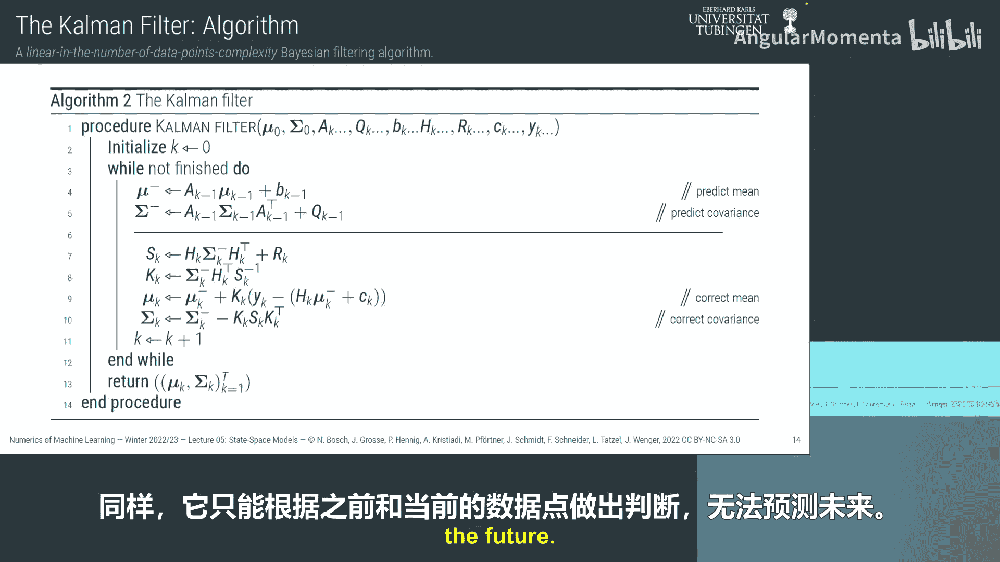

Okay， now I'm going to do something risky。 I'm actually going to show you code。

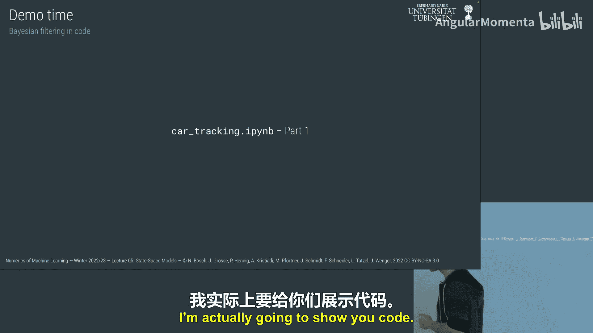

So let's see if this works。As the name already suggests。

 we're going to look at a car tracking example in practice。

 So the setting is we have a car going from its start position to its destination in X Y plane。 So。

 of course， cars are moving in three dimensional space， but we neglect the third dimension。

 which has basically imagine a map， a map， a trajectory drawn on a map。 And we want to。

 based on noisy measurements。 So， for example， GPS measurements of this car。

 we want to find the true trajectory。😊，And all we have to do for that is open this notebook。

Quickly realize that we are not staring at Python code。 This is actually Julia code。So。Loazhe。嗯。

Let's see。Yes， thank you。I hope everybody can read this。 Nice。 Anyway， we're looking at Julia code。

 This is not Python code。 I have no special intentions。 I don't want to advertise Julia or anything。

 It's just maybe it's interesting for you to see。 I'm using Julia myself and my PhD。

 It's quite a nice and emergent programming language。 But， of course。

 it has its advantages and disadvantages。 So if you want to use Python in your homework。

 please do so。 It's completely fine。😊，Okay， this is just some setup we actually don't need。

 We have to begin by setting up our state space model。Okay。

 remember we have this car tracking example here， right。

 So the state is going to consist of four components， X and y position and x and y velocity。

 The velocityloc is respectively denoted with this dot。

And we are only ever gonna measure the first two components of the state vector。

 We are only going to get GPS measurements， In measurements of the position might be completely different in practice。

 But this is just how it， how it is， for this example。😊，Okay this is our state。

 we have a measurement dimension and state dimension of2 and 4。

 respectively we are going to initialize this with a Gaussian distribution with mu0 and sigma0。

 mu0 just being the zero vector in four dimensions， sigma  zero is just the scaled identity metrics。

😊，Okay， you're going to write the stone， execute the cell。 coolol， So far， so easy， right。

Now it gets complicated。 We have now our dynamics model。 It is a linear Gaussian model。

 as we already said， because then we can do common filtering。

 We are going to assume that our metrics A doesn't change over time。 So it's constant。

 But it's quite complicated。 Right， So okay， maybe a is not as complicated as as the process noise covariance。

 we are going to talk about in a minute。 it's just this thing with once on its diagonal and something that involves D T on its of of diagonal D T is just。

So as the name already suggests， it's the time step。

 so the difference in time between two subsequent steps， k and K plus1。As I wrote down here。And Q。

You can see has's an interesting structure and also involves kind of polynomial terms of this D T somehow。

 And I'm actually not going to tell you why， because it's very complicated。

 It roughly speaking and the arises from the discritization of a continuous stochastic model。

 Its stochastic differential equation。 And these objects are really complicated to study。

And we don't have the time to discuss them here。But you recognize that it has some structure and you just have to believe me that it makes sense to use the state based model。

Okay， cool。 We can actually just translate this to code。

 We say our time step in between two subsequent K and K plus 1 is 0。1。

 and we just write down these metrics， these metricsrices。

 transition metrics and pro noise conveyvariance metrics A and Q。😊，Okay。As for our measurement model。

 as I already said， we just measured the two first components of our state vector。

 so we have this projection metrics each here as our measurement metrics it just selects basically。😊。

X position at x velocity and no x position and y position from the state vector。

 and the measurement noise covariance metrics is just the scaled identity metrics again。Okay。

 so far so easy， let's execute this。What going what we are going to do next。

Is we simulate this dynamical system once we are going to。Draw a trajectory from these dynamics。

 and we are going to draw a bunch of measurements from this trajectory that is going to give us our ground truth and our observations on which we make inference。

Later on， and we can visualize them。Just a second。 So here we have the time series plots here on the right。

 So we have the x position over time and the y position over time。And we see that。 we have。

Not equally spaced measurements over time these I chose random from the sequence of measurement。

Because these two plot are a little bit hard to interpret。

 I always plot this trajectory of the car left from these two plots in the X Y plane。

So basically the car starts here and then drives around this。

trajectory trajectory and reaches its destination here。

So now we are going to do what we are gonna to do is implement our common filter。 First。

 the prediction step， and it basically。Completely and translates into code。

 You can write by basically write down the equations from up here。

 So we don't have a Fine term in this model。 So we just have as the predicted mean a times mu。

 and we have our predicted covariance metrics， and we return them from our predict function。

 and we execute this easy。And we are going to do the same for the correction。

We have all these terms that we already saw。 You saw them and two slides already。

 So I'm not going to detail them anymore。 Just show you， we translate them here into Julialia code。

 Notice that these。This matrix K involves the inversion of a matrix。

And this we learned in the second lecture given by Marvin， we don't do。What I do instead。

 because I'm lazy and Julia is awesome。 I tell Julia our metrics S has structure。 It is symmetric。

 And then I can just use this divide by operator。 And Julia does a fancy metrics decomposition intrinsically。

😊，And it's also linear system， instead。So don't use inverses。

 This is our common filter correct function。And now I just wrote down the loop that we saw in our pseudo code。

 I start off with， I initialize a list with our initial moments。😊，I entered this for loop。

 It's not a by loop here because then we would sit here in two weeks and wait until it finishes。

 This is not really interesting。 I take from the end of my current estimate。

 our current filtering estimate。 I use this and our dynamics model to predict。

The predicted meaning covariance。And then here's the twist。

 and this is related to the question you had earlier。If there is data。

 I use the correct function and save for the filtering estimate to our filter estimate。

 So the filtered moments， the corrected moment。If there's no data， I'm still going to save something。

 I just going to save the predicted moments， just in order for you to see what happens in between measurements if you execute the common feature。

But this you don't have to do， it's not necessary。Okay， we execute this loop。😊。

It's actually already finished because it's not a lot of data points。 and then we plot it。

 So this is complicated code。 We don't have to look at。

And we see that this is our resulting estimate。 You see here on the right。

 The x position is regressed in a way。 And here in between those measurements。

 you see the uncertainties or this is the marginal uncertainty on two marginal uncertainties。

 marginal standard deviations。 Now we got it in between those measurements。

 And you see the further away we get from the previous data point the larger this and the larger and more rapidly。

 this uncertainty grows。 You see this also here。😊，It's a little bit difficult to plot this uncertainty in two dimensional space。

 So in the state space。 So to say， because we would actually， in order to make this correct。

 plot Gaussian contour lines around every step that we take。

 And then this plot would just be cluttered。 So I didn't do that。 This is the best we get。

 but it's kind of inaccurate。Yes。My music。き用い楽しい。No， no， we do。 don't do anything fancy like that。

 We just use the prior as given by our a metric。 Oh， his already。

 the question was whether we some somehow correct。Using the time step or by decreasing the time step in between in between those measurements。

 right， if I understand clear your question correctly。嗯。

Not entirely sure what you mean by it's different from the usual discretization。

 Maybe should we maybe I can try and answer this question offline， okay。Anyway， so you see here that。

Also， here， the fact is reflected that our。Model trust predicts in between measurements using its dynamic model。

 And because it's linear， it's just a linear line， right， And as soon as nu information trickles in。

 we snap back onto this trajectory。Because we trust our data。

And the uncertainty also rapidly decreases。And this is our filtering estimate for this task。

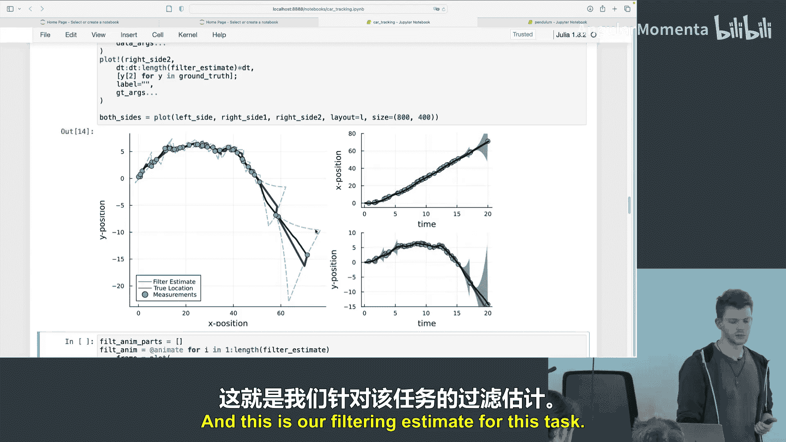

O。Now we go back to the slides。And look at what we have learned so far。

We learned how to build a state space model， a state space model is the language that we are going to use to describe dynamical systems such as a moving car or a pendulum。

We chose it to be linear Gaussian because then we can compute all the interesting quantities in linear。

 No， not in linear time using linear algebra。With metrics vector products and so on。And basically。

 the essence is what we learned to compute is this posterior。

 So the sequence of filtering estimates that are only informed by the past and the present being a collection of Gaussian random variables。

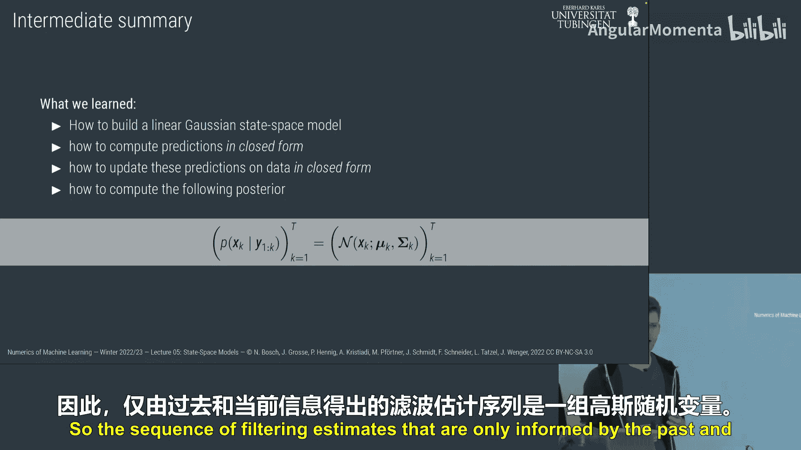

And this is really cool for this online estimation setting I've been mentioning so often today。

 because at our current， our most recent estimate， we have seen all the data that is available。

 right。😊，Here， at this point。The estimates are， at the very end。Here。

 it is informed about all the data points we have seen so far。 But this point here。

 I hope you see this。 This point here is not informed about this data point。

This's just something this this algorithm doesn't do。 But if we now know our car at some point stops。

 it reaches its destination。 And now we want to shift our problem statement。

 we shift away from we want quick online estimate until to the problem setting that we now want to know what the perfect estimate is。

 given all the data So the correct estimate or the best possible estimate of this trajectory the card shows。

Given all the data at every time point。 So basically， roughly speaking， we want， for example。

 inform this estimate here about this data point here。Okay。Yes。

 and this shifts our problem statement to compute a sequence of posteriors that have a different form。

 These are called smoothing posteriors。 It's the measure。

 It's the distribution about our current state， given all the data points available。😊。

Why12 capital T。And I'm already going to tease it。 This is going to be a collection of Gaussian random variables as well。

 So this is quite easy to compute， as we will see。And the derivation is actually quite difficult。

 So this is just a handwritten note from when I was a masters student and taking a course on time series analysis。

I don't want you to understand or even read these derivations because it's quite lengthy。

 And we don't have to do it in this course。 If you are interested， you can do them yourself。

 all of you can do it。 I just want to show you what I used in order to make this derivation。

 I use the markov property。 I use space rule， and I use the Markov property again。

 and then some probability theory stuff in between。What I want you to look at。

Is the thing that we compute or that we want to compute and the result in the end。

 So this is what we end up in。 is the general， These are the general smoothing equations， So to say。

And even though this might seem complicated， all of these conditional distributions， all these terms。

Over there， you know， already。You see here the filtering distribution。

 and it's already tells us something。 we have to compute the filtering distribution in order to compute a smoothing distribution。

Here， we just have our dynamics model， P of the next state， given our current state。

This term is especially interesting。 This is the smoothing distribution at the next time step。

This is the quantity we want to compute just at the next time step。 So what does this tell us？Now。

 I saw a good gesture over there， what do you mean？Exactly， we have to go backwards。

 This is going to be an backward recursive algorithm。Based on our filtering distribution。

 the dynamics model and the thing down here， this is just our prediction distribution。

 Notice that there is no measurement model involved here。

 It's just using the filtering and prediction and the dynamics model and our smoothing estimate at the next time step。

 And then we just marginalize over the next time step because we don't care for it。

If we now go back to the setting of linear Gaussian state space models。

I already told you it's going to be a collection of Gaussian random variables。

We can write down metrics vector product operations to compute first， the smoothing mean。

 That's the matrix G。 No， smoothing mean， smoothing gain， smoother gain， This thing is called。

 It is a product between the filtering covariance metrics times the transition metrics transposed times the inverse of our predicted covariance at the next time step。

And this matrix is all we need in order to compute our updated mean in which we just add to the filtering mean。

 the product of the smoother gain times a residual term between the smoothing mean at the next time step and the predicted mean at the next time step。

And the smooth covariance metrics comes about by adding to the filtering covariance。

The product of so we first built this the residual term between the next smoothing covariance and the predicted covariance。

 and then we just multiply the smoothing gain from the left and the right。

Just three equations makes it possible to compute this posterior from our filtering posterior。

And then we can write this into an algorithm as well。

Notice now that we shifted from formulating y loops to four loops because。

This algorithm only makes sense if we have a data set or at least a fixed portion of time steps that we want to consider。

 because from the very end， we go back what's now up until the beginning。

 It is highly unlikely that there are new measurements coming up in the beginning of the time series。

 This is just not how time works。Anyway， we start from the end of our time series because as I already told you。

 at the end of the time series， our filtering estimate coincides with the smoothing estimate。

And then we go backwards in time。 See here for K in T up until the one。

 we compute the smoothing gain， and we use the smoothing gain to compute the smooth moment。

 And then in the end， we return the sequence of Gaussian random variables。

 and this is our smoothing estimate。

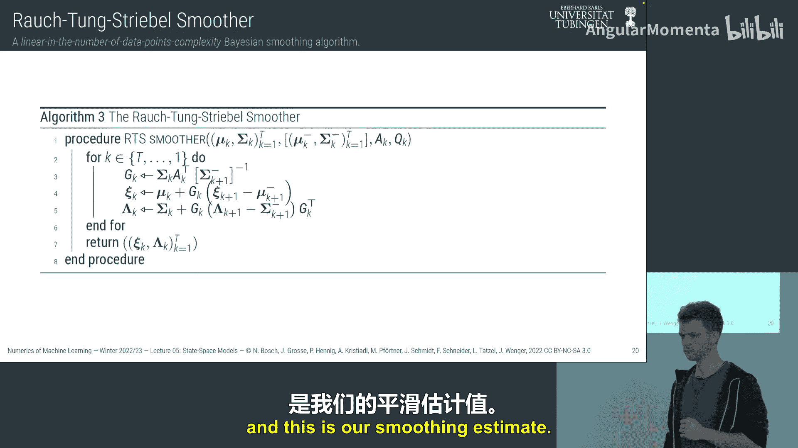

Okay。Let's look at this in code again。

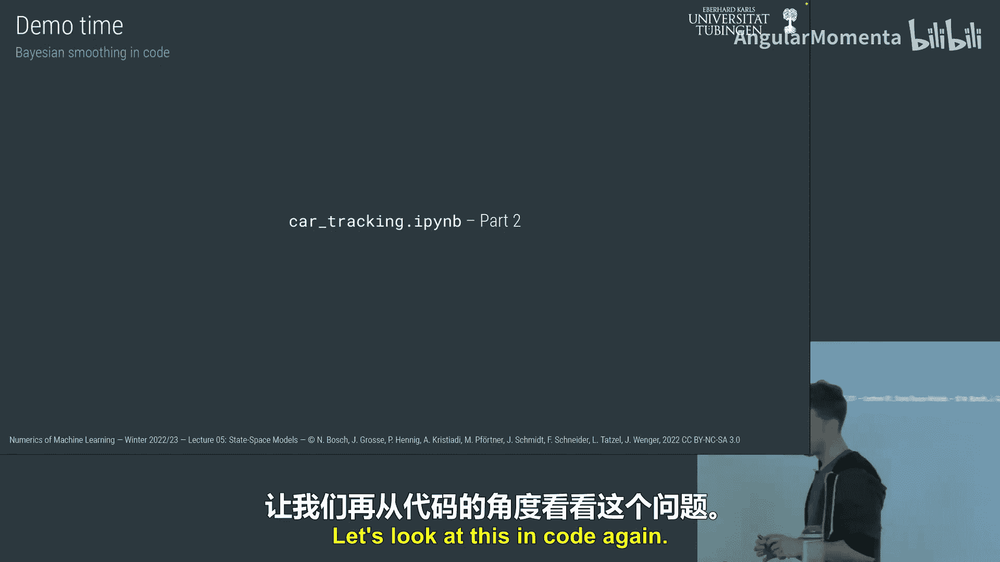

What。Nice， okay， we're still in the same example。 It's just part two。 Basically。

 we scroll down for a bit。Oh， actually， I forgot to show you the animation。 Wellow。

 let's look at this really quickly。 That's an animation of the filtering estimate real quick。

 because I like animations。😊，Wop you see how this comes about。 you see here again。

 for visual reasons， plotted a prediction every time。

 and then you see how the uncertainty snaps back every time we see a data point。Now， for smoothing。

 we again translate the equations we just saw。 You don't have to memorize them。 Of course。

 I put them on the slide such that you can look it up later。But we just translate them into code。

 Again， we are going to tell the algorithm or we tell the compiler that this metrics here is symmetric。

 It's a covariance metrics。So we divide by that by solving a linear system。

 We use the smoothing gain to compute our smooth moments。 We return them。Execute。

 and then we're going to initialize our smoother estimate。

 our trajectory with the final filtering estimate。From before。

And then we go K steps in reverse over our state indices。

 select from the beginning of our list because we're going backwards。 our current smoothing estimate。

 We select our filter estimate at time step K and our predicted。Moments at the time step K。

 which I sneakily saved earlier。 I didn't tell you about that。

 but I saved them because we don't have to compute them again， right。

 These are precomped during filtering anyway。 And all of that we are going to provide the smoothing function with together with our dynamics model。

We're going to execute this loop， It's already finished。And。

Look at the fancy animation in which our smoother now smooths out our filtering distribution。

I've started off here with this plot in the X， Y plane because it's just nicer to look at， but。

This uncertainty is， as I said， a bit difficult to interpret。

 So if we want to see the actual clean truth， we have to look at this plot。

Which plots the same thing just as the time series is here。

And you can see that now we have a nice interpoent between those points。

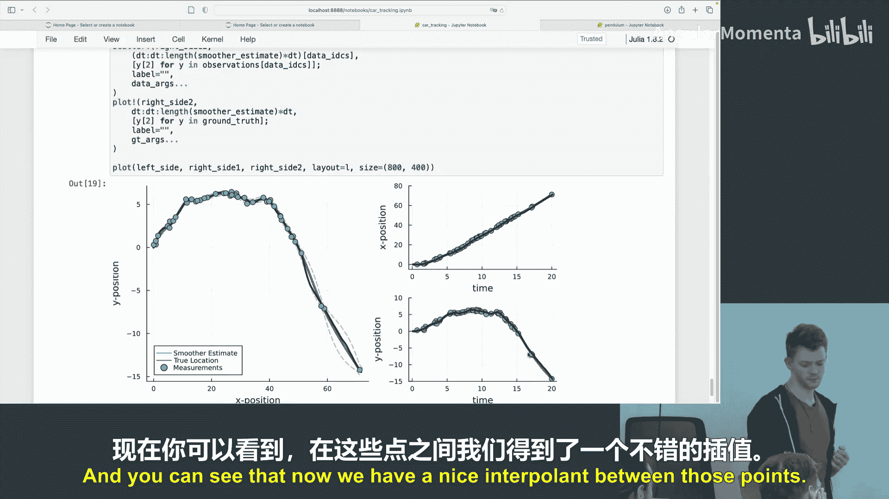

Actually。This nice interpot。Is a Gaussian process posterior which has computed。

So the smoothing posterior， this collection of smoothed random variables。

Are the marginals of a Gaussian process posterior we just computed in linear time going one time forward and one time backward。

Again， I cannot tell you why exactly this is。 I'm just going to tell you， if you are very interested。

 we can talk about this a bit in the tutorial。 but this again， has to do with。

Sttochastic differential equations and very complicated math anyway。

So what assumptions did we make for that， we assumed linear transition linear measurements。

 we assumed additive calciumus noise to both these dynamics and measurements。

 and we assumed the mark of property。😊，O， now we can compute Gaussian process posteriors in linear time。

 does it mean that you can forget everything that Yuna and Wangga told you over the past couple of weeks。

 No， I only told you that every smoothing posterior is a Gaussian process posterior。

 but not every Gaussian process posterior that you can compute can be computed using Gaussian filtering and smoothing。

This is just something that you can keep in mind。Okay。Now。We can do Bayesian filtering and smoothing。

 cool， other questions。I know it's a lot of stuff that you're going to learn at the moment or that you are learning at the moment。

 You don't have to memorize every equation。 I just want to have them want you to have them such that you can look them up。

 far more important are the principles I keep repeating over and over again。

Before now taking the next step， what could this next step possibly be。

 remember that our ultimate goal， why we actually are chewing through this theoretical part now is simulation of complicated dynamics。

So what kinds of models do we have to look at next。One keyword。One keyvert。

 that makes everything so much more difficult。😊，No。

 we're going to stick to the markov property because otherwise it would screw up our framework entirely。

😊，Yes。😊，Non gaians。Also something man。Why did I ask this question， No。

 we are going to stick to Gaussians。 I'm going to tell you that it is possible to drop the Gaussian assumption in the very end。

 but I'm not going to show you how， yes。😊，Yes， thank you。

 We' are going to talk about nonlinear models。 but these are very very good comments that bring up。

 So especially the non Gaussian thing brings up an entirely new class of algorithms。😊。

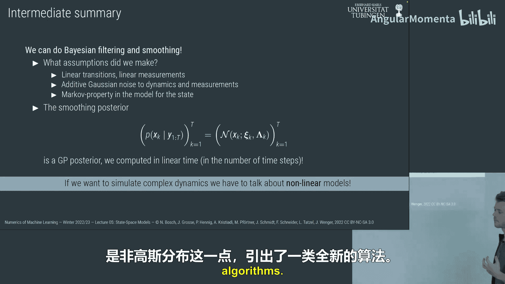

Anyway， we're going to talk about nonlinear models。 If we return now to our state space model。

 you see here that this Fine transformation of the previous state has been substituted。

 has been replaced by a general function F for the dynamics model and a general function H for the measurement model。

😊，And as all of you probably know， non nonlinear function of Gaussian random variables are not Gaussian random variables anymore。

 so everything doesn't quite work out yet。 so this doesn't mean that we have to stop here。

We just pretend that we are dealing with Gaussians。

 We're just going to approximate our model and use。Gausian inference， again。

How are we going to do this？ The principle is actually quite easy。

We are going to use both of these functions F and H。

 and we are going to linearize them and then use common filtering again。As easy as that。

 How are we going to linearize them as you probably know。

 were going to use a tail approximation in first order because we linearize。

 I just quickly wrote this down here again。 So for a general function T。

 you can form a first order tail approximation， which is an approximation as a linear function in a linearization point。

 C Cta。And it involves the Jacobian metrics， which I denoted here chase s G of the nonlinear function G evaluated at this linearization point Car。

We can rewrite this， rewrite this Taylor approximation and reorder the term such that we see that we have a linear or Fine function again。

 a a x plus B， where A and B arises from this Taylor approximation。Just for you to remember。

 the Jacobcoian metrics is just the metrics containing all the combinations of partial derivatives of this vector valued function G。

All of you probably notice。Okay， lets let's look at a few pictures quickly。

 So here we have this nonlinearar function G in blue Sch logistic sigmoid function。

 We chose one linearization point Cta， this green dot。 And in this dot。

 we approximate the nonlinear function G with the linear function G hat。 This is this orange line。

 And you see the further we get away from this linearization point diverse the approximation gets。😊。

Okay， but we don't want to talk about analysis here。 We want to talk about random variables。

 So let's draw a few samples from a random variable。

 And this is Gaussian distributed with mean2 and standard deviation 1。

Now we see what happens if we map these samples and compute a push forward measure。

 so to say by mapping all of these samples through this nonlinear function。

 and we end up with this distribution， which is clearly not Gaussian， doesn't look Gaussian。However。

 if we map it instead through this linear function， we get this distribution。

 which is again a Gaussian distribution as you would have expected。😊。

And we can see it's just an approximation of the true distribution。Really quite different。

 this one is not symmetric and the means doesn't really match up and this year the map samples to outside of the image space of this nonlinearar function。

 everything， but we are just going to use this approximation for now because we want to use common filtering because it's so nice。

Okay， so how we proceed now is we just linearize everything that is nonlinear in our state space model。

 and we will begin with our nonlinear dynamics。😊，So we are given this model。

Xk given xk -1 is this not only a function of Xk -1 under additive Gaussian noise。

We are going to linearize those dynamics， and we are going to have these terms involving the Jacobcobian as our new metrics A and this fiI term involving the。

Evaluation of our nonlinear function and something else involving the Uovbian as our Fine term。

 This just drops out of the tail approximation。Okay。As soon as we did this。

 we ended up with a Fine model again。 So we have a linear Gaussian dynamics model here where the terms just arose from the Taylor approximation。

And what we do now is we just insert those new system components into our common filter equations。

So for the predicted mean， and this is really nothing else than the common predicted mean which we saw before。

We insert instead the Jacobbian。And this Fine term。And we see already here。😊。

That we have here plus this Jacobbian term。And minus the Jacobbian term。 So these two cancel out。

And the predicted mean is just the non nonlinear dynamics function evaluated at the previous filtering mean。

I forgot to say that we choose this comes about because we choose the linearization point smartly。

 We choose Cta to be the previous filtering mean。 So this way。All of this cancels out nicely。

For the predicted covariance metrics， we also just insert for every transition metrics we find the Jacobian metrics of the nonlinear function F。

And then we have this term Jacobcobian times filtering covariance times Jacobcobian transpo plus our par noise covariance matrix Q。

Okay， so we now。Have equations that allow us to deal with nonlinear dynamics。

 and we do the same for the measurements。We have this nonlinear measurement model Yk given xk is the Gaussian random variable that involves this nonlinear function H evaluated at Xk。

 we linearize this function。 We get this form H H x plus C where H and C comes about from the tail approximation as before we choose as a linearization point Cta equals the predicted mean now。

We recognize that we have a linear Gaussian model again。

 and we insert everything into the common filter equations。We just compute our crmeian matrix S。

Just using the Jacobian now instead of the transition metrics。

 or the Jacobbian is our new transition metrics， if you will。At our measurement。

Covariance metrics are， you compute a common gain in the same way。For the updated mean。

 we recognize again， if we insert our tailored terms into this equation here。

 we end up with this term after rearranging the terms for a bit。

 and we have minus Jacobian plus Jacobian again。So our measured predicted mean is just the evaluation of the nonlinear measurement function at the predicted mean。

 So the residual term is this Y K minus H of predicted mean。Okay。

 and for the updated covariance metrics， actually nothing changes。

What we end up with are equations for the so called extended kman filter。

And it's nothing else than this， it's just an extension of the common filter for nonlinearard dynamics and measurements。

And they are actually so similar that I chose to introduce a slide again where I just write down the common filter equations next to the extended common filter equations。

And highlighted in red， everything that changed。We just predict our mean with this non nonlinear function。

 substitute every transition matrix with the Jacobian。And。Think of our common filter equations。

 This is basically basically all that matters。 Just for these two parts。

We see that we just have to evaluate our nonlinear functions。

Questions regarding the extended comment filter。Okay。W， still something。Can't differentiate or。

want to differentiate for a reason。And you linear approximation。

There are to you or any your approximations。By calculating the function are different。okay。

 interesting question。 So the question is， what happens or I I slightly reface the question。

 What happens if we cannot differentiate our function？

 So what happens if we cannot compute a Jacobian And you already gave a suggestion what you could do like a finiter difference in schemechema。

 right take an function evaluation at this point and the function evaluation at that point build a difference like。

Stand at finite differences and then do the same thing。 I don't know if this works actually。

Might well be that it actually works。 can you are free to try this instead of using a Jacobovian。

 I think it works just。😊，Maybe maybe it gets unstable at some point。 but yeah。

 feel free to try it out。 We can talk about it。In the tutorial， maybe。Okay。Quote。

You can do it the exact same thing for the Rphtchtleer smoother or Car smoother。

 which is sometimes called， but it's not the correct name。

 So we just built the extended Rt ter smoother again by looking at the Rlf Toch ter smoother equations。

And insert as the trans post transition metrics， again。

 our Jacobian metrics of the nonlinear function F。Evaluated at the filtering mean UK。That's it。

 that's nonlinear smoothing， or one way to do nonlinear smoothing。

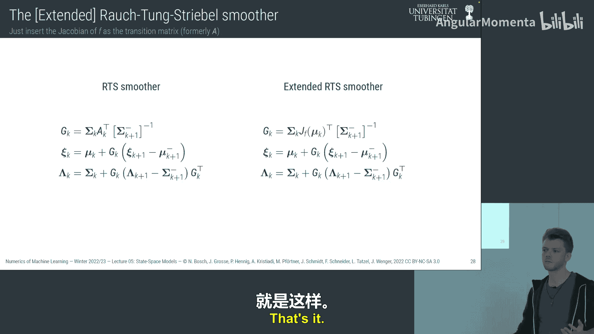

Let's look at this， also。In a code example， and as the name already suggests。

 we are going to look at this dynamical system I've been talking about earlier， this pendulum。

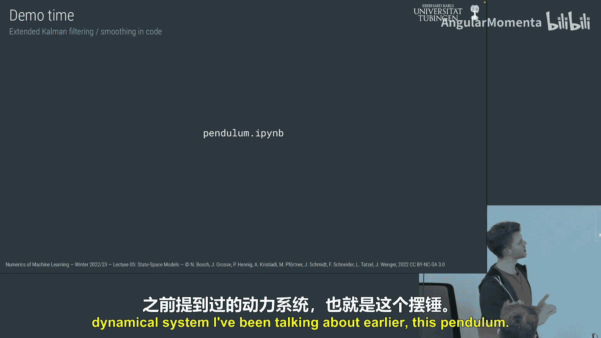

Whoop。Going to open a。Next notebook。Import some stuff。And build our state space model。

Our state space now consists of two components， Theta and theta dot。

 Theta is just the angle of the pendulum。And theta dot is the angular velocity。

So our state dimension is2， and our measurements are actually scalr。Okay， so that's quite simple。

So far， we are going to start off with an initial Gaussian distribution。

 We are going to initialize the mean at0 angle， but an initial momentum by setting the。

Angular velocity in the beginning to a non0 value minus-3。It just just， it's not set in stone。

We are going to encode that we are quite certain about the initial angle。

 but a little less uncertain about the initial angle of velocity by having here not a scaled identity metrics。

But still diagonal， it's just this initial covariance metrics we're going to。

Executors encode code as well。 And now we're going to set up our dynamics model。

 So this now gets a little bit more interesting。We have now this nonlinear state space model where Xk given xk -1 is this nonlinear transformation of our previous state。

 and this nonlinear transformation looks like this。

So F maps our a state vector of angle and angular velocity to a new vector of angle and angular velocity that changed。

To the previous angle， we add， again， this time step that is computed from the difference of the subsequent time steps K plus 1 and K。

Times the angle of velocity。 We just built this product and add it to our current angle。

For the angular velocity。We add to our current angular velocity。

 this term where we have this resistance or friction parameter alpha， which I just said to 0。3。

Multipliied with the angular velocity minus G divided by L。

 where G is the gravitational constant of our planet Earth， which is roughly 9。81。

Divided by the length of the rod of the pendulum， which obviously also affects our dynamics。

 which I just said to three。Multipliied with the sign of the current angle。And all of this。

 we again multiply with our time step。Okay。You don't have to understand how this function comes about or why on earth this thing here models the dynamics of pendulum。

 But I promise you you will learn about these types of equations next week from Nutanya。

 and these are actually quite interesting。 one of my favorite topics to study。Very cool stuff。

We are going to choose as our process noise covariance， again， this very complicated matrix。

 which involves some weird polynomial terms of our time step。

I'm again not going to talk to you about how it this comes about。

 just have to accept it for the moment。And this is our dynamics model。Okay。

 how does this look in code， We set our time step to 0。05。 We set our gravitational constant。

 This sigma Q term just basically scales all the terms in this process noise covariance metrics。

 We could also pull this in front here。 it's not very interesting。

 We have this air resistance term that influences our dynamics。 or maybe not air resistance。

 Maybe a better term would be the friction， right， just the general resistance term。

 And we have this rod length of the pendulum。😊，And we're going to write this down in code。

 This is just basically。What you see here， just that I substituted every theta with angle and every theta dot with angular velocity gets quite complicated here in the end。

 We turned a new state vector， and this is our nonlinear dynamics。

Our process noise covariance metrics， and we have our dynamics set up。As for the measurements。

We actually have quite a simple model。 H of the state vector is just the first component of the state vector。

 similar to the carracking example。 Notice this is actually a linear model。

 So we didn't even use a nonlinear measurement function here。

And we have a scalar measurement noise of 0。08。Just for the fun of it。

 and that you can see the extended command filter equations later on。

 I actually wrote down this linear measurement model as a function H of x。😊，Okay， let's execute this。

We are again going to simulate now our state space model。

 where we draw one realization of the state space model。 So one dynamics unrolling。

 So to say that gives us our ground truth。 and we are going to draw the according data as well。

And we're going to plot it。And this is what we end up with。Okay， that looks familiar。

 but a little bit weird， right， You see here that we have some wiggling going on down here and also here that it's not a perfect oscillator。

 This is because we are looking at one realization of a stochastic system。 This is。

 if you will see a pendulum in the wind。 So from time to time， there's random momentum coming in。

 changing the dynamics of the pendulum。 That's why we don't see perfect oscillations here。

And we have some measurements， also noisy measurements at a few random time steps。

 and we are going to use these measurements and the extended command filter in smoother in order to get a good estimate of this scrunt with trajectory。

Okay。The common filter extended common filter equations in code just take the filtering mean。

 the filtering covariance， the non nonlinear function F that describe our dynamics and the process noise covariance matrix Q compute our predicted mean by evaluating the function。

 then computing the Jacobian。And what I'm doing here is I'm calling a package that uses automatic differentiation。

 probably all of you know that。Maybe few of you saw it other than in the context of deep learning。

 so you can use automatic differentiation for other things than training deep networks。

 so that's cool。Of course， for this very simple model you could just write down the Jacobian on paper。

 but as soon as the models get very complicated， you might want to consider making use of this very cool technique called automatic differentiation。

😊，So I do this here for the simple model because I'm lazy， I use the Strian metrics。

 substitute our transition matrices with that。😊，And return our predicted moment。For the correction。

 we do exactly the same same thing。 We compute our gradient information。

 So this is not a Jacobian now because we have a function mappingping from R 2 to the real lines。

 So it's a scar function。😊，So we just have basically one row in the draggon， it's our gradient。And。

We compute the measured observation， No， the predicted observation using the measurement model on the predicted mean。

And then compute basically just using the common filter equations。our updated moments， mu and Sigma。

Okay。Clear。Then everything I changed in this loop。I edit an E here。And then E here。

 everything else stays exactly the same。It's just a loop going over our state indices。

 we spare the first one because it's just our initial moment。

We we select from the very end our current filtering estimate。Predict the next ones。Again。

 push them to a list because we need them later for smoothing。If there is data。Be correct。

For the newly gained observation。Else， we're just going to push our predictions。Okay。

 let's execute this。 It's actually very fast， it's already。Finished。

 and now let's look at the animation。 No， let's look， yes。

 let's look at the animation that shows us our filtering estimate of this pendulum trajectory。😊，What。

O。Here you see it。 You see here in the right。 It's very interesting。

 The predicted trajectory already encodes now this oscillatory behavior because we informed our prior dynamics about our model。

 and it's not linear。 So it's not just one line going in the， in the future。😊。

But it's already exposing these nonlinear dynamics。 So this is quite cool。

 And in between measurements where the prediction maybe was not so good。

 the uncertainty goes fans out very rapidly。😊，And then as the new data point comes in。

 it snaps back onto this data point and corrects。On the basis of the data we've seen。Okay。

 so this is our filtering estimate。 We don't have to make multiple plots now because this is a time series。

 And these two marginal standard deviations here in these shaded area are the correct depiction of our uncertainty estimate。

And this is the filtering estimate。 Okay， cool。 looks nice， doesn't it。

Now that we already learned about smoothing， we can just go on and implement implement the extended route to extremely smoother as well。

 where we just substitute our transition metrics with our Jacobion of our nonlinear。😊，Dynas model。

Okay， the smoother。Or again， uses automatic differentiation。Compututes are smoothing gain。

 smooth mean， smooth covariance returns it。And then we execute， again， our backwards loop。

 you know this already not。Going to go over that again。

And then we again can look at a fancy animation where our smoother。Again。

 tiies up our filtering estimate from before by going backwards through time and computing actually quite nice interulence in between those data points。

This is a Gaussian process posterior marginal evaluated at all the points that we considered in our sequence。

Comput it in one linear in forward direction and once linear in the backward direction。

 So this is quite cool， right。So this is what it looks like in the end。

It's a nice interpolate between the data point， and it covers the ground truth trajectory nicely in its uncertainty。

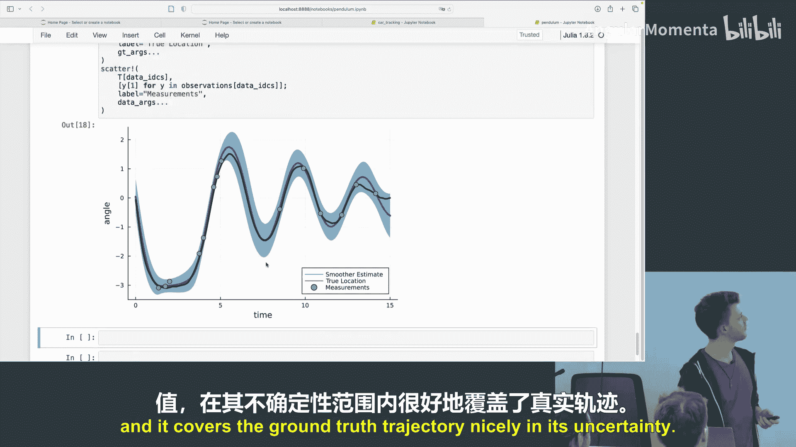

Okay， whoops wrong direction。Okay， with that， I'm actually almost finished with my lecture。

 so you made it through the theoretical part such that we can go on next week to actually really nice dynamics that we can look at。

😊，First of all， though， I don't want to leave without telling you that extended common filtering of filtering Car filtering in general is not the only way to do Bayesian filtering。

 It's smoothing。 It's just one way。 and it's a way that most of the time actually works quite nicely and it's very easy to understand and implement。

However， I want to present to you now in an alternative， and I'm not going to present it。

 I'm just merely going to mention it that there's an alternative that's called the uncented Kman filter。

And while the extended Kman filter approximates the model and computes the exact solution。

 the uncented Kman filter leaves the exact model intact。 So the nonlinear function。

But approximate the distribution。It does so in a very complicated way。

 it deterministically chooses points called sigma points from this distribution。

 Gaussian distribution you see here on the right represented by these samples in the background and maps these points。

Through the non nonlinearity and then uses the mapped sigma points to compute a Gaussian pro n。

 Gaussian appxi distribution on the basis of these points。I'm not going to go into detail。

 I just want to let you know that there exist other methods that you can use if the extended Carl filter doesn't work。

Now， coming back to your question over there， somewhere when you asked me whether we can drop the Gaussian assumption as well。

 there I told you， we have to open up a box of more complicated algorithm。

 And one of these algorithms is the particle filter。 It's a sequential Monte Carlo method。

 and it works for nonlinear models。 It works for non Gaussian models。

 It approximates the actual true posterior model。It's roughly speaking a sequential version of important sampling。

And all kinds of complicated stuff added。To make it work。

 and it comes with all the pros and cons of Montetic Carlo methods in that， for example。

 first and foremost， it's very expensive to compute and a bit harder to implement any the extended column filter。

But it's a very cool method， and if you want to learn about this。

 there is a book called Bayesian Ftering Sthing。😊，Baesian filtering and smoothing。

 I actually used a lot of this in this lecture to create this content。 It's written by Smos say OK。

Asim Mua is a researcher in Alto in Finland， and he's actually going to visit Ting in late March next year as part of the probabilistic numerics spring school that has been announced。

Yesterday or the day before yesterday， so maybe you even have the chance to listen to a talk。

Given by him， if you're interested in the topic。And I definitely recommend if you're interested having a look at his book。

 it's actually very accessible。

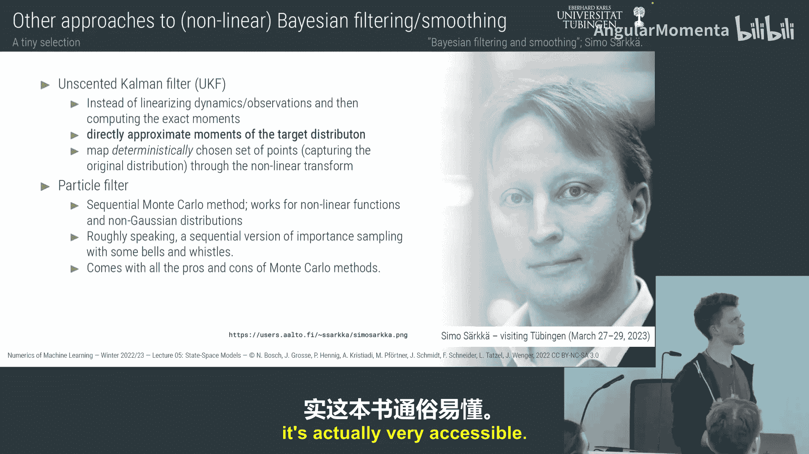

Finishing off now， let us quickly recap what we learned about today。

 We learned about the language that we use to describe dynamical system。

 probabilistic state based models。And we chose a special kind of these probabilistic statespace models in that we chose a linear Gaussian model such that we compute。

 can compute the prediction and the filtering distribution en closeded form just using linear algebra by using the common filter。

 We extended this because we need to do this to nonlinearar models。

 We will use this for our simulations later on， by using the extended K filter。

 which is just an extension of the common filter。 that linear arises everything in your state space model and uses the common filter equations again。

And now we can handle nonlinear dynamics， nonlinear measurements in a really cool way。Next week。

 I strongly recommend you coming back because Nathaniel here will tell you everything about how to mathematically describe。

These dynamics themselves。 So not the models for these dynamics， but the dynamics themselves。

 So he's going to introduce you to a language that's very powerful that captures all sorts of laws of nature。

And in the lecture afterwards also given by Nathanthaniel， so in two weeks from now。

 he's going to combine today's lecture and the lecture given in one week。

Where we will learn how to use probabilistic numerics， i。e。

 Bayesian filtering and smoothing to actually simulate those dynamical systems。

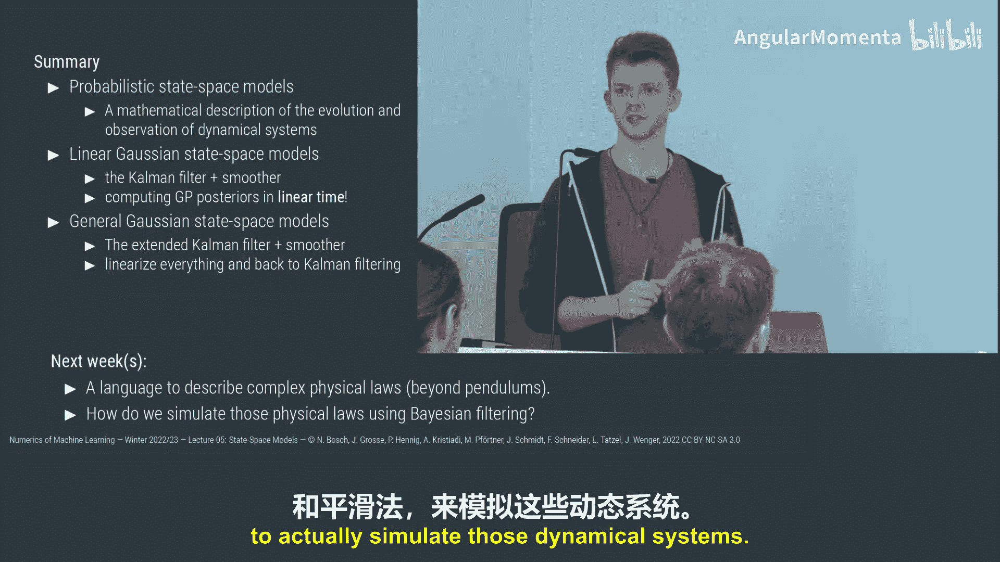

So this's the combination of those two lectures。With that。

 I want to finish off by asking you to provide feedback。 I'm very。

 I very much appreciate you listening to me today。 And with that， I finish off this lecture。

 Thank you for listening。😊。

