# 【精译】蒂宾根大学《机器学习中的数值方法》-p06-6-——-常微分方程解法-——-纳撒尼尔·博施--BV1WMYHzAEcL_p6-

。

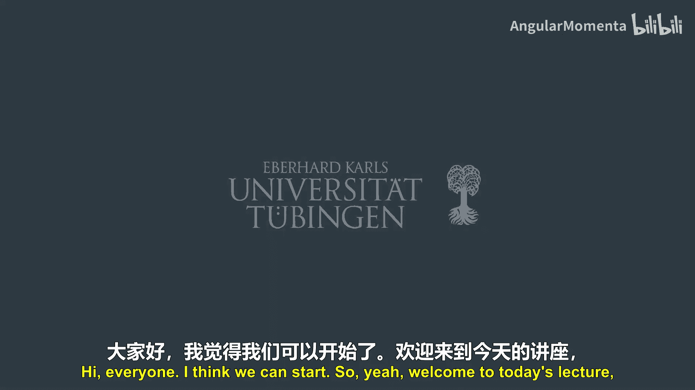

Hi， everyone。嗯。I think we can start。 So， yeah， welcome to today's lecture in numerics of Machine Learn。

 We're in lecture 6。 My name is Nathaniel。 I'm also PhD soon with Philip。

 and I prepared this lecture with Jonathan， together from last lecture。😊。

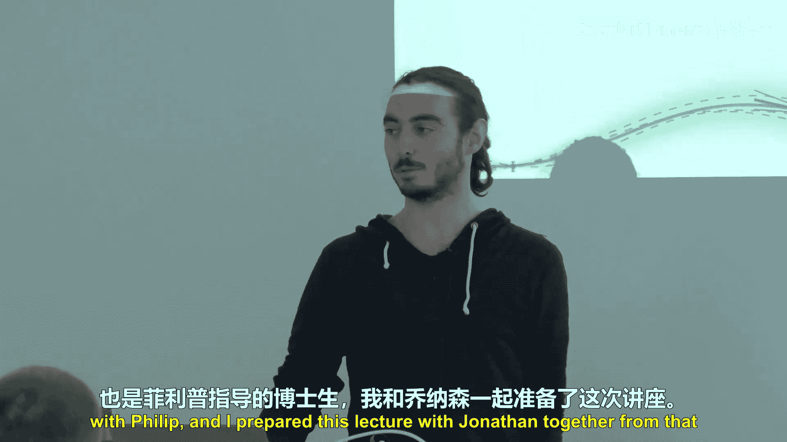

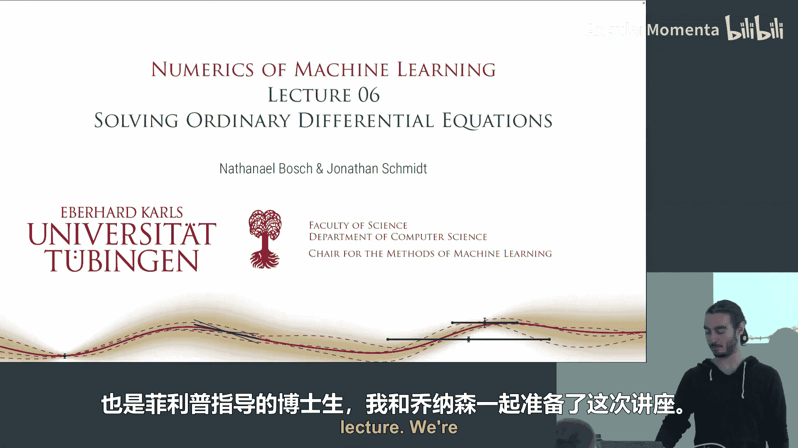

We're in lecture 6， but were also in the second lecture of our block on simulation。

I started last week with Jonathan that told us about state space models。

 and he provided us with a language to， well， describe the evolution of a state in a probabilistic way and describe observations that depend on the state also in a probabilistic way and then provided us with a set of tools in order to estimate states from the observations。

And we talked about that in a very general sense。 But then we also looked at a practical algorithm。

 the so calledled Kman filter and Kman smoother or H Tongkibble smoother that solves this problem exactly in the linear Gasian case。

 And then we extended it to the non nonlinear case and got an approximate inference algorithm that which is very fast and does work well in many situations。

Today， we do a similar thing， but we talk about it in a very different way， because we talk。

 we also talk about states。 We also talk about dynamic systems。

 but we use a very different language because well， for the most part。

 things will not be probabilistic。 We assume that we have a way to describe the evolution of a state in a completely exact deterministic way。

But even then， things are complicated enough， and we do need to approximate the simulation aspect。

 So before we did approximate inference， this time。

 we have to approximate simulation because doing it perfectly is just not feasible。

And the language that we use is O Ds and the algorithms are like O Ds are ordinary differentially equations。

 And the algorithms that we use are numerical O D E solve。And so we start with， yeah。

 a small intro to O D E， especially an intro from the perspective of machine learning。

 And I give some examples on where O Ds appear in machine learning。Then in the main part。

 we talk about numerical solves， constructive few and look at some examples and their differences and properties。

And then in the last half hour， we have a block on parameter inference France， where it' not like。

 it's not really a simulation problem anymore。 It's rather that we want to learn about the system that generates the simulation and how that and acts together。

 we will see in the last part。

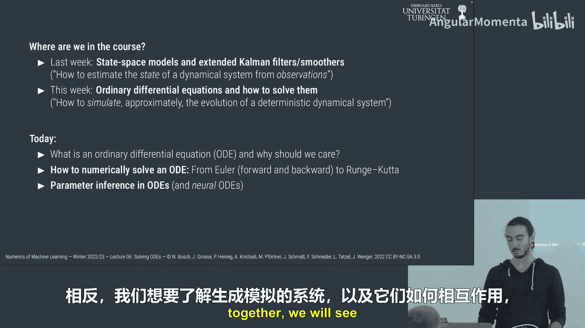

Before I go to the examples， let me define an ordinary differential equation。

 An ordinary differential equation。 or an O D E is this thing here in the middle。

 So x dot of T equals F of x of T comma T X is the unknown function。

 It has a similar meaning as the state from last week。 I think so it's。

 it's a thing that evolves at time。 And it is a function。 So it it is continuous， right。

 So X is defined for all the Ts in some time domain。😊。

I also use T and talk about time because that's the easiest interpretation of an O D。

 It X really has a one dimensional input。 So only a scalar and evolves along this one dimension。

That's also why it's called an ordinary differential equation。

Then F on the right hand side is called the vector field。 and it describes， well。

 it allows us to describe the derivative of x given x。 And typically。

 we want to solve the O D E for some time domain， not for the whole real line。

 but up to some and like starting from 0， up to some time capital。So in general。

 it is a way to describe the derivative root of the function， but not the function itself。

 And so the question is， what is X， Because this thing basically implicitly describes X。

 And so we have to do some work in order to find x。

And now to the examples where OD E appear in machine learning， I think the first one is， I guess。

 super well known now。 And everyone that at least as a Twitter account knows about diffussion models。

Or even in the first lecture， we had a lot of images， I think， that were generated from one。

 So diffusion models are quite hype for the whole year。

 and they fundamentally rely on differential equations。

I'm cheating a little bit with this example because for the biggest part。

 I think stochastic differential equations or S Ds do do the main work。

 And so if you really want to get into those models， you need to understand S Ds。

 But at the same time， in order to understand S Ds， you need to understand Ods first。

 because S D are just strictly more complicated。 we will not talk about S Ds in this lecture。

 nor the next。 but I think ODs well， are important order to get there。Also， like in one detail。

 there are algorithms that perform this mapping from noise to data that use O D Es。

 So like there are papers published last year that make this transformation from there to there by numerically solving an O D E with someung Kta serverva。

😊，嗯。This mapping from noise to data has also been done before diffusion models already because people cared about modeling complex distributions。

 So things like here on the right， or， I mean。Images it's also like。

 there's a distribution of images that are natural。 And so modeling that need。 well， for that。

 you need to describe a probability distribution of dose。 but it's complicated to work with。

 whereas the thing on the right is just II D gotsh noise， and it's easy to work with。

And this mapping from distribution that are easy to work with to distributions that are complicated to work with is something that normalizing flows do。

 And well， there's， I guess most of the work on normalizing flows or half of it like maybe does that in a continuous way by using O D S again。

Then you might have heard about new Os。That's basically， so it also relates to the two points before。

 But there was a nice paper published in 2018 that sparked quite a lot of hype in that field， which。

Reinterpreted residual neural networks as disctizations of a more continuous thing。嗯。

Where instead of thinking of a residual neural network layer by layer。

 you think of it as a continuous transformation that is then discretized by an numericalital algorithm。

And one specific algorithm leads to the thing that we know。 And in general。

 we get a continuous formulation。 and that's。Yeah， again， sparked a whole lot of research。

 There are still many papers being written on neural Os。

 And I would also argue that I think it accelerated the two points above because the diffusion model stuff often also relates to neural Os。

To give something completely different in case you are more interested in optimization。

 more interested in optimization， it turns out that in order to understand what happens by in gradient descent。

 you can do something similar。 I just presented neural o and reinterpret gradient descent as a discretization of a continuous objects。

 And this continuous thing is called a gradient flow。

 And it's much easier to well write a theorem about what the gradient flow does than what the disc thing does。

 And I took this graphic from a very nice blog post by Hossse Sp。

 who does a lot of great work on optimization And yeah。

 he had a love posts on gradient flow and also extends the to Ss and stochastic gradient descent。😊。

The one example we will do in this lecture is parameter inference， which maybe relates more to， well。

 the machine learning settings that we are used to。 So we have some data。

 and we want to learn from it。 And well， if we know about the process that generates the data。

 maybe we can learn something more meaningful， like in this example that we see later where we， well。

 we learn four lines， even though our scatter plot describes only two of them。

 And in order to do that， we need some assumptions on the structure of properties of these four lines。

And small spoiler for next lecture is the act of solving an O D E I itself a process of learning something。

 learning an unknown function in this case。 And so next lecture。

 we will interpret numerical O D server as machine learning algorithms。😊，Alright， so I hope that。

 well， you know why we're sitting here and why we're talking about Odis and why I am excited about them。

 So coming back to the definition of an ordinary differential equation。

 The question for the rest or the two thirdhirs of the lecture is， how do we solve Os。

 So how can we find X such that we satisfy this differential equation。😊，And well。

 we can write down the solution of an O D the following way。

 X of T is actually given by x 0 plus integral from 0 to T。 F of x toweru comm D T。

 That is a true statement， it's also not very helpful。 because it is the solution。

 like if you compute derivative。 The thing on the top comes out It's not helpful because of two reasons。

We have an integration problem now， and integration is also non trivial。

 And that's why there will be a lecture on it， I think， and。

The integration problem is even particularly annoying because X appears in there too。

 and we kind of need all the values from 0 to T of x， but we don't know x， right， so。Yeah， it's a。

 it's a true statement。 and it will motivate a lot of the algorithms or maybe even all of them that we talk about today。

But it's not yet a solution that we can actually work with。There's one piece of insight， though。

 which is。The solution depends on the initial value。

 So the problems that we actually care about are so called initial value problems。

 which is basically an O D E together with an initial value x 0 given by， well， some x subscript 0。

Whenever I say O D E， I probably mean initial value problem with an O D E and an initial value。

 When I say solving an O D E， I mean solving the corresponding initial value problem。

So let's look at an example that， well。Visualizes why O D E can be a helpful tool for modeling and why。

 well， and how we can solve it or how solutions look。 It's a very simple example。

 It's one dimensional。 It's a so called logistic O D E。 and， but we。

 we can motivate it from a biological perspective。Where， well， we don't use X here anymore。

 We use P because wet to describe the population size of something。

 And the change in population is given by R times P。 So R is a growth rate and P is the population。

 So if we ignore the parts after it basically means it grows proportional to the population。

 which makes sense。 Like if 10 people have5 babies， then 100 people probably have 50。

 And so the growth is larger， if the population is larger。

And then the part on the right describes a upper bound， because if P divided by K approaches one。

 then the thing get 0 and we stop growing。 So K is effectively like an upper bound for the population or also called carrying capacity or a bottleneck。

The solution of the logistic O D is given by this。 Today， we talk about numerical solutions。

 So we don't really care about how to solving， how to solve O Ds by hand。

 This solution you can get by doing some derivativerivations by hand。

 but this is explicitly not the goal today。 We want strategies with which we can approach general complicated problems with a computer。

 which is why I just give you the solution， But you don't really have to trust me on this because you can compute the derivative by yourself。

 one of those nice cases where at least verifying a solution is very easy。

 even if coming up with it is more complicated。😊，So， yes， this function solves the O D。

 We can plot it。This also maybe visualizes once more。 what the problem setting is。

 The arrows in the back are a visualization of the vector field because they kind of move the solution around。

 And then here are 7 lines that solve this O D E for different initial values with some chosen parameters。

 K1 and R 1。So we get multiple solutions for different initial values。

 If we specify an initial value， we end up with one solution。

 And so the goal of solving an initial value problem is basically。

 given the starting point on here somewhere and the arrows in the back coming up with this plot。

That is the task that we are interested in。嗯。In general。

 please feel free to interrupt me at any point。 If you have questions。 If anything is unclear。

 then we can talk about that。

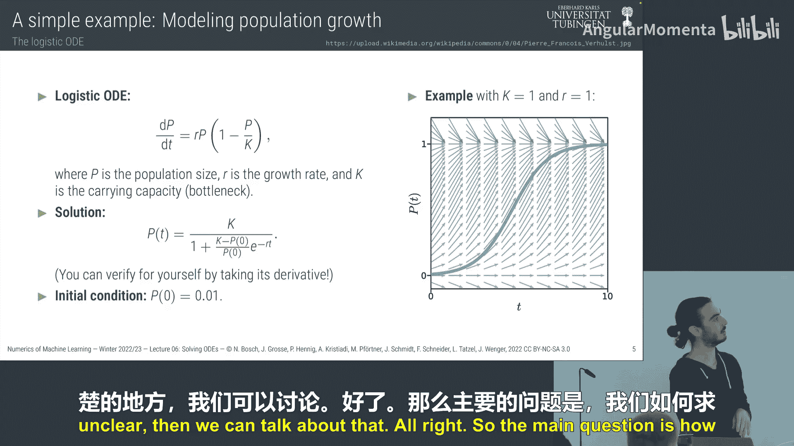

Alright， so the main question is， how can we solve audience in general。

 So if no one gives us the solution， what can we do in particular， Well， it in most cases。

 it's actually impossible to give the solution in close form， but we still want a strategy to find X。

 or at least find something that is close to X。

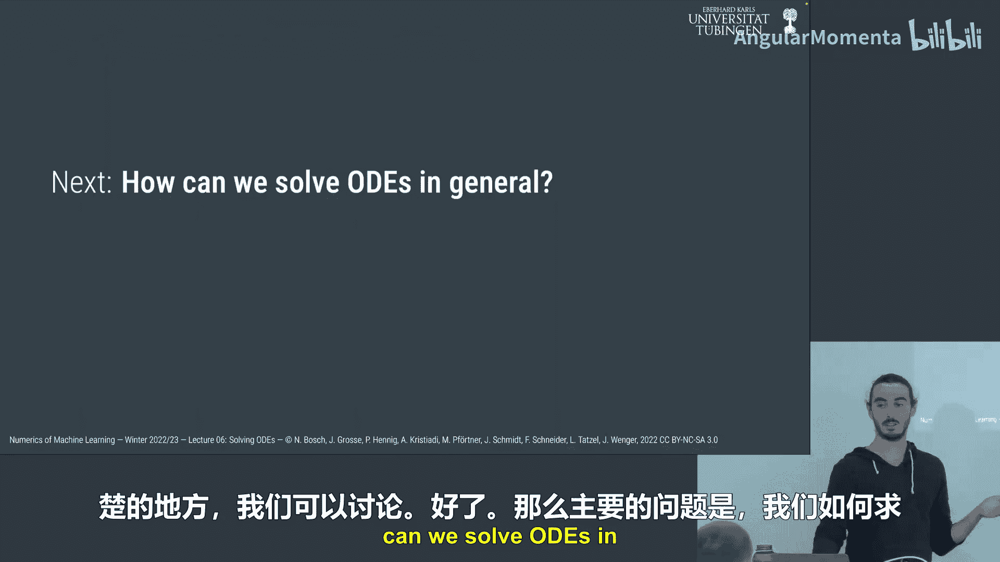

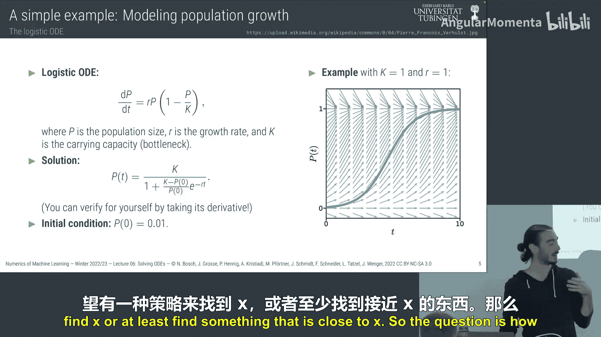

So the question is， how can we solve O in general。

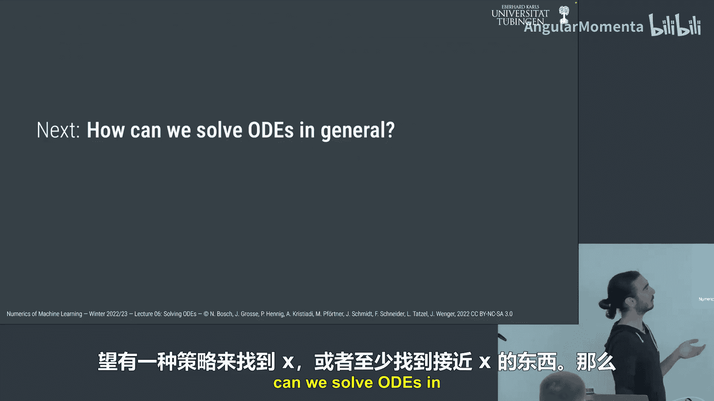

And。For that， we come back to well the definition that we saw so far and the solution that we've seen so far。

And the strategy in numerical o summer is basically to extrapolate step by step。

 which means that instead of trying to compute X T。Directly from time at x 0， the question is rather。

If we have something at time X T， how can we go to time X T plus H。 And then again， the formula is。

 of course， exactly the same as before。 So this thing is still the true solution。

 If you have the true solution at time X T。And the difficulty is also exactly the same as before。

 So in order to do this， we still need to solve the integral， which is non trivialvial。

 And we need to handle this X insight here， which is also like。

 that is the main difficulty in this problem。The motivation is， though， that probably， if H is small。

 So T and T plus H are not so far away from each other。

 then the approximate algorithms that we come up with with dealing with this are probably fine compared to trying to jump ahead directly。

So， that's the motivation。Yeah， so the main question is， how do we compute this thing here。

 And all the algorithms that we show will be different ways of computing that。 And as a result。

 we come， we get numerical O server。嗯。So the first thing we will try is using Taylor series expansions or Taylor series approximations。

 Actually， you've seen this last lecture when we tried to push gausians through non nonlinear functions。

 and we well use Taylor series expansions to linearize the function。 in general。

 Taylor series expansion。😊，Takes some function G that well here for simplicity maps R to R。

 just to have easy notation。 And it says that， well。

 G at some tau is equal to G at time t 0 plus And then we take the derivative times tu minus t0 plus1 half the second derivative times tu minus t0 squared and so on。

 R in this series representation。😊，Note that this was exact。

 If you actually let the serious one run into infinity。What we did last lecture。

 then is basically ignore everything that is here to the right and only look at the left part。

 And then this thing is an approximation。 And we obtain a linear function because tell only appears in here with some slope in。

 in， like in front of it。And that's a Taylor series approximation。Today。

 we'll do something even simpler as our first algorithm， which is we will。

 like last time we do the first auto Taylor series approximation。 We will not even go there。

 we'll do a zero auto Taylor series approximation， which basically means we discard everything to the right from here。

 which is a very bad approximation， but it leads to an numerical algorithm that everyone knows。

 And surprisingly many people use。 and we'll see that on a second。 So。😊。

0ero order tele series approximation。Okay， well， the。

 the reason we do that is still we want to approximate this integral on the top。

And so we do a Taylor series approximation of the thing inside the integral， the integral。

Where the relation， So this F of X tau come a tau， you can interpret that as a function of tau。

 if you just merge the F and x on together。 and then youre in this notation here。

 This is why I use G of Tu。And well， when we do the cellular series approximation around T。

 then we approximate F of X to comma2 as F of X T comma T。 and we have some error term。

This error term comes from this here because that is at most age。And when we plug this into our in。

 that means that instead of integrating a function like this thing that depends on toweru。

 we suddenly integrate a thing that does not depend on T anymore。 so we can pull it out。

 we integrate from T to T plus H， the one function， which is only H。嗯。

So we managed to find an approximation of this integral。 And if we plug that into the top。

 we get our very first numerical Odi server， which is the former Eer method and。😊。

I imagine you've seen that before。The scheme is， well。

 you take your estimate attempt T and you adjust it by adding H times your like F of your estimate attempt time T。

 which is， well， the local slope。It's an explicit method because it explicitly describes how to compute X set a time T plus edge。

So it， it's a formula。 You can write， literally write this into your favorite programming language and compute the next point in time。

Alright， so that's the very first solve。 And again， like it is actually used in some software。

 or yeah， it， it appears also in dynamical simulations。 I think， I mean。

 if you look at what op May I gym does under the hood， they do this。

 basically to simulateim the systems。嗯。Now， let's try to do a thing a little bit like change one thing and get another algorithm。

 which is， well， choose a different location to do the zero dollar Taylor series approximation。

And the motivation for that is in some sense that， well， here we use the， the local information of。

 well， the point where we are in order to extrapolate。

 maybe a way to get more information would be to use the slope from the point where we want to go。

 which basically means we do a Taylor series approximation around tau equals T plus H。And well。

 the math still works out。 So we get the same approximation here only that it says T plus H now， we。

 this formulation is the same as before。 Only that here， it says T plus H。

And we get the so calledled backward Oer method that is given by this。

 So X hat a time T plus H is equal to X hat a time T plus H times F of X hat a time T plus H T plus H。

嗯。And， well， it's， again， very easy to write down。 But this is not an explicit equation anymore。

 And maybe now it's clear why I said explicit earlier。

This equation describes the quantity that we want， but doesn't explicitly give I'll tell you how to get the equation。

 So again， similar to， well， the thing we started with which is an O D。

 which describes the thing we want， But we have to do some work here again。

 it describes the thing we want。 but we do have to do some work。嗯。And well。

 one way to do that is basically move that to the other side。 Also， Then we have 0 equals something。

 and that is a root finding problem。 And we will see that or we。

 we'll talk about that again in the next few slides。So， yeah， we have our first two O servers。

 basically， forward Oer， an explicit method and backward eer。😊，So。Let's look at code quickly to well。

 see how easy it is to solve O these。嗯。There's， I mean， it's 13 lines of code。

 but most of it is because I wanted this to be copy pastsable。

 So if you copy paste this into your terminal， then you actually get a plot that looks like this。嗯。

And while the algorithm itself is basically only in line 9。

 although there rest this problem definition in line 3 and 4。

 importing a plotting package on the top， specifying a step size。

 Maybe you're confused about this double slash here。

 It's basically a way to write a fractional number。 So it's not not a floating 0。1。

 but it's like one divided by 10， really， which makes things a bit nicer。 It doesn't matter a lot。

 And then here you have the x plus eer。 And it's really the same way as I wrote it down。

 like the new x。 I just overwrite the variable， is x plus h times F of x comm here。

And it works like we get a solution of the logistic O D E that looks reasonably fine。 is。

 it's conceptually similar like the same as we did before。

 I didn't plot the true one here because we will talk about error letter。Back what。

 I learned code is。Also the same in the sense of like， we can write it in one line。

 But as I said as we did， like in slide， we were also able to write it in one line。

 But I said that you need to do some work in order to solve it。

 Well I chose the same way to implement it because I used the roots package。

 which has a function in find 0， to do the thing that I talked about。

 which is this thing solves the rootfin problem for me。

 and then splits out a new X that satisfies the implicit equation。😊，And again。

 we get a solution that looks fine。 and the code overall looks quite easy to read。

A few comments about this thing， though。 that's， I mean， we've seen that in the first three lectures。

 how。Nummerical methods appear when you try to do something with a computer like well doing G P regression。

 And then suddenly， when you start looking into what it actually means to invert a matrix。

 you open up this whole field of research。This is exactly one of those points where again， we can。

 we can start digging and thinking about our numerical method， called a numerical method。

 Maybe we should think about that。 We can look at what this function does。

 I did check out the do string。 And it turns out that find 0 is actually quite complicated。

 Like there's a whole houristic algorithm that decides from a set of like 50 different methods。

 What the best roots finding method is and so on。 today， we're not going to dig deeper there。😊，But。

 I mean， we are， because we think about numerical methods。 We are aware of this happening。 And。

 for example， I know that in there are some packages where the。

 where implicit differential equation solve us。Have an interface for the user to specify how this kind of thing should be solved。

And well， because implicit methods have this additional complexity。

 you can actually tell it to compute inverses with conate gradients， for example。

 So that is actually what people do。 And if you look at the documentation on how to solve stiff O Ds。

 then you need to care about these things。But we want to get to Wukutta。

 So we will not care about this for today。 but you， you， you see the theme， I think。嗯。Yeah。

 so one other question in this context is， so this thing does something complicated。

 whereas here it's something easy。 So why would we do want to do the complicated thing。

 in particular， thiss fine zero function。 It's， it's an iterative algorithm。

 like maybe it uses like a newton iteration。 And so this thing is computed many times in order to get to the quantity that you care about。

 So that is more expensive。 It is， well， more annoying to code， It is more annoying to understand。

 So there's some extra cost involved， Why would we want to do that， And well。😊。

I guess the answer is because backward Oer is a different algorithm from forward Oer， and。That。

 there's one specific property that we will look at that visualizes this difference of explicit and implicit methods。

Which is stability。So， yeah， stability is the， the vague word that well pops up when you look at differences between explicit methods in general and implicit methods。

嗯。There are different notions of stability。 So if you open up an O D E book。

 then this is not all there is。 but people can about way more than this one slide that I'll show。

 But yeah， I think this visualizes explicit and implicit all already。Also， if you've heard about。

 I don't know， O is being stiff， then this is the context。So to compare forward and backward Euler。

 we will look at a very simple O D E， which is x dot equals lambda X。 So it's scalar。

 It will also be easy to plot。 and lambda will be a number that is lower than 0 here chose -21。

 We've seen a second y。😊，The true solution is therefore， like this dash line。

 It's an exponential decay to 0。And it decays to 0 quite fast， as you can see。

 because the plot goes from 0 to 1， but it's visually 0 already at 0。2 or something。Now。

 when we solve that O D E with forward Eer with some step size，0。025。

 we get these dots here and lines in between， which basically， I mean， if we zoom in， then I guess。

Around here， you see that there's an approximation error， as there always is。But like conceptually。

 it does the right thing because it goes to 0。 Like， the true solution goes to 0。

 thought all goes to 0。In the limit， it's fine。The question is。For which step sizes does it go to 0。

And well we can look at that by just plugging in forward Eer。

 So X hat T plus H equals X T plus H times。 And then we plug in the vector field from above。

 So Lada X hat。Which gives us a simpler formulation where we just multiply one plus h lambda to the previous estimate。

And now the requirement of it， well， becomes different。

 Like if we want this thing here to converge to 0， suddenly。

 we know something about this thing here in the middle。

 So one plus H lambda should be smaller than one。And if we check that for Lambda -21 and the 0，0，25。

 then this holds。But we can also ask the opposite question。

For which step sizes does it not hold anymore。 And well， when we solve to Lambda or I mean， okay。

 basically， I just have a counter example， but we can could also solve。

 But if we plug in a step size of 0。1。That would mean that we have 0。1 times-21， which is。1-2。1。

 which is-1。1。 absolute value of it would be greater than one。So this equation does not hold anymore。

 And so just looking at what we derived here， it should actually not converge to 0 anymore。And。

It well， we can try that out。 And I mean， of course， this is correct what we wrote on and the code。

 like when we run it， we see that it actually starts oscillating around the thing。 But at each step。

 it overshoots。 And then the gradient information it gets is like way deeper。

 It overshoots again and so on。 And there's this whole feedback loop happening。

 And it actually divergs。😊，嗯。So this basically means that for specific problems。

 we actually need to take small steps。 Otherwise， bad things happen。 Like otherwise。

 we get this divergence behavior， even though the O D is actually quite simple to solve， right。嗯。

And so， I mean， the goal was to compare forward oil and backward oil。

We can do the same math for backward Oer。 And we see that when we re this equation。

 then the requirement we have this one divided by 1 minus H lambda should be smaller than one。

And when we plug in the numbers， that means one divided by 1。1。 And that is indeed smaller than one。

And when we run the code， it actually converges to 0。And like backward Oer， you， you can。

 you can check for yourself on which ages this works。 But with that lambda。

 I think it should always converge to 0。 So that's a fundamental difference on why backward Eer has properties that forward eer has not。

 and why sometimes you might actually want to do the expensive。

 more complicated thing instead of the easy thing。嗯。That's， I。

It's not completely the full part of the story because， I mean， I mean。

 the one backward oil iteration is more expensive， so。This is not a final answer to in this problem。

 you should always use backward Eer because probably when you sit in front of your computer。

 the thing you care about is just how much time you have to wait until you solve the O D E。

 But roughly speaking， when you expect your differential question to have very steep areas。

 Then you should consider solving using an implicit solve。 or on the like phrasing it differently。

 when you solve that diverges。 maybe you have a problem with the stiffness of the problem。

 And then you should consider using an implicit solve。Alright。

 it also shows us that we talked about two algorithms。 Both of them are super simple。

 and we already face the problem of which one should we choose。 And yeah。

 this is one partial answer to that。

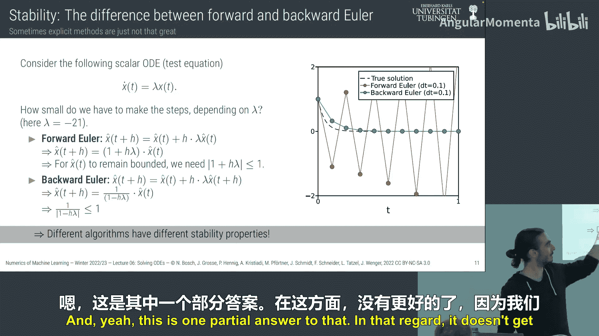

In that regard， it doesn't get better because we will actually talk about a whole class of servers。

 So this opens up basically1 hundred50 new algorithms that you can find in software packages。

 But it's also a class of servers that is very like well used and probably the default server when you use sai is probably Kta server。

 a specific one that you saw in the very first lecture。 and that we will revisit in a few slides。😊。

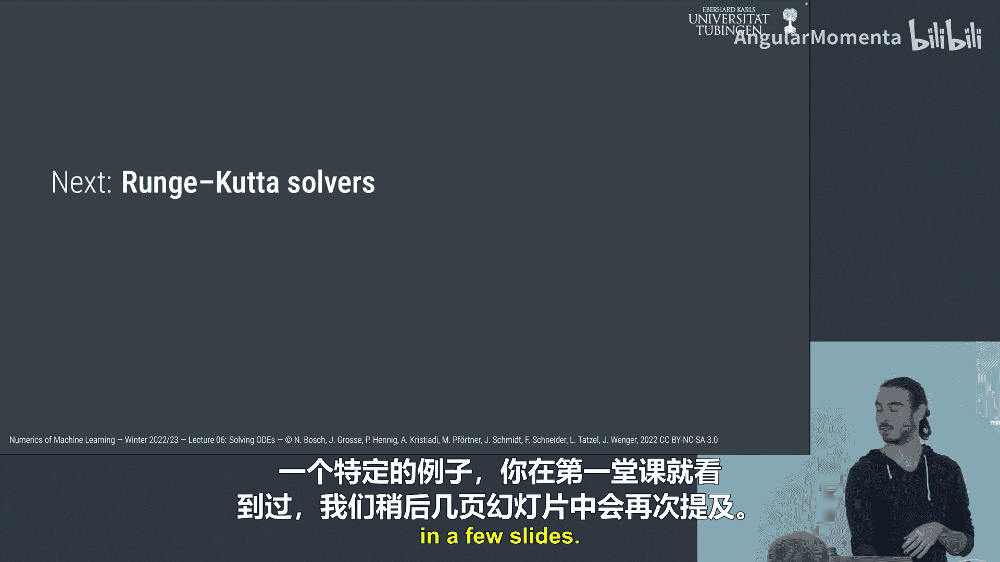

嗯。The problem is still the same。 So we still try to extrapolate from some time T to some time T plus H。

And the difficulty is also still the same， which is we need to solve an integral， which is annoying。

 But it's particularly annoying because inside the integral， we have X。

The motivation for women Kta is now a different one， which well， is basically， well。

 I said there are two problems， one with the integral and one with X being inside。

 We just tackle the integral problem by numerically solving integral and conceptually numerical quadature is。

 well。A term for numerically solving integrals and typically works in the following way。

So when we have an integral with some lower bounds and upper bound of some function could be vector valued。

 then we approximated by discretizing in a specific way。In a specific way， because， well。

 we have to choose where to evaluate the function G， which are the so- calledled quadraature node。

 And then when we sum them together， we can give more or less weights to different ones of them。

 and those are the so calledled quadature weights。Again。

 I think you will talk about integration in more detail in three lectures， so。And。

 and we don't really like， there are many ways of doing that。

 You can probably fill whole like courses for the semester on how to do quadure。

 So this is really just a conceptual motivation for the kind of operation that Wutta does。

Because W Qta methods or explicitkuta methods I will talk about today。 do a similar operation。

 So we replace the integral with a sum of S terms。 and we have specific weights quadature weights and quadature notess。

😊，Only that。 And I said it before， there's this additional second difficulty of， well。

 we still need to find X hat a time T I tau I， because while it's， it's not given automatically。

 we have to construct it somehow。And this is basically the difference between different Wkuta methods。

 So if you look at five different Wkuta methods， theyll give you five different answerss to how to choose W I tell I and how to construct the Xhas at those locations。

嗯。All right。Family。Hi Qa looks like this。If we compare that to the last slide。

 we basically so here I use W and tower。 On the next slide， I use。

B I and replace the whole F term with the case。 because that is the notation that one could that methods use。

 Yes， you have a question。Previous tour。系。関連トす。For my good message。Yes。Yes， that is。

 that will be the very first when we put our methods on this slide。So， yes， yeah。

 but you are completely right。嗯。Alright， so in general， when we could their methods look like this。

So。That that is basically what I had on the last slide。 It's just the definition that we， when you。

 when you code them up， basically， you implement how to compute K1， then how to compute K2 and K3。

 because K3 depends on K1 and 2， K2 depends on K1 and so on。Then， at the end。Well， no。

 this is just a general formulation of the， the lines here。 And at the end， you。Updates， exempts。

By extrapolating again from X T with step size H while summing up the different K I with the appropriate quad weights。

Because this is a bit tedious。 Like， I mean， this is the way you implement it。

 And I think if you write code， probably you want the formulas like this。

A way to talk about W Kutta that is a bit more compact and more readable as so calledled butcha tableaus。

Because when we look at these equations and structurally， they all look the same， right？

 And I told you that the way homekuta methods are different is basically by choosing different weight P I。

Different qua notes here， C 2， C3 and so on。 And then con constructing the X hats in a。

 in a different way。And a general way to write that down is with so calledled bota blues， because。

Other free variables here that need to be chosen can be packed in a tableau。With， well。

 a column that。Basically， this thing here describes how to construct K2。

 This thing here describes how to construct K 3 and so on up until K S。 And at the end。

 we sum them up in the correct way in order that we get the next step。

If you go to Wikipedia and look up whom we could there methods in general。

 that you find this article with a list。And they don't write down equations or anything。 Theyre just。

 it's basically a list of portraitchar tableaus。So in some sense。

 if someone gives you a butchert tableau， you can also just implement it。

Or even red code that handles General butcher tables。Alright。

 So let's look at who you could our method examples。And well， this is just。

 so you can do some pattern matching with the stuff that I wrote below。

 But it's the content from the last slide。And as you said already， yes。

 the very first one could that method that we can talk about are the very simplest one is again。

 forward Oer。 So I kind of tricked you to go through all the stuff only to show the same algorithm again。

😊，But it's because while the extrapo， if we just replace the thing with a K1。

 then this actually satisfies the equation above。 And we can also write down the butchert tab。

 It's just a very like。Not very special one。But if we insert some zeros。

 then we get this butcher tableau。 And again， if you go to the Wikipedia list of Hong Qta methods。

 this is the first one。 Like， that's actually the first one Qta method they give。嗯。

And surprisinglyurprily， I， okay， I didn't define implicit when we could that methods， but I。

 you can imagine that there are implicit when you couldta methods。

 and the F backward Eer fits the definition of an implicit when we could that method。 And basically。

 well， here normally， there needs to be a0 for things to be explicit。 There's not。

 So it's implicit method。And yeah， there would not be a definition of implicit methods。

 There was a question， sorry。I should like。P先我。あ言ですか。Is maybe I can have an attempt because I。

 I could imagine that the question is， if we split the inter like the integral into different terms and then just take steps in between all the time。

 Like instead of going from T to T plus H， we go to。

The middle point and then to the next does something。Yes。What I'm interested in。

W why is key into computer。時ワの。デト？So， I mean。I'm still not completely sure that I got things right。

 but。If the idea is， I mean， one other thing that you could do is， for example。

 do an oiler step and do a second oiler step。Is that the intuition of like doing a thing。

 like doing one step and then doing another step from right there。

Because this is conceptually not what happens。 like that that， that would。

Be a different algorithm and has different properties from here。

 So I guess the observation is correct that the B I is I think they some to one。

 the need to probably like something like that。 But you actually have quite a lot of freedom and choosing these numbers there。

 maybe like I will have two or three examples that are not forwarding backward O where we see Butchar tableaus。

 Maybe we can revisit your question after you saw that。

 And you can check if that was a counter example or not to your intuition。😊，Yes。也说なす。

But you may have been asking。You'll see in a moment in the next exercise that it turns out。Doing。

One step that persist。Like this one。Connection to be much better and reinforce that。much better。O。嗯。

Al right。Yeah， so let's jump to。The actual example， I mean， I， there's maybe the。

 the second easier thing that we can still try to interpret intuitively on how it was constructed。

Is the so called。Explicit midpoint rule。And that is an example that is kind of close to doing two Oer steps。

 but it's not。 So maybe this is already a good example for why there's a bit more happening here than just doing two Oer steps。

 motivation basically being that well earlier， I said。

 we can either take the the derivative at the point where we are or the point where we want to go if it's the point where we want to go。

 we're implicit。 So maybe we can take a better derivative in the middle in an explicit way because we don't want to get to be implicit。

 which would amount to。This equation here on the top。 But then the question is。

 how do we estimate the thing in the middle and the easiest way of doing that would be taking an oiler step。

And that leads us to the so calledled explicit midpoint rule。

 which is the third W quota method in the list of Wikipedia。But if you check that。

 it's not an oiler method。 like， it's not the same as doing two oiler methods because you still extrapolate from the point down here and。

The K1 is internally multiplied with half the subs again。

 So you kind of reduce the thing that forward Eer did in order to get a better extrapolation。

Whereas if you route write down to Olash steps， something else comes out with different con like different properties。

 We'll talk about them in a little bit。One more for the fun of it。

 there's the classic thought order Hong Kutta method。

 I think it's quite like that because it's like the original method by Hong and Kutta together。

 these are the equations。 I'm sure we could find some intuitive， like understanding of that。

 And they are also nice plot of Wikipedia on like how to extrapolate with the gradient and adjust that in some way。

 But I think we skip that。😊，The， the thing is， the butlets upload below is still readable enough。

 The code is readable enough。 You can， you cant implement this。And。Maybe at this point， it's also。

 so Huungya and Kuta came up with this method。 So they derived the numbers on the right。 So， and。

 and that is a proof that is readable。 Like， if you。

 you can check books like this solving ordinary differentially equation book。

 which includes a derivation for these coefficients。I think by now。

 it's clear that we cannot choose them completely。 However， like how we want。

But it's also clear that there is some freedom。 Otherwise。

 there wouldn't be a list of 150 Qta methods on Wikipedia。

But so feel free to check out the derivation。 It's， it is understandable。

 Like you can do that if you're interested， but yeah。So there's a question。Sorry。意合？I think so。

And you。do the good。 do the B I S。 So the， the quoature weights here on the last line always sum up to one。

 And yes， I think so。Yes。Good thanks。エキーワン？エケ。A。I would be surprised， actually。1 by6。

One by three plus one by three plus one by6。お前イグ。peak up was the term。百。我れ。I， yeah。

 I think I got a bit too confused。So sorry， I don't know if someone， if you understand， Okay。

 alright， yeah， let's， let's talk afterwards， yes。Am I correct in understanding that the portraittablela arises from the quadroture of the integral that we saw at the very beginning。

 Yes， so the way to derive these would be choose a family of polynomials。

Derve the quarter to rule and then derive the coefficients from the court。Yeah。

 I'm not so sure about that anymore because it's not just an integration problem。

 It's also constructing these intermediate values。 So I'm not sure if you have a direct mapping of integration rules to Hongkus methods。

If you choose a family polynomials， I think the。Points in which you evaluate the punishment rule。

Are given by the zeros of the polynomial tab。 So if those are them。

Give the notes of the question rules。Then they should directly come。嗯。Okay。

But I'm not sure if that' true。And those。試しも。you have freedom and choosing where are you about？Every。

你在。And so the， when I looked at the solving ordinary differential equations One book。

 sometimes the text was motivated by there are these quot rules。

 Can we find a similar thing that solves O D。 And then they， like then the follow up question is。

 how do we construct these things in between。 That's why my impression was that it's not a direct mapping。

 but。It's， but， but I mean， they are very motivated by college ruless。Thanks for your question。嗯。So。

 yeah， we were here。 I guess the next one to jump to， you know， from the very first lecture。

 which is the dominant print or 5 method。 And at the latest here， it gets。嚟。

It's still fractional numbers。 So it could be worse。 but yeah。

 we see that it's hard to interpret what's going on and to like the goal should not be to try to understand how this gradient does and so on。

 Like in this book， there are the explanations on what properties these coefficients need to satisfy。

 And then Do print came up with a method that does a lot of things like works well and satisfy these properties。

 there's a question in the back。So the question is， why are there two lines at the end。 And yeah。

 I was coming to that。 So the thing is so complicated because it does， does a whole lot of things。

 First of all， things get more complicated when， when you make the whole tableau bigger and that makes it less trivial。

 We've seen that before that this one was harder to interpret than this one。 so。

That's already one thing。 But then the question was about these two lines。

 And so do pre 5 does one cool thing， which is it gives you two solutions at each step。😊，Because。

 I mean， this last line was about how to sum up the case that you computed before。

 And there are two different ways of summing them up。Which give you twokua methods at the same time。

So it's， and this is why it looks this way。 like because they try to have an efficient algorithm that gives you two long quota methods at the same time。

 but which are， which have a different degree of accuracy。

One of them is more accurate than the other。 And there are theorems to say that the order of accuracy is different from one and the other。

 And so basically。You can。Like， use the more accurate one to estimate the error of the less accurate one。

And again， that's why this thing is so complicated because of this。 an error estimation is。

 in turn helpful because one thing we didn't talk about yet。

 But I will talk about here now and on the next slide。

 And you own the homeworks is I never discussed how to choose the step size H。

 But if you have an estimate for the error， then you can use that in order to adjust your step size H。

 if your question changes from solving the O D E for a given step size to solving the O D E while satisfying some local error。

 Yes， there's a question which。What is the same。嗯。I。Actually。

 you don't know which one is the more accurate one。Well， that's always did。Yes， yeah。 yeah。 I mean。

 intuitively， this0 here surprises me。 So it seems like it has contains less information。

 So I would assume that this one is less accurate， but I。

 I wouldn't guarantee it's because I never implemented it by itself。 Yes， another question。

The question is， why are there two zeros， Like， if there are  two zeros here。

 why even compute it and it's。Because above they are not the zeros。

 So you need them as intermediate values。嗯。Exactly， alright， so。Yeah， the you also。

 I think in the very first lecture， you switch to Python code and scroll through the Dop 35 fing codes on Github。

I just copy pasted one specific part out of it。 But so the rest of the code is still quite hard to read because it's still forn code。

 But at least this huge list of numbers that you talked about last time， not last time。

 but in the very beginning。Got a bit more interpretable， because now， at least。

 you know that this hard to read thing maps to this slightly less hard to read thing。 So a 6，5 is。

 well，6，5 somewhere here。 And then yeah， you can find all of those numbers on the left side。

And again， it says that given the butcher tab law implementing the methods。

 basically amounts to while implementing all of these numbers and then doing the generic Kta thing。

And also， as I mentioned before， the Fon code is also， so annoying to read。 Well， again。

 because it's Fon。 But also， because all of this stuff also happens in there。

 So it doesn't just compute the next step。 It computes two estimates。

 It does some local error estimate。 So to have local error estimation。 It chooses a step size。

 There's all of this bells and whistles stuff that is on top that gets called when you call sip pi solve O D。

😊，Yeah， and once more， I mean。I refer to this book very often。

 so I can imagine that it is actually this thick。 But in Chapt 2。4。

 theres a section on error estimation where this here is actually explained how it works。

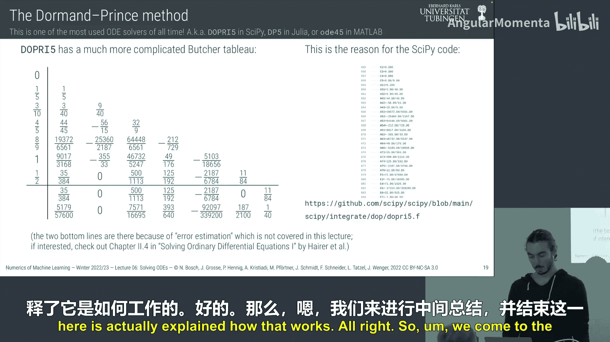

Alright， so we come to the intermediate summary and to the end of this block on how to solve ODs。

 I think the main takeaway is， well， we talked about home you could our methods。

 And I showed a bunch of them。 We ended up with dop 35。 They are a lot of them。

 They have different properties。 the most complicated we saw today is do 5。

 but you can actually get larger methods with like whether tableau is 15 lines long。

 And similarly similar and readability。嗯。But there are difference with differences between the server。

 and these differences are interpretable in some way。 We talked about stability。

 So explicit versus implicit methods。I only talked about forward and backward Eer。

 but there are implicit W Qta methods。 I didn't show the tables for them， but they do exist。

 They exist in Python and Julia and whoever you like your server。 and so。If things div。

 maybe try an implicit solver。 Or if you know that your problem is stiff。

 maybe try and implicit solver。We also briefly talked about order。

 I didn't really have that as the focus in the last few slides。

 So let's do it quickly here because there was this comment on。If it's the same to do many small。

 intermediate steps or do this complicated construction and the difference between doing the complicated thing and doing the simple thing is actually that you have the different convergence rate of your local error where okay。

 it's not defined here， but local error is basically the one step error。 It's So the question is。

 how much error do you make if right now， you have the true correct solution。

 But in the next one you do the estimation。And。The order of thekuta method is defined as， well。

 the local truncation error having an order H P plus1。

It basically also shows you that if you make H small， then your local error gets small。

 If you gets H to 0， then your local error converges to 0。 So that is good。But， yeah。

 And then the server that we looked at is hot O as an order of one。

 And you will prove that on the access sheet。Exclusive midpoint method was the next more complicated thing。

 And it is a bit more complicated because it has a bit better convergence。

Fourth auto Hongkuta method。 It's in the name and dop 5。 again。

 it's called dop 5 because it has order 5。What might be different。They mentioned if you did four。

Poiler steps in the role。Regraulations。さ。H four。The thearrow would be。Something positive。还H。こい wait。

You that methods。Any error。Was。H2 the fourth。And it features a。Take go to minus4 because all of this。

关我。Thanks a lot。 Yes， another question。Do brands。Is it the same model？No， it uses。 well。

 it has one other difference in both estimates。 And that's also the trick on how you do step size selection them because。

 you know that they， well， the difference between those two estimates。

 because the other one is also not the true one， but you can use the difference because you know。

 both of their convergence rates。嗯。Also， in the explanation that we just heard， its so。

This does not mean it's always better to use a higher order method， because otherwise。

 we would use order。13 methods or something all the time， because theres a hidden constant in front。

And so unfortunately， like same as with stability and order that you have a heuristic of if you want to solve something in a precise way。

 probably you want a higher order。 also， probably dop5 is an okay default setting， but。Like。

 if you want something only very costly， things can be faster and more stable by using only an other three method or something。

And then I mentioned also that there are many like belts and whistles happening when you call si O D or similar。

 The most important one is probably step size selection。

 which uses this information about order and local error to choose a step size。 And again。

 that's something we didn't have time to cover the slides。 But it's a whole question of， well。

 wondering about how to choose age instead of taking age as a given。 And the question rather becomes。

 how to choose age if my local error should be lower then。

And we have an exercise on the exercise sheet。嗯。Also， just for completeness。

 there's sometimes you even have automatic solar selection happening that tries to do the above thing。

 which makes the implementation of everything way more complicated again。

 because they only use heuristics。 But as always， when you have automatic things as soon as things break。

 you probably need to understand these again。 So it's， it's good to know about stability in order。😊。

Alright， that concludes the how to solve OD part or how to do simulation。

 Are there any more questions on that， Otherwise we have time at the end also。Okay。

 so now we flip the problem setting， basically， because up to now。

 I assume that we are given an initial value problem。 So we have an initial value。

 We have a vector field。 We know everything exactly imp perfectly。 And still。

 we have to approximate because it's a hard problem。Now。

 we assume we don't know F and we don't know the initial value， maybe even。 But instead。

 we do have data， which well we like to have。 And the question is。

 how do we estimate F and estimate the initial value from it。

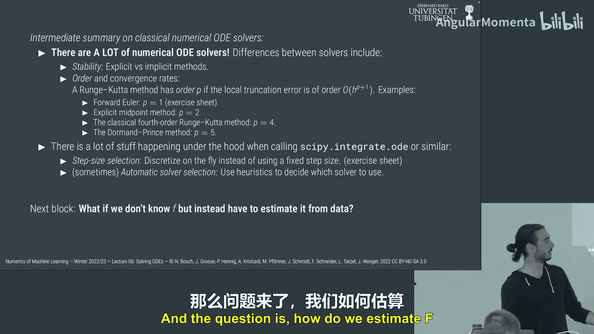

And yeah， I mean， the motivational example from the first flight was this one， basically， so。

When we have。A scatter plots like here with a green and a red。 Yeah， green and red scatter plot。

And we just put on our machine learning heads。 then we do ca fittinging。 We use a neural network。

 or after this course， we use a G。 and we get a very nice interpoulation。

 And then we go to the prior on the sites。 But， of course。

 if we know more about the generating process of this thing。

 Then we can get a more meaningful answer。 And this links together this whole idea of ODs with the problem setting that we often encounter where we just where we just try to fit data。

 And well， in this block， we use ODs as information because it helps us understand the process that did generate the data。

 And we can write down the geneative model and do inference in that system。😊，And in this example。

 I mean， yeah， you've seen flavors of this。 I think multiple times already。

 I apologize for not using the same O D E here as in later slides， It's because in this paper。

 we use a different O D E than another one。 here， it's a so calledled S E IR model。

 It's also an epidemiological model where S stands for susceptible， exposed。

 infected and recovered So we don't model the dead。 We just say if you die or recover。

 you're recovered。Where。You could add a D at the end。 And then， yeah， we。

 we would know how to write that down。And well， it's， it's also quite interpretable。

 It basically says that there's a specific， or there's also a typo， but。With a contact rate beta。

 the end susceptible people meeting exposed people。 You have people meeting moving from here to here。

 So this should be an E divided by N pardon for that so that the mass moves from there to there。

Then with some rates， exposed people get infected and with some rates， infected people get recovered。

 you can also have an additional term that moves people from susceptible to infected directly。

 And if you look that up on Wikipedia， that is the case。

 But I we said the second better to0 in this experiment。 So made it easier to write down。

And the parameter inference problem is basically finding beta gamma and Lambda。

 such that the audio solution fits the data， which well， here is not the case。

 So the lines on the back are generated with wrong parameters and the lines on the bottom are generated with inferred parameters and having a good solution basically means having a good fit through the data。

 but at the same time， also having parameters that we can kind of cross check with， well。

 what we think they should be， because compared to the weight of a neural network。

 we actually know what Lada means。 And if it says that I don't know。

 the recovery rate is huge or super small， then maybe something is wrong because we have some additional information from literature about it。

😊，嗯。Yeah， so it's not just a simulation problem， but there is one hidden in there。

 but it is rather an estimation problem of the vector field F and the initial value。

To write that down， we， well， write down the generative model for the states X。

 And then we will write down the observation model。And the generative model for the states is。

 in general， an O D E where now we have parameter theta entering the vector field F and parameter theta potentially also influencing the initial value。

But all the rest is the same。Which also means that if we know Theta， it's a simulation problem。

 we can just solve it with Do P 5。 If we don't know Theta， then it's not a simulation problem。

 but an inference problem。And the thing we learn Theta from or we want to learn theta from are noisy observations。

😊，So a data set that consists of Y I and T I that are observed as follows。

 So Y I depends on X at time T I for generality in a linear way。 You can imagine this age。

 for example， being。Selecting only the infected people， like in the example above。

 like before we can interpret that we can measure this。

 but this we cannot measure and that we cannot measure。 But this， again， we can。

 So age would be a linear map that maps a four dimensional thing to the last two dimensions。

 like a projection。That's why it makes sense to be in there。And then we assume gosh nice。

And the general goal here for this parameter entrance problem would be to estimate theta from the data。

Which with base rule is means solving this thing。And well， as you know。

 are probably had before doing like actually getting the posterior is not quite trivial。

 There are a bunch of things we can do。 We could use MM C or a plus approximations or something。

 today， we will talk about。K of a sub goal。 but it really compute contains most of the complexity that we need to talk about today。

 which is computing the maximum likelihood estimate。Which requires， well， computing the likelihoodli。

 But the main thing that needs to be done is actually thinking about what this term is。

 we will do that on the next slide。 And since this term also appears up here。

 this is really the thing we need to understand。 And， I mean， we can always add a prior or start And。

 and then think about how to extending and extend this to get the actual posterior。Alright。

 we can write down the likelihoodli because we can write down the generative model。

 And we know that the data here is just， well， a linear map plus gaussian noise。

So the likelihoodli of the whole data is just， well。

 a product of Gaussians evaluated at Y I with mean H times X theta T I comma zigma。Now， I mean。

 it's easy to write down。 And this is actually the correct likelihoodli that we cannot work with that。

 because our fundamental assumption here is that Y I is measured from the true X。

But we spend all this time today talking about the fact that we cannot actually get the true X。

 and we have to， well estimate it somehow。So we cannot actually evaluate this likelihood。

 and we have to approximate it somehow for exactly the same reasons for which we needed to do all the wrongquta stuff before。

 because we cannot compute the true X。So that's a problem。

 But we also talked about what to do in this case。 and at least from the perspective of today。

 the correct thing to do or one thing that we can do is approximating the true solution with an estimate of the solution。

Which is essentially what we do anyways when we call Hongkuta。

 because we take the output and just continue working with that。

And so we just assume that our solver is good enough。嗯。While， of course。

 having in mind that the server makes errors。 So， yeah， if， if you use it with a huge step size。

 maybe this is not a good assumption。um。So， yeah， but。

We can do this approximation and then plug it into our likelihood from above。 We get out this term。

 All that changed is ahead here。 And this term， we can now evaluate and we can actually compute the marginal likelihood。

 the maximum likelihood。😊，Or the likelihoodli itself。 And as you know。

 maximizing likelihoodlilude is equivalent to minimizing lock negative lock likelihoodli。

 And we get basically the mean square error。 in particular。

 if we assume that this thing here is Zigma times an identity matrix and Zigma fixed。

 then it is actually a mean square error。So this， we can compute。

 It's a loss function that takes a parameter and gives us a loss。 And we need to maximize it。 And。

 I mean， we maximize loss functions all the time。 So we'll just do that。So let's look at an example。

 and I mean， I want you in advance， But now we don't have an SE I， R model anymore。 but S I RD。

 the E dis disappeared， which was the intermediate thing between susceptible and infected。

 But instead， we started counting dead people。We have a time span。 We have an initial value that is。

 that has a free parameter。 So we say that the number of infected people in the beginning。

 we don't know。 So we need to estimate it。And we have a non parameters， beta， Gamma and Eta。

 where beta is the contact rate。I generated a data set by while choosing some parameters and then simulating this model and then taking noisy samples from it。

 Not also that this will not be estimated。 It will not be part of the loss， but it totally could be。

 like we could estimate a noise term just that here， I didn't。And the true parameters are， well。

 a very low number of infected people in the start。 And then， well， some contact rate， gamma and Eta。

If we have this， we can also start writing down a loss。

 This is exactly the thing from the last client。 It's a mean squared error。 And there's the 0。

1 coming from up here。 doesn't really change much。 Sam as this half here。

But we can implement it and we can evaluate it。And then， well， if we want to optimize it。

 we start with some initial guests。This is a very bad one because it's odd S of magnitude wrong here。

 And yeah。And if we plot that initial guess， we also see these。

 You only see three lines because R And D are stacked because those two numbers are the same。

 but it's a very bad fit。And what the loss does is given the parameter guess。

Computing the approximate solution。 So these lines and then computing the L 2 loss， which means。

 well comparing this line to the scatter plot and that line up there to the blue scatter plot down here。

嗯。And now we can run an optimizer。I mean， it's， it's an optimization problem。

 So the question of which optr to run is similar to in general。

 And I think there will be time dedicated to that in this lecture。 I used LBFG S because it worked。

 And well， when we run that。We see how it iterates， and I take a bit larger steps here。

 And at some point after 150 iterations， we have what visually seems to be a perfect fit。

But the cool thing is that。We don't just care about fitting the data and seeing that the lines are fine。

 but we get an output that we can actually interpret。 like from this problem。

 we inferred that the number of infected people initially was 10 to the -5。I mean。From， okay。

 where the population goes from 0 to 1。 So scale it with the population come to get an natural number。

 We get a contact rate of 0。5。 We get a recovery rate of 0。06， and we get a death rate of 0。002。

 And these numbers we can interpret。 We can compare with literature and so on。

 which is why it's pretty nice to not fit this with。😊，Just a neural network or even a G P。

 even if like we， at this point， don't get uncertainty out。 we get something that we can interpret。嗯。

Alright。 so this is in general。 And， and， I mean。This thing I explained here scales to or the strategy is also how to solve parameter inference problem in more complicated settings。

 It's really about。Having an estimate for the dynamical system with some free parameters。

 having the data and then constructing the loss where internally， it uses your an audio server。嗯。Now。

 we come to an example that once more， you know， from the very first lecture。

 but in the very first lecture， you saw a solution that we don't yet know how to do。

 So we'll do something else。嗯。But the motivation in the very first lecture was that we take the S IRD model from the last slide。

And if we compare that to actual covid data that is from here， like the the black dots。

 then we see that the curves from here would probably not be a good explanation for it。

 And even if we just look at this model， it's because the model itself would also not be a good explanation for it。

 And one way of making it better is， for example， to make the contact rate time varying。

 I think that is still a very reasonable assumption by from my experience。嗯。

EIt's still only a model because， I mean， it still only tracks。 like。

 has these four categories and so on， so。I'm not claiming this is the model。

 but we made it more complex on one specific point。 And so the question is now。

 how can we do parameter inference with this slightly more complex model or quite a lot more complex if we make something continuous instead of。

Just the scaleum。And what we've seen in lecture 1 is that， well， by the end of next lecture。

 we will end up with this plot where we find a beta that is time varying and that gives us an estimate of the contact rate together with an estimate of the states of the solution。

 which has a good interpolation and with uncertainty estimates。

We don't have the tools for this today。 So this is the motivation。

 this is the motivation for what I'm going to show。We do， however， have the tools today to。

Just model Bta of T with a neural network and do parameter inference on the neural network。

I'm not claiming this is， the smart thing to do。 And as you will see in the results it。5呀。Doesn't。

 doesn't give you something as nice as here。That， like， in principle， we have the tools。

 So the estimation problem is one。Where for this Covid data here。

I assume that gamma is known and Eta is known， so we don't estimate those anymore。

 We just take them from literature， which is also what what was done to get this plot here。

And all the parameters that we need to find are the parameters in the neural network here。

But we can still write this loss function that takes a parameter and maps it to something。

 And what it does is basically given a parameter， solve the O D E computes an L 2 loss。

 and then try to minimize that。嗯。And as the， the difference in quality of this plot in this plot shows。

 I prepared this for this lecture because it seems like the thing to do in order to explain what happens here。

So， yeah， it， it could have been a nicerpl。We have S， I。

 R and D if in four different plots because they vary so much in scale。

 But I wanted to look at all of them， not only I and the scale the first。

 is's why all of those numberss on the left。 And the thing I cared most about is beta。

 which is why it takes up so much space on the right。

I will show an animation on how it looked in my experience to try to train this thing。

 And you will see that。Well， it kind of works。 O。 I used， I mean。I'm not。

 I'm not a deep learning guy。 I don't really know how to choose neural networks， so。I。

 I choose chose hyperpara after trying around for a while in preparation for this lecture。

 I try out optimize us in preparation for this lecture。 And I get to something that is。I mean。

It's not comparable to the fit that I had with the G P stuff。 but I mean。

 it gives us the two bumps here and here。 it fails to fit all of this complex part over there。

 but it， and it gives us a contact rate。It's way less beautiful than if we would have uncertainties all around them。

 And it's way harder to interpret。But it's a point estimate for a contract rate。And。

And at the same time， I say it's hard to interpret。

 But in neural in the like we're using neural networks， right， And like typically in neural networks。

 things are hard to interpret。 And here we can plot the line and we know what it means。 So like。

 compared to neural network stuff。 This is super nice to interpret。 It's just that， Yeah， I don't。

 I don't actually know how good this contact rate is and how well it explains the actual contact rate that we would have observed。

 Also like。😊，If we。Yeah， I think kind of stops at some point。 I just ran it until a conversionver。

 Like， so it's an optimizer。 That's line search stuff happening。

 which is why sometimes it's faster and sometimes it's slower。 Yeah， and this。

 this is the final result。So， yeah， it's， it's okay。 but it could be better。And in particular。

 maybe one thing to mention is that。Like， so this was the result。And here on the left。

 there's a peak happening。And the question is， so if we try to interpret this， then basically I。

 I would be like wonder about what's going on here。

If we compare that to the other result that we have， then。Until January， April。

That would be from here to here。AndThis thing is completely uncertain about everything。

So maybe I should not spend half an hour trying to interpret the speak。

And the reason for why this thing is uncertain is also， like， we can interpret this because if。

The numbers are low。 there's the typo。This E should be an eye。 It moved from one side to the other。

 So if the number of infected people is small， then this gradient is small。

 There's low change and basically better influences， basically nothing， because。Like。

 if you multiply a very small number with something。

 then it doesn't really change much if the something is big or not。

 And that's kind of why there's so much uncertainty here for beta。 And also here， because here again。

 infection rates as well。Whereas in this plot， like， we don't really get that information。

 And like kind of a drastic change to double contact rates， so。Yeah， but again， the big disclaimers。

 I did this in preparation for this lecture。 conceptually， I think this is a valid approach。 I mean。

 with all the pros and cons that you have when you use neural networks by doing exactly this。

 you do not get uncertainty quantification。 But as I said before。

We talk about maximum likelihood estimates because that's the hard， like。

 that's the thing where we need to and like that we needed to learn how to do。

 But if you have likelihoodlis， you can add prior， you can start sampling and so on。

 not claiming that this is the best thing to do in that context， but。You。

 it's not impossible to add uncertainty quantification and still do conceptually this switch is using a neural network or another parametric model。

And this is actually， like I gave you this code。 and you can see that on Eliliaas。 and you will。

 you can play around with that for the exercises this week。😊，And yeah。

 so what we will do next week as a final thing to come up with is this。 So because。And we。

 we had so many lectures on GPS。 and they have， well some， so many things that I just mentioned。

 like about the uncertainty and what's happening on the left would also be solved by using another class of models。

 which might be in particular， very helpful because we map a scalar to a scalar and。

It's not a very common neural network task。 Let's say， but it is a common。

 Like we saw many plots where we did exactly that with the G P。So。

That might be the more natural choice。 And we actually can do inference。

 And that's what we're going to do next week。

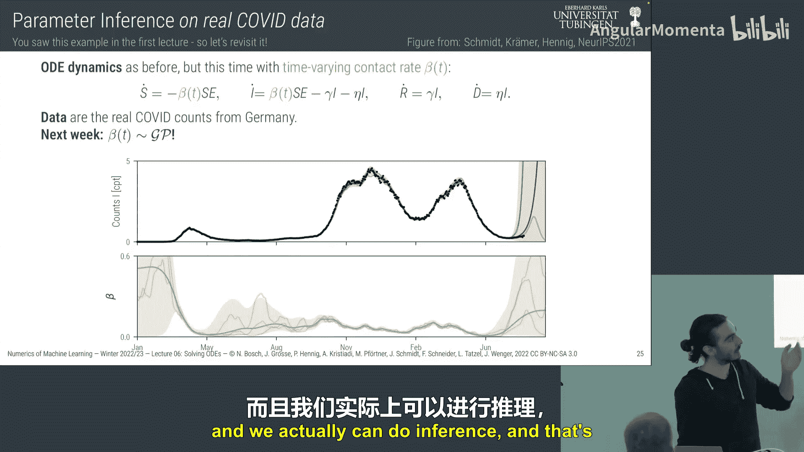

So， with that。We are at the end of the lecture。 We saw well。

 we talked about O Ds in general and saw some examples in machine learning。 And I hope again。

 that I gave enough examples that you see that like in core machine learning research and papers that are submitted to conferences right now。

 like two weeks ago， I reviewed papers that had O Ds on them again， as always。

 And so OD Es play an important role in machine learning， like in core machine learning papers。

 But also when you start applying machine learning to like real world problems in the real world。

 you often have stuff to write down because you did actually think about the problem before calling your machine learning algorithm。

😊。

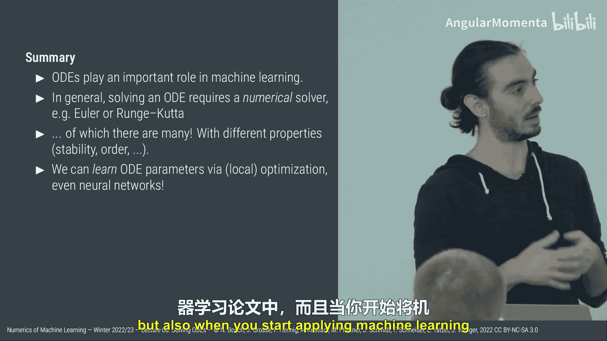

嗯。In general， solving OD is nontri。 That's why we had like one hour talking about numerical solves。

 And we kind of only scratched the surface。 but we've seen a bunch of examples。

 And I hope you got a better feeling for how like the difficulties that arise and the complexities they are。

 for solving Os with a computer。And well， we can， in we cannot just simulate O D。

 but we can also learn O D and their parameters from data， which again。

 I think is particularly interesting in the machine learning context。

 even when there are neural networks in there， I be one final mention of something like。😊，The。

 the way to be more general zoom out more is like at this point。

 you know what neural O D are and how to solve like how to work with them， basically。

 because in the neural OD context， the difference is that you don't assume structure because maybe you didn't think about your problem before。

 And you just make everything in neural network and try to train that But conceptually。

 it's still like， it's basically the same loss function and the same training procedure。So， yeah。

 there we go。 neural Os。Allright。 so that's the end。 Next week。

 we talk about probabilistic numericalital load server。 So for the first half， same problem setting。

 but different point of view because we know about probabilistic state estimation。

 And so we want to apply that。😊，And then at the end， we do prim inference again。So thanks a lot。

 Please fill out the feedback form。

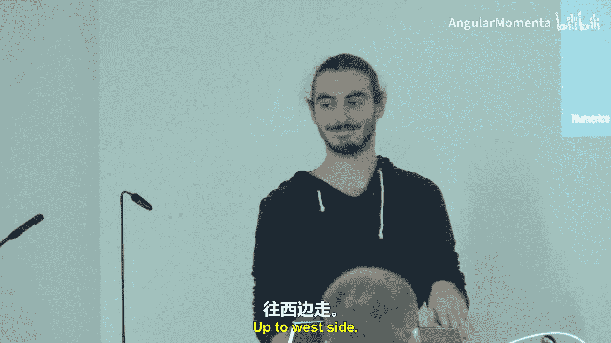

