# 【精译】蒂宾根大学《机器学习中的数值方法》-p07-7-——-概率数值常微分方程求解器-——-纳撒尼尔·博施--BV1WMYHzAEcL_p7-

。

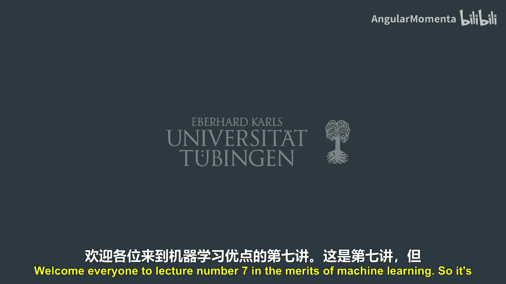

Welcome everyone to lecture number seven in Numerics of Machine Learning。So it's lecture number 7。

 but it's also lecture number 3 on the block of simulation。 And so this is the third one in that row。

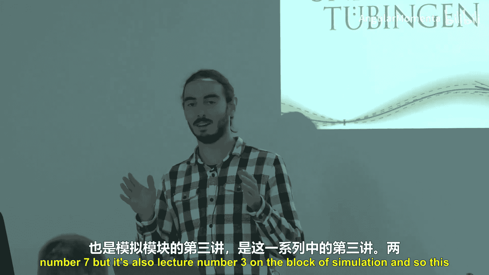

嗯。It started two weeks ago with Jonathan that told us about state based models and introduced a language to describe dynamical systems。

 but in a probabilistic way。 So we have。Well， there there's。

 we have an estimate for a state and how it evolves over time。

 And we also have a language to describe an observation process that depends on that。

 So the point of view is one where theres uncertainty involved in the evolution and in the observation。

 and we try to reconstruct the state。And the specific tools that we talked about are common filter as and smoothest or extended common filters and smoothest for nonlinear problems。

Then last week we also talked about dynamical systems。But with a very different language。

 and we talked about ordinary differential equations。

 where the point of view is not really anymore that we have a state that evolves in a probabilistic way and an observation process。

 but it's kind of a like very precise way to formulating that we really know how the state is going to evolve with a differential equation。

But then the problem is that when we do that， we still have like。

 we want to answer the question of what is the state then， given this differential question。

 And doing that with a computer suddenly is difficult again and still does estimation。

And we were only able to get algorithms that do well， solve OD Es approximately。And so today。

 we combine those two ideas。 We will look at ordinary differential equations and ways to solve them。

 But through the lens of patient state estimation。And so this will be the biggest part of the lecture and the main part is looking at ODEs。

 interpreting them as state estimation problems and then solving them as state estimation problems。

And by doing that， we get probabilistic numerical solvers because the algorithms that we use are。

 well they give us distributions over the state or over the audio solution。

And so the output is strictly richer than from a classic server， but we will see that in the lecture。

Before I start with the actual content， I will have a one slide recap for each of these topics。

 The first one is numerical ordinary differential equations solve。 So the stuff we did last week。

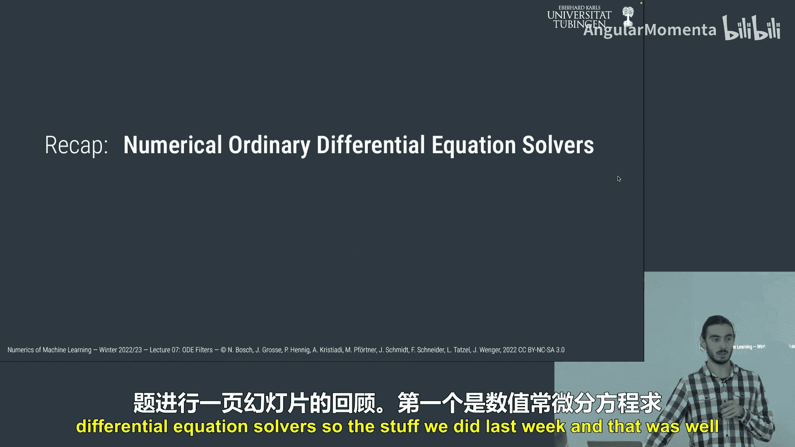

And that was， well we looked at differential equations or ordinary differential equations。

 which is this equation in the middle and big。Which describes the derivative of x。By， well。

 some vector field F that well， can be easy in the examples that we looked at。

 but can be hard in practice。And then vaguely speaking。

 when you are given an ordinary differential equation， the task is to find x。 Well， where。

 and then you use an American algorithm in order to simulate starting from x 0。

 But it's kind of like there， there's a mismatch between this task of finding x and the thing we actually do。

嗯。And one example that popped up last week。 and we'll， like we will look at this a lot today again。

 it's the logistic O D E。 That's one of those cases where the the differential equation is quite easy because we can actually solve it by hand。

 And that makes it nice for us to evaluate the methods we have。😊，And while visually speaking。

 the problem statement is basically we have these arrows on the back， which are the vector field。

 So this F。We have the blue thing on the left， which is the initial condition。

 And we want to find the black line。And then last week， we looked at numerical methods that do that。

 And well we looked at these three， well the first two are methods。

 And the third one is a whole class of methods。But each of them had the approach that we have some estimate at some time T。

 and we want to compute an estimate at time T plus H。 And we do that in a specific way。

 And the simplest one we could come up with is forward Eer。 Similarlyly simple is backward Eer。

 But there's the tricky implicit part。 And then the explicit one Qta methods。

 got if you recall these butts have low， they get well， way larger and more complicated。

 but conceptually， it's the simple formula。 you just need to define what B I should be C I。

 And then there are these other A's hidden in the ex in here。

But so there's a mismatch between what we do and what we want， because I said we want to just find X。

 And what we do is we call it X hat now， because it's wrong。 So fundamentally， these methods do。

 they try to find a quantity。 They cannot find the quantity。 So they approximate it。

 or when we switch up the vocabulary a little bit。 They estimate the true solution。

 and they provide a single X hat as an estimate。And they don't just estimate it like randomly。

 they estimate it by， well， from some information， for example， by evaluating the vector field。

 So you evaluate the vector field， and thereby you update or you extend your estimate to a future time point。

 And that's the point of view that we will have today。And estimate really means there's an error。

 And the error depends on the step size。 I think we've seen that last week also。

 So if we make the age small enough， then the solution gets better。

 if we would be able to make the age infinitely small， then we get the actual true solution。

 but we cannot。And while， depending on the age， we have either a very noticeable error。

 As see on the top here in the middle， we still see it here on the bottom。

 We cannot see it anymore in this plot。 but theres always some error somewhere。And so fundamentally。

 numerical loads of us try to estimate a quantity。 They， they will be wrong。 Also。

 So they will never be completely correct about the thing they return。 There will be an error。

 and they estimate X by have using some information。 in this case， evaluations of the vector field。

And this kind of once more sets the whole motivation for。 Well。

 when we see that numerical Loisa must do estimation anyways。

 we might want to frame it as an estimation problem and solve it as an estimation problem。

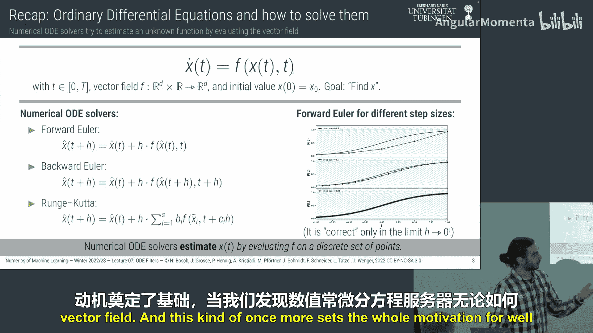

And the tool we use is exactly what we did two weeks ago。 patient set estimation。

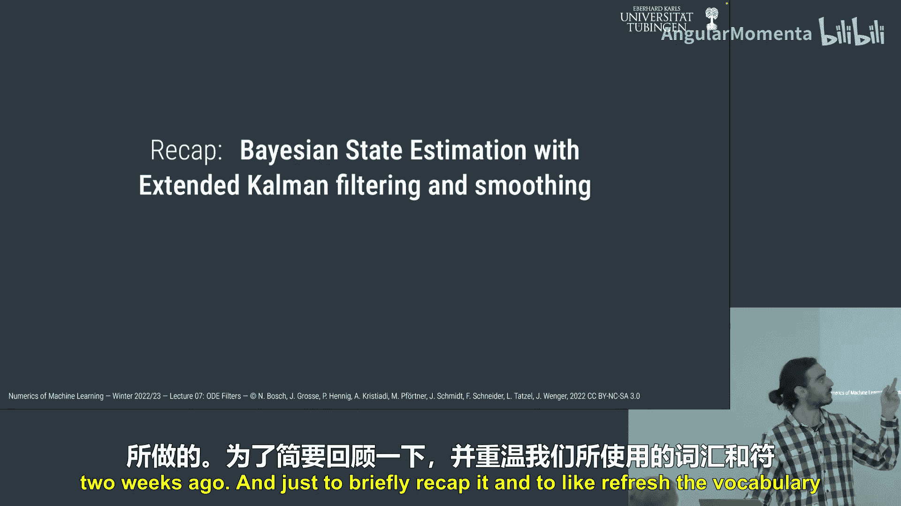

And just to briefly recap it and to like， refresh the vocabulary and the notation that we had。

We looked at nonlinear Gaussian state estimation problems。Where X is the state， the lowercase X here。

 and y are observations。 And well， we first write down kind of a geneative model of how we think X and Y behave。

And we do that by specifying an initial distribution and a prior or dynamics model that describes how x evolves over time。

Then we specify a likelihood or measurement model or observation model sometimes that explains how y depends on x。

And then we are given some data。 and the task is now to do inference， which basically means， say。

 well， describe what we think X is， given the fact that we observed some data。

 And there were kind of for。 Well， two subtask， two tasks that we looked at last week。

 But then there are like two more things hidden in the algorithm。 basically。

 we have the filtering distribution that we looked at a lot。

 which is basically estimating the current states， given all information that we have access to right now。

And the smoothing posterior， which was estimating X given all the data。And then well。

 to get to compute these at some point， we do compute these prediction estimates。

 So basically estimating a future state given current information。

And there are these likelihood terms hidden in there。

 which gives us an estimate of the next observation that we might see。

 And these quantities on the right， we can compute with quite simple algorithm。

 So the extended command filter and extended command smoother， which have some， well。

 the building blocks of a predict step and an update step。 we don't need to go through the formula。

 But it's quite nice to see that the predict step is really a two line thing and the update step is a five line thing。

 you could even make it less， of course， and just make things less realable。

 But it's conceptually quite a simple algorithm and simple to implement。😊。

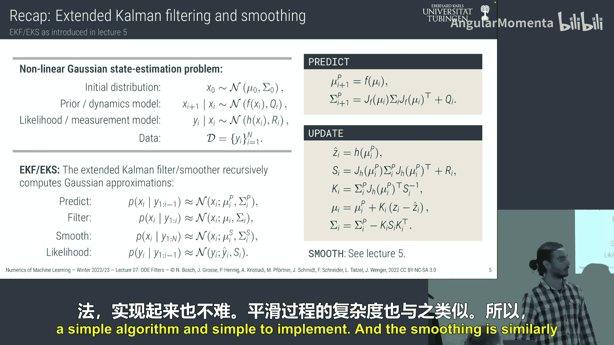

And the smooth thing is similarly complex。And so。Yeah， I said it before。

 and I will repeat this quite often today， but we combine these two approaches。

 So we combine the methods from the last slide that we saw in order to solve the problem from the first slide to get probabilistic numerical O D solutions。

😊，And one motivational quantity is this one， because that kind of describes the kind of thing we want to have in the end。

And it also shows you how to phrase the numerical O D E solution as an inference problem。

Because instead of saying that we want to find an X that fulfills the OD everywhere。

Which we cannot compute anyway。Might as well specify the thing that we might be more likely to compute。

 And that is， we want a posterior of a x of T。That satisfies。 Well， the initial condition。

 because we look at initial value problems。 So we want x 0 to match the given initial condition。

 The x subscript 0 is given。And we want to fulfill or satisfied the O D E。

 But we relaxed the whole thing thing and satisfied only on a discrete set of points。😊。

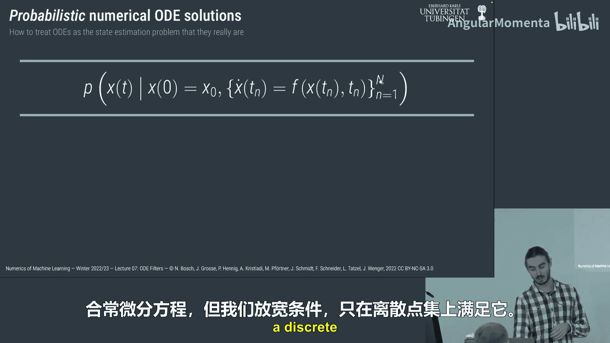

And the motivation for that， maybe go back again。 Like we only evaluate the O D on a discrete set of points anyway。

 So all of these methods that we looked at， like we always go from T to T plus edge。 in some sense。

 we never look at the continuous thing or condition on the continuous thing。

 which is why we make it part of our problem statement to say well， given the disctization。

 I want an estimate of the output。

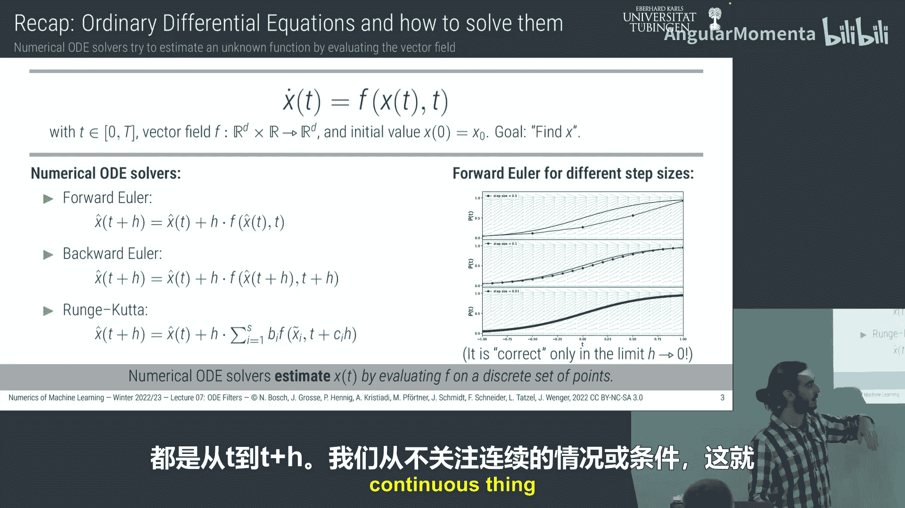

And because I told you that we are going to use the stuff from two weeks ago。

 while that motivates the fact that we want to do Gaussian filtering and smoothing。

 And the reason for that is， of course， not only because we did it in the lecture。

 but because it's a fast algorithm。 it gives it， it does inference in O of n time。 And well。

 Hong Kta， that's the tool。 So we want to be a bit comparable。😊。

And in order to end up with something where we can do Gaussian filtering and smoothing or extended kman filtering and smoothing。

We need to construct a state space model。Because， well， you， as you've seen on the recap。

 once we have the state space model， we know what to do。

So the main job will be to build up a state space model that once we solve it。

 gives us a quantity of this kind。And for that， we will need to define a prior model。

 a likelihood and data model， or like a way of informing the state。 And once we have that。

 we can do inference。

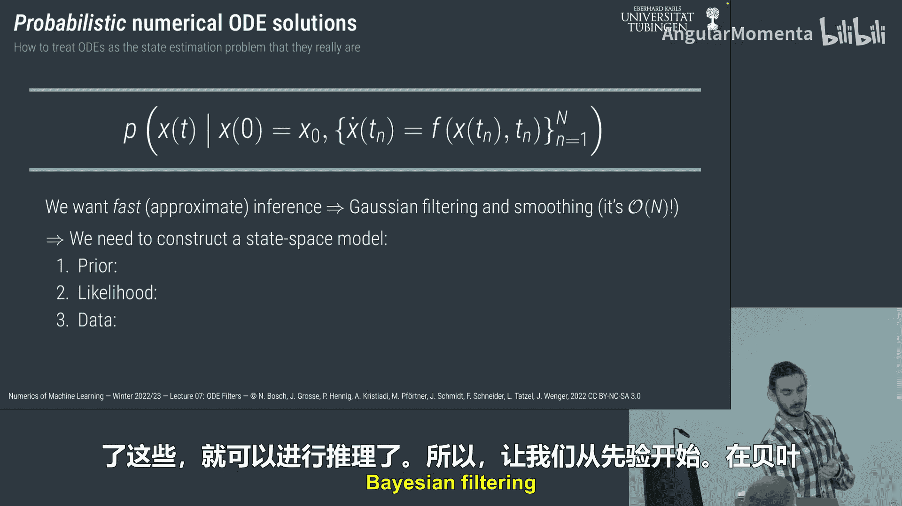

So， let's start with a prayer。嗯。And。Well， on the Bayesian filtering and smoothing slide。

 I used this lowercase X to describe the state， and I also used the lowercase X in the O E context。

 But in some sense， let's still ask the question， what is the state actually that we can consider。

 And well， just using this well， lowercase X through O D solution doesn't satisfy the thing We wanted the state to be two lectures ago。

 I think on the slide， we have something like a quantity that fully describes the dynamical system。

 And just having x of T is not enough。 That's like you take the logistic equation。

 It's a single point。 It could evolve in any direction。😊，But like one thing that would， would。

 if we could fully describe the thing， would be to have X of T and all derivatives。

Might be infinitely many。 but we've seen Taylor series expansions last lecture and two lectures ago。

 So I hope these are familiar。 But basically here， the the point is really。

 like if we had access to x of T， it's derivative root， and second derivative root and so on。

Potentially like an infinite sum that it it's annoying to work with。 But if we had those。

 that would fully describe the system。And。Well， once more。

 we do truncate the tail lake series expansions。 So we want something that is very informative。

 even if it's not perfect， which we can get when we truncate the whole thing。

 we only track the first Q derivative where， well， x superscriptd 0 means the0 of derivative and so on in this notation。

😊，Which introduces an error term。And now I will get a bit vague for the rest of this slide and then very precise on the next slide again。

But in some sense， the， the prior that we had two weeks ago what was always like a probabilistic thing。

 right， There was uncertainty when you go from one step to the next。

 And that is really motivated from this term。 Like， if we would do this approximation。

 then there's an error in there， which we don't know。 if we only do this approximation。

And so to get a probabilistic model basically means， well， this error is now a random variable。

 And suddenly we have a transition model that I will write down on the next slide。But so the。

 the goal here is really to find out what quantity can we use as a state in an ordinary differential equation。

 And like my claim here is that tracking Q derivatives is good。

 And then we have an error term that we can describe。So that is the state。 We will， like。

 instead of just looking at x of T， we will look at x of T。 It's derivative。

 It's second derivative and so on up until the Q is derivative。Q might just be one。

 Then we have a lot of noise in the， I will show some code later where all we will track the first two derivatives。

 So it's not like we want 100 derivatives or something。But， yeah。

 by tracking a limited number of derivatives， we get to a probabilistic state model。Alright。

 that's the motivation。 But the notation doesn't yet match what we did two weeks ago。

And so I give you something that does match the motivation， the notation from two weeks ago。

 And well， that's on this slide。 The thing I just described as a name。 It's， it's a。

 sarcchastic process。 It's a so-called Q times integrated Vna process。

 And there's a bit more history to this thing and a bit more context than we have time to talk about today because it's actually a continuous thing but we will work with it in discrete time。

 so that we can apply all the tools from two weeks ago。😊，嗯。

So we have this uppercase X that I will use now whenever I talk about the stochastic process that has a structure that goes from x 0 to X  Q。

 And to be a bit more preciseci， I I replace it now。 Like， I don't write the lowercase X anymore。

 because the lowercase X we don't know， right， That's the true thing we would like to find。

 But the uppercase Xs here are now the random process that we are currently defining。

But the idea is that， of course， this random process is supposed to model the true solution。

This Q times integrated Vna process prior， this one specific process that I motivated and that we will choose to do today has transitions of this form。

 I think the most interesting line is maybe this one， which says that if we have x at time T。

 we can get X at time T plus H with a Gaussian model。😊，嗯。

Which is actually linear because we multiply some matrix A of H with x。

 and we have some covariance matrix Q of H。And the Q times integrated V process。

 apart from the Taylor series approximation motivation。

 is also quite convenient because this a of H and  Q of H are non encloed form。

 The formulas look a bit annoying。 but like they are， you can implement this。

 and you can build up these matrices。 So it's actually quite convenient。😊。

And so this object is not something that we can work with and that we will。And the A H of Q H， Yeah。

 I told you they like the formula looks a bit annoying。

 But when you look at the thing in two dimensions， then suddenly it becomes quite structured。

 And A H is this upper triangular matrix with well， actually only diagonal terms。

 So once everywhere here， H H squared half， which might remind you of the Taylor series coefficients。

 And that's where H A comes from。And Q， H well has a similar structure， not the same。 But again。

 like written like this， it's quite easy to write the code for it。

 And we will actually see the code for it。Alright， so this is our prior model。 We can plot it。

 So this is the， okay， maybe before I showed the plot。

 it's a two times integrated Vna process prior because well， we track two derivatives。 and so。😊。

The second， yeah， maybe it's better with the plot。 But the thing on the right。

 you see A H is a three times three matrix because we track the zero derivative。

 the first and the second。 So it's a three dimensional thing。If I plot this process， X of T。

 then I get these three subplots， basically。 like here， I think there are five lines in each or 6。

 And then well，5。 So this， these are five draws from the process I defined。

And maybe that visualizes why it's called a two times integrated wena process。

 because the second derivative is a wena process。Which you might have heard before。

 Maybe you've heard Brown in motion before。 It's the same thing。 So this is this， we had random walk。

If you integrate that version， you get these。 and if you integrate that one。

 you get the top plot or going the other way around。 If we take the green line from the top plot。

 we take compute it' derivative。 Then it is actually this green line here。

 If you compute its derivative。 Then we get the well， not so nice line down here。And， well。

 that is why it's called a two times integrated Vna process。And if we draw more samples。

 then we maybe get a better feeling for， well， its statistical properties because at each point in time。

 it's actually a Gaussian。 And again， like， we will not talk about it as a continuous object a lot。

 But just so like you have the reference， these are Gaussian processes， actually。😊，So they。

 they satisfy the properties of a Goian process， and they are Markovvian because we have this。

 So it's so calledled Go Markov process。All right。嗯。And then。

Maybe one other thing to mention at this point， because we will need it later。

 if we have the whole stack capital X， then accessing， well， for example。

 the first derivative is very easy。 It's basically just looking up the correct entry。Which， well。

 instead of implementing as a slicing a nu or something is like a multiplication with a projection matrix。

 So accessing an entry is a linear operation。 So it's very convenient to give them this whole stack。

 access the first derivative， second derivative or something。 And we will need that in a few slides。

😊。

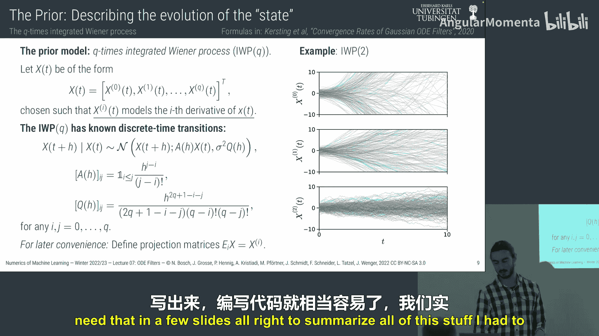

Alright， basically to summarize all of this stuff I had to define here， we found we。

 we defined a prior that we will work with。 And it's the Q types that integrated Venna process prior。

 And it's nice to work with， because we can write down these transition densities。

 which we need to do gausian filtering and smoothing letter。

 and it's convenient because A and Q are given in closed form。😊，And so the other part that we need。

 it's two bullet points formally。 But like conceptually， it's really the same。

 And we will see why the other part is this likelihoodli and data combination that will inform the prior so that it actually does the thing we wanted to do on the top。

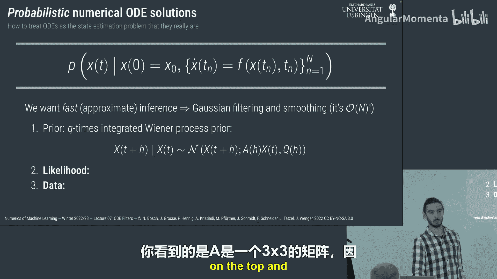

And to get there。We will look at the O D E again because， well， unsprisingly。

 we didn't use the OD yet。 And so the other half of the states problem of the state space model。

 then probably has to included。And so we will define a likelihood model and data motivated by the O D E itself。

And well， the thing we were given in the very beginning was this ordinary differential equation with the lowercase X and the goal that we want to find X。

 And that's the perfect thing we want， but it's intractable。Now， we define this。

X of T process in the last slides。And the motivation for x of T was that it should model the thing we want to have in the end。

 And also， I said that X 1 is a derivative of x 0， and they all correspond to one of the derivatives that we want to model。

And so using the language of the thing we just defined。

 the equivalent statement to solving the O D would be that we want our process to satisfy this equation。

If it does， then it also solves the O D。嗯。And then well。

 we can reformulate that to put all the access to one side and define a measurement function。

 or sometimes also called information operator that well takes X。It is defined in the following way。

 and it should be 0。This is the ideal thing we would like to have in a perfect world where we have infinite compute。

Now， we already talked about discritization。So we already relaxed the goal a few slides ago that instead of trying to solve it everywhere。

 we try to do things on a discrete grid。 And so the requirement basically becomes satisfying this O D E on a discrete set of points。

😊，Or equivalently， with the thing we just define， that means that we want。

M of x now evaluated only a discrete points T I to be 0。And like conceptually， this is really。

 it's still kind of a thing we want， right？ That's the information that we have and that we。

Want X to satisfy。 And the tool that we use not to make it satisfy the thing is by making this an observation model or measurement model or maybe even information model。

 and then doing inference。Into slideleds。But so this quantity motivates a likelihood model。

In the following way， so。In the statespace model description， I had Ys。 Now， I use these。

 I will say why in a second。 But we have this observation Z。That the conditionally on X is given by。

 well， a Gaussian where basically we use this measurement function that I defined above。

And we have data， that says that。This thing is actually 0。And0 is precisely the reason why it's a Z。

And so it's really like， this is the desired thing。We define this observation model。

 And then in the inference， you will see why this actually helps us satisfy the desired thing。

I introduced one thing here。 I don't know if you realize but there's an R。嗯。

There's actually no reason for an art to be there because like。

 there is no noise in the measurement process。 We defined this function。

 like this measurement function above exactly。So there's in our problem setting。

 there's no reason to assume that F gives us something random。Also。

 there's no reason to assume that we don't actually want to satisfy the O D。

 We do want to satisfy the O D exactly。 So there's， there's no noise on either side。

 So it's actually a noiseless likelihoodli model， which more formally would be a the likelihoodli。

 though this one is actually quite convenient because if you do。

 if you have the Kman filter update in mind， there's an R somewhere in there。

And set like just plugging in the 0 does the correct thing。

 So that is actually what happens when you condition on a D likelihood。 You just like in your code。

 you really plug in the0 as， as observation noise。Alright， so again， we define a lot of stuff。

 and this likelihood model。 The good thing is we can have a look at it and like。

 get a better feeling for the thing I just defined here。😊，Like before that。

 I defined a prior for the X and how it evolves。 Now， I defined a generative model for a Z。

And so we can look at it the same way as we did look at the prior。 I can draw samples。

This time for X， I just used the once integrated genome process。

 which means that x 1 is a Wina process， and x 0 is the integrated aversion。

 I mostly did that to save some space。😊，And Z of T is defined in a specific way， right？

 So the concrete example is， again， the logistic O D E。And for this given O D E。

When you well plug in the O D E in on the left hand side everywhere。

 then Z of T is basically defined as x 1 minus。 So Z of T is x1 of T minus x 0 of T times 1 minus x 0 of T。

And that is like， that's literally how I computed these lines。 I take a line from here。

That's the X 1。 And I subtract a line from the top times 1 minus the line from the top to get these sample draws。

So this， it's a generative model， and we can， we can simulate it。Now， the question， I mean。

 maybe to understand why we did all of that， let's look a bit deeper at the solution and how that relates to the whole inference stuff。

I can plot the solution in there， too。 and we don't really see much because I'm zoomed out a lot。

 So if I zoom in at the solution， then we see， well。

 the standard logistic or E solution that we know from all the slides。This is the correct derivative。

 We can also compute it in closed form for this O D， E。 That's why we look at it。And then Z of T。

 like， if I take this black line minus the black line on the top times 1 minus the black line on the top。

 then I get exactly 0。By construction， because the encodes the fact that the。

 that the X satisfies the O E。 So it's， it has to be 0。 But maybe seeing this again。

 like explains why we have a noiseless measurement model。

 This line doesn't wiggle around the 0 or anything。 It is， it's actually 0。

 If you give it the true solution。And now， like looking ahead。 So this is our generatorative model。

 And now looking ahead of what the inference process will do， the data lies。 well in this plot。

 not in the other ones。 It's in the space where the z lie。

 And it's kind of a discriscratized version of the Z。

And then the thing we will do next and in the cold and in the homework is basically going from the generative model to a posterior。

 which basically says we want this thing to collapse around the Z。 It's not perfect。

 It's approximate inference。 And by doing that， we also get estimates for the X。

 And we see that they relate to the solution。So I hope that this like clarifies why we go through the trouble of setting up this generative model in this way。

Because it allows us to go from here to here。And the thing we get out is kind of an audio solution。

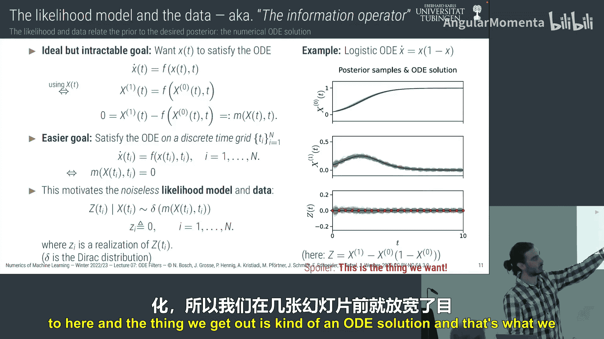

And that's what we will do in a bit more detail on the next few slides。But basically。

 so there were two parts。 We defined a prior in a specific way。

 which well is the the Q times integrated venna process prior。 It's a class of prior in some sense。

 because there's a queue that we can choose， but I didn't give you like the most general thing that we could work with。

 But this is a very general way to， So like to do these things。

 Then we have the likelihood model that encodes the differential equation。

So this is the object that relates the prior to the thing we want to have in the end。

 this likelihood model and data combination。And， I mean， the data， they are， they are just zeros。

 right， But in order to really get to this language that we introduced two weeks ago。

 we have to define all these quantities so that we can do inference。

So that is actually the main part。 So we wrote down a state space model。

 and we can now just solve it。

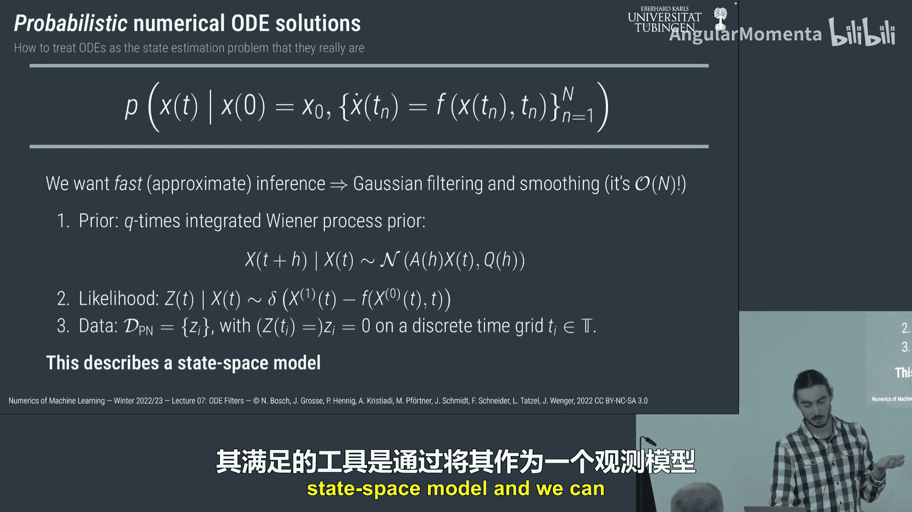

嗯。Yeah， there， there will be so many of these things in this lecture。 So let's look at it again。

 So that's like the whole thing。 I think I didn't talk about the initial distribution。

 but you can just use a zero mean standard covariance， Gasian。We have a dynamics model that I define。

 We have a liket model or information model that encodes the O D E。 So that depends on F。

And we have the data。There's one thing I didn't talk about and that we still need to do or to add in order to actually solve the problem that we are given。

 Does anyone see what's missing。So the only information that we include right now is the ordinary differential equation。

But there are many solutions to an ordinary differential equation。

 So there's one additional piece of information， yes。Exactly， we're not using the initial value。

 Thanks。 so precisely， that's it。 The initial value is missing。And so the question is。

 how do we include this initial value， I skipped it earlier， basically。

 because I think this is the more tricky and more interesting part。

How can we include the initial value。Yes。We may be setting mut to the initial value that does actually work。

 and is a sensible thing to do。 There's a more general way to talking about it。

 And it's like it results in the same because it's a noiseless observation model。

 But this really drives the point， like motivates once more that like observation models or like information models。

 maybe even the the object that allows us to like define the things we want。

 And we will do that a lot。 So the way we can include the initial values by just defining another measurement。

😊，That depends only on x0。So on X， the the full stack of all the derivatives that we track。

 it actually evaluates only the 00th derivative。 And the data point we have is the initial value itself。

And because it's noiseless， it's kind of setting it to the correct value， only in a formally。

 a bit more precise way。So， yeah， it was like super easy to give a model。

 just add one more thing we want。嗯。Allright。Okay， so on the next slide。

 I will write down some pseudo codes of the extended K audio filter。

 There are building blocks that we need。 So for completeness， I define this Kman filter prediction。

 and the E KF update is the same equations as we had in the like second actual slide。

 I think only that it's pseudo code now instead of equations。We also use a kman filter update。

 but it's the same only that， like if computing the Jacobian Australia。

So these are the building blocks that we need in order to implement the extended common audio filter。

 And then the algorithm itself is given like by this。Let's go through the landbe line， so。

It's a procedure or a function that takes in basically the statespace model that we've wrote down before。

 which well has different blocks， which is， well， the initial distribution mu 0 minus and Zigma 0 minus the transition model A and Q。

The vector field and the initial value， which implicitly defines an observation model。And then。

 time theization。And then the algorithm， well， first does this initial value。

 because while we start at time 0， and then we have this， we need to satisfy the initial value first。

Which is a Car filter update。 So that maybe that explains also why we have mu 0 minus and sigma 0 minus。

 because while there is an update that we do first。

This E 0 is the linear observation because I defined E 0 to take the state X and map it to its0 of entry。

The this0 here is the observation noise， which is 0。And then we have the data point x 0。 So again。

 that matches the notation here on the right。 If you go through the slides again at home。

 then I think these things should always match the things I use here。

And then inside the filtering loop， this is just the standard filtering loop because there's a prediction and an update happening。

 The prediction uses the transition model。 And， I mean， A and  Q depend on the step size。

 The way I define them。 So the line before， we need to well compute the step size。

 and then the E KF update has this。 well， not does not have observation noise。

 And the data point is also 0。 then I had to define this measurement function in order to kind of hide the T because otherwise。

 it doesn't formally match what I did on the slides before。😊。

And then we just returned the whole thing。It also， like， I think I hope that from this description。

 like just。Doing the extended command order is smoother。 It's kind of straightforward。

 We take all of that， and we smooth。And then instead of returning the filtering Comp filtering distribution。

 we return the smoothing distribution。

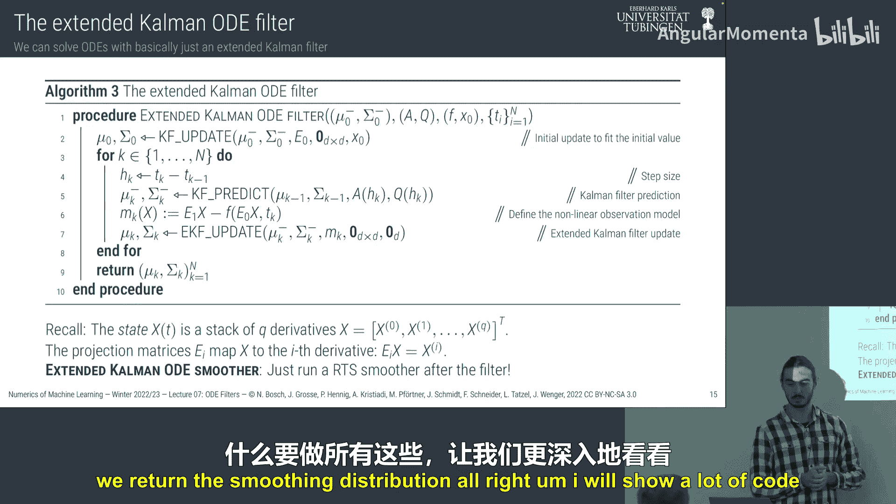

Alright， I would show a lot of code today to really prove that like these 10 lines with the building blocks and setting up the model correctly is enough order to solve an O D。

 because sometimes the formulas seem more complicated than it actually is。

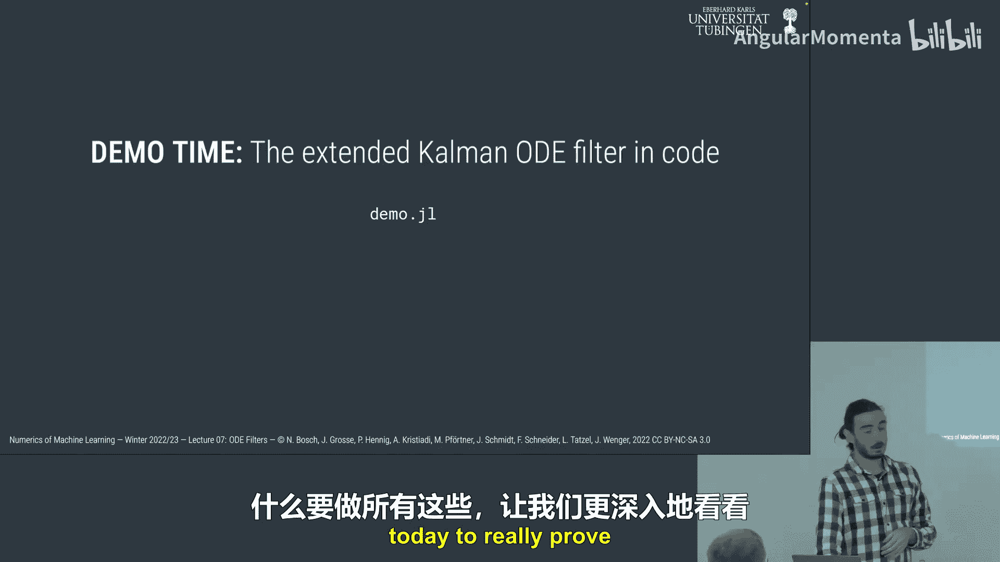

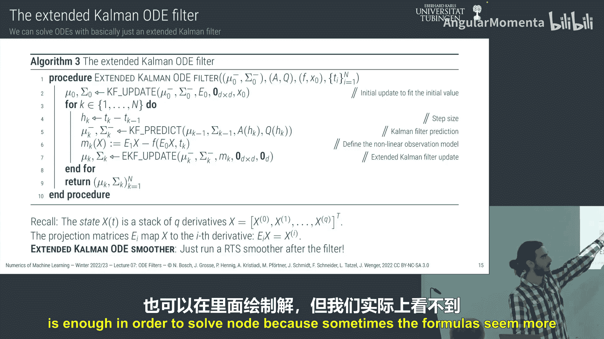

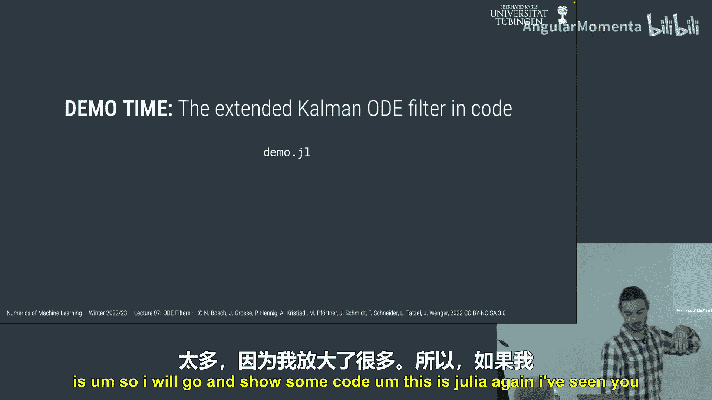

So I will go and show some code。嗯。This is Julia again。 I've seen you， you probably。

 well we've seen a little bit of it last week， but a bit more two weeks ago。嗯。

I know that most of you are probably more familiar with Python。

 but I think the notation should be simple enough today that it's easy to follow。 and so， and my。

 that was actually my motivation。 because if you look at this Carman filter predict， for example。

 on the top。Is it big enough for everyone， by the way。No， okay。嗯。Com plus， yeah。Okay。

 then I have to scroll a bit more。 but it should be better， maybe。Alright， so this comment filter。

 I predict that I wrote down here。 I mean， it's two lines in a return statement and a text for arguments and like。

It's really。It's exactly the same as in the slides。And this will also be the same in the code。Mostly。

So I have these building blocks。 and maybe so you don't like， I don't hide stuff。

 There are some import above。 but yeah。And then I have these building blocks that I need to define first in order to build the extended command audio filter。

 There are these common filter prediction， common filter update， extended command filter update。

Maybe if you come from Python， then this is one of the things that might be a little bit surprising at first。

 but it's just a transpose。And thiss divided by S， I think you've also seen two weeks ago at multiplying with the inverses。

 but in a numerically more stable way because it solves a linear system。

And I use a package to do Jacobians。第二。But so these are the building blocks that we have。

And then the actual algorithm that will， like， that will be run in this notebook is this extended common or the if。

 So it has the same name as in the slides。 It takes the initial value and initial distribution。

 the transition model， the initial value problem， basically。

 So the vector field F and an initial value X 0。 and a time Detization。I also pass in the E0 and E1。

 because from the inside， it's like not really like it's。

 you cannot figure them out from the inside of the function side just passed in。

And then the algorithm itself consists of， well， mostly the blocks that we saw on the slides。

 which is。嗯。One update on the initial value here。 So on x0， basically。Then。And then inside the loop。

 there are these four lines that we've seen on the slides。 So computing a step size。

 doing a prediction， defining measurement model， doing an update。

 and then just returning the whole thing。So this is， I think。

 closely match sub pseudo code that we've seen before。And so。We will solve a logistic O D E again。

 I've， yeah， you've seen it before。 So I define a vector field。 I define the initial value time span。

 and the true solution looks like this。Then in order to run the extended common audio filter。

 we need to define a prior。 We did that on the slides already。

 And the code is actually the one from the slides。 So it's a two times integrated we process。

 And if you look at the slides， there was exactly like this was a of H。 And this is Q of H。

 once again， maybe this a of H is unfamiliar。 It's a shorthand notation for a function in Julia。

 So a is a thing that you can evaluate at a step size。 and it returns a matrix。😊，嗯。

And then I define these E 0， E1， E2， which just， well are a one times 3 matrix that map to either the。

 the0th derivative， which is the first entry of the vector。

 the second or the third entry of the vector or the first and second derivative respectively。

So if I take 0 times x， then I， instead of having the three dimensional object。

 I only have a one dimensional object， which corresponds to the zero derivative of the thing we want。

The initial distribution I chose arbitrarily here。 It's just0 mean standard like one covariant。

 And then I choose a discrete time grid also with some step size。And if we run the whole thing。

 So there's a bit of code hidden sometimes。Then so maybe you' are more familiar with Jupiter in Pluto。

 you have the output above the cell。 But this is the code that is run in order to get this thing。

The line that I need to show is only this one， because this says， well。

 we call the function I just defined with the object I just defined in order to compute filter estimates。

And then below that， there's some annoying protein code in order to get the thing on the top。

But if I hate this again。Then you see that。 Well， the first of all， we get three plots because we。

 well， solved， we solved the OD E， but we our state it describes the 0。

 the first and a second derivative。So we get an estimate for X， X dot and x dot dot。

And second of all， there's a， well， there's a dashed line。

 It's hidden behind the blue points because the thing that we output is actually an O O D solution。

 So we get a line that also is roughly at the location where it should be。So it's pretty cool。

 I mean， we， we learned about extended carbon filters two weeks ago。

 and now we used to solve an O D E where， well we did， we。

 we did the whole lecture on how to solve OD E， but we could basically just use the algorithm that we learned about two weeks ago to get something that for now。

 looks roughly the same。😊，So， that's pretty nice。I have a block here playing around with step sizes。

 And that is exactly what we' are going to do， not just to showcase Julialia sliders。

 but there's like we will learn from it， but basically。

 we can change the step size and make it smaller。 So down here， there's code again。 that is hidden。

 which basically just calls the function again。😊，嗯。

And you see that if we make the steps size smaller， then at least in the third subplot。

 the uncertainties get smaller。And if we make the step size larger， then at some point。

 we will start seeing the uncertainties in the first plot too。Yes， here， for example。

So we really see that we get uncertainties。嗯。Maybe one thing about these uncertainties， also， so。

You had part of the homework on classic O D server was about local error estimates。

 And maybe one thing that might be surprising is that when you look at this。

 the uncertainty doesn't just grow over time。 But maybe you actually expected that， well。

 I mean if I make an error now and make an error again and so on。 then it should just grow forever。

And in some sense， like worst case for like any O D E， That is true。 Like if， if。

 if you want to know the error of a solver on any problem in the worst case。

 then you can prove that kind of they can get larger and larger。But this is not a worst case error。

 This is an error estimate for this specific problem。And the logistic O D E。

 if you remember these  errorss， basically， as long as you start the number larger than 0。

 you will get pushed to the one eventually。So even if you have a large error at some point。

 as long as you get to the one eventually， then your actual error does decrease again。

And so if the actual error decreases， you also want your error estimate to decrease again。 And it。

 and it does like it， it shrinks again on the right hand side in the top plot。

 Also here in the derivative， because the derivative tends to 0。And so。Yeah。

 that's like it is an actual error estimate。 It's really。

 it's not meant to be interpreted as a worst case bound。

 it tries to model the error that is happening。嗯。There's， I think， one other thing here。

 So at some point， the solution gets worse。And just to showcase that。

Smoothing generally does in improve the result， which also kind of make sense because， I mean。

 if we look at the line， we want to interpret it as the best estimate that we can have。

Whereas the line I show right now， without the smoothing means that this point in the middle is only informed from the left hand side and。

Like， if we don't have to do this， then like， why would we only inform it on the left hand side。

 So if we look at trajectories in general， it always makes sense to smooth， whereas， and。

 and that matches also the motivation from two lectures ago。

 Fing is nice for online stuff or like trying to reason about a point life。

 But when we have trajectories， then we can get further improvements by doing this smooth thing。

Alright。 so the  error estimates are kind of cool because of their structure。

 There's something that's not great about them。😊，And maybe I don't know。

 So can someone tell me what is not nice about these error estimates。

Or describe how they could be made even better。 maybe even in this specific lot here。

So the blue shaded area is supposed to be an estimate for the error。The。

 the numerical error that the Soviet does。And the numerical error here is， well。

 the mismatch between the blue line and the black and the black dash line。So。The area is like this。

 but the actual error is like this。 So basically， the error estimate is way too large。In some sense。

 mean， it， it would be a much better error estimate if it barely covers the black dash line。

And that like coming back to the whole motivation and why we're doing is。

 part of the motivation is that we want to have error estimates。

 So we want to have an answer from our algorithm that describes。

That gives an estimate of where the solution lies。 And， I mean， the estimate is fine。 Like， right。

 the， the black line is covered， but it is kind of undercon。

 So we would like it to be more confident like the， the blue area could be smaller。

 and we would still be like it would still cover the true solution。😊，So。Yeah。

 that's the answer to this thing here。 The uncertainties are too large。

 They don't just seem too large。 They are actually too large。

 And that is the thing we will have to fix now。 and that we didn't talk about yet。

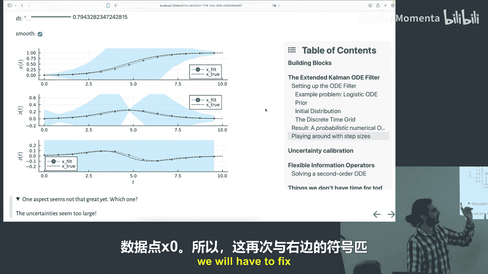

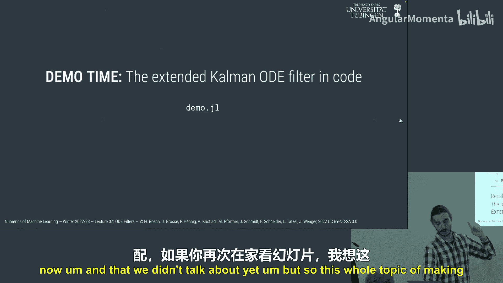

But so this whole topic of。Making uncertainties more meaningful is also known as uncertainty calibration。

 And we will see that we will have to do that in order to get actual uncertainty estimates that mean something。

And there's a very， so for doing uncertainty collaborationlibration。

Or there's a very simple reason on why the uncertainty is where the way they are and why they are too large。

And that is that there was one part in the prior that was kind of hidden on the way。 And again。

 one of these things I didn't talk about so that we can talk about it now。And that is。

 there's a prior hyperparameter that we did not set。嗯。When I define the prior first， So the prior。

 of course， depends on Q。 and that queue needs to be specified。

 And that is also a question by itself， how to choose Q。 But there's one other hyperparameter that。

 again， was kind of hidden on the way that directly influences the uncertainties。

 And that is the Zigma squared。There was a like on the first slide where I introduced the prior。

 I said there's a Taylor approximation plus noise， and there was a sigma in front of the noise。

 And that really is a hyperparameter。 You can think of it as L GP hyperparameter。

 like when you do GPS with。😊，RBF kernel。 then they are typically like there's a length scale and an output scale。

 That's basically an output scale。 Like it， it's， it makes the thing wider or less wide。嗯。

And because， because it， it directly influences how much noise is added at each step。

 So making this thing 100 just makes things 1 thousand times more noisy and making it well 0。

00 or something just makes things way more precise。😊，So like。

 it's clear that Zigma directly influences thecovariances。 and we didn't set it。

 It's a hyperparameter。 And the question is， basically。

 how should we set it so that the posteriia gets more informative。And on a high level。

 the motivation is exactly the same as on GPS。 That's why I mentioned them。

 because in Gaussian processes， you have the same problem。

 You have prior hyperparameters that you need to estimate。And in the first three lectures。

 I think you also talked about that。 You estimate them by maximizing the likelihood。

And there's a way to compute this likelihood。 And then， well， you， you optimize it by。

While calling optimizer computing ingredients somewhere。In our specific context， the， our well。

 this formula is not specific to our context， but it's convenient because of the context。

 maximizing the likelihoodlilies means maximizing the like P of data， given the parameter。

Which data was this collection of these。 So it's， it's a bunch of zeros。

 but they have specific numbers to them， and they correspond to a random variable。

So we have Z 1 to N。And we can decompose this probability here by， well， writing it as Z1。

 given Zigma times Z K， given well， other data points before。 This is really。

 like if you multiply them up again， then you end up with all the Z on the left side of the bargon。

 So this is a reformulation。And that is convenient because we have a way to expressing this thing on the right。

That is why， like when I recalled the quantities that extended common filter computes。

 I also mentioned that we have this estimate of what the next measurement should be given all the current estimates。

 because we need that in order to compute this marginal likelihoodli， which we want to maximize。

And so we， the extent of the common filter actually does Gaussian estimates of these。

 So this P of Z K， given Z 1 until K-1 is a Gaussian where these things pop out of the update equation。

And that allows us to rewrite the thing as a， well， so called quasi maximum likelihood estimate。

 because there's an approximation happening here。 So basically， we have an approximation of this。

 Yeah， there should， this should be a。Approximately equation question because， well。

 this is not correct because of this approximation happening。

But we will compute Zig Mahat as the arcms of this thing on the right， because this is tractable。

 whereas this quantity for a mono nonlinearar model is not like， it's not trivial to get that。And。So。

 so。This is really a general way of how to do parameter estimates in extended common filters。

In like on the next bullet point， we will talk about this specific parameter as Zigma that is exactly in this location。

 But conceptually， like the， the standard approach part is really just a recap of what you do in G P regression。

This thing here explains to you how to do parameter estimation in extended command filtering in general。

 So this is the quantity you want in code。 This is the thing you compute， You。

 you was out to diff with and you optimize and so on。 Like， that's， that's a reasonable thing to do。

嗯。In our specific context， like in O D E filters and so on。We can be a bit smarter than that。

 Instead of computing this quantity， taking a gradient step and so on。

 we can actually solve far Zigma had inclosed form。😊，With a bit of derivation。

 half of the derivation will be heard of the homework。But you can， well， in the specific model。

 if you write down the model and write down the inference algorithm that we use。

 So write down exactly the state space model as we had on the slide and use an extended command filter。

Then。We， we are able to show that there is like we can compute a maximum likelihood estimate in closed form by evaluating these things。

 So Z had still the same quantity as before。 And as also。

 So these two come out of the updated questions。😊，The specific Zs are zeros。

 so we can also just ignore them。And。So not only can we compute that。

 but we don't even have to recompute the solution again with the updated parameter。

 And that is basically part of the homework in the homework。 you will show that。

Zigma directly scales to covariances。 So like setting it in hindsight is equivalent to just rescaling the covariances。

And that's part of the homework。And because of this equivalent， what we can do is we can like。

 take our estimates that we， that we had， like these bad estimates from here。And we just。

Overrite them in a rescaled way。 And then we get better estimates。

 or we get the estimates that correspond to the maximum likelihood estimate sigma。

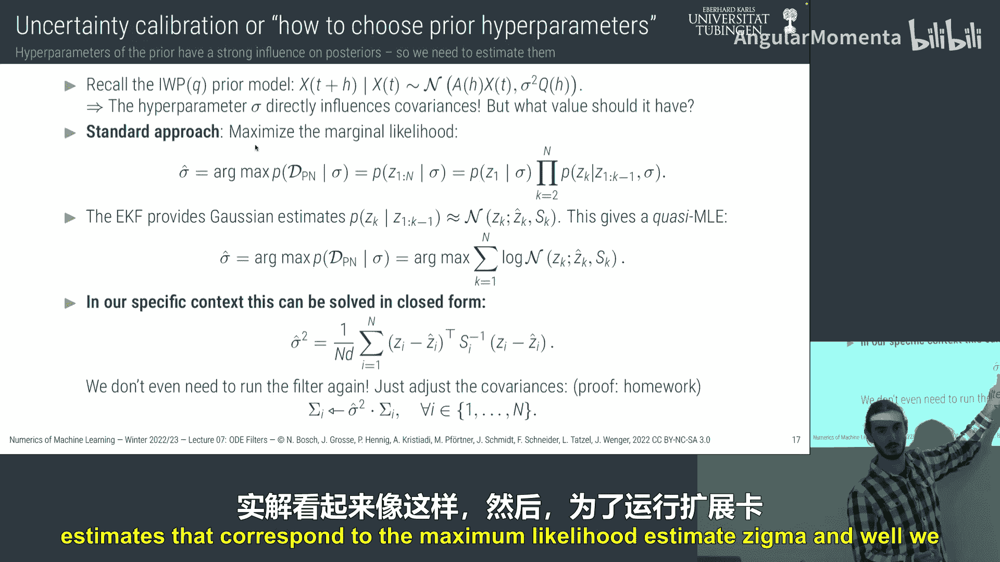

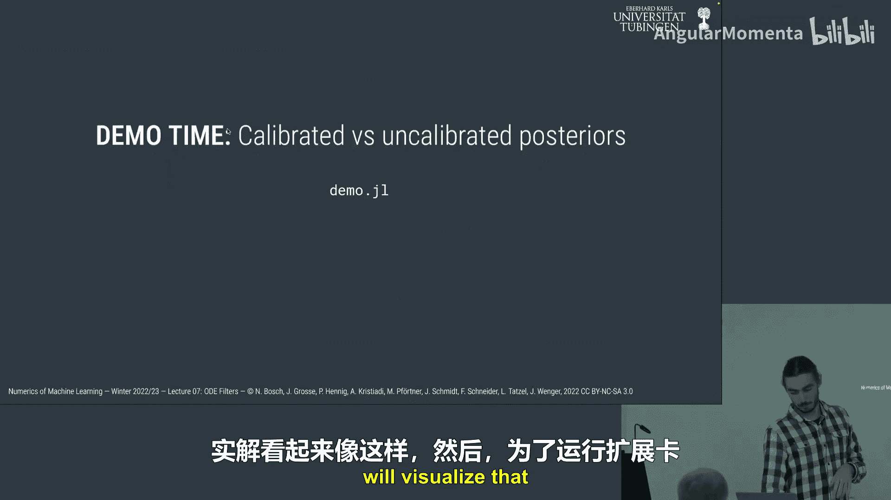

And， well， we will visualize that and show that encode code is also， again。

 conceptually quite simple to implement。We have these。 So this is exactly as in the slides。

 I don't know why。The resolution is a bit off。Yeah， okay。嗯。This doesn't get better。下日。Well。

 so these are the equations from the slide。 I just wrote them down again so that you have them for the code。

嗯。I defined a new。Update function with the suffix for calibration。

It's exactly the same one as before。 Only that in this line， I also compute this increment because。

 well， inside of the sum， we can compute this quantity， which I call an increment。

 because it increases the sum at each time。We can compute that in the update step and just return it so。

Otherwise， it's a copy paste from before。And then I also just copy pasted the extended Kman Odi filter from before and just changed two lines。

 which is this one where I well compute。 well， I， I take this increment and I will increase the Zigma head because we want to compute the sum at the end。

 So I do it in a running way。😊，And I do this divided by n also to， well。

 because this is the quantity we want to compute。 D is the dimension of the O D E。

 And because it's a logistic O D E， it's one。And then at the end， there's this rescaling happening。

 And then， yeah， so this is basically with the dots。 we overrite the covariances。

 And that is also what I had here above。 So we take the Zigmas that we computed。

 and we just rescale them with the Zigma hat that we just computed。😊，Apart from that。

 it's just copy past it called from before。And then we can do the same thing。

 We can play around the step sizes， and maybe。Like one thing that you see directly is that。Down here。

 we always had some uncertainty before。 if we scroll up。Even for small steps。

Even though the error is actually super small。Now， we cannot see the uncertainty anymore。

 So that visually is already an upgrade。But， and， and then like looking at the other end。

 we see that。Well， now for these step sizes here， it covers barely the true solution。So the。

 it's much less overconfience。 The posterior is much more informative and much closer to the actual solution。

 more meaningful。And then if we make the steps too large。Well， maybe this is kind of a failure case。

 but it， it provides one piece of information， which is。Andcer， it's an uncertainty estimate， right？

 So we are still doing approximate inference。Formerally， when you run extended current filter。

 you don't like。It's， it's still trying to approximate something as Gausian that might not be。

 So that is one reason why does this way。And even just like generally。

 like conceptually and philosophically， getting uncertainty estimates that are always perfect all the time is an impossible thing because if you had them。

 you could just improve the solution。So in some sense。

 you you only like the goal is to get uncertainty estimates that are as informative as possible。

And well， in many cases that we see here， the， there's a meaningful relation between， in particular。

 the structure of the uncertainty estimate， because it's gets smaller again and the actual error。

In these plots， we don't really see anything。 So one other plots to look at is。Basically。

 from the top plot， I just plot the error。 So instead of looking at the solution and another line they。

 which kind of lie on top of each other， I look at the difference between the lines。

And so the error estimates， on average。Is 0， of course。 So this top plot is the actual error。

 And the bottom plot is the thing in lock scale。And the， the mean of the error estimate is 0。

And then there's a， what' the。There's a dash line somewhere。But we can also see。

So for these solutions above， where we see uncertainty， there's a dashed line。

 This is the actual error that we are making。 So we're kind of above the true solution。

 And it's still covers by our error estimate。When we make things smaller again， then， yeah。

 in this plot， we can still not see anything。 But if we look at things in lock scale。

 then we see that we are like an order of magnitude to offer something。 But structurally。

 it does the correct thing。And well， it's， it's undercon， which then。

 like typically is a direction that you prefer to tend towards。

 But if you have to decide between over and under confidence。嗯。Alright。 And so。

 and like for all the step sizes that we can play around with here。

 we do get meaningful error like error estimates that like have a similar structure to the thing that they should have。

Alright。 And so with the stuff I defined before and the error calib。

 like the uncertainty calibration from this slide here。Which also LED to code。

 We do get an algorithm that provides error estimates that。

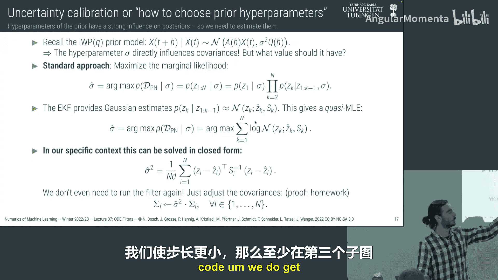

Really depend on the O D E and its theritization and meaningfully describe the error that。

 like the numerical error that we are actually making。So。

That is kind of the thing I motivated in the beginning of the lecture and the thing we went for。

 So now we we kind of did it。 In some sense， we have a numerical O server。

 It does provide error estimates。 They are useful。 They are not always perfect。

 The algorithm is fast。 We kind of checked all the boxes。 but maybe that's a good point to。😊。

Ask like， why we are doing all of this。 So why are we doing O D E in a probabilistic way。

 and why don't we just call onekuta。And there are kind of two aspects that come to mind and that influence our research in the group also。

 that's this part， basically the one that we talked about so far， which is just fundamentally。

 we believe it makes sense to have uncertainty quantification whenever you can and to try to quantify errors that you make and to be probabilistic about things。

 And we've seen that we can get uncertainty estimates。That are meaningful。

 We get like plots that look nicer than they did before。 We get these uncertainties around。

 and we can draw samples from the whole thing。 Like it's kind of nice to be probaistic about all of this。

😊，In the rest of the lecture， I will talk about a different aspect that is not motivated by the error bars or anything。

 but by the methods that we use。 And basically， I believe it's actually a convenient thing to use O server that are formulateted in a probabilistic way and to go through all the hassle of like defining the state based model and so on。

 because。It's quite flexible。 Like， we were able to， in like one question answer。

 basically decide that we also want to include an initial value。😊，And in the rest of the lecture。

 we will just include other stuff that we would like to have and see how that leads to algorithms that we can run。

Computing things that we didn't even talk about yet with essentially the same algorithm。

And there will be two examples， or two main ways where we'll talk about this。And well， yeah。

 So leave the space of solving O D E a bit and look at all the things that we can solve now that we well know how to formulate things in such a way that an extended command filter can solve them。

And yeah， so this， this first example is really motivated to looking at other problems that are not quite O ease the way we looked at。

 but similar enough that we can maybe figure out how to solve them。

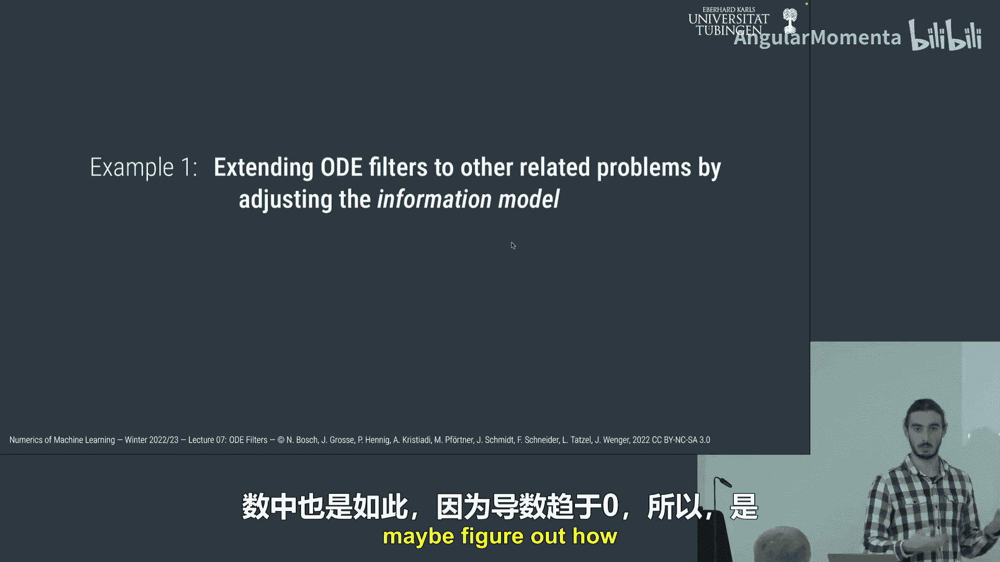

This is the stuff we did so far。 So we had an numerical problem， which is an initial value problem。

And we defined a state space model。 And then we just ran an extended command filter with fairly generic code。

😊，嗯。What if we actually have this problem。It's a second order O D。 It does appear actually。

 quite often。 when you talk to physicists， they are often able to describe the。

 like the acceleration of something， because I don't know。

 the something as a planet and it moves around the sun。 And so you have physics that you write down。

 and you get a description for an acceleration， but not for the velocity。😊。

So if we have this problem， how could we。Adjust the state space model to compute the solution to this problem。

Does anyone has have a like suggestion of what we could do。Yes。Conservation。To。

 to include this x dot， you mean， yes， exactly。 So that's。

 that would include this additional piece of information。 if we make one that looks similar to this。

 I will not show the next part yet because there's still one more thing we want to adjust。Yeah。

 again。So you means adjusting the O D E like Clot here。 Yes， exactly。

 So if you recall the derivation for this line here， we started from an O D E。

 then we replace the lowercase axis with the uppercase axis with the correct， like superscript。

 And we ended up with this where this is basically the left hand side from the equation。

 That was the right hand side from the equation。😊，And if instead， in the beginning of the lecture。

 I would have started talking about this。 I would have done like I would have said every。

 like all the words would have been the same。 only that the thing I would have written down is this one。

 So we start from the top。 And instead of saying it should be in equality。

 I put all the things to one side and said that their difference should be 0。

 That's why there's a minus。And instead of talking about the lowercase X。

 I use the prior process that we have here because the goal is to write down a state based model。

And so the second order would E from the top becomes a likelihoodli model or an information model that is defined as x 2。

 No， minus F of X1， comma， x 0， comma T I。The motivation for this quantity is exactly the same as before。

嗯。Instead of saying， oh， we also need to add the initial value。

 I would have said we need to add the initial value and the initial derivative。

 So I just defined this thing to make sure that x1 is actually equal to the initial derivative that we are given。

And。This is， again， something we can work with。 Like we can just run an extended command filter with some predicted update steps。

😊，And to prove that。I will show code again。 It's， again。

 a lot of copy paste from stuff we did before because not much changed。 So in this block。

 we saw the second order O D E， a specific one， so called harmonic oscillator。But basically。

 there are only two lines that are changed from before。Exactly 2。

 which is we also do an update on the first derivative。If you compare the， the。

 this line and that line， then the only difference is that here。

 the measurement operator is 0 and here at E1。 because first， we update on x 0。

 and then we update on the X 0， just the initial derivative。And then I。Change the observation model。

 But I didn't even have to change the E KF update call because the E KF update was defined in a general way anyway。

 Like it's this generic update building block that you could use to solve all the exercises from two weeks ago。

But I did， however， really find the measurements model as the difference between E 2 times x minus F of E1 times x comma E 0 X T S I to match the thing I've brought here on the slides like x 2。

 X 1， x 0。And there's calibration happening again because we always want to do that to get meaningful results。

 And now we can look at the result of all of this。 There's code hidden again。

 But it' basically just defines the harmonic oscillator and then calls the extended Kman audio filter too。

 please don't write actual software like this。 But it。

 it's nice to be able to show that this is actually the only change we needed to do to the function by copy pasting stuff。

😊，And well， again， we get， well， a probabilistic output of our solve that。

Provides an estimate of what the solution to this O D should be。 And if we take a very coar grid。

 then again， we make a noticeable error。 But the error estimate is kind of in a similar scale。

This is also quite nice to see because the error in this case doesn't just go down to 0 because there's not like this attractor that we tend towards anyways。

 so。😊，The error really adjusts the problem setting like it really defense。 Yes， one question。

We don't have。Yes。Exactly， which is conceptually， so very good comment。 maybe to repeat it。

 So the point was that for the velocity。 So for x dot， we don't have an equation。

 And so it's just inferred by the model。 And yes， exactly。 kind of in the same way as for X itself。

 we also didn't have an equation。😊，But we have this measurement model or information operator that takes the whole stack and maps it to something we know。

 which is， well， formally speaking， it's， it's a 0。 But， I mean， the important。

 like the interesting thing is the definition of this information operator。😊，And now。

 in the second order， O D E， the information operator itself has access to x 0， x 1 and x 2。And so。

We learn about the whole state in the process。嗯。Exactly， and so therefore。

 the output that we get actually describes X， X dot and X dot dot。Where， by the way， like。

 we also had an estimate for the second derivative when we solve the logistic O D。

 And that doesn't even appear anywhere。 But because our prior says that the second derivative is the derivative of the first derivative。

Which sounds obvious， but that's actually encoded in the prior model。 Therefore。

 we also had an estimate for that earlier。Alright。we can basically just solve other things now by with similar motivations。

 I don't know if you ever heard about them， but there are differential algebrabriic equations。

 They can be written as done here in the middle and green。 So it looks like an O D E。

 We have this M on the left。But we could we when we are not able to move the M from the left to the right because it's singular。

 So we cannot just multiply with its inverse。 You could， for example。

 imagine a diagonal matrix that just becomes zero at some point。

 So there are some equations that don't actually describe a derivative。 They are giic equations。

 Therefore， it's called differential giic equations。

 And I think the standard examples always come from chemistry。

 So there are some chemists scare about them。 But well， for this example。

 suggestions on which part of the stateface model we can adjust to get an algorithm that we could just run。

😊，Yes。Exactly。Instead of calling it O D E likelihoodliludeate， we could call a D A E likelihoodliot。

 and we can encode this equation in here， run it， and we get something that solves the D AE。

 And like， yeah， so I this is the one way I don't have a code example for。 But we did we have。

 like we did that in a paper。 And it also works。 So we can actually solve the AE in a probabilistic way。

 with the same algorithm。😊，Even though like， I never talked about you of what a the A E is。

 if you really care about D A is probably still make sense to have a full lecture on them and like do all the theory stuff。

 But conceptually， from an algorithmic perspective。

 it's very straightforward on how to solve a D AE right now。One more example。

 sometimes you have an O D E， but you have also something on top。嗯。

Maybe the motivation here could be a planet again that moves around a star。

Where you can write down a differential equation that describes like the acceleration of something。

But in addition， you also， because， I mean， when you write that down。

 you did a physics course before and you learn that energy has to be conserved。

 So you can write down a bunch of equations that。Give you a quantity that needs to be constant or a different。

 like something that needs to be 0。 If you just put the constant in the equation also。

And so you have an O D E， but you have some additional information。嗯。

The whole thing is kind of over determinedtermined by now， like formally， right。

 because you don't actually need that equation。 It's， it follows from the rest。

 That's what you learned in the physics class probably。

 But it is additional information that we can use and can encode in our model。

 And also outside of like probabilistic numers。 There are algorithms like people in classic numerical analysis。

 sit down and define solves that try to conserve quantities of a specific kind。

 It's a whole research field。 you can find book about them。But like from our in。

 like probabilistic inference perspective， it's just another piece of information。

And so any suggestions on how to include just another piece of information in a well discretized way inside of the statespace model。

Yes。Yes， exactly。 Thank you。 So we add another observation model。

 And while algorithm algorithmically， instead of doing one update step， we do two update steps， but。

😊，Putting the inference algorithm aside。 like this is now the model that would be motivated by the equations above。

 So basically， there should be T I in here， of course。 But under discrete grid。

 we also want to satisfy a G where again， formally。

 we have this zero observations that we condition on。And algorithmically。

 it's two observation models， so we just do two updates instead。

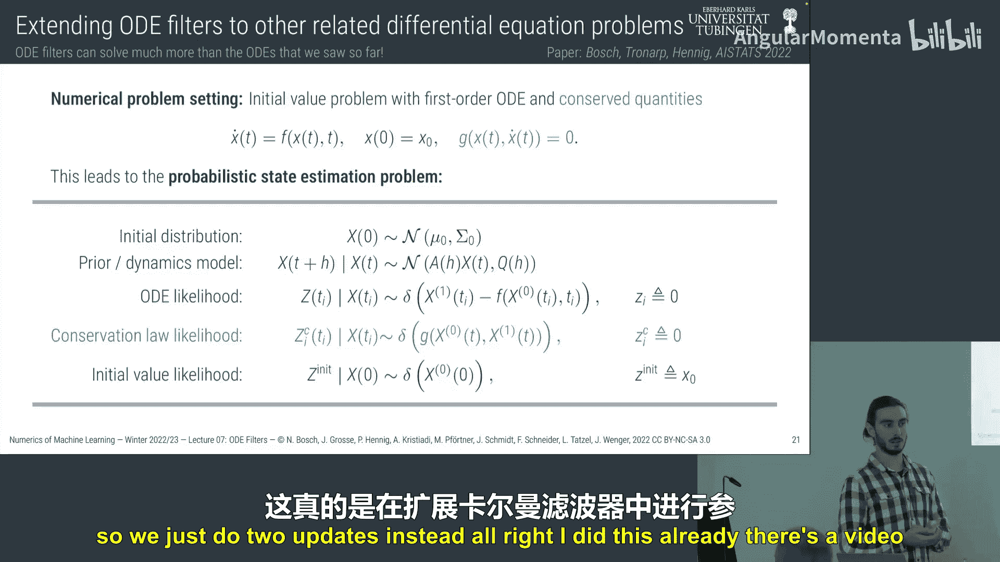

嗯。Alright， I did this already。 There's a video that maybe motivates this whole coned quantity stuff。

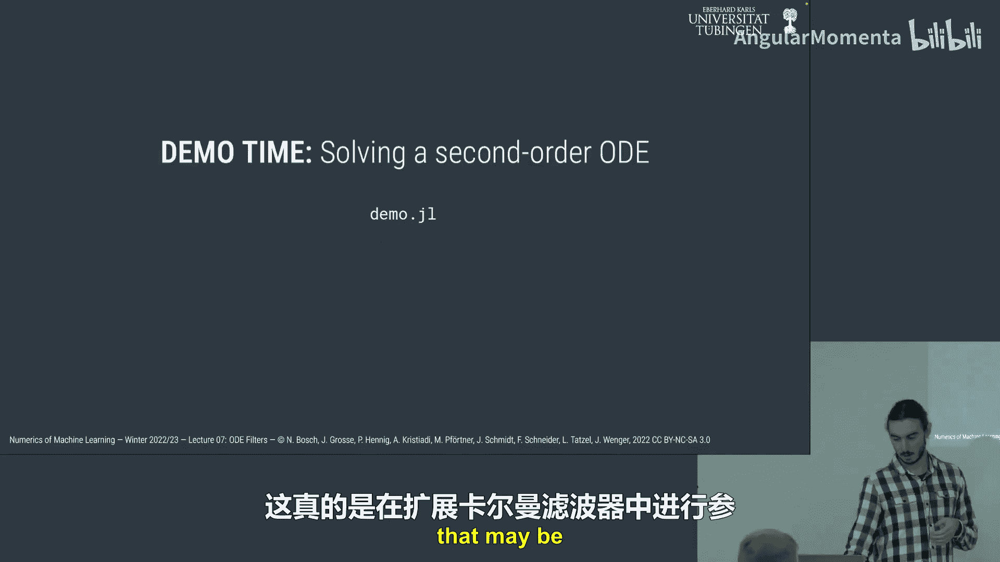

This is like it's not a planet。 I think it's a star that moves around the center of a galaxy。

 And the whole thing is projected to a 2D plane because that's how we see it when we look at it。

On the left， I have a very accurate solution of how it should look。 in the middle and right。

 I have two extended command filter approaches。Where the middle one only has access to the O D E information。

 The right one is access to the energy and O D E， and they have the same grid size。

And so if we run the whole thing。Then， I mean， it looks pretty nice。

 Like they are basically the same。 I think if we go back a bit more then they are more closely the same。

 up to here， it's kind of similar here， maybe。But then if we continue to run the thing。

 then we see that the middle looks noticeably more different。And also， like。

And now it kind of starts to do weird stuff。 That doesn't at least visually， like。

 it's not as appealing as the stuff on left and right。 So it seems to as lost。

 have lost some structure that the other ones have。 And that is like really what's happening。

 like we， we are。The right hand one， if we compute the energy at each point in time。

 then the right hand has much more constant energy than the left。

 The left just leaves the constant energy plane。 and then there's something that we cannot interpret anymore from a physical perspective。

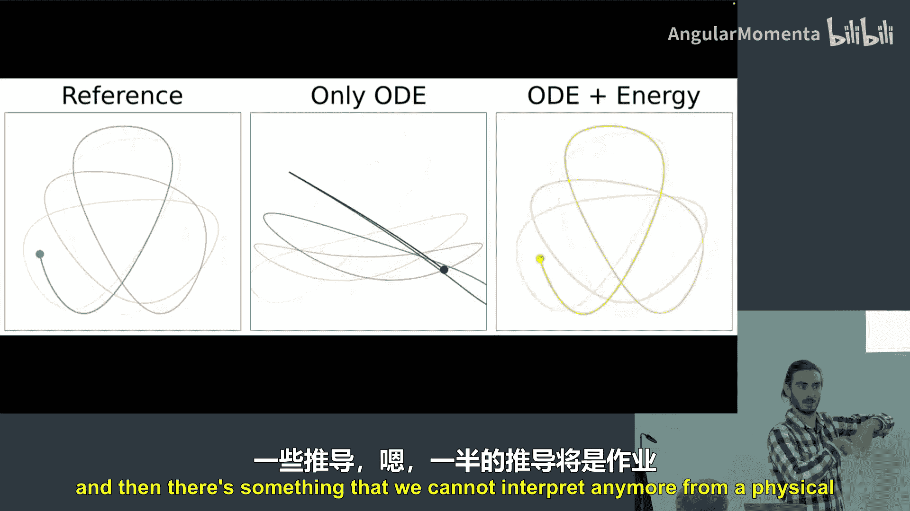

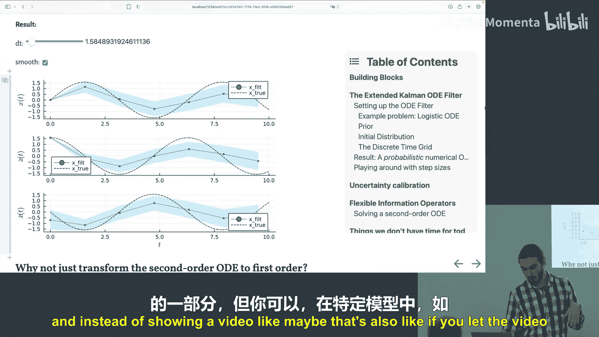

嗯。And instead of showing a video， like， maybe that's also like if you。

 if you let the video run for a long time and in this case。

 I had other set sizes but basically the trajectory you end up with for the true system is kind of the thing on the left。

 which visually looks quite appealing with a lot of structure and so on。

And then the one on the right is not the same， right， there， the， the lines are probably wrong。 It's。

 there's， there's numerical error， but it keeps the structure that you have much better than the thing here。

 And if we let things run for long enough， then this here becomes quite degenes。

 And there like it it shouldn't even be able to go here to this middle， right。

 there should be an empty triangle。So even though mathematically， the thing， like。

 you don't need to add this conserved quantity， right， because the O E fully specifies it already。

We're not able to solve the O D anyways， so。Putting in more information actually helps us to get a result that is more meaningful。

And there are classic methods that do similar things。

 But that is kind of the flexibility and convenience point from before。

 We didn't have to learn a new algorithm。 We just had to think about a problem。

 formulate the statespace model。 And then we used the tool that we know already from before。

 which is where one of the standard tools for doing state estimation。Alright。

There's one more example。 It's not a new one。 You know it before。

 But now we have all the tools to solve this problem。 And that's kind of a combination of O D E。

 So the stuff we talked about in today's lecture and last lecture and G P regression are Well。

 external data。 and the example is， of course， the Covid data where we have a scatter plot of the number of infected people in Germany from。

 well， beginning 2020 to July 2021。

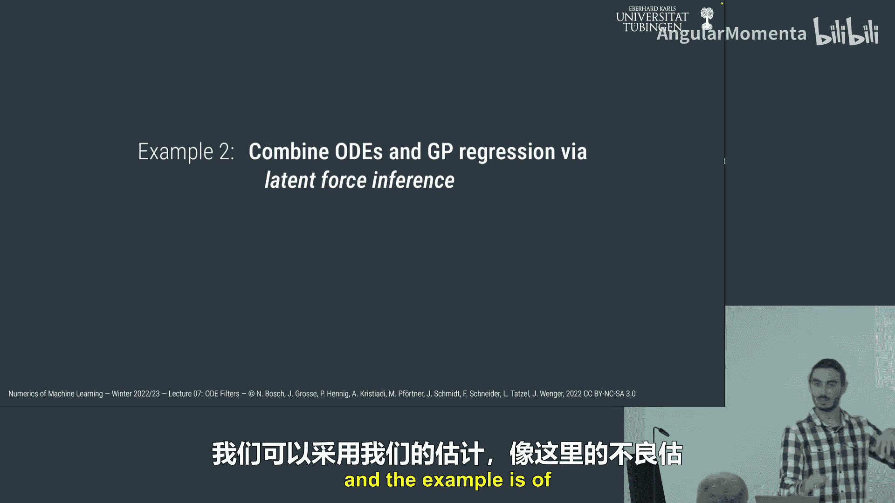

And we've looked at this last lecture already in the context of O Ds in parameter inference。

 like in general， when I today， we used OD Es where I only write X， and X was always one dimensional。

 but we can extend the things we did today to higher dimensional O Ds。😊，In fact。

 in the homework sheets， we will do a two dimensional audio。 basically means for each dimension。

 you do things individually。 But you will， you will see that in the homework and in the tutorial next week。

But so for this epidemic model， of course， we had this S IRD model where as the number of like the the susceptible population。

 I are the infected， so。The kind of the scatteraf plot here。Are the recovered people。

 and then are deceased。And we already motivated that if I just have a scalar B。

Then the result will look way different。 And it's not a good model for the reality。

 So one way to improve that model in order to be able to recover this plot would be to make Bay better of T a time varying thing。

And last lecture， I， I， I showed you a result with the neural network， which was okay，sh， maybe。

 but today， we will make beta a Gaussian process。 At least that's what I said last week。

 More precisely， we make it a ga Markov process。 because this is the language that we know to handle in this context of patient state estimation。

😊，And。Like we， we didn't really talk about why this is actually a golfing process and it continuous and so on。

 But I guess the intuition is we can specify the step size， right， So we can， if。

 if you can discretize something at will at will， it might be a continuous object。

 And so this beta of T。 we can write down the same way as we wrote down our state X。

 with a transition model So it's a linear model， There's an a sub B because it might not be the same。

 it depends on the step size H and it describes a transition from beta of T to beta of T plus H。😊。

And we also have an additional model。For the data that explains how this scatter plots depends on the audio solution。

And it's basically Y given X is a gaussian with some matrix， maybe。Maybe this should rather be why。

 I。嗯。Given， and then you have to stack S I RD。And that is。Well， only the ice with some gasian。Yeah。

 this is。It's one dimensional， so we don't need a covariance matrix。Exactly， because， I mean here。

 yeah， I didn't plug in the actual O D， but X is this four dimension X is the solution of the O D。

 So it's this four dimensionmetrical object， S I， R and D。

 And we measure only the I in this plots or in the code， we can actually measure more of them。

 But in general， we have this linear measurement operator。😊，And well。

 we do the same thing as we did for the last bunch of slides。

 which is write down a state space model and then do inference。

And you see these things get a bit more complicated and larger and harder to parse visually。

 which is why I made these three blocks。嗯。So there's a solving the O D E part where， well。

 we also assume that we know the initial value。 there's a data part。

 And then there's this beta that come in addition to the O D E solution itself。

And so the first part is the prior for the O D E， where the X well， is S I， R and D。

So the capital X is supposed to be a model for the OD solution。 So for S I， R And D。

 and we track a bunch of derivatives with the same motivation as before。We have。A model for beta。

Where again， like， it's the same language as we have above。 It's only that So。

 and there's this is a go Markov process。 It might also be a Q times integrated dinner process Pri。

 We can choose it that way， if we want to。With some initial mean and covariance。

And now we have a bunch of likeli models。 But two of them we already know before。

 this is the O D E likelihoodli。Only that it not only depends on x， but also on beta。

 because the vector field depends on beta。We have the initial value likelihood。

 which says that x at time 0 should have a specific value。 So probably like， well， the， the。

 the initial count of how many infected people and so on there are。

 And then we have the data likelihood。Which is the thing I wrote down on the slide before that relates this O D E solution to the scatter plot。

And actually， we've seen， so we've seen this in the last lecture on the parameter inference context。

 We said that we measure the solution with some linear matrix H because maybe we don't measure measure all the dimensions or something。

 And we also said that it's a Gaussian mouse model。 So we have two the likelihoodliludes。

 and we have this Gaussian likelihoodliot。😊，And。We can look at it in a bit more visual way。

 I think we've seen a bunch of these in the very first and lecture and two lectures ago， it's。

This stuff here， but in circles and arrows。 So we have a state that evolves over time。

 That is up prior。We have a latent force， which is also like where we also have a prioror for it。

 a gold mark of prioror。Then we have this O D E that depends on both the state and the latent force。

 because x is an input and beta has an input。And then we have observations only of X。 We cannot， we。

 we can， we are not able to observe the B。And the inference task that we will use an extended command filter for is basically。

Given the black dots， what are the white dots， that is what an extended common filter does。

 Only that norm， like in the settings we had before， the first row doesn't exist。

 and the last row doesn't exist。But in some sense， it the same inference I wrote this before in this conserved quantity stuff。

 we already talked about even having two observation models。 So we do the same thing。Yes。

 there's a question in the back。The question is， if it would also be possible to put beta in the state。

 Very good question。 You're taking away my next slide， because the next。I click somewhere， oops。

The next slide was basically about how do we implement that and maybe the one reformulation that we can do to just make this simpler and more close to the thing that we already did before。

 It's exactly that we， I mean， the x and beta kind of look the same。 Z depends on x and beta。

 So might as well merge them。And so， what we can do。I introduced x tilder。 It's a stack。

 Well there in Xilder， there's x， and there's beta。Which means that mu 0 tilde and Zigma 0 tilde are。

 well， the stacked version of the means and a block diagonal of the covariances， same for a and Q。

 But we have。 So this X tilder now contains all the， all the things we want to infer。

And the measurement model for the O D E now only depends on Xder， same as the initial value。

 same as the observations。And to make things similarly visual， I really find0， E1 and EBITDAbitta as。

The linear operations that access the correct entry， right。

 because we will want access to the0 derivative that we need here in the vector field。

 We need the first derivative here， and we need beta here。

 So getting them out of X is just a linear operation。😊，Yes， there's another question。要な。A to Mq to。

Yeah， they should be block diagonal。 Yes， yeah， exactly。 very good question。 So same。

 like all the co same as the covariance， which is block diagonal。

 These A and Qs are also block diagonal。 But maybe it's good to mention that the filtering distributions we get out are not block diagonal。

 right， I mean， X and Bta， there， they， they are correlated。 They will be covariances。

 after having done the inference。 And the prior， they are not。😊，All right。Okay。

 so this is the thing that you have to write down in order to solve this Covid latetnt force inference problem in the way that we well。

I've seen already in a bunch of lectures now。 and the inference algorithm is like really。

 it's an extended command filter and smoother。 If you look at the paper by well Jonathan and then also niel K and Philip panic。

 then they defined this in the correct way in a smart way that shows the well discretization of everything。

 and but algorithmically， it's an extended command filter and smoother。 So the motivation is still。

 we define a state space model， we know how to do state space models because we know how to do extended command filtering and smoothing。

 And then we end up with this thing， which gives us a posterior distribution of the same quality as an extended command smoother gives always。

 that while we have a posterior both for I because it's part of our well capital X state。😊。

And also for the betas， jointly from all of this data， where， well。

 one part of it is a scatter plot and the other part of the data was the O D E itself。😊。

In one giant inference algorithm。And maybe it's also nice to mention that。

 So we only talked about inference algorithms while the extended carbon smoother goes forward backward once and then gives the posterior。

 And so to get this plot， we had to get do the forward backward past once。

 which while in comparison to what I've shown you last week with this video that goes on for 1000 iterations。

 is pretty nice。😊。

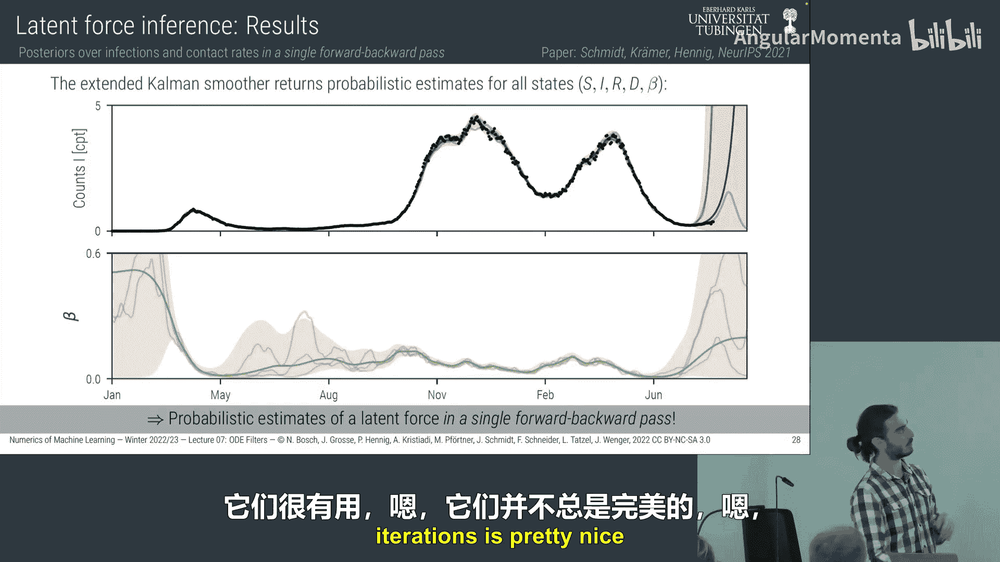

Alright， so that's basically the content for today's lecture。

 We looked at OD Es from a probabilistic perspective。

 and I argued that solving an O D E is actually solving a state estimation problem。

 Only that last week， we didn't talk about it as a state estimation problem。 But fundamentally。

 we try to estimate an unknown quantity， and there will be an error。

 So we want to be probabilistic about things。 And we have the tools to do state estimation an a Bayian way。

😊，In an efficient way， even。 And so today， we defined a way to solve O D Es with extended carbon filtering and smoothing。

 which leads to this whole class of servers that are sometimes called O D E filters。

And then I well showcased that。There is this motivation of like， we want uncertainty estimates。

 and we want to be Bayesian about things。 And the uncertainty estimates that we get are useful。

But there's this whole different aspect that maybe sometimes doesn't get talked about so much。

 but it's also just sometimes very convenient to be patientes about things。

 And in this particular example， we've seen that。By having this general inference algorithm。

We can write down a geneative model for a whole bunch of problems。 like。

 you know how to solve a D A E know， we or at least like in practice with code。

 even though you never heard about it before， probably。

 and that is only because you know how to use the extended command filter and how to implement it。

 maybe sometimes in a slightly non-standard way because you have two measurements in the beginning on the middle or something。

 But yeah， we， we know how to do that。 And then。That not only allows us to do。

 to solve numerical problems， but also to do inference from data in a very efficient way that combines well physics and general external observations。

So one summary of maybe this three lecture block that we had that what ends with this lecture today is that in our minds。

 pageian filtering and smoothing is really the way that we can model or formulate dynamic systems and model them in a way that is like flexible because we can just add information if we want to。

 And well can factor out the inference algorithm is something that we can take care of afterwards。😊。

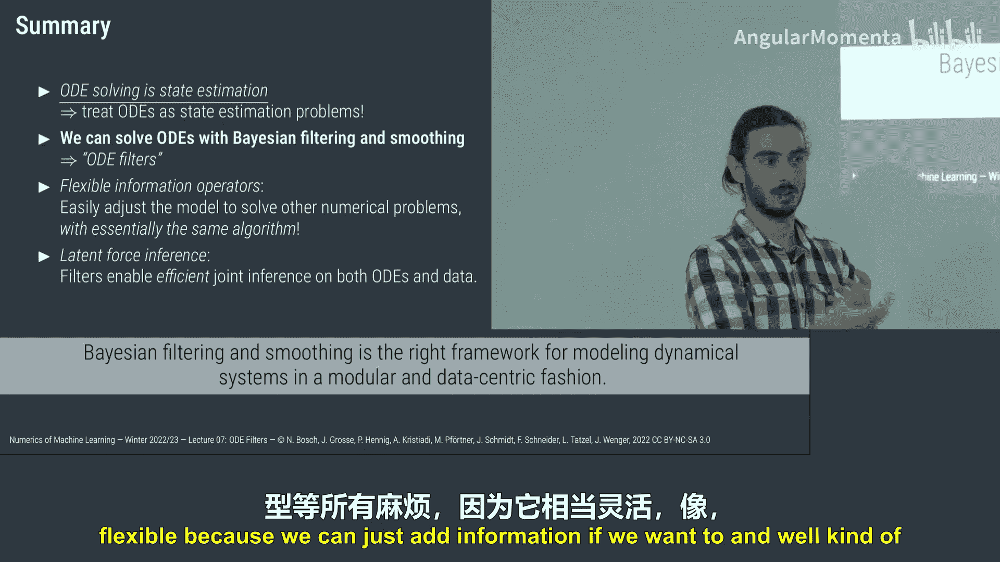

So I thank you all for joining lecture。 Please take out your phone right now and do the feedback like right now。

😊，I want to see people scan Q our codes。 And then yeah， thanks for a lecture。

 I'm around if you want to ask questions and then see you next week for partial differential equations。

😊。

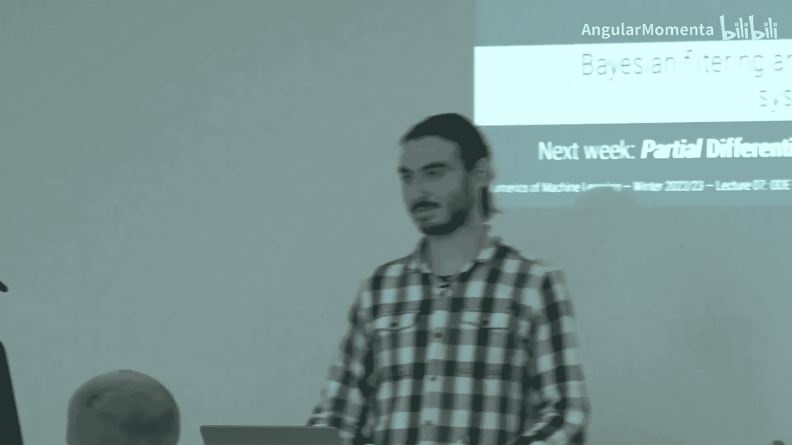