# 【精译】蒂宾根大学《机器学习中的数值方法》-p08-8-——-偏微分方程-——-马尔文·普福特纳--BV1WMYHzAEcL_p8-

。

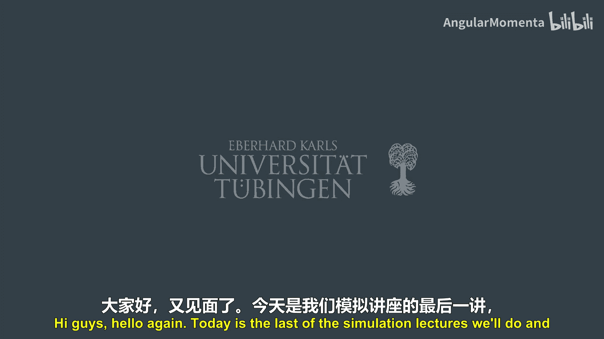

Hi guys， hello again， today's the last of the simulation lectures we'll do and we'll talk about partial differential equations and also Gaussian process inference again surprise surprise。

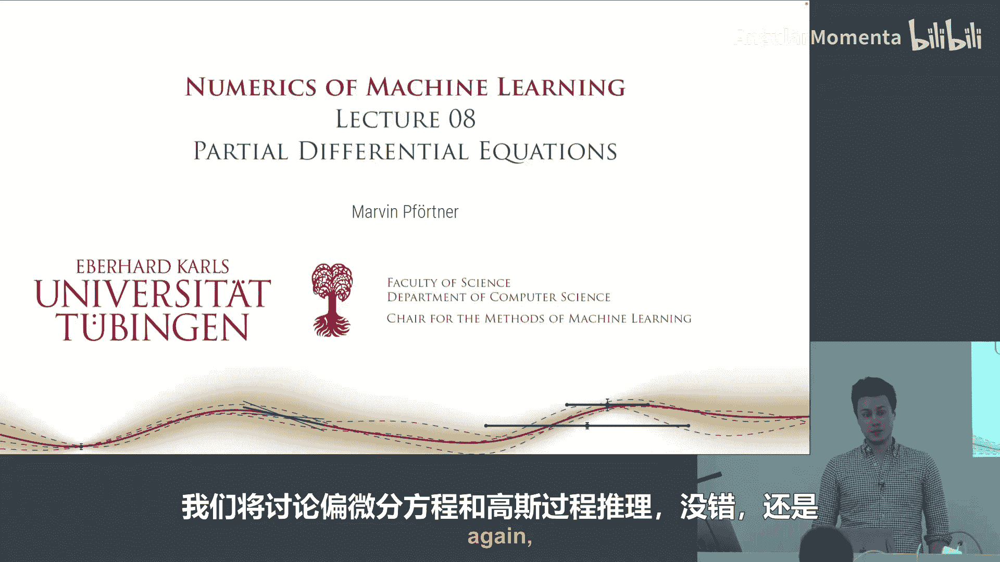

So， first of， a bit of an outlook of what we're going talk about today。 So， first of all。

 I'll clarify what a PD DE actually is and why these equations are important。 why， what what。

 what all the fu' is about essentially。嗯。And the main part of the lecture will be showing you how to integrate PD DE based models into machine learning models and specifically probabilistic machine learning models。

And we'll do all that by sort of working through a practical modeling example。

 just to make things a little more visual。So first of all。😊，P， E are used as the language of。

 of mechanistic knowledge。 Now， what do I mean by that。

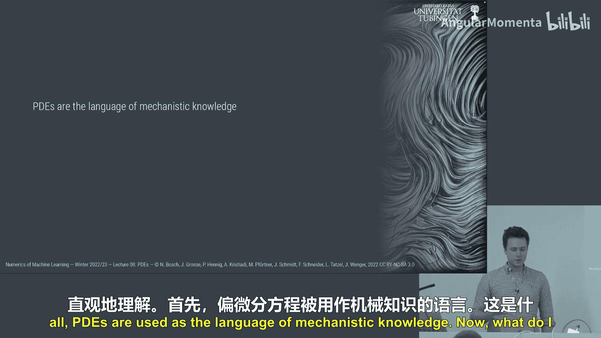

A mechanistic model。 It has a term mechanism in it。 It， it describes essentially what's going on。

 for example， in the real world， but also in financial markets and situations like that by describing the mechanism that generated the data。

And think about something like opposite charges attract equal charges Reel， right。

 You don't know how to protons， like you don't directly know how two protons will interact。

 for example， But you know that they will sort of repel。 And you know the strength of that force。

 And this is what I mean by mechanism。 You don't know the trajectories of the protons。

 But you know how to get to the trajectories from that mechanistic knowledge。

Another example of a physical system that is actually described by PDDEs。

 the the realm of fluid mechanics， So the description of fluids of all sorts。

 And actually there's sort of a fluid in in a wider sense。 So， for example。

 climate models and weather models are also based on these， these PD DEs。

And the important model here is actually a very important system of PEs。

 It's called the Navia Sts equations。 You might have heard that。Already。 and yeah。

 theyre described to simulate systems like the weather climate， but also ocean。

 So you could do like a tsunami model， which predicts when a tsunami will hit the coast or whether it will actually come about。

嗯。Because of， well， you can sort of see from these situations that the models are typically really large scale。

 So simulating the ocean， simulating the entire Earth climate is over a long period of time。

 it's a really large system。So yeah， these problems we're talking about are typically a very。

 very large scale， and they're also very difficult to solve in practice。But also。

 PD Ds are kind of an interesting thing to talk about。

 because the theory and practice of PDDEs are are actually still a highly active field of research after。

😊，You could argue already a century or maybe even centuries of research going into this。

 this field of mathematics or applied mathematics。And。It's actually， in a sense。

 so difficult that one of the well known millennium problems is about these navia stocks equations。

 namely just to state whether the set of equations even has a solution and how smooth that solution is。

 So that sort of。Maybe already gives you an insight into how difficult it is sometimes to talk about these。

 these models。Now， because it's these are typically difficult。 And this is sort of， I guess。

 a common scheme in mathematics。 No nonlinear or general PD D Es are quite difficult to understand。

 And so in this lecture， we are sort of restrict ourselves a little bit to a simpler class。

 namely the class of linear P D Es。 I'll define what that is in a little bit。But just know that。

Even if we restrict ourselves to that class， this is actually still quite a powerful modeling language。

 So， for example， many of the physical processes that happen around us are what can be described via linear P Ds。

 still quite accurately。 So， for example， thermal conduction， the diffusion of heat。 And。

 for example， a piece of metal is described by the so calledled heat equation。

 which is one of these linear P D Es。嗯。The phenomenon of electromagnetism。

 I already talked about protons interacting。 This is also。Described by a set。

 actually a system of linear P is called the Maxwell。Equation or Max equations。嗯。Wave mechanics。

 So essentially the description of， of water waves and。

 and waves that sort of propagate through air can be described to a very good approximation by the wave equation。

 It's also a linear equation。And the particle velocities of particles in Brownian motion are also described by the so called focal plank or chrommopho equation。

 The latter one actually also has quite an important。EPla in mathematical statistics。

 where relates to stochastic processes。But there's not just physical models that are described by these equations。

 but are already hinted at financial markets。 So the the famous black Schs equation。

 which is used in mathematical finance is also such an equation。 And finally。

 if we actually in practice work with nonlinear partial differential equations。

 We can use linear approximations to these nonlinear equations。嗯。In numerical simulation。

 essentially， by iteratively linearizing。So。With all that motivation side， we use these models。

 typically。To describe the the behavior of a real world system。

And we don't know the exact behavior of that system in advance。 But we know， as I said， how。

 how the mechanism behind the the， the system works， so。I'm deliberately phrasing this。

This goal we have for this lecture here as a sort of zographical model。

 because we w to fuse the well known or the the， the， the models we know。

 the probabilistic models with these mechanistic models， with this mechanistic knowledge。

In order to gain some of the strengths of machine learning in practice。

 this is also sometimes called called hybrid modeling， because we have empirical knowledge from data。

 from observational data。 And then we have mechanistic knowledge。

 which ties all that nicely together quite nicely。 And so we know， which is why this is shaded。

 We know the the mechanism， and we want to infer the system behavior。 However， PD D Es and。Yeah。

 well， P， P， D Es usually have some， some sort of have some sort of set of parameters。

 And we usually don't know these parameters in advance。 I give a couple of examples here。So。

 examples of these。Pyrameters are like strengths and distributions of heat sources or charges in electrical problems。

Material parameters such as the speed at which heat diffuses through certain material or actually just forces in。

 in classical mechanics are all examples of this。 And we don't usually know these。

 but we can measure them。 These measurements are typically noisy。But from that。

 we can already see that we actually need to be able to deal with observation noise in our models。

 And classical descriptions of these things typically don't handle that too well。

So we have these measurements of the system parameters。And the system parameters also。

Sort of need to be known in order to， to solve for the system behavior， right， because they， the。

 the equation is sort of governed by these， these parameters。

And sometimes we also have measurements of the system itself in terms think about like a sort of a heat simulation of the。

 of the heat distribution。 We， we， we might just place a thermometer at a certain point in our simulation and measure the temperature。

Of a piece of metal， for example。 But we can do that at every point of the simulation。

And this is why we actually need that mechanistic knowledge to sort of interpolate between our measurements question we。

That depends on the， on the situation forces you can just measure。

 right there's like essentially measurement devices for that， for example。

 Sometimes it's actually more， more difficult to， to measure this stuff in which case you can actually use these measurements and sort of propagate the knowledge back to the system parameters。

 which is then called an inverse problem And Natan already talked to this about this quite a lot in the O D E lecture。

 So you can So this is actually sort of the the the flip side of what we're doing here， right。

 not not necessarily just simulating what the system does。

 but also inferring what the what the sort of causal mechanism underlying that is， yeah。嗯。And。

Our approach to this here and actually sort of the goal of this lecture is to use Bayesian statistical estimation to fuse what we know。

 like the mechanism that we know。 And this measurement data and actually also uncertainties that are probably contained in most of the。

 these system parameters。Why Bayesian statistical estimation， Well。

 because we have all these uncertainties and would actually be quite a。

 quite a good thing to propagate all essentially all that we don't know un the solution so that we can give some。

 some， some confidence。To the predictions we do。Alright， so let's actually jump into the。

 the PD DE world and first of all， answer the question， what we actually mean by a linear P DE。So。

 first of all。Think about we， we want to simulate a， a physical system。 Typically。

 physical systems have some sort of spatial extent。And if they。

 if it's a system that evolves over time， we also have a time span over which we want to simulate this。

 So first of all， we， we define this， this set D。Which is called the domain。

 And then we look for a function that describes the a physical system。 say， for example。

 a temperature distribution or like the forces generated by， by by a set of electrical charges。

And this is actually the unknown function you。 This is the。

 the description of the system that we wanna wan to simulate。

The mechanistic knowledge in these PD D E based models is actually given by this equation here。

 where D is a so calledled linear differential operator。

 I'll actually show you some examples of that。 But generally speaking。

 this is just a linear combination of partial derivatives。Of the unknown function U。

 And we don't know the function U， but we prescribe a fixed value F。

 which is called the right hand side of the equation for this linear combination。

 And this is essentially。Turns out to be a very elegant description of a lot of physical processes。

 for example。Now， some examples of linear differential operators。

 given by the probably the most well known one is the lapplian。

 which is just the the sum overall second partial derivative。 essentially the。

 the trace of the Hessian， right the。Sort of nonm partial derivatives。嗯。And another example of Ae。

PDE is actually an F or linear。 P DE is actually an F find O D E。 So in， in。

 in case where we only have one input variable instead of D input variables to our function。

 we can construct this differential operator here， which consists of just the。

 the one derivative that we can actually actually build with this function and another sort of。😊。

Linear term here。 And then this， if you rearrange terms in the equation。

 just gives you the vector field of an F and O D。 So in， in a sense。

 F I O D or F and O D are special case of linear P， D E。 And in general。

 an O D E is a special case of a P， D E。😊，It's not always helpful to think a bit about it this way。

 because the P D E are tend to be a little bit more difficult to simulate。

 But it's just sort of a closure argument here。Now。

 let's talk about some problems we have with these equations if we want to actually apply them in practice。

 First of all， usually we do not get an analytic solution。

 This was already true for a lot of the ODs we considered。 But here it's， in a sense。

 because it's a wider class of models。 It's actually， well， we inherit these problems。嗯。

So we need to use numerical solvers to actually get to these unknown functions here。Which。

 because the function you as actually an infinite dimensional object will introduce this gratization error inherently。

Unless you know something about the problem。 But we're going to talk about this。Secondly。

 we already sort of talked about this。 The PD DE has parameters。

 and we can actually pinpoint what these are。 now a little bit better。 The function。

 the right hand side function F is one of these parameters in like， for example， when I said， well。

 heat sources， we need to know heat sources that are involved in our problem and charges。

 these are typically described by the right hand side of the equation and material parameters。

 for example， are the coefficients in the， in the linear combination of the。

Partial derivatives of the function U。And we don't know these exactly， usually。

I already talked about this。Now， finally， classical solvers that have been developed essentially over the past century are sometimes quite difficult to embed in computational pipelines because of。

 of this reason that well the parameters are usually not known exactly。

 but we sort of need one estimate。 need a point estimate of a parameter。

 And so it it tends to be quite difficult to actually propagate these uncertainties with the solvers。

 which is something that we aim at solving by this Bayesian approach we take here。Now。

 there's a bit of a problem here because PD D E is， just the PD D E itself。

 usually does not identify its solution uniquely。For O Ds。

 we have already seen that we also need to formulate initial value problems。Because essentially。

 there's a constant of integration involved If we solve these equations。 And for P。

 this is not much different， but the types of additional conditions we need to impose are a little bit more difficult than in the。

 in the， the O D E case。But let's actually look at an example first。

 So we look at the so called Poson equation， which is just the laplastian of the function。

 having a prescribe prescribed value。And let's for now， think of a solution candidate to this。

 this function sorry， this equation， which is just linear。

And we can see that if we apply the lapplian to this linear function。

 I said this is just a trace of the Hessian matrix。But because this is a linear function。

 the Hessian is 0。 It doesn't have a second order term。So this is just 0。

 which means that linear functions are actually in the kernel of this， this differential operator。

 And so for any solution of the Poisson equation， we can just add a linear term。

And still get a solution。Because I'm going talk about this in a little bit。 this。

 This differential operator is actually linear。嗯。So， usually。

Maybe also in the spirit of what you do in the O D E case， Uni。

 uniqueless can be achieved by requiring an additional condition tool。

 which is usually a boundary condition， or in this case。

 actually to keep everything linear linear boundary condition， where again。

 we have a linear operator here。 I talk about this in more detail in a little bit。

But in the physical intuition， why we prescribe something that happens at the boundary of our simulation domain domain is actually that。

 well， if you think about the， the problem you're simulating。

 there might be interactions coming into your system from the outside of the simulation domain。

And if you don't simulate these outside influences。

 So if you don essentially don't model them in your mathematical framework。

 then essentially anything can happen。Like。If you， if you model a piece of。

 the the heat distribution， a piece of metal， and there's like a truck rushing into it。 then yeah。

 what， what's gonna happen， You don't know。 So you essentially need to model。

Everything that happens outside of the simulation domain。

By summarizing it to how the outside interacts with your， with your simulation at the boundary。

 because that's the only sort of influence you can actually， can actually have here。And a PD， D E。

 together with a set of boundary conditions is usually referred to as a boundary value problem。Now。

 an example of a specific example of such boundary conditions areishly boundary conditions。

 which just say， essentially， well， we we so the operator restricts the function to the boundary。

 which just says， well， we prescribe the value of the function at the boundary。

 If you think about like the function you being a heat distribution in some piece of material。

 Then this just says， well， we know what the temperature is at the boundary。

 And this in physical analog this might just be like you have a huge bucket of ice water。

 which will not change temperature， whatever happens on the inside of the domain。

 So you know the the the boundaries of your domain will， will always stay at 0， essentially。

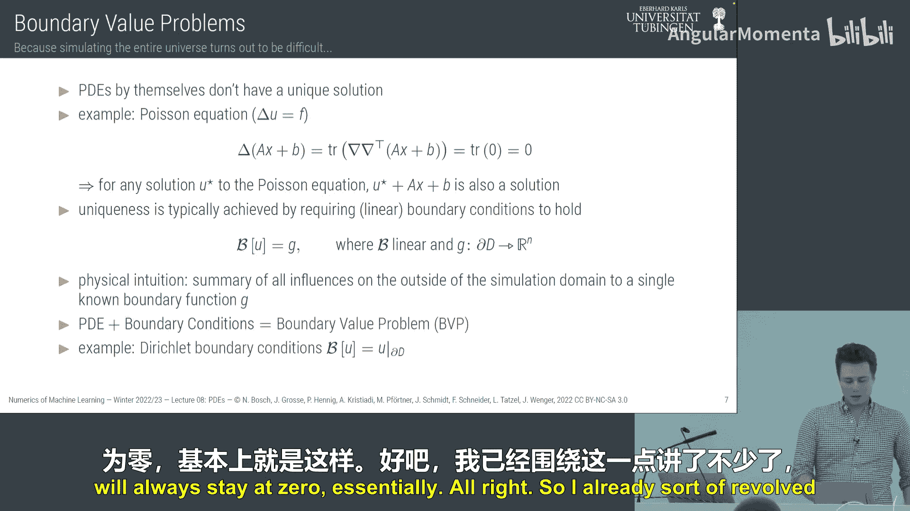

Alright， so I already sort of revolved around this point for quite a bit。

 But PD D E are actually statements about functions。 So we have an unknown function。 U。

 and functions are typically infinite dimensional objects。

 So you might already know if there's an infinity involved。 You need to be a little bit careful。😊。

But it turns out that we have quite convenient structure for functions because it turns out that functions or function spaces。

 sets of functions。

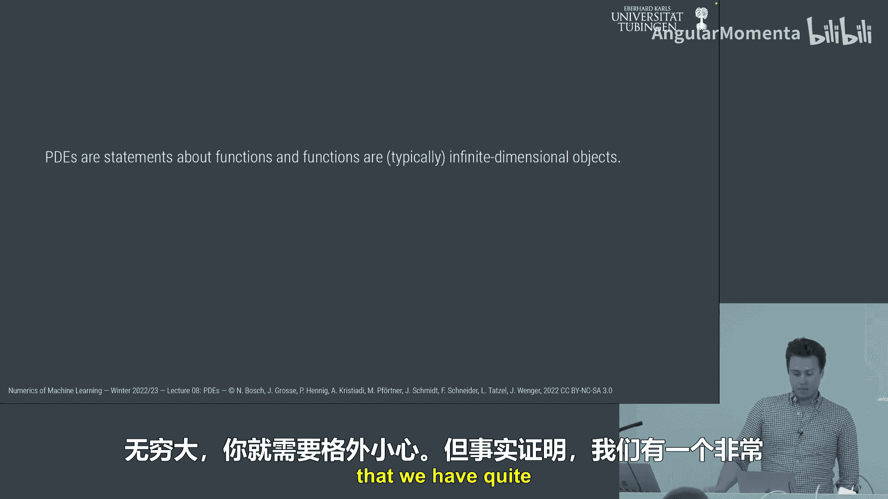

And the certain conditions are actually vector spaces， right？

 So from from sort of linear algebra classes， you might be very familiar with the vector space R N。

 So essentially the space of n dimensional column vectors。 And you， as you know， you can add them。

 You can multiply them with a scalar。 And you can do essentially the same thing with functions just by saying。

 well， the the the sum of two functions and the product of a function with a scalar are just defined pointwise。

 This is what's set here， so。😊，We have vector space structure， but that also comes with all the。

Sort of nice amenities that that come with vector spaces。

 So there can be bases in these vector spaces。 right， It's just。

 it's just a linear combination of some set of basis vectors。 And for function spaces。

 you have a linear combination of a set of basis functions。😊，Usually these。

 for at least for the function spaces we care about here。

 these spaces are actually infinite dimensional。 and sometimes they don't even exist in this form。

 This is what I mean by you have to be careful。But for， for this lecture， these， these exist。

 They are infinite dimensional。 and they exist as essentially a series of， of vectors。

You also have linear maps， and we know from finite dimension of vectorspaces。

 we can represent linear maps by matrices。 And the linearity property just means we can pull the matrix inside a sum and we can pull scals out of the。

 out of the matrix vector product， essentially。Linear maps in infinite dimension of vector spaces。

 specifically in function spaces are are called linear operators。

 And this is also actually what where the term linear differential operator comes from。

 Because the a differential operator maps a function， for example， to its derivative。嗯。So it's a。

 it's， it's a map between vector spaces of functions that it has this linearity properties， so。

Essentially， because you have the sum rule of differentiation。

 and you can pull scalrs out of a derivative。So this is actually why we talk about linear equations and linear differential operators。

 And by sort of applying this knowledge， you can see that a linear P。

 D E is nothing but a linear system in an infinite dimensional vector space。So we will actually。

 in this lecture， apply quite a bit of intuition from solving linear systems that we developed with Unhan lecturers。

😊，To the case of Ps， this is actually quite a nice analogy you can always think about when working with these systems。

There's two more details。 Well， you can define norms on vector spaces， right， For example。

 here we have the maximum norm or the infinity norm on on R N and。Well， the， the， essentially the。

 the analog of this also exists for certain classes of function。

 So you can just take the supre over a function。And then that is。

 that it turns out to be in norm and function spaces。 If we have norms。

 we can also talk about convergence。 And if every sequence in these spaces converges。

 we can talk about a banak space。 And then well， we know that R N with the infinitefinity norm as a ban space。

 but actually the space of k times continuously differentiable functions on some set is actually also a banak space with this particular norm And so we again。

 we can take a lot of the intuition from the finite dimensional case over to the infinite dimensional case。

 but maybe not always。 So we have to be careful in these in these senses again。

And the same actually also holds for， for inner products and hber spaces with with a couple of caveats。

 which I'm actually not gonna go into right now。 Just notice that usually。

So of these translations involve。Replacing indexes into column vectors by function evaluations。

And then sums by integrals。Sort of a very straightforward way of， of， of deriving these analogs here。

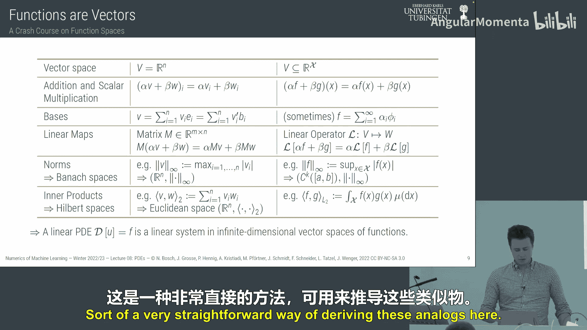

Yeah。Alright， so let's move on to a bit， a bit more practical topic。

 which is actually this toy example that will serve as the main motivational example with which I'm gonna introduce the methods we're gonna use here。

 which is a simple model of the heat distribution in a central processing unit in a computer and CPU。

😊。

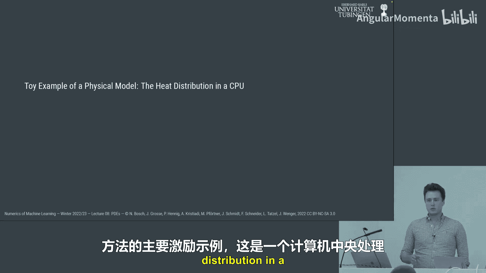

嗯。Now， this is what the discrete GPU and a computer usually looks like。 Actually， this。

 this metal piece on top here is not the the， the， the sort of the chip itself。 It's just a cover。

 which is used to extract heat from the chip。The actual silicon is just this little。Black box here。

 black。Well， chip， actually。And these components are particularly limited by the heat they give off。

 right， if there's currents going through it due， due to internal resistances and things like the chip the chip will produce quite a lot of heat。

 And if these systems overheat， they may take damage or not function properly。

 And we want to avoid that。 So it's actually quite a good thing to know what the。

 what the temperature distribution in your chip is in practice。

You might already sort of guess that this thing is actually really thin。嗯。And so its， we。

 we can sort of model it as a two dimensional thing。 So we， for now。

 we'll actually restrict ourselves to a two dimensional modeling and like a mathematical modeling of this system。

 the this is the the spatial domain we talk about。 So it's just the cohesion product of。

 of intervals in this case， the length and the width of the chip。But actually， since there's some。

Homogeneous geometry here to keep things simple for this lecture。

 we'll even restrict ourselves to just this modeling， the。

 the temperature distribution sort of on this line， slicing through the chip right here。We。

 we are actually gonna see two dimensional example little towards the end of the lecture。

 and we'll see that this is actually quite a good model assumption for this particular case。

But now let's turn to actually moving from a。Sort of physical model into math， right？

 So first of all， we already defined the spatial domain that we're gonna work on。

 which is just this interval from 0 to the length of the CPU。

 which is sort of this coordinate axis right here。嗯。Now， we know that when we want to simulate。

Problems involving heat。 We， we actually need to know where the heat comes from。

 Like what generates heat in our system and。For now， we'll actually just assume whether， the。

 the GP built into this， the CPU is actually idling。 It's not doing anything。

 And the cores are actually computing something really hard。 So the。

 the compute core of the CPU are are working and generating heat。At the same time。

 these systems are usually built into a computer in a way that theres a a heat sink on top of them。

 which transports off all of that heat generated by the ship So， so as to prevent it from， from。

 from overheating。And。Actually， this sketch might be a little bit misleading。

 The heat sink by sort of squashing this， what's called a thermal interface material。

 It's sort of a paste。Around these edges， you could assume that it extracts heat sort of uniformly from。

 from all of the the surface of the chip， right， so the， the。

 the heat leaves the chip via its surface。And so if we actually wanted to model。

Where the heat sources are in this chip and sort of where the heat sinks also are。

 where where the heat leaves that system。We could look at a function like this， right， so。

We placed three Gaussian blobs on the cause themselves， which are the heat sources。

 And you can see the unit here is whatat per cubic millimeter。

 So it's essentially heat per per unit volume。And then there's another negative constant where， yeah。

 negative constant function superimposed onto these Gaussian blobs， which models the heat sink。

 everything that is getting pulled out of the CPU。😊，嗯。Yeah， and now you might wonder， well。

 we talk about P D here。 So what is the PDDE that actually models this system Well I already talked about the heat equation。

 So here it is。嗯。It's a linear PD DE。 It's also second order。 Why is it second order。Anybody。Exactly。

 yeah。 the the the pla term contains the second， the nonm second partial derivatives， exactly， yes。

So this is where that second order comes from。 I'm going to talk about a little what these individual terms actually mean a little bit later。

 But for now， note that this function U is going to be the temperature distribution in our chip。

And we can see here that there's a。Temporal derivative。 So a derivative。

Of the time variable involved。A reasonable assumption to make things simpler for us here is actually to assume that a temperature distribution stays the same over time。

 which will eventually happen in a， in a CPU which sort of runs over time。 And， when。

 when the the control on the fans of that heat sink actually reach sort of a stationary point。

 So what we'll do is we'll assume， well， at some point。

 we are actually gonna reach a stationary temperature distribution。

And you can sort of work that into this model by saying， well， okay。

 if the temperature doesn't change， then this temporal derivative is just 0。

there is no change in temperature， no no， at least no temperature change in temperature anymore。

In which case， we arrive at the stationary heat equation， which is just， you know。

 you obtain from this equation by just setting this entire fast term to 0。

And since we restricted ourselves here to this one dimensional subset of this CPU，Essential。

 this line， this actually turns into this equation， right。

 the Lalaian with D equals 0 with just one dimension。 is's just a second derivative。Now。

 what is that We've actually already seen that in this lecture。This equation。

 What does it remind you of。It's just an OD E。Because we restrict ourselves to one dimensional problem to a one dimensional problem。

 It's an O D E， which sort of， you might say， well， where's the point in talking about P D E here。

 It's just so things are a little more visual for this lecture。

 Everything that we're gonna talk about in the following actually also applies to the multidimensional case。

 We， we don't have any specializations to the， the one D case here。Alright， now how do we。

Inject this mechanistic knowledge we have from this differential equation into our statistical model。

嗯。A way of thinking about these， these P， D is actually interpreting as an observation of this unknown function U。

And this is done essentially in much the same way we， we work。E with in the O D E case。

 there is an unknown quantity。We， we don't know anything about this function U。

 but what we can observe is a derived quantity。 We can observe its image under the differential operator。

 And we know that because we want the P， D E to hold in our system， this。

Image of the differential operator。 Think of it as just differentiation for now， just you know。

 one partial derivative。 we， we know that it has to be a certain value。

 namely the value of the right hand side function。And in physics。A lot of。

So this actually has an interpretation。 A lot of the most fundamental laws formulated in physics。

 actually conservation laws。 So they describe the conservation of some fundamental quantity like energy。

 mass momentum charge， some， some physical observable。

 And it turns out that these are usually actually expressed as P。

And the heat equation we've just been talking about Not that I actually moved one term over the to the other side is a statement about conservation of energy。

 particularly heat energy。 So this left hand side term here。

Is proportional to the change in temperature， the， the temporal change in temperature。

 And you can actually So， so it it turns out that this is also proportional to。

The the change in heat energy。 If temperature changes， heat energy changes。

 Not that temperature and heat energy are actually not the same thing， but theyre in this case。

 proportional to one another via these material parameters here。And we said that， well。

 every change in。Heat energy has to be explained via either a heat source。

 So this Q dot V is actually a heat source。So。Essentially。

 a known value of heat entering the system at any point。

 or it has to be explained by heat flowing in a certain point from the surroundings via heat conduction。

 And this actually sort of makes sense， because the Laplian。

computeutes sort of a curvature estimate of the function。 In one D， it is actually the curvature。

 It's just the second derivative。And if you have a situation where you have sort of a parabolic bowl。

 then you would expect， because the surroundings of， of the。

 of the center point are harder than well， the center point itself。

 that heat flows into that because well， temperatures tend to equilibate over time。

 And this is the statement is， well， every change in in in energy is either either explained by conduction from the surroundings or by a heat source being present there。

So there is no energy lost or gained other than what we can explain， essentially。

And this is a local statement， right， because there's all these derivatives involved， which。

 which are computed at every point of that， of that domain。嗯。Yeah。

 I already stated that normally this or abstractly speaking。

 this is just a local mathematical property。 So the value of a prescribe prescribed value of a derivative at a certain point。

And we can actually write this equation。Which is sort of in， first of all， just a notational thing。

 But we can write it as the difference of the differential operator minus the right side being equal to 0。

 And we define this as the function I or the operator I。

Which is in probilistic numerics also refer to as an information operator。

 And for the specific case of just， you know， the derivative。

You've actually already seen these information operators in the O D E lecture。

 This is exactly what we conditioned on in the， in the probabilistic O D E solver。

So this is just a more， more general sort of framework。 It doesn't just apply to。嗯。

Differential equations， but you can essentially express any any piece of information with such an information operator。

 And it you can see it as a sort of extension of the notion of a data point， right。

A PD D E is arguably not， not a data point in and of itself。

 but it still provides you information about the problem that you're trying to solve。

So it's a generalized notion of data， or actually information。Alright。

 now we actually want to solve this， this differential equation now， and。

We have an unknown function U。 So what do we do if we have an unknown quantity in Bayesian statistics。

 Well we just put a prior over it。In this case， surprise surprise。 It's a Gal process prior。 U。

 And you can actually see that prior over up here。 It's a mat 7 Ha kernel。😊，嗯。And just a， you know。

 constant mean function。And the observations， which replace the normal point observations in regular vanilla G P inference is now the the information operator。

 right， we， we， we require the differential equation to hold at every point of the domain where we replace the solution candidate by the G P now。

Now。Well， how， how do we actually do this， first of all。How do we actually apply such a。Such an。

 such a differential operator to a G P。What， what kind of object do we get from that。In another。

 another way of frame is how， how， how do we take the derivative of a G P。And second of all。

 how do we actually compute the posterior now。How do we condition of on this piece of information。

And this is where oh， well， actually， it turns out that both of these objects are GPSps， again。

So we have a sort of a closure property of GPS under linear observations。嗯。And。

We still have a bit of a problem because this is actually an infinite set of observations， right。

 Because we want the P， D E to hold at every point of the domain。

 And the domain is typically like an interval。 for example， it's uncountably infinite。

So computationally， this is going to be quite a challenge to do。

 It's basically impossible for the general case， unless you know something analytically about the the problem you're solving。

So we relax this piece of information by essentially saying， well， we。

 we don't want it to hold at every point of the domain， but just at a finite set of training points。

 X in this case。 And these are because of classical methods that that are similar to this called collocation points。

 I think Natanana also talked about this in the O E lecture。😊。

So it's essentially the same approach we take in the OD E lecture just that we don't use state estimation here。

 but an actual G P。Alright， now it turns out that these objects are very。

 very similar to the forms of， of what you get if you。

 if you condition a finite dimensional Gaussian random variable on a linear observation。

 So this actually popped up already in the lecture on it G P， is's just， yeah， the。

 the Gaussian inference theorem essentially on R D。 So。Colum column vectors essentially。

 But now recall that we actually said， well， functions are also vector spaces， right， so。

We can see a G as a probability measure， or as sort of like a random variable on function spaces and。

Yeah， we just use some， sort of some， some G P prior here。 And then as before。

 we choose a linear operator。 In this case， it's actually a linear operator that maps the sample paths of that G P。

😊，Onto R N。 So a set of n linear observations of that G P。

And we introduce some sort of a noise variable here， which is independent of the G P。

 So this is just independent Gaussian noise。Just as in the， the finite dimensional case。Now。

 it turns out that the， that the prior predictives。 So the。

 the the image of the Gaussian process under this linear operator。

Is actually given by a normal distribution。Where we map。

Where the mean is given by the image of the Gaussian process mean function。

Through that differential sorry， that linear operator。And the covariance matrix。

Is very similar to the covariance matrix we actually get in the finite dimensional case， just that。

In， instead of， well， we can't really apply like a matrix product here， right。

 because this is a linear operator， not a matrix。 And this is not a。Linear operator itself。

 but also a function。 But the analog of this a sigma a transpo thing in function space essentially。

 is to apply this linear operator， which remember acts on functions and returns a vector from R N。

Apply this first to the。First argument of the kernel function。

 So fix the second argument of the kernel function， then。You have a univariate function in x。

 which returns a real value。 And this is actually exactly what we can input into that differential operator。

 because， well， that's the space it's defined on。嗯。And then afterward。

 seeing it as a function of x again， which now maps from。Because we index into the。

 into the eye here maps from the well the spatial domain X to R again。 And this is， again。

 one of these functions that we can input into the differential operator。So we apply again， now。

 you actually see a concrete example with a concrete differential operator that will make everything a little bit more clear in a little bit and a posterior。

Of this， this event。It turnss out to actually have a similar structure， too。Essentially。

 we just replace matrix vector multiplication of。The matrix with applying the linear operator to a function。

And we replace this a sigma a transpo object by。Yeah， that's。That thing we already saw here。

This ground matrix。嗯。I left out a lot of theoretical detail here。

 We're gonna return to this in at least some vagueness in the end of the lecture。

 but know that theres a lot more involved than just， you know， writing down these equations。

 And you need to be really careful when doing this because of all these infinities involved。Yeah。

 we're going to talk about a little later。 That's a question。It basically is。

 so think about this map from from。Also。とそゃ。Yeah， so this is why it's mapping to R N instead of。

 So normally like just differentiation would map function to function。

 But this is essentially concatenation of the differentiation with several point evaluations， right。

 So because point evaluations are actually also linear because theyre defined that way essentially。

 you know， because。summation of functions is defined pointwise。 So yeah， so this is， we。

 were actually gonna see this on on the next slide。

 So an example of this would be just take a derivative and then evaluate it at a point X。Now。

 if we actually want to compute this object， what does that look like。Anybody have an idea？

Like for this specific choice of linear operator。Do you mean this x？It's just some eggs。

It's a fixed X。 Actually， yeah， I screwed up here。 So this is a different X than than that。 So just。

 you know， think X till the year。也そす。That's it's just some fixed X。 say3， it's 3。Okay。

 so it's not it's。十么。No， no， it'， it's， it's3。 It think think of it as 3。In the frontier。All right。

So it's， it's just， you know， you you， you differentiate the one argument。

 then you differentiate the other argument。 It's simple simple as that。

 It's just a little bit difficult to express in this standard linear operator notation。Right。

 so you first。Sort of fix the second argument to some value。

 Then while applying the linear operator to a the kernel。

 which is now just a function of the first argument。

 means I differentiate once with respect to the T1 argument and then insert X into that。 essentially。

 And that now I see it as a， as a function of the second argument。

 And then I differentiate with respect to that。 So it's。Simple as that for differential operators。

 differentials is actually quite easy to do。And then， well， if， if you have multiple X points here。

 then you just build a matrix of all pairwise derivatives， essentially between these。

 these two points in order to get at this object。 It's actually a matrix。And actually， to， to， so。If。

 if we sort of enter this case that you just， just brought up where we don't actually point evaluate where we have a proper linear operator between function spaces。

 we also define these， these covariance kernels and。Well， this is a kernel。

 These are cross covariance functions。Which are essentially the same thing we defined above just that we。

 we actually see it as a as a function of the， the point we want to differentiate it afterwards。

 And what you can show。By essentially applying what you just learned about what you just learned on the previous slide is that if you have such an operator and it  fulfills certain conditions。

 which we're gonna talk about later， then。The， the。

 the image under that operator of a G P is just the G P again。By definition， essentially。

 And this is how you get at the derivative of a G P， for example， right， if。

 if this is just a derivative operator， just， for example， for scalar G P， just differentiate once。

Then you differentiate the mean and you differentiate the kernel functions on both sides。

 essentially， to get a symmetric function。 again， for example， you can see it like that。

 And then that's a G P again。Under certain conditions。Now， let's apply that to our PD D E case。

 So we return to well， the same G prior and the the observations。

 And we already said that we already saw that well。

Applying the differential operator to the G P is a G P again， with specifically this form of。

Poserior well， moments。 And you can actually see that G P here。 So this is the， in this case， the。

 the well the second derivative ish or the scaled second derivative。

 because that's the differential operator we're working with of that G P。

 You can see that happening because the samples are actually much less smooth。

 We lose degrees of differentiability by differentiating these functions。

 which is also how you know that you're working with a mat kernel and not with something like a squared exponential kernel。

 because the samples from a squared exponential kernel are actually smooth。

 So infinitely differentiable。😊，嗯。Yeah， now， now that we've seen that。

We can also apply the same theorem or the same table， essentially to this problem here， where our。

 the linear operator is now， well， first apply D， then evaluate at the set of points。呃。

And compute can compute the posterior。E Gaussian process in this case， Well we know it's a G P now。

 And if we actually apply this to this problem。Then we first define a set of collocation points。

 The blue dash lines here are these X points， essentially。 And then， well。

 the observations are given by this black function。

 because this is essentially the right hand side space of the PD D E， right， once we applied the。

Differential operator， the G P has to sort of match the the， the righthand side function。

 And this is why the y values of the， these observations in this transform space are just given by point evaluations of the right hand side function。

 And you can see in this space， we essentially just have a normal Gaussian process regression problem。

 But we actually propagate the the knowledge we gain from that back to this original G P。

 which is connected via the differential operator。And， well。

 we can see that it sort of reacted to it， but it doesn't seem to really have worked。

 There's still a lot of uncertainty left。 So what's the problem here。

Think about what I said about P Ds not being uniquely solvable。The boundary conditions are missing。

It actually does work。 It， it's not， it's not broken。 In the sense。

 you can actually see that all the individual samples。

 which you can actually also see from this plot， all samples sort of approximately solve this equation。

There's just degrees of freedom， which the PD DE doesn't fix。

 And this is actually exactly this linear degree of freedom that I was talking about。

 So every sample of this G P， at least approximately is different sort of from from one another by a linear added linear function。

Sort of， you know， just。You have just scaled or skewed actually by exactly this term。嗯。And。Well。

 since this posterior is now just the G P again。 And if we， for example。

 impose deishly boundary conditions。 So we prescribe the value of this temperature distribution at。

 at the boundaries of the interval， the left and right boundary point， which we like physically。

 you can could interpret this as as a measurement from a thermometer， you might sort of attach there。

Then。Well， we just have a normal Gaussian process regression problem because the posterior of that previous problem is a G P。

 which you can just take as a prior for a normal G P regression problem。

 You just observe two values at the boundaries。 there is nothing special about this。And networks。

 So we still have a bit of uncertainty left here。Actually observe that the right hand side basically does not change。

 So it's is essentially the same from before。 But now uncertainty collapses。

 And the remaining uncertainty you can see here is just the approximation error。 We。

 we didn't actually require the PD D E to hold in every point of the domain just in these collocation points。

 but。This is also why we get some this reflects actually， in the GPS P's confidence estimate。

 It's as well， I'm not certain because I didn't。Get all the information， essentially。

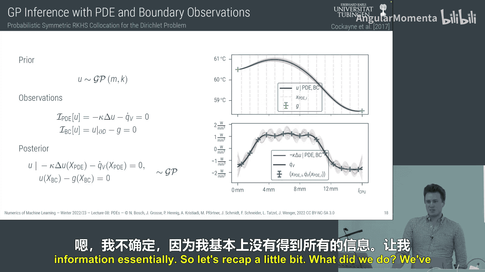

So let's recap a little bit。What did we do， We， we've seen that a generalized form of G P inference can actually produce an approximate solution of this boundary value problem that we formulated here。

嗯。And we get an estimate of this approximation error that is typically quite difficult to handle。

Here， we are actually returning to this graphical model from the beginning。

 if you remember correctly。 So we have。I the description of a physical system。

 which we initially don't know， but we condition it on the observation that some mechanistic knowledge we we。

 we have some mechanistic knowledge about the system here， which is， in this case。

 we measure the values of the， the， the temperature values of the CPU at the boundaries。

 and we know how heat flows essentially through a piece of silicon。Now， what is。Unfortunately。

 a little bit unrealistic about this is the boundary values in deployment are usually not known。

 These thermometers don't exist if you have CPU in your system。 There are thermometers on the CPU。

 but not at the boundaries。So we need to sort of get rid of that in order to actually have a realistic model。

 And secondly， these heat sources， the the values of these heat sources are also not exactly known。

The way we modeled this was sort of， well， okay， if the cores actually compute something。

 then let's approximate the heat source distribution with like a Gaussian b。

 But you don't know it is actually a Gaussian blob。 Like we haven't measured that。

So to get around this， it would be actually kind of cool to have the possibility of adding uncertainty to。

😊，Both the， the boundary values， because these are also not exactly known。

 And the exact values of this heat source distribution。

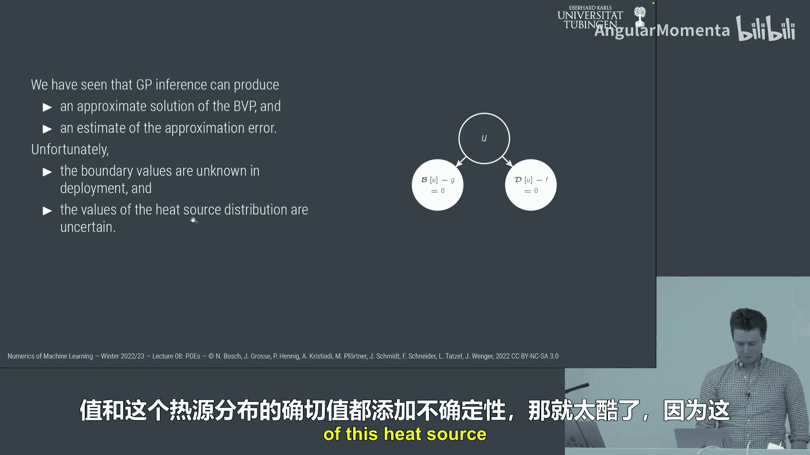

Okay， so let's return to the case where。We just conditioned on the PD DE。

What is a more realistic boundary condition for this， say， Well， more practical boundary condition。

 at least。 And it turns out that I already stated that that we， we。

 we know that heat is extracted approximately uniformly over the entire surface of the， of the CPU。

 and actually these boundary points are sort of the the， the side parts of this， this box。

 this ideally idealized box that the the CPU is represented by。So physically。

 you can actually model these boundary conditions。 So the， the。

 the information about how much heat is extracted from the surface translates to a so called Noiman boundary condition。

 which is instead of setting the value of of boundary point。

 it says the first derivative of a boundary point。If there's a lot of heat being extracted。

 then you can assume that sort of the temperature distribution moves onto the boundary in a。

 in a relatively steep declining slope。 And if there's a lot of heat entering。

 then it's a positive slope， at least on the， on the， on the right slope here。

So if we actually do that， we， we model the uncertain values of that derivative because， yeah。

 we don't know exactly。 like we， we don't know how much exact heat leaves via the the boundary。

 but we can sort of add some plus plus or minus some uncertainty that to that。

So we model it with another Gaussian， in this case， a Gaussian process。 But well， it。

 it it is actually just the Gaussian distribution because it's just two values instead of a function。

And we add an additional information operator， which is given by exactly that derivative at the boundary。

 Don't worry about this。 This is a directional derivative， because normally。

 if you have a multi dimensional domain。 So say， for example， like a plane。

 it's not just the derivative， but it's the derivative in the direction of the normal the normal vector to that boundary。

 So essentially， how much heat flows out of a surface through the。To the thing is， well， given in。

 in， in the direction of that that normal vector， the exterior normal vector。

 But think about it as just the first derivative for now。And well， yeah。

 this is an information operator describing that Noiman boundary condition。 It's also not a。

 in this case， not a normal Gaussian process regression problem anymore because we have another observation through a linear operator here。

 It's just a different one than the differential operator。Of the PD DE， it's this this B。

 this boundary operator we saw before。And if we actually do that， well， oh， sorry。

 we see that we got rid of one of the degrees of freedom， right。

 So instead of there being a linear degree of freedom。

 where we can actually have an additional slope。We fixed the slope。

 but the only remaining degree of freedom in the samples of this G P。Is the offset。

 the translational degree of freedom。And this kind of makes sense because we just said where。

 where heat flows to and where it flows from， Not at what absolute scale the system operates。

So this could be a system running at 1000 degrees Celsius， or this could be at like-200 below 0。So。

How we actually fix that absolute scale is by these thermometers that are actually contained on the CPU。

 just not at the boundaries that are contained in the center of the CPU course。

And so we have measurements， thermal readings， from these sensors。

 which are called digital thermocensus。At three points along this， this cut through the。

 through the CPU。And we actually add those。 This collapses， but it doesn't collapse fully because。

 well， there's measurement uncertainty on these thermometers。And so we only can do so much， right。

Essential， what we can learn from the absolute scale of these three。Of these three measurements。

 measurements。Now。Again， we， we already said that。 well， we。

 we don't actually know the the heat source term。嗯。There should be some uncertainty on it。

 It was sort of a。Eyeballing rough estimate of， of what might be going on。 So how do we fix this。60。

Maybe， maybe even two trivial just add another G P。All GPS， everything。So instead of saying， well。

 the right hand side of this P DE is some fixed function， we sell say， well， okay， it's just some G。

 P。It's a probability measure， an uncertain estimate of a function that we actually should know。

 So we model our prior belief about what that function actually is and by another G P。

 And we can use the same inference technique now。 But there's a bit of a problem because。

The physics of the problem actually， well， first of all， this， this。

 this deterministic boundary function we used before was carefully chosen such that it actually integrates to 0。

 And this makes sense because if， if it wouldn't integrate to 0， then in total。

 there would be more heat entering the system than is leaving it。And in this case。

 we would never reach thermal equilibrium。It was the。

 the system would just keep on heating up because there's always more energy entering the system。

 So we need to choose this， the， this， this function， this right side function to integrate to 0。

But how do you do that with a G P。A G P， if you just add Gaussian noise to that。

 that single estimate， then some of these samples will consistently lie above the， the mean。

 which we use as the original estimate of the right inside function。And then， well。

 they will have a bigger integral。So how， how do we solve this problem？

How do we essentially guarantee that this G P has area 1。In all of its samples。Exactly。

 integration is a linear operator。Integgrrates are linear because， well。

 the integral over sum of two functions is the sum of the integrals of the two functions。

So we can actually formulate another linear observation。 Well， linear information operator。

 which exactly。😊，Formulates this specific condition， which I call a stationity condition。

 because refers to thermal stationity。You actually have to add in the the boundary effects too。

 because while there's heat leaving via the boundary。

 So the heat that leaves via the boundary and the heat that leaves sort of on the interior。

 which is modeled by that that negative term in the in the right hand side function。

 And then plus all the heat that is， generated by the CPU cause， that needs to be 0。

 that needs to equilibrate， essentially。And so by actually adding this additional constraint。

 which now doesn't actually affect our function U in the first place。It's just the， the， the。

 the right hand side function and the boundary function， Q V and Q， A。The， well。

 the prior over these two functions changes。 And you can actually see if you look closely。

 that samples that start out below the mean here， which the mean actually already did integrate to 0。

Well， actually， in the sorry， will actually， in the end， lie consistently above it。 And then they。

 this happens in such a way that this actually this in integral  zero condition holds for all of the sample paths。

And well， now we can sort of apply all of these information operators to the， to， well。

 this join G P prior。 This is actually a multi output G P prior now。To arrive at this system。

And this is， I would argue1， a much more realistic model in terms of the assumptions that it makes about the problem than the one we started out with。

And you can see that， well， there's still some uncertainty left， which is makes sense because we。

 we don't have a certain right and side function。 We don't have certain boundary conditions。

 and we don't have certain measurements。So all of these uncertainties contribute。

To the posterior uncertainty about the solution。 But you can actually see that the， the red area。

 the red shaded area down here。 It's actually， I realize quite difficult to， to discern that。

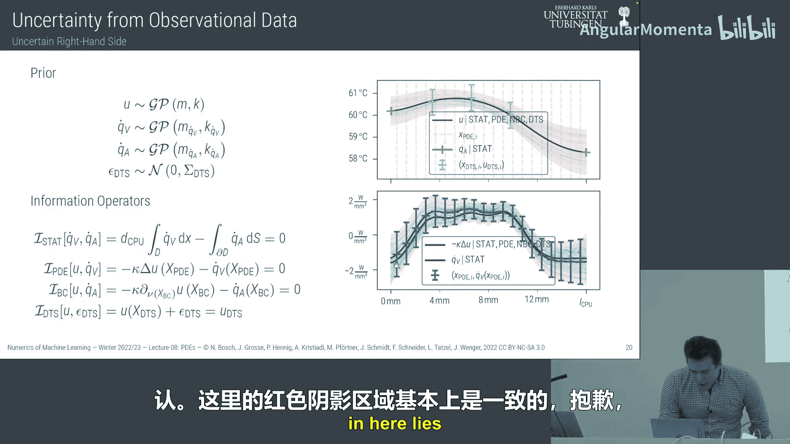

The red shaded area in here lies essentially consistent。 sorry。

 lies consistently within this blue shaded area。 The blue shaded area is the uncertainty about the right hand side function。

 So all of essentially， or most of our。

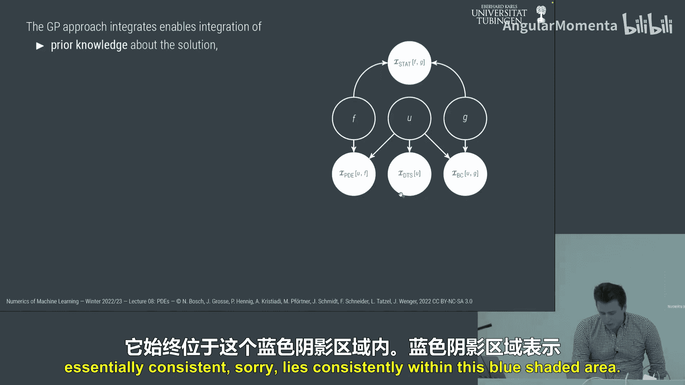

Estimates for the。Cvature or whether the image of the， the G。

 P under the differential operator agree with uncertainty。

 or they're consistent with uncertainty about the right hand。

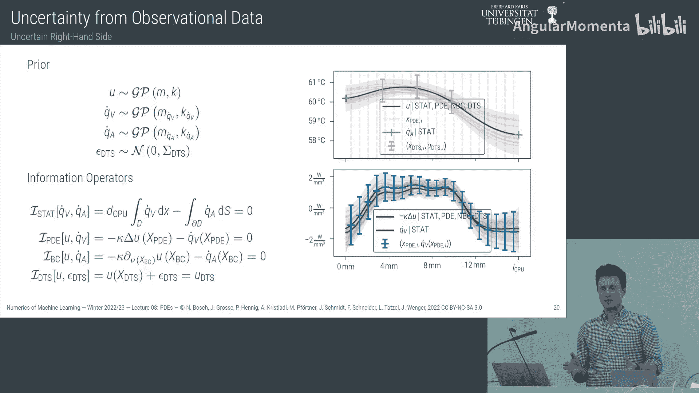

So that makes a lot of sense。Alright， let's recap again。 So we've seen that this G P approach。

 combined with the notion of an information operator。

 enables us to integrate prior knowledge about the system's behavior， which is formulated as a G P。

 Well， as the assumptions made by a Mattern kernel in this case。😊。

We can inject mechanistic knowledge in the form of this linear P， D E that we've been formulating。

We can have uncertain boundary conditions and right hand。

 which actually appear quite often in practice， specifically also in the context of inverse problems。

We can use a noisy empirical measurements to get rid of some of the uncertainty that we get from。

 well， uncertain boundary conditions and right hand sides and the approximation uncertainty。

 And all this happens while we provide quantification of the approximation error that we get by。

 you know， not requiring the PD D E to hold exactly at every point of the domain。

We get an  error propagation from these uncertain estimates of the system parameters right inside the boundary conditions and。

The bigger story behind this is that all of this is only possible because instead of just giving a point estimate of the solution。

 we actually relax that a little bit and say， well， we。

 we just answer with a an infinite set of solution candidates。

 which are weighted by a probability measure。 It essentially just。😊。

One of the essentially the promises of Bayesian inference in， in a different form。 But yeah， it's。

 it's very powerful。 instead of using a point estimate of that function。

 just use a probability measure over functions， which can give you confidences。

 which can give you samples， which all in this case， exactly fulfill the the。😊。

Conditions you subjected to。嗯。Yeah。And it's also probably more honest because instead of saying。

 well， we actually know that this is the right hand side function we want to solve the P D E with。

 you acknowledge。 well， there is uncertainty in that there is practically always uncertainty in these estimates。

You almost never know this， exactly。

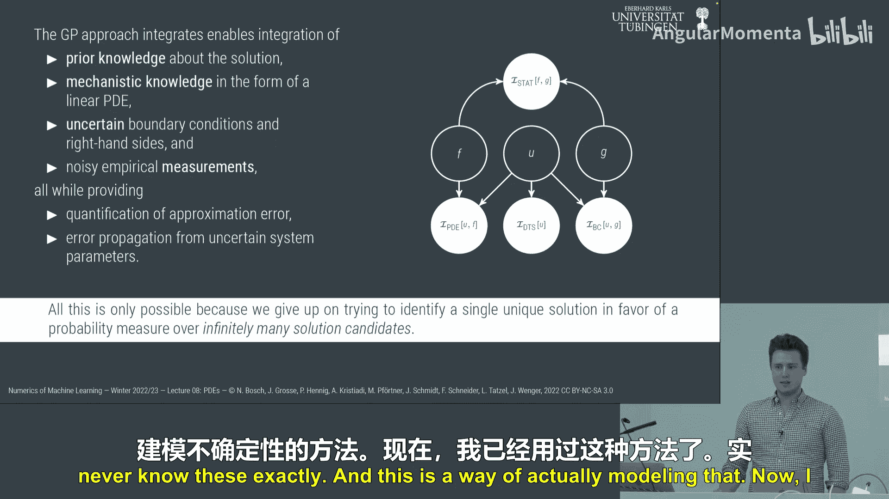

And this is a way of actually modeling that。Now， I already see that this。

 you can actually simulate exactly the same model Also in 2D。 This approach is exactly the same。

 only that you replace， well， your one dimensional grid of points by two dimensional grid of points。

 essentially and change the prior a little bit。 You can see that it works。 And actually。

 because there。Almost the same same temperature across the the Y axis here。You could argue that。

 well， the1 D model was actually quite a good model in the first place because there's not a lot of variation。

 And And by positing this， this  one D model the way we did was， well。

 we said it's essentially the same temperature along that dimension， so。

It was probably fine to model it like that just， just as a proof of concept here。Now， in so。

In contrast to the O D E lecture。We didn't really talk about time here。

 But what is time other than just another spatial dimension， You could argue， space time domain。

 essentially， And you can apply exactly that to a1 D version of。The heat equation。

 So now the actual heat equation， not the one where we set the temper derivative to 0。

 where now this axis is time axis。 It's just， as I said， another spatial dimension。And this is the。

 the， the one。Spatial variable， we have。And now you can actually see that this。In a sense。

 resemble resembles a lot an O D E with an infinite dimensional state space。

 So you have a state you can think about it as a state variable per domain spatial domain point。

 And then well， you have an O D E part， which describes this evolution over time。

And if you slice through， through this function over time and actually animate what's happening。

 then you get a physically plausible simulation of a heat offf fuion。

 which also has all these uncertainties because it's a G P， right。

 There's not a lot of uncertainty because I didn't add uncertainty to the right- hand side and the boundary conditions。

 And I used a relatively dense grid。 But in the end， you can sort of see that the grid specifies。

 And there's more uncertainty specifically at the edges。

So you can simulate temporal problems also with this approach by essentially saying。

 well time is nothing special， special。 Time is just another input dimension， essentially。Alright。

 so I talked a little bit about classical numerical methods for these PD Ds。

 which have been developed over this past century， so。How does this approach fit into it。

 It might seem a little bit weird to use a G P when there's all this stuff already developed。

 But it actually turns out that the posterior mean of this method we've been developing。

 assuming that you don't add any uncertainty。 So you。

 you have exact boundary conditions and you have exact righthand sites of the P， D E。

Is just the point estimate produced by some classical method。 In this case。

 it's called symmetric collocation， which is also why these points are called collocation points。

So this is just one method。 So wheres。EThe， the plethora of other methods。More generally。

 we've actually， we've actually showed that not in this lecture。

 but you can actually show that all so- calledled weighted residual methods can be。

 can be realized as these posterior means of a Gaussian process just without the uncertainty quantification。

 obviously， and some collocation methods are actually an instance of these。

 But there's also finite volume methods， which which you might might have heard。

And there's also the large class of what are called Galeran or petro of Galeran methods。

 which contain probably the most famous method for solving P Ds。

 which is the finite element method and also spectral methods。嗯。

And the way you get to these methods is essentially by changing the way you discretize the equation。

Remember here we took this PD DE residual， this D U minus F。

And just evaluate it at a couple of points。 Well， why would you just evaluate。

 You can essentially project onto any other function， because you have a Hilbert space， usually。

 So you have an inner product on functions， and you can just put in another function there。

 And by essentially by， by realizing it this way， you get at all these other different methods by carefully choosing the functions that you project on and by carefully choosing the prior you work from。

With a bit different scheme， you can actually also show that finite finite a difference。

 Thiscratization of P D E S can be realized via G P inference。 This is another paper from our group。

嗯。And。Now you might wonder， well。Why would you even use GPS in， in。In this or additionally。

 through this plethora of other method methods。 Well。

 we get this uncertainty quantification And what's kind of nice is because we know that the。

 the posterior means of these methods are the same as the classical methods。

 We can essentially use them as drop in replacements。😊，EOf these classic classical methods。

 because you get the same solution， just plus uncertainty quantification。

And that's kind of cool because you can reuse existing software stacks， essentially。😊。

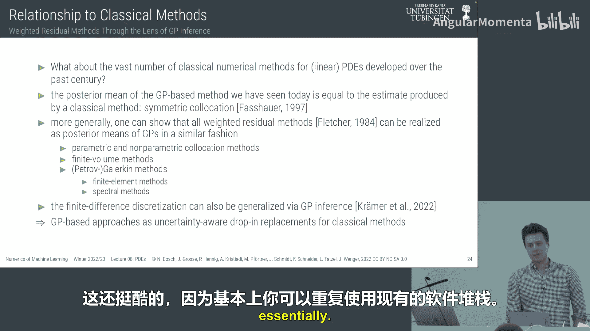

All right， quick summary。In general， we've seen that GPS can be used to solve linear P， Ds。

 But maybe even more importantly， we showed that these information operators are quite an elegant language to realize regressions or function estimation。

 essentially， from very heterogeneous types of information， not just point point evaluations。

 but all sorts of linear functional。😊，And that turned out to be quite helpful in these hybrid or。

Yeah， physical， physics informed or mechanistic models。But。In the beginning。

 I said it's like incredibly hard to solve these equations。

 So where' is all that hard math that should be necessary according to that statement to。

 to actually solve the equations。And， I mean， so far。

 we just really needed derivatives and a little bit of linear algebra to actually express what we're doing here。

So where is all that。 Well， as I said。

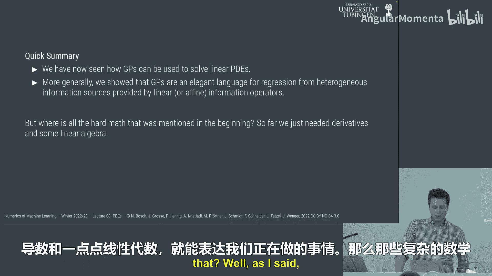

There are some。Very important。Failure cases that we should be aware about， and。Mainly。

 there's two points。 So maybe you can come up with one of the points where actually。

 what we just did is not working。 if， if we formulate our model in the wrong way。

There's one very obvious one and one not， not so obvious one。So。Someone have someone have an idea。

Think about what， Well， I mean， we use derivatives of GPS， right。

 So what can go wrong with a derivative。Anybody。Well， the function might not be differentiable。

If you differentiate differentiate an non differentiable function， you essentially。It's undefined。

 right， You don't know what's happening。So， first of all。

 we need to make sure that the sample paths of R GPSps are actually differentiable。

Because otherwise it's kind of meaningless what we do here。And the second thing is that， well。G， Gps。

 and specifically evaluations of GPS are random variables， right。

And you might know from your probability theory， statistics as， random variables are functions。

 which need to be measurable。In order to actually produce a meaningful sort of or a consistent statistical model here。

Now， if we differentiate a G P， then that derivative， because the G P was random。嗯。The we， we。

 we think of this derivative of the G P， specifically the point evaluated derivative Also as a random variable。

 It should be a random variable， right， because well。

 the quantity that we differentiated is is random。So that derivative better be measurable。Otherwise。

 yeah， we're again， in undefined territory。So everything that we do in this case doesn't work。

 Fortunately， there's。A way of， of choosing your prior。And choosing specifically to。

 essentially tuning it to that differential operator you're using。Such that all of this works out。

 But you need to verify some important conditions。 And I'm gonna try to go over the。

 the formal details of that theorem in a little bit。 This is actually from an。

 from an upcoming publication of our specifically on that topic to， to make everything rigorous。

 in a sense。So， first of all。Let's talk a bit about the， the， the sample paths of the G P。

 First of all， what， what even is the sample path of the G P， formally speaking。

And when are they differentiable。Well， first of all， actually。

 let me say because I'm not gonna come back to that this， this， what's。

 what's what's called bounded here or the statement that a linear operator is continuous in this case。

 under， under this， the， the assumption that， well。

 everything else in your holds sort of gives you the measurability of the derivative。

 So I'm not actually going talk about this。So much more。 Just recall that。

Marices are always continuous。So the， the， the linear maps defined by a matrix。

 all linear maps in a finite dimensional vector space， in fact。

 are always continuous In infinite dimensions， this doesn't hold anymore。

And you need to verify this for every particular。Operator， well。And we sort of。

 we sort of require this year。 But we're going talk about this in the last slide， maybe a little bit。

So first of all， let's think about how are GPS even defined。Well， A G P is just a collection of。

 of random variables， of real valued random variables。One of such of。

 of such of these random variables at every point of the domain of the G P。So essentially， if you。

 if， if you say， well， I evaluate the G P at a point X 1。Then。That is a random quantity。

 That is a random variable。 It's a real valued random variable。

 And in this set of random variables that define a G P there is specifically one corresponding to that output at the G P of the G P at point X1。

EDon't be confused by this mega。 This just comes from the definition of a random variable。

 A random variable is a function from this。Sample space of the。

 of the probability space is omega to some real value in this case， if you fix x。嗯。And。Think you。

 I guess you can think about this omega as like a random random number generator。Right。

 if you sample something from a random variable， you first sample an omega。

From your probability space， which the random， that's what the random number generator does。

 And then you transform that thing through this， this function F or F of X in this case。

 to produce you a valueant。Well， if， if you chose this random number generator and that function F correctly。

 then you get， for example， a Gaussian random variable。 if if， yeah， you choose that。

 choose that in the correct way。So for G P， we， first of all。

 only know what the distribution of a finite combination of evaluations of a G is。

 That's essentially what you do when you sample from a G P， for example。

 you evaluate the kernel function at all the points you want to sample at。And then， well， this。

 you know from the definition that that is a multivariate normal distribution。

 And you sample from that。But we use GPS to model functions， not the evaluations of functions。

 So where do the functions enter in this definition。If we actually fix one such value。

 So imagine that we actually were to continuously sample a function。

 continuously sample a sample path from a G P。We would do this in the following way。

 We would fix an omega。 So we would essentially say， well。

 random number generator generate like a random event。And then， we transform that omega。嗯。

Essentialially via all these functions。 So there's， theres for every X， there's one such function。

And if we fix omega， then well， we get， we， we get one such function。

By looking essentially at the collective of all of， of all of these fxes with omega fixed。

 And this is what's called a sample path。 This is what， what we talk about when we say， well， we， we。

 we， we， we want a sample path of the G P。 And this is also why we think about GPS as models of unknown function functions。

This is obviously something we cannot do in a computer， right。

 because there's an usually uncountably infinite number of these xes。But this is what you were doing。

 Well， think about it as constructing like an infinite dimensional matrix。

 then taking the choleski of that。 And then， you know， using this to， to compute your。

 your regular G P sample。And。If we look at the collective of all of the。

 all of such possible sample paths by sort of looking at， well。

Taking one for every possible event generated by the random number generator。

Then we get what's called the sample path of the GP。And。What we need to make sure。For。

 for our purposes， is that。All of these sample paths in this sample space are sufficiently differentiable。

Because otherwise， we're doing something that is undefined， right。Second of all。If we。

 if we state that we want to compute L F。 So the appque or well the， the。

 the image of some GF under a linear operator， L， what we actually mean is。First of all。

 fix an omega。Then， you have。A sample path， a function which just maps X to the real numbers。

And then we map that through the linear operator。And then。Afterwards， we sort of let mega go again。

So， it's the concatenation。Of essentially， a sample path with that， that operator。 and in this case。

 because we choose the operator to map to R N again。This is just。In our N value random variables。

 So the random vector。Even though there is like an infinite dimensional object in between there。

 which is this G P， right。And I already said that， well。

 this is exactly the random variable that the thing that needs to be a random variable。

 This needs to be measurable because we， we condition the G P on the fact that this has a certain prescribed value。

 right。嗯。So， yeah， this better be measurable again， not really going into details here。

It turns out that these sample paths of GPS are actually reproduce or can be made into a reproducing kernel Hibo space by choosing an appropriate kernel。

 I'm not really gonna go over this。 This is just for the people that know what an RH S is。However。

Usually， the problem is。Actually， I， I believe always。

 the problem is that that the reproducing kernel Hi space of the， the actual kernel of the G P。

 So the kernel function that you choose。Is not the space from which the samples come。

 The samples are informally speaking， usually rougher。In terms of differentiability。

 then samples from the well， elements from the original archs。

And you sort of need to choose a larger space in which these samples are contained。

 And you can actually show that。A sample from a G P is almost surely not from that space。

 So with probability probability 0， you draw a sample from specifically that space。

Let's look at a concrete example， which is also very useful in practice。 So this is actually why I'm。

Ening on that is the mat kernel。 So scary expression。

 you can simplify this quite a bit for specific parameters， P here。Which I。

 which is actually an integer。 And it turns out that this parameter P controls the differentiability of the G P。

 so。The higher the P is the more derivatives you can take of that G P， essentially。嗯。First of all。

 the archage is generated by that kernel。 So the function space that that that that is generated by this kernel。

Contains functions that are P times differentiable。So you can actually get， you can yeah， Well。

 if you， if you get a function from that space， you can differentiate differentiate P times。

 actually continuously differentiated P times。But the problem is that if you have a G。

 P with specifically this kernel。And the samples are not p times differentiable。

 The samples are actually less， have， have have less continuous derivatives。And you can show that。

 or informally speaking， you can show that there are actually D times less D half times less partial derivatives where D is the input dimension of the kernel。

 So， for example， in our case， we chose a matern 7 hs。Colonnal。嗯。Which in the。In the。

 in the covariance， RH S， I'll call it the K， the kernels RH S， which mean that。

 would mean that the functions are actually three times differentiable。

 But since we modeled a D equal one problem。The functions we draw from that G， P。Actually。

 one times less differentiable。 So two times differentiable。

 which is exactly what we what we need here。And。For for a rule of thumb， you can， if you。

 if you need sort of partial derivatives up to order at most M， remember。

 we have a second order equation。 So for us M S2。Then you can choose you can use this formula to compute the。

 the parameter P for the mat kernel， which you actually need in this case。And a nice thing is， if。

 if you actually choose this specific。Formula， then you actually know that the differential operator on the paths of their G P is actually bounded。

 So you get a random variable。 That's a nice plus。With that。 sorry。 And yeah。 so。

 so this is actually， you can generalize this， this process。

 I actually should have done that here because I talk about dimension。

 These are normally just Euclidean norms。 So instead of just computing an absolute value。

 it's it's the well， yeah， the Euclidean norm of the difference。

 so you can deploy a maternal kernels in an arbitrary number of input dimensions。

 But specifically for PDs。 And you will actually actually see that on the exercise sheet this week。

 it's better to choose to， to construct the D dimensional kernel by taking products of 1 D maternal kernels over the dimensions。

😊，And this is specifically useful if you have sort of mixed orders of the derivatives。 Remember。

 in the heat equation， there was only one sort of first partial derivative with respect to time。

 but second partial derivatives with respect to the spatial variables。

So it actually makes sense to use a， well， ma kernel that gives you two partial derivatives in the spatial part of the kernel and one that is rougher name is exactly one degree of differentiability rough for the。

Time， time dimension。That helps you adapt to the concrete equation you're trying to solve。

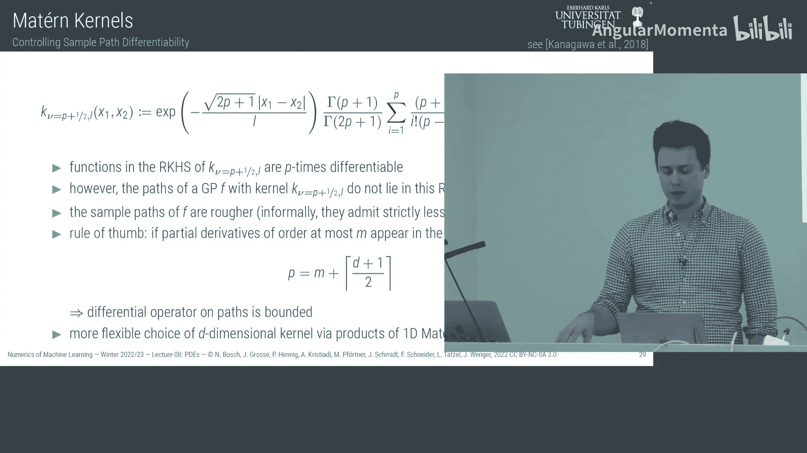

Yeah， with that， I come to an end。 We've seen that P D Es are this important and actually sort of ubiquitous language for。

 for modeling problems， physical problems specifically。

 but also other problems from other domains in the real world。 We can。

 we have seen that we can use our recurring framework of G P inference to actually solve these PD Ds。

 but more generally， GPS provide this， this framework in which we can。

Fuse or combine very heterogeneous information sources into a single regression model by using these Eine information operators。

 And in the end， we've seen that you need to take quite some mathematical care。

 So as not to make mistakes in the model construction。

 but this mostly applies to the construction of the。Prior。

 and I've given you sort of a shorthand for how to get at a specific A prior for a specific equation and practice。

Alright， thanks for listening， and I'm happy to answer any questions。😊。

