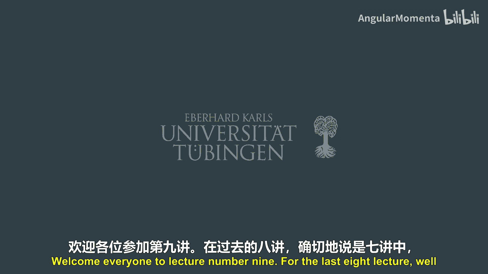
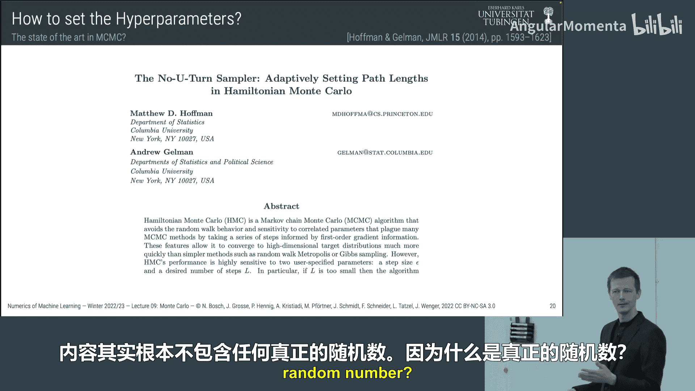
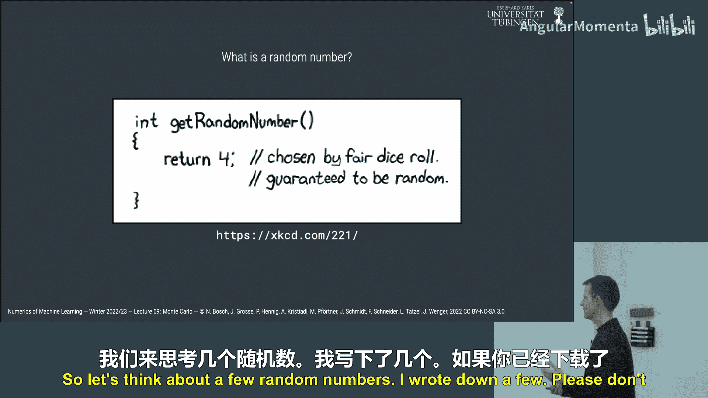
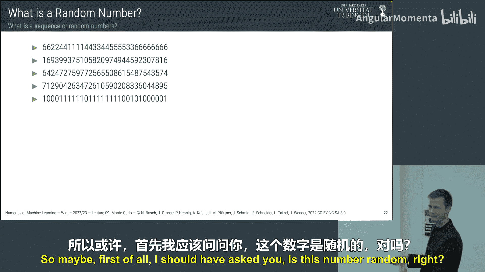
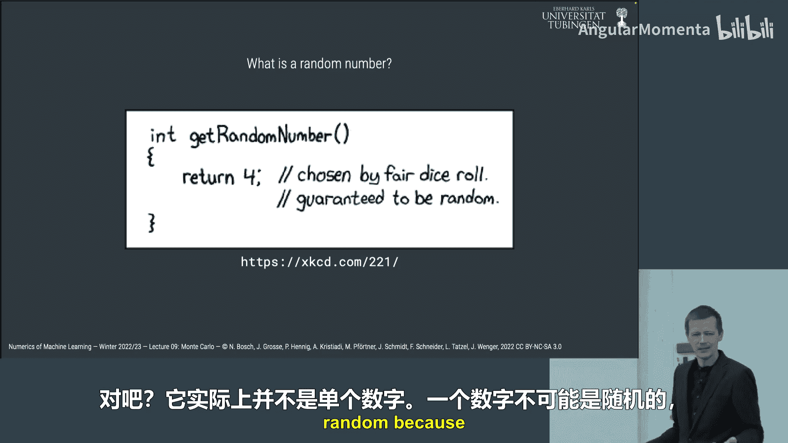
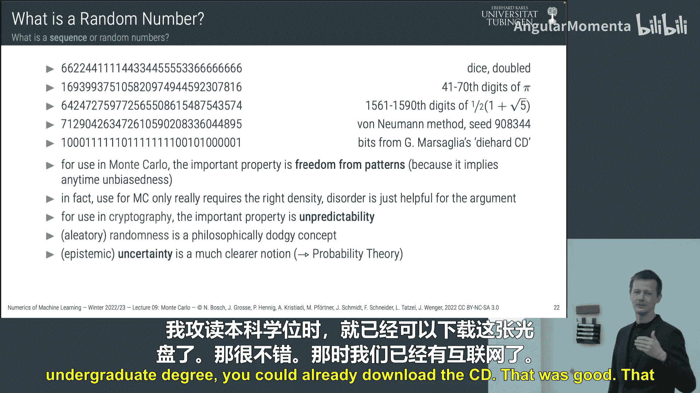
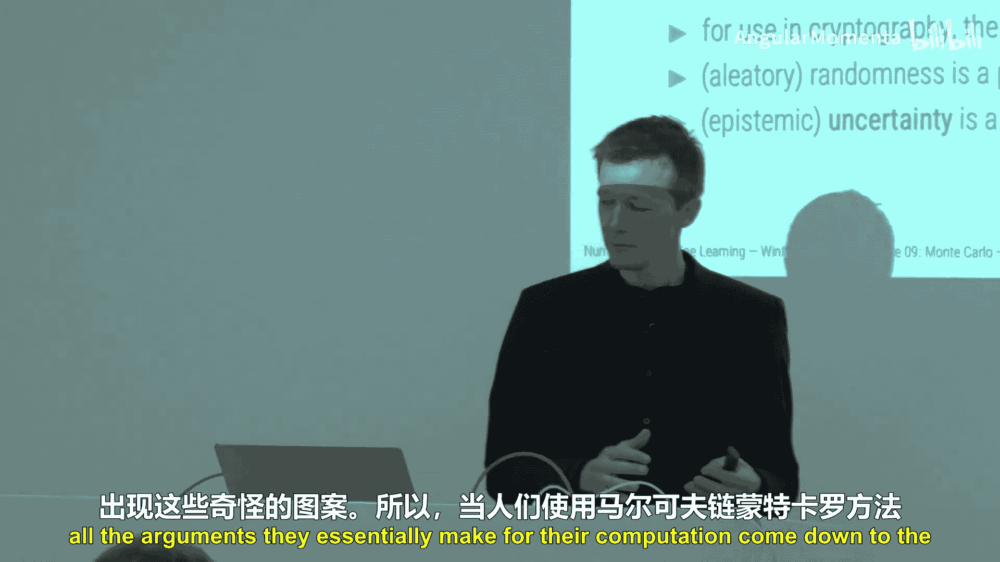
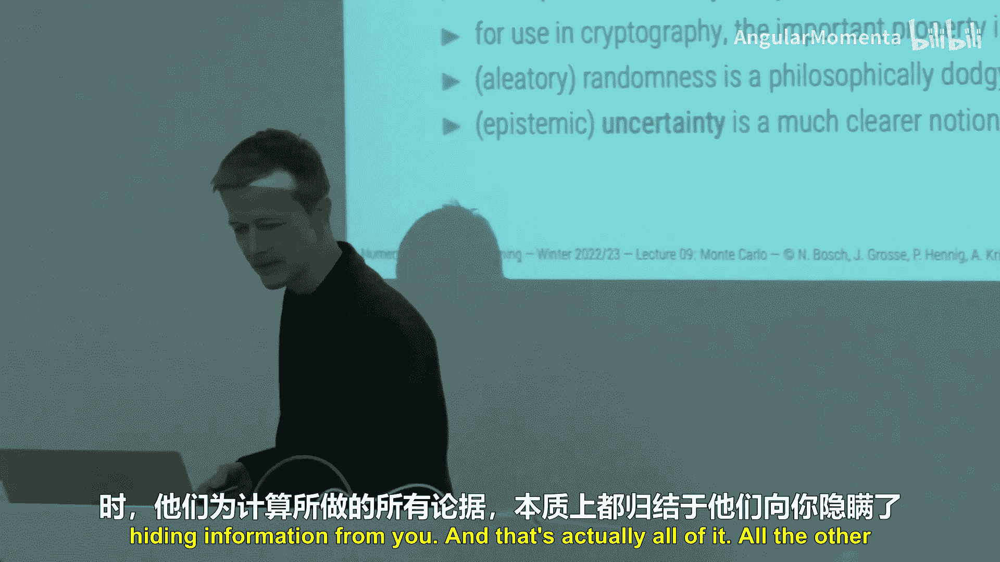
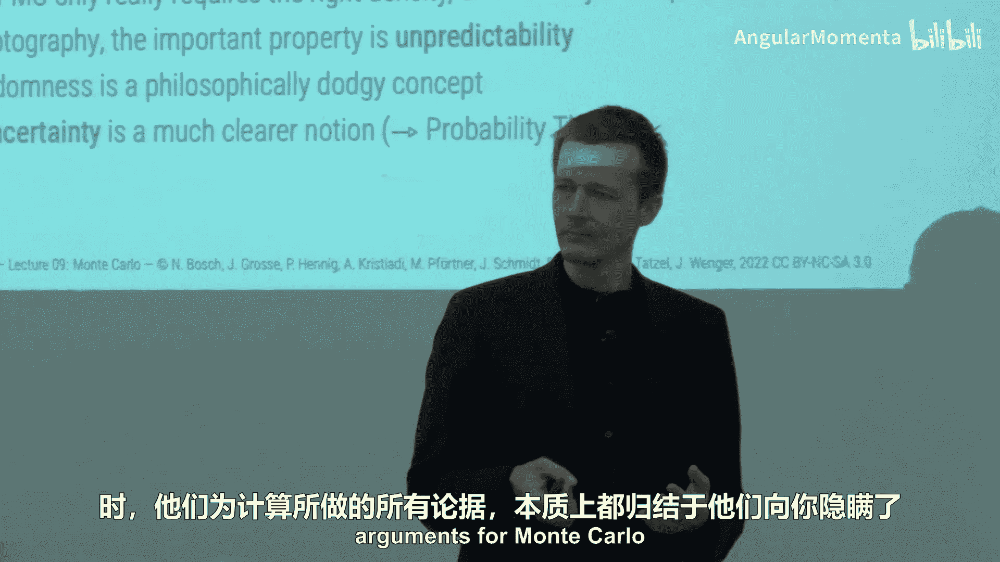
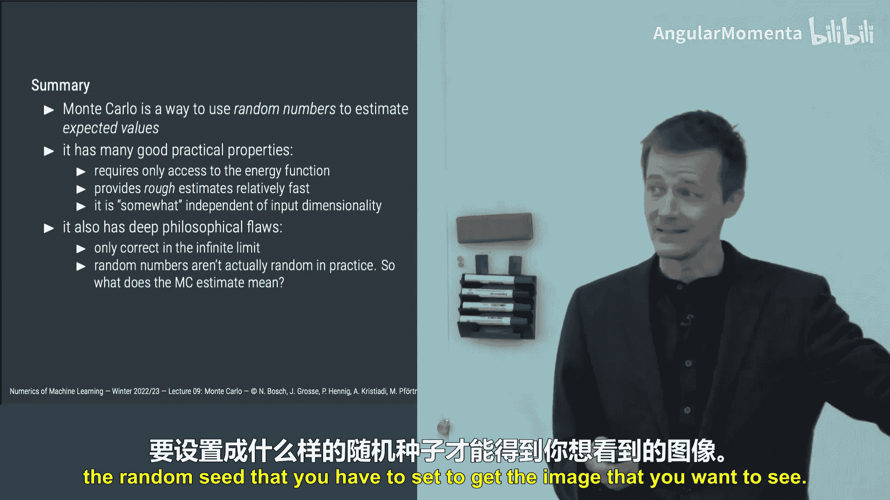

# 【精译】蒂宾根大学《机器学习中的数值方法》-p09-9-——-蒙特卡洛-——-菲利普·亨尼格--BV1WMYHzAEcL_p9-

。

🎼Welcome everyone to lecture number nine。For the last eight lecture， or actually，7 lectures。

 you got to enjoy well prepared， beautiful lectures by the PhD students。 Now。

 for the next two lectures， I'm going to take over， and I'm gonna be less prepared， I can tell you。😊。

We've been talking about。Linear algebra first， I that makes total sense because linear algebra is the foundation for everything。

 You can't really do computation If you don't know how to solve linear systems of equation。

 And then because it was natural to extend from the point of view of Gaussian process regression。

 we move to simulation。😊，And it turned out that simulation is actually quite a complicated problem。😊。

So。For the next two lectures。Will actually， I well， first of all， I can tell you。

 you've now passed basically the heart， the hard stuff。 So from now on。

 the rest of the course should be， if you've made it this far。

 it's gonna be fine for the rest of the course。 What we now move to for the next two lectures is ostensibly integration。

😊。

And the reason。We're doing it at this point was， while okay。

 simulation was like naturally to follow up on Gasian process regression。

 integrationeg will actually have a slightly different kind of character。😊。

Will use it less as a direct means of some， to， to get to some tools you absolutely need to know。

 But more to reflect a bit on the the nature of computation as such and。How to do it right。

So when I say integration， I mean the kind of computations that we need to perform in machine learning when we do Bayesian inference。

To do Beijing inference friends， you have to compute。Conditional distributions， posterus。

Using base theorem。And base theorem contains an integral。And it contains a joint distribution。

 And that integral is essentially kind of a marginal， right？

 So you can think of this marginal also as the an an expected value of some conditional distribution。

And then， of course， expected values more generally are also quantities that we want to know。

 If you done， if youve done patient inference， you want to know afterwards。

 what is the expected value of some quantity， What is the mean， What is the variance。

 what are covaris， how do things depend on each other for to answer these kind of questions for general distribution。

 We always have to compute quantities that look a little bit like this。

So there is some function which we care about。If you wanted to compute the mean。

 then that function is just a linear function。 If you wanted to compute a variance。

 then it's essentially a square， the， the quadratic function。

 And then there is some underlying distribution piece， some probability。

 density or probability measure in general that we need to integrate over。So how do we do this？嗯。

Today， we're going to focus on one very particular way of doing this。Called Monte Carlo。 quick check。

 handss up。 Who's used Monte Carlo before。😊，Not， Yeah， everyone。 good。 Not everyone， actually。

 There are like three people who didn't raise their hands。 You just not， just haven't broken up yet。

 Okay， so you all know about Monte Carlo。 That's good because you can do a really quick run through。

 And what I want to do is。😊，Okay， so one one thing we're probably gonna end up doing anyway is like a quick recap of how Montecollo works from the very simple idea to the most advanced algorithms out there。

 So just that were all on the same page on what kind of algorithms we're working with。

 But what I also want to do along the way is to reflect a bit on the history of how these algorithms emerged。

 and how they are used because the main message for today。 spoiler alert is going to be。

 there isn't really。😊，I think such such a thing as just the integral and。

 or an integral and one type of algorithm to solve them all。 But whenever you're facing an integral。

 it makes sense to think about why you're computing it。

 And when you're using a certain algorithm to do。 so it makes sense to think about why you're using that algorithm。

So here's the history of Monte Carlo。 It starts in the Second World War with。Actually。

 several different people。 It's a bit tricky to make out who actually came up with it。

 But two that are really maybe good con contenders are Stanniis love Stanniis Wf Ulam。

 Any Polish people in the room， probably mispronounceces already。 and John Fa Neman。😊。

W everyone who studied ever computer science knows， right from。Well， famous for various things。

 including the phenomenon architecture， working in the US at the Manhattan Project。

 So some physicists have come up with this beautiful observation that nuclei of atoms can be split。

 and they create neutrons。 And there is some kind of idea in the air that that could should be used possible to build a bomb from these kind of。

😊，From this kind of reaction， How do you do that， So the story goes apparently that if I remember correctly。

 U La was in the hospital and Van Neman visited him and H I had about， you know， building bombs。

 as you do。 And their， the problem they had was。That。So the， the reaction is right， there's， there。

 there's an atom。 It gets hit， or actually， it absorbs a neutron。

 and then it splits and produces new neutrons。😊，And those nerons are fast。

 and they sort of spread out。So what you'd like to do is to use those neutrons to split more atoms。

 right， That's a chain reaction。 But if you just put a bunch of visible material together in a ball that doesn't actually happen。

 So the question was， how do you， what's the right geometry。

 How do you arrange this material so that you actually get an explosion。

 And that's apparently surprisingly hard。 It's not just， well， okay。

 if you make a ball that's big enough， then yes， But then you already have the bomb exploding in your lab。

 you need to such that it only explodes once it's over Japan in this case。 So，😊。

They had no computers， basically to speak of。 So they had to think of geometries。 And that's hard。

So they came up with this idea。 Notice that this is kind of an integration problem。

 Theres a bunch of neutrons flying around。 You want， you can， you can optimize the geometry。

 and you'd like to get an expected value for the density of new neutrons to be maximized in some region。

😊，So you need to need to compute this statistic， this expected density of neutrons。

 So how did it do that？ They come up with this idea that we can approximate such integrals。With sums。

😡，Over evaluations of the function we want to integrate over。

 if the points where we evaluate a function are drawn from this distribution。

And we'll see in a moment why this actually works。 But first of all， how did they。

 how did they em proceed Well they built a little computer， an analog computer。 It looked like this。

 It's called a Fermi analog computer， the Fermiac。😊，And it worked。 So， first of all。Well， okay。

 so you can see that they consist of three things， basically two wheels and a pen。

And the pen has lines attached to it。 so you can measure directions。

 and those two wheels correspond if remember correctly to two different settings。

 One is that there are two different types of neutrons to simulate thermal ones and fast ones。

 And that's what these two wheels do。 You can see there's a big wheel and a thin wheel。

 you can switch between these two modes It's like like two modes of computation。

 And then this thing which is difficult to see here in this picture from this direction has like several different rings of decreasing thickness。

 which correspond to different types of material that you can simulate in。

 And so the way this works is now you take sorry， bad picture the best one you can find online。

 Of course， you have to wear your black gloves because 1948。

 And you you hold this thing over a drawing of a geometry you're trying to test with a bunch of dice to create random numbers。

 And then you simulate the path of a neutron by throwing a eye to get a a sample from the distribution of the initial energies of these neutrons that tells。

😊，How far theyre going to go， depending on the material they're in， you're moving this thing。

 this machine on the surface until these wheels tell you that you've now used up all the energy。

 And whenever you cross between different parts of different material。

 you change the mode to keep counting up how much energy you've already lost。

 And then you throw a die again to compute probably or to randomly draw what kind of event happen happens next when you get a fission or some other types of。

😊，Events。It's been a while since my nuclear physics classes。And then you。

 you simulate like 100 of these paths， Basically。 So afterwards。

 this picture is completely covered in black lines。And that gives you a distribution。

 an empirical one for what the neutrons are。 And you can look at it and say。

 maybe I need to have more of a pen over here or something。 And then we do this whole thing again。

 And if you do this often enough， A you manage to build a nuclear bomb。😊，Which was well， yeah。

 So this is maybe a pretty big one， which looks more like a new like a hydrogen bomb。

 You're getting two hydrogen bombs in a moment。😊，Because that's the other kind of inventors for these smart smarter kind of computations。

So。The reason I'm telling you this story， apart of the fact that it's a nice story is that notice how this is actually a simulation method。

We're not initially trying to solve some integral。 We're actually trying to simulate some process。

Right， by creating an algorithm that produces a simulation of a stochastic process， but in a very。😊。

Kind pedestrian literally， well， kind of hand walking way because there's no computers to use yet。

So why is this a good idea to do this kind of computation？ Well， so the idea is to say it again。

 we're interested in this quantity， which is an expected value。

 So it's like the average number of neutrons or the average location of the neutrons or the average length of the path and so on and so on。

😊，And we're going to replace this integral by this thing。Which is sum， instead of an integral。

 So a finite object， instead of an infinite object over evaluations of this function at points that are drawn from this distribution P。

 And this drawing is what happens with the dice in the case of the firmac。😊，So why is a good idea。

 And this is the part you've probably all seen in previous lectures。

 because this is an unbiased estimator。 So what this means is that if you compute the this is now a random number。

 right remember that this is just a number It' not not a random number。

 It's just a deterministic quantity。's an integral。 It's kind of singular in high school。

 And this thing down here is a random variable is the thing youll in university。

 But this random this random variable has a beautiful property。 several beautiful properties。

 One of them is that that it's unbiased。 So the expected value of this quantity is equal to this quantity we care about to see this。

 well， we just compute the expected value of this quantity， this X S are drawn IID from P。

 So the expected value of the whole thing because they are II is the sum over the expected value of those quantities。

😊，Each of these quantities， each of these terms here is just phi。

 So we just have some as some over S copies of phi divided by S， which is just phi。

 So now let me quickly check。 Is this too fast or too slow for you。 I is too obvious。

 You've seen this before。😊，Okay， so it has a good good nodding。 So were， we're too slow。

 I'll speed up a little bit。😊，Like， why is So， So we now know that this random thing we。

 We we are trying to compute。On average， has the correct value。

But every single instance you compute has the wrong value， right， because it's a random variable。

 So the next question is， how far from the truth is it on average， given that on average。

 it's correct。So if you compute that， to compute that variance of the， this， this vendor variable。

 And now， have you seen this computation before， do you know where I'm getting to， Very good， Na。

 not everyone。 But most people。 Okay， so I'm gonna save you this。😊。

Complicated thing of expanding two sums and trying to compute the variance of this estimateator。

 will'll see that this variance is。The so the expected square distance between the render variable we're using to estimate the integral and the actual integral is some constant。

Given by the variance of that function。 So that's the expected value of the square of F under the integral。

 divided by the number of samples。So that means if S increases， the error gets small。

 and that seems to be a good thing。 Right， So we have an an random number that on average is correct。

 And if we expend more computation， it gets ever better。😊，Okay。

 so that is actually the entire argument for why these algorithms not a good idea to do。

And now there are two caveats。 The first one is， is this actually good。

So is this a good rate of convergence？😊，三G。Yes， so that means it just like this， of course。

 this means that the this is the expected square distance or the expected distance。

Drops like one over the square root of S because it's the square root of this thing。But okay。

 so question again， is the school or bad。So it depends on who you ask。

 If you're asking a statistician， they say it doesn't get any better。

Because there is no unbiased estimator that can converge possibly faster than this。

 This is the min max optimal rate for unbiased estimators。So there's no way to get a better estimate。

But if you're asking an numerical mathematician and say。

 well this is like the worst possible way to could imagine， it's not even linear。

If you're looking for polynomial rates with these simulation methods that Jonnatan and Na La Mavin told you about。

 we spoke about conversion rates on the order of amount of computation invested raised to some power。

 Po power， right， not to like not not to  one half， but to like 4，5，6， whatever。

 So that seems like a weird discrepancy， which we have to investigate at next week。

 we'll talk about methods that have these good conversion rates。 But they'll have their downsides。😊。

And today， we'll talk about this thing and why it might still be a good thing to do。So。

 the other observation is。😊，That is often usually made at this point。

 And I used to do it all the time as well is that the nice thing about this is that this here is just a constant。

 And notice how there is no D in here where D is the dimensionality of x。😊。

So X X could be a big vector could be millions of dimensions。

And there is no reference to the dimensionality of this problem in here。Is this true or not？So here。

 people disagree again。 There's actually a threat that went by social media recently and got pointed out to me because theyre citing me at some point。

 So I had to look at this again。 comes from this blog。

 I recommended you have a look at this blog and read it。 You can click on the link in the slides。

 The underline is actually a link。😊，And。I have to say， I think there is a bug in that argument on。

 on， in， in this block。A harmless one that doesn't actually change the argument。

 But there is still a bug in there。 If you can find it， send this guy a comment。

 Give it best regards， right from the lecture。So his argument is， well。

 so it looks like there is no dimensionality in this problem。But， of course。

 there is this variance of F under P。And we could think of a situation where that variance has something to do with imality。

And that's a bit， it's a bit weird， right， because we're thinking of this F as a given function。

So it's just something。 It doesn't really depend on。Dimenssality， as such。

 is just you have given a function， right， But， of course。

 there are settings where you can vary the dimensionality of the problem。

And you can construct situations where that as a function of the dimensionality。

 if you stick within some structured kind of problem that you， where you can vary the dimensionality。

 you can make these variant explode really badly。And that's his argument。

 And I actually started writing down the full derivation。

 Then I realized that there's probably a bug in his derivation。

 So I think his derivation doesn't quite work， but。It， it's essentially true that if you。

 if you just take care to construct F in such a way that it interestingly behaves in dimensionality。

 that you can make this variance explode really badly， including exponentially fast。😊，However。

Typically。We're thinking of F as the mean。 So the linear function， X or the quadratic function。

 And then this usually isn't actually a problem。So。Long story short。

 I had to be really careful about this， because people。For example。

 also cite me and claim that I'm not making this point。 So I'm going make this point very clearly。

 yes。The conversion rate of Monte Carlo is not independent of the dimensionality of the problem， but。

For most interesting applications of this kind of way of solving integrals。

It is very insensitive to the dimensionality of the problem。

In the sense that you can use Monte Carlo sampling to solve very high dimensional problems of computing expectations。

And the methods we're going to talk about next week will patently not have this property。

 They will not scale well to high dimensional problems。In a similar way to how not， actually。

 you know， I'll not make that point because it's probably technically just slightly incorrect。So。

That means it scales， but it also behaves converges in a questionable way with the number of samples that we are drawing with the amount of compute we're investing into the computation。

 So here's the classic example again， just to make sure that we all talk talk about the same thing。

 So let's say we wanted to estimate pi， which is a stupid thing to do。

 because theres fast fast ways to compute pi。 But one way to do it would be to draw random numbers on the Unigrid。

😊，Just this line of Python。 Here's a definition of pi。You just draw random numbers。

 You square them all element wise， and you sum them always in pairs。 When that sum is less than one。

 you're inside of the circle。 When that sum is larger than one， you're outside of the circle。

 The area of this quarter circle is pi over 4， because if this is a unit box。

 And this is a unit circle， which has area pi R squared R is one。 So the area is pi。

 we have a quarter of that。 So it's pi over 4。😊，Right， and so yeah， if you multiply by 4。

 the average value of those， this binary random variable of being inside or outside。

 you get an estimate for pi。 If you plot this， the absolute error of this way。

 stupid way of computing pi as a function of how many samples we do， you get this plot on the right。

😊，And you can see it converge towards the truth as a function of the number of evaluations。

And it converges with a rate that is given by one over the square root of the number of samples。

 Those are these straight angled lines that I've plotted in。

 I've also plotted in the expected value for this， which is the variance of。These。Venddom variables。

 by the way， what's the， how do you compute the variance of this just a sanity check。

How do you think I got through this black solid black line。So for that。

 I need the variance of this function F divided by n， right？ So divided by n is easy。

 That's how the plot comes away。 But what's the constant。

So this is a newly random variable that we're computing here。 is's either  one or 0。😊。

But it's  one or0， with a certain probability。And that probability is pi over4。😡。

So it's pi over 4 is the probability。 And what's the variancerrogance of a beuli random variable。

Which have if， if you have a balloon event variable that is positive with probability P。

 What's its variance。Yes， P times 1 minus p。 So it's pi over 4 times 1 minus pi over 4。

 And that's exactly what this how I got to this black line。 Okay， so now。😊。

This means with a very small bit of code， like with this one line of code。

 with a tiny amount of compute 9 to 10 samples， I get a number out that is correct to one order of magnitude。

 So around 10 samples， we get something that crosses the 10 to the 0 line， right。

 where we get sort of 3 on average。😊，That's good。 Before that， we get like basically ones and zeros。

 Shiny。you might times 4， right， So basically 4，0，4，0， and then suddenly better。

 And so that's kind of good。😊，But if you wanted to have a really high precision answer。Like。You know。

 the first 100 correct digits of pi。 then while you can extrapolate this line to get to -100。

 And that takes a while。😊，Probably longer than we have time in the remaining universe to to compute。

And as simple as this example is， that actually contains everything you need to know about Monte Cardo。

 that if you're faced with a problem like these nuclear physicists were。

 we have just no other way of computing something。 And it's really unwieldy the thing you're working with。

 And you just want to have a rough estimate。 Then this is a very smart thing to do。

 because it's often quite easy to construct the simulation to draw from the distribution and then just watch the simulations and kind of see what they typically look like。

 basically looking like like like looking at samples of you know probabilistic machine learning models。

😊，But it's very hard to use this kind of computation to get a precise answer。So。

If you're facing an integration problem in one of some of your machine learning work。

 then if you want to have an answer by this afternoon without having to work much on the math。

 This is a smart idea。 But if you want to have a precise answer， this is not a thing to do。

And its may seem completely obvious， especially if you've had a probabilistic machine learning class。

 but。😊，I think this， this kind of insight isn't really taken sufficiently seriously by most practitioners。

 There are still very， very many people out there who think Beijing influence is always Monte Carlo and it always very expensive。

That is， I think fundamentally， comes down to this insight。You thinking well。

 to do Beijing inference。 I need to do Monte Carlo， because that's the only way to compute integrals。

 right， And that's very expensive because you have to run it for a long time。😊。

And that's not true because there are other ways to approximate integrals。

 which can also work really well。 They are just typically more work to get to work。

 but then they can potentially be very fast。So that was the easy bit。

 That's just what's called simple Monte Carlo。 You actually draw of the distribution。

 And then you followed， you just stamp simulate a lot and compute expected values under under simulations。

😊，In practice， of course， you can't actually draw from P quite often。And so， we need ways。

To construct samples from a distribution that is fundamentally intractable。

So once you have aable distribution， Monte Carlo turns the intractable integral into aable sum。😊。

But for that， you first need attractiveable distribution from which you canly draw samples。

And the classic way to do that。😊，Is what。Before I go to the next slide。Okay， good。 Im。

 I'm slowly catching up with your knowledge。 I guess so there are standard ways to take。😊。

Uniform random numbers。And turn them into samples from some other distribution。That work well well。

 Okay， up until two years ago， I would have said which work well for very simple low dimensional problems。

And these are essentially so direct transformation。

 So sometimes for certain one dimensional distributions。

 you can fiddle with pen and paper and find ways to turn uniform random number random numbers into Gaussian random numbers into gamma distributed random numbers into beta distributed random numbers and so on and so on。

 Okay， so that's very， very basic。 That that's what happens inside of your random number generator subrin nu dot random is full of these methods。

 right， Okay， fine， then there are ways like like like rejection sampling and important sampling。

 which take standard typically Gaussian distributed random variables and kind of use them to approximate other distributions。

 those don't scale well to high dimensional problems， only two or three dimensional。 And quick。😊。

Like injection at this point。 This is what the story used to be is probably the story you got to hear in your probability mobility machine learning class as well。

 But there are no methods that can actually draw from extremely high dimensional。

 very complicated distributions， essentially by transforming uniform random numbers。

 And theyre called score based diffusion models。😊，This lecture is not about scope based diffusion models。

They are very new， and you've all seen them， right， They drive things like stable diffusion。😊。

They're essentially just that。 They're just direct transformations of uniform random numbers through a really complicated non nonlinear function。

 some neural network。😊，Essentially。But we didn't have quite quite have time to get get to that story in for this lecture。

 Also， or maybe at the end of this lecture， I'll ask you again why we are not using stable diffusion yet to draw from Bayesian inference problems。

 And you can think for the rest of the lecture。 If you are bored by what I'm going to tell you next。

 why that is the case。 Okay， so what is the standard way to produce random variables that are distributed according to some higher dimensional distribution is called Markov chain Monte Carlo。

😊，And that's what we're going to talk about for the rest of this lecture。Markov chain Monte Carlo。

 you've already heard the word word Markov chain several times。 So here's the picture again。

 that was also in Uninatans and Naana is lecture are methods that are based on a structure that moves that steps itly forward with a finite memory。

😊，That's what a Mark of chain is。 right， So it's some data structure where you do a local computation that only depends on some finite local state。

Typically， that finite local state is actually the sample we're trying to draw。

But we'll get to a point where it's a bit more than that。 Just like in simulation。

 we also got to a point where it's a bit more than that。And。The methods that。

That there's essentially actually only really just one method of this type。

Which engenders all the other ones。 And it was invented by the people。 actually。

 I'll go directly to it because you've probably seen it before。

 It was actually invented by the generation of nuclear physicists who wanted to build hydrogen nuclear bombs。

Thermonuclear weapons rather than classic nuclear fission weapons。 in particular。

 the names that are connected with these people are Edward Telleller and the husband and wife。

 Marshall。 And I think she's called， oh I forgot her name Agodi。

So I looked them up before this lecture。 And now I just got the first， Okay。

 so husband and wife Rosenblt， who worked on nuclear weapons in Los Alamas in the 1950s。

1954 and so on。 So they are slightly more complicated geometries to optimize。

 and they had to use the number generators that have a bit more advanced。

 And together with the mathematicians Metropolis and Hastings。

 They ended up coming up with this algorithm， which you've probably seen before。

 The Metropolis Hasings algorithm。😊，Which to remind you works as follows。 So this。

 were constructing a markov chain。 So we're going to have a full loop wrapped around what's on the slide。

That's the important bit。 And now what happens inside。 So we go， we are at a current state。

 And now we're， we're drawing from some proposal distribution called Q， a new location。😊，X prime。

 which so the typical choice to have in mind is that Q is a Gaussian distribution around your local point。

And then at this proposed location， we're computing this what， what。

 what initially looks like a weird ratio between the distribution we are trying to draw from。

At the proposed distribution and the current one multiplied by the ratio between the。

 the proposal distribution with reversed arguments。That's the general form。 Typically。

 this is a Gaussian distribution。 So X T is the mean of the Gaussian and X prime is the argument of the Gaussian。

 And because Gaussians are symmetric around the mean。

 because there's an x prime minus x in there squared。

 which you can reverse Those two quantities actually the same。

 So this is just one and it cancels out。 And we only care about the ratio between P at x prime and an X T。

😊，If that number is larger than one， we go to that point。

 So that means if P of x prime is higher than where we currently are， we always go there。

 And if it's lower， then we go there with a probability that depends on the ratio between the two。

 So if the step that has been proposed is extremely low， it's extremely unlikely to be accepted。

 and if it's very， essentially the same value， then the probability is very high to accept it。

So one intuition for this is that it's a little bit like optimization with the probability to go downhill and how far like the probability to go downhill depends on how far you're going downhill。

 But actually， the best way to。Get a sense for how this works is to use a beautiful。Use it。

Beautiful animation。That。I'm just going to start and move over。 I should have started this before。

 sorry。嗯。Let me go here and move this up。That doesn't come for me。 comes from a guy called Qi Feng。

 So here's a probability distribution。We are going to do。Metropolis Hatings。

 we are starting at some point initially here。 And now， let me see if I can make this a bit。Smaller。

 so initially， we're at some point， we're drawing for a proposal distribution a point in here。

 and then check what the ratio is。 And that's probably not gonna be accepted。

 Then we draw a new point that also doesn't get accepted at a new point。 Oh。

 and that's now gonna get accepted because the probability density at this point is higher than here。

 So we accept with probability 1。 and we go there。😊，And then， we。Keep doing this many， many times。

And if the algorithm runs for a long time， it's gonna produce points。

That get us is that produce a bunch of， a bunch of points first。

 And I'm not coin them samples yet because we'll have to talk about why those are acceptable samples in a moment。

Okay， and。Maybe while were staring at this plot， cause it's kind of nice to look at。 By the way。

 have you seen this animation before。😊，No， no， yes， no， no， Okay， half of you have then。

Maybe one thing to to， to notice is just just sometimes it's really good to look at visualizations of other like this。

 because you can immediately see inefficiencies。😊，So one thing is， whenever this thing。

Stays at some point。 You can actually see the histograms move while it stays at that point。

This is a part of metabolic Hastings。 It doesn't reject a point。 It just adds it to the count so far。

 It just stays at some point， but keeps adding it to the count。

And then we can maybe notice that how well this thing explores depends on how well this proposal distribution is adapted to the entire distribution。

 So， for example， if you make it a bit smaller。Then it's going to move around more。

Because it's typically going to be proposed in a region that is close to the current one。

 So if you're already in。A characteristic region of the distribution， then will highly likely。

 highly likely to accept。 But if you make it too thin， then we don't move So we accept every point。

 but were basically stuck in some regions。 We don't explore。 So this is essentially an exploit。

 exploitation kind of problem， right， So we need to manage find a point where the algorithm moves as much as possible while also accepting as much as possible。

😊，Okay， let me stop this。And go back。 So why is this an acceptable thing to do This algorithm。

 Why does this actually work， So this algorithm has two interesting properties。

 which are the properties you always find in papers on new in newly invented Markovche Monte Carlo algorithms that are called detailed balance and algorithmicity。

😊，We sort a detailed balance before？Now we're getting somewhere。 Okay， so T balance is this property。

 which says that the probability to be at some point。And to move to another point。If。

P is actually the distribution we're trying to sample from。

Is equal to the probability to be at some other point and to move from the other point to the previous point。

So if P is the correct P， then the algorithm is as likely to be at some point and move to the other than to move in the other direction。

 right， So to be at the other point and to move to that direction。

And to show this is actually quite straightforward for metropolis Hatings。

 It's much harder for more advanced algorithms。 So we actually just plug in the definition， right。

 so the probability to move from x to x prime， is the probability to propose that point and then to accept it。

 We accept it with minimum1 and this。 Then we just move these terms into the minimum， we rearrange。

 move them out of the minimum again。 And we find that we see the thing the same thing on the left on the right hand side of the of the equation。

 And we' are fine So the beautiful thing about this property。 is that it means this process。

 this entire process of running this for a long time， has a stationary distribution。

 which is given by P。 So that what this means in math is if you look at this expression down here。

 So that's you think of this as an operator acting on this entire function P。😊，Right。

 so this is this T of x and X prime， this transition operator。

 the probability to go to x prime if you R with X。 That's a conditional probability distribution。

 But you can also think of it as an operator that that kind of gets convolved here with X。 sorry。

 P of X。So what is this， we here in this integral， we can， by this line， we is show we could。

 we can replace this expression with this expression。 That's literally just from above。

 Then we notice that P of x prime doesn't depend on x， so we can take it outside of the integral。

 And this here is just a probability distribution， because it's the probability to go to any value X。

 given that you are at x prime。 distribution distributions integrate to one。

 So we're left with P of x prime。😊，So if you have a set of random numbers that are distributed with a density given by P of x。

 and then this algorithm operates on this entire sort of in your head。

 infinitefinly large set of random variables， random numbers。

 then they don't change the density of those points。So this is like a station。 Well。

 it is a stationary point of this operation。So algorithms that have this property have at least one such stationary distribution。

 Then the only other thing you have to check is that there isn't another stationary distribution that you might excellently get stuck in。

And this is the slightly more tricky point that is can actually be formulated in this notion of what's calledergoicity。

 And this is always a bit difficult to explain because it's， it's a little bit。Self referential。

 It's kind of。Just writing down the fact that there is no structure。

 that not insufficient structure in the algorithm to get stuck in some other stationary distribution。

 So aity of a sequence means that it is a periodic。 It doesn't contain a recurring sequence。

 and it has positive recurrence。 That means if youve once been at at some point。

 Then there's nonze probability to come back to that point at a future point。

processes that have this property have only at most one stationary distribution。

And our algorithm has this property。 And here is that， that's the bit that is kind of。

Nearly pointless to prove it's so Im I， I can give you a hand wavy answer。 So why is it aic， Well。

 because we're drawing。Randomly， so there' is no periodicity。

But that's really just saying what I mean by random， right It's just， it is not periodic。

 We're not gonna do the same thing after8 steps， because that would mean we could predict what happens after eight steps。

 right。And it has positive recurrence that is actually correct for mepolis hasstings with proposal distributions that have full support that could potentially move everywhere。

 because then there's always a finite probability to move to the point you've previously been at。

 Okay， so by this property。😊，This algorithm fulfills these two properties that it has at least one and at most one stationary distribution。

 So that means if you want it for a really long time。

 it has to be in that one stationary distribution。 and that is the distribution we' are trying to sample from。

The only problem with this statement is that it's just。An existence statement there eventually。

 it'll get to this stationary distribution。But we're not seeing how fast。

And so remember for simple Montecalo， we had this square root conversions。😊。

Which we already thought was a bit bad。And we， but we also realized it's actually the best rate you can imagine。

 So this algorithm is gonna have a worse rate。😊，And if you do this。

 so you actually typically get a behavior like this。

 So this is a kind of insight that comes from David Mcka's wonderful textbook on machine learning that such algorithms often have these kind of local random walk behaviors。

 You also just saw it in the animation we looked at。

 And that means we actually have to think of a random process that moves on top of the random process we are already trying to draw from。

 And the number of effective samples that this algorithm draws have something to do with this kind of free way。

 free step length or free time length between two samples at completely opposite ends of the distribution。

😊，One way to think about this is to say， if you have a distribution that looks sort of like this that is very elongated。

 That's typical for nontrivial distributions and high dimensions。

 there will be one length scale that is the largest。 In this case。

 it's this sort of diagonal from bottom left to top right。 Let's call that capital L。

 And there'll be one length scale that is the smallest。

 let's call that the one that is orthogonal to it。 That's tiny。

 And now if you make that proposal distribution much wider than this width。😊。

As I've just done this in this animation before。Then the acceptance rate will be very bad。 So if。

 if I make this really big， right， then。The distribution， it， it will mostly not accept points。

 So it'll stick around for a long time。And if I make this acceptance。

 if I make the proposal distribution very small， then every point will be accepted。

 but we're not going to move at all。So probably we're going to set。

 set our step size at something like the small length scale epsilon。

And then we're gonna get a random walk。On。A scale of epsilon。

 So random walks keep a move a distance of square root number of steps。

So the number of steps is the acceptance rate times number of of steps taken， right？

 so that the average distance traveled in time T is。The proposal with。

Times the square root of acceptance rate times number of steps。

And that means if you solve this number， if you you put a pick L here。

 So if you want to travel from one end of the distribution to the other and then rearrange this equation to get an expression for T。

 you get that the number of time steps you have to wait to get effectively one sample is。

Square of the ratio between long and small length scale。

 So if you're thinking of a covariance matrix of a Gaussian。

Then L and epsilon are the largest and smallest eigenvalues。

 So they are like condition numbers of this， of this matrix。 and it condition numbers squared。

 So that's pretty bad。 And that means you'll get convergence weights that are still O of square root of T。

 But with a huge multiple in front。😊，And you can see this here。

 So the plot on the left is actually just like another way of looking at this plot。 So in red。

 you see the Monte Carlo estimate for the means of this distribution converge to the correct value。

 which in this case is 0。 Why， because just to make sure you understand。

 this is like aus distribution。😊，With mean 0。 So it has two means 1 for x1，1 for x2。

 And the red points are drawn ID from the Gaussian， which I can， because it's a Gaussian。

 And if you sum those up， you get those two red lines at the bottom。

 which converge like one over square root of n multiplied by one。

 And I'm drawing two standard deviations。 Y 1， because it's a standard Gausian with correlation。

 And in blue， you see the same plot for these for these mes hasstings estimates。

 And you see that they are still really bad。😊，And actually。

 a challenge with this is that if you're just looking at the histo， the。

 the histograms of these sort of， if you're just looking at statistics of these blue dots without knowing what the shape of the distribution is and without having the red dots as references。

It's not entirely obvious how you would notice that this is the case。So this week。

 your homework is to implement a Mac ofche Montetecallo algorithm。

 a very specific one or a very specific problem， as you may find out。😊。

And one of the things I hope you're going to try is to convince yourself that you have actually drawn IID samples。

AndWe'll talk about that in the， in the tutorial next week。

This is not going to be straightforward because youll actually have。

 a distribution to draw from that is totally unintuitive。So here it's simple。

 but keep it in mind when you're doing the homework。Okay， so。Now， we have。One algorithm。That。

Works kind of， but also kind of doesn't work。 And we're at 1954 by now。So now， since then。

A large number of smart people have in completely invested their brains into making these algorithms work well。

 and they made several really great advances to make them work much better。

 which actually mirror to some degree， some design patterns that you've already seen in the simulation。

😊，Lectures。So even though for many of you， Monte Carlo is a repeat of something you've heard before。

 maybe try and find the connections to the other parts of this lecture course that we've been through before。

 so。What， who， who knows what， What is your favorite Markov Cha Montetekalo algorithm to use in practice。

What's the atom of MCMC。嗯hu。It's a bit less obvious than for optimization。I wait for a moment。Yesす。

Yes， so Hamiltonian， Monte Carlo or nutss is the statement。 And so nutss is a。

 is a variant of Hamilton Monte Carlo。 Here is Hamiltonian Monte Carlo。 Actually。

 I'll leave that out。 So is， who has heard of Hamilton Monte Carlo。😊，Not that many people。 Okay。

 and those of you raised your hand。 do you think you know how it works， It's always this， okay。

 so we are gonna talk about Hamiltontonio Monte Carlo。

 A because it's the atom of Markov chain Monte Carlo。😊，And B， because it uses an OD E solver。

 And we've spoke about OD E solvers in the past few weeks， so。

Let's see how they connect to each other。So here's the idea。

Were trying to draw from some probability distribution， P of x。

Let's imagine that this P of x is can actually be written as what physicists would call a Bzman distribution。

 So that means it can be written as the exponential of minus some function of x。This is an extremely。

😊，Minimal assumption， pretty much all ever so slightly the relevant probability distributions are off that form。

 in particular， basically， all of physics。In machine learning。

 we call these models energy based models。So。And there's beautiful theory about pretty much about how pretty much every density is of that form and so on。

So，嗯。That's the problem we're trying to draw from。 And we have access to E of X。 Now。

 what we are going to do is we're actually doubling the amount of。Variables we're going to draw。

 So that's like in the O D E filters that you've seen， we take the state space of the Markov chain。

 which consists of all the X。 And we just， for every X， we invent a second state。😊。

Which we call the momentum P。 or it's just a fancy word for the time derivative for x dot。Okay。😊。

And now what we have to say is how that new part of the state space， how that's going to evolve。

Velative to x。Because we just invented it。 So it has no further description yet。 It's just there。

 So what we're going to say is that it evolves according to。

A function that defines an ordinary differential equation。 Let me first write down the function。

 and then talk about the ordinary differential equation。 We're going to come up with some function。

 which is called H because of this guy， William Roowan Hamilton。

 which has the important property that it that it contains the energy that we've already used and it depends on X。

 and then uses a new function， which we call K for kinetic energy。

 which only depends on the other type of variable on P。😊，And， in fact， the typical choice。

 but it's actually not the only one you can choose。 The typical choice is this。

 which is one half times the essentially the square of P。So for the， for your high school physics。

 you're thinking of one half M V squared right？ So that's kinetic energy and M is just set to one because it's easy。

 right And so if you want， if you already heard about this and you apart by this。

 think about in your like branch off at this point from the lecture and think about how you do this with relativistic energies。

 You would get relativistic Hamiltonian Monte Carlo。 And that's a thing。 you can try that。

 So just imagine what happens to the mass。 if you want to do it。 Okay， so。

 and why that might be a good thing to do and why not。 So okay。

 but for those of you who haven't not about this algorithm， don't go there yet， keep it in your head。

 And instead， we're just saying you're gonna use this function。 That's just our function。

 You just put it in there。 And the important thing about this is mostly that it only depends on P and not on X。

😊，And now we're defining a differential equation。That uses derivatives of this function H。

And that is actually an important differential equation that you don't get to change。

 at least not easily。 We're going to say that the time derivative of this variable x。

Is given by this the partial derivative of H with respect to P。So what is this， Well。

 E doesn't depend on x。K depends on P。 If we take the derivative with respect to P。

 we just get P out， right， simple。And the time derivative of P is given by minus the partial derivative of H with respect to x。

And what is that， Well it's on the next slide， But you can already think about what it might be。

 Just look at this expression and think about what the derivative with respect to axis。

So why is this an interesting thing to do。 So the first observation is if we manage to draw from the P of X and P that is defined by E to this function。

😊，Then because exponentials work the way they do， this distribution factorizes into a term that only depends on X and one term that only depends on P。

And the P that depends on x is our P of x that we are trying to draw from。So this algorithm。

 if it manage to to draw from these， from this joint distribution of X and P。

Marginally draws from the distribution over x。 So if we watch it move around in this state space in X and P and then drop all the ps and only look at the x'。

 we get draws from the actual P we're trying to draw from。😊，So that's a first， good property。

The second good property might be on a few more slides， because first。

 we need to think about how you actually implement this algorithm。 So for that。

I have to pop around a little bit in the slides。 For that。

 we need to solve this differential equation， right。

And in normal lectures on probabilistic machine learning。I would now go and for that。

 you need to know e solve。 right， And there's this magic thing called do 5 that you can just call in spi。

 and it does before for you。 or you can implement it yourself。

 And there these algorithms called leapfrog algorithms and physics actually。

 which happened to be Hes method。 But you've had this lecture。 So we can talk about it。

 How would we actually implement this。 Well， here we are。

 So for this here is our equations again from above， this is our choice of H。

 we've already found that the we've decided to model this the O D E。

 which for the X X time derivative does this， which is P。 And I asked you to think about it yourself。

 So the time derivative of P， which is given by minus the partial derivative of H with respect to X is。

😊，Minus the gradient of E with respect to x。So now we have a differential equation。

 which we could feed into an OD E solver， but we could also just implement an OD E solver ourselves。

Here's the ordinary differential equation with this state space and this right hand side of the differential equation。

 And now what they're going to use is what's called Haings method。

 which youve heard about in Naya lecture as a Ruungakua method of second order。😊，So what it does is。

This here is kind of the putcherapau hidden in this expression。 right， So we start at point I。

 and then first evaluate at H half times F of the initial point。

 That's the first line of the puthaap law。😊，And then， we evaluate again。At1 H half， Well。

 we evaluate at Z I plus the Euler step。Basically， and then take the average of those two values。

This is， as it happens actually， your Wgauta method， which has converence rate order，2。

 And you can also implement it。 Well now， so this is the abstract expression。

 right for the Wkua method。 This is how you would implement the Wkua method in code。😊。

But in this case， we know what F is because it's a specific ordinary differential equation。

It's the one that's at the top。So we just plug it in， and you can write down what the hoin step is。

One forward。Directly。So this is the difference between using a software library and actually implementing it yourself by hand。

 If you do that， you end up with， you know， a bunch of Python code that looks like this。

 You can look at it after the lecture。 But instead， we can also go back to this nice visualization。

Reit。And change to what's called Hamiltonian M C。And。Step。So were at this point again， initially。

 and now， what we don't see actually is the momentum， which is not plotted in this plot。

 but it was initialized to some random variable at the initial point。😊。

And now this is what the OD E solve did。It simulated the dynamics of this Hamiltonian system with。

 which is basically a particle of mass 1 moving in a potential that is given by the log which with。

 with energy given by the potential energy height， given by the logarithm of this。Shape， right。

And this is what this OD E server did。 W Wed around Vi a lot and ended up over there。

And now we reshuffle the momentum， set it to a random variable again。 solveve the OD E solver again。

 whoop。😊，And we're at the other point。And that's kind of neat， right， So just two steps。

 And we move basically from one end of the distribution to the next。That's nice。 And we move again。

 and we accept。😊，So maybe I can just let this one for a bit。

 So you can see it kind of move around and it produces these nice samples。 Now， in a way。

 we noticed that。😊，This looks really cool。 moves very fast， right。

 But notice that every one of these black dots in these。

 in these kind of snakes requires one evaluation of the log of P。😊。

So we should actually maybe compare the efficiency of this algorithm to the corresponding me say things that makes as many evaluations as we have black dots in here。

😊，But that's actually still better for our reason that we're gonna see in a moment。So。

 but maybe the thing to notice in this animation is that we need a somewhat constant number of steps to simulate。

Actually， we are doing a constant number of steps。 Sorry， we don't need it。

 We just set it to a constant number of steps。 This is， which is set here，37。 And here this is the。

 the， the step size。 So this 0。1。 That's the step size of the OD E solver， little H。

 If you make it big， then the algorithm makes big， chunky steps。😊。

And you can see already that this is somewhat inefficient because it moves and then turns around and comes back。

 If you make it really big， It goes really crazy。 And if you make it tiny， then it's super precise。

 But why would we need to do that， right， You could just get really precise answers。 Okay。

 I'll stop this。😊，And now， why is is a good thing to do。 So for this。

Here is two interesting observations。Maybe they are actually。Yeah， okay。

 so you can do them in any order。 but they are already given away by this slides。

 So the first thing is， this is a mepoli hassting scheme that always accepts nice。 Secondly。😊。

This algorithm makes steps that don't move at， a distance that is given by large length scale over short length scale。

Squared， sorry， number of steps square or large angle or long scale length scale square root。

 But instead without a square root。 So we basically get rid of this problem。 So instead of this。

 we just get a one here other than a two。 and we'll see why in a moment， so。😊，Or we'll see it here。

 So， first of all。If our distribution， if we take sort of small steps。

 if you think of a local point where the distribution is almost a constant function。

Then this algorithm just moves in the way that a particle with momentum moves， right。

 It just moves in a basically straight line that doesn't bend because if there are no force forces acting on a particle。

 it just moves in a straight line， right， Newtons。Second law， I guess。F is n times A。

 So the distance traveled after n steps。Is given by the number of steps times the step size。

 essentially of the solver。I a constant。Instead of the number of steps and then the square root of it。

 So we're going to move further。 And we saw this in the animation。

The second thing is that this algorithm always accepts。And we'll see why。 So the， well， basically。

 the point is that the Hamiltonian is conserved。 So the way we chose this。嗯。

EThis ordinary differential equation。The way we wrote it down was a hidden way of saying the time derivative of this function H of X and P is 0。

And because their time derivative is 0。This joint distribution， wherever we evaluated。

 once we have initialized， will always have the same value as the point where started。

 So the acceptance probability will always be one， and the argument will always accept。

 There's no acceptance probability anymore。 But you can also write this down as math。

 So the way we define this ordinary differential equation。😊。

Means that the total time derivative of this function， H。Is given by well， or not chain rule， right。

With respect to the variable X and the variable P。 And then we plug in these values up here。

 We notice that they cancel out and we are at 0。 So this algorithm draws from a joint distribution over X and P。

At one constant potential line， essentially。And which potential line are we on？😡。

Saity check to see whether youll follow。Does this mean that this algorithm gets somehow magically L on one potential line and then always stays on that。

The potential line is chosen by the initial momentum。So every time step。

 we randomize the momentum that puts us on some potential line of H。

Then we do a simulation that gets accepted because we stay on the same potential line in H。

 And then we randomize again， move to a different potential line by changing the momentum。

So in a way， we are moving in H in X and in P space。

 we just don't really see the P because we just randomize it every step。And of course。

 while we do that。When we randomize the the， the， the potential， sorry， the momentum P。

We after the simulation step。Also， change the potential line we are in N x。Of course。

 because we see it moving between different potential lines， right。Okay， and now。Well， yeah。

 actually。That's largely what I wanted to say about these algorithms。 But now。

 maybe we can just actually look at this。 The best way to understand this problem is just to look at this plot for a bit and play along with the parameters。

 So notice how this is， this is a bit like an optimization。 It's a bit like an atom。

 It has parameters。😊，So Adamom has parameters， learning rate， Epsilon， beta 1， beta 2。

 And if you've done deep learning， you know that you have to set those parameters and it's annoying。

 So this algorithm also has two parameters they are called in this。😊，Lingo leap frog steps。

 which is the number of steps that the solver， the O D E solver is allowed to do。 and Delta T。

 which is given by， which is the step size of our hos method H。 So we can set those somehow。

 And if we set them badly， the algorithm doesn't work well。

 So if we set the number of steps to a very large value。Then you can see it move out。

 turn around and come back。And that's annoying because it wastes computational resources。 right。

 we start a simulation， and then it， it kind of spends most of the time going back and forth without actually moving。

 So the overall distance traveled after the simulation is much less than what the simulation did during the run。

😊，So you kind of want the simulation and also this。

 the Delta T chosen such that the simulation kind of starts， moves in a direction。

 And when it starts turning around， you kind of want to stop。 right。

 That's the intuition you would have。 So that's what's called a U turn。

 That's where the no U turn sample comes from。😊，So you could come up with an algorithm that basically imagine。

 maybe try this for yourself， right， So how would you write such an algorithm。

I would divide a subrout of this algorithm that notices when it has turned around。

I'll let you just think about this， for 10 seconds。So， firstst of all。

 you may have noticed that it's already a bit tricky to think about this because， of course。

 the space might not be two dimensional。 might be very high dimensional。

 So if you're drawing from 100 dimensional distribution。

 it's a bit harder to think about what it means even to turn around。😊，But you could， you know。

 you could measure Euclidean distance to the point where you started and just watch it as a summary statistic go up。

 And then when you start dropping again， you're done。The problem is， when you do that。

 you break detailed balance。 You're building an algorithm that is guaranteed to move away and not come back。

Right， this。Let's stop。The momentum。Doesn't。When the momentum is 0， you mean， you move up。

 you move up the hill。 And then when it sort of turns around and the momentum goes 0， yes， and that。

 again， I think， would break the balance。😊，So the one way to do it。Which is。

Like the one of the algorithms many people use is called the new nouter sampler nutss。

 which we can actually， which is best explained by just looking at at a visualization。

 So what this algorithm does is it actually starts to mark of chains。😊，In opposite directions。

And waits until one of them starts turning around。So that means it。

 it gets closer to it's the other one that is running away and then draws a random number to decide which of them to use。

And it somehow turns out。 And that's like a page in the paper that that actually satisfies detailed balance。

And quite often， actually， when Mark chain or the color methods are defined。

 this is what the entire game comes down to。 So someone has this nice intuition for what should actually work。

 then they realize that that doesn't quite keep detailed balance。

 So they introduce more randomness to make it satisfy detail balance again。😊。

And pretty much any algorithm in the Markovche Monte Carlo or Metropolis Hastings mold comes down to this。

 Also， pretty much like half of these algorithms are invented by one guy， Bradford Neal。

 this one isn't like as one but the one you're gonna implement in your homework actually is。

 It's a variant of slice sampling， which comes from Bradford。😊，Okay。

 so this algorithm is maybe an example of one of these numerical routines where。

 which is kind of analogous to what we heard previously for O Ds and for partial differential equations in for linear algebra and so on。

 where at some point， things just get so tricky that it's good that someone did a PhD on it。

 worked it out， wrote it down， packaged it and left it to you。

 because this is the kind of thing you might not want to implement anymore。😊。

But it's still useful to understand what it does and why it does certain things in a certain way。

 from the randomness to begin with and the behavior of Markovche Monte Carlo to why things are chosen in a certain way。

 Because now， at least you can still understand what that step size actually does。

 So if someone tells you that you have to work on that。

 then maybe you can think about how you would set it。By the way。

 one way to think about this step size is to think about the second derivative of this function and get let it give you a local scale for how far you're gonna step。

 This is sort of similar to how an optimization method you might use curvature as well。rental let。

And。EWell， good point。I you knowそ upプ。Just read the original paper， if you want to。嗯。There is a way。

 So there are various， actually in this visualization， you can check。

Various implementations of this argument is one that somehow adapts。Certain things。

 another way of doing of， of adapting the hyperparameter of Hamiltonian Monte Carlo is not to use these two different simulations。

 but instead using hesian evaluations。 So curvatures to get a sense of the local scale of the distribution and then decide how far you're going to step。

And you can see this in this simulation here。 So there are various other versions。 But at this point。

 just like there are many different。You know， O the E solvers， you don't have to know all of them。

 It's just good to know at least one decent one。Okay， so。That was the。Textbook version。

Of the Markov Cha Montecando lecture。So now if you've heard it before， you've been reminded。

 If you haven't heard it before， you've heard it now。

 And this is the knee jerk approach to computing expected values in patient inference。

If you really know know what else to do。So if someone gives you a probabilistic model。

 a probabilistic program。So a bunch of variables depending on each other， where。

The initialization of the random of， of the， of some variables is just a random variable。

 and you want to compute posteriors。 You apply Markov J Monte Carlo to draw asymptotically from this joint distribution and then compute expected values of that distribution by basically computing sums of function evaluationvations。

And the arguments I've given you in favor of these algorithms are the ones that you usually hear in lectures on this topic。

But there are also reasons why those algorithms are maybe not the best thing to do。

 We've already come across a few of them。 The first one was that this convergence rate。

Seems kind of low。 So even simple Monte Carlo， even the even if we can draw random numbers from P independently of each other。

 which we can't do with Markov share Monte Carlo， but with simple Monte Carlo。

 we could And Markov share Monte Carlo only approximate them。 even then。

 we are only getting a conversion rate of square root number of samples。😊，And the statisticians。

 I said at the beginning would tell us that that's the best thing you can hope for。

 because for unbiased estimators， there is no better rate。Then square would of number of samples。

So if you want to get out of this。😊，We have to question whether we even need an unbiased estimator。

So， and here it's maybe good to kind of take， take a step back and think more from the perspective of a numerical algorithms for machine learning lecture。

 And think， why is there a random number in this computation in the first place。😊。

So unbiasedness is a property of random numbers， right， It's not a property of integrals。

 The integral is not unbiased。 The integral is just a number。

But Monte Carlo methods use random variables。 Why is there a random variable in our computation to begin with。

And when you think about it， there is really no reason why。The only reason there is。

 is that it makes our us our， our our our  estimate are unbiased。

But we can only talk about unbiasedness once it's a random variable， right。

 It's a property of random variables。So there's a weird philosophical jump。To say啊。

I'm gonna use random the number。 So what's the best when number I I can compute Well。

 it's an unbiased one， right， if it， what's the best estimate， what's the unbiased estimate。

 That's one property of estimates。 It should should be unbiased。😊。

But why a computing an estimate in the first place。

Maybe there's another way of approximating this quantity we care about in that has nothing to do with randomness。

And that's why we maybe notice that what I showed you today for the entire lecture didn't contain a single actual random number at all。

Because what is actually a random number？After my entire career， I still don't know， to be honest。

 actually。So。Whenever I start thinking about random numbers。

 I realized that all the numbers I can think of。And maybe not random。

So let's think about a few random numbers。 I wrote down a few。

 Please don't check in the slides if you have downloaded them because I'm gonna gonna give away the answers。

Here's random numbers，5 of them。Which of them is random？

So maybe， firstt of all， I should have asked you， is this number random， right。And the answer is。

 maybe this gets you to the point where， where。Well， randomness is a property of sequences， right。

 It's not actually a single teacher。 A teacher cannot is not random because you don't know what the corresponding structure is。

 You have to look at sequences， but sequences are always finite。

 Sences computed on a touring machine are always finite。 So here are a bunch of finite sequences。😊。

So， let's see。Do you think that this one is random。I mean， you've all seen the pattern， right。

 So what's up with that。There's a bunch of repetitions， right？

 So what I actually did here is I took dice， which are like your philosophical device to make randomness and through them。

😊，And then I took the。Yeah， and then just just vote them down twice。 right。

 I just vote on the answer twice。 That's it。 But not even more。 I。

 I think I thought of some cool way to produce longer varying lengths of repetitions。

 but it's really just whatever came comes up written down twice。😊，Is that random？The second。

So it's kind of random and not random by it， because you can predict if I， if I give you。

The first digit， you can predict the second digit， but not the third。

And if I dropped you randomly somewhere in that sequence， showed you what the current number is。

 and then asked you， what's the next number， What would your answer be。The same， right。

 because you're half with probability 50%。 Youre at the beginning of a pair。

 So there's a high chance that an X one is actually the same one。Okay。

 so that sequence is maybe random because I use tiece and tie is sort of everyone accepts。 Yeah。

 they are random。 We've sort of culturally accepted that they are random。😊，And double。

 but the doubling is kind of weird， right。 So what about the second line， someone recognized it。

Very famous sequence。Having is recognizing them。 So they are digits of pi。

 but theyre not the first ones。 It's the 41st to the 7th70th。

 But there's always someone in the room who knows the first 100 digits of pi， right。

 So I've directly moved it to a bit further。😊，Is this a random sequence？No。

You're shaking your head to why not， Why it not random。If I dropped you randomly somewhere in pi。😡。

Could you predict the next point， the next digit。No。我一人都。Because theres no structure to the sequence。

 right， It's an irrational number。 There's no patterns。Interesting point。

 So somehow pi is weirdly finite and infinite at the same time， right。😊。

Because we only know a finite number of tt of pi， A lot of them， but only a finite number。

So actually， I don't know whether there is an algorithm。 Yeah， Okay。

 so there's probably really no way to get to an arbitrary point in a sequence of pi。 Maybe there is。

 So I'm not a number of theorists。 Maybe there's some weird way of getting there and somehow randomizing some machine。

 but。So clearly， I mean， this is like the most deterministic quantity ever， right， It was it。

 It was studied by like the ancient Greeks 2000 years ago。

2 and half thousand0 years ago and found to be somehow absolutely fundamental。

 And like one of the most。😊，Important objects， maybe in our universe。So it's not random by。

 but it has no structure。So maybe that's something we wonder about a random number sequence。嗯。Okay。

 so the other， the other， the next line this is actually also， it's just a safety net for me。

 So sometimes there's someone who knows Ts of pi。 It's like， it's the digts of pi。

 So here is the 1561st to 1590 T of the golden ratio。 It's exactly the same thing。

 It's just a bit less known。 But it's just as reliable， right， just as the feministic。😊，So。

 the next line。Is I forgot。 Let me check。 Oh， yeah。

 That's actually the kind of random number that I've used for the whole day。It's a random number。

 generated or generated random number。Using a particular outdated method， the phenomenon method。

 and with a particular seed。 So this sequence of numbers。Is。Maybe it's random。

 It's random in the sense that we use the word random number。

Because those are exactly the kind of numbers we use in computations when we use Markov Chi Monte Carlo。

But notice how if I wouldn't have told you the seed， it would have seemed random。

 And the moment I tell you the seed is not random anymore。

So there's like this private key I have that's called my random seed。And once I reveal it to you。

 the algorithm is not IID random draws anymore。And heres， actually。

 I can tell you in the last one as well。 So these are diits from a C D containing random numbers。

 So back in the day， when there was no internet， and it was hard to get random numbers。

 there were actually machines that produce random numbers。

 physical ones that used typically radioactive decay to produce random bits。 and you could buy them。

 and there were different machines from different producers across the world that you could buy。

 And there was a guy called George Massalia in the US who did a famous paper checking them for randomness。

 So he bought a bunch of these machines。 And then random produced random bits and checked whether they are random。

 He used various kinds of tests for randomness。😊，Like basically checking for patterns。

 So he used the vendor numbers produced by these machines and then turned them into various vendor numbers you can think about。

 like， for example， occurrences of birthdays and the calendar。

 And then he checked whether co occurrencecurres。 If you produced a lot of different birthdays。

 whether joint birthdays happened at the right rate， according to the birthday paradox。

 and then built like 20 odd of these tests。 They were called the diehar tests of randomness。

 That's what the paper was called。😊，He found that all of these machines were not actually random correctly。

 They all failed those tests， even though they were physical and supposedly totally random。

 And then he basically did a， A parity of all of them。

 like sort of chain them together and computed the parity of their bits and then released those on aD。

😊，So he like stored them and then burned them on a C。

 and we would send those Cds to people who really needed random numbers。For， you know。

 safety critical applications。 So I， when I did my undergraduate degree。

 you could already download the C D。 That was good that we had Internet。 So I downloaded it。

 And here are a bunch of these bits。😊。

Clear about as random as it gets。 right， They come from really， like the thing that banks used。

To produce random bits。But they are stored on a C D。 So once I tell you where they are。

 they are not random anymore。 So what this is supposed to get across is that randomness really has something to do with lack of information。

It's with about something you don't know about patterns you don't know。

 about points in a deterministic sequence。 you don't know。

At least that's the case for all of the randomness that we use in contemporary。Machine learning。

So there are kinds of applications of random numbers， where this lack of information。

Of knowledge about where you are in a random sequence actually matters。

 And those are all ones where it's all about someone knowing something and some other person not knowing something。

 So cryptography， basically。Cryptographic hashes use this property。And for them。

 they typically use a random number generator。 But then the seat of the random number generator is the important bit。

 Basically， that's like your private key that you keep hidden away。

But for the kind of random numbers we， we've used today to compute integrals。

It seems totally misguided to talk about this lack of information。So the only way， I mean。

 if I wanted to phrase this in what's actually going on when you use an architecture modga method is imagine you're doing you're writing a paper。

About some patient inference on some model。And maybe some， you know， real world data。

 and you're doing visual inference。 you want to do sort of you want to get a good estimate for things。

 So you write your paper。 I'm gonna use Macov jam multi the color。 when you do that。

What you're actually telling your reviewer is。I produced a bunch of numbers。

 but I'm not telling you how。Right， I'm only， I was doing it in a certain way。

 but I'm not telling you how， why， Because if I'm not telling you， then the estimate is unbiased。

But the moment I tell you， the moment I tell you， the seed is not unbiased anymore。

So if someone actually uses the same seed all the time and you know the seed。

 you kind of shouldn't accept the paper anymore， right， because it's not unbiased。

But if you don't know the seed and you don't know how they set them。Maybe it's okay。 Now， of course。

 there are all these nice studies about， you know， you can， there is there was something on。

 on Twitter。 and it was still coolval of someone doing a big， big table call from Kiha。😊。

To check for people setting random seats in code on Github and then found lots of spikes and frequency。

 So when people set their seats to 0 to 42 to 69 to 4，20， whatever。

And they don't set it to actual random numbers。 They also set it to like 1，2，3，4，5，6，7，8。

9 or like whatever， right， or things that， things that just happen if you put your hands on your keyboard and go from left to right。

 Like， then you get these kind of weird patterns。So when people use Macovche Monte Carlo。

All the arguments they essentially make for their computation。

Come down to the fact that they are hiding information from you。

And that's actually all of it。 All the other arguments for Monte Carlo come down to this property that they are unbiased。

So when you're using Monte Carlo， you're kind of accepting。

That you're using to paying this extremely high price for the algorithms that they converge at best with a square root fast rate。

 which seems very bad， right。😊，And next week， we'll find algorithms that converge polynomially or even exponentially fast。

😊，And the only reason you're willing to pay this price。

Is that there is this beautiful theorem at the beginning that says the resulting estimate is unbiased。

But it's just unbiased because I'm using random numbers， right。

 I I'm approximating something that is just a number。 It has nothing to do with randomness。

 I'm completely arbitrarily injecting the idea of randomness into this problem。

 then making an argument about how it's unbiased relative to the randomness I just injected that only holds up until I'll tell you how I made a randomness。

Because the moment I reveal how my random number generator works。

The argument is actually philosophically， not not valid anymore。

So here's the real reason why people want to use Mar J Monte Carlo。 It's because it's easy to use。

It's easy to implement， and you can just start it and walk away from the machine and have the computer do the the the difficult job for you。

It tends to， you tend to just have to call a method that， that。

Acceses the value of your probability distribution， your P of x or your log of P of x。

 or actually just P of x up until a  normalization constant。

 which is essentially the same as as accessing the energy function。And then it just runs。

And it happens to work。Reasonably well in problems of。Relatively high dimensionality。

And I say this very carefully in this way， because what。

 that's another thing that when you really check。😊。

When people use Maccoche Monte Carlo in high dimensional settings。

 we rarely ever actually get to hear or get to prove that it works well。

It's just that there is no other algorithm to compare to to check whether it works well or not。

 So we kind of end up relying on Markov Monte Carlo because it's the only thing for which we have theoretical guarantees。

 which rely on the fact that we're using random numbers， which we don't actually have。

 But maybe they are random enough to kind of accept the mathematical argument。

But because we don't know the conversion rate for for Markovche Monte Carlo， we kind of well。

Just have to accept that the samples， hopefully are useful。

 Now that's a little bit unfair because there are ways of producing interesting summary statistics to check whether your mark chain Monte Carlo estimate。

Is mixing， And we'll talk about some of those in next week's tutorial。

But they are not tower guarantees。 They are just tools like software development tools， basically。

 sanity checks to check whether the algorithm seems to be doing its thing well。And。We。

Accepting when we do this， when we， we basically are willing when we use Markov Cha Monte Carlo to accept。

And fundamentally， very slow and painful， laborious algorithm。

 just because it makes it easy for us and hard on the computer。

 And that's fine quite often because human labor might be much more expensive than the electricity needed to run the computer。

 But for some settings。 and we'll find more in after Christmas， basically。😊。

It's absolutely not a smart idea to use Markov J Monte Carlo。

 And it's much better to think about other ways of approximating integrals。😊。

And what we will then notice is that those integrals。 of course。

 these methods will always have will always be approximations as well。

 It's just gonna be that the way in which they are approximate will be most structured。

So you could think of this as a form of bias。 right。

 There will be a certain ways in which they always tend to go wrong， which you can kind of guess。

 but not perfectly guess， because otherwise， you could correct for them。

Which are not easily findable in Markov Shi Monte Carlo。

 But that's really more to do with the fact that LMC is so opaque than with the fact that these other methods are bad。

So。Marov mod methods are only correct if you want them forever， and nothing ever runs forever。

And they are not actually random， So they're not even correct。

Because No one actually uses random numbers。Case in point。

 if you've ever used say stable diffusion recently to make some beautiful pictures。

 like I do all the time now， for me for my slides， Of course。

 you set the venancy to a fixed value because you want to get the same picture back the next time you run the algorithm。

 And there are all these websites of people。😊，You know。

 posting their prompts for these algorithms together with the random seed that you have to set to get the image that you want to see。

So what happens on the websites is people say， use this random algorithm in this deterministic fashion to produce this thing that I found。

 I've been rummaging around in this sea of randomness。

 And if you fix the randomness in a certain way， such that it's not random anymore。

 It does this interesting thing。😊，I'm not sure that's a property that we want to keep for machine learning for the long term future。

 So with that， I'm at the end for today。 next week。

 we're going to talk about we are going to approach the integration problem from the other direction will look at how fast an integral could possibly be computed and what that has to do with inference and with uncertainty quantification And the price will have to pay then I can already tell you now。

 is that the algorithms well look at， will typically only work for low dimensional problems and in high dimensions。

 they are， if you' are lucky just as good as Markov J Monte Carlo。 So they they won't actually break。

 Theyll just be a little bit like Markovche Monte Carlo。

 and then we might as well use Mark of Montelo， because it's so easy to use。😊。

Thank you very much。

