# 【精译】蒂宾根大学《机器学习中的数值方法》-p10-10-——-贝叶斯积分-——-菲利普·亨尼格--BV1WMYHzAEcL_p10-

。

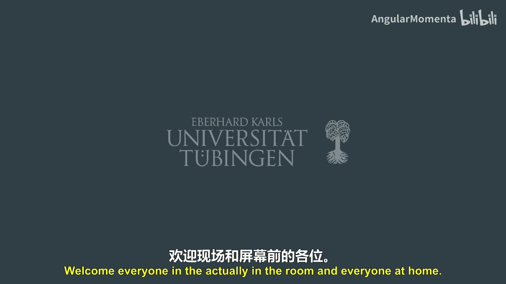

🎼Welcome everyone in actually in the room and everyone at home。 today is the， the。

 the pre Christmas lecture。 So we are a little bit more， more， more comfortable crowd in the room。

 And that nevertheless， means we still have a whole lecture ahead of us about integration。

 So last week， we spoke about how typically people do integration and machine learning。😊。

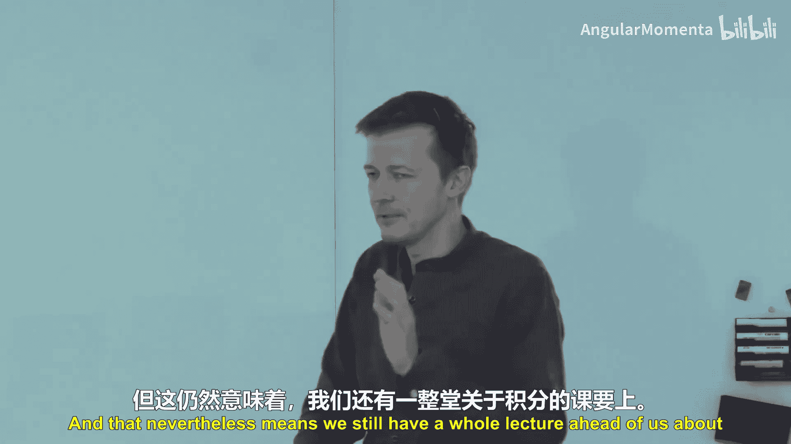

Using Markov J Monte Carlo。And today， we'll talk about integration as a computational problem with less thought about how to do it most efficiently and more about how to do it properly。

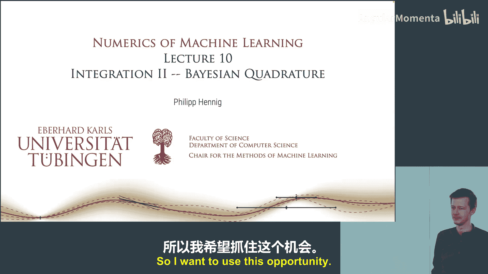

So。I want to use this opportunity。 I said last week already。

 the integration cannot can can serve as a good。😊，Test case for how one might want to think about computation。

And today， I really want to focus on this thought。 So we're。

 we're going to pick one particular integration problem。And then think about it carefully， slowly。

 trying to understand what actually happens when you're computing something。😊，And in which sense。

 you can think about this process of computation as learning。

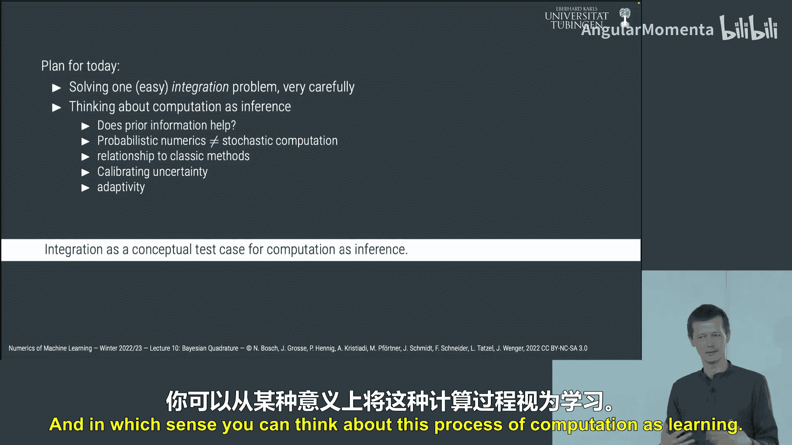

So， here' is our problem。Is a function。 It's called F of X。 X is a real number。

 So it's a real valued function that is given by the exponential。😊，Of minus sine squared of 3 x。

 minus x squared。Or sometimes。I've been known sometimes， even in job interviews to ask people。

 what does this function look like。Now， you've all got the slides in front of you。

 So there's nobody point in me asking you this。 but it's， it's a good idea to。

 to pause for a moment and think about what actually happens when you think about the shape of this function。

😊，So here's a set of strings。Or a string， a set of characters。That is， I think I counted once。

G take 20 characters long。AndBy writing down that string。I've uniquely identified one function。

 So we all have， you know， thanks to your undergraduate education。

 You all agree on the formal language that describes this function。

 You know what those characters mean。 And that means there is a unique。Object。

 you could call it a function or unique graph， a unique line in an。

 in a coordinate system that identifies this function perfectly。😊，And that means， in some sense。

There is nothing to be uncertain about， right， You know everything。Once I write down this function。

 you know， everything you could possibly know about this function because it uniquely identifies one function。

And that function， of course， looks like this。So one way to think about this is that you can think of this as a product of two functions。

 the x of minus sine squared 3 x and x of minus x squared。

 So x of minus x squared is the Gaussian be curve。 Its the thing that everyone has in their heads already。

 and x of  sine squared 3 x as well。 So s sine is a number between -1 and1。😊。

Sine squared is a number between 0 and 1。So x of minus a number between 0 and1 is a number between1 over E E to the -1。

And one equal to the 0。 So we've got our Gausian bell shape。

Multiply by some oscillating function that keeps going up and down， but doesn't go to 0。

 It only goes to one over E and then comes back up to one。So the Gausian bell is like a。

An envelope around this function。So， here's this curve。It's unique。 We know everything about it。

But that doesn't mean that we can answer every question about this function。Directly， so。If I write。

 if I define another， another object called capital F。

That is given by the definite integral from -3 to plus 3 over dysfunction。

Then you don't know what the number is。Even though I've uniquely identified this little life。

You don't know， because。A， you can't find that number。

 an expression for that number in a table of integrals。I've checked。 So there are。

 there are these big books full of integrals， right， And let me close that so that you don't get。

Comply blinded。Like the， the crashstein， for example。 But if you check in there。

 you're not gonna find this integral。 It doesn't。 It's not in there。

But you also don't know because there is no atomic operation， no。

 no function in the glue C library that just evaluates this integral。In contrast to， you know。

 the gamma function or something like this。So since you don't know， youki are uncertain about it。

 right， That's what uncertain being uncertain means there is something we don't know。We can't。

 There's a question。 We can't answer。But we're not。Totally uncertain about it。We know， oops。

 we know something about this， this， this problem。Let me fiddle around with my slides a little bit。嗯。

And here's maybe a point for a question， even if you've already stared at your slides。

 So what do you know about this integral， Can you say some things about this number F capital F。嗯h。😊。

Ped and founded by。1。Yeah， so it's finite and bounded。 in the following sense。 So first of all。

 we can notice that this function is， it's upper。 Well。

 and maybe it's even easier to say it's lower bounded by 0， right。

 because the exponential of something。 So that function is non negative。

 So the integral over this non negative function has to be at least 0。 right， it's。

 it's larger than 0。 And secondly， as you said， this function is upper bounded by one。😊。

So if you think of a box from -3 to plus 3 over one， that has area 6。 So this function is integral。

 Capital F lies between 0 and 6。😊，In fact， yeah。Yeah， as you said， the Gaian Cur is also。Exactly。

 so we can also put this upper bound of the Gaussian around it。

 And then we know that this integral has to be less than the integral over this Gaussian function。

 So the integral over this Gaussian。 So the x of minus x squared over the indefinite domain。

 So from minus infinity to plus infinity is square root of pi。

 That's something you can find you know textbooks， were looking for the definite integral， though。

 from -3 to plus 3。 So we have to multiply by some correction factor， which happens to be。

 if you think about it for a bit， thearrow function of 3。😊。

It's not's entirely straightforward to see that。 It's clear that it has something to do with the error function。

 But y it is exactly 3 and not one half times earth of minus whatever。

 But it's the error function of 3。 And you can， that's a function that is in the noy library。😊。

It's in side dot special。 So you can call it。And if we called treat that as。

And non numerical operation， something we can just do。 Then we'll get 1。77。

 So now we know that this number。 first， we realize that' symbolized between 0 and 6。

 and then we realize that it is actually between 0 and 1。77。 So that's already。

 that's a pretty narrow range， right？ So we're not infinitely uncertain。

 And this is totally typical for computations。😊，It's。

 I actually can't think of a situation where you don't know anything at all about the result of the computation。

You can usually bound it quite well。Sometimes weekly and sometimes very precisely， like in this case。

So I'm showing you this plot to motivate by it might not be a bad idea to treat。

The problem of finding this integral as an inference problem in the patient sense。

By putting a prior over the unknown object and the quantities that we can compute and then performing Bayesian inference。

One reason why we might be able to do that is that we begin with an actual prior that we are finally uncertain about。

But before we go to this Beijing interpretation， let's first think about the connection to last week。

 to Monte Carlo。 How would we solve this problem with Monte Carlo。😊，で。

So you're saying rejection sampling。 Yes， you can actually do important sampling as well。

 which is a little bit more efficient。 So here it is。 On the left。

 I'm drawing random numbers from the Gaussian distribution with standard deviation one over the square root of2。

 So that's this， this standard x of minus x squared distribution。

 And then for every draw of this distribution， I evaluate the ratio between the red curve。

 the function we care about and the gray curve， the Gaussian curve。

 So I know what the integral over the Gaussian curve is It's the thing wasn't the previous slides like the square root of pi times the error function of 3。

 So I multiply that number， which is capital G。 by this Monte Carlo estimate for the average ratio between f and G。

😊，I just summed them up。And if I do that， I get an estimate for this function， for this number。

 that this unknown number lies between 0 and 1。77， which I'm plotting just a moment here on the right as a function of the number of function evaluations。

 And what I'm plotting here is the absolute error between this Monte Carlo estimate and the actual value of this integral。

 which I've computed by some magical means of screen， kind of right。 So now your question。😊，新ばさん。

Tohoose fixed value from the distribution then。So this plot on the left is mostly just a visualization。

 So what I'm actually drawing are the X I。 So those are the locations on the X axis。

 And now I made this plot by taking all these x locations。

 And then at each point drawing another uniform and the variable and drawing it that's between 0 and1 and multiplying it with the value of the Gausian at that point。

 Why do I do that。 Well， because now you can see that the density of these black dots under this curve seems uniform。

 But it's sort of visually uniform。 There's no structure in this thing。

 which is a good unit test sanity check to see that those samples seem to make sense。

 that they are not mis scaled somehow。 But actually， so。😊，I wouldn't， in fact。

 need to precisely draw from the Gausian distribution。

 The only thing I need to do is to draw from that distribution。

That has support on the domain we are trying to integrate over and on which for which I know the analytic integral。

 because I need to be able to multiply with this G。 I need to know what G is。

 and I need to be able to evaluate those ratios。 So if my function doesn't have support on this domain。

 then I'll have divisions by 0 arrows， basically， And if I don't know what G is。 well。

 then I don't know what I'm computing。 So I could in particular。

 I also use a unit uniform distribution。 So this is not specific about Gaussian。

 right I don't need to have this upper bound。 So here I have a second line in green。

 which draws uniform and a numbers。 So numbers between 0 and1。 then I settract1 half。

 So now I have numbers between-1 half and plus 1 half I multiply by 6。

 So now I have numbers between -3 and plus3。 for each of these。

 I evaluate this ratio between F and G。 So G is just one， basically， So like up to the G。

 which is equal to 6。 fine。 And then just some those up。 and I get an estimate。 And on the right。😊。

You can see those two curves。Converging towards 0。And in the， the S gray lines。

Lines of slope 1 over square root of n。 This is a lock， lock plot。

 So those lines look like straight lines， because it's a power law。

And the dash lines are those analytic statements about the convergence rate that we had in the previous lecture。

 So they are given by the variance of the samples。 Sorry。

 the standard deviation of the samples divided by the square root of the number of samples。

 So that's the theoretical statement for the expected error of this estimate。

 And you can see that that's actually pretty good。 you might notice that those lines tend to be in the upper part of this distribution of of dots。

 That's because it's a lock plot， right， So this down here is much further。

 much closer to this number than up here。😊，Okay， so that's the Monte Carlo way of doing things。

 And last week， we realized that this rate， this convergence behavior， this random process， is。

 in some sense， optimal because it's the best unbiased estimator of this quantity drawn from random random variables。

 So today， our goal is going to be to beat this by quite a bit。😊，So how we repeat that。 So now。

 of course， I could this， if this were like electro and classic numerics。

 we could now go and you know write down all sorts of classic quadulature rules。

 I'm not going to do that。 instead， let's imagine that on your way here today when the snow is gone。

 But imagine you had a little bike accident this morning。 like you got hit by a bus or something。

 and you have some kind of retro at amnesia。 And now you forgot everything you lot in high school about how to compute integrals。

 everything。 But youre still left weirdly with your beautiful knowledge of probabilistic machine learning that you got last term from professorfess Amaka。

 So if that's the case。 then you can treat this problem as a Bayesian inference problem。

 You could just say here's here， quantities that I get to see called F of X。😊，I can evaluate F， O X。

 wherever I want。And there is another quantity that I care about。 that quantity is called capital F。

 That's the integral。 And I can use。The framework of Bayesian inference to construct an inference algorithm that tries to estimate capital F from evaluations of little F。

 little F are things I can evaluate their data and capital F is the latent quantity。

 The variable that I would actually like to know。So to do that。

 let's write a little bit of math on the slides。😊，So we start by putting a Gaussian process prior over F。

 Y， a Gaussian process。 what else right， is the the first knee reaction you could have because it's the the go to Bayesian regression model of for functions。

 And we're going to choose a prior mean function and a prior covariance function called the kernel。😊。

We know from previous lectures and also your G P lectures that Gausian processor have this beautiful property。

😊，That any linear operator acting on this function。Induces another Gausian distribution。

So this distribution is associated。With the Gaussian distribution over any Fine map of F。

 which has a mean， which is given by the Fine map of the mean and the covariance。

 which is given by the F I map applied to the covariance from both sides。

 sort of what that exactly means we'll see in a line。 So in particular， this also holds four。

The linear map that is the integral， right， integrationegration is a linear operation in the sense that。

Integral of F alpha F plus Pta G is equal to alpha integral F plus beta integral G， right。

So that's a linear operator。That means that this Gaus process over little F。Is also。

 at the same time， automatically a Gaussian distribution over the integral。

 If there's just one integral， we're trying to compute。

 that iss literally just one Gaussian render variable， right like one be curve。

 we could also think about the indefinite integral or from， I don't know。

 from minus infinity to x or from a to x， then it would be a function of x。

 which will be a Gaussian process。😊，Okay， so that's the， the idea。

 But now this has actually get us anywhere。 Well， that means that if we have a Gausian process over the。

Now with the function F。Then in principle， there's also a Gaussian distribution over the integral。

 But can we actually evaluated integral。 Well， to see， let's see what we have to do。

 So let's say we already had some observations of the function。

 If we've evaluated a bunch of points because that's what we're going to do。

 Then we're going to get a Gausian process postia mean。 And we've now seen that several times。

 even in the lectures here。 but also in previous lectures that postial mean and sorry。

 Gaussian process postor distribution has a postial mean and posterial covariance。

 which look like this。 So there are these functions that well involve a bunch of linear algebra。

 they involve evaluations of the function value various various locations in verses or solutions of linear systems of equations that involve kernel grammar And then there's the function mu of x evaluated at some test points。

 and the kernel evaluated at a test point and all of the training data。😊。

So if we choose this form for discussion process and then think about this object here up here again。

 then that means to get the distribution over the integral。

 we need to compute the integral over this object。 So this is a function of little X that we are trying to integrate against x。

So notice that that means because of this property of integrals， we can integrate the mean。Plus。

 and then we have to integrate only this function here。 This kernel function of the legs。😊。

And on the right， for the covariance， we have。A pivari integral from both sides over this covariance function。

 that first is a pivari integral over the kernel itself， plus。

And sort of inner product between these functions that already showed up in the prior mean or theos mean here。

So。Through this operation， through this kind of derivation。

 if we have evaluations of the function at various points。

Then we have embedded the problem of computing， an integral。In。

Theyre reproducing kernel Hilbert space， right， in computing integrals over the kernel。

 So if we know how to compute integrals over the kernel。

Then we can compute integrals over any function， at least approximately that we are trying to learn。

😊，Because these expressions here do not involve any integrals over F， right。

 The function values F only show up as actual values in Y as numbers as floating point numbers。

I say embedding because one term for this object here is。

 is the kernel mean embedding that you may have heard somewhere else before。

 maybe in in the statistical machine learning class。So。

That means that that we have to be able to compute integrals over the kernel。

 So we have to choose kernels for which we can do the integral in closed form。😊。

Let me pick one kernel。 What's your favorite kernel。保存。my turn。 very good。 Okay。

 you've been warned not to use the Gaussian kernel。 The mat kernel will be one possible choice。

 I'm gonna make it even easier。 and I'm gonna choose the over lost focus again。

 I'm going to choose big revealed run roll。 the Venner process kernel。 So that's the minimum kernel。

😊，A currently is given by for the covariance between two function values。

 the minimum between the two input points。 minus a constant。

 The constant is necessary to make it positive definite。

 One simple way to choose the constant is to set it to something smaller than the smallest function value you're going to operate on。

 We know that we're going to integrate our function from -3 to plus 3。 So I'm going to set C to -3。😊。

Okay。That's a function of X and X prime。 It's a very simple function。

 So the minimum function looks like a relu， basically， right like a vectortified linear unit。

 So it's very easy to integrate。 You can do that as a homework exercise。 if you want to， by the way。

 there's no no no homework this week。 But， you know， here's something you could do。

 And if you do that， then you'll find that that this particular integral。

 This kernel mean embedding is given by this function。 So it's one half。 So this is a function。😊。

That goes， that computes the integral over this kernel。From A to B。

Integrates over the first component of this kernel and then leaves the second one as an unbound variable。

 right， So it's still a， still a function of one variable。 in this case， x。😊，In this notation。

 So it's one half x squared minus a squared plus X， P minus x minus B minus A C。

 So B and A are the integration limits， and X is the variable that this function depends on。

 It's now a function of one variable， right？ Well， actually。

 it's also a function of the integration domains， of course。 But we'll assume that that's constant。😊。

And the binary variable integral you can also do。 So you basically take this function and you integrate it against again。

 against x。 And you'll get this thing， which is just a number。 If P and A are constant。

 then it's just a number， right。😊，And for simplicity。

 I'm going to say that the prior mean function is just 0 because then the integral is just 0。

 So that's gonna be really easy。 It works well for this particular function because that function goes nicely back to 0。

 If it wouldn't， we need to do something slightly different。😊，So that's it。 actually。

 So this is something you can， you can implement on a computer。 See you， So I hope you。

 you can convince yourself that these are two functions that you can write down in Python。😊，Right。

 theyre very straightforward。 They're not complicated。 They don't need any complicated functions。

 or they need power functions， squares， right， but and cubes， but other than that， nothing。

So you can certainly implement those。And now were going to use this to do beesian inference。

 So we start with our function again in black in the background on the left。

 Here is our venno process prior。 Vino processes have this interesting property that they are sort of asymmetric They are not stationary。

 They start at some small point。 And then the variance keeps growing。 on the right。

 you still see our not markov change。 Monte Carlo estimate。

 And now we're going to condition on a much of function values。 So I evaluate at three points。

 In this case， at -3 at 0 and a plus 3。 and you get a posterular Gaussian process。

 These red lines are samples from this Gaussian process， The ven process is very rough。

 It's the famous's the Gausian process that corresponds to brownian motion。

 It's the oldest Gaussian process was studied already by Einstein when he wrote is anbilous paper about browning motion。

 that's exactly this Gausian process。 So if we keep evaluating。 now we have five evaluations。

 you see a red line appearing up。😊，Yeah， the red solid line is the point estimate to the integral over the posterior mean or the posterior mean estimate for the integral。

 which are the same thing because。The expected value of an integral is the integral or an expected value。

 So if you keep doing that， then our process sort of slowly begins to converge against the true function。

 And theres a big step just now， and it keeps going gets better and better as we go on and converges really fast at some super high rate that well need to discuss in a moment。

 So first of all， before we go on， let's first marvel a little bit that this result。

 this is evidently much better than the Monte Carlo line， hopefully youll agree。

 How much better is it。 So let's say you wanted to do you wanted to achieve something like 10 to the -7 relative error。

 roughly that maybe good because that should be good enough for everyone 10 to or not relative。

 but total error 10 to the -， which in this case is almost the same because the integral has value roughly one。

 then you would need something like you know，200 a little bit less than 200 evaluations with this integration method。

 How many would you need with Monte Carlo。 you can sort of visual。😊。

Try to extrapolate this black line。Until it reaches this 10 to the -7。

 and you will end up with something beyond 10 to 11。 So it would take years and years to sample this。

 And this evaluation takes。It's basically instant。 You don't notice。 right， there's no runtime here。

 but it's。You don't even notice。 Okay， so this is clearly much faster。 Okay， so first of all。

 that's a good thing。 Now， you might wonder， though， well。

 maybe you've already made out all sorts of interesting observations about this plot。

 and what we'll kind of do for the rest of the lecture， basically， is to talk about this plot。😊。

About all its properties， all the things that seem wrong with it and all the things that seem good with it and think about them。

 And that's gonna be the entire rest of the lecture。 So a first thought you might have is， okay。

 fine， fine， fine， but。😊，We haven't talked about how expensive this is， right？

 So Monte Carlo is very cheap， in a way， You just draw random numbers。

 You evaluate the function at all the random variables at all the， sorry。

 at all the locations given by the drawn random numbers。😊，And then just sum them up。

 So summing is very easy。 It's a very fast thing can even be done in parallel。 How expensive is this。

 So， first of all， notice that this plot kind of makes sense because were plotting against the number of function evaluations because both of these methods need to evaluate the function n times。

😊，Either you do it at random locations for Monte Carlo or you evaluate on this regular grid that I just happen to choose。

 We're gonna need to talk about why I chose a regular grid in a moment。So。In that sense。

These are meaningful comparisons。 But， of course， in the second case。

 we're doing Gaussian process inference。😊，And maybe you still have， despite lectures 2 and 3 and 4。

 this kind of weak feeling in your stomach that Gaussian processing inference is somehow expensive。

 Well， this one isn't because this is one of these processes that you can implement as a kman filter。

😊，And we spoke about common filters and lectures。5 and 6 and 7， in particular，5。 So let me tell you。

 let me do the one slide on Kman filtering。 The one thing that I'm gonna say at the at the beginning that you don't need to understand is。

Nanil already pointed this out。 And Yoonatan Schchmt briefly as well， that there is this limit case。

 limit the notation for the limit of kl filters towards infinitely small steps。

 That's called a stochastic differential equation。 So a naturalable way to write this process in this in this language that is in the first line。

 If you haven't heard about this。 It doesn't matter will get to the correct line or the one that you understand in a moment。

 So it turns out。😊，That this particular process， which is called the Vno process。

 is connected to this weird object， the omega。Or D W。

 depending on notation that you may have seen somewhere before。 It's this ven measure。

 So it can be written as the solution of this process that happens to be you know，0， the X plus one。

 the omega。 And that means we can， we can define。ESt space that consists of two states。The first one。

 So state spaces should make sense to you， right， You've seen those in the previous lectures。

 The first state is going to be the function value itself。 That's the thing we get to observe。

 We need to have that thing because otherwise， we can't condition on observing it。😊。

And the second thing， the second state is going to be the integral。 The thing we care about。

 We need to have that as well， because otherwise， we cant make statements about it。

 So these are the two minimal things we need in our computation procedure。

 and we'll couple them to each other by this beautiful ordinary differential equation， linear。

 ordinary differential equation， given by this basically this matrix F。😊。

You don't need to understand this weird thing of called are process。

 But if you think of an ordinary differential equation。

 that just looks like D Z of x that is the state is given by is equal to F times Z。啲。X O D T。

 that's a bit。 Okay， I've messed around you with T and X。

 Then you can maybe convince yourself that if you have this kind of linear map between the two states that that then that encodes integration。

Right， so。A simple way to think about this is actually in the next line。

 So if you discretize this process。On a finite dimensional step。

 then that amounts to computing updates to the integral as。

The old value plus the length of the step times the value of the， the first state before。Right。

 so the integral of。X plus D， T。Is the integral of x plus D T times the derivative。

 So little F of X the integral before。 That's what this equation says。So we can。

 we can actually discretize this stochastic differential equation in this form。

 And now we're back at notation that you've seen before。

 So these are the variables that define Kman filter。😊，They define a a prediction model， A and Q。

 You remember that you can define these linear time andvariant systems with these matrixrices。

 A and  Q， where a is this the deamministic step And Q defineds the stochastic part of the process。

 And then we need an observation model。 The observation model is defined by these variables。

 H and R H tells us what we are seeing where they get to see the function value。

 but not the integral。 So there's a 0 in the first and the one in the second element of this。😊。

Mattrix and R defines the noise and the observations。 And here again， similar， actually。

 to simulation methods for differential equations， R is 0 because we just assume we can evaluate the in value wherever we want。

😊，Without noise。 And we also need to initialize。 So we do that by just setting the initial function value to what we observe at the beginning of the integration domain。

 The integral we， we initialize to0。 of course， because at a at the beginning of the integration。

 the integral from a to a is 0。 right， So we said that then after that。

 we know exactly what's going on。 So we can set the prior covariance to0。

 prior precision to infinity， Basically。 And then we just keep running the K filter。😊。

So that I'm not gonna write down again。 It's those lines of the camera filter that you've seen before。

 But they are once， you know what A Q， H and R and M1 and P1 are。

 they are just an algorithm that you can just call。 And advance it。

 And the only thing you have to tell it is how far to step。

 And then you'll you can just look up what's actually in here。

 These are some particular processes that arrive from this。Choice of kernel。

 And you see that the update equations for the integral look like this。 So at each point in time。

 we evaluate a function that gives us a value Y I so that we just set our estimate of the function。

 And then we update our estimate for the integral， which is given by this line。

 It's the old integral plus half of the step size times the observation here plus the observation of the previous step。

😊，So that's an average of the last two evaluations。 So the current one and the previous one。

And then we get to update our covariance。 We see the function value。

 So we're totally certain about the function value。

 and the integral gets in the the uncertainty about the integral gets。😊。

Sort of increased a little bit by something that has to do with the step length， cube。

So now there are various ways to think about this。 First of all。

 the fact that this is a common filter means we can implement this inenial time。

 So this algorithm is as expensive as Monte Carlo。😊。

It's just a sum over a bunch of values multiplied by a constant。 But again， I mean。

 the Monte Carlo estimate also needed us to evaluate some other functions and multiply by them。So。

 that's fast。The second thing is we can look at this expression and wonder what kind of estimate this is。

 So they have various ways of thinking of finding out sort of the next insight。

 The first one is to just look at this Gaussian process and ignore the fact that it's a Kman filter。

 And I can just like remind you that。😊，Let me go back。 So Gaussian process posteriors。

 posterior means。 Here is our posterior mean。 These posterior means are weighted sums over the kernel If the prior mean is 0。

 Then what this is here is a， I mean， this is a vector multiplied by a matrix。

 So it's just a bunch of numbers， a vector multiplied by kernel functions， right。

 So this is a weighted sum over kernel functions。 And the kernel function is the minimum function。

 So it's a piece by linear function， a relu， basically。😊。

So awaited some over piece of by linear functions。The posterior mean over our in is a piece5 linear function。

And if you sum together， we lose， you get more a new Voo。 No， that， not a Voo。

 but a new piece by linear function， one that sort of just goes up in。And， in fact。

 it's a sum over as many of these piece by linear functions as we have evaluations。😊。

And it's supposed to interpolate our function。So that it goes straight through the evaluations that you have。

 There's only one line that has that property。 It's the， the linear sp， right。

 the function that goes through all of the function values and then extrapolates like a constant at the end。

And we actually see that here。 right， It's just a bunch of straight lines between。The evaluations。

 So here， we've evaluated five times here， here， here， here and here。

 And we get a straight line as the posteror mean。 It's a bit difficult to see between all those Vi samples。

 But that's it， right。So what's our estimate for the integral。Well。

 it's the integral over this estimate。So what's the integral over this piece by linear function。

It's actually the thing that we see in the Kaman filter formulation。 It's the sum。

Over the average value in each block。Right， so in each， in each of these regions。

 we have a straight line that goes from the left end to the right end。And the integral is just， well。

 it's just the area under that trapezoid， right。W trapezoids。 it's the integral over the trapezoids。

 It's the trapezoid rule。 It's the second most simple integration algorithm you've ever seen。😊。

The second most because the most simplistic one is reman sums。

 where you just start on the left and then you just take steps to the end and then move up the step。

 It's actually almost the same up to some technical complication。

 This is maybe the more natural choice。😊，And you've used this in high school。Right you maybe。

 maybe for your A levels， you have to compute an integral at some point。

 And one way to do that is to just draw straight lines and compute the areas under those straight lines。

 So what we've just done is we've discovered that this very basic integration method is actually Gauss process inference。

😊，So here's a classic algorithm， maybe the most classic integration method。That。

Turns out to be the posteror mean。Of some complicated Gaustion process inference scheme。

And it's directly connected to it。 right， It holds for every choice of how many evaluations I make。

 even if the gridit is irregular。And this is one of these high level insights that I want to get across in this lecture。

 Even if you don't care about integration， this is a very important and actually quite common result that it turns out that you can think about various classic algorithms as。

😊，The red line in the middle or the posteria mean over。A A process inference scheme。

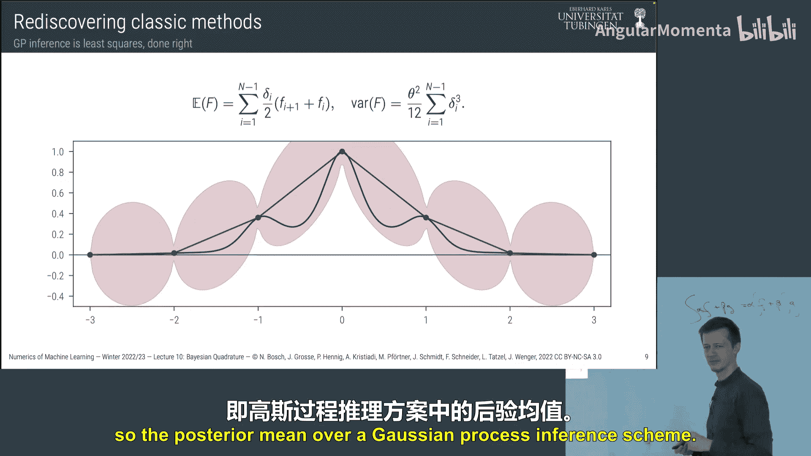

です。It can also be done for basically every other numerical problem。 So for linear algebra。

 there's a corresponding relationship that you actually already saw in lecture number 3， I think。

 for various。😊，Inter linear solvers， like the S decomposition。

 like conjugate gradients and various other ones， that they arise as least squares estimates over either the solution or the matrix and least squares estimates are essentially Gaussian estimates up to the uncertainty。

😊，For integration， we've just seen that the trapezoid rule， and I'll show you more examples later。

 turns out to be the posterior mean of some Gaussian process scheme for optimization。

 we won't see because you'll， there's more interesting stuff to learn and after Christmas。

 But it turns out that various classic。😊，Smart optimization rules。

 like basically all quality Newton methods， So B，FG S and all its variances are least squares estimates。

 So they arrive from some Gaussian estimate over the hesian of the loss function。😊。

For ordinary differential equations。😊，Natana pointed out in passing that there is a way of thinking about specificgakuta methods as very specific Gausian posteror estimates over the solution of the O D E within the individual step。

 And for PD E's Marvin even though I'm not sure everyone got it。

 But he basically pointed out that you can think about a very large class of P D E solve generalized Galeran methods。

 also as Gausian process inference。😊，So in all of these cases。

The classic methods actually turn out to be Bayesian estimates。

 They're just Bayesian posterior estimates。And similar to how。

You've learned in probabilistic machine learning， maybe that Gaussian process inference is the right way to do least squares inference because it's least squares as the post mean plus uncertainty estimates And those uncertainty estimates come for free。

 Because they require quantities that you've already computed for the posteria mean。

 So if you have them， why not use them to get uncertainty in the same way。😊，Nmatically computation。

In the classic sense， should maybe be thought about as。 My personal opinion， of course。

 should be thought about as Gaussian inference。Because。It's least squares for numerically quantities。

With uncertainty， for free。So now let's come back to this uncertainty that we've just computed。

And thinking about what they could do with it and why we should care about it。

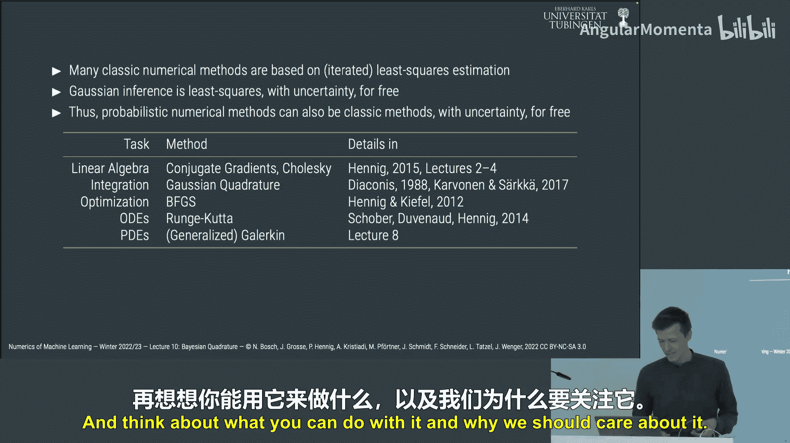

And here， I said， we should think about various properties of this plot。

 We'll first start with something。Well， maybe uncontroversial。 Let's see。 So in this plot。

 I've decided to use。A regular grid。So from one step to the next， I just。Keppt， well， actually。

 from one step of the plot to the next， I doubled the number of steps cause then it's a。

V step in a log lock plot。 But in each case， I left the distance between the evaluations constant。

So they are all equally， far apart from each other。

So you could wonder whether that's the right thing to do。Right。

 where should I put those evaluation notes。And that's actually opening up an interesting aspect that numerical algorithms aren't just。

Machine learning algorithms， in the sense that they estimate from data。

 they are actually more like AI algorithms。 They are more autonomous agents because they get to decide something。

 They don't just get data and then operate on it。 They actually decide which computations to perform。

It's， it's a， in a somewhat boring way， right， It's just where do I put those little points to make the evaluations of the function。

 But you still need to make this decision。And you can answer this question actually。

 in the same way that you would answer it for a Bayian inference problem。

You could say here is a probability distribution。 I would like this probability distribution to converge towards certainty。

 very fast。So I need to find a quantity that describes certainty or uncertainty。

And then manipulate that。 So the an what's a measure of uncertainty for probability distributions of information content。

Entropy， so some of you are in Bob Williamson's class， I guess。 So you've learned about entropy。

 And you know that the entropy of a Gausian。😊，Is up here。

The entropy of a Gaussian multivari distribution is given by basically a constant that grows with the number of evaluations。

 plus one half times the log。Of the determinant of the covariance matrix。4。

Gauian distributions that can be written。As basically Kman filtering。

 So as linear time invariant systems， there's a nice way to decompose those that turns out。

 in this case， to give us this answer。 So that is skipping a few lines of nontrivial algebra。

 But you can just believe me that it happens to be the case that the variance of this。😊。

Posivity distribution over the integral。Is given by this number。 So actually， yeah。

 made it sound more complicated than it is。 This is a unvari Gausian distribution， right， It's just。

 just the integral capital F is the thing we don't know。 So we just， it's just one number。

 So the distribution over it is just a Gaussian。😊，Bll curve。 So it has one quantity。

 which is given by the variance。That is this thing。 And that's the thing we want to minimize， right。

So that this defines the entropy。 So if we want to make this entropy minimal， we need to minimize it。

 Well， actually， the logarithm of this is defines the entropy。

 but the logarithm is a monotonic transformation。 So if we minimize the variance。

 we also minimize this logarithm。😊，Or get way around， right。So， to minimize this expression。Well。

 it's just a function of all the deltas。So one first thing we can do is we realize that maybe we want to have a design。

 So locations of the evaluation that start at the left end， at a of the integral。

A and N at the right end of the integral at B。 So that tells us what deelta n -1 needs to be the last step。

 It needs to be the width of the integration domain。

 minus the sum of everything you've done so far before。嗯。

And then we have a function that we that has basically now depends on all of the remaining Delta I。

We can take a gradient of this object with respect to these deelta Js， which are less than n-1。

 You can do that for yourself。 You get out this because there's a Q here。 The three comes down。

 squares are are left， right， The 12 becomes a4。 we have those expressions。

And now we want this gradient to be 0， because that's a necessary condition for a minimum。

 We set that to 0。 and we find that all of the deelta Js have to be equal to the delta and -1。

 So they all have to be equal。😊，So if we want to minimize the posteror uncertainty over the integral under this kernel。

And。We assume that we want integration nodes on both ends of the integration domain。

 Then we should have a regular grid。So the， this regular grid doesn't just come from intuition。

 It's not just all。 That's what but sort of looks nice。

 but it actually can even motivated from this prior over the in。😊。

And now you might have two questions。I think you really are already thinking about one of them。

 One of them might be， well， why do I need evaluations on the left and right end。Right。

You don't have to。 You could leave the left end open， actually， or the right end。嗯。

And that gives you a different design。 Actually， if you really want to know。

 you need to check in my book。There is the answer somewhere in the margins。

 It's an ever so slightly neatly different answer， which takes into account that we have this prior Gaussian process。

 which is broader on the right inside and on the left。

So it's going to put a few more evaluations to the right than to the left。

 because there's more uncertainty there。 But once you evaluate on the right ones， it's gone。

 So it doesn't matter anymore。And a second question you could have is。

 or maybe just more of an observation is。That this is， of course。

 an answer that is very specific for this Gaustion process trial。

So if I had some other prior that I can run this Bayesian quadwaature algorithm on。

 then I might get other designs。😊，In particular， if I have a structure prior uncertainty about the in。

 if I know something about it。That it has some particular algebraic shape or that the uncertainty is distributed in an nontrial fashion across the domain。

 You might typically get quite different designs， actually。So。

The technical takeaway is we have now understood maybe why we choose a regular grid。

 but maybe more importantly。We really should think about computation as the action of an intelligent agent。

It doesn't have to be super intelligent。 It only has to solve this simple problem。

 but it can still motivate how it acts。From the point of view of patient inference。

So there's a policy that this agent follows， like in reinforcement learning。 and this。

 this very simple policy of maximum information gain。And here， in this case。

 we can do this in closed form。 And the answer is somewhat boring。 It's just a regular grid。

 But there are other settings where this is actually a really nontri thing to do。😊。

So that is about how where to put the evaluation nodes。

So what we now know is that we can think of the trapezoid rule， this classic thing from high school。

😊，As a Bayesian estimate， actually， the posterior mean of a Bayesian estimate that arises from a Gaussian process prior。

 a very specific Gaussian process prior over the in。And if we decide to use the regular grid。

 then we have actually， we can actually motivate this choice by an information theore argument。

So the entire algorithm is sort of derived as a self consistent fashion from a set of prior assumptions。

And now， since we've realized that we are doing this， we can come back to this plot。 Actually， I'll。

 I actually， I'll show you I'll go back to this plot for a moment。

 So that I keep hopping around so much。 Actually， maybe I'll go to this plot。😊。

And look at it again and realize， okay， this is kind of neat。

 So we can think about the trapezoid rule as a Bayesian estimate。 So why is this good， First of all。

 Well， that means that we get on top of the estimate that we already know， this trapezoid rule。

 which is not new。 So this conversionvergence rate here shouldn't really be surprising because it's not a new algorithm。

 It's hundreds of years old。😊，But if we get something else on top。

 which is this Gausian process posterior。Vararianance， right。

 and the posterior variance is may be an error estimate for the integral。So we get an error estimate。

 and we actually get it for free。Basically， in the same way that the posterior covariance is for free in a Ga process。

Cause it only requires quantities that we've already computed anyway。In the， for example。

 if you implement it as a filter， you just get it out as this P， the big P over the in at the end。

So in this plot， I actually have plotted this error estimate， and it's this red dash line up here。😊。

And that's a bit。Underwhelming， no。It's way too high。It's way above the actual error。

And it's not even just above the actual error。 It actually contracts at a rate that is less than the actual error。

 So the further we go to the right， that wider or this gap becomes。

Between the actual error and the estimated error。So we'll talk about that in a moment， but。Maybe笔。

So may， so a natural reaction to this might be， oh， this is this is full。

This whole algorithm is stupid， right， that estimates the  error really badly。

 And keep in mind that this is the trapezoid boom， right， So if you think this is stupid。

The type result was is stupid。And it's been around for， I don't know，200 years。

 So it can't be so totally bad， right。So。Maybe there is something about this algorithm that isn't quite right。

And if you can understand that， then we're not necessarily finding out that the Beijingesian view is bad。

 Maybe might just find out that the trapezpher rule has some properties that we might want to question。

Okay， so let's do that。 So it turns out that we've already seen now that this variance estimate。

 I've now written it down a few times is， well， actually on the previous slide， it was。

 this is the variance estimate。 So our error estimate， of course。

 the variance is the expected square error。 So our error estimate is the standard deviation。

 It's the square root over this。 So let's write it down is this expression。😊。

We've decided that we're going to use constant step size because its's maximum information gain。

 What' the best thing to do。 So all that deltas are the same。

Then what we have here is essentially a sum over n -1 terms， where each。Of the elements of the sum。

 the summons is just something like。1 over N cubed。Right。

 so it's actually the width of the integration domain， B minus a cubed divided by M cubed。

Because if I set Delta to a constant， that means that I have to cover the distance of P minus a in n steps。

 And that's exactly this， right， It's just P minus a cubed over n cubed。

So that's nice because it makes this some easy to think about。 right。

 These are just all constant without within the sum。 There's no I in here， right？

 So that means what we have here is actually pretty much n。😊，Precisely n -1 copies of this number。

So that's like one n canceling， basically， right， So it's one over n squared or O of one over n squared。

 And then there's a square root here。 So that means this quantity drops like one over n。😊。

And you saw that in the plot， right， So the line dropped like one over n。

 That's actually what this does。 But I already brought brought it into the。

 into the plots that the arrow actually drops like one over n squared。😊。

And that's actually a theorem。 So you can look that up。 You have to dig around a little bit。

 and like。Some， some like basic numerics classes， basically。

 it's often not even properly discussed because it's so straightforward。

 But the conversence rate for this trapezoid rule is O of one over n squared。 Why。

 because you can actually think about So one， one simple handway way to do this without a proper proof is what we're doing is we are approximating our inte by piecewise linear functions。

 right。😊，So if you think about each of these linear regions where we have a linear line between the start and the endpoint。

Then within that region， we have a linear interpolation for our function。

But what we are actually estimating is the integral of that function。

 So that's like a quadratic approximation to the integral on that domain because the integral is like one order higher than the function we're approximating。

 right。😊，So that means that the error， if you're think in sort of in terms of Taylor series and Wallace theorem。

 then the error is something like O of step size cubed。Right。And there are n of those regions。

 So in each of these regions， we have an error that is cubic。

 So we add up those n times n cubes like one over n cubes。 And so we end up with one over n squared。

 Basically。 So that's the actual error。So， that means。Our beautiful Gausian process。😊。

As the ratio rule。Somehow gets the error wrong by one order。

It just assumes that the error is much worse。 But there's a theorem that can tell it that that's。

 this is what the that that's， that's your error， actually， right， so。Why is it so overly cautious。

 There is a mathematical statement that can guarantee that this holds。Shouldn't it be possible to。

 to。Just， you know， make sure that this mathematical property holds。So what's maybe like。

 if you read this theorem。Do you notice some hidden。Assumption in it。This。ableYes。

 so the statement says， if F is like little F is at one is once continuously differentiable， then。

But we are using a weno process prior。So this trapez rule arose。But I saying， well。

 let's assume that our in comes on this mean process prior。So we did that。

 We sort of we brush past this。 Let I just said， well， let's use whatever ga process。 You know。

 like the first one that comes to mind the we process or the mat， whatever one half， right。

 which is very similar。 then we get。😊，We got our algorithm， right。 So in that process。

 we kind of forgot for a moment that， of course， by writing down a prior。

 you actually make an assumption。😊，And it turns out that this is a theorem you'd have to look up that sample paths drawn from a weno process。

 they have this extremely rough behavior。They are non differentiable almost everywhere。 In fact。

 they can even be shown to not even be lipssheds。 They are sort of almost lipssheds， but not quite。

 So they are really， really nasty。 They are what's called hilda continuous。EOf lowest possible order。

So they are， they are sort of super rough。 Like， if you zoom in。

 they have this self similar fractal kind of property that on every length scale， they look the same。

 and always this very rough。And。So what this means is our integration algorithm。

 We told this algorithm， Well， you're like like a。It sort of me way。 What's my purpose。

 Well you integrate very rough functions， That's your job， right， I've told you。

 your prior assumption is this function we're going to give you is unbelievably rough。

 It's non differentiable， almost everywhere。😊，And then what this algorithm says is that， well， okay。

 if that's the case， then I have to be very cautious with my estimate for what the。

 what the integral is going to be。😊，And what this thing does as we move forward is it keeps discovering that those numbers we get from this function。

 they are way more regular than it expected them to be。😊。

And it keeps making this observation at every resolution because its prior is rough at every resolution。

 And the function is increasingly super smooth as you get closer and closer。😊。

So if you want to fix this。Then we might need to use a different algorithm that assumes more smoothness。

Or another way to think about this is if you're using the trapezoid rule。

 you're throwing away computational efficiency。Because you're using an algorithm that is designed to operate on super rough functions。

And that means it can't be as good as it could possibly be if it would know that the function is much smoother。

So without even talking about how you would do this。I can I get to that in a few minutes。This is。

 there's actually something hidden in there as an insight about numerical marital algorithms。That。

 and it's more of this sort of social structure of numerical computation。

Who writes actually numericalmer algorithms？ Well， ideally， numericalmeratory analysts。

 So a PhD student。Doing a math PhD， an applied math PhD， right， So what is their goal， Well， they。

 they often don't actually need to solve one particular problem。 They need to solve。 They want。

 they want to have something they can publish， right They want to come up with an algorithm that works on many。

 many problems。See， you're kind of incentivized to come up with。Algoriths。

 so which you can prove a statement that says for every function that fulfills following properties。

 this is going to work。And that naturally leads to overly general algorithms。

Once where you are quite sort of careful to make sure they work on a large class of problems。

Maybe not always on superav functions like this， but。You know， you。

 you're gonna make some assumptions about the function that are typically quite cautious。

And when you do that， thats， this doesn't actually come for free。

So algorithms that work on a large class of problems。

Tend to work not particularly well on any individual of one of them。

And that means if you have one concrete problem in your career at some point that you want to solve one marital problem。

 and you know， it's just this particular problem。Then if it's sufficiently important to you and not just something you used to do in an afternoon。

 it might be worth actually designing one computational method for this particular problem。

And you can do that once you understand how these algorithms work。

We'll get to that again at the end of the lecture to also think about what that says about Monte Carlo。

Before we do that though， I want to show that we can at least fix a little bit of this problem。So。1。

Like the simplest aspect of this miscalibration of the error is that there is also a scale to this error。

 which in this plot I've just set to one， actually， So this red region。

 it's just the standard we process， right， So it just opens up in this sort of standard fashion。😊。

With a rate of one per one。嗯。And in variance。 And that， of course， isn't necessarily correct。

 So we just happen to be lucky in this case because the in， were looking at this black line。

happens to be on a scale from 0 to 1。 So this plot looks good。But， of course。

 you could have a setting where the black line is much more dynamic。😊，Or much less dynamic， actually。

This corresponds to the setting in simulation methods in O D E solvers。

 where the dynamic of the vector field can be， you know， quite smooth or very rapidly changing。

 And then you need different step sizes， maybe。So， can we。

Estimate that scale while the algorithm runs。 and how expensive is that。So the answer to this is。

 yes， we can。 And we can again use ideas from your probabilistic machine learning class。😊。

So if there is， let me check。 if you can remember what you learned last term。

 if you took that lecture。 So if you have a Gaussian distribution with an unknown scale， an unknown。

Constant in the covariance。And you get some data from it。 How do you estimate that scale。That we'tぞ。

Evidence optimization。 So that's the generic that the general thing。

 if you to want to learn the hyper parameters of a Gaussian distribution。

 you compute the evidence or the marginal probability for the observations under the prior。

 and then you optimize these parameters。 That's true。 That's the， the general answer， internal。

 this is also expensive because it's a non nonlinear optimization problem。 But if it's just a scale。

 If it's just a scalar number。 Then there's actually a closed form way of doing this。😊。

Have you heard of conjugate prior inference。No， okay， let me tell you the story that like is。

 this is a party story everyone likes。 if you haven't heard it yet。

 then you get to be one of two days， whatever。 so。😊，Okay， so。

How do I make this in two minutes or a few minutes。4。

Probability distributions that are exponential family distributions。

 So they can be written as an exponential of something linear form。

 There is always a conjuggate prior。 So a probability distribution for its parameter。 In this case。

 our parameter is going to be this theta in front of the kernel that we don't know such that the product of if you think of your observation as a likelihood。

 and you multiply by this prior for this parameter。 you get out an。

 an object that is of the same algebraic form as the prior。

 for Gaussian distributions And the standard deviation of those Gaussian distributions。

 that conjuggate prior happens to be what's called the gamma。😊，Prior。

 the gamma probability distribution over the inverse of the variance。

 the precision of the Gaussian distribution。 And so this is a complicated technical statement。

 But it's related to a nice story about this guy He's called William C Lee Gossett。

 And the kind of people who know his name by name tend to be statisticians has anyone heard of him before。

😊，No， okay， so he used to be， he studied。Statistics， if I remember correctly at Cambridge。

 and then he went on to become a brewer， a master brewer of the Guinness brewreweery in。😊。

I think initially in London and then later in Dublin， even， and he had to， so。

Brewing back then was important business， and he had to make sure that this is a chemical process。

 that it worked well， right， So he needed to take samples from the。

 the beer barrels and keep estimating how they are distributed as samples from some distribution。

 He assumed that Gaussian distribution。 And he had exactly this problem that he didn't know what the variance of his sample was。

But he had studied with。Pearson， I think， for his degree and had learned a little bit about how to do statistics。

 And he came up with this beautiful way that now， nowadays， he write like this。

 So a gamma prior over the the the inverse variant of the Gaussian and then conjugate prior inference at but he was working for Guinness。

 and they didn't allow him to publish papers。 So it's a little bit like today that sometimes people working in industry aren't allowed to publish their work because Guinness wanted to keep it a bit of a trade secret。

 So he published under a pseudonym。😊，He called himself student。

And so the distribution that he came up with， which is the marginal。

 the integral over the Gaussian times the gamma integrated against Theta is called the student distribution because he couldn't use his proper name。

It's often called the student T distribution because he designed a statistic called T。

 So it's one of these distributions that stupidly are named after a variable that is completely arbitrary。

 just like the gamma distribution。Okay， so。In numbers。

 this means to keep track of our estimate for theta。

 we start with a prior over theta inverse squared， which is of this particular algebraic format。

 I haven't even written out what it actually looks like。 You can look up on Wikipedia。

 what the gamma distribution is it just happens to be the right algebraic choice。

 such that the following tricks works。 if you multiply those two together。

 So a Gaussian distribution over some numbers with a variance given by theta squared times a number。

😊，Multiplily by this thing。Then。The product of this up to normalization is， again。

 of the same form as this camera distribution with new parameters。 and those parameters are。

The original parameter plus the number of collected variables times a half。

And the original other parameter， plus。A statistic。

 is also also called the sufficient statistic that is given by this object。 So it's the observations。

 our function values， transpose times the kernel gramatics inverse times the observations。😊。

The only really important thing about this is that。A。

 this is a quantity we already have computed anyway。Because we need it for our posterior mean。

 So there's no extra computation to get to it。Nice。😊，And secondly， the other quantity is also easy。

 It's just keep track of how many numbers you've collected。 So we already know that as well。

 So we can keep track of these two objects simply by adding up numbers that we locally collect。😊。

For free， pretty much， right， the only thing need to do is add up floating point numbers。

2 floating point numbers， which is really whatever， right。So if you keep doing that。

 then we always have a posterior estimate of what theta is。😊，And it starts out very broad。

 and then it becomes more and more concentrated as we get more observations。

 And the dis associated distribution over this parameter is called the gamma distribution。

 The associated distribution over the integral is called the student T distribution。 If we do that。

 then we get the following plot， so。😊，Here is the initial prior again。 And now。

 at every point in time， I show you what we would have got。

If we would have kept the scale constant in thin gray in the background。

And the actual estimate for the student T marginal in red。And so you see initially。

 we get an observation that's a little bit too small like this。

 this number here and this number are a little bit closer to 0 than what the prior expected。

 So we shrink a little bit。 Then we get the next few observations。 And now actually。

 the distribution kind looks good because at this resolution。

 the steps from one point to the next are kind of what the prior expects。

 So were nearly at the same scale。 And now we keep going， and we keep observing now。

 now we're beginning to get into this domain， where the function happens to be actually quite regular。

 We get higher and higher resolution observation of the function。

 and we keep seeing that the numbers we see from one low to the next。

 tend to not deviate so far from each other。 And this sort of distribution starts to contract。😊。

And so on the right， you see the original estimate that we had on previous plots and a new one in red dashed。

 And you can see that it's still not super convincing， but it's a little bit better。

 It's actually quite a lot better in the sense that asymptotically。

 this contraction rate here will match this contraction rate。 So they get to the right order。

 But this gap is not going to close。😊，And what they sort of keep saying is that we're using a prior that is way too conservative for this problem。

We know that this function is smooth。And， in fact， actually， we do know， right？ So if you。

 we started out this lecture by looking at this expression， right， F of x is x for。😊。

You could have looked at this and just said， well， that's a smooth function。 right。

 There's a sign in there。 There's an x square in there。

 There's no point where the where it divergtes。 There's no root of the there's no the point where the gradient is is undefined。

 It's a smooth function。You can also run automatic differentiation on it if you wanted to do this with a computer and keep discovering that it's super smooth。

 so。😊，We actually know this isn't like your prior that you have in。Statistical machine learning。

 right， or visionian machine learning， where you just go in and say， I don't know。

 like the world is complicated。 I'm gonna use a smooth prior because what else I'm gonna use here in computation。

 we actually know what the problem is。 It gets given to us as a string in a formal language that describes the problem precisely。

😊，So we can check some some kinds of prior assumptions。For example。

 the fact that all derivatives of this function exist。And then if we can do that。

 we might want to use it and break away from this。Tezoid rule to use something smarter。 And in fact。

 it turns out there are， of course， much smarter algorithms。

And if you haven used an integration method in univariate problems like this before。

 you might know that there are nice packages for integration。In Python， you。

 you find them in si dot quad for quad v。And because they are all these square estimates。

 they all correspond to some Gausian process prior。 In particular。

 there is a class of algorithms called Gausian and quadvaature。They often come as Gaus and something。

 Quavischer， Gausus， Lendre， Gausus， Chabyacheev， Gaus Lobato and so on。

 They all correspond to some least square estimate over a particularly structured prior。

And I don't have time to tell you exactly how they work。

 But I can show you that they work really well。 So here you see on the left。

A particular set of features in green in which it's a good idea to expand these functions。

 These features happen to be legendgenre polynomials。

So there other polynomials are a particularly interesting class of polynomials， which are smooth。

 So they are always infinitely often differentiable。😊，They are orthogonal to each other。

 So that makes certain kinds of computations very fast， very convenient。

 You can think in some sense of some gram matrix being diagonal。😊。

And they are of they defined on a bounded domain from-1 to plus 1， which， of course。

 you can scale to -3 to plus 3 by just taking all the numbers that come in and dividing them by 3。😊。

So they are a classic way of doing certain kinds of integrals on bounded domains that are multiples of -1 to plus1。

 like ours。😊，And。There are corresponding quadature rules， which I'll tell you more about in a moment。

 which converge extremely fast。 So here on the right in green。

 you see the error of this corresponding integration estimate。 And you can see it converges very。

 very fast。😊，In fact， as a just， as a suggestive line without a proof or any statement。

 I've added in this pen line， which is an exponential function。

Just to point out that this is so fast， you can almost think of it as exponential convergence。

 It's a super polynomial rate of convergence。😊，So， and this only works。 But though。

 So this nice convergence you only get four functions that are actually smooth。😊。

It's just that our function is smooth， so it's good。And it turns out that this estimate。

 this green line that you see here， actually also corresponds to some posteror mean estimate under certain kinds of Gaussian p assumptions。

 The paper for this was written by Tony Carvean and Simonmoake in 2017。

 I've got the abstract down here， which I'm actually going to read out because it contains a few warnings。

😊，It's a bit small。 So if you can't read it， it says。That's the actual abstract from their paper。

 In an extension to some previous work on the topic。

 we show how all classical polynomial based quadventature rules。

 this green 1 is one example of them can be interpreted as Bayesian quadature。

 The stuff we've been talking about today， If the covariance kernel is selected suitable。

 So if we find the by prior， as the resulting Bayesian quadroature rules have zero posterior integral variants。

 the result of this article are mostly of theoretical interest in clarifying the relationship between the two different approaches to numerical integration。

 So what they actually found is that to make this work to get this green line。😊。

You have to do something that seems quite unnatural， which is that you have to ask the algorithm。

 How many evaluations are you going to choose。And then I'm going to give you a kernel that is fitted specifically to this number of evaluations。

Which happens to have the property that exactly after that number of evaluations。

 the posterior arrogance over the integral is 0。Even though it's wrong。

And if you wanted to make add an uncertainty， you then have to add more terms afterwards。

 which are going to mess up the poster mean estimate。

You can see that that's actually a problem in this plot。

 So what I've done here on the left is in red。I've actually computed one such estimate for the in。

 So that's this red line that keeps going up and down。 This is for five evaluations。 Here。

 you see the five evaluation points，1，2，3，4，5。 You can see that those points are irregularly spaced。

 Well， they are somewhat regular， but they are not uniform distance。

 That's because this is an non ocean prior。 and you can also see that the interponent looks absolutely nasty。

 doesn't look anything like the black line。 It kind of diverges badly as well to the left and the right。

 But it happens to be a quite decent integral estimate。 So the integral over this red line。😊。

Happens to be a point on this screen curve。So this is really a set of features to expand in。

 which are not suitable for， for learning the function， particularly。

 but they are quite suitable for learning the integral。 They have this nice conversion weight。😊。

So if you really wanted to understand this better。That would be， I don't know。

 I'm nice master thesis on the side because it's not really a solved problem in the sense that it doesn't provide super good uncertainty quantification。

But I'm showing you this plot to point out that there are classic algorithms。

 which are very good for this kind of problem。 and they happen to be actually come with lots of structure with different bases for different kind of integration problems。

😊，And since we're talking about integration today， you might as well know about them。

 So if you're using one of these quadature rules that come in s dot quad。

 then there are actually several different ones to choose。

 and they are designed to work on particular kinds of problems that depend on the integration domain and the shape of the function you're trying to integrate。

 So what they do is they approximate the in integral this thing we care about。😊。

While they assume that it can be written like this。Where Phi is a set of orthogonal polynomials。

 and W is some weighting function。And then there are special specific choices for Phi。

 depending on W。And A And B。 So if the integration domain is from goes from -1 to1。 like in our case。

 then there are， theres in particular， the one that I used here cause legendre integration。

 And then there's actually a whole set of different polynomials by Che Chef。😊，嗯。In particular。

 there's this one， But theres actually more than that。

 There's at least three different kinds of shabutature polynomials for different kind of weightings。

 So they are basically a statement about where the function varies， right。

 whether you expect it to be more varying in the corners or more in the middle。

And there are also variants for indefinite integrals or integrals over the unbounded domain。

 which are hermit polynomials and they are various other ones。 They are gig and powerer。

 polynomials and so on。 So if you ever have the need to compute an integral numerically on the line。

 a univariate one， then think briefly about what kind of integral you're trying to compute。

 What are the integration domain， What's the shape of your function， why。

 because you're specifying a prior for your Bayesian inference rule。 And if you get it right。

 you need less numbers。😊，And if your problem is particularly nasty。

 you might actually really have to think about it because otherwise。

 the algorithm might not work well。Thankfully， because this is a simple problem。

 integration in one dimension， these algorithms are quite good at telling you when they are probably wrong。

 So they have good convergence estimates， and they。😊，Throw errors and flags， and so on。Okay， yes。

Just a general question in the plot where we've got the  error and our ba culture rule。

It seems like it's in the beginning。 It has a nice like speed of reduction in error。 But then like。

然这个我们 to。Yeah stops。Is there a reason for that？You mean the fact that the red line。

That this redt line here has to spend。 and then becomes like this， so。Well， it has a reason。

 and it has something to do with with this very specific in。So what you see here is the fact。

 maybe that this in has this global structure that has something to do with a period of three over pi because it's sign of something。

 right， So it bubbles up and down。And then beyond that， as you， as you zoom in more and more。

 it basically is just a straight line at every region and。

That's sort of this first region here is where the algorithm discovers this shape， basically。

 And then after that that， it does something very boring。

 It just keeps extrapolating straight lines by straight lines。

 but they are ever so slightly not straight， but they are always basically not straight in the same way on every scale。

And that's what you see here。So this is something about the particular problem that we're trying to integrate。

So， now。嗯。For the final few minutes。Let me briefly summarize this may be a point where I should have had a black slide。

Whi says。There are these classic integration of algorithms， classic quadvature rules。

 these Gausian quadwiture algorithms， Gaus Leonnder， Gaus Sheppbychiev， Gaus Kronro， Gaus， Kein Baer。

 Gaus Hermit and so on。😊，Also， the trapezoid rule and various other kind of integration rules。

 pretty much every integration algorithm for one dimensional functions that you've seen before in high school or in a numerics class can be thought of as some form of Gausian posterial mean estimate because they are derived as least square estimators。

😊，And we can motivate choices made by these algorithms， in particular。

 also where they put their evaluation nodes。By information theoreticalore arguments。

 by minimizing the entropy of the posterior distribution。 Actually。

 in the case of these orthonormal polynomial integration rules， is is particularly extreme there。

 the evaluation node are chosen such that the posterior variance is 0 so that the entropy goes to 0。

Or basically， it's undefined。 It's completely removed。嗯。Right。

 but that's just one dimensional functions。 So what we did now so far was mostly think about integration as some kind of philosophical problem。

 right， it's this， there's a function。 You want to interpolate it， learn its integral。

 But who really cares about one dimensional integrals。 in reality， will， I mean。

 if you actually encounter one dimensional integral， you now know what to do。

 you go side dot quad dot integrate and it just does it。 And unless your in has a super nasty shape。

 or it's on the unbounded domain and there's nasty shapes in certain regions。😊。

It's probably going to work。But the interesting settings are for higher dimensional problems for beyond dimension 1。

 Well， actually， they are also classic quaature rules for dimension 2 and 3。

 They're called cuubbitature rules。😊，But beyond three， things get really complicated。 And I told you。

 last。We。That。Actually， I can， I have a slide for this， right，😊，show you this that。

Monte Carlo algorithms converge like one over the square root of the number of samples。 And that's。

 in some sense， good， in some sense， bad， bad， because one of the square would looks bad， but good。

 because in the expression， there was no obvious way in which the dimensionality of the problem showed up。

 You can construct situations where the dimensionality matters。 And in many cases， it doesn't。😊。

So the methods that I showed you today actually do not scale well in dimensionality。

They tend to have this property that their performance decays with the exponential of the dimensionality。

 Why， well， because you pretty much have to produce a mesh of evaluations。Such that each。

 in each dimension， the distance between the points is in Euclidean sense is like。

Smaller than some number。And to make that number small， this typical scale。

And on a grid of D dimensions， you need to put exponential of D points on there， right。

 So you have a one dimensional grid and you want to have 10 points。Between left and right end。

 you need 10 points。 If you need a two dimensional grid and the projection on one of those dimensions should have 10 points each。

 then you need something like 100 points，10 to the two。 And if you have a D dimensional grid。

 you need something like 10 to the D points， right， So that's bad。

And this has something to do with the fact that we are trying to interpolate。

A function on the whole domain。It also has something to do with the fact that we are using Gausian processes as our priors。

So remember that the Gaussian process posteror covariance looks like this。

 And that's the thing we're integrating。 Notice that this expression in its nice linear algebra form doesn't contain any ys。

 There's just x in there。 So the posteror uncertainty of a Gaussian doesn't depend on the numbers you've seen。

😊，It just depends on where you' have evaluated。And that means that these integration methods are。

 by their nature， non adaptive。They can't reason about where to put evaluation points。

Because there is nothing in their entropy in their formulation of information gain that tells them that some points contain more information than others。

That means they scale badly to higher dimensional settings。Because。In higher dimensions。

 they just have to cover the domain with points。So to get away from this。

We need algorithms that somehow can reason about the fact that some points are more informative than others。

And that is actually often the case for integrals， specifically in machine learning， because in。

Actually， yeah， have a right slide for this。 our in in machine learning settings I said last week as well。

 The integrals we tend to compute tend to be expected values of some function under some probability distribution。

😊，That's actually the reason why Monte Carlo works in the first place。So for Monte Carlo。

 we always have to compute some integral over F of X DP of X or P is a probability distribution。

 and probability distributions integrate to one。 So on a big domain， they can't be large。

 non negative value everywhere because then they wouldn't tend to integrate to one。

 They typically have what's called a concentration of measures。

 So they tend to be large in some area。 And then almost0 everywhere else。 And actually。

 the example we've been looking at today for the entire day is of this form as well。

 So we can think of this function Now， here's the plot that I might have shown you in the beginning。

😊，Our F of x。Is equal to x of minus sine squared of 3 x minus x squared。

 We can think of this as a product between the Gaussian。

X of minus x squared and this x of minus sine square of 3 x function。

If you multiply those two together， these two gray lines， you get the black line。

So this is a little bit like， well actually， it's a， a。

Sort of a prototypical example of a situation where you have。A prior。In this case。

 the prior is a Gaussian distribution。Multiplily by some likelihood function。

 which in this case is this exponential of sine squared function。

And you know that likelihoods don't have to be probability distributions in their parameter。

 So if you think of L of x as a likelihood。 So the probability of observing some data given x。

 then this L doesn't have to be a probability distribution in x only in the data。

 but pi has to be a probability distribution in x up to normalization。

In that's the situation we have here。So in a situation like this。

 if I asked you for the integral over this curve， you can sort of intuitively say， well。So。

 first of all。I know that this function is nonze everywhere。

 because it's appropriateed to distribution。Sorry， non， not， not non0。 non negative。

 So it's larger than0 larger or equal than 0。 And secondly， it has to be。

 it can only be large in some part like。Contained area， if it would。

 if there were a possibility for it to come back up again far away， then overall。

 it would have to be lower。Right。And that means if I start somewhere。

 let's say here and keep seeing large values， then that might be a good reason to stay in this domain for a while。

 And that's actually exactly what Macov Che Monte Carlo does。 right， it moves around。

 And if it finds larger and larger values， it spends more time in them。😊。

So we need an algorithm that does something like this。

And one first problem that we have with our Gaussian processor so far。

 maybe first thing we could fix is that。😊，So notice that Gaussian distributions are distributions over the real line。

 So they always put non zeroro probability on negative function values。 They have to。

 because at every point in x， there's a Gaussian distribution over a function value。

 and the Gaussian has full support， right？ So they have to allow for function values that dip below 0。

But we know that this function is larger than larger or equal than 0 everywhere。 Actually。

 this is even larger than 0 everywhere。 So we would like to encode that。

 And you can't encode this with a Gausian。 one way to encode that in a sort of pedestrian fashion is to say。

 let's take a Gaussian process。😊，And then， square it。

So we take functions that come from a Gaussian process and then take their square because the square of a number is always larger or equal than 0。

😊，So here's， here， I've actually done that。 So I've done something almost like this。

 So I've defined a new function L。😊，Sorry， a new fact L tilde。

 which is implicitly defined through this equation or explicitly through this one。

 So it's given by the square root of two of the actual function L that we're trying to regress on minus some constant。

 The constant is just like something like， you know。

 that captures the fact that this function doesn't come down to 0。 So here I've said it to 0。1。

 but we could have said it to 0。4 as well， whatever。😊，So。EThat's a way of saying this function L。

 this part of our in that we care about is larger than 0 everywhere。😊。

And we can't do close form Gaussian inference on this。 but we can do something almost like it。

 So I can take。 And here you have to trust me that it's just this just， like just an intuitive idea。

 I， whenever I run the algorithm， I take the values from our gray line here， L。 And I。

 because I can evaluate them without noise because it's just a function that I can evaluate on the computer。

 I can evaluate the corresponding value of L Tilde。😊，Right。It's just this computation。

 which is cheap。 And then I just use this as the training data for my approximate Gaussian process。

 And then when I reason about the thing I care about L。

 I have to do some kind of numerical trick to reason about what the corresponding square of the function L would look like。

😊，And there are various numerical tricks of doing that， approximately。

And then the other thing I can do is I can say， I know that I don't actually care about L。

 I care about the integral of L under this Gausion prior。X of minus x square。

 So I just multiply these two things together to get a belief over what the function might look like that I'm trying to integrate。

😊，This is called warped Gaussian process inference because we warp the Gaussian processes by squaring them。

 the samples from the Gaussian process。The corresponding approximate distribution over those function values over these orange lines is not a Gaussian distribution。

It's actually， I mean， the correct distribution is not Gaussian。 and it。

 its's approximation to it is some stochastic process that can be approximated by a Gaussian process。

 where the covariance depends on the observed function values。😊。

It actually depends on the postor mean。And that can be implemented。

 and it gives rise to an algorithm that's called wasabi for warp sequential active Bayesian integration。

 You don't need to understand exactly how it works。

 But the main basic idea is the final thing I'm going to tell you is it's possible to build prox numerical algorithms。

 which are based in a probabilistic formulation， which adaptively。😊。

Add uncertainty where they think they are going to see large function values。

 And here's the plot for what this looks like without understanding what the math actually is。

 So we start out with。Our approximate distribution over this L evaluated at one sum first point。

 In this case， the point is at 0 because， you know， we have a Gaussian prior， that says。

It look lies in this pell shape region。 So we might as well start at the mean。

 It's a good point to start。We evaluate。 We get one point。 We get it into Poland for this function。

And then the posteror uncertainty about those function values based on thanks。

 thanks to this not further explained nonlinear approximation of or approximation of a nonlinear transformation of a Gaussian gives rise to this。

Utility function in blue。Which is some form of uncertainty measure。

 And you can see that it adapts to the shape of the of the observed function。

 What this says is I have seen a function value here。 So therefore。

 I am not uncertain at that point because I've seen a function value here。But right next to it， I'm。

 I believe that there are more positive values， and I care about positive values because I know that the function typically is quite small。

So in this region， close to what I've already seen， I might want to evaluate again。

So whenever this function is maximized， which happens to be this line， I evaluate again。

 Then I become certain around this point。 So now I shouldn't be looking here anymore because I know the function here quite well。

 But over here， I'm still quite uncertain。 So let's choose where to evaluate next。

 And you notice how this is like some active learning procedure。😊。

Right you keep observing and then you adapt to what you've seen。

 and this algorithm will actually start to explore and then build models for now it has observed here。

 And now it bends in there。 It starts filling in this bit。 And now slowly。

 it has seen sort of the a large part of the integration domain It has sort of covered this。

 So now it will start once it has covered down to here。

 it will start coming back in here and refining this estimate moving around。😊。

Such algorithms don't just this， this particular algorithm doesn't just work for one dimensional problems。

 It actually works in higher dimensions， as well。And it can even be shown to have some non trivialvially small convergence rate。

 There is a complicated paper in your ribs 2019， pointing out that such adaptive quadulature rules can have a convergence rate that isn't totally stupid。

 So this particular algorithm I just showed you， even though it was very handwaly constructed。

 by just saying you know， we're gonna construct this thing actually can be shown to have some properties that are not so bad。

😊。

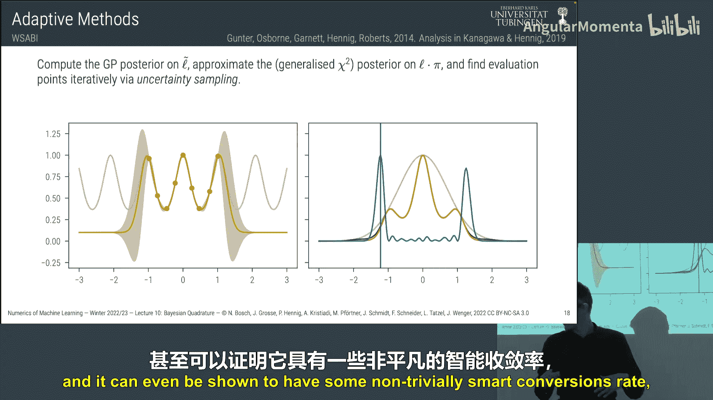

That's the weak thing I'm going to say。 It's a very complicated theorem。

And one can argue about whether this is even a good rate or not， but they are convergent。

 They are consistent algorithms that actually converge。 So long story short。

 it's possible to reason about algorithms that adapt their behavior in the same way that Markov chain。

 Well not the same way， but in an analogous way to how Markov chain Monte Carlo does it。

 And these algorithms scale to problems of reasonable dimensionality，10 or 50。😊。

If you have 2000 dimensions。Well， then you're not going to cover them anyway。

And then you can use Markov chain Monte Carlo。 And it's going to be roughly as good as these methods because there's no structure to use。

 You would need to， you， you would need to use。Something like 10 to 1000 samples to even roughly cover the space。

 And Monte Carlo is not going to do that， do that either。But actually， after Christmas。

 we'll find out in around late January that in， that in such settings。

 there is something actually even better than Monte Carlo to do。

 which will not necessarily have something to do with patient Quajo。😊。

The high level philosophical statement for that， I'm actually going to cite my wonderful co authorthor。

 Mike Gosbornne is that one should be careful about why Monte Carlo is actually chosen。

 So Monte Carlo algorithms can also be associated with the Gaussian process prior。

 That's the fear I'm。 I'm gonna save you this because I'm out of time。 But the the point is that。😊。

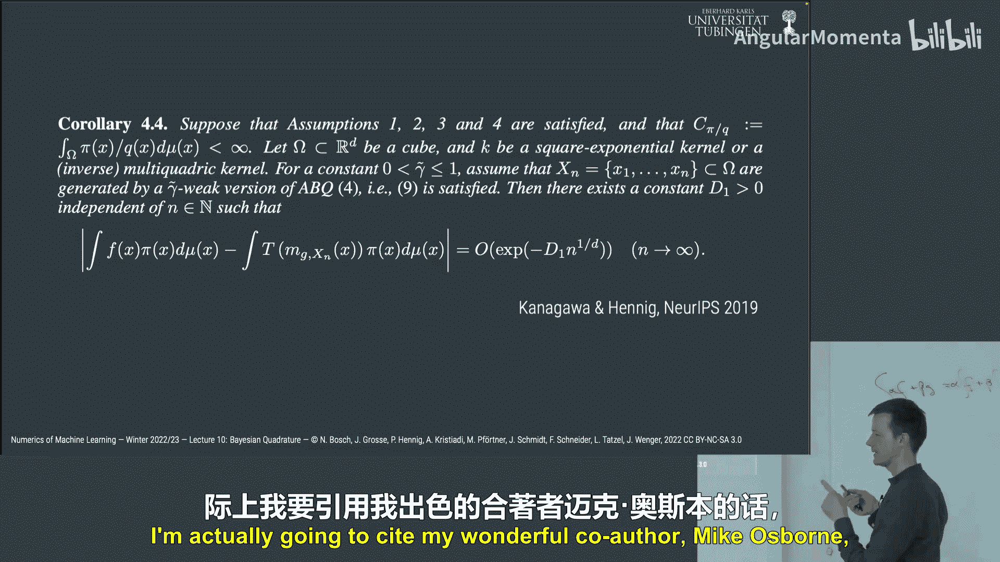

The argument for Monte Carlo is that it's independent of dimensionality in its converence rate。

 but its con rate is actually very bad。 It's one over the square root of the number of samples。

And we have to use this conversion rate because we kind of insist on having an unbiased estimate。

 as sympatheticically， if you're willing to give up unbiasedness。

 which last speaker argued is artificial anyway， because it's only a， it's only a concept。

 meaningful once you use random numbers。And there's no need to use random numbers for the feministic problem。

Then you can actually get algorithms that converge way， way， way faster in low dimensions。

Even super polynomially fast， extremely efficiently。So。As Mike says。

If you care about the fact that Monte Carlo conversion rate is independent of dimensionality。

 that is like saying if you want your nail hammering to be independent of wall hardness。

 you should do your hammering with a banana。 If you use a really bad tool。

 then that tool is going to work equally bad on every problem。But that's not a good thing to， to。

 not not a good property to have。Actually， the fact that Monte Carlo is independent of the problem shows that it uses a way too weak prior assumption。

Set of prior assumptions。 And if you want to have an algorithm that works well。

 you typically have to introduce some prior knowledge to make it work well。

And that's not just true for integration。 It's also true for other kind of numerical problems。

 The more you know about your problem， the more you can inject。Yeah， and we'll talk about more。

 more about this after Christmas。 At this point， I'll end。 I've used integration as a。😊。

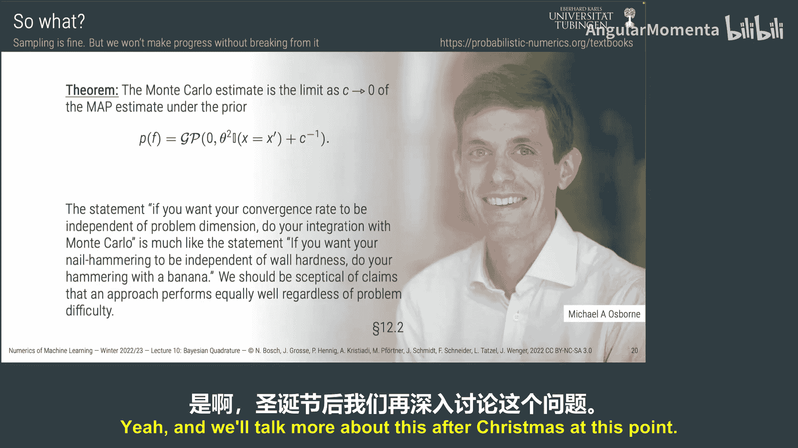

Abstract， philosophical。Example to reason to think about what it means to compute something。

 We spoke about one concrete particular problem and realize that you can think of the computation in a Bayesian fashion by putting a prior over joint dis joint prior distribution over the quantities you care about。

 In this case， the integral and the things you can compute。 in this case。

 the values of the integralte。The corresponding algorithms assign a posteror estimate that can be identified with classic methods。

 but they assign an uncertainty estimate around those estimates， those point estimates。

 which arises from prior assumptions and the numbers you've got to see。

Sometimes those error estimates are really bad。 They are very far away from the truth。

 And when that's the case， that doesn't necessarily mean that the probabilistic U on computation is wrong。

 it actually typically just means that the set of prior assumptions are bad。

And that you can maybe fix them by using typically more prior knowledge。

 and such prior knowledge is often available in computational settings because we know what our problem is。

 It's encoded in computer code for us so we can look at the formal description that the code provides and try to use to extract more information to make the algorithms one faster。

😊。

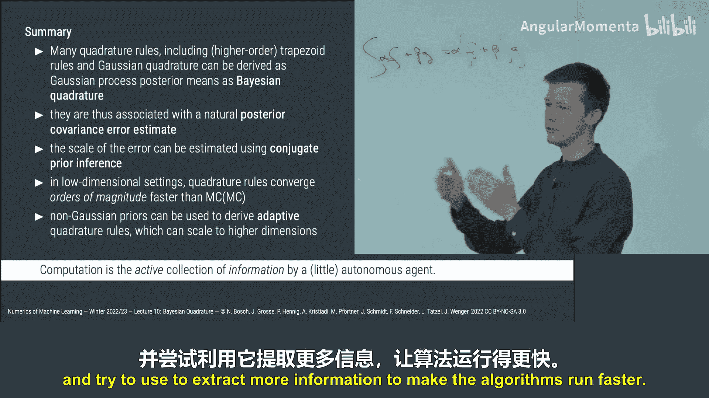

And we can think about these numerical algorithms actually as little autonomous agents。

If you're building a big machine learning solution。

 some agent that I don' know drives a car or does some complicated decision when it solves numerical problems。

 whether it's training a deep neural network or computing some Bayesian posterior or somewhere inside。

 there is actually like a tiny little autonomous agent inside of your big autonomous agent that does the computation that decides which numbers to compute。

😊，And by informing that autonomous agent about its task， you can make it work better。

And maybe that's where were in for today。 Thank you。

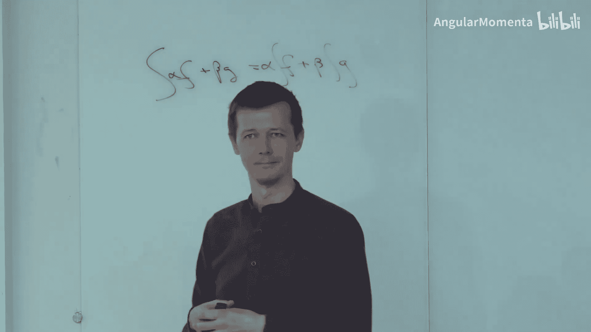

