# 【精译】蒂宾根大学《机器学习中的数值方法》-p11-11---深度学习优化----弗兰克·施耐德--BV1WMYHzAEcL_p11-

。

Okay， hello， everyone。 So today's lecture is going to be about optimization for deep learning。

 I'm Frank Scher。 I'm going to give this this lecture today。

 So if we perhaps lost you a bit before the winter breaks or last year。 Don't worry。

 we've got a new topic， we've got deep learning， as you can see from the title。

 So today's lecture by me。 is going to be more of a bit of an overview on training neural networks。

 why it's hard， what we should do about this， then next week。

 Lucas is giving a talk about a specific set of methods。😊。

And then after that， well have two more lectures about sort of in deep learning or deep learning adjacent topics。

 the next the third one of in the deep learning section is given by Philip with material from Agotinos。

 And then the fourth one will be by Uya。 So once again， it's a fresh topic。

 So if we lost you a bit before the winter break。 if you still have to catch up on some lectures。

 Don't worry， I don't expect any knowledge from prior lectures。

 but we'll also have a fresh start here。I will try to make some connections to the earlier lectures because some of the patterns will be the same。

 but I don't expect any knowledge from you。 So don't worry。

 if youre still missing on some details from previous lectures， we'll start again。

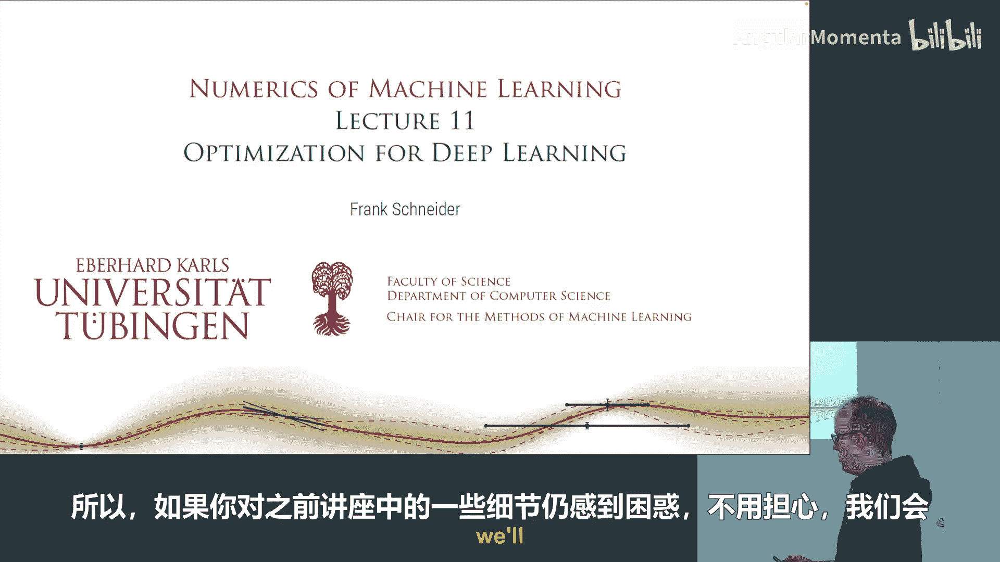

So this entire lecture。 So today's entire 90 minutes will all be about this very simple question。

 namely， how do we train neural networks。 So hands up， who has trained a neural network before。

That's pretty much all of you， at least them definitely the majority。 So it's great。

 So you already know something about it。 Hopefully， by the end of the lecture。

 you know a little bit more。😊，So this sort of deceptively simple question actually has a lot of different ways to answer it。

 And since you all trained the neural network before before。

 you know that there's hardware to consider， right。

 So you we could answer this question by thinking about the hardware。 Do we use GP。

 Which GPU do we use， How do we best use it so that we utilize it the most and stuff like that。

 We won't talk about hardware today。Then we could also talk about software， right， The。

 the question about， should I use Pytorch， Jax or go old school with Tenorflow， all these questions。

 What's the most efficient implementation for this stuff。 Again， we won't talk about this today。

But the third one。The third way we could answer this question and tackle this is about the methods and the algorithms that we use to actually train。

And this is the topic of the lecture。 So the entire 90 minutes will just be about answering the algorithmic or providing some algorithmic answer to the questions。

 how do we train neural networks。So since all of you trained a neural network before and maybe you've heard some lectures about deep learning。

 you I think a totally reasonable answer to this question would be， well， that's rather easy。

 I just use atom。 It's a good default。 And I just use the learning rate of 1 E -3。

 That's the default in the atom paper。 That's the default in Pytor。 And that always works， right。

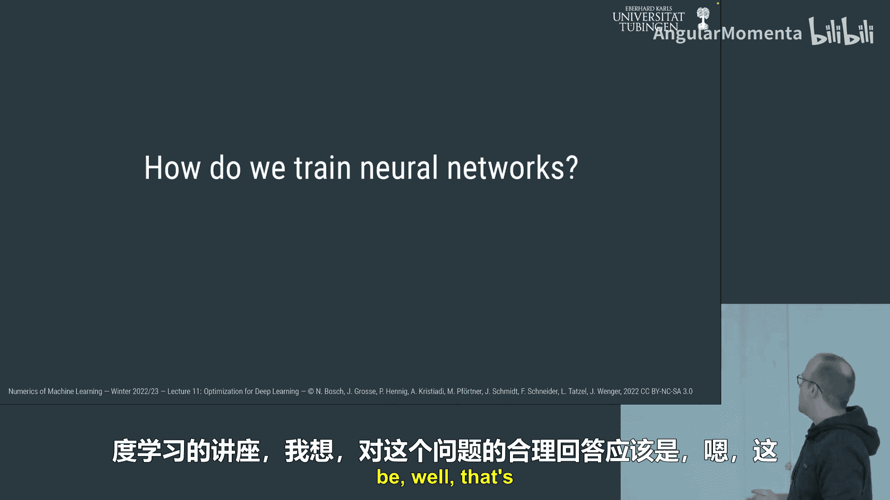

Well， I think it's not that easy。So if we look at a real world example of people training a neural network。

 we can see that maybe this story is a little bit more complicated。So I think it was last year。

 So an entire sort of group at M I tried to train a large language model。

 So something that is a bit similar to G 3， at least in the architecture， So G 3。

 you probably know because it's behind this big hype of jet GPT。

 And so mid I tried to train a similar， large language model。

 similar in the sense that it uses a similar architecture。 And they call it O P T。

And so in their paper， we can look at the section about training methodology， Basically。

 describing the recipe that was needed to train this large language model。

So if we go to this section， we can see that it starts with a sentence。 We use an Adamom W optimizer。

 So， again， already， it's not at。 They use Adam W。And they set beta 1 and beta 2 to 0。90。95。

 So I looked it up the defaults for Adam W in Pytorch or in the paper are not 0。9 and not 0。95。

 So they use something non default。They also tell you about weight decay that they use。

 And then they have the sentence that said， we follow a linear learning rate schedule warming up from 0 to the maximum learning rate over some steps。

 And in the very crucial sentence， a number of midf changes to the learning grade were also required。

 And they actually provide a plot of this result of this midfly changes to the learning grade。

And just looking at the schedule， it looks really complex， right。

 But this is the learning rate schedule that was needed to get this large language model to train。

 So it wasn't that mid。 I just didn't know that theres a default learning rate for at that just works。

 And it didn't make this plot overly complicated to sound。 I don't know。

 smarter than they are already。 But this was actually what was needed to get these large language models to train。

So one more example to show you how complex it is to train a neural network is that luckily， for us。

 they detailed all their struggles to train this large language model。

 and they provided this in the form of a lockbook。 And this lockbook has more than 1000 pages that are just dedicated to what they tried。

 what they observed and what they did as a result。And so they have an entire section in this lockbook just about。

 oh， oh， the loss exploded。 and we don't know why。 So what should we do。

 And the first suggestion that they give in this lock book is step 1， don't panic。So clearly。

 training a neural network is much harder than just using atom with some default learning rate and just letting a train。

 right， So we need some empirical learning rate schedule。 We need some new methods。

 and we need sort of a more than 100 page lockbook to describe what we're doing。

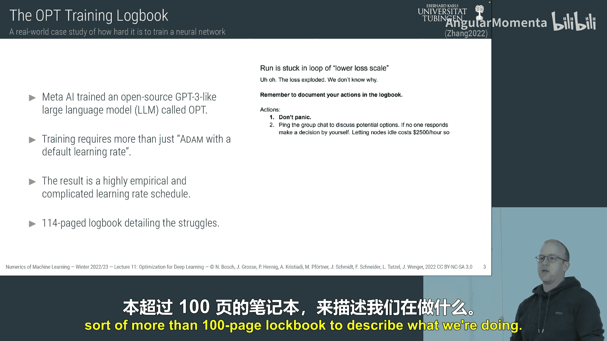

So we， so last month， I organized a workshop at Nrips。

 basically getting all the experts in one room to try to talk about， well。

 how do we train neural networks， So we had the first author of the paper that I just mentioned the O P T paper。

 We had the first author of the or the author of the Adam paper and other experts from Google from Meta altogether in a room to try to discuss。

 Well， how do we train neural network。Unfortunately， perhaps。

 I think a very fair summary of the outcome is that currently no one really knows how to train neural networks。

 at least not efficiently。This doesn't mean that we don't know anything。 right。

 We have some intuitions。 We have some guidelines， but it's all super， super vague。

 And we can see that just from the OP T example， where experts at metaA。

Took so long to get such a large language model to train and needed to fiddle around with the algorithms。

 and the method a long time， long time to actually get something to run。So this is already sort of。

 I think the key point of this lecture is that currently training a neural network is quite hard。

 and we need to do something about this。So in my lecture。

 I first want to take a bit of time to explain and look at the sort of at the background on why training a neural network is such a challenging task。

 right， we see from what we saw from this example that it is hard and it does require some fiddling around。

But I want to look into the methods a bit more to understand why this is needed。

And maybe from the previous lectures， you kind of notice the pattern in our lectures that they usually go something like this where we first introduce what is the current state of the art method。

 the classical approach， then maybe we describe a bit what is wrong with it and how we can improve it。

And for deep learning， and training neural network。

 it's a bit different because I actually will take the entire second part of my lecture to just find out what the state of the art is in training neural networks。

 So it isn't Here is the classic V1 classical method that we need to improve。 But as we will see。

 there are lots of them。 And we don't really know what the state of the art is at the moment。

And then， lastly。Hopefully， I can also tell you a bit about how we can improve the situation。

 So given that training a neural network is a bit of a mess， what can we do about this。

So that's the structure of my lecture。 and I first want to start with understanding better why neural network training currently is such a challenging task。

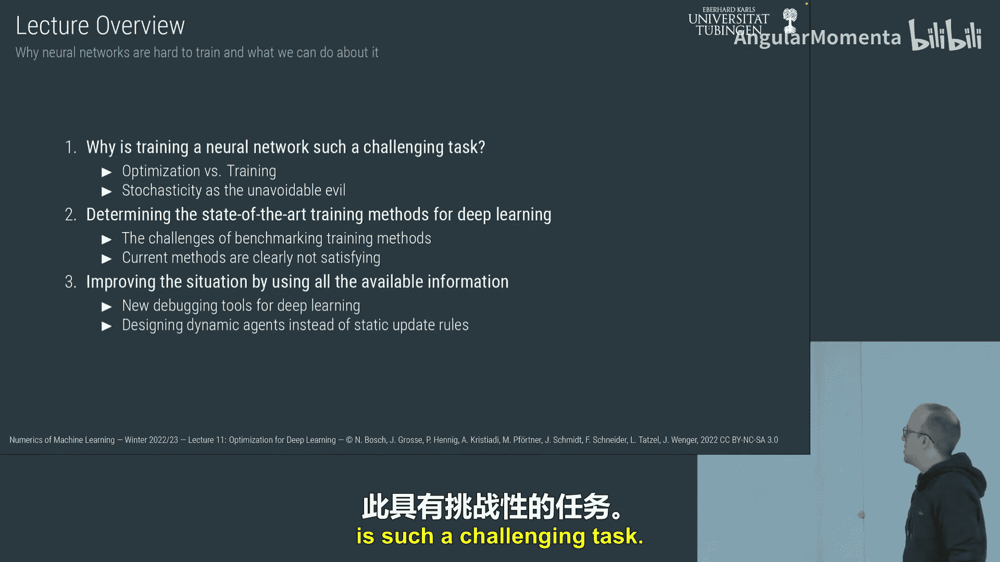

So this is just a very simple overview of what a neural network is。 since all of you trained 1。

 I assume you know。 But just so that we get the notation or we have a shared notation and the same terms。

For this lecture， I will only focus on supervised learning。

 not because my conclusions don't really extend to the other stuff。

 but just because it's a lot simpler to explain。So in my setting。

 we just have a supervised learning with a neural network。

 which means that we have some neural network in the middle here that is parameterized by some parameter Theta。

 We get some input， and we want to produce some output。

And so the entire lecture will be only about understanding how we can set this theta most efficiently to get the output that we want。

That's all we want to do。And so if we look at an even simpler problem of how we can set the parameters of a model such that it produces a hypothesis that we are happy with can look at this simple example。

 That's the data that we have。 We have some data point X and some sort of output Y。

 just a handful of data。 And we'll do it really， really simple and just consider linear regression。

 right， So all the hypothesis we currently consider just straight lines。😊。

So we can just start with a random hypothesis。 Let's say the relationship between X and Y looks something like this straight line。

 Obviously， it doesn't， but it's the first start。So since it's a straight line。

 it is parameterized by two parameters。 Ill call them theta 10 and theta 1。

 And in this right picture， we'll look at the， I call this lost landscape view or the parameter view where I have our hypothesis somewhere here。

 right， specific set of theta 1 or a specific specific value of theta 1 and a specific value of theta 0。

 And they together form this hypothesis that is shown in green here。Now。

 we could try a second one just to see if we're better。 the red one， different parameters。

 different model。And one very straightforward approach to finding a good hypothesis would be to to try out lots of them until we find this one here that at least given this data provides the best hypothesis。

So if we actually test all of the possible hypothesis， we can see that we get sort of this。

 I should point with this。 We get this lost landscape here。 right。

 So what is plotted here is for every value of the thes。

I plot how good or bad the hypothesis is with good hypothesis。

 having sort of a white color and bad ones blue。And so effectively， what I want to do。

 if I do machine learning， if I want to do some curve fitting， pattern recognition， whatever。

All I want to do is basically find the minimum of some lost landscape of some lost function， right？

 So so basically that's， that's what machine learning is。

 just finding some minimum in a huge loss landscape。 And obviously。

 I just look at it for sort of linear regression here。

 which makes everything super simple from neural network。 It's more complicated。

 The lost landscape is not two dimensional。 It's maybe 10 dimensional at 10 million dimensional or more。

And so the hypothesis that we can build are also more expressive， right， But at the end。

It's all about finding the minimum in a lost landscape。Well， actually， that's wrong。

So that's not what we're doing。 So let's have a closer look at what we're actually doing。

 So while we could solve the optimization problem with something like this。

 we just started the random hypothesis and take small steps in the direction where it's going downhill。

 And at some point， we'll arrive， arrive at the minimum。 But that's not really what we want to do。

So let's have a closer look at the exact setting that we're actually in to see why this is not true and why machine learning is not optimization。

 okay。So I'll just with some introduce some math notation so。

 so that we can talk about it in a little bit more detail。 So again。

 the setting is that we want to learn a function and that function is parameterized by some thetas。

 So same setting as before。And we get some input X， and we also predict some output Y。

 and we have some， or there is some relationship between the inputs and the output。

 So the x and the y。 And the goal is that our model makes predictions that I denoted here by the。

 the y with a hat。 hopefully， the predictions of our model fit the true targets。

 and this fit is sort of。诶。we， we sort of determine whether we have a good fit by some loss function L。

 right， for denial now， just assume that L is given that quantifies how different our predictions are from the true outputs。

 the true targets。Now， we can think of this entire example in the setting of image classifications or our inputs X would be images。

 Our outputs Y would be the label。 For example， Is this the image of a cat or a dog or a hot dog。

 whatever。And so what we want to minimize the goal would be to minimize the expected loss for the true data distribution。

 right， for all images of dogs and cats and so on。 That would be the goal。

 That would be what we want from machine learning。 to have a computer to have an image classification model that can。

 as best as possible， predict the true label for all images out there。 But obviously。

 we don't have access to this true underlying data distribution because this would be infinite。

So what we instead have is we have access to a finite training data set。 So imagenet， Cypher 10， M N。

 whatever。To this， we have access。 So we can test our model。

 We can train our model on this finite training set that are called the train here that consists of some sort of tuples of inputs and outputs。

 But this is a finite training data set。 So this is just a finite sample from the true sort of data distribution。

 The true collection of all possible images of cats and dogs。

 We only have us access to some subampled part of it。

And so what our entire optimization method operates on is just this empirical loss。

 So it's not the true loss。 It's not the true risk the expected loss。

 It's the empirical risk of the empirical loss。 So we only evaluated on the data that we have。

And even this， most of the time is not really true because indeed learning， as you probably know。

 we use batching。 So the loss that we evaluate on and keep training on the signal that we get from the gradient that determines or sort of steers our training process isn't actually the full training set。

 but only a small sum samplele of it。 and we repeatedly draw batches from it and don't evaluate on the full imagenet set。

 but only on 200 images at a time。So in that sense， what we operate on what we minimize。

 which is the empirical risk or the empirical loss， is not the quantity that we actually care about。

So in that sense， machine learning is not optimization。 And so from now on。

 I will hopefully stop talking about optimization methods for deep learning or optimizers。

 because that's not really what we want them to do。 We don't want them to optimize。

 We want them to train。 So from now on， hopefully，' not making a mistake。

 I will call it training algorithms， right， and training methods。 So SD Adam。

 I will now call them training algorithms。So given the fact that we optimize or operate on some quantity。

 namely this empirical loss， but actually are interested in the performance on some other quantity。

 namely the true loss。We get sort of these specific properties of machine learning， for example。

 overfitting， right， So here you can see the training curve of three different training algorithms just in your head。

 if if it confuses you in your head just translate training algorithm was optimizer， That's fine。

 three different method method。 If I remember correctly， it's S GD， a momentum version and atom。

 and you can see how the training loss behaves over the number of epochs。 So on the X axis's epochs。

 and I' will show that in a second。So this is the quantity that we operate on and that our optimizer or training algorithm actually gets to see。

But what we are interested in is maybe something more like the test loss。

 So how good or bad am I on unseen data。 Again， the test loss is only sort of a surrogate for the true data distribution that we don't have access to。

 But we can use it as a measure to understand how good or bad we are on unseen data。 Now。

 if you see this， probably your first reaction is we're overfitting。

 we should have stop training earlier， right， because training loss still going down。

 But test loss increases。 So on new unseen data， actually become worse。Well。

 maybe the loss isn't even the quantity that we're interested in。 So for images。

 I don't really care about the cross entropy loss of a model。

 but I might care more about the accuracy， meaning how many images do I get right or do I get wrong。

And here， we can actually see a different picture。 So naturally。

 if for training accuracy or the training accuracy increases over time。 But this。

 the same thing happens for the test accuracy as well， which is a bit weird。

 if you look at the test loss that at some point just increases and you would go like， oh， careful。

 I'm overfitting。So this example， hopefully， with this example。

 I show you that overfitting is actually more complicated than we might initially think in something like generalization that a word that gets thrown around a lot is also a bit more complicated。

 because we generalize in multiple ways。 We first sort of generalize from the training set to the test set。

 but oftentimes we also want to generalize from something like the loss to some other performance quantity。

 So in translation， you usually， I think train on something like cross entropy loss again。

 but then you care about the quality of your translation。

 and that sometimes it measure with something like blue score or so， but you don't operate。

 you don't optimize on the blue score itself。 For example， for images， it's a accuracy versus loss。

 for Gs， for example， it's the same。 you train on a loss。

 But what you care about is how good or bad the images look visually to a human。

 So overfitting and generalization is much more complicated than just going from train to test。

ButThis also， again， sort of emphasizes that what we're doing with machine learning and when we train neural network is not optimization。

Because the quantity that we operate on， the quantity that we can actually evaluate and try to minimize。

 Its not the quantity we at the end care about。 So maybe this is the。

 the second big key takeaway from this lecture is that optimization and training are not the same thing。

So sort of as a result of this whole setting of having mini batches to train with instead of the full data set in general。

 wanting to have something that not only optimizes， but maybe trains。

People have come up with lots of different methods， right。

 stochastic gradient de is probably a prime example。

 The very simple update equation of just starting with some theta and just taking a small step denoted by this learning rate data here in the direction of the negative gradient in here gradient evaluated on the mini batch。

But you probably also know the momentum variance， for example。

 with heavy ball or nest of accelerated gradient that sort of try to take into account previous gradients and understand or learn from them how they should behave in the future。

And there's all these variations like Rs Pro and atom and so on and so on。 And at the end。

 there's actually more than 150 methods。 So I know， because I counted。 So I built this table。

 and I'm pretty sure that half of the existing methods aren't even on this table and it's already so full that you can't really see right。

 And so if you look at the slides again on your computer maybe in detail。

 you might actually complain that I might double count some stuff because I think Sa or Ba is on there twice。

But that's actually not a fault。 It's just that there are multiple methods with the same name。

 So before we come up with new training methods， maybe we need to come up with new names first。

 because apparently， we run out of names。So that is sort of the ridiculous situation of neural network training at the moment that we have more than 100 methods to choose from。

 And the critical part is that even if we pick one of these methods， for example， SD。

 we still need to learn how to use it。 So， for example， for SD。

 we still need to decide what learning rate we should use。

And as you hopefully saw from the OP T example， that's not a trivial task。

And it gets more complicated if we pick at， we actually have even more high parameters to pick。

 So for at， we not only have the learning rate here。

 we also have this beta 1 and beta 2 that popped up in the beginning as well。

 And we also have something called Epsilon here。 that was sort of。

Initially introduced as a safeguard against dividing by  zero here。

 But then people thought maybe this is also a highmeter， and you should also tune it。

So now with Adamom， we have four high parameters to tune。 so I cannot just try them all out because。

 as you know， it gets more complex to， just tune 4 high parameters and increases。

 So that's sort of the ridiculous situation that we have right now。 We have so many methods。

 And we don't really know how to use the methods that we have。

And so my suggestion and what sort of will be a bit of the core of this lecture is that we need to have proper benchmarks for the methods。

 understand which one actually help， which one improve。

 which ones are maybe necessary and which ones are sort of maybe just a bit noise， right。

 So hopefully， with some rigorous benchmarks， we can actually cut this list down into is something more manageable for people to actually go through。

 because a list of 150 methods。 It's not something that you can go through if you want to train the neural network。

And then on the side of the hyper parametersameter， maybe we can do something different。

And actually provides some new tools for users to understand how tuning something or how changing a hyperparmeter。

 what the effect is on the training process。 So that's sort of the approach that I want to present today is that first。

 let's have some more rigorous benchmarks to really understand which of these methods are necessary。

And then use debugging tools to provide more insight to users on how they should use these methods and perhaps set the hyper parameters。

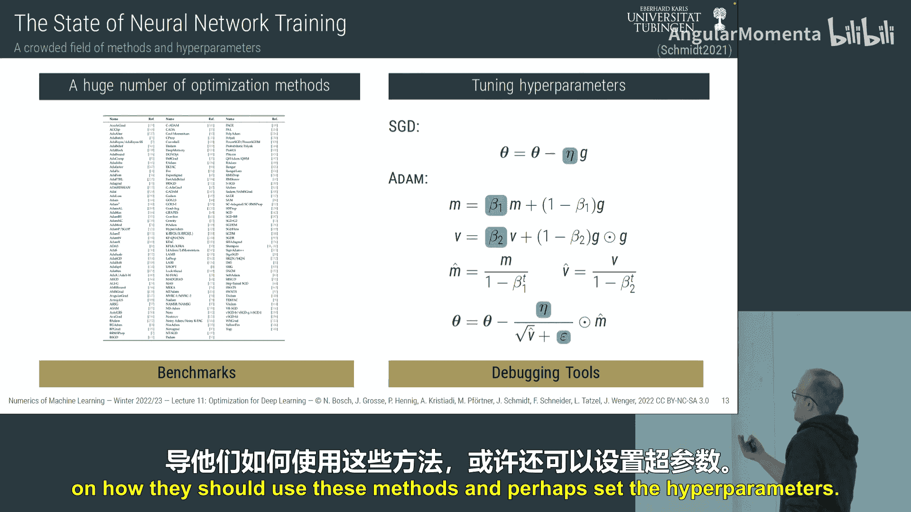

And so this next section will be all about benchmarking training algorithms。 And as I said before。

 this is sort of the part of the lecture where we try to introduce you the classic method。

 the current state of the art。But this is actually an entire quest on its own to find this method。

 And I will tell you a little bit about this。So that's the question for you。

 Let's say we have two training algorithms。 So in your head， you can think S G D and Adam。

 We have two training algorithms I call A and B。And I want to understand which one is better。

 What do I do， What's your suggestion， What should I try first。

So it's maybe a bit of a two way question to actually answer。

 But let's say I ran algorithm A on my problem on my neural network training。

 and I ran algorithm B on this as well。How should I determine which one is better。

 Which number should I look， Which number should I compare。Any suggestions？Yeah。By。F1 score， right？

Any other suggestions？Theres a question whether we car at all about the resources we are using for them。

to find numbers。Yeah， great comment， exactly。 So I'm just going repeat it。

 So hopefully it's on the video as well。There might be a question whether we should consider the resources that we spend on training as well。

 And maybe algorithm A and algorithm B reach the same solution。

 So sort of same quality of model at the end。 But one is more efficient。

 Maybe one just needs less GPS or less time， right。And if we have this conversation for longer。

 I think we could come up with more ways to compare them。 Maybe one is just faster。

 Maybe one requires less tuning。 Maybe one is just easier to handle， and so on。

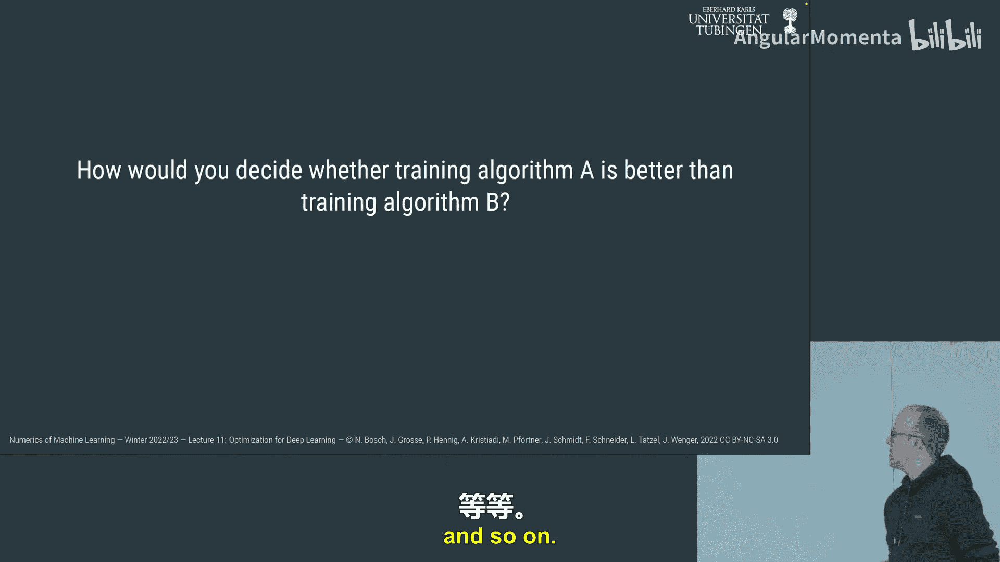

So that's already one of the fundamental problems of comparing those methods for deep learning and understanding which optimizer which training algorithm we should use is that we haven't really decided what the quantity that we compare them with is。

 So we don't actually at the moment， know what better means。

 So if we have the question is at better than SD。 Well we first need to understand and define what better means。

 And for deep learning， this could mean multiple things， we could have something that is just faster。

 So instead of training a model， taking 10 hours with a new method it takes 8 hours。

 I still get the same performance could also mean getting a better performance at the same time could mean that it's more robust to the choices that we make like learning rate or maybe model choices。

So。If we have another example。 So again， we compare A in B。

 and I found out that A gets me 90% accuracy and B gets me 91% accuracy。

Does that mean the be is better or is it just noise。How do we know。Right， so I could just retrain。

 And maybe this time A gets 91% and B gets 90%。So since deep learning is sort of what has this schasticity baked in。

It's really hard for us to determine whether our results and our better performance is just noise。

 And if we try it again， we actually get some different result。

 Or if it's a pattern and sort of significant results and a significant difference between the methods。

 Now， this is not necessarily a fundamental issue because one thing we could do is just run it multiple times and take something like the median or the mean score maybe use some standard deviation and decide whether it's significant。

 But it means that evaluating methods just becomes so much more expensive。

Cause I don't have to train once。 I have to train train maybe 10 times and do this for every method。

So whatever I decided to do before to compare methods。

 I now have to do it at a cost of 10 times or 20 times or whatever。

And that's unfortunately not the last of the problems that we have。

 is that at least for someone like me who wants to understand what is the best method in general。

 what is the best training algorithm in general， I actually have to do this on multiple problems。

 because if I just train one model and there it's better。

 it doesn't tell me anything whether it's better in general。 So for general purpose methods。

 And that's currently the way that we use atom is that we throw it on reinforcement problems。

 We throw it on Gs， we throw it in large language models。

 I actually need to test all of these cases to understand whether they're better in general。

 or just on this specific issue or this specific problem。

And since deep learning is this sort of complicated area where we work with data。

 we work with models。 We work with hyperparameters and do tuning。

 It's really hard to isolate the effect that just the method has on sort of the the training process。

 right， So it's really hard to isolate the effect that I get from using a better training algorithm to all the other aspects that go with it。

 So ideally， I would also need to test it， for example， with different hyperparameters。 every method。

 because otherwise， maybe it's just that this specific hyperameter。

 this specific learning rate that I chose just works better with this method。

 but this doesn't mean that the method in general is better。 Again， it's not a fundamental problem。

 It just makes everything a lot more expensive。And so this is something that I basically already said that usually there's some interaction between these parts。

 right， for example， I think this is clear that the learning rate interacts with the training algorithm and maybe the optimal learning rate for SGD is not the same as the optimal learning rate for Adam and so on。

But this also extends to the models that we're currently using。

 So I think it might be a valid thing to say that perhaps the models like Resnet or the transformer models are popular because they are easy to train with the training methods that we currently have。

 And if I come up with new training algorithms， Perhaps we could actually train different models。

 So there is some connection between the models we use and the methods we use to train them。

 So again， just makes everything more， more expensive。

And this is just sort of a last point that I wanted to make is that it's really hard to compare actually SGD with atom or SGD with momentum because they are not instances。

 They' are not runnable algorithms。 Theyre families of algorithms。 So， for example。

 if I want to compare SGD with momentum。 Well， it depends on how I set the the sort of the beta or here it's called row parameter。

 the momentum parameter of this method。 And I could， for example。

 just set the momentum parameter to 0。0， which means I get SGD back。So in a way。

 momentum just is sort of a more general method than SGD。

 And so comparing those two doesn't make a lot of sense。

And what I can only do is compare specific instances of these algorithms。

 So specifically saying I compare SGD with this learning rate or with the learning rate tuned in this distribution to some other algorithm that is completely specified。

So you see， there are a lot of challenges of comparing training algorithms for deep learning。

 And most of the problems just come from the fact that everything gets so expensive that we can just simply run a benchmark。

 find out within five minutes whether a method is better。

 But it actually takes a lot of compute to go through a proper benchmark。So。Roughly two years ago。

 we still try to identify what is the state of the art of training methods。

 So what is currently the best method to train。 So that's why we try to set up this benchmarking process and try to find some solutions for the issues I just mentioned。

So starting with the problems that we test， sorry， with the optimization methods that we tested as training algorithms。

 Obviously， it's not possible to test the entire list that I showed you in the beginning or the entire 150 methods。

 As I said， it's just way too computationally expensive to do that。 So instead， we had to pick 15。

That's still doable。But that means that I can't really make any claims about algorithms that aren't on the slide here。

 But hopefully， we pick the most important ones。 So we have some classics like S GD and the momentum methods。

 You have R S prop。 And then you have neuro methods like sort of atom variations like randomom or Naom。

 have something like out of believe that came out two years ago。 I think。But once again。

 we are only testing specific instances of these algorithms。 So we're not testing S GD。

 but we're testing S GD with a learning rate tuned in a specific distribution， yeah。paper before his。

有。Wass called is it。さ先。Yeah， it's actually pretty similar。 And I think there could be。

 So I need to repeat the question first。 in the beginning on the OP T paper。

 I mentioned that they used the Adam W。 Why isn't Adam W on here， Is it similar to this？ Yes。

 it's very similar And maybe there can be a philosophical argument。

 whether Adam W is a different training method or not。

 because basically the difference between Adam and Adam W is how you implement weight decay。

So it's more of a difference in terms of how you use the regular strategy。And again。

 it sort of gets into the details of whether this is a new training method。

 whether this is part of the sort of optimization part， or is the regular。

 maybe more power of the model to be considered there。

 But this perfectly gets into the issue of it's really hard to train。

 It's really hard to separate these parts。 And in this case， we didn't decide to include Adam W。

 but it's certainly something that you could do， yeah。Okay。

 so my point is we couldn't test all of them。 So there might still be wonderful methods out out there that we missed。

 which is very unfortunate。 But at least we could sort of focus ourselves on one or a selection of the most popular methods here。

Now， as I said before， we can just run it on one problem and then state from there that is in general better。

 So we had to compute or had to create a set of some problems。 In this case。

 we used eight different problems。 And you can see that they vary quite a lot。 We have some very。

 very simple sort of noisy quadratic。 Theyre more like test problems。

 Toy problems to understand the algorithm a bit better。

 We have some Vs some larger image classification models。

 resnets and also R an end So recurrent neural networks。

 And you can see that the runtime already increases。 if you go down。

 And so maybe one of the larger models takes already a handful of hours to run just a single time。

But obviously， we have to do this for all 15 training methods。

 So if you see a training time here already， you have to multiply by 15 to just get it for all the optimization methods。

But。A big thing in deep learning and neural network training is that we have to do tuning， right。

 We cannot just pick， as we saw before， just one learning rate。 And that's the good one。

 And we're happy with it。😊，But actually， we have to consider tuning as well。 So for tuning。

 we decided that we want to simulate sort of four different scenarios。

 So maybe one algorithm is just really good at being run out of the box without any tuning。

 And so maybe this is a really good candidate， you just want to see whether the model you set up or the data。

 whether this just kind of works， whether there's any use in even trying to tune it。

 And so we tested this in this what we call the one shot setting where we don't do any tuning just use the default high parameters to understand if you have a practitioner that maybe just has a single GPU and just only has it available for a couple of hours。

 maybe like which training algorithm should use to just quickly get some results。

 maybe for debugging， maybe for testing purposes or something。

And then if you sort of go down this list here， we increase the budget and use more more runs to tune the hyperparameter of each algorithm。

 So we start with 25 then 50 and 75。 So for the large budget。

 this would be more someone who maybe an industry once you really get the best performance they can get。

 So they can deploy the model and practice。 and they have lots of GPU resources available in parallel and could just start and spawn a lot of hyperparameter。

 different hyperameter settings in parallel。So this means to run the large budget problem sort of the large budget tuning。

 we have to do 75 individual runs where each take five hours。

 and we have to do it for 15 different optimization methods。

And there's one more thing that we also wanted to vary， which is the schedule of the learning rate。

 So this is probably something that， you know， that over the course of the training process。

 you should maybe decay the learning rate over time or at least vary it to some degree to really get the best performance。

 So we not only considered one such schedule， but four different ones， because， again。

 there might be an interaction between the learning rate schedule and the best training algorithms。

And so we tested the constant， a cosine， a cosine with worm restarts and a trapezoidal schedule。

 So the constant is just， as the name suggests， we keep the same learning rate over the entire training process。

 The cosine decay is something that slowly decays over time。 So it's the orange one。 And in green。

 we have something that repeatedly restarts during training。 So you decay the learning rate。

 but then increase it again。And the trapezoidal schedule is a combination of something called learning grade warmup。

 where in the beginning， you slowly increase the learning rate， Basically。

 until sort of your training algorithms sort of moved into an area that is a bit more well behaved。

 You it constant for a while and decay at the end。So we tested out basically all of the possible combination of that。

 For example， we tested atom on the second test problem with a medium tuning budget and a cosine schedule。

 and all of these combinations in total give us something like almost 2000 different configurations。

 But since one of those configurations， for example， oh， sorry。Wrong button。

So since one of this configuration， for example， include doing medium tuning means that we don't have 2000 runs。

 but we have some bit more than a 50000 individual runs that we have to do。

So this already gives us sort of this huge data set of。

 of training runs to hopefully extract some knowledge out of it。As I said before。

 we also repeated sort of the best hyperameter setting multiple times to understand whether performance is just due to noise or understand sort of how much the results can vary just if we repeat the run again。

So let's look at some examples of the results。 So this complicated figure just shows the performance of every optimizer。

 every training algorithm we tested。 So those are the 15 ones here。

 And each training algorithm corresponds to one color。

And it shows the performance of all these methods on all a test problems that we tested。

 So each test problem is one of these aes here。 So， for example。

 Tolstoy character R and N is one of the problems。 So training a character sort of language model for character prediction using an R N on some tolstoy data。

 And then we can see that the black line is the best here， getting a performance that is above 62。5%。

 This one corresponds to R S prop。 And we can see that rather at the bottom。

 we have the yellow and orange one， which are aim is bound and out bound。

So we could see that on this problem， arms prop performs better than something like a misbound out a bound。

 But if you now move and look over to all the other test problems。

 there isn't really a clear picture。 Is there more like a big spaghetti plot where you see a lot of lines crossing all the time。

 And if you look at what the best method is for each and every test problem it actually changes a lot。

So this is just showing the results for the large tuning budget and trapezoidal schedule。

 But the main picture looks the same If we look at different budgets and different schedules。

 So the main picture is there isn't really a clear answer。

 So there isn't really a clear state of the R training method for deep learning。 And instead。

 we have lots of methods that are sometimes good， sometimes not so good。

 And we also see that something sort of traditional， like atom。You need to quickly switch here。

So I could point again， yeah。Something of the the more traditional and the maybe the most popular method at the moment。

 Adam shown in red here actually performs quite well。 And so all the sort of methods that came after。

 like Naam or Adam that are direct variations of it and at least in our benchmark and our tested situation。

They don't really show a significant and consistent performance improvement over at。

And this is especially true that if you consider that what I show here is the sort of average performance over multiple repetitions。

 So if I also plot  error bars in here， you can see that sort of the results。

Trink a bit in terms of how different they are， because most of the time。

Atom is actually within one or two standard deviation of getting a good result。

So I think what this entire part about benchmarking tells us is that currently there isn't really a clear state of the art method of this is how you train a neural network。

 right， There are lots of different methods。 and which one is the best depends on your problem and depends maybe on how much time you have on the budget。

 how long you train and so on。 And we can see that in our benchmark， Adamom looks quite good。

 But maybe for large language models， you need to do something else。

 can also saw that relatively consistently for the character R and N R Pro is actually better。

 And so we get this really sort of modelled picture of there isn't a clear。

 this is the training recipe。 This is the way this is the protocol to train neural networks。

 And instead， we get this very， very messy situation where you don't really know what the current state is。

And。I mean， some of， maybe some of the points or some of you might go and say， like， well。

 you just tested it in this limited benchmark。 You could have tested other methods。

 Maybe you just needed to look at larger problems。 And some of the criticism is definitely true。

But we're actually trying to do this now on the much larger scale。 So hopefully this year。

 we can release the Eml Commons benchmark from our algorithms working group。

 So I together with George Do from Google share this working group at Eml Commons。

 and we really together with people from Google researchers from Google from Meta from the Toronto and so on try to build the competition to measure neural network training speedups only due to algorithmic changes。

 So we want to build a benchmark， a competition to see how much we can speed up neural network training by changing the algorithm building more efficient algorithms。

 So I see it really as an extension of the benchmark work we did before。

 but now at a much larger scale。 So since we have a lot more people involved and researchers from different companies and different universities。

 we can build much larger scale problems。 So it's not only on the sort of smaller scale problems but on larger scale。

😊，Imagenet problems， WMT， translation models， and so on。

And a big difference from what I showed you before is this time。

 it's not us that select the method and how we tune it。

 but people can actually tell us and submit algorithms。

 So if you have a great idea for something like an improvement to add or entirely new method。

 you would build your submission and send it to our benchmark and it's sort of a competitive benchmark where people。

 sort of fight against each other with their method instead of us deciding how we should use the method。

And so I think what this effort of Emily Commons shows and the amount of sort of money。

 both direct and indirect that these companies and universities put into is that it's not just us that don't really know what the state of the art and training method at the moment is。

 But the entire community at the moment is sort of really unable to identify which of these training methods are the best。

 And what the proper protocol is for training neural networks。So， it's not just。

Us that are looking for this manual and this flowchar on if I see this， I should do this。

 But it's actually companies that have a lot of expertise like Google or Me and so on。

 They' are looking for the exact same thing。

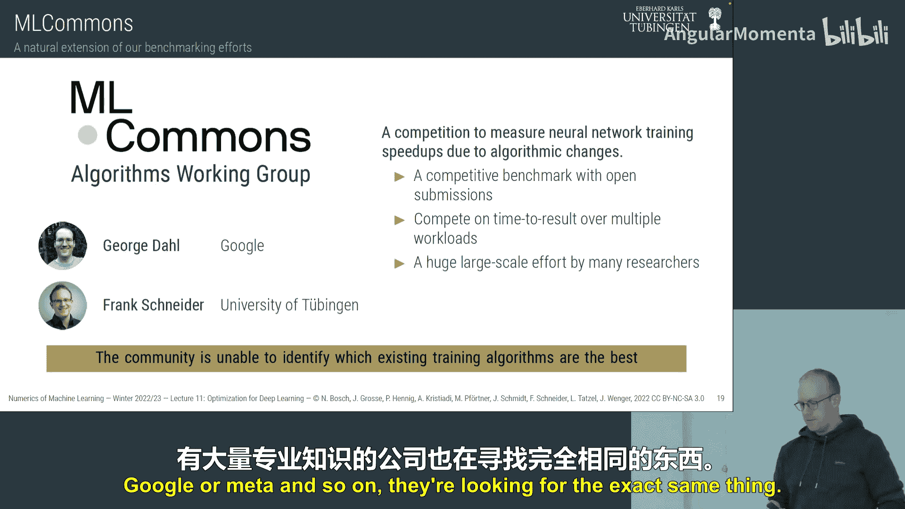

Alright， so given now that we have the situation where there's so many methods。

 we don't really know how to use them。 What， what's， what's the solution， What， what。

 what can we do to improve this situation。And with this next part， what I want to explain is that。

One strategy to improve what we currently have is to once again。

 look into the methods in a bit more detail， understand that there might be some additional information in there that we could use that is currently not used。

And then use this additional information。Hopefully， as an end result。

 to use better algorithms that can do a lot more automatically。

 perhaps instead of us fiddling around and babysitting and tuning a neural network。But， maybe。

Until we have those great new methods that do everything automatically。

 we can actually sort of provide some of this available information in the form of debugging tools to user to be a bit of a help。

😊，And so I first want to talk about the first part。

 which is sort of what in additional information is there available that we could use to build these debugging tools or to build these training methods。

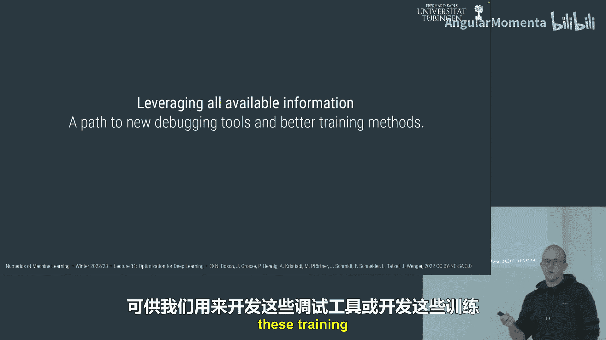

So if you remember back the slides where I had in the beginning about that we don't really optimize on the true or the loss that we care about。

 the true loss， but we only operate on some smaller finite training set。

the same is true for the gradient right， We don't evaluate the true gradient。

 which means the gradient on the sort of the entire underlying data distribution。

 but we only do it on sort of this empirical gradient here。

 that is just sum of the n training examples in our training dataset。 and as I said before。

 most of the time， we also approximate this by just sum over some individual samples from this training dataset in our mini batch。

 So although this entire So n might be 10 million examples。

 but we usually only look at maybe 1 hundred，200 or000 at a time。 before we take our step。

So what we can see here is that this， it doesn't really matter if it's the mini batch gradient or the empirical gradient。

 It's just sort of a sample from this true gradient， right？ And we pick n N samples or B samples。

 and then average over them。 So this is really an estimate of the true gradient that we look at。

 And all we use at the moment is the mean of this estimate。

But if you sort remember back at some of the other lectures is that， well， if we have a mean。

 maybe it makes also sense to talk about the variance of this estimator， right。But it's not really。

 doesn't exist in Pytorch， and it's not available。So what I want to say with this slide is that in Pytorch and what atom is using。

 what SGD is using， what all the methods are using。

 is's just this mean gradient that you get from averaging over some mini batch。But there。

 there is some additional information hidden in there， which is all the individual gradients， right。

 This is just a sum over B individual gradients from the individual training examples。And so if we。

 if I have this information， how these individual gradients spread out。

 whether they' are spread out a lot or focused very much around the mean。

 this is additional information that I could use because it tells me how noisy my gradient is。

 It tells me how certain I am that this is the gradient at the moment。

And I think what is hopefully also visible here is that this is not some。

 some quantity that is super expensive to compute， because basically， we're doing it already， right。

 We're taking our B samples。 And at the end， we just average over the gradient。

 So I could just look at the gradients before we average them and have them。 So it's not， in theory。

 it's not something that is just way too expensive to compute。

But it's more like the developers of Pytorch or Jax or whatever just decided that this is not a quantity that we need to use。

 And it's a bit of a chicken and egg problem where Pytorch doesn't really want to implement it until someone has shown that they can actually do something useful with it。

 But it's really hard to do something useful with it。

 If you don't have it available in Pytorch or other frameworks。

And so people from our group actually develop packages or a package called backpack。

 And there are similar packages to it where we can officially access this additional information。

 So not only the individual gradients， but also some other quantities like variances or second order information。

And so。Hopefully， what I can convince you of is that there is more information in this sort of compute graph available or during the backward pass in this computation of training on neural network that we can leverage and that we can use and that is currently not used。

And we can do it efficiently to get it efficiently。

 It's actually a little bit more complicated than it make it out on the slide。 But it is possible。

 as we've shown with backpack。 and it's not only theoreticallyly possible to get efficiently。

 but also practical。So one question is， what do we do with this additional information。

Here's just one example of how we can use this additional information to sort of steer our training process a little more。

 right， This is just one example， one simple one。 And I can make a few more later on。

So one very popular and common thing that people do when they train neural network is that they stare at this loss curve。

 see it going down。 Hopefully， over multiple iterations here。

 I plotted the mini batch training loss over times or over iteration。

 And you stare at the loss curve。 And from this， you decide what to do with your neural network。

 whether you should decrease the learning grade， decrease it or what。

What I show here are actually two different loss curves。 So one in orange and one in blue。

 that is really hard to see because it's almost exactly the same。 So it's just behind。

 So I have two lost curves that are virtually the same。Now， if I look in the lost landscape。

 So if I look at what is actually happening in the optimization in the lost landscape。

I can see that blue and orange。Are actually doing two completely different things。So the blue curve。

 which is the one behind， basically jumps back and forth here in this sort of rather narrow valley。

 right， So we have， so I with the shaded background， I denoted the the loss。 And so the dark it is。

 the higher the loss。And you can also see these is lines or the lost landscape at the moment。

 Basically， looks like this sort of a narrow valley。

And blue starts here and basically always jumps to the other side of this valley and make some progress towards the global minimum that is marked with a star here。

Now， orange does something completely different。It starts at the exact same point。

But I think the arrows are almost impossible to see because they are so small。

 So orange just makes very， very， very tiny steps along sort of the one of the sides of the valley and moves down。

So although they do completely different things in the lost landscape， their lost curves。

 looks pretty much the same。So what the loss curves。

 loss curve tells me is if my network is training or it's not。 but it doesn't tell me why。Right。

 so it doesn't tell me what I should do。 So for blue。

 a reasonable thing to do is just take one step with half the step size before。

 And then I would end up at this point here， here， which is actually quite a good point。

 And for orange， the obvious strategy is to increase the learning rate and make some larger steps to actually make some progress。

So the loss curve tells me if my network is training or not。 If I look in the lost， Los landscape。

 actually， I could actually see why it's training or what I should do to improve it。

 The problem is for neural networks， I can't really look into the lost landscape。

 The lost landscape has tens of millions of dimensions。 Hreds of millions and it's ever more， right。

 So it's impossible to look into the lost landscape。

 So even if I do some random cuts through the lost landscape， It doesn't really tell me anything。

So although this would nicely tell me what I want to do。For practical neural networks。

 this is just way too much information。 These are tens of millions of numbers。

 If I look at the trajectory and it doesn't tell me what I want to do， which， what I want to know。

 which in this case， should I take a larger step or a smaller step next。But。

The quantity that we are interested in in this case is actually rather simple because it's just about。

 should I do。 or how large is my step in relation to the loss that I'm seeing at the moment， right。

 So with this plot， I want to introduce a quantity。 And it's a little bit hard to understand。

 unfortunately， or my explanation is always a bit hard to understand。

 So I'm just trying to give you sort of a visual definition of the quantity。Which is。

IActually show it in three different scenarios。 So for now， let's just focus on the left plot， right。

What I do is I observe the loss at some point， Theta T。Then I take a step in， for example。

 in the direction of the gradient or in the direction that Adamom suggests for me doesn't really matter to some other point。

 Theta T plus I。 So this is just one step in in the lost landscape。

 And since I'm just doing one step， all my updates are happening in this one dimensional direction。

 right， So it doesn't matter how high dimensional， my neural network is。

 if I just plot one single step of my optimization procedure， always one dimensional。

And at this point， I observe another loss。 In this case。

 my loss is a bit lower than the loss I started with。

 And what I also observe is sort of whether my lost landscape still goes down or goes up right。

 So this is sort of illustrated by this。 hopefully it's visible by this black line here。

 which is the slope in the direction that I'm currently stepping。

 So what I'm basically doing is I start here。 I evaluate my loss。

 I also check what the slope is in the direction that I'm stepping， should hopefully go down。

 Otherwise doesn't really make that much sense， perhaps to step in this direction。

 Then I take one step to a different point here I can evaluate the loss again and can also determine whether it's still going down in this direction all would go up。

 And depending on what I observe whether it's still going down or not。

 I can probably build some model of how the lost landscape behaves in this direction， right。

 So in this case， I observe observe a loss that is lower than the one I observe before。

 And I see that the。Slope is still going down， which means probably the lost landscape looks a bit like this blue line here。

And probably the minimum of this loss in this direction in this。

 just this direction that I'm stepping in is probably quite far away from the point where I step2。

And so we call this scenario understepping。 and we deote it by an alpha that is negative。Again。

 I could get the total opposite observation， which would be。 I observed some loss。

 I stepped to another loss that in this case， is pretty much the same。 And suddenly。

 I see that the slope is going up。 So I probably overstepped the minimum。

 And this is what we call overshooting。 And we donote it by a positive and larger than zero alpha。

 And then obviously， there's also the situation in between where I actually stepped pretty much close to the minimum in this direction。

 right。So all I want to do with this alpha is character， whether I'm understep。

 whether I'm sort of minimizing or whether I'm overshooting。

 And I do that by only considering the loss in this single direction。 So， again。

 this alpha is always just a scalar number， and it doesn't matter how high dimensional the neural network is。

So one thing that you might think if you look at this is well。

 if you build this quadratic model here， you actually have four observations。

 You have a loss here in the slope and you have a loss here in the slope。

 But you're building a quadratic model that doesn't really work。 Well。

 all of the observations that we're making the loss as well as the slope they're noisy， right。

 because we only observe them on a mini batch。And so we can use the information from all these individual observations from each sample to actually calibrate this model a bit better and understand which of these observations we should trust。

 because it's less noisy and which we should maybe put less trust in， because it's quite noisy。Okay。

 but the one thing that you should remember is that this alpha is a scalar quantity。

 always a scalar quantity that we can efficiently compute。

 And that tells us how small or sort of how small or large our steps are compared to the loss that I'm observing in this direction。

 and negative values means I'm understepping and positive values mean overstepping where one means I'm exactly jumping to the other side of the value。

 And so we can see that plotting this alpha distribution。 by the way， why is it called distribution。

 Because we look we look at alpha in each individual iteration。 So if we just track all the alphas。

 I get a distribution over each step。In this case， orange and blue。

 they behave pretty similar all the time。 Blue is always pretty much stepping to the other side of the valley。

 So it gets an alpha distribution that is very close to one here。

 And orange gets an alpha distribution that is very close to -1。

 So this quantity can tell me exactly whether I'm understepping or overstepping or doing something in between。

So the crucial point here that I want to make is that， again。

 the loss curve tells me if I'm training or not， but doesn't tell me why。

Looking at the landscape would theoretically provide me this information。

 but it's so high dimensional。 It's so many information that I don't really sort of it's。

 it's way too many information to make sense of it。

But if I can build some quantities that compress this information into something that is meaningful into sort of a status report。

 I， I can actually get the information that I'm looking at。

 I can actually get the information that I care about， which is。

 should I take larger or smaller steps。 right， So this is just one example of what we can do with additional information。

 And the bigger point that I want to make here is that we could use this additional information to build new debugging tools for deep learning。

So the current debugging tools for classical programming， by which I mean。

 everything that doesn't involve machine learning or data looks a little bit like this。

 We write functions， We write scripts， We write classes。

 And when they don't work the way we hope they work。

We could theoretically look at the zeros and ones of our code， right， all the information。

 why our functions worked the way the work would be visible in the zeros and ones。

 But this is way too much information， not something that we can compress or understand and really make use of as a human。

And so what we do is we use debuggers。 They take this low level information。

 compress and condense it into a sort of meaningful status report， which in the sense or in the。

 in the case of a traditional debugger would be it tells you the values of each variable in a function。

 or maybe if you use a profile or some run times and so on。And I think。

 or we think that we need something similar for deep learning。So in deep learning。

 we do model training， which is perhaps arguably a bit more complex than just writing functions because we have data because we build models and because we have to worry about hyperparameters and so on。

And so we can get different bugs in model training that we can get in classical programming。 So。

 for example， I could just mess up the learning rate of my training and get something that still compiles It still runs。

 It doesn't。 It doesn't throw me any syntactical error。

 but my training might be super slow or even just explode， right。

 So I could get sort of these silent bugs that just make my training very slow and inefficient。

 And maybe my final model very bad， very poorly performing。😊，Without them being super visible。

 And so we have different types of bugs compared to classical programming。

 So we also need different tools to find them。So if in the case of deep learning or model training。

 I use a classical debugger that actually looks a lot like looking at the zeros and ones from before。

 because with a traditional debugger， I could look at the， let's say。

 parameter values of my neural network in each iteration， right， All the information is there。

 I could look at the exact pixel values of all the images in my training data set。

But this doesn't give me any insight on what I should do。

 It's just a huge list of numbers that I can't really make any sense of。

 just like the zeros and ones。So what we need is something in between that takes this low level information and compresses it into the relevant status report that I want as a user。

And this is something that you could call perhaps deep debugger。

 And with a tool that we call cockpit， I think we have found something of a proof of concept that these types of tools can exist。

 that they can be efficient and that they can actually dig up some relevant information for the user。

So what does this cockpit look like， Well， if you train a neural network and you or sort of use cockpit to look at the training process through its lens。

 training looks something like this。So this is huge。 again。

 looks a bit like you're getting overwhelmed with information。 But if we step through it one by one。

 it becomes much clearer。So at the bottom， you see the performance plot。

 which shows the training loss going down over time。

And you see the a curacies So both training and validation acuracies increase over time。

 So by the way， this is sort of just a looped animation。

 So this is basically what you would see if you would live monitor the training and just restart after it's done。

So this performance plot is probably what people look at at the moment all the time， right。

 They stare at this。 It's basically the loss curve plot。 They stare at this。

 If the accuracycurac goes up and the loss goes down， everything is good。And if not。

 unity do something。And probably， this is also something that put people look at。

 which is sort of what are the current hyperparas that I'm using。 In this case。

 we're just plotting the learning rate， which we sort of gave the cyclical schedule here。

But now we want to extend sort of the view of a user from just these two plots to all these additional plots at the top。

So this is basically the benefit of cockpit that it augments view of view with these additional instruments。

 There's actually more than these。 But this is sort of the default view that you get。

 very similar to what a pilot and an airplane would do is he has all these complicated instruments that tell him or her about the state of the airplane。

 And instead of basically just looking out of the window and seeing if everything works fine。 right。

 So that's what we hope to achieve is to augment the view of a viewer who's training a neural network with some interesting plots that tell them more about what is currently going on。

 similar to what is happening in an airplane。And so。In the blue column。

 we have some instruments that tell you something about the step size。

 So how large or small are the steps that you're currently taking。 For example， at the very top。

 we have this alpha distribution that I just talked about。 We also have plots about the distance。

 So how far away from the initial initialization。 Am I currently in my optimization trajectory。

 So it's basically the difference between where I'm currently at and where I started。

Which can also tell me a bit if I'm perhaps stuck in some local area and need to move on to some some other place。

 is's also the gradient norm here， which is just as the name suggests， the norm of the gradient。

 It can tell me a lot about how much signal I'm currently getting to sort of direct my training process。

And so one thing people are often worried about， for example。

 in training neural networks is getting stuck in some local minimum。

 But if you look at the gradient norm， you can actually check with whether this is true or not。

 because this tells you whether you're stuck in a local minimum or not。

Then there's an entire column in the orange one， just about gradients。

 and especially about the fact that we own not only have a mean gradient。

 but also individual gradients where we can learn something from。 So， for example， all these。

 it's actually basically three different quantities in green and blue and orange are gradient tests。

That basically tests how much noise there is currently in your gradient that you're getting。

 So basically， what they're telling you is， should you increase your batch size or decrease it or what should or or is it fine。

There's also some histograms about how these gradients sort of distribute。

And then there's an entire green column about curvature information。

 And I'm not going to talk about this today because Lucka's lecture next week will be focused all about curvature。

 So he will talk about this in a lot more detail。So what I want to show you next with the next few slides is that these additional quantities here at the top and sort of some variations of them that that are also part of cockpit that they can actually not only sort of overwhelm you with these lots of information。

 but that they can actually dig up some relevant stuff and perhaps actually help you find some bugs in your neural network training。

So。This is an example of finding something that we call a data bug。

 So something that results in inefficient training that is caused by the way that you handle your data。

So probably one thing that you should know is that every time you use data in a neural network or general and machine learning。

 you should normalize it。 So meaning that it sort of distributed it between 0 and 1 or something like this。

But usually not all the time， depending on， on how you set up。

 your data arrives in this sort of raw format。 Where for pixel values。

 there's often between 0 and 255。Now， if you look at the data。

 So one in this raw format and once in this normalized format， if you just look at it， in this case。

 it's just mudpl lips I show command， you don't really see a different， right， Visly。

 theyre the same。 And that's because mudpl Li just takes care of it。 And if you visualize it。

 there's no difference。But your neural network will be affected by whether you use raw data a normalize or normalized data。

And you can actually see this if you look at this gradient element histogram of cockpit for the normalized data or the raw data。

 And you can already see that the raw data has sort of spread out a lot more and fields maybe intuitively a bit more weird than this nicely behaved histogram here。

😊，Now， in general， this might not or doesn't always have to be a bug and a big problem。

 but it means that it probably affects your optimal hyperparameters， right， For example。

 you're at a learning rate。And so if you hope that the default learning rate of atom works。

 you probably want to use normalized data。 But it's something that is easilymiss because even if you just visually inspect your images。

 you might not see it。Another example of finding bugs。 And in this case， it's a model bug。

 which again means it somehow affects training negatively。

 and it has something to do with your model。Is here where we can have two or we see two networks。

 One is in blue， and one is in orange。And they seem to have a pretty much the same gradient element histogram。

 But one of them， and it's the orange one， is training much worse。 So it's a lot harder to train。

 Blue trains nicely and orange trains pretty badly。

So this might be a case for the gradient element histogram is not the full story。

 But what you can do with cockpit。 And again， it's sort of available additional information is that you can look at the same histogram。

 But for each layer。 right， That's a sort of a big property of neural networks that they didn decompose into layers。

 And so we can look at the same histogram layer by layer。

 So this is for this first layer that is the closest to the input。

 This one is the last layer closest to the output And we also shown one in the middle。

And what you can see is that for the orange network， a bunch of them actually are super degenerate。

 And only the last layer sort of looks nicely， at least here。

 But since most of the parameters of this network are in the last layer。

 it also dominates sort of this network wide histogram。

 So that's why you cannot see this in the network wide histogram。

 But you have to look at it layer by layer。And so with this， you can sort of already see that， okay。

 something might be wrong with my model because I initially get some gradients。

 but they sort of degenerate throughout the model。 So probably there's something wrong with the model。

And exactly， that's the case because the difference between the blue and the orange 1。

 orange1 is the activation function that you use， right。

 And so just by switching between sigma and Reello。

 you can either get a network that trains really nicely or get something that doesn't really train at all。

 And this is something that， again， it's like super hard to find if you don't have any tools for it because it's just trial and error。

But if you at least have some idea of where the bug might be found in this case。

 it at least looks like something is wrong with the model can at least sort of。

Understand a bit more of where not to look。 Let's say it like this。And lastly。

 we have a case where cockpit helps you with something that we call hyperparameter bugs。

 which essentially means you sort of messed up tuning。 You maybe misspecified the learning grade。

 And it's actually also a case where it can help us inspire new research and understand methods better。

So again， I'm looking at the alpha quantity from before。

 The only relevant information that you need to remember is that a negative alpha means that we're understepping。

And positive alpha means that we're over shootingot or overstepping。

 and something around 0 means we're actually getting quite good to the or making steps that are quite close to the optimal step in this direction。

😊，So what we plotted or shown in this illustration above is the median alpha over a training run。

 Okay， so this is looking at all the alphas that we observed during a training run and just taking the median over it。

We did look at different problems。 These are visualized by these different colors。 So for now， let's。

 for example， only look at Cypher 10。 And this 3，3D is just sort of the code of our model that we use。

 So for now， let's only look at these sort of purple color dots。

 We have multiple of those because we tested multiple different learning rates。

And the larger the bubble， the larger the learning rate， right， So you can see this one。

 actually a bit larger learning grade and the smaller learning grades end up here。

And the higher the bubbles or the dots on the Y axis's， the better the performance。

 as measured by test accuracy here。And what you can see is perhaps a relationship that you would already have guessed is that if we use larger learning rates。

 we also get a larger median alpha because we tend to overstep more or instead of understepping for us taking two small steps。

But I think what the surprising part about this plot here is is that the optimal or the best performing runs are not the ones that are closest to 0。

 So they're not the ones where we minimizing the most。That actually runs where we overshoot。

And this is really rather consistent between runs between different problems， right。

 We can see that the best performing ones， which are always highlighted with this vertical line。

 they all fall in this area of positive alpha， which means overshooting。

 But even all the good ones are in this right part of the plot。So clearly。

 minimizing in each step is not what we should do。 And instead， we need to overshoot some。

And so this is something， again， where if you would train your neural network and you're seeing negative alpha values。

 probably you should increase your learning rate。As you can see， the。

 the best alpha value depends on the problem。 So I cannot tell you exactly how much you should increase。

 unfortunately。But at least if you observe a negative alpha value。

 that's probably a sign that you're taking two small steps。

But besides this sort of helping the user tune their learning rate。

 this is also really interesting because it tells us that， again。In neural network training。

 maybe minimizing is not what we actually want to do， because apparently。

 we need to overshoot and we need to do this systematically to get the best performance。

And this is not something that we observed only， but other people observed as well。 For example。

 this is a paper by University of Toronto where they basically looked at a very simple problem。

 Here's the quadratic problem。 Again。 We have those eyes lines here and the starting point here。

 And they compare two different strategies。 And they compared in the setting where you can observe the gradient only with noise。

 right， And that's a very critical aspect。And so they first come compare the method where you take or。

Where the steps that you take。Are always designed in such a way that the step size is the one that gets you the lowest loss possible in this direction。

So if we start here and the gradient points us in this direction。

 the best step size that we can take is here because this would give us the lowest loss。Now。

 if we would be in the deterministic setting， my next gradient would directly point me to the minimum。

 And the best step that I could take is exactly here。 So after two steps I would be done。

 But unfortunately， in neural network training， we're not in the deterministic setting。

 which means everything is a bit noisy， which means the gradient that I really get。

 it's not pointing directly in this direction， but probably just slightly down or slightly up or something。

 And if I then decide on the step that I should take and the optimal。

 it's actually a really small step。And so if I do this repeatedly。

 I will just sort of wiggle around in this narrow valley at the bottom and not make a lot of progress。

And then they compare this to a sort of a global optimal schedule。

 So one way you just in the beginning， take large steps and bounce around back and forth in this valley。

 And only after a while， decay your learning rate until you sort of fall in the value。

 And then you actually a lot closer to the minimum compared to this sort of。Short。

 short term optimize schedule。So， again， this is an example for why optimization and training are two different things because。

In the digitalmin setting， we could just take local steps that are optimal。

 and we would end up with something that is globally optimal。But in this case here。

We have this what they term short horizon bias in the sense that if I take something that is locally very good。

 it might actually hurt my performance in the long run。 And instead。

 I should probably or should do something like these steps here that look very chaotic in the beginning and like very problematic。

 perhaps。But that they actually make a lot of progress in this direction here。

 So if I became a learn grade， I am actually at the sort of low and good point。

And so this also gives some background on why this overshooting is perhaps necessary to train a neural network because we have this noise。

 And so we need to sort of compensate for this。

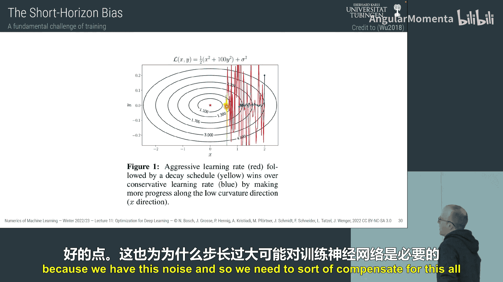

Alright， so I'm at the end of my lecture。 So I briefly briefly want to summarize the main points that hopefully you could take from this lecture。

So as I said before， in most of the lectures previously， we always had this。 this is the clear。

 this is the classic method that we look at。 and that people use。

 And maybe here's some ways to improve it。 But in deep learning。

 it's super unclear what the state of the art is。 So if you ask two people who train neural networks。

 how do you train neural neural networks， you probably get at least 10 different answers， right。

 So there isn't a clear protocol， a clear training recipe that you just follow to train neural neural network。

 And instead， theres hundreds of them and people have all these sort of strategies and all these conceptions on what they should do and how it should be done。

 So there is no established standard protocol to just follow to train neural neural network。

And instead， there's a lot of babysitting and tuning still necessary to get your neural network to train。

So the second point that I want to make is that we have all these methods。

 but it's clearly that they are so unsatisfying to use at the moment。

 which is why training a neural network is such a pain。

And the third point is that the stochasticity in deep learning is such a primary source of the challenge for this hard task of training a neural network。

That， or it， it， it results in the fact that training and optimizing are two different things。

 And we want to train our neural network and not just simply optimize it。But luckily。

 we think that with the additional information that we can get from something like the backwardboard pass efficiently。

And think about the gradient not only as sort of this single value。

 but more as a distribution and think about the standard deviation， the variances。

 the confidences that come with it。 We can actually account for this stochasticity to first maybe build some better tools for practitioners。

 but hopefully in the long run to also build better methods that can take a lot of this burden and babysitting off of people and build more autonomous methods that can do a lot of this on their own。

So that's sort of our two way strategy is to first think about the tools that we can provide for practitioners while we sort of wait to develop these better methods that do a lot more of this autonomous。

So that's the high level summary。 So I think hopefully， after this lecture。

 you agree with me that currently training a neural network is really a mess。

 And if you're interested in helping us improve this。

 then let us know we're always looking for a master student。

 bachelor student or PhD student to help us improve this。😊。

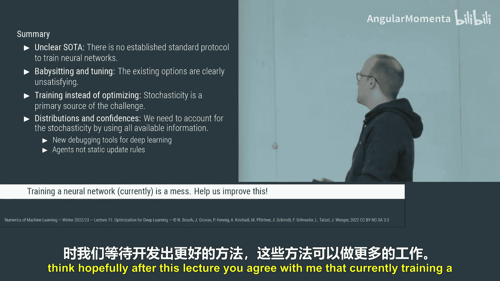

So thanks a lot。

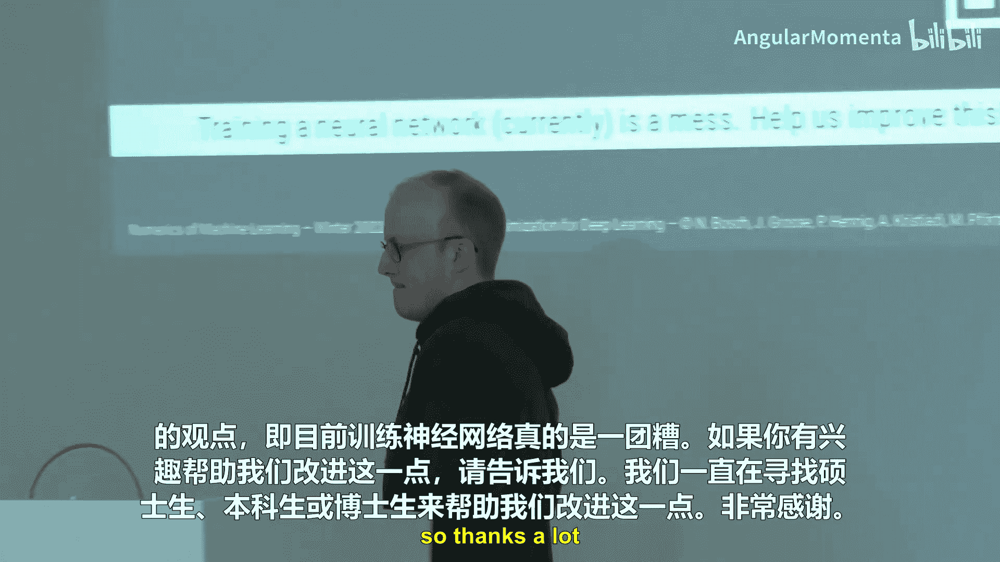

