# 【精译】蒂宾根大学《机器学习中的数值方法》-p12-12----深度学习的二阶优化----卢卡斯·塔策尔--BV1WMYHzAEcL_p12-

。

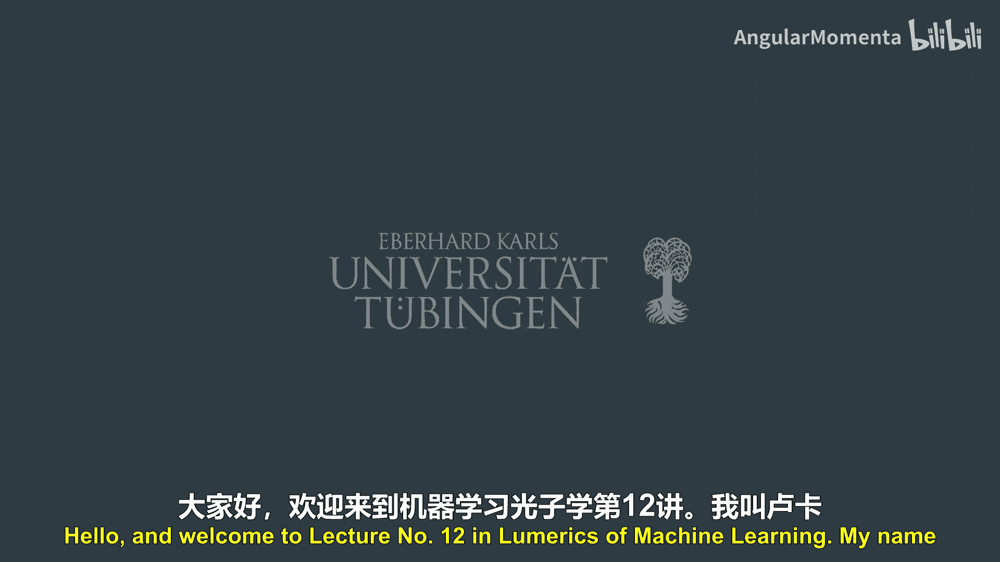

🎼Hello and welcome to lecture number 12 in numerics of Machine Learn。My name is Lucas。

 I'm a PhD student in Professor Hens Group， and I'm gonna talk about second odd optimization for deep learning。

 So last week in Fs lecture and also in the exercise。

 you've probably seen that deep learning of neural networks is pretty tedious and an extensive。

 expensive process。😊。

And today， we're gonna to learn about a different class of optimizeimrs。

 namely second auto methods that at least don't have some of these problems that first auto methods have。

🎼Yeah， so that's a plan for today。 But we will also see that these specific optimizers have other difficulties and unsolved issues。

 especially in the context of deep learning that I want to address。

So I want to start with a brief example。So this here is an example of a minimization problem。

And you can see the so calledled ho and po function in 2D。E whichch is this banana shaped function。

 which has a a global minimum at at 1，1。And we start three optimizers at this initialization of the parameters。

And here you can see basically the three trajectories of S GD with some learning rate。

 Adam and L B F G S。 So maybe the first thing you notice is that for S GD and Adam。

 I need to specify some learning rate。 right？ So for those two。

 I have hyper parameters and at tune them basically by hand just by trying all different values。

And for L B， FG S， apparently， I don't have to。 I just use the default parameters， and apparently。

 it works。So this is maybe one first observation from this little example。

The next one is that if you take a look at the trajectories， then for S GD。

 we have this very jumpy behavior。 So it seems to kind of serve this very narrow valley。

And it doesn't seem to make， yeah， good progress， I would say。 But as for Adam。

 this looks a little bit better， a bit more stable because it seems to make more progress along the low curvature direction as well。

And L B FG S just looks nice， in my opinion。 It seems to make kind of well informed steps。

 And it also seems to make only very few steps。So maybe one guess you could already have is that the convergence of LBFGS is faster than for the other two。

So let's check if this is right。So at the top plot here， I plotted the loss value。

 So the value of the function we' are trying to minimize。 And on the X axis。

 we have the number of steps。So for L B FG S， I think it's 7 steps until we reach the tolerance of 10 to the -8 for Adam。

 It's in the order of 1000。 and for S GD， it's in the order of 10000。So， yeah， it seems that。S G。

 D and Adam take many steps to reach to tolerance， whereas L B FG S only requires less than 10 steps。

And now you could maybe argue that okay， maybe it does less steps。

 but it could still be more expensive in terms of runtime， Right。

 Because if every step is just much more expensive then， yeah， maybe it's just not worth it。

But actually， it turns out that also in run time， the difference is not yeah that large anymore as in terms of the number of steps。

 but still LB FG S is much faster than Adamom and certainly faster than S GD。So。My question is。

 first of all， how do such methods work。And secondly。

 do they maybe also have potential for deep learning， Why don't we apply them to deep learning。

 right。So this is what I want to address in this lecture。

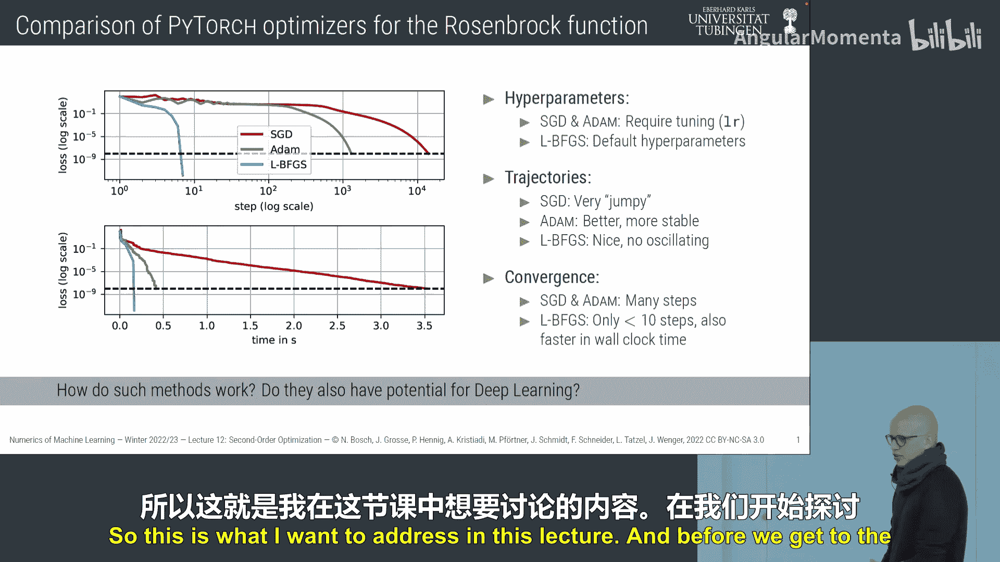

And before we get to the to fund the interesting stuff。

 I want to briefly summarize and recap first all the methods。

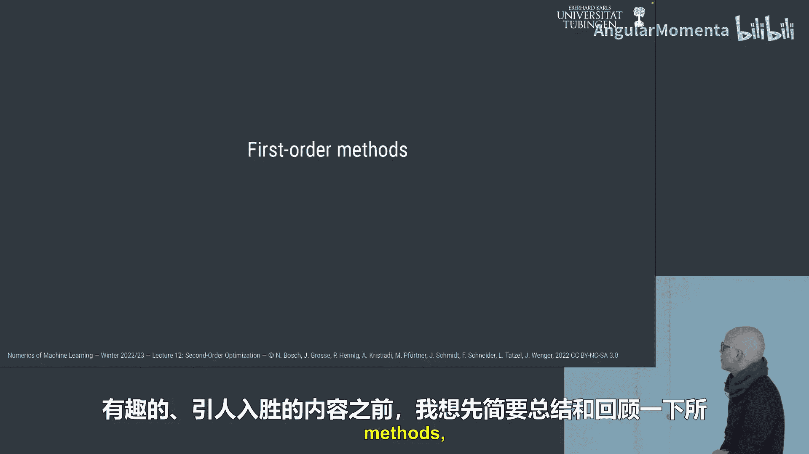

But I'm gonna go through this quite quickly because，1 of all。

 I think you have seen this in multiple lectures before。 and also last week in in parts by Frank。

So first of all， we have training data。 When we do deep learning。

 we have basically training examples of inputs X and outputs y。And we have this training set。

 which has N such examples。 And these examples are assumed to come from a data generating process。

 basically。 So a distribution， which is called P data。

And we assume that we have I I D samples from distribution。

Then we have a neural network or a model that makes predictions based on a parameter vector theta。

 which comes from this space and an input， which comes from this space。

 And this is then mapped to C dimensional output vector。

 which is basically C is the number of classes， right， So this is a vector of dimension C。

And in the last step， we're gonna compare this prediction Y hat with the actual label from the training data。

 why。So this would be the loss function。 So it takes those two things， mapps it to a real number。

And this is basically， so the loss is basically a measure of dis dissimilarity。

 right between the prediction and between the actual label。

And now we can do this for the entire distribution of data that we have。

 So the expected risk is defined as the expectation。Basically。

 taking samples from this data generating process and then taking the expectation over these numbers。

 Okay， so this would be the expected risk。And so the problem with this is。

 if this is our objective function， which we want to minimize。

 we cannot because we usually don't have access to this distribution。

So what we do instead is we compute a Monte Carlo estimator。

 You should know about them from Professor Hen's lecture。

 so we can basically replace the expectation。With an average， you could say yeah。

 And we just plug in those numbers of the loss for samples coming from the distribution。

 This is basically the idea of a Monte Carlo estimator。So we end up with the empirical risk。

 the Monte Carlo estimator of the expected risk and。

Our goal in deep learning is to find a configuration of our network。

 So with such a parameter vector theta that minimizes this empirical risk。Okay， I'm sure you know。

 that there are numerical methods for this， like gradient descent。 So here。

 the idea is pretty simple。 We just go into the direction of the negative gradient because the negative gradient points into the direction of steepest descent。

 right。So this is usually what for first auto methods， do。

 they take the gradient and they compute the next iterate。 in this case， Theta K plus1。

And in this case， of gradient descent。This is the old parameter vector minus alpha times G Al is the learning rate or step size。

 energy G is the gradient of our target function。 The expected risk。 So in 2D。

 this would maybe look something like this。 So the， the lines here are contour lines。

 So we have kind of a bold shaped function。And we start with some iter Tta K and go into this direction of the negative gradient。

 This would be the idea。Now， maybe most of you already see the problem。

 We have the same problem as before。 We cannot really compute this gradient because we don't have access to the data generating process。

So again， we can compute an estimate of this on finite data using a Monte Carlo estimate。

Which leads to stochastic gradient descent， S GD。So the idea is we can estimate this thing on finite data。

 So this could be training data。 It could also be which it is in practice， a mini batch of data。

 which is much smaller than the actual training data。

 and then compute Monte Carlo estimator for the gradient， which looks like this。 So it's again。

 an average， over individual gradients。 and these individual gradients So there is one for each examples in the mini batch。

 right？ So for example， if we have three such examples， a batch size of three。

 then we get three individual gradients as fun is already also shown you in the last lecture。

 and the average of these three orange arrows is this estimate she had。Okay。

And a nice property of this gradient is that it's unbiased because it's a Monte Carlo estimator。

 It's， yeah appvably unbiased。And the SGD update then looks like this。Basically。

 exactly the same as gradient descent， just with a stochastic gradient。

And the efficiency of such methods can be improved if we use， for example。

 moving averages or something like momentum。Because then you get more robust estimates of of the gradient。

 for example。 And you can also try to incorporate higher moments of the gradient。

 So something like a second moment， for example， which is， for example， also done in atom。

 So we compute an estimate of the variance， basically。Alright， so on this slide， I。

 I try to show you that gradient based methods are sensitive to the condition number。

So what is the condition number？It's simply the ratio of the maximum and the minimum directional curvature。

And the condition number is denoted by Ka， and it is defined as L divided by mu。

 So L would be the maximum curvature， and mu would be the minimum curvature in your。

 in your loss function。And let's assume for a bit that mu is larger than 0。

 I will later address this point in more detail。 But here I want just to。

 to emphasize that if the condition number is large， it's a problem for gradient based methods。

 That's the point of this slide。So if the large curvature in this。

 in this ball shaped function is the same as the small curvature。

Which means that we're in such a case here。 Then the gradient is actually a decent direction。

 I would say。 So because it pretty much points into the direction of the minimum。

 So it's a good search direction， right， And if you have an appropriate learning rate。

 this is a good step。 and we make fast progress。Whereas if the situation looks more like this and we have a direction in which the curvature is large。

 so this would be this direction。And we have another direction in which the curvature would be very small。

 So in this direction， the， the gradient barely changes because it's really flat， right。In this case。

 the condition number would be large。 And you can see that。

The gradient doesn't really point into a good direction because it would basically move like orthogonal to the connection line to the minimum。

 And we won't make much progress here。And this intuition can be basically turned into a theorem for the convergence of these methods。

 So in this case， for gradient descent。So if your function is L smooth and mu convex。

 which basically means that the maximum curvature is L and the minimum curvature is larger than 0。

 then gradients descend with some step size 1 over L。

 So we need to specify the correct step size here。As this convergence。

 So the distance to the minimum。 And the next step is gonna be small or equal to constant factor times the current distance to the minimum。

And this factor is smaller than one。Let's again， consider like the different values of Kappa。

 So if Kappa is around one， then this factor is around 0。

 which means that we basically converge in just one step。

Whereas if this kappa is large and we have an ill conditioned problem。

 then this number here is gonna be close to one。 And the reduction each step is only gonna be very small。

 So we make small progress。 and therefore， we have slow convergence。

And the result is pretty much similar for S GD。 It convergence also linearly。

 which means that it also has this constant reduction reduction factor in each step。

 but it converges only an expectation because this is now a stochastic process。

It doesn't really converge to the solution， but only to some like level determined by the noise and the gradients。

And also at a slightly slower rate， depending on how noisy the gradients are， but。

My point here is that gradient based methods are basically sensitive to ill condition problems。Now。

 maybe the question is， how can we improve these updates， right， What can we do to the gradient。

 How can we rescale it to make it better。So I would say what we should do is we should make a small step。

In this direction。For example， maybe up to here。Which is basically saying we multiply by one over L。

Because Alice is the large， a direction。Whereas in the small curvature direction。

Where we have coverage much on you。We want to also multiply or rescale a gradient in this direction with one over U。

Okay， because then if we do this， then we have a small update in this direction and a large update in this direction。

And we would maybe get something that points more into the direction of the minimum。

So what quantity am I describing if I say multiply by one over L or multiply by one over mu。

Which quantity is that。Yes。corpo。Yeah， but we're not talking about variances here。 but I mean。

 this would also hold for the deterministic case， right。せま。Yeah， it has to do with curvature exactly。

 And maybe more precisely， it has to do with in wealth inverse curvature， right。

 because I say multiply by one over L or multiply by one over U。

 So what I'm describing here is a quantity that is。

 or this quantity I'm describing is basically inverse curvature。

So in order to reduce this or eliminate this dependency on the condition number。

 we have to introduce our access inverse curvature。And this leads directly to second auto methods。

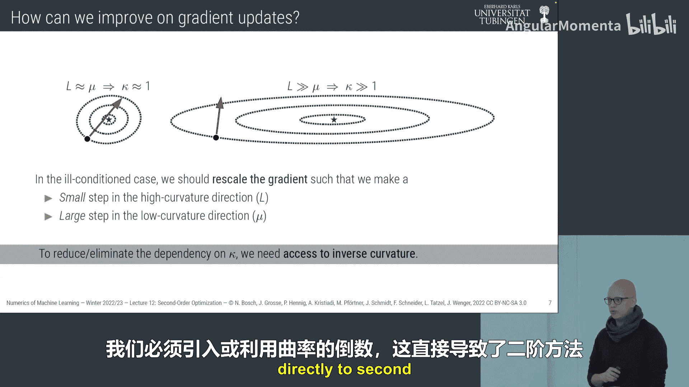

So。With second order methods， I mean methods that use curvature or inverse curvature somehow to improve the steps。

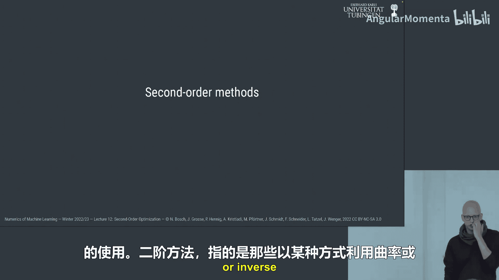

And the central quantity of second order optimization is the so called Newton step。

So I want to give a quick derivation here。So basically。

 this is all based on a quadratic tailor approximation of the lost landscape around Theta K。

So we're gonna try to approximate our loss function at our current iterary theta K with some quadratic function。

And this quadratic function has a specific form， which is a constant plus a linear term in theta with the gradient and the quadratic term in theta with the Hassian of。

 of the loss function。And we're gonna assume that the Hessian is positive definite。Again。

 I'm gonna go into more details later。So basically。

 what we are doing here is we compute a bolt shaped function that serves as a proxy or an approximation of the actual target function。

And now， because this approximation has has such a specific forum， right， we can。

 we have this precise forum here。we can actually do minimization of this proxy in closed form。

So the idea for the Newton step is we could choose our next iterate Theta K plus one。

 such that it's the argument of the quadratic。Okay。

So that basically means we go from here directly into the minimum of the quadratic function。

 And this would be the new step。And it's pretty easy to， yeah， to derive the。

 the close form formula for a Newton step。Well， how do we minimize Q。

 We can simply do that by computing its gradients and setting it to 0。

Which is pretty straightforward。 And because the Hasian is positive definite， it's also invertible。

 And we can write down the newton step， which is exactly this quantity here。O。

 so we need access to inverse curvature and the gradient。Okay， this would be the newton step。

Any questions so far。Must the derivation clear？Am I boring you。Okay。嗯。Okay。

 so the Newton method can be much faster than a gradient based method in certain situations。

So for a newton method， we actually get local quadratic convergence。 So earlier， as a reminder。

 for the gradient based methods or basic gradient based methods like S GD or gradient descent。

 we get linear convergence。 So convergence of this form。

Whereas we can get quadratic convergence order for Newton's method。So if we have target function。

 which is twice differentiable and we have Hasian， which is lipss continuous。

 it basically just means that the Hasian cannot change arbitrarily fast。

In a neighborhood of the solution and the sufficient conditions have to be satisfied at this point。

 which means that the gradient is 0 and that the Hassian is positive definite at this at this point。

And if we are close enough to the solution already。

 then the sequence of Newton updates achieves quadratic conversionvergence order。

And here I try to compare them a little a bit visually， just for a bunch of example numbers。

 just to make this point。So I basically just compare linear convergence to quadratic convergence。

 and the data is the same for both plots。 just here I have the linear scale on the number of steps。

 And here I have the distance to the optimum currently。 And you can see that。It's basically。

 a vertical line for the quadratic convergence。 And it's a straight line for linear convergence。

 because in a semi logarithmic plot， like we have here。

If we have a constant reduction factor in each step， this is gonna be a straight line in。

 in a a semi plot。But。I mean， we cannot really see what the， what the orange line is doing here。

 right， So I also plotted the number of steps in a logarithmic scale。 And we can see that for。

 for this particular example， we would need something like 10 steps for Newton and something like 1000 steps for a method with linear convergence。

So my point is， Newton methods can be really fast in certain situations。

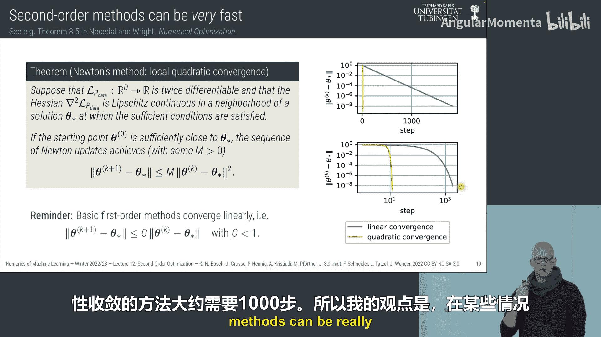

So。On this light， a little maybe an an intermediate summary。 So Newton methods seems great， right。

It is It is robust against ill condition problems。 So it doesn't have this dependency on the condition number。

Second order methods can be really fast to get quadratic convergence if youre initializing close enough to the optimum。

In contrast to gradient based methods， Newton steps have a natural length。 So with that。

 I mean that in the proof for the convergence of gradient descent method。

 we needed that we needed to specify the learning rate。 Basically。

 we needed the learning rate to be one over L。And such a thing didn't appear in the convergence theorem for Newton。

 Right， So apparently， Newton steps have a natural length scale and don't need this learning rate。

 at least in certain situations。And last but not least。

 they have a long success story and are the default choice in many scientific fields。

So why don't we use them for deep learning。Why don't you use them for deep learning。Yes。かでに。

The crian the。As back。Asestion。Yeah， so the question is basically about computability。

 And you said that it's easy for the gradient。 But what about the Hessian。

 And it turns out that you can actually compute additional stuff in the backward pass like coverage information as well。

 it comes at a price。 But in principle， you can do it， yes。The he of the large neural nets。Yes。

Exactly。Yeah。That's a good point。 So cost is a problem。 How do we start the geometric is a problem。

 More ideas， yes。Sorry， can you repeat。いいですか？They are stuck at local local stuff。 Okay。

 but this is maybe also true for a gradient based method， right。

 They could also converge to a local minimum。Yes。Yes， that's a good point in so on。Exactly。So， yeah。

 your point was that the Hassian is not necessarily positive definite。

 which means that we basically have a non convex problem and then。What is the newton step。

 We're gonna take a look at this， as well。Maybe one point that didn't come up yet。

If you think about the difference between grade design and S GD， there is a difference， right。

So it stoasticity， exactly。 So I would say these are the three main problems for applying second order methods to deep learning。

Non convexity。 How do we deal with a non convex objective function。

 which usually we havet deep learning。What about the cost。

 How can we access store and invert even huge carvature matrices。

And the third point is about stochasticity。 So how can we handle stochasticity。And in the following。

 I， in the rest of the lecture， basically， I want to go through these three problems with you and give you or try to give you an overview of the ideas that exist for these problems。

So， of course， I cannot go into the technical details for for every method。

 but I'm rather trying to give you some rough idea of the concepts that are applied question。そせス。

With stochasticity， I mean， so if you have usually you cannot compute those quantities you want precisely。

 right， If you want to compute the precise newton step。

 you need a precise hessian and the precise radiant。

 And because we cannot compute those quantities for the expected loss， we have to estimate them。

 right， like we had to for S GD， for example， And this can have a very a very strong effect on the performance of these methods。

 and we should at least know how they are affected by noise。

 if we want to apply them in these situations。All right。So let's start with the first point。

 non convexity。 How can we deal with non convex objective functions。

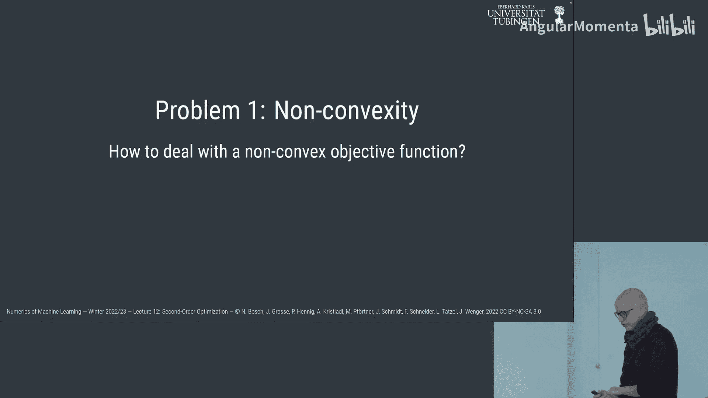

So earlier， we assumed that the Hasian is positive definite， right， when we derive the newton step。

 And the question is， why So I would say it's pretty much clear that we cannot allow eigenvalues to be 0 because if we have a 0 eigenvalue。

 then the Hasian is simply not invertible， and we have a problem。

Because then the Newton step does also not exist， right。

 But why didn't we allow negative eigenvalues。So if we consider a cut through the quadratic model along the corresponding normalized eigenvector。

 So we're gonna take this quadratic model， this bowl shaped function。

 and we basically restricted it to a。Doing edit over a line segment。And。

 so we get a one dimensional function， right， and。Here。

 I'm basically showing you how this function looks like。

So we're gonna start from our current iterate， and we go into the direction of the eigenvector year。

With some， you could say， step size tall。So we're gonna consider this as a function of to。

And if you now just plug in the numbers for the quadratic model， you can write it in this form。

And now the interesting bit is the curvature， so。We have。H times E， E is an eigenvector。

 So H times E is the same as lambda times E。We can pull Lada in front because it's simply a scalar。

 and we are left with E trans post E。And because I assume that it's a normalized eigenvector。

 This is a squared norm， which is just one。 so we can simplify to this thing。

And if we consider this as a function of tower。 This is simply a quadratic function， right。

 It's simply a parabola， which makes sense because a cut through a multi dimensional quadratic is a parabola。

 It kind of makes sense。But the interesting thing， again is， so， so first of all。

 this is a parabola right in tau with a constant curvature lambmbda。

 So if you compute the second derivative of this fun function with respect to tau。

 it's gonna be lambmbda。😊，And。This is nice because it gives us an intuition between the connection of eigenvalues and curvature。

😊，So if you consider a cut through a quadratic function along some eigenvector。

The curvature along this direction is going to be the eigenvalue。So I think this is a nice intuition。

And in this specific case， we assumed that this Lada is negative， right。

 We want to know what happens if we take negative eigenvalues。

So think about how this parabo looks like。If this curvature is negative， it bent downwards， right。

So if you take a large enough tower， if you let this go to infinity here。

 the quadratic model is simply unbounded from below。

Which means that the Newton update is meaningless because it was fundamentally based on the idea of minimizing this quadratic。

 And now， if I have a negative eigenvalue， then this quadratic does not have a minimum。

So in this case， like you correctly said。It doesn't work， right， And it deep learning。

The problem is that。Usually， the， the Hassian is indefinite。

 so that there are positive and negative eigenvalues。 So the Newton step is meaningless。

So what can we do to address this problem。So one idea you could have is。

So the problem seems to be the Hassian， right， So maybe we can just use a different quantity。

And one example of such a quantity is the G G N， which is the generalized Gaauus Newton matrix or G G N。

 in short。And as we' gonna gonna see， this is a positive semi definite approximation to the Hassian。

 and we can basically use it as a replacement of the Hassian。😊。

So here I want to give a little derivation。So the G G N kind of arises when we take a look at how the He T N decomposes using this split。

So， the loss function is basically。Or if you want to compute a loss， what you do is basically。

 you take the parameter vector theta， you map it through your， or you apply it to your model。

 And then you're gonna take the model outcome and apply your loss function。 Right。

 So this is kind of a two step process。And。The derivation for the G G N is based on applying the change rule to dis split。

And because all those quantities are vectors and metricsrices， it's a little bit difficult。

 And you would actually need something like matrix differential calculus to do that properly。

 But I still want to give you like the， the rough idea of how the eeration works。

So if we now compute the gradient of the loss。And we want to do this with chain rule。

 according to the split。The idea would be to compute the derivative of the loss with respect to F and then of F with respect to theta。

 So this would be the chain rule， right。And this is exactly what happens here。

 So if we want to compute the first derivative of the loss with respect to theta。

 we first take the derivative of the loss with respect to F。 So with respect to the first argument。

And then we take the derivative of F with respect to the parameter theta。

 So this is basically simply how change rule works。

Just that it looks a little bit more difficult here because we have those metrics quantities here。

So J would simply be the Jacobian of the model with respect to Theta。Okay， now。

 if we want to do this another time， we can。 And because we have this product here。

 we basically need to apply the product rule。Okay， so how did product rule work again。

 So we fix the first thing and just compute the derivative of the second。

 which will give rise to this term， And then we'll do it the other way round。

 And we're gonna compute the derivative of this term and multiply with so we we fixed this quantity。

And this is what happens here in the second line。So he would just copy the Jacobian transpose and then compute the derivative of this thing with。

 with respect to the parameters。 and we can apply chain rule again。

So in order to compute the derivative of this with respect to theta。

 you can compute the second derivative of the loss with respect to F and then multiply again with the Jacobcoian。

So this is simply change rule another time。And for the other thing。

 we have to compute now the derivative of this metrics， which is， yeah， a little bit hard because。

 as I said， you would actually need metrics differential algebrabra to do this properly。

But basically， the idea is to fix one output of the model F。 Then this mapping is basically。

 so F would be if you fix one component， it's just a real number and we can compute second derivatives。

And then this is basically simply the， the Hassian。嗯。With respect to theta of the model。But only the。

 the C， the c component of this model。 And we multiply with the C component of the great in vectoror of F with respect back to of。

 of the loss with respect back to F。So maybe this was a bit confusing。

 But the core idea is basically to consider the loss function as the split into first applying the model and then applying the loss function and applying change rule to the split。

 This is the core idea。And you can see that。The Hessian then kind of， yeah。

 decomposes into two parts。The first part is gonna be what we define as the G G N。

And the remaining part is just a residual that kind of makes a difference between Chiji and Hassian。

But the G G N is now definediant as this quantity here。 So just the first part。

But this would only be the G G N for one particular training example。 So for one input output pair X。

 Y。And exactly the same as for the Hassian。 we're gonna define this quantity as the expectation over the data generating process of this product of Jacobian。

This is the Hasian of the loss with respect to F and the Jacobian again。Okay， so this is the Jjian。

And a little bit of intuition， what this， how this matrix is different from the Hassian is。

The G G N neglects curvature from the model because it basically just says， okay， I ignore this。

 this entire second term。And this second term contains second derivatives of the model with respect to theta。

 So we're basically neglecting curvature information coming from the model rather than from the loss。

And a different way to say this is if the model F is linear in theta， then the hessian would be 0。

 right， The second derivative of linear function is 0。 So this term would drop out anyway。

 And in this case， Hessian and G G N coincide。 So if you consider a linearization of your model in theta。

 and then G G N and Hasian are actually the same quantity。Okay， so now， why did we do all this？

 I mean， the point of this was that we need something that is positive definite， right。

 And now let's check if this is actually the case。 So on this slide。

 I want to show you two main properties of the G G M。 First of all， it's symmetric。

So if you consider G transpose， which is simply the expectation we just saw。

 I omitted this distribution because I didn't want to clutter up the slide。 but yeah。

 the expectation is still over the X and Y coming from the data generating process。

And we take the expectation transpose。 And because the expectation of a matrix is defined element wise。

 it doesn't make a difference if you pull the transpose inside or not。 So we can do that。

 And now apply apply the rules that go for the transpose。 So we have the Jacobian transpose in front。

 Then the Hassian transpose in the middle and Jacobbian transpose transpose。

 So Jacobian at the right。 So we arrive at this quantity。

And now the Hassian is symmetric because second derivatives are also symmetric， right？

 So we arrive again at G。 So it turns out G G and a symmetric。Now。

 let's check if it is also positive semi deffinite。

So let's apply a vector from the left and the right， some vector V to the G G N。

 Then this is simply plugging in the definition。 We can pull the vectors inside of the expectation because they are just constants。

 right， We can pull them inside and out of the expectation because of its linearity。

And then we can basically group those Jacobian vector products together。 And this is inside。

 the expectation is equal or larger to 0， if。This Hassian is positive semifin， right？

 And if you take the expectation， this property still holds。So the question that is left is。

Is this Hassian actually a positive semideite。And it turns out for basically all relevant loss functions it is。

 And maybe this is most obvious if we consider the mean squared error loss。So in this case。

 the loss would simply be computing the norm squared between the outputs of the model and the true label。

And this norm is squared。And in this case， the Hassian would be scalar times the identity metrics。

So it clearly is positive definite。 And that means this property basically also transfers to the G G N。

 and the G G N is positive semi definite， which is exactly what we wanted。Yes。

Arameters enter the loss function。In a way， other than just。Throw them all output。For example。

 that regular conversation。I think you could still compete with something like a G， G， And for that。

But I mean， it'， it's really， it's fundamentally based on the split。 So if you don't have the splits。

 I'm mature if it's still well defined。嗯。Yeah， we we。Other people like。えあれば。

And that's a unique thing they referred to us to Chi Chi。So one thing that that I。

 that I can think of is maybe compute G G N still for the loss function and to simply compute the hassian of your regular riser。

 because if， for example， for regularization， this is simply identity metrics， right。

 And then you could maybe have something like G G N plus。Parameter times identity。

 which is simply damping。 And we're gonna talk about this a bit later。

 So this is maybe one thing you can do。 But I think like in this definition， its。

 it requires the split of model and loss function。🤧嗯。Alright。

 so this is one possibility for replacing the Hasian with A GN。Because in this case。

 is's positive semifinite， right， And it gives us a well defined step。

And there is also another matrix， which is called the Fisher information metrics。

 So assuming that you can write your loss function as negative log likelihood。So this is。

 for example， true。 if you have a softm and a cross entropy loss， then your。

 your model basically describes a distribution over the classes because you get this this vector of dimension C。

 And it's basically a distribution over， yeah， as I set the classes。And in this case。

 you can define the official information metrics as this quantity。And at this point。

 I don't want to go into the details。But this matrix is also positive semiinite。

 And maybe I can try to give some intuition。 So if you replace the Hessian with the fissure and compute and newton step。

 then this is steepest descent in distribution space。 So what does this mean。

So one way to think about it is steepest is basically a ratio。 right， If。

 if you're talking about how steep a function is， it's basically a ratio。

 and it's a ratio of a difference between two function values and a difference between two parameter vectors。

 And with this ratio， you can basically say how steep the decrease in the function is。

But this notion of steepness depends on the metric you apply to your parameter space。 So。

 for example， if you say my parameter space， I want to apply the Euccle metric。

 then what comes out of is， it's just gradient descent because the negative gradient points into the direction of steepest descent。

 But it could also use a different metric for measuring distance between two parameters。

And because we have this interpretation。That the parameter basically models distribution。

 We could also say we want to measure the distance between two parameter vectors by measuring the distance between the two distributions。

 for example， in Kbec lipla divergence。And when you do that， then。

The steepest descent is actually this step。 So the fiser inverse times the gradients。

So this is what I mean by steepest descent in distribution space。

 It's basically applying colic lip divergence to the distributions。 Yes。Sorry say again。要。おき具え。Yes。

The most in some way。 Yeah， exactly， yeah。Okay， and there is a strong connection between the Fish information metrics and the T G N。

 because in many cases， for example， soft Max for entropy classification。

 those two matrices are exactly the same。Okay， so we have solved the， the problem。

 I would say kind of， because we have found like reasonable。

 meaningful curvature proxies we can use instead of the Hassian。 and we get a well defined step。

But even in the convex case， even if the Hassian was positive definite， we have still one problem。

And the problem is that the quadratic model can be arbitrarily bad。

 So if you consider this problem here。So at one dimension of visualization。

 we have the loss function in black。And we have the quadratic approximation shown in blue。

And clearly， if we minimize this function and go to this point。

It's not a good step because we actually not decrease the loss， but rather increase it even。

And this is maybe something that we want to avoid。 And this leads to the trustre problem and damping。

So the idea is basically to restrict the updates to lie within some radius R。So basically。

 our rads in which we trust our quadratic approximation to be precise。

And then the trust region problem is。EWere still gonna to define the next iterate as the argument of the quadratic。

 But under an additional constraints that we don't move too far away from our current iterate。

We want to stay within this trusted radioius， basically。And this leads to a modified newton step。

 which you can see here。 So basically the thing that changed is that we can simply add deelta times identity。

 So deelta is simply a scalar， and this is the identity metrics。

 and we add this to the curvature metrics for some deelta larger equal to0。And with damping。

 we can basically interpolate between gradient descent and the full Newton step。

So if you take Delta equals 0 here， then this is simply a new step， right。

And if you make deelta really， really large， then this term in the sum is kind of dominated by the identity。

 and we can forget about the Hasian。And now what is Delta times identity inverse， Well。

 it's just one over Delta。So we are left with next iterate is current iterate-1 over deelta times gradient。

 which is simply gradient descent with a small learning rate， right？ And basically， with temping。

 we can interpolate between those two extremes between the full newton step and gradient descent with a very small step size。

So with them， we can basically control how conservative we want our updates to be。

And now the question， of course， is， how can we choose the radioius？ And it turns out that。

Even if we could change a reasonable radius， then， oh， sorry。

Even if we could define a reasonable radius， then it would be really hard to compute the corresponding delta。

 because。I mean， this delta depends on the choice of radius， right。And it's easier actually。

 to work with the damping directly。In a houristic way。 So， for example。

 there is this living back market heuristic， and it's basically based on the so-called reduction ratio。

 So it compares to things。 It compares how much。 So if my quadratic model is correct。

What decrease in the loss function do I expect when I take this step。

 which would be the distance from going from here to there。

And it compares this to the actual reduction of the loss function。 So in this case。

 the jump from here to there。And and。Depending on how well those two numbers match。

 it will adapt the damping。 So， for example， if they are pretty much the same。

 That means that our quadratic model is a good approximation of the loss function。

 then the damping will stay the same。 whereas， for example， in this case。

 the reduction that we expect is much larger than the expect than the reduction that we get。

 So in this case， we would certainly increase the damping by some factor。

 So this is basically how this aistic would work。

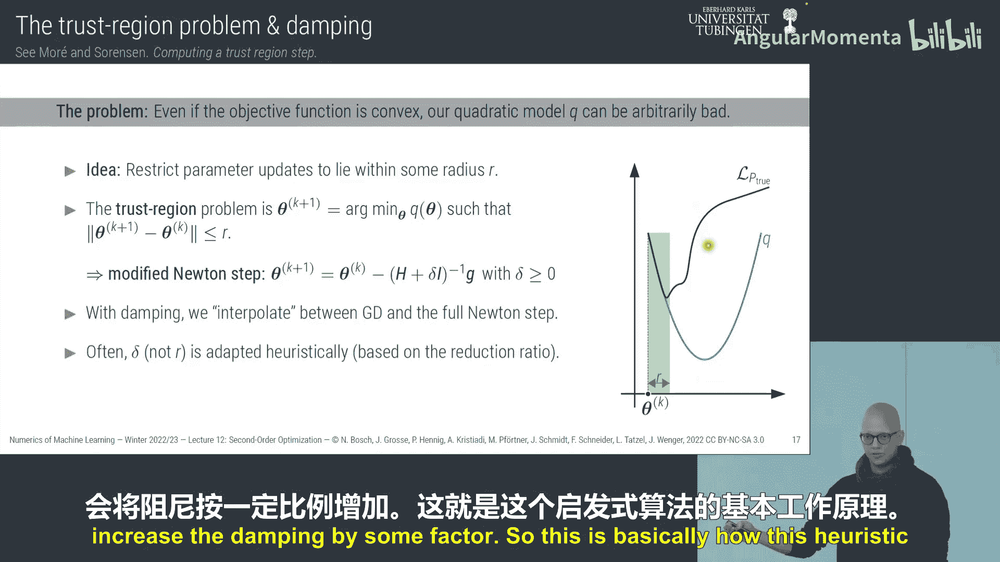

So here I want to try to give an answer to the question we had。

 How can we deal with a non convex objective function。

 And I think the answers that we can give are pretty concrete in this case。 So instead of the Hesian。

 we can compute positive semi defite curvature matrices like the G G N and the fissure。

 They provide meaningful curvature proxies。 So， I mean， they have some。

 there is some intuition behind them。 we can interpret them。😊，And often they are even the same。

 which is also nice。And it's pretty easy to give unbiased estimators of both of these matrices on finite data。

So we can basically replace the expectation by a Monte carlo estimator for both cases pretty easily。

And the second thing we talked about is damping so we can control。

How conservative updates we want to be。And using damping heuristics like Le Bamarkw。

 This actually works pretty nicely in， in practice。 So I would say for this question。

 we have pretty much concrete answers。😊，So let's move to the next problem cost。

So the question here is， how can V M access and invert this huge carvametes。

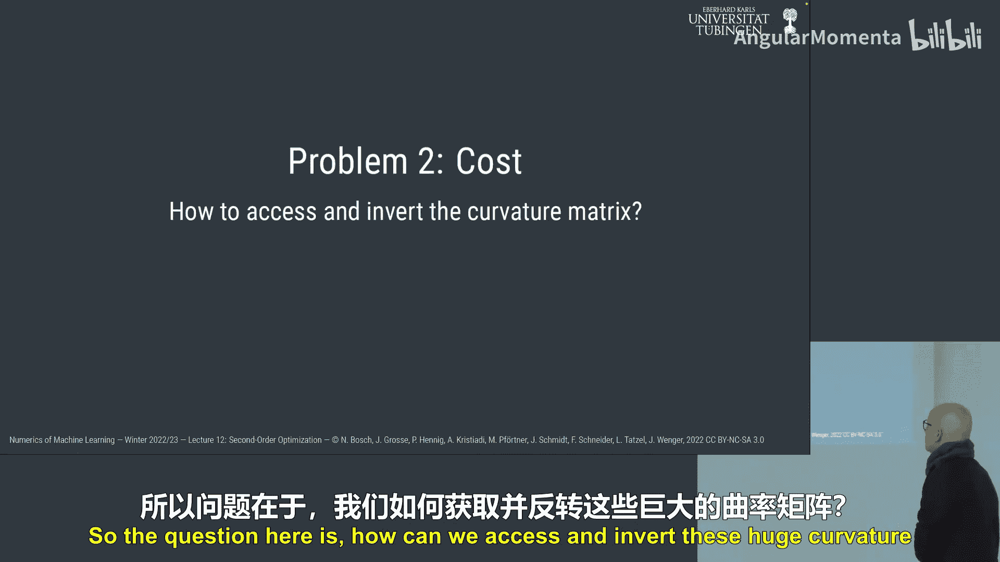

So to illustrate this problem， I have a little example。 So if we， for example。

 consider the all CNN and CNN network， which has 1。4 million parameters， which is， I would say。

 in modern times。EMaybe a moderate size of an neural networkbe， maybe even small。嗯。

Then the Hastian requires to store T squared numbers， right， It's a matrix。And if for each number。

 we need 4。 So if we want to store this as a float， we would have to store 8000 GB。

So I don't know what like machines you have， but I don't have a machine where I can store or even invert such a metrics。

So what can we do about this？ So the problem here is。Stor is O of T squared， and inversion。

 at least in the upper bound， is cubically in cost。 So how can we do this。And for this question。

I would say we don't have to reinvent the wheel， right。

 We can basically borrow ideas from the new algebra。Because， I mean， for example。

 from Marvin's lecture and also from Yo Tzmana lecture， there are certain ideas we can just use。

 For example， we could use a low rank approximation of the Hassian。

Which leads to something like B F G S or L B， F G S。

We can use iterative methods that so something like C G con gradients。

 which leads to hasssian free optimization。And we could use structured approximations or approximations that make use of the structure of the curvature metrics。

 which leads to something like KFc。So in the following。

 I would like to briefly show you how these ideas work。So let's start with BFG S。

So the core idea of B， FGS is that we want to gradually learn an approximation to the inverse Hassian from gradientding observations。

So there is a lot of stuff going on in this statement。 So， first of all， it's a great。

 it's a gradual process。 So it's an iterative process where we step by step learn how the Hasian or the universeverse of the Hasian looks like。

😊，It can actually， So I deliberately put learn here because you can actually see this as an inference process in the the Ba framework。

And it's an approximation to the inverse Hassian。 So not the Hassian。

 but the inverse Hassian directly。 And I'm gonna show you how this works。

And this is gonna be based on gradient observations。 Okay。

 so we're not gonna actually compute cr information here。

 but we kind of gonna deduce from gradient observations how the inverse Hasian will look like。

And how does this work？So I brought another visualization in1 D。

 So if you think about the situation where you have two parameter vectors， or in this case， numbers。

 Theta K， Theta K plus one。And you can evaluate the gradient at both positions。

 So this is the gradient， right， not the target function， but the gradient。Now， if the question is。

 can you give an approximation of the curvature， So this， the， the the curvature of L。

 So the first derivative of the gradient， right？ And how can we approximate first derivatives， Well。

 we can use the secant， which is the screen line。And compute the slope of this function。

And the slope of this function is simply Y K divided by S K。

 So basically a finite difference approximation to the gradient function。

 which gives rise to the second derivative。This this clear。Okay， I see some loaddding。And basically。

 the same idea you can basically transfer this idea also to the multidimensional case。

So if you multiply this by S K， then it just goes to the other side。

 and we arrive exactly at the so-called secant equation。 So we have Y K。

 which is the difference in the two gradients。 We have S K。

 which is the difference in the parameter vectors。 And here we have the Hassian metrics。And now。

 if we want to get to B FG S， we basically all the idea is。

 So we want an approximation of the inverse Hassian， right？

 So we're gonna take properties from the actual inverse Hassian。

 and we're gonna require our approximation to have the same properties。 That's what， I would say。

 a reasonable idea。🤧嗯。So the first constraint we will have on our approximation to the inverse。

 which is denoted by B， is that it fulfills the second equation for inverse。

So here I have the second equation for the actual Hassian。

 And if you multiply this from the left with the inverse Hassian， you get inverse Hassian。

 Y K is S K， which is basically the yeah second equation in the variant for the inverse Hasian。

 not for the Hasian。 but yeah， the idea is still the same。Also。

 we know that the Hassian is symmetric， which means that the inverse Hasian is also symmetric。

 so we're going to require our approximation Bk plus1 to also be symmetric。And lastly。

 we're gonna require our approximation to not or to。

 to change the changes should be as small as possible between two iterates。

And these conditions actually give rise to the B B， H S update。

 So you can write write down a recursive formula for how to construct these approximations to the inverse hesian。

And these updates only involve the previous approximation and the vectors， S， K and Y K。Right so。嗯。

Basically， that's the idea， yes。approximation。あま。This one。Yeah。Vctor。So in this case。

 it's supposed to be a one dimensional quantity。 But， yes， in general， it's a vector， yeah。Yes。わ。

pectト？Like an ultra product。So this is just for the1 D case。

And this is for the multidimensional case。Because like you said， this。

 this formula simply doesn't make sense for vectors。

 So this is simply to explain why the form in the multidimensional case looks as it looks。

Not as a proper derivation， because I just wanted to make the。

 the core idea clean clear because deriving this would be more complicated。Yes。遊みたい。A good question。

 So usually， this is initialized as a multiple of the identity metrics， because what else do you do。

 right？ but yeah it。Im， I am， I am not completely sure。

 So I know that this is like the default choice， but then may be cases where you want a different initialilization。

So some kind of better approximation to the inverse already。

 if you can compute it than just the identity metrics。I'm kind of prior。Basically some， yeah。

 you could phrase it this way yeah。All right。So now we still have a problem because this metric Pk。

 so the approximation to the inneressian is still de times t， right？😊，At the general。

 it's a dense metrics。 So no positive to here。And we still have to store it。So the idea of all the。

 the insight that is important here is that at iteration K。

This approximation is the result only of B B 0 and the entire history of those vectors， S。

 K and vectors Y K。 So if we store those vectors， we can basically recursively construct this metrics。

And the idea of L B FG， S is that we can still get a good curvature approximation or， sorry。

 approximation to the inverse Hasian B， K hat by only using the most recent curvature information。

 So we're not gonna use the entire history of vectors。

 S K and Y K going from like the current iteration back to 0。

 but only like a fixed window of some fixed size L。😊，And with this。

 the claim is that we can still get a good curvature estimate。

And that means that we have less memory consumption because now we only have to store two L vectors instead of 2 K。

And yeah， so if L is reasonably small， in some cases， it's even one。

 this is much cheaper than starting the entire metrics。And， I mean， ultimately， we also， we。

 we want to compute a newton update， right， So we want to apply this approximation of the inverse to the gradient。

 And it turns out that there is also an efficient algorithm for that。

 which is called the LB FG S to loop percursion。 But at this point， I cannot go on the details。

 But I just wanted to let you know that there is specifically designed procedure that is very efficient to apply this metrics to the gradient。

So next， I want to talk about Hassian free optimization。

So the core idea here is to basically use C G for minimizing the quadratic because C G is like it's specifically designed for minimizing quadratic functions。

 right， So is exactly the case， maybe where we want to apply it。

And the nice thing about C G is that it only requires us to do metrics vector to a products and not actually。

 So we don't need that the carvature metrics to be in memory explicitly。

 We only need to be able to multiply with this metrics。😊。

And it turns out that so the hessian free approach that is described in this paper。

Actually uses the G GN， which is a little bit confusing because it's called hessian free optimization。

But it uses the G G N as curvature metrics， and we can multiply with the G G N without ever building it in memory explicitly。

And this is why it's called also a metrics free approach。Now， the idea is。

 so for a given input output pair， we want to compute the product between the G G N and some vector。

 right， because this is what we do in C G。 We have to multiply the carmetric with some vector。

And for only one input input output pair。 So if we used the kind of Monte Carlo estimator for the G G and only on one data point。

 the G G and would look like this。 Okay， and I want to use this setting for this simple example。

And the matrices are C times to。And the Hasian is C times C。

 So the metric look a little bit like this。So D is the number of parameters in our vector and our network。

 So this is gonna be a very large number， whereas C is at least compared to D often very small。

So the thing we want to compute looks approximately like this。Now， how do we do these metrics。

 metrics or metrics like to products。So the， like the。

 the naive thing to do would be to just follow this rule and compute J transpose times Hessian times J。

But then we are screwed because then this is a D times T matrix， right。

 So how would you comp compete with this， this product。Between those two between those four objects。

 yes。Exactly， can you explain briefly why this is a good idea you。えビ？No。

 so J trans J at times V would actually be。Yeah， exactly。T one and then as we have。Exactly。

 so you basically only have to only have those tiny vectors of size C that you have as intermediate results。

and at no point， you have this D times D matrix in memory， explicitly， which is nice。😊，But still。

 you could think that， okay， but I need somehow to have access to the Jacobian and this metrics。

 And the Jacobian is also C times the， right。 It's quite large。

So we need some way to efficiently multiply the Jacobian with a vector or Jacobian transpose with a vector and so on。

 We need to do these matrix vector products efficiently。🤧嗯。And I am no expert an an auto di。

 but I'm still gonna try to explain the core idea of how this can be done efficiently。

So we don't have to construct these matrices explicitly。 And as an example。

 we consider the first operation。 So we're gonna try to figure out an efficient way to compute Jacobian time vector。

So， the core idea is。To replace the Jacobian vector product， which we want to compute by， I。

 by a directional derivative。 And this is how it's gonna work。

 So we basically compute or we consider linearization of our model， okay。

So this is simply a tailor approximation。We approximate F at at theta plus deelta theta by F of theta plus the Jacobian times Delta theta。

 And we have some error term。O， now here appears the Jacobian Ve product。

But we don't want this to be Delta theta， right， We want this to be real。

So maybe we can sneak the vector inside there。 And， yeah。Try to see。

 try to see what's happen happening。So we're going set Delta theta to r times V。

So R is a small constant， a scalar， and V is gonna be this vector that we want to multiply with。

And then you can rearrange the terms。And it turns out that you can write it this way。

 So J times V is。This difference between two functions divided by R， And we have this error term。

In principle， you could already use this approximation as an approximation to the Jacobin vector product。

 right， Because you would simply have to。Evaluate the function， two times。Divide by R。

 And you get an estimate of the Jacobbian vector product。

 But it turns out that this is numericalmerically very unstable。So on the one hand。

 you want this error term to be small。 So you want this R to be small。 But if R is small。

 you divide by a small number。 and these two vectors are also。Quite similar for small numbers。

 So you get numerical cancellation and your stability gets screwed。

So we don't want to use this finite difference approximation， but something else。But now。

 if we consider this as a function in R， we basically have some function evaluated at R minus some function evaluated at 0 divided by R。

 Now， if we let R go to 0， this is a derivative， right。So for R going to 0。

 we obtain Jacobian vector product is simply the derivative of this function with respect to R。

Evaluated at R equals 0。And this is an operation that you can actually implement very efficiently in an alternative library like Pytorch。

 And it turns out that you can implement all those three vectors very efficiently without ever having one of those matrices in memory explicitly。

 So this can be very can， can be done very efficiently using those alternative tricks， basically。😊。

Alright， so that's it for has optimization。 We saw that the core idea was applying C G。

And we can use additional out tricks to even make those individual metrics vector products very efficient。

So as a last technique， I want to present K Fec， which is the chronic affected approximate curvature。

And this is based on the fier information metrics。 So it tries to build an estimate for that metrics。

And it's basically based on two approximations。 The first one is a block diagonal approximation。So。

We assume that the fisher R V， yeah。We will use an approximation such that the fier matrix has this block diagonal structure。

 where it has one block for each layer， which basically means that we will neglect curvature interactions between layers。

This is the first approximation， and it's reasonable because it makes inverting this metrics trivial when you can invert the blocks。

 right？ So the invert the inver of this metrics is gonna have the same block diagonal structure。

 but it's gonna have the block in inverses on the diagonal。 So if we can come with those。

 it's easy to invert the this matrix F hat。And the second approximation is that we exchange two operations。

Taking the expectation and the chronica product。So what I mean by that is for a linear layer。

 the block can actually have or can actually be written precisely in this form。

 So this is not an approximation。 It actually has this form。

And so it's an expectation over chronica product over two things。Of these two vectors。

And this is approximated using， first of all， the expectation over the first thing。

 then the expectation over the second thing。 and then computing the Chle product of the tool。

 So this is where the approximation happens。 And this is also reasonable。

 because if we can write the block as this product of two matrices。

AndThen inversion of the block is really easy。So if we want to compute the inverse of the block。

 then。I mean， according to our approximation。 So this actually shouldn't be an equal sign。

 It should be an approximate sign because of this approximation。

But we can plug in the forum for the block， which is AI Cher B I。

 And now we have this nice property of the Cher product that we can basically pull the inverse operator inside。

 and we get AI inverse。😊，Chronic factor， B， I inverse。 and these two matrices are tiny， right。

 So compared to the block and the entire metrics， these two components。 AI and B。

 I are really small and inverting then can actually be done。So basically。

 the cost of storing and inverting F comes down to storing and inverting those components。

 A I and B I。Right， because。From them， you can basically build the entire metrics。 And also。

 it's easy to construct the inverse。

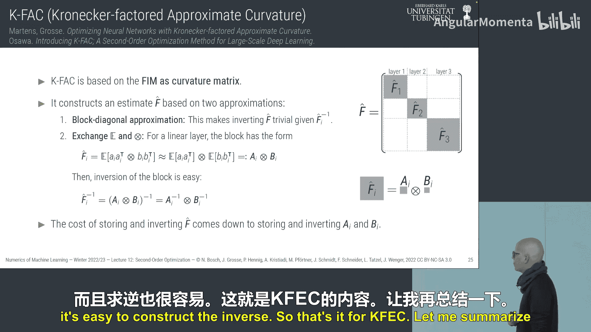

So that's it for K Fec。Let me summarize again。So how can we access and invert the curva metrics。

 That was the question we started with。We saw three approaches。

 And what I'm trying to do on this slide is， first of all， give you a little summary。

 but also try to give you certain pros and cons for the different things。

E whichhich sometimes are also based on a personal experience or what I know from colleagues。

 But don't ci me on that， okay。So for B， FG S and L B FG S。

 this is basically a dynamic lowering approximation of the Hassian。

And it's actually the default choice for small deterministic problems。 So， for example。

 if you call s optimize minimize， that's gonna be using B， F G S or L B F G S。So， for example。

 if you have a really small network and noise is not so much of an issue， for example。

 because you only have few data points and you can basically a the estimates very precisely。

 then it might actually be worth a shot to try out B FG S or L B FG S。

 to solve this problem because they can actually be really fast in certain cases。Next。

 we also discuss the Hasian free optimizeimr， which is quite close to the notion of Newton steps。

So for B FG S， we had this approximation by only a few vectors。And in K Fac。

 we had this chronic factorization the block diagonal。 and so these different approximations。

And in the Hasian free approach， we don't have those approximations， right。

 We take the G Gn instead of the Hassian。 But apart from that。

 we don't apply any further approximations。 So it's actually quite close to the notion of the classical mutantton step。

It requires little memory。 So， I mean， we don't have to store any vectors， like， for example。

 for L B FGS or for KFac， we have to store those chronic vector。But instead。

 we have more sequential work because we use an iterative approach。

So if we do a lot of C G iterations， this is also quite costly。

And hasssing free seems to require larger mini batch sizes。

 which is problematic if you have batch norm layers。

 So this is a little a bit of a complicated story。 And I experienced this myself， unfortunately。

 So the problem is， if you want to use larger mini batches。 So， for example。

 the authors of this paper by Martins。 they use something like in the order of 5000 as mini batch size。

For， I think， an alter encoder on MnesT。And if you have such large mini batch sizes。

 you have to kind of split the computation into a。Chunks of data you can actually handle。 So。

 for example， if you want to compute the gradient on a large mini batch， you。

 you take chunks of data， which for which you can compute the gradient。

 and then you aggregate the results to compute the entire gradient， okay。

But this is kind of based on the assumption that。If you take one mini batch and compute the gradient。

The result should be the same if you split this mini batch into， for example。

 two parts and feed them through your network separately。

 computeute individual two gradients and aggregate those two， right， This should be the same。

 And if you apply a batch norm， it's not。 So this is gonna be a problem。 And unfortunately。

 So batch norm is still used a lot。 And if you want to use testinging free with large batch sizes and batch norm。

 you're gonna have a problem。 yeah。So the last thing we discussed is K F。

 It's basically a lightweight representation of the fier information metrics。 It's widely used。

 for example， also in uncertainty quantification， and Philip will talk about this next week。

And the Kfiic optimizer， as my last point， heavily relies on a heuristic damping。

 So this paper by a Fredric benzeing basically gave evidence that the Kfiic optimizer is actually more similar to a first auto method than to a second auto method。

And it attributes the good performance of Kfi more or less exclusively to the histic damping that is used in this。

In this optimizer。So， it's actually questionable。If K F still contains or to， to what extent K F。

 this approximation still contains information from the actual fissure because of those approximations that are made there。

So I would say in summary， we have some pragmatic approaches。

 like engineering style approaches to this question we had earlier。

W whichhich all have their specific pros and cons。Now， finally， I want to address this last problem。

 which is aity。

So here the problem is we want to compute a newton step。

So we would like to invert the Hessian and apply to the gradient。But we only have estimates， thereof。

So we can only compute an estimate of the Hassian and an estimate of the gradient。Now。

 because we have finite data， right， we cannot access this data generating process。

So how does this change things。So even if you have unbiased satochastic estimates， so。An expectation。

 this is the gradient and an expectation。 This is the Hessian。 So they are unbiased。

But even if we use unbiased stochastic estimates， the Newton step will be biased。

So if we consider the expectation over the stochastic Newton step。

 So this is the thing we actually can compute。It turns out that here is not equal。 And on the right。

 we have the thing we actually want to compute。Now， why is that。So。first of all。

 the expectation factor arises if those two things are independent of each other， right。

So for example， if we take one mini batch to compute the gradient and one mini batch to compute the Hessian。

 then this expectation factorizes and we can actually split this computation into two parts。

 computing the expectation of the inverse hesian and computing the expectation over the gradient。😊。

And this is not the same as pulling the inverse out of the expectation。We will see in a bit wide。

 is this the case？But then this is actually the same as the Newton step。

 because we assume that we have unbiased estimates for H H for unbiased estimates for H and G。

But the， the point where it definitely goes wrong is this one， okay。So。The。

 my claim here is that a stochastic Newton step is biased。 So in expectation， it's not correct。

And I also want to。Or I， I will try to provide some intuition for this problem， also in one D。

So let's assume a very simple case。 So we assume that G hat and G is simply one。

 So the gradient and the noise on the gradient is not an issue。So the question boils down to。

 why is the expectation over one over H hat not the same as the one over H。Right。This is kind of。

The question， if we consider this one dimensional case。

So why is there no equal sign between those two quantities？ This is the question。🤧。

So let's try to understand this in one D。So we have an estimate of the curvature。

So this is actually a distribution， right， It， it has some uncertainty。

And this is shown as the screen distribution。And in expectation， our our estimate is correct。

 So in expectation， we gonna get H。Now， if we map H through this inverting function。

 So the inverting function is simply taking the in inverse of the argument。 So in one。

 this is simple。 right we can just write down the the fraction。

Then mapping H through this function is gonna give one over H。

 So this is the thing that we actually want to compute。Now， what is the thing we actually get。So。

If we consider the screen distribution and we consider it as a left half and the right half。

Then mapping the right half through this function will not change a lot of the of the shape of the distribution。

 right？ But if we map the left part of the distribution， which， which comes close to 0。

 if we map this through this inverting function， then it's gonna distort the the interval a lot。

So if we map this distribution through the inverting function。

 then it will actually break the symmetry and we get this heavy tail if the distribution comes close to 0。

And that means。Because of this heavy tail， the expectation expectation is moved to above， right。

So in expectation， our estimate of the inverse curvature is gonna be too large。

This is basically what I'm trying to， to say here。 And if you didn't like my visualization。

 you can also like show this in， in math。So this function， fire is convex。For our positive values。

So that means that Gen's inequality applies。 and you could just plug in the numbers and see that the expectation over。

1 over age hat is larger than one over H， which is exactly what I claim in this visualization。So。

 this means。Due to the uncertainty in our curvature estimates。

 our new step is gonna be too large in expectation。

And this also transfers to the multidimensional case。So the bias can， can affect different direction。

 directions very differently。So if you take a look at 2D visualization。Imagine we are right here。And。

Basically， we gonna move in two directions。 We're gonna move into a high curvature direction and we're gonna move into a low curvature direction when we apply the new step。

And the high curvature direction saw this direction。Is maybe not so much of an issue because here。

 the curvature is large。Which means that it's far away from 0。 And in this case。

 this bias is not really present， right， The distribution。

 if we map it through this inverting function， it's not really changed much。

 It's not really distorted， and we get a decent estimate of the inverse curvature in this direction。

 So maybe in this direction， our update will look fine like this one。

 It would have the correct length， basically。Whereas if we have a similar noise level for a smaller curvature。

So if the distribution gets close to 0 and we invert that distribution。This biasious。

Can really have a strong effect。And our expectation， in expectation， our step is gonna be too large。

 So we gonna have a situation。 maybe something like this where the update in this direction is gonna be too large。

So if we construct a newton step from those two components， basically， which， yeah。

It will result in a step that looks like this。 And this step is certainly not ideal because you can clearly see that we overstep the minimum by a lot because of this bias happening in the low curvature direction。

🤧嗯。So so far， I talked about biases because of those stochastic estimates。

And now I want to talk a little bit about instabilities， but the arguments is pretty much the same。

So it can simply happen due to chance。That we sample an estimate， which is close to 0。

 And in this case， this small error in the curvature estimate is amplified by a lot。 if we invert it。

 and we just get a step， which is basically arbitrarily large。

So this can cause an unstable step if we just are unlucky with our sample。

And if this only happens in one direction it messes up the entire step。

 So you saw on the slide before， we can have an a decent update in one direction。

 But if we screw up in another direction， the entire stop step doesn't make sense anymore。So 1。

 I don't w to call a solution， but one way to to yeah， maybe soften this。

 these biases and instabilities a little bit is applying damping。So remember。

 the damping was basically adding a constant to the curvature。Which means the situation。

 we are gonna move this。We're gonna move this green distribution to the right。

 So we're gonna move it away from 0。 And that means that， yeah。

 the biases we make and the instabilities are not so much of a problem anymore。

 because this happen when the distribution gets close to 0， right， So if we move it away from 0。

 we won't have these problems in， in the same extent。But there are certain problems with damping。

 So first of all， it's just a scalar number， right？ So it basically treats all directions equally。

 And maybe this is a little bit of of an oversimplification to just have like one number。

 and yeah trying to solve all this complicated stuff that is going on with this one number。Secondly。

 it's adapted horrlistically often。So kind of as an auto loop optimization process where you consider those。

 those reduction ratios。 And yeah， it would be nice to have maybe something that is， yeah。

 smarter than that。 And maybe something that is also aware of the stochasticity that is in the estimates。

 So ideally， I think what we would like to have is not something that adapts to damping。

 like in an auto loop optimization irurically， but actually in the inverting。😊。

Algorithm have something that is aware of the stoasticity， aware of the uncertainty in the estimates。

 and then can decide for itself whether it wants to make whether it wants to make certain updates in certain directions or not to make them。

 I think this was would be more reasonable。

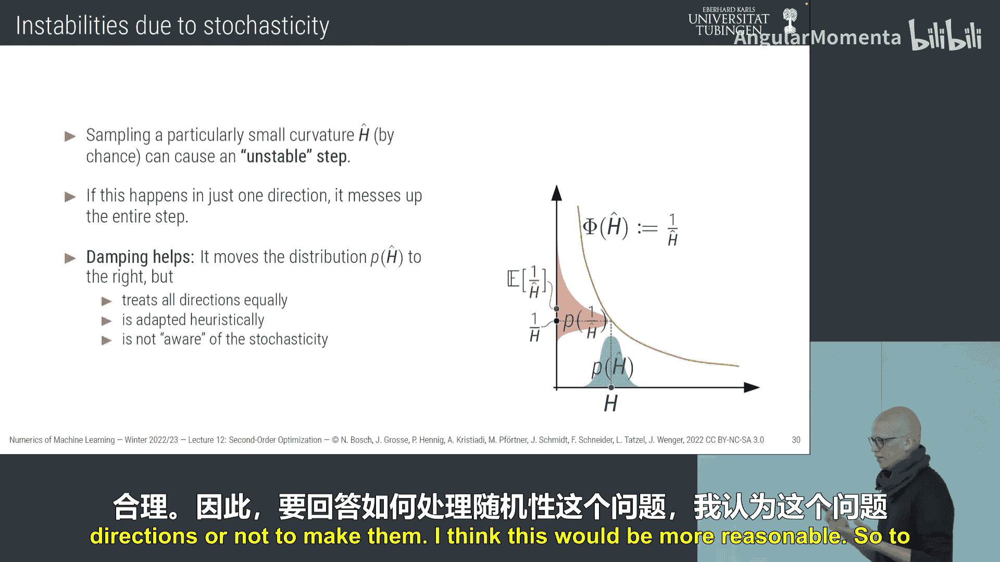

So to answer this question， how to handle stochasticity。

 I think this problem is just fundamentally not solved yet。

So my guess would be that we need specialized algorithms that are informed by richer quantities。

So by richer quantities， quantities， I mean distributions rather than point estimates。

 So if you had access to the screen distribution you saw in the visualizations。

 then you could actually maybe come up with a rule what updates to apply and what updates not to apply because you can reason about how uncertain you are about these updates。

And with specialized algorithms， I mean algorithms that can actually use those distributions and。

Like in the inverting process already use those richer quantities。

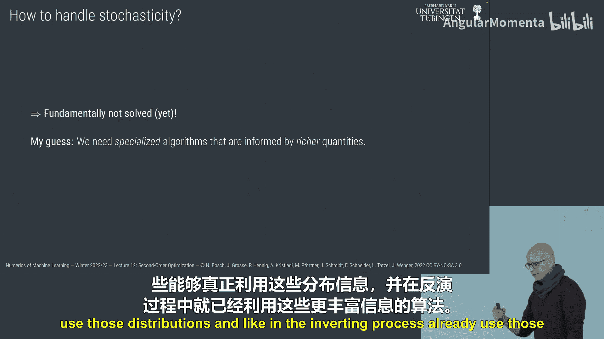

So with that， this was the last problem we want to want to discuss。

 So the summary would be so last week we saw that training neural networks with first auto methods like S GD and Adam remains expensive。

 tedious and brittle。 I'm sure you've also experienced this in the in the exercise。

And second auto methods， I think， offer a partial answer to that。So， for example。

 in that they are robust against ill conditioning。But they come， of course。

 also with their challenges。So we talked about non convexity。

 where we basically have concrete answers， like we can use positive semiite curvature proxies like the G G N or the fissure。

 We can use damping to make more conservative steps。The next problem was cost。 So I presented B。

 FG S， L B， FGS， the Hesian free optimizetimr and KF as smart ways to deal with this problem of huge curvature matrices and how to invert them。

 And， and they， they all come like with several pros and cons。 And lastly。

 I presented stochasticity as a fundamental problem， which is not solved yet。And。

 but maybe until then， I think curvature， of course， remains still a useful quantity so on。

As I already mentioned earlier， Professor Heick is going to talk about uncertainty quantification and the role of curvature in this case。

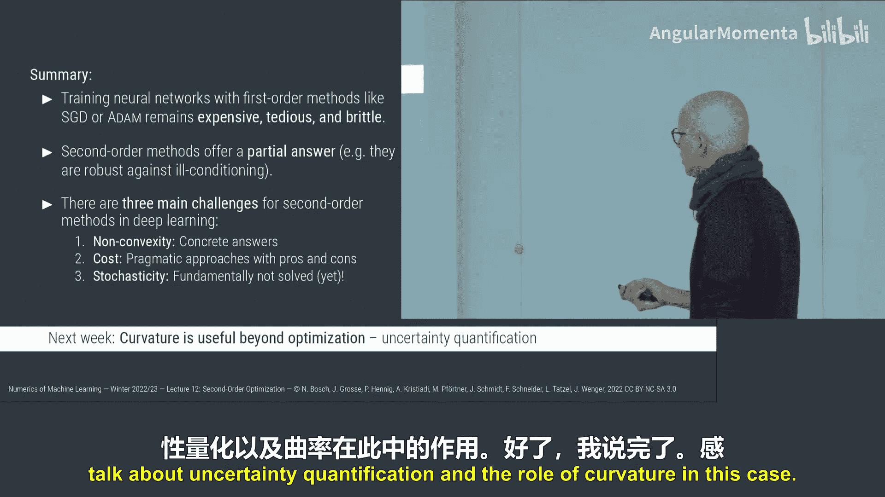

So with that， I'm done。 Thanks for attending。 Thanks for answering my questions。 And yeah。

 that's it for for me。 Thank you。😊。

