# 【精译】蒂宾根大学《机器学习中的数值方法》-p13-13----深度学习中的不确定性----Agustinus-Kristiadi--BV1WMYHzAEcL_p13-

。Okay， again， welcome to lecture number 13 in which you get to see me instead of Arusinos because he was supposed to give this lecture when we prepare the lecture course。

 we were still thinking he would give the lecture but then he got a slightly expedited offer to do a postdoc at the Ve Institute in Toronto and he had to leave us literally last week so he said goodbye by last Friday and we can't give this lecture and so we have to imagine him doing this I'm just sending in for him that also goes by a way of an advanced apology that I'll occasionally have to think about what I'm actually presenting because it's ever so slightly a little bit of PowerPoint Kaaraoke but I was involved in all of the papers we'll talk about so I should hopefully be able to do this。

😊，So what is this lecture about？The previous lectures， so far。

Where maybe one way to phrase it is about getting uncertainty into computation。

 doing numericalmatic computations with uncertainty。 But today is a bit special。 Today。

 we will talk about how to do the computations to get uncertainty into your machine learning if it's not already there。

😊，And that will actually give us an opportunity to also reuse some of the insights that we had in previous lectures。

Particular we talk about uncertainties， or Bayesianness in deep learning。

 we already spoke about in lectures 9 and 10 before Christmas。

 the fact that uncertainty usually means solving integrals and today we'll see a really really fast way of solving integrals because we've already learned in lecture 9 and 10 that the generic way of solving integrals。

😊，Montic Carlo sampling。Is maybe not the most efficient way to do things。Alright。

 So we also we use some of the insights from the previous two lectures。 So two lectures ago。

 function I told you about how to train neural networks。 And actually。

 he kind of told you that it's not so straightforward。 as it might seem。 And then last week。😊。

Las Tter built up an intuition for how to use second order quantities， curvature estimates。

Maybe first for optimization and deep learning。 and today we'll see again that or we'll see that the second order quantities。

 these curvature estimates， can actually do a lot of double duty for us， not just for optimization。

 but for really interesting other functionality as well， in particular。

 to get uncertainty into deep neural networks。😊，So before I can tell you how to do that。

 we first have to talk about why we need uncertainty indeed deep neural networks。

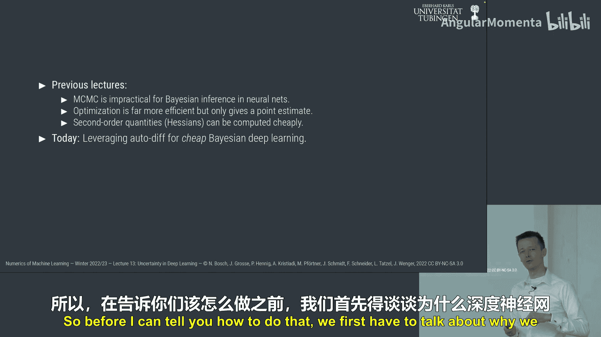

And there are actually several good reasons， and they are surprisingly concrete。

At least in my opinion。 and I want to use one of them as a motivation。

So hands up who has seen pictures like this here on the left before。

 probably everyone who's taken a deep learning class， yes。

 so you all know that they are just this weird。😊，Behavior of neural networks that sometimes you can give them really stupid images。

 and they'll think they are something completely different。

You've probably seen a different version of these pictures with adversarial examples。

 So these are examples that look like actual images。But get the wrong classifier output， right。

 that predicts the wrong thing。 So these here are slightly different。

 These are what you might call out of distribution examples。So these are images that are actually。

 they look a bit like white noise。 Theyre not actually quite white noise。

 but they are almost like this。 They are very far away from the training data within the inputs domain。

 right， within the X space。 They are images， but they really don't look anything like natural images。

😊，However， a network trained on these class on on， sorry。

 a network trained on something like imagenet training data that actually you works well on the training data that has high predictive precision on the training data gives outputs that are labeled under these images to this。

 these particular images with very high confidence。😊，So the classifier gives something like 99。

5% confidence that this year is a Robin and this year is a cheetah and so on。😊。

And I think we all agree that that's not a good thing。😡。

And you don't want a classifier that looks at some at some totally stupid image， It says。

 I know exactly what's in that image。So this is sometimes called asymptootic overconfidence because these images are very far away from the training data。

And there was actually a really beautiful paper by my colleague Matthias Hein in C if you are 2019。

 which in machine learning terms is like a few ages ago， right。

 in which he showed theoretically typical for Matthias Hein that this is actually a fundamental problem with。

😊，Classification networks of the standard type， which are classification networks We using Vlu No nonlinearities。

And the argument goes as follows。 and I'll actually pretty much try to reproduce it in。

Just like a few lines with some intuition。So first of all， here's an image that shows the situation。

 So you see here a training data set，1，2，3，4 classes。 it's a classification problem。

 There are four colors in this plot。 if you can see them， therefore four classes。

 we've trained a classifier， very simple classifier on this using relu non nonlinearities for the as a linked function between the layers of the network。

😊，And what you see as a shading in the background in red is the confidence of the classifier in whatever the output classes is。

 So you can see four regions， right you can imagine that each of these regions。

 the classifier thinks is one of the classes and they are not shaded in the color of the class。

 but they're shaded by confidence。 So deep red means the class is predicted with very high probability and white means basically all the classes。

 the highest class has a low probability。😊，And as you can see。

 like what the main thing you're supposed to see in this plot is if you move away from the classes to into the corners of the image。

 you still get very high confidence。😊，And that's bad， right。

So myas science showed that this is actually a fundamental property， and it works as follows。

 Theres two insights to have。The first one is， we're talking about a relu classifier。

 So if you're thinking of the pen ultimate layer， the logicit layer of the network。

 the one that goes into the softmax output， then that is a relu layer。

 So that means it's a linear combination of the previous layers output。

 So if all of the layers of the network are have used Vlu non linearities。 then so everyone， I guess。

 knows what the V is， right， So it's a piecewise linear function。😊。

That you get to scale and move around。Now， a piecewise linear function of a piecewise linear function or a piecewise linear function is still a piecewise linear function。

 So the nice thing about real networks is that their output is a piecewise linear function。

 It's just a combination of hierarchical combination of the previous layers。

 but that doesn't change the fact that it's still piecewise linear。

 It just has combinatorial many of these piecewise regions。😊。

So this picture is supposed to show this。 So each of these gray lines is one of these boundaries between linear。

 between linear regions。 So each each cell delineated by these gray lines produces like is a piece linear function。

😊，So the first lemma up here says。😊，If you have such a classifier， such a neural network。

 such a function， F of input。 So this space here is the input space， iss a sketch of the input space。

 and if you have such a pieceY linear function on this， then if you take any point in this space。

And scale it away from zero。😊，Then there exists a last point alpha， is's this blue point。

 after which you're going to be within one of these linear cells and never leave it again。

Does that make sense？So the main thing about this is that there are finite many of these piecewise linear features。

 So therefore， if you move away， eventually， you're crossing the last of these gray lines， right。

 And then after that， everything is just linear。😊，Okay。

 so if we think about moving far away from the training data。

 we will eventually be in a region where the classifier has a linear input to the。

 to the softm output。So remember， from your deep learning lectures to do classification with multiple classes。

 you have multiple of these linear outputs， right， going together into like you have number of classes of these linear outputs。

 and they go into a softmax。😊，Okay， so and the second theorem then says or this the statement then says。

 and I'm gonna show you a visual visualization of this at the moment。

 But I'll first tell you about the statement is if you are in such a piecewise linear region and you move sufficiently far out。

 then you eventually you're in one of these regions where the all the classifier outputs are all linear。

😊，And that means。With probability 1。😡，Each of these linear functions that move out have a different gain。

 right， They， they rise at a different rate。And if that's the case。

 then if you move sufficiently far away， then there's one of them that is will be the highest。

And because it has some higher gain than the other ones。

It'll be arbitrarily far away from the second highest one after some distance， right。

 And if you put that into the softmax。You'll get an arbitrarily high confidence for that one class。

And that's exactly what PC。 So I also have a visualization of this that I hacked together yesterday。

😊，嗯。So here you see three linear output features in red。

Each of them you can think of as one class predictor。And above them。

 you see the softmax output over those three。Now， clearly， right， so。Let's maybe look at this one。

 which is the steepest one。 right， It comes from below。

 So it has very low probability to the left of 0， and then it becomes the highest one。

 So it has very high probability to the right。 And for the other two。

 you can think about why they look this way。😊，And。So in a situation like this， clearly。

 one of them is the one that has highest highest gain。 So eventually。

 itll be arbitrarily far away from all the other ones。 If you move arbitrarily far in this direction。

 and then you get arbitrarily high confidence in this class。😊，Okay。

 so this is a fundamental property of relu classifiers。 It's not something that's sort of。

I don't know。 It's not an， an accidental thing。 It's not like you can retrain your weights to avoid this。

 It's just fundamentally a property of these networks。

And I'm going to tell you that the way to fix it fundamentally is to add uncertainty to the weights of the neural network。

😊，So let's see if we can get there。 So， first of all。

 how do we get uncertainty on a deep neural network。😊。

We have to have a Bayesian interpretational uncertainties is always connected to the idea of Bayesianism。

 So we need some Bayesian interpretation of the neural network。

It turns out that that's actually surprisingly straightforward。 maybe， well， maybe surprisingly。

 certainly straightforward， maybe surprisingly， depending on how much you've thought about this before。

 So in the last two lectures， a function already introduced several times。 And then lookas again。

 this notion of empirical risk minimization， which， of course。

 you also know from your statistical machine learning class。

 So deep neural networks are trained by minimizing some function that looks like this。😊。

Up to a few  normalization constants that I've left out for ease of argument。😊。

So the risk we're minimizing is some function that happens to be a sum over individual terms where each term depends on one of the training data and all of the weights of the network。

 where the weights go like are dennoted by theta， and they go into some function where the structure of the function defines the neural network。

😊，And then maybe in general， you also have some regularizer on the weights。😡。

Just so like for full generation， right， You don't always have that in， in deep learning。 But。

 you know， you could。So minimizing this function。😊，Can be thought of as in particular。

 since these functions are usually are non negative。

 They can be thought of as also minimizing some other name for the same function。

 which you could just call negative log likelihood of the data under the predictive model。😊。

Minus some function that only depends on the weights or not on the data。

 so we could call that a log prior。So minimizing this is the same as maximizing the exponential of this。

 or I've left out the minus here。 So there should of course be a minus here。

 So if you take the logar rhythm out， you can think of this as multiplying a prior with a bunch of individual likelihoods。

 And prior times， likelihood， after normalization is a posterior。😊。

So normalization doesn't matter because we are just finding the mode， right。

 the lowest point in this negative lock posterior。And that mode is not shifted by multiplying this thing by a constant because the constant would just be minus a constant here in this in the logarithm。

 And that doesn't change the location of the minimum。So actually。

 we can think of deep learning already as doing Bay inference。

 It's just that we only compute the mode。😊，Of the posterior。Well， actually， we don't。

 We never ever find it because of all the problems that F told you about， but。

We're trying to get there。In particular， if you think of the one common setting that is actually not so rare is for regression type settings。

 so you have supervised problems with continuous relative outputs a common loss that is widely used is a quadratic loss and so that's down here and common regularizer is what's called weight decay or quadratic or L2 weight cost So that's this thing can someone guess what the corresponding prior and likelihoods are。

😊，Yes。我。So if you are doing regression with a quadratic output loss。😊，And quadratic weight cost。

 you're essentially putting a Gaussian prior on the weights and a Gausian likelihood on the data。

 However， that's not a Gaussian model。 because remember that we're talking about deep neural networks。

 Here's a picture on the right。 So Theta enters in a non nonlinear fashion into F。😊。

So it's not just like Ga reggressor。Okay， so we actually have kind of a Bayesian interpretation for our deep neural network。

So the only thing left to do is to make use of this possibility， right。So to do that。

 we would consider the full shape of this object this here is a full posteror。😊，Up to normalization。

 And then maybe we make predictions about the output， for example。

 about for regression or for classification over the class。

 then we are what the typical setting is we're getting a new input X star。

 which we have to make a prediction。 And then we want to know the class label Y star。 So for that。

 we have to integrate out our uncertainty over the widths。 a marginal。 Now， unfortunately。

 And this is why， of course， most people don't do page deep learning。 This object。

 this positive distribution is intractable to begin with。😊，Right were like in2D learning。

 So there's like a billion of these weights， Theta is like a billion dimensional vector。

 and this function is highly nonlinear。 It's not just a quadratic function。 Otherwise。

 it would be a Gaussian， and this function here is also not just a Gaussian because if you do classification。

 it might be something like the softm over the class。😊。

So that's where most of sort of the early thoughts about Bayian deep learning kind of ended。

And it's actually where in recent years， a lot of contemporary Bayesian thoughts about Bayesian deep learning have entered in with a somewhat sort of reflexive answer to say。

 well， it's an interactable prior and likely go so let's do Montecallo。😊。

So I've told you in lecture 9 that Monte Carlo approaches， while theoretically very well founded。

 are potentially dangerous because they might take a long time to converge。And， in fact。

 that's going to be my argument today as well。 So we are not going to do Monte Carlo。

Because that would。Basically， disadvantage us。Compared to people who are not doing patient inference from the start。

I'm assuming you've all an a deep sorry， you've all done a deep learning class。

 So you kind of know and like the way deep neural networks work， not all of it， but some of them。

 And you'd like to be able to keep doing that， but maybe adding uncertainty would be nice。

 but not at the cost of completely making it intractable， like so the people who train GT。

 whatever4 or5 at the moment， they can't afford to run a markov chain Monte Carlo chain a Markov chain of Monte Carlo samples on their huge deep network because it would be so expensive that you could never hope to actually do it。

😊，So if we want to add uncertainty to fixed pathologies like the ones I just showed you。

 then we have to find a way of doing all of this without significantly adding costs to the process。

So what we'll talk about today is the cheapest possible way。😡，To do integrals。And it's。

Automaticated differentiation， coupled with linear algebra。So let me show you how this works。

First of all， there is a surprising result。😊，Due to Augusttus， so if he or here。

 he could give you like the full story。Which is that this problem with overconfidence that I've just showed you in an example can actually be healed。

By being Bayesian about the weights。Period。Not by computing the correct posterior。

 but by correcting by by adding any probability distribution to the weights。

 So the paper actually has the title being Bayesian， even just a little bit， fixes overconfidence。

Because it contains this theorem。That actually I'm going to just read out the one part of the theorem and then we'll talk about what it actually says。

😊，There is， this theorem says any Gaussian approximate measure on even just the last layers weights of the network already solves the problem。

 at least partially。😊，So before we talk about how it works， it's valuable to appreciate this。 right。

 So what were trying， what we're going to say is。😊。

It doesn't actually matter whether the probability distribution we are going to put on the way is the correct one。

 whether it's actually a correct posterior or not。This particular problem that we've talked about at the beginning。

Can actually be healed by adding any kind of probability measure on the weights。

They're even the simplest possible one。😡，How are we gonna arrive at such a， such a measure。

 So actually， I'll go one slide forward because I can tell you this is what it will look like。

 the output。😊，And you can see already that it has sort of healed this confidence problem， right。

 It just becomes less and less confident about the class as you move away。😊。

So how does this work We'll take our input to the classification layer。

I keep sping back and forth about how to， how to call that。 This is like the this F theta is the。

 the input。To the logistic output layer， to the softmax， F Theta。

 and we'll write it as explicitly as a linear function of the last layers weights。

 we'll call those W。😊，Multipliied with the outputs of the pen ultimate layers。😡，嗯。我的 output。

So phi of x is what。Comes it sort of encapsulates everything that happens in the lower layers of the network。

 And W is are the weights of the last layer。So theta。

 the parameter set theta combines both w and phi。If you like。Now。

 we're gonna to assume that we'll put a Gaussian distribution on those last layers weights。

 So we're basically ignoring the fact that there is a deep neural network below。 We just take it。

 You don't think much about it。 And we're just gonna assign a Gaussian distribution on the last layers weights。

And in fact， it doesn't actually matter what the covariance of that distribution is。

 we'll just assume it's anything that is not zero。But we assume that the mean of this distribution is given by whatever the trained weights of the network are。

So that prediction it would otherwise make that we have previously thought about。

And now we are going to use this distribution to try and solve this problem from the previous slide。

😊，So this is now a Gausian distribution。 We've just decided that it's a Gaussian distribution。

 We are gonna to make predictions。 Were were doing classification。 So this year。

 this likelihood is a softm， softm over。😊，F of theta at X star。

And so this is still an interactable integral then， right Gaussian Time， Softmax integrated。

 doesn't have a closed form。 Thankly， though， smart people a long time ago already came up with good approximations。

 In particular， David McKay had had in basically the seminal paper on Bayesian deep learning。

 which happened to be in his PhD thesis，1992， basically wrote on how to do this approximately。

 because he had the same kind of mindset。 He said， well。

 how can we be ever so slightly Bayesian about deep learning。 Well。

 back then like connectionist models。😊，So he realized that you can write this integral。

 if this is a Gausian and this is the softm very roughly as this。

 So you compute the softm over a quantity that is kind of derived from the sufficient statistics of this Gaussian。

 So this is like a derived variable， which at the in its numerator has the mean prediction。

 kind of the output that the network would otherwise have。😊，But then you mediate it， you kind of tea。

Yeah， flatten it a little bit by a term that is one over the square root of one plus pi over 8 times the what。

 what would be sort of like Gausian output， Take out Gaussian prediction over the function F of theta。

 right， So if F of theta is w transpose times phi and you marginalize over what w， you you。

 you would get like a Gausian with this mean and this covariance。 That's kind of this quantity。😊。

So if you take this function， this prediction， then it has this property。

 So for any X under the above approximation of this integral， any Gaussian approximate measures。

 in particular， any choice of sigma yields the fact that as we move arbitrarily far away from any point。

 we are going to get a confidence that is bounded away from one。

 So the classifier is not going to be arbitrarily confident。

 And I'll show you this in this little visualization that I've used before。

 here I can actually switch this on。😊，So here， what you now see is for each of these linear inputs。

 I've just added a Gaussian uncertainty on the weights that translates into this term phi transpose times sigma times phi。

 which looks like these three kind of regions of uncertainty。 And in blue here。

 you see this approximation。 this David Mckai approximation for the classes。

 And the main thing to see about this is that the blue lines are bounded away from one。

 They don't approach one anymore。😊，And one intuition for why this happens without doing the proof is if you look at these regions of uncertainty。

 you can sort of see that。 And I mean， you can actually be better， maybe better see this even in the。

嗯。In this expression， you can see that that there is a function up here that is linear in x。

Because it's a re network。 So it's pwise linear。 So if you're far away， then this is linear in x。

 and we're dividing by something that is quadtic square root of a quadratic term in x。😊。

Right so it's x times x x squared。 and there's a square root over it。

 So we're dividing something like x over x， and it kind of cancels out asymptotically。😊。

That's the entire point。 And what does it come from。

 it comes to the fact that we are uncertain about the weights of the network。

So we have to take into account that we don't quite know the weights。😡。

And then suddenly everything is good。😊，So this is really so far only a philosophical argument for why you should be uncertain about the weights on your neural network。

 not because of some religious reasons about Bayianism。

 because it's like the right way to do learning， but because it actually avoids pathologies。😊。

It's just wrong to assume you know something， if you don't。And it creates issues like this。嗯。O， now嗯。

this is the argument there's been。We should be uncertain。 And actually。

 it kind of doesn't really matter how uncertain we are。 as long as we are ever so slightly uncertain。

 it's going to be fine。But then， of course， it's an asympltic statement。 Yeah have to be uncertain。

sufficient to be between two sets of。that one7%。No， yes。

 So you're saying it has to be a Gaussian and E E。 So maybe。

 maybe more cautiously this what this theorem says is if you're doing all of these approximations。

 if you're linearizing， you're using this particular approximation。

 you're putting a Gaussian distribution on the last layer weights。

 then it doesn't matter what a Gaussian is。😊，Now。It's certainly possible to get generalizations of that kind of theorem。

😡，That work for a broader class of approximations。But actually。

 I'm quite happy that we just we just have that because we are going to stay within that framework for the rest of the lecture。

😊，And I could maybe also rephrase this statement by saying it might be a good idea to put a gausstion of approximation on the weights。

😊，And using this particular approximation for the for this integral， which by the way。

 is actually quite a stronger approximation。😊，Because of properties like this。

So we are actually kind of deliberately stepping outside of the kind of religious framework of Asian influence。

 and just say， we just do this。😊，So we use probability distributions on the weights。

And pretend that they are posterors。When， in fact， they are not， right。

 because the weird posterior is。I mean， it's this object that we've spoken about now， right。

 It's this thing。But then again， how much do you care about the actual shape of this postivion。

This is maybe also a good， a good point in the lecture to point this out。 I mean， if you。

 when you write down a deep neural network， when you define an architecture for a deep network。

 does anyone ever think about the fact that they are generative models and they can be interpreted as posterists or defining likelihoods and priors。

Right。You don't write down a confnet with eight layers and whatever weight norm and decide that you're doing that because of some Bayesian modeling assumption。

It's just what you do because it's deep learning， right And you just hope that it learns the right thing。

 So maybe it's not so important what exactly the shape of this posterior is。

What does seem to be important， though， is to consider that the weights are not actually identified。

😡，What I just means is that the loss function is not a point mass。 It's not just0 everywhere。

 and then minus infinity at some point。But it's actually a complicated shape。

And there are several different choices of weights that all explain the data somehow。

 sometimes better or sometimes worse。So if we are in that framework， then。This is， of course。

 an asymptotic statement， right， it only says something about what happens if you go abitarily far away from the data and we never go abitarily far away from the data。

 not even in this picture。And not， I mean， also for most use cases of deep learning。

 right X is actually something on a bounded domain。

 So if we talk about images like the ones I showed you on the very first slide。

 then the domain of images is bounded， right every pixel goes from 0 to 255 end so asymptotic distributions are useful for this kind of theoretical analysis。

 but maybe they are not like super crucial for applications。😊。

So that maybe raises the question of how should we choose this sigma？😊。

Such that it works also in practice。And here， my argument is going to be we choose it with automatic differentiation with curvature estimates because they are the fastest and cheapest thing to do。

 And it works as follows。 These are calledla approximations。

 Maybe quick check who has heard of Laas approximations before， Almost everyone。 That's very good。

 So I can be quite fast。 So the idea is to do a quadratic approximation to the lock posteror。😊。

Let's do it with the notation of deep learning。 So our full posterior is this object up here。

 which is prior times likelihood。 So that's the joint。😊。

The generative model divided by its normalization constant。

 We've just realized that we can write this joint as the exponential of the negative loss function that we are optimizing in deep learning。

 So that's the connect between deep learning and patient inference。😊。

And now let's assume we found the mode。 We actually used some magic optimizer that found the mode of the loss。

😊，三号。We call that theta map。 Now around theta map， maximum aoserreory， right map。

 we do a second order tail of approximation that gives a constant plus a linear term。

 And because we are at the mode， the gradient is0。 So the linear term drops out and were left with a gradratic term。

 which contains the hesian of the loss function。😊，So we need the negative exponential of this。

 So if you take this by the minus in front， to take the exponential of it。

 that's going to give us the exponential of negative this thing。😊。

Times the exponential of a quadratic form and exponentials of quadratic forms are Gausians after normalization。

😊，So we can do this integral here in closed form if you want to integrate outzeta and we' look at the normalization constant of a Gaussian。

 which is2 pi raised to d half where is the dimensionality of the space。😊。

Times the determinant of the square root of the determinant of this hessian。Matrix。

Notice that that's actually the hesian， even though if you think of it as a covariance。

 we would need the inverse of the hesian。Okay， so if we can get to the hesian。

 then we can construct approximations like this。 And this is actually totally analytic。

 So if someone gives you the hesian。😊，In some passable form and the trained neural networks。

 or the Fita map。Then you can just say those two define a Gausian。

 a Gaussian with a mean at theta map and a covariance that is given by the inverse of the Hasian。

Of this loss function。And that will look like this。

 So this is the cartoon picture that people always show。 Here is the loss function in blue。

 And this is the Gaussian that you get from this， which is centered at the mode。

 and it has lock curvature equal to the lock curvature of this blue line。

 The main reason to show this plot is that this is evidently not a perfect approximation at all。

 It's totally local。 So you can be arbitrarily wrong。

 There can be another mode somewhere else that this thing will completely miss。😊。

And that's also the argument that has been used for a long time against the class approximations。

 I mean， they are like the oldest approximation ever for Bayian inference。 They were。

 as the name suggests， actually invented by Piazimmo。😊。

The maquita Lala because he couldn't solve the beta integral and he needed like so he had to use the Gausian integral。

😊，And because it's so old， you can sort of it has this kind of。

Sort of pet reputation because of this problem。But。Actually。I， I have now。

 over the past few years come round to really fall in love with a approximations again。

 And I'm gonna tell you for the rest of this lecture why。Before we do that， and me briefly actually。

 yeah， I'll tell you on that slide。 So here's the point where I do PowerPoint karaoke with Augusttina slides。

 So here's how it works。 You take your deep neural network that you are using from whatever else you got it from。

😊。

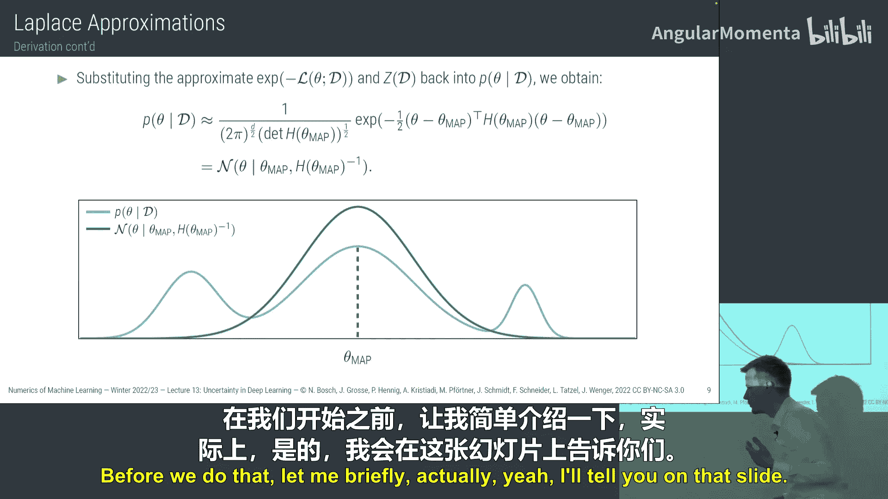

From your deep learning class， from papers with code， whatever， you take it。

 And if it's already been trained， then you're basically done almost。If it hasn't been trained yet。

 and you first train it and you train it in whichever way you like using any of the 120 algorithms that Frank Schider told you about two weeks ago。

Right。Adam， typically。And you wait for it to converge。

 I dont know do something fancy with the learning rate， decay， it， cosine， decay， whatever。

 eventually you end up with theta map。😡，And that was the hard part。Getting it to。

So you've already survived a hard part。 And now， the only thing left to do is to find the hesian at that point。

And you do that with。Outtoive， I'll show you code in a moment。 Actually。

 I'll put it on Eliliaas as well that you can look at。And， of course。

 it's not entirely straightforward， but you can rely on automotive to do that for you why。

 because automatic differentiation is actually kind of a science。 It's，'。

 it's a close form process that actually works as opposed to those 120 optimizers with their weird parameters and Monte Carlo and all of these algorithms that are so shaky。

 right， Auto differentiation is just linear algebra。 It just works。😊。

So that's not the hard part about about deep learning。 So if we get our hesian。

 then let's just assume for a moment that we have that hesian。 Then we're done。

 We have a Gaussian distribution over the weights， and everything else is closed form。

 So the cool thing about this is that a， it's cheap。 The hard part is training the deep network。

 But you've already done that。 So at the end， you're just once evaluating the hesian。😊，Nothing else。

And actually， I'll show this to you because I have a little animation of it。

 I think I think I fiddled around with some piece of code。😊。

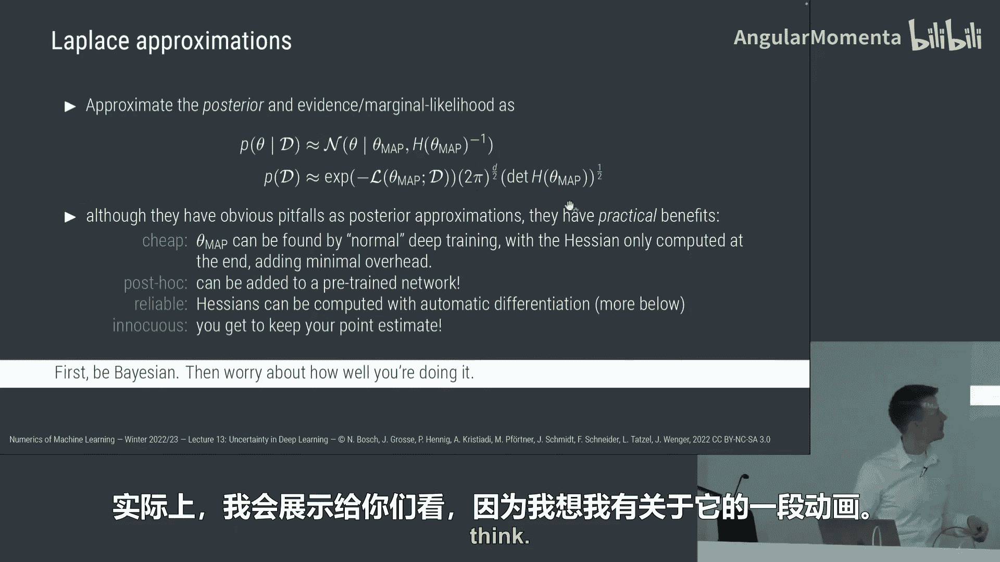

A little bit。 So Augustguts actually gave me this data set。 I'll upload this code afterwards。

 So here's just a bit of a toy data set that has these four Gaussher blops。

 And now here's like we are training a deep neural network。

 For those of you who have used torch before。 You can kind of。

 you've seen these pieces of codes lots of times。 There's a really simple， deep， deep。

 deep neural network with two hidden layers。😊，And then importantly。

 where is it cross entropy output loss？😊，So we trained this thing。In the normal way， you know， here。

 it's a tiny dataset set。 So everything is kind of reasonably fast。

 even though this isn't the GP machine。 Once it's done， we have a trained neural network。

 Notice how so far there's nothing Bayesian whatsoever。 Nowa has a test data set on which we can。

 which you can just construct。 and you'll get this kind of prediction， right。😊。

And now what you do afterwards， after you have trained your D network。

 youre just gonna construct a Haitian。And actually。

 I'll show you in a moment how exactly how to do this computation。 But first of all。

 the main thing to understand is you're doing this after you've trained your deep neural network。😊。

So this doesn't add costs to training the network。Secondly， you can do it even for a trained network。

 So if you can download a trained imagenet classifier。😊，And you have image that are available。

 and you know what the architecture of the network is。

 You can do this uncertainty business afterwards。You don't have to re the training algorithm。If。

The people who train stable diffusion would actually give you access to their training data。

 You could do this， as well。I mean， you don't quite have the attaining data and the entire architecture。

 but you know。I already said the nice thing is that it's auto di。

 So there is no fancy tuning sampling algorithms。 And thirdly。

 maybe the coolest thing about this is that it actually allows you to keep the point estimate。😊。

So normally when patients talk about doing patient inference or deep learning。

 the argument goes the other way around They say， well。

 this map estimate shouldn't be the estimate of the neural network because if you're actually uncertain about the weights。

 you should maybe think about the average， the mean weights。

 and that mean will not typicallyP at the mode， right it'll be somewhere else。😊，And for a long time。

 historically， that was the argument for doing Beijingesian deep learnings like， no， you know。

 your T default is actually wrong。 You want to have an average of several possible explanations。

And that never quite stuck with applied people because， I mean， by now。

 you know how hard it is to get these networks to work。 So once you have a trained network。

 that kind of works， you don't want to fiddle with it anymore。 You to keep it。

Even though it's just the mode of a posterior。So actually here。

 this kind of turns into an advantage for， for this way of doing Bayesian inference。

 You have a trade network。 You get to use it。 And if you like the predictions of this network and they achieve whatever yourre 97%。

A accuracy you want to reach。 Then you're just happy and you keep them。

 and you're just building uncertainty around them。So in practice。

 this has turned out to be a surprisingly powerful insight， actually。😊，So those are the good bits。

 That's the reason to be happy about At class approximations。 There are， of course。

 also some downsides。😊，Can someone guess what they are。The Florida national is expensive。

Thesian is expensive。 Yes， and that's actually kind of the main problem， right， So in fact。

 the problems are pretty much the same that Lucas Tatzzel had on his slide last week。

 So I've basically copied them down again and just be phraseed them a bit。 So first of all。

 our optimizer doesn't necessarily have to be at an actual local mini moon might just be somewhere else。

 Secondly， this hesian doesn't even have to be positive definite because it's deep learning。

 So the loss function is not necessarily convex。 could just be wherever。 And thirdly。

 it's expensive because it is of size weight space by weight space。

 It's quadratic in the size of the weight space。😊。

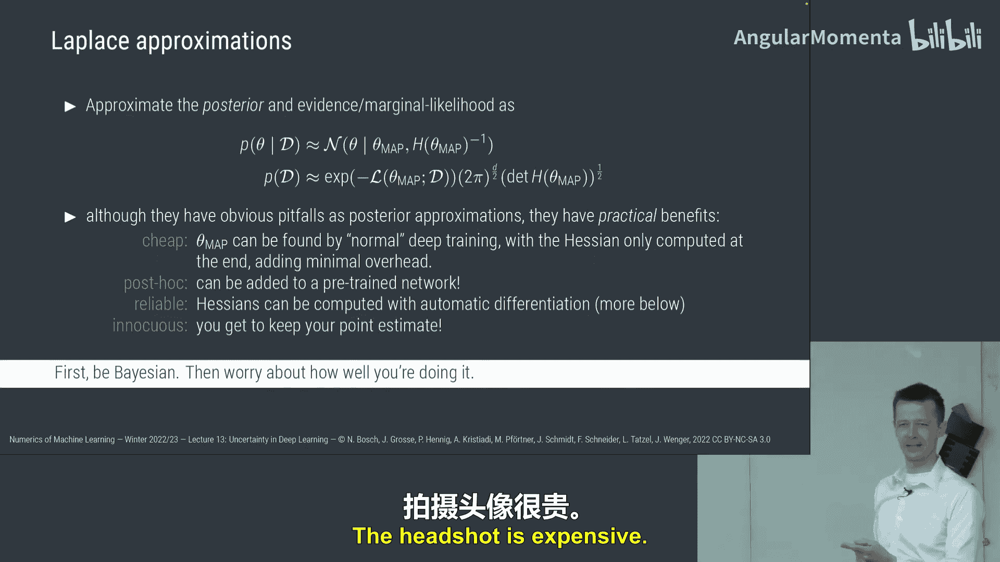

So the answer is going to be the same answer as in the previous lecture。😊。

We are just ignoring the fact that we're not actually at the mode。

 We are just going to construct an approximation to the Haitian that is guaranteed to be positive。

 definite。😊，Spoiler alerts， it's the generalizedcals Newton matrix that you already heard about last week。

😊，And we're going to use various forms of approximations to get to a tractable form of the Hasian。

So the generalized calcium matrix is you've already actually it's on the next slide Yeah。

 so on the next slide you'll look at it again， but there is just you can think of it as an approximation to the hessian in a way that I'll make a little bit more precise on the next slide。

😊，It is guaranteed to be positive semi deffinite because it's the outer product of a vector with itself with something in the middle。

 And if you， if you're computing the the G GN。 So this is this is maybe the one thing I have to mention on this slide。

 If you're computing the G GN for the loss。 And you have a regularization term， a weight cost。

 then you can just add that， of course， to your G GN， and that's gonna be easy。 So， for example。

 if you have a quatic weight cost is just a scal or times a unit matrix。😊。

And then we're typically going to make some further approximations about the structure of this GGN。

 For example， we might only consider it diagonal。Or we might do some block。Diaagonal approximations。

 like the chronic effect factor approximation that you've heard about in the last lecture。

So here is the G G N again。 So we Lucas already talked about this last week。

 So I don't have to spend much more time on it。 The main important bit about the。

 the G G N is that it contains this object J， which is such a Koion。Of the。This function F of theta。

 which is this kind of input into the classification layer with respect to the weights。

Of the network。 So it's a matrix， right。And， in fact， actually。

 it turns out that the reason to use the G GN is not just that it's always positive definite and therefore convenient and also a bit cheaper thanhes。

 It actually has a nice， interesting connection to another kind of approximation that we're going to use。

😊，So， and that's linearization。 It's called sometimes called a linearized neural network。

 So if you think of this function F of theta， not the loss function that we we we found a tail approximation about before。

 but this function F of theta。 the input into the classification layer。

 And you do a first or tail tail expansion of this function around theta map。

 then this is obviously this term。 right， So this is where the Jacobcoion shows up。

 I hope that's pretty obvious。😊，And if you think of the， the hessian of the loss。

 if this were the actual network。So if our deep neural network was replaced with this function。😡。

In the white space， then the G GN would actually be the hesian of the loss。Under this approximation。

Maybe something where you have to think about for two or three minutes。

So this is kind of simultaneously an argument for linearization or for the GGN。

 So either you could say I like a linear representation of the network and then the GGN is the natural representation of curvature because it's the hesian associated with this approximation or you could say I want to use the GGN because it's nicece and positive definite and then you're kind of compelled to use this linearization because it matches to this curvature estimate。

😊，One thing that's always important to note at this point is that this linearization doesn't mean that we are replacing the neural network with a linear function。

😡，Of the inputs。 So this function here is still non nonlinear in x， right。

 It still contains this object。It's just linear in theta。😡。

So this does not ruin the nice properties of your deep neural network。 It still behaves as before。

 If you plug in some X， you just get the exact like at at theta map。

 you just get the exact prediction of the deep net。

 You just now have something that's linear in the weight space。If we use this linearization。😡。

And combine it with the Laplace approximation， we actually end up with a completely detractable model。

 assuming the loss function is tractable。😊，So here this is for regression where it's particularly straightforward。

😊，So if your right， So here's this equation again that we had on a previous slide。

 So if you want to predict the output of the network at some test point X star， the trained network。

 then you'd have to solve this integral that we've now seen several times。

 if we assume that this is Gaussian from the La passivea approximation。

 And we assume that this is linear from the linearization， then sorry。

 So if if this is linear and this P of that function， if that's a Gaussian function。

 a Gaussian density， because we're doing regression， So if the observation likelihood is a Gaussian。

😊，Then this is an integral of a Gaussian against the Gaussian。 There is a D Theta missing here。

 and Gausians against Gaussians are just Gausians。 So we end up with a Gausian prediction。😊，So。

The title of the slide says it， if you're combining linearization in the weight space with a laplace approximation on the weights。

You're getting a gosian。Gusian model， a Gausian process from your deep neural network。A Gaus process。

 where the mean function is given by the output of the deep neural network。

And the core variance function is given by， well， this thing。 So the Jacobian of the the network。

 a weight space on the right hand side。Taken as an inner product with the inverse of the Haitian。

This actually also works with a tiny adaptation for classification。

 And that's the bit we've seen so far。 So if we do classification。

 then the output likelihood is the softmax， as I've now mentioned several times。

 And so if we assume that this thing is Gaussian distributed。

 Then we have to compute an expectation of a softmax under Ra Gausian。😊，That's intractable。

 but we could use this simple approximation that David Pakai came up with。

 That's a closed form expression。 And we end up with this prediction。😊，Everything is closed form。

And actually， you can also see this in the code。That I sort of skipped over。 Here it is。

 So here's you can look at this code afterwards。 I'll put it on on Eas。

 This the actual implementation of this kind of process。

 So we arere coming in with our trained neural network， which now exists， right？

 And so in this piece of code Augustts actually together with F Tangle came up with a nice implementation using torch。

 which is a functional sublibr of torch or derivative of torch。

 and we don't have to understand everything that's going on here。

 But maybe the important pit is that you're defining a loss function。

 And then you're computing the hesian of the loss function。😊。

And the Jacobian of the train network with respect to the weights。And then compute the G GN。

 which is a little bit of Einstein' some notation trickery。 But basically。

 it's an inner product between the Jacobian and the Hatian。1 or two lines。

 And then the rest is just plotting。 And so that's basically boring。 right。

 So when you make a prediction， youre just。Adding con constructing the predictive uncertainty from the Laplace approximation and then pushing it into this simple approximation for the softmax。

 which is this one over one square root of one plus pi over eight times whatever， right。😊。

And you get this plot that you've now seen on previous slides already。So again。

 it's a simple post hoc procedure。

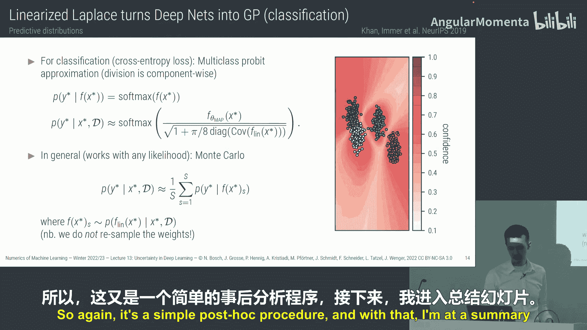

And with that， Im at a summary slides， these are La passivea approximations for deep neural networks。

😊，Youre approximating the posterior distribution of the。Weights。

By finding the mode of the loss functions or training your D neural network and then constructing a curvature estimate。

 in particular， the generalized cosnu matrix and linearizing the network in its weight space。

 So computing a Jacobcobian of the output function of the network with respect to the weights。😊。

Those two can be combined together in a product， and you get a prediction for the output function F of X star。

 which is still nonlinear in x。😊，But now， linear in weight space。

And we can marginalize over this distribution， depending on what the loss function is。

 If the loss function is a quadratic loss function。 So the output likelihood is Gausian。

 then it's all closed form。 If the output is a softm or the loss functions the cross entropy。

 then there is this fun approximation， which is basically as cheap as assuming it's a Gaussian。

 just a different function。 And if it's some general predictive function that isn't cross entropy or quadratic。

 then you could still do Monte Carlo， but Monte Carlo in。😊，Linearized weight space。

 So you just draw a bunch of Gausian。Weights from， sorry。

 a bunch of weights from the Gausian distribution that comes from this Laa approximation。

 And for each of the。 So sampling those is trivial， right， It's just Gausian random variables。

And then just sum up a bunch of predictions rather than running Markov J Monte Carlo in weight space。

 which is the expensive bit。So there you have it uncertainty for your deep neural network。

 And now the rest of the lecture will be why。Why， what， why。

 why would I want to have something like this and what would I do with it， Well。

 I've already given you the first argument。 The first one is。

Does anyone remember avoiding overconfidence？So。If we do this。

 then at least for the case of classification with this particular linearization and approximation。

 at least we now know that our network will not be overconfident。 We'll have this。

 this thing that that that suggestive picture on the right keeps saying。😊。

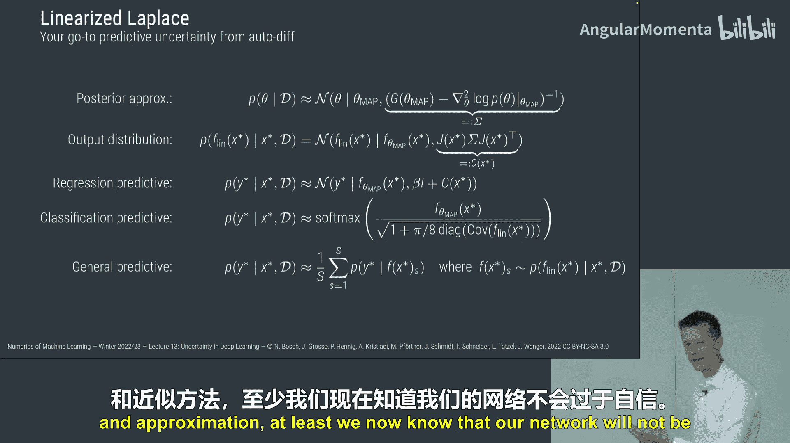

So as you move far away from your training data， the network will at least not be arbitrarily overconfident。

But there's actually another reason why you might want to do this。

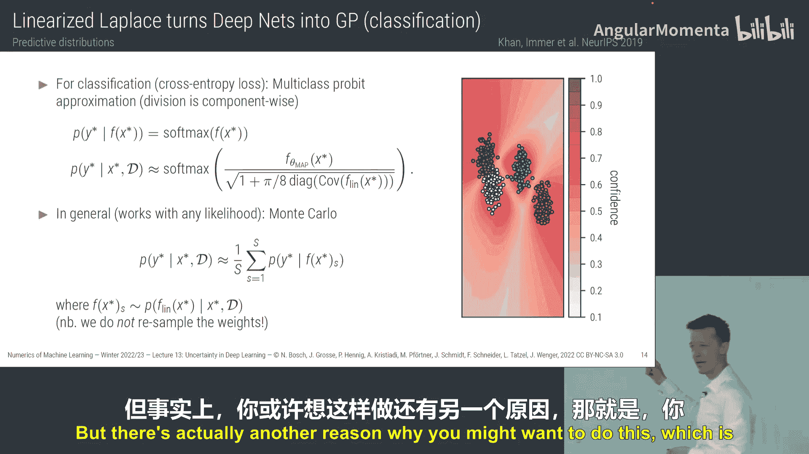

Which is that the Bayesian formalism， as you may know。

 from your probabil listening machine learning class。

 provides functionality to do interesting things。😊。

One particularly important thing is to adapt parameters or aspects of the model。

By checking how well the model predicts the data， marginally predicts the data。And for that。

 we usually use in or B that the mechanism in Bayesian inference is called evidence maximization。

 So we are trying to compute the likelihood for some model under the data。

 And that involves the normalization constant in。😊。

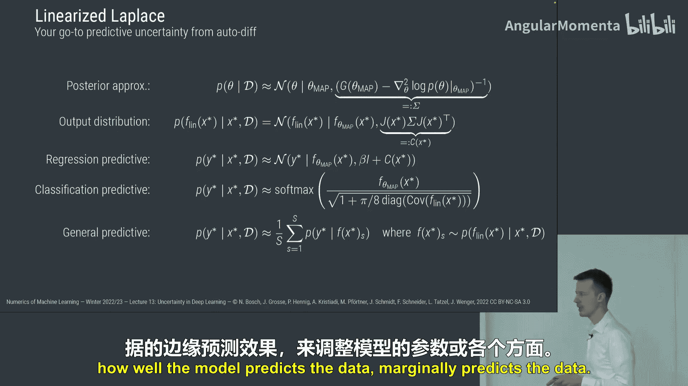

AtThe theorem of base， right， the denominator， the P of data。 So what is actually the P of data。

 So normally we it's intractable， right， It's this this integral over P of data given weights times P of weights。

 D weights。 And we can't do that in closed form for a general posterior。

 But we now have a strongly reduced simplified form of the posterior and the loss function。

 We've linearized the network in its weights。😊，And we found a quadratic approximation through the loss function with the Laazza approximation。

 So maybe things become tractable again。 And indeed， they do。 So actually。

 Ive kind of had this on a previous slide about the Laazza approximation。 So kind of。😊，Here， right。

 we know what the normalization constant of this thing is。 It's just。This， right？

And that means that the Z of the E。 So that is our marginal likelihood。 is's just this。

 So it's the x of minus the loss at the train model times this。 well， times a bunch of constants。

 which aren't important because we're going optimize this thing times the determinant of the hest。

So we can use this as a measure of how good our model fits。😊， one more slide。 Here we go。

 These are results from a paper by Alex Imer and his coauthors。

 who is a PhD student here in tububing an and in Zurk。😊。

Which are published two years ago during the pandemic。 So the idea is， let's just， basically， I mean。

 basically， it can be summarized in one statement。 Let's just take this approximation seriously。

Is this Gausian approximation to the network that this combination of linearization and quatic approximation for the loss。

 which turns a deep neural network into a Gaussian process。 So let's do with a deep neural network。

 people do with a Gausian process， which just compute the evidence for the data， and then。😊。

Pick whichever model has the highest evidence。😡，So here's a picture that's actually from their actual paper。

 It's just reformative to look a bit like fit better into our slides。 Here's a regression data set。😊。

So the orange dots are the data and they've trained a very。

 very simple deep neural network with just a few layers。

And then for different choices of that of the model。 So in particular。

 they vary over the number of hidden layers in the network。 they compute this quantity。

Which is the logarithm of the quantity。 we had a few slides ago。So。

This year is the negative loss function at the trained model。So that's this will。

 because this is a quadratic loss， right it's regression。

 This will measure like you can check your intuition。 What does this actually。

 What does this quantity actually measure。😊，This is a quadratic function。This is like。

Y minus f of theta。Ed x。You set variance。I think you were thinking of the right object。

 I wouldn't call it a variance。 It's the average quadratic distance between the predictive。

 the black line。😊，And the data， the orange line。 But it's， it's a quadratic form。

 So it's a bit like a variance， right， Yeah， so you can see that this model down here has this is the one with three layers。

 The black line is much more flexible because it's a bigger neural network。

 So the black line is closer to the data than it is in this model。

 which is a single layer neural network， which actually isn't the neural network。 It's just。😊。

A go should be pressureor， basically。嗯。So in this model， this loss function will be smaller。

Because were closer to the data。But notice that there is a second term in here。

 which is the determinant of the heship。So， determinants。First of all。

 tend to grow if you make the model larger because there's just more numbers in your matrix So the determin and just get larger。

Sorry， the lock term in particular gets larger because the lock deterant is the sum over the eigenvalue。

 So if the hesian is a positive definite matrix， then these are positive numbers that you keep summing up。

 So the more you have， the larger。😊，But it also， of course。

 depends on what exactly the model actually is。 So our he here， of course。

 will depend on what the shape of the loss function is at that point， right， So it's not just。

Just keeps growing as we add more layers。 But actually， if you get more layers。

 that might be a better fit。 The loss function might be narrower， and then that might actually go up。

So here in this picture， you see those two numbers。

 So this is actually the the this approximation for the marginal evidence，-88 for this model。

-100 to 15 for this model。 So if we take this seriously， then what this says is pick this model。

 please。😊，They actually reran their code for five different choices。

 So I forgot the X label here because I just made this plot an hour ago。

 So here this plot shows for the as a function of the number of layers that this neural network has。

 these three quantities。 So the red curve is this quadratic fit。😊。

The black curve is this whats sometimes called the Oham factor。

 you might remember from your probabilistic machine learning class。

 this sort of penalty term for complexity of the model。😊，And this is the sum of those two。

 And clearly， you can see that sort of around 2，3 or four layers is probably good。😊。

And maybe actually two or four might be the best。You see here ever so slightly an arrow bar。

 So there's a tiny bit of arrow bar here， which kind of gets them close to each other。

 So these three are basically the same。You get the arrow bar by。😡。

Retraining the network several times。Which is annoyingly expensive。

But that's how you get yourarrow bar。Yeah， and maybe one thing you notice is that this outcomes factor is not as straightforward as you might think it is。

 So for Gaussian processes， we are kind of used to this as you just as you make the model more more complex。

 the Ohams factor kind of goes down。 So everything gets more and more penalized。 But here。

 because we are computing the hesian of the loss function。

 there's actually a nontrivial effect about how well this model gets to explain the data and how much degrees of freedom it actually has。

😊，And if you add layers underneath each other， they might actually constrain each other in surprising ways。

 So we can't quite expect this function to just of come from up there and keep going down。

So how would you now， Well， if you have discrete choices like this。

 you just look at this curve and just go， I'll pick this one or maybe this one。

 If you have a parameter that you can tune， like， for example， prior precision。

 then you can do this with。Stochastic gradient descent。 And in fact， actually。

 I think I have a visualization of this。 So here is our network with linearization。

 La class approximation for the classification problem。

 I'm I'm plotting this approximation to the confidence。

 And now this is actually a function of one parameter， which I haven't talked much about yet。

 which is the prior precision， So maybe maybe quickly go back。

 So I kind of dropped it along the way because it seems so unimportant。

 but actually it has an effect on the， the on the the output， which is this term here。

 Theres regularization， of the loss。😊。

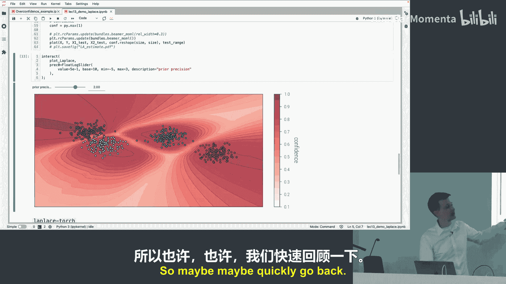

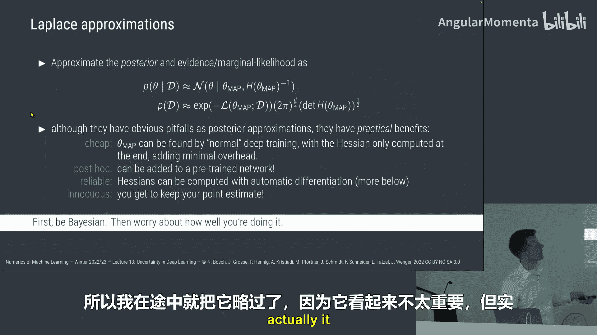

I've chosen this to be a quadratic。😡，With a number in front， which is corresponds to prior precision。

 So it's like one over the。The variance of this prior a， right， And if you move this up and down。

 then you can see that this actually affects the confidence of the model quite a bit。

So if I make it very small， the precision then the model becomes very unconfident。

And if I make it large， the model becomes very， very confident everywhere。

So there's probably a good choice somewhere in between， somewhere around here。 And in fact。

 that's actually what marginal likelihood maximization would tell you。 In fact。

 there is a way to do this。 Augusttinous and Alex Imer and some of the other people authors of these papers wrote together a little library that you can use yourself as well。

 which simplifies the whole process even more。 you just take your trained neural network and just run this thing。

 and it just tells you what the best choice of prior position actually is。

 So there's a line here that says find the right prior position。

 and it does exactly what we just talked about。 So it computes the evidence of this data under this model。

 does some gradient descent and finds this choice。 So apparently。

 this plot looks sort of looks best from this Bayesian perspective on how to choose these parameters。

😊，So now I have to find the slide again that I'm supposed to be yet。

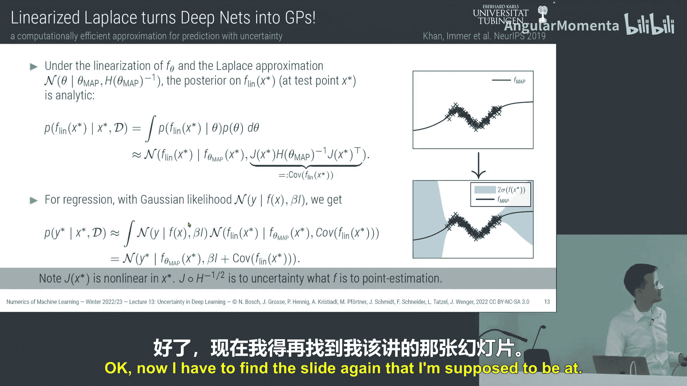

嗯。Right， so you can use the FAa approximations to select models to select parameters of a neural network。

😊，Not algorithmic parameters， not the learning rate of your optimizer。

 because that happens before you do Laplace， but choices like the number of layers。

 then the width of the layer， the prior precision on the prior of the of the layers。

It's not the only way to do this。 And， of course， you could do it with， you know。

 cross validation on， on a， or with a validation data set and so on。

 But this is one way of doing it that is kind of motivated in a probabilistic fashion。

And maybe I think the honest answer is probably that it works quite well for certain things like choosing prior precision。

 and it doesn't work also well for other things like for example。

 choosing the number of layers of your network， if only because it requires reing the network。😊。

So how does it work， We compute this quantity， which clearly we can compute now because it involves the loss that we' are already optimizing and this hesion that we' are already constructing for plus。

 So we might as well make use of it by picking whichever number M maximizes this quantity。😊，Yeah。

 and I've already done the demo。 So there is a piece of code that does that for you。 You'll get to。

 I think you'll get to play with this or actually implement yourself these Lapaso approximations in the exercise sheet for this week。

😊。

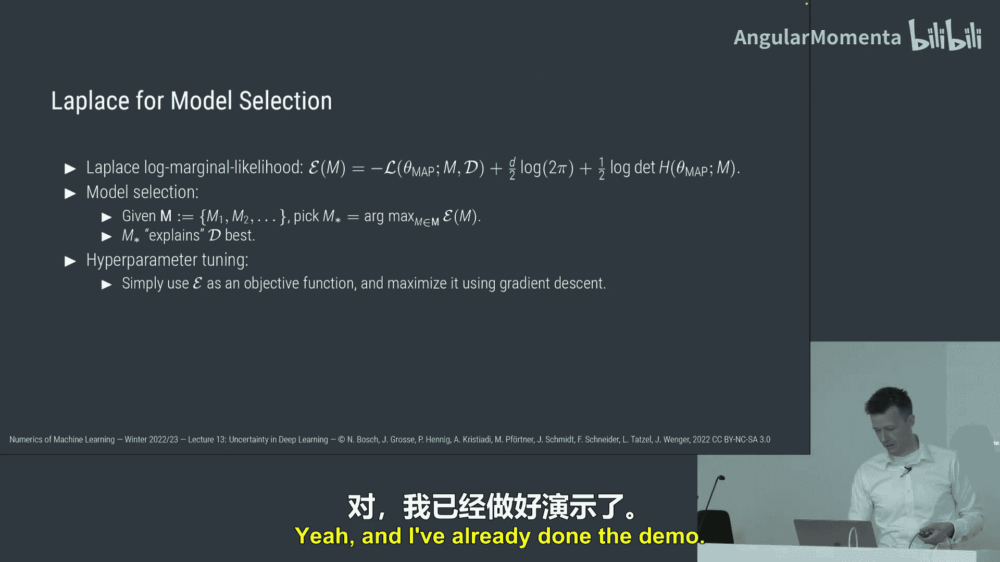

And now I can waste your last 15 minutes with a bunch of other things you could do with plus approximations。

😊，And this is largely going to be a celebration of Augusttino's PhD， I guess。

 and also Alex Imer and Eric Txbergger and M S Khan。

 who are all people who've worked on these linearized Laplace approximated patient deep neural networks。

 which have become kind of one school of thought for how to do uncertainty indeed deep learning。😊。

The one that is motivated by low cost， rather than by。Faithfully representing the full postero。

And it's been solidified into a large number of different publications。

 which were published over the last few years。 Like you can see that the earliest one on this list is from。

😊，Just over two years ago。 And since then， the people have been busy writing lots of papers on this and also building this library。

And they basically like used， they all boil down to this idea of。

 let's take this linearization and quadratic approximation seriously。

Use them as a black box tool that turns a deep neural network into a Gaussian model and then do whatever you do with Gausian models。

So a first thing we could do is we could return to this example that I had at the very beginning of the lecture。

 So I made this argument that there's this problem with deep neural networks that don't have uncertainty on the weights。

 that if you go far away from the training data， you'll get a classifier that is arbitrarily confident。

 And I said， if you put any Gaussian measure on the last layer weights and linearized and do this approximation。

 then you'll get something that isn't arbitrarily confident。

 It's gonna have a finite confidence that is bounded away from one。😊。

But you could say maybe that's not actually what I want， right？

 So if I so this thing that that I'm gonna end up with。As I move far away。

 it won't actually be fully uncertain。 It won't be the maximum entropy uncertainty。

 It won't be one over the number of classes。 It'll just be something。

So if you zoom out of this training regime and move very， very far away。

 there are still going to be structure in this predictive distribution。 It won't。

 won't go arbitrarily close to one as the nonb network would go， but it still has this structure。And。

You can also see this in this little visualization that I showed before。So these blue lines。

 they go somewhere， but they don't go to one over the number of classes。

 which is this con constant line here， which is at at one third， actually。So how do we fix this？

 Well， Augustino and Matthia Hein and I came up with a very like with a fix that is so simple。😊。

That it's actually kind of embarrassing， to be honest， but it actually works surprisingly well。

 which is to say。嗯。Well， actually， okay， maybe， maybe it's not so embarrassing because it has an interesting intuition。

😊，So let me tell you a story about this。 The problem with this， if you think about how to fix this。

Kd of what would be the thing you have to do to your network to make this work。

 assuming that we're staying within this particular choice of approximation。

 then you can kind of convince yourself that there is no way to fix this by just adding a bunch more of video features。

Because no matter how many V features we are going to add to this network。

As long as there are finite many of them。We will always have this property that eventually。

 as you move far away from the data， you're in a linear regime。

 and then you have a linear function divided by a linear function and it goes to a constant。

So either you'd have to fix something about the weights。

Of these features and make them grow as you move away from the data。 But that seems really wrong。

 right， Then you would have to have the weights of the the network depend on the input of the network。

That kind of breaks the idea of a deep neural network。

The only other way to fix this is to add an unbounded number of weights。And actually。

 this is kind of intuitive。😊，If you move very far away from the data。

 then what this says is kind of imagine I've given you a finite data set， right， So， of course。

 you could only train a finite number of re features with that because you have finite a finite amount of of training data。

😊，But the world out there is perhaps kind of unbounded。 So in principle。

 you could get more and more and more training data。 And if you did that。

 you could probably train more and more and more re weight。

And if you had a way of producing training data out here far away from this class of like set of four classes。

 then maybe the real world would contain many more classes or actually just many more other things。

 other other kinds of structure。😊，And that would maybe compel you to put ever。

 ever more weights on there。I actually find this quite intuitive。

 and it also fits neaty with the idea of Bayesian non parametrics。 So or kernel machines， right。

 no model should ever have a finite amount of degrees of freedom。 actually， really。 I mean。

 in practice， it's okay because we only have our finite training data。

 but there' is like an unbounded complexity left that we just haven't encountered yet。😊，I mean。

 the funny thing is it turns out if this is the only thing you want to fix。

Then you actually can do this。 You can keep track of this infinite number of things you need to track。

For free。AndThis works as follows。We're going to say that the actual function we care about。

 that's called an F tilde。Is actually the thing that we get from our finite amount of data F theta and that finite amount of data。

 of course， will be in a finite domain because how what else could it be， right。😊。

And some other function， F tilde that is added。 sorry not F tilde F hat that is added on top。

Add it why。 Well， because F Theta is already a linear function anyway。

 So we might as well add some more you features。😊，And this thing keeps track of all the nonparmetric amount of stuff that we just haven't seen yet。

And we're going to assume that。This F F hat is a little bit like the F theta that we are already constructing。

 That means it consists of a weighted sum of Vlu features。

 It's just that we don't know what those features are， where they are and what their weights are。

 So we're going to put a really simple prior over them。

We're just gonna assume that the number of video features grows linearly as you move away from the training data。

And their weights are just draws from a Gaussian distribution。If you do that。

 then there's a construction for such processes that ends up being a Gausian process。

 So you've had your probabilistic machine learning class。 both of you。

 you know that there are ways of constructing Gaussian processes by just doing infinite sums over Gaussian distributed weights。

 and that's exactly what you can do in this case。😊，So， if you add。An arbitrary number of features。

 you're adding more and more and more and more and more of them and make them arbitrarily dense。

 Then asymptotically， you actually a Gaussian process that for this particular choice of features。

 for Vlu features happens to have this shape。😊，This is called an integrated browning motion Gausian process。

 And you've already encountered it in the lectures by Naana Elon Natan who was sitting at the back when they constructed their simulation methods。

 They are O D E filters。😊，Now it just goes in both directions away from zero to the left and the right。

And if we construct this right， you have to be a little bit careful about the math。

 then you can imagine a situation where all your training data is in here。😊。

And this is the asympttic regime where were very far away from the training data。

 You can imagine that this bit in here has ne negligible effect on your posterior because you have all the training data in the region where this thing contributes 0 anyway。

 approximately。😊，So that means your posteror is will remain a direct sum over the train deep neural network and your Gausian process。

 which actually is still at the prior。 So the postivor of this model asymptotically or approximately。

 will be the train deep neural network plus the prior， which is just this thing。😊，So if you do this。

 then， first of all， you can show a theorem that actually says asymptotically。

 my uncertainty will then become the maximum entropy thing one over see。😊。

Doing this doesn't cost anything because I just add uncertainty that depends on how far I am away from the training data。

So that I also have a picture for this。 So we can just add this here。 It's like。

 click at the uncertainty and then just find the right choice to make sort of to like scale up the uncertainty。

 And you can see that this blue line。 These blue lines now go towards asymptotic uncertainty。

 We can actually make this sort of get arbitrarily close to it， essentially。😊，So how does this work。

 You take your training data， You train your digital neural network， You do has approximations。

 You get uncertainty on your weights。 And then you also take the training data and you find it sent way。

 So you compute the mean of the training data and the covariance of the training data。

 which is easy to do。 It's linearly expensive。😊，And that tells you where your data is and how broad it is。

 You use the breadth of the data to define， a length scale for this approximate Gaussian process。

 And that just adds a a function onto the uncertainty that just says if you are n widths of the training data away from the training data。

 then just add n cubed to the uncertainty and you'll get this。😊，A calibrated uncertainty。

 It's really just a back stop， right， It just means if you're very far away from the training data。

 you will get arbitrarily low confidence。😊，And nothing else。

 it doesn't change the point prediction except for just reducing it back to one over。

But it also doesn't cost anything。 So why not do it。Another thing you could do is。

 so this is the acid plot regime is like very far away from the fing data。

But now we could think about what do we do inside of the training data as we are close。

 like close to the training data。What could we do with uncertainty to improve the predictions at that point？

This is sometimes called out of distribution training。😊。

And you might have heard about it in deep learning classes。

 So even if you are close to the training data， there might be the problem that there are some inputs。

Which which you might call adversarial inputs， but a network has high confidence on the incorrect class label。

So what you would like to do in these， in these settings is to tell the network that this is a region of your input space where I just don't know what the right label is because I don't have training data for it。

 but I would like you to be uncertain at that point， right。So， to be able to do that。

 we would need a way of training the uncertainty of the network without changing the point estimate。

And that's exactly what the passivea approximations are good for。 Why， well。

 because they separate the point prediction from the uncertainty into two sufficient statistics of the Gaussian distribution。

 into a mean and a covariance。So if we have a train network that has trained the mean。

 maybe we can fiddle around with the covarience to make it uncertain in the regions where we want it to be uncertain。

And the way that this works is by adding。Units through your deep network that don't that don't do anything。

To the point prediction。But which add uncertainty just by being there。

So these plots at the right are from Augustts， and I always found them a bit difficult to understand。

 So I'm going to draw my own picture。😊，If。

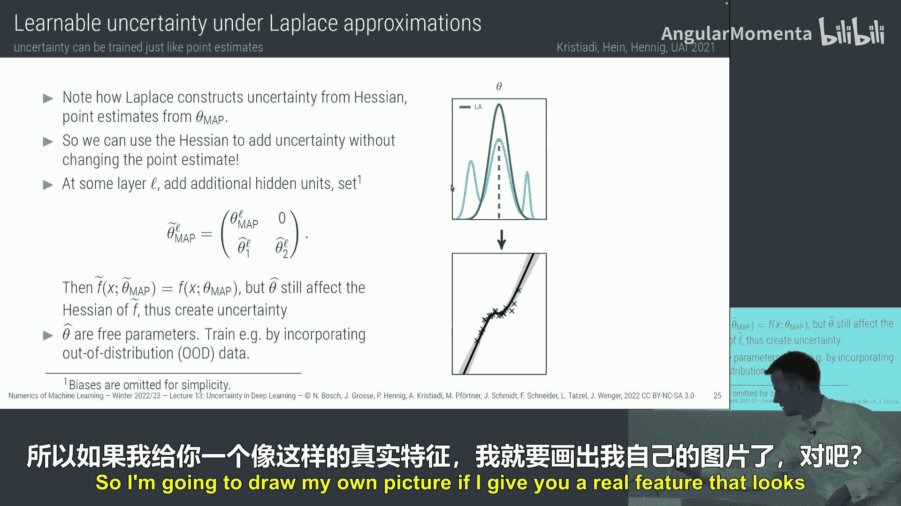

Yeah。If I give you a Vlu feature that looks like this， right， So this is the standard Vlu。

So this is just the feature， right so this is phi of x。Now， if I multiply this with a weight。

 now I have an output to the next layer， right。If I decide that this weight is0。

Then this function just looked like this， obviously， right， because 0 times 0 is 0。😊，Okay。

 so this won't add anything to my point prediction。

But if you think about the uncertainty associated with this feature。

Then the uncertainty is phi transpose times whatever the variance of this w is times phi。Of X。

So it looks like some kind of trumpet shape， right。Well， I mean。

 the variance looks like the square of this， but the standard deviation looks like this。

 The arrow bar looks like this。So what is this is its' uncertainty。Better I get to move around。

Because I can fix the parameters of this Vette。 I can shift this left and right。

 And in higher dimensional spaces， I can rotate it and move it and so on。

 And by changing the numbers in here， I can scale this up and down。😊。

But it won't change the point prediction of the network。

And of course' I don't necessarily just have to use a Vo feature， I could use something else as well。

 I could put a Gaus in there it would be localized， I could use a triangle shaped thing。

 something else， whatever features you like or1n H features which go to a constant and so on。😊。

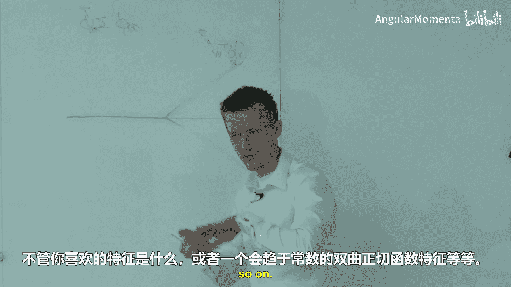

And so the the way that this gets sort of translated into code is this picture here。

 So you take a particular layer of the network。 Let's call it L。

And you expand the weight space of the layer kind of below。So that or above。

So that you have more units in that layer L。All of which get。A wait。

For which the output above is set to 0。 so they don't affect the prediction at all。

But because this means that we're introducing new parameters Theta hat into the the network。

 there will be new rows and columns in the hesian in the Lafaso observation。😊。

And those rows and columns contain numbers， even if you just track the diagonal that you can tune。

So the only thing left to think about is how we could tune them。

And that actually requires you to think a little bit about your data。 right。

 You basically need to write down a loss function that says where you want to be uncertain。

And one way to do this is what's called out of distribution training。

And if you've been through a talk by Matthia Hein and you've probably heard about it because it's one of the things that he's like a world expert on。

 So one simple way to do this for the example of image classification is。😊。

Let's say we've trained on， you know pictures of dogs and cows。

 then you take another data set out there from the net， some benchmarks， I don't know Inet。😊。

That you remove ideally， all the dogss and cows and leave everything else in and then say those data。

 those are just different。 They are pictures of something else。

 They still look like real world images。 You can also generate them in a different way， right。

 You could use a generative model or whatever or some other data set。

 Sometimes people even use noise， but noise is a bit dangerous。

 And you just say those are images that are not talks and cows。😊，So。

I'm not going to tell my network what they are。 I。 I introduce like 100000 other classes。

 I'm just going say this is a third class， which I don't know。

 So the simplest thing I could want for my network is just to be uncertain in those regions。

You can use that to define a loss function that just says those two classes that I'm trying to learn。

 they should be uncertain in that region。And then that extra is an extra term in your loss function。

 right， you have your on distribution training data that you train as before。

 which affects the weights of the trained part， of the point estimation part of the network。

And at an extra term in the loss function， that's the O， O D loss。

Out of distribution loss that just says these are the numbers where I want you to be uncertain。

 And then this thing will is going to shift around the terms in the hesian。For which you can。

 of course， computer gradient， right， such that you get uncertainty where you want to be uncertain。

And that， of course， can be within the training data。 You can kind of carve out bits of the。

Input regime where you just want to put a big blo of uncertainty， essentially。Right。

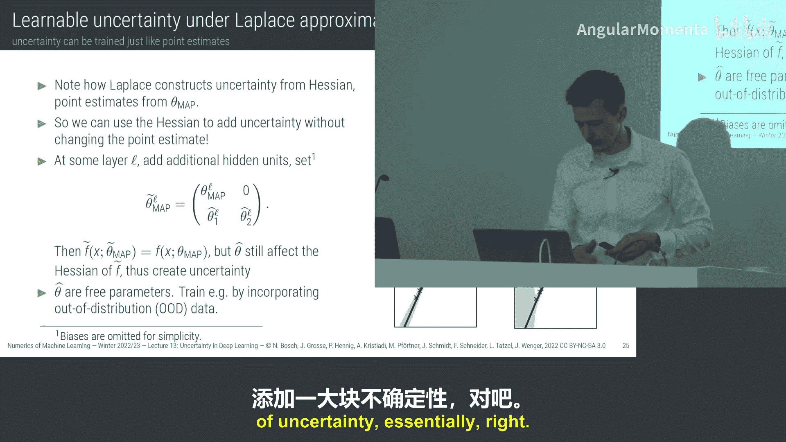

And I'll leave it at that。 So here's a final。S。That I'm gonna spend a few minutes on。

 you can also use it to give some feedback while we're waiting or while you're listening to me， so。😊。

First of all， the， the first main takeaway was that uncertainty actually matters in deep learning。

 It's not just some religious dogma that you want to be uncertain about everything because visionism is nice。

 but it not being uncertain about the parameters of a machine learning model in particular。

 deep neural network。😊，Its actually bad because it causes pathologies。

We looked at one particular one， which is that V low classification networks have this property that if you move far away from the training data。

 they predict one of the classes with arbitrarily high confidence。

And it turns out that there's a very simple fix for this， which is you linearize the network。

You put any Gaussian distribution on the last layer weight and you approximate the output of the softmax with this simple reing of the softmax。

😊，And。You heal kind of at least partly this problem of overconfidence。

So if you're already doing that， you might as well think about which weight to put。

 which Gausian distribution to put on the weights。And I've argued admittedly relatively weak。

 that one nice thing to do is to construct a curvature estimate of the loss function at the mode of the loss。

 a lapaa approximation。😊，Why is this a good idea。 Well， because you can do it with auto dif。

 So that's quite reliable。 So you can do it post hoc。

 So you can even do it to a trained neural network that someone else has trained for you as long as you have access to the training data and the loss function and obviously。

 the network。😊，And it won't change the point estimate。

 It's actually adding something that's completely orthogonal， if you like， to the point estimate。

 the hesian。And this is maybe nice because most people who train deep networks don't want someone to come in afterwards and say。

 oh， no， you done it all wrong。 I'm gonna retrain everything and gonna mess up your classifier。 No。

 you want to keep the classifier， but just add uncertainty to it。

 And that's what the passive approximations do for you。😊。

They can be particularly well combined with a linearization of the network in the weight space。

That linearization allows us to do closed form。Computations that can。

 maybe be best summarized in the sentence that they turn the deep neural network into a Gaussian process。

That's actually the title of the paper by M S Khan， who introduced this。

Larization turns neural networks into Gaussian processes。

And it can be done pretty much to any deep neural network if youre willing to compute the Jacobian and the hesian of the loss function。

For example， you can use this linearized Gaussian process approximation to do maximum evidence or evidence maximization。

 So to find parameters of the architecture。That you might want to use not just for uncertainty quantification。

 but also to fit the network。You can also use this。

Idea of Lafaa approximations to add functionality to the network that you might want。 For example。

 asymptotic calibrated confidence。😊，By measuring the distance to the training data and just adding a term that keeps growing as you move far away。

 And there is a。Admittedly， somewhat handcrafted argument for why this is a good thing to do。

 because you can think of it as infinitely many ways that keep getting edit as you move away from your data。

You can also train uncertainty within the input domain。By adding。

Units to your network that are deliberately set to have expected weight  zero， so mean weight  zero。

 but curvature around it。That can then be trained， for example。

 to give high uncertainty on data that is patently different from the training data。

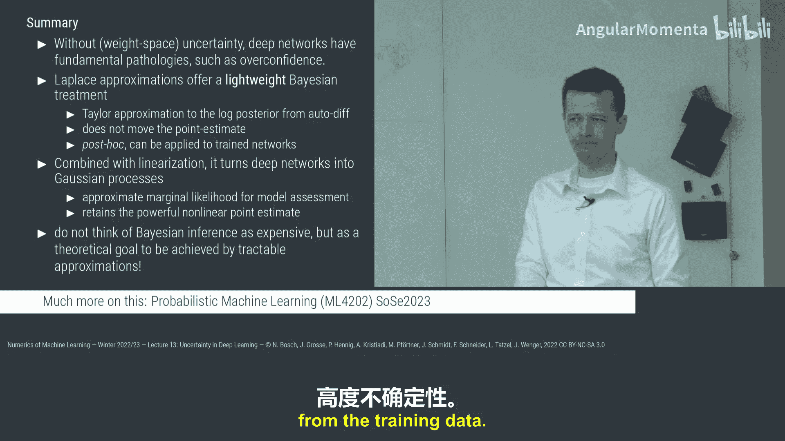

Maybe a meta takeaway from this is also something that was also a threat that ran through the entire lecture course so far。

 which is that we quite deliberately talk about probabilistic numerical algorithms or probabilistic training。

 and the lecture course next term that I'm going to teach is called probabilistic machine learning。

 not Bayesian numerics or Bayesian machine learning。😊，Because。Quite often。

 what we're looking for is actually just the fact that there is a probability measure to operate on。

And the strict， mathematically precise question of the full posterior。Is。

Kind of maybe a level too high。So if people have told you that being patient is expensive。

 they may be correct。But being probabilistic doesn't have to be expensive。

And being probabilistic can solve most of the problems， actually， like overconfidence。

Without having the entire cost of finding the perfect posterior and tracking it。😡，Which is。

Maybe not a thing you want to do anyway， because you never wrote down a prior you believed and to begin with doing full patientian inference。

 So actually tracking the exact shape of the posterior only makes sense if you actually believe in the model。

 if you believe in the prior and the likelihood。And in particular， in deep learning。

 nobody believes that the deep network defines a correct prior， right。

 It's just a convenient parameterization of a function。

So there's not really a need to be super cautious about the posterior。

 but there is a need to put a probability measure on the weight。

And that's what the first approximations allow you to do。If you like this kind of view。

 then there will be much more of it in the probabilistic machine learning class。

 I realized that almost none of you are going to be in probabilistic machine learning next term。

 which is maybe good， so I got to do it today and you' got like the fast insight into it in a single lecture for those of you who still want to take this class。

 there'll be a significant number of lectures in the probabilistic machine learning class where we very carefully take this step from Gaussian processes towards deep learning and this kind of functionality。

😊。

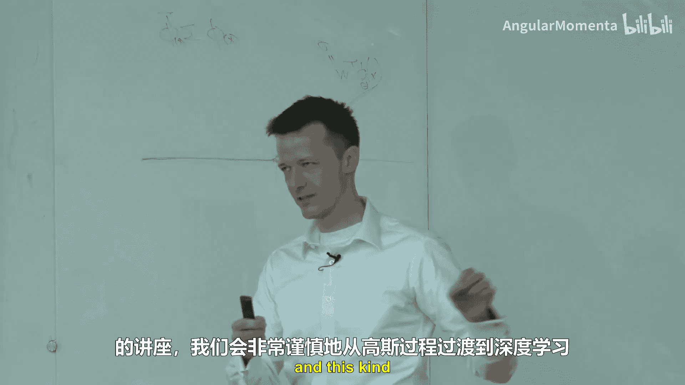

Okay， thank you very much。

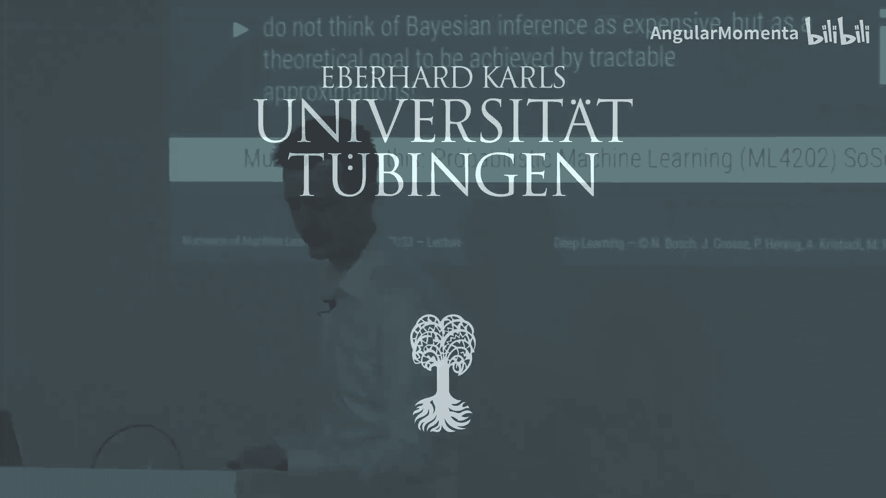