# 【精译】蒂宾根大学《机器学习中的数值方法》-p14-14----结论----菲利普·亨尼格--BV1WMYHzAEcL_p14-

。

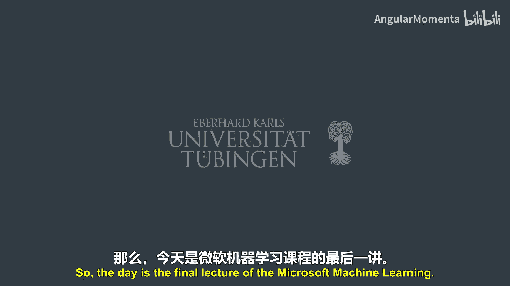

🎼So there is the。Final lecture。Of the merit of machine learning， not everyone is here。

 which is not a problem because I'm not going to do anything new。

 I'll just rehash the content of the lecture。 I'm guessing you're here because you want to prepare for the exam on Monday。

 of course， you want to hear what's up in the exam。 We'll talk about that at the end。😊。

What I'll do is I'll very quickly rush through pretty much the entire course。😊。

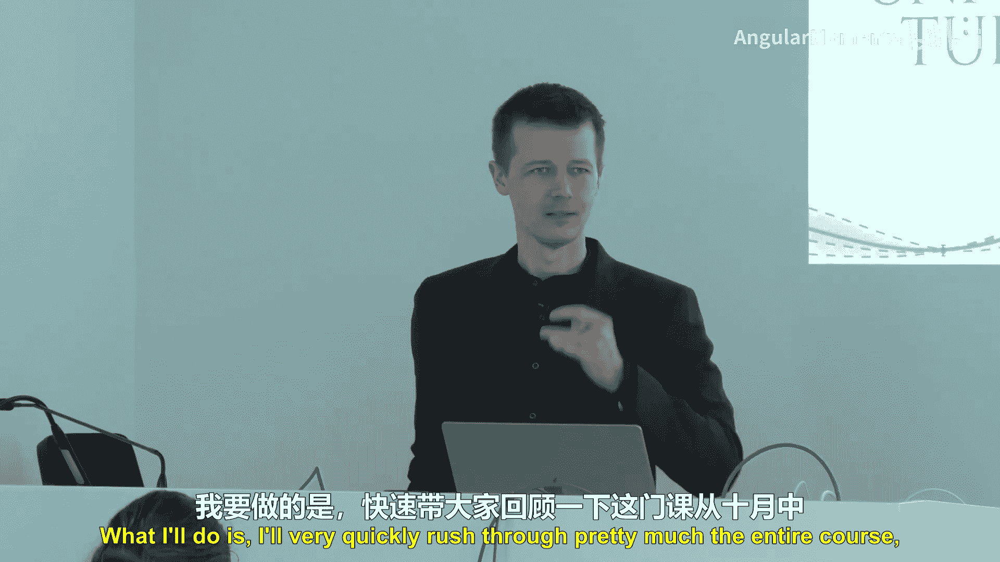

From mid October until now， not every single lecture。

 but I have slides from pretty much all of the lectures。 conveniently。

 I have few of the lecturers in front of me as well。 if there are really tough questions。

 I can hand them over to you。 And I want to use this as。An opportunity。 So， of course。

So you may wonder whether what I show you is better than for the exam。

 Everything is relevant for the exam， but I didn't make the slides with the exam in mind。 In fact。

 I make the slides before the exam， so。😊，嗯。What I want to do is use this opportunity to take a step back and think about what we've actually done in this term。

 because。😊，I think that's sometimes really useful， especially for a lecture like this。

 which was so heterogeneous with so many different lecturers。

 So maybe it's useful for you as well to hear what I think about what you've actually learned。

 Let's see。😊，So high level， we started out lecture number one。

 maybe with me pointing out that why do we even need a lecture on numerical methods in machine learning。

 Because machine learning actually is numerically computation。😊。

The stuff that happens inside of the machine when it learns is the solution of a numerical problem。

And that's in contrast to what you might call classic AI。

 which are the algorithms you learned about in algorithms and data structures。In machine learning。

 we have to solve。Mathematical problems that do not have a closed form solution。

And they are pretty much all of the problems that classic numerical analysis studies， they are。

Not in the order of the lecture， but nevertheless。Integration for。

 let's call that Bayesian inference。 So whenever you want to measure how much volume is left in a space of hypotheses to Bayesian inference。

 you need to solve an integration problem。Optimization。

 if you want to train a deep neural network or any other model that constructs a point estimate by minimizing some regularized empirical risk。

 you need to solve an optimization problem。Different equations， if you have an actually。

 differential equations show up in very interesting places。 On the one hand。

 whenever you have an agent that interacts with this data source and needs to decide what to do next。

 you might call that reinforcement learning。 But it also shows up in situations like robotics。

 Then you need to need to predict what will happen next。

 right you need an internal model of the world as simple as it might be and predict what is going to happen next so that you can decide what you want to do next。

 That's a simulation problem。 But， of course， they are also applications in science where laws of nature are represented by differential equations that those were actually the examples we mostly spoke about。

 And then you need to solve those and use them as another source of information about what you actually know and how much you can learn from data。

😊，And then there's linear algebra because linear algebra is just everywhere。 in particular。

 also in all of the above， solving Gaussian integrals is a linear algebra problem。

Solving quadratic optimization problems is a linear algebra problem。

 and solving linear differential equations is a linear algebra problem。So therefore。

 we went through all of these problems， not in this order， but we started with linear algebra。

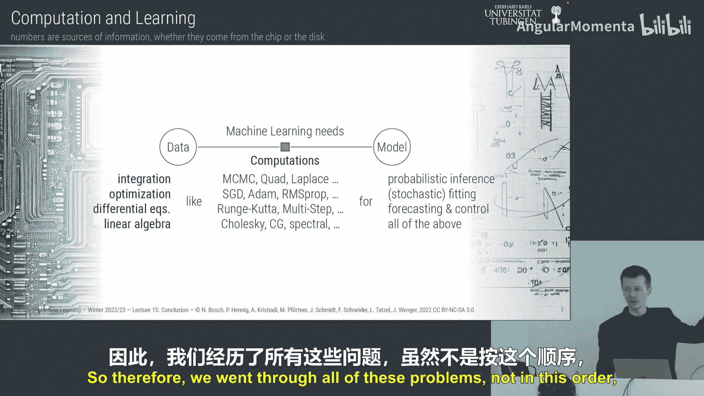

And here for me， the high level takeaway is， if I've tried to write it into like two sentences。

 pretty much。Maybe not something you saw initially in the lecture， but it sort of transpired。

 which is that。When you do linear algebra。This doing the verb in this sentence is something that happens on your processing unit。

 C or GPU。And it doesn't happen on the disk， but your data is on the disk。

So when you think about how complex it is to do linear algebra on something that involves a data set。

 you actually have to think about what you have read from disk and processed on the chip。

Rather than how much data you actually have on the disk。😡，And this。

 this may not be entirely obvious initially， but this is relevant why。

 because reading through the data once。Costs linear much in the size of the data。

And picking bits of the data out， of course， cost less than linear time。

So all the stuff that's expensive in linear algebra has nothing to do with reading data。

 It has to do with what you do with the numbers you read from disk on your chip。

And that's relevant because we don't actually always have to load the entire data set。

So the relevant setting for this， the base case in machine learning is Gausian process regression。

 which did sort of double duty in this lecture， in this course。😊。

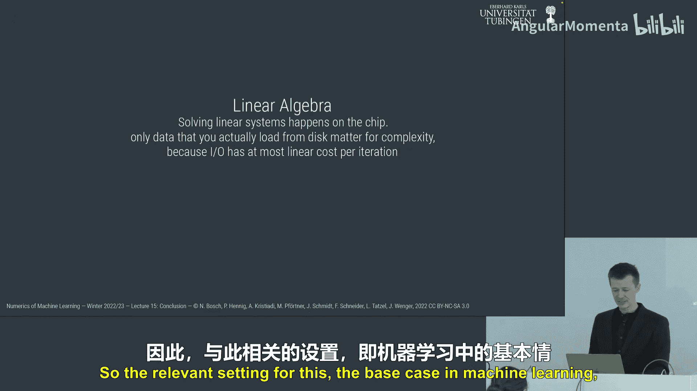

First of all， as a template basis machine learning algorithm。

 one of the simplest possible supervised machine learning algorithms。

 and also as the model class from which we constructed numerical algorithms for the entire rest of the course。

😊，Here is the slide again from lecture number 2， which was held by Marvin and prepared by Unnaan。

 Here are the equations you then get got to see over and over and over again。

 The entire relevant thing is that to learn this predictive distribution， which is a distribution。

 It has a mean and a covariance， two things， a mean and a covariance to construct these two objects。

 we need to solve this。😊，Linear system of equations in here。 So this expression that involves。

 which we write typically as an inverse of a matrix times a vector。

And maybe one of the first things we realized is that this notation hides a lot of interesting structure。

 It's this sort of nice math mathematician's way of writing down。 or this is the thing we need。

 But without telling you actually how you compute it。😊，And maybe this is really important。

In the context of other machine learning algorithms like deep learning， because。I。

 I think historically， there's been an interesting sort of situation that because it's possible to write an equation like this。

 everyone thinks that's what that， that that's what you need to do to do Gausian process regression。

 And therefore， Gaussian process regression is expensive and interactable because， well。

 the textbook says solving such problems is cubly expensive in the size of the matrix of this quadratic matrix。

😊，While for deep learning， we can't write down such an equation。

 You can just say we want whatever weight to minimize the empirical risk。 And therefore。

 people don't even start to think about how complex it is to train a deep neural network。

 We got to that towards the end of the lecture course。

We also noticed that this problem sort of shows up twice。Here and there。

 And there is the same matrix being inverted every time。

 But it's multiplied with a different vector every time。So in this lecture number 2。

 and then the following lecture number 3， Mavin Jonnatan told you that there are many different algorithms for solving such linear systems of equations。

 There is the classic algorithm that you all learned about in probabilistic machine learning called the Chalesky decomposition。

 which is usually presented as a box that just runs and that it ends that it's done。😊，But actually。

 you can think of this algorithm， as we learned， as an it procedure。

 something that takes a big matrix and then starts operating on the rows and columns of this matrix。

😊，Loading them one by one， and constructing。Numbers from them in steps that are linearly expensive。

So each individual step is of complexity， one length of one of these columns， at least initially。

And then there's a correction step， which is quadratic in the number of steps you've already done。

 So it's sort of linear trans quadratic。 And then because you run it until the end。

 that's actually cubic because in the end， the number of steps you've done is also n。

 And then you just have en cubed。And what's interesting is that that was of the big reveal of this slide was that you can think of this algorithm。

 not just as constructing a matrix at the end， but you could actually。

 at every single step of the procedure， stop。😊，And return an estimate for the inverse of the matrix that were trying to construct。

And that's this matrix C， which shows up here。And that's actually also cost some。

 We already saw some discussion of this on the， on on the forum。after this lecture， clearly。

 which was a very good sign。 It seems like nobody was surprised by this anymore。 I was like， okay。

 it's constructing an in， right， But that's not actually how you see Cleski usually presented， right。

😊，So this was already new from this lecture。And why is this interesting， Well， at first。

 you might imagine that that means I can just。Stop the algorithm first that first。

 But stop the algorithm early at some point and just use this approximation。 Then， of course。

 you have to worry whether this approximation is actually good。 So in that lecture， you see。

 I'm doing a little bit of PowerPoin in karaoke， we saw that if you。

 if you actually move through the data in some order。 and the data is actually ordered。

 then that means you're going to get a good approximation at some area and a bad approximation of some other areas。

 because you haven't read this data yet， you can also go through the data and some random order。

 And then you may actually end up with a somewhat pretty decent approximation of the posteror distribution of the Gausian process。

 And one way to think about this is that it's essentially like。😊。

Forgetting that there's this other data， other rest of the data around。

 which just keep loading bits of the data from disk and just don't care about the other ones。And。

 clearly。That is going to be linearly expensive。In the number of data on the disk at most。

 you might even be able to do it cheaper。And quadratically， on top。

 like times a quadratic term in the number of things we've already looked at to keep track of how they interact with each other。

That's maybe a bit boring because why would you leave all your data on disk。

Maybe you want to do something a little bit smarter than that。

 But it's interesting that that's actually possible。 So we。

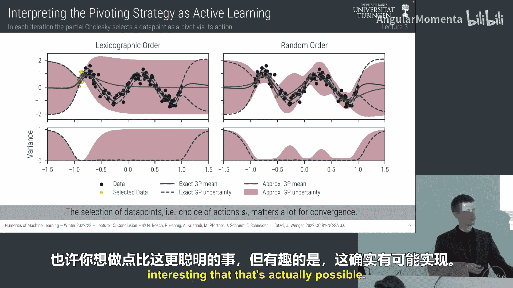

Yeah， did that。And then there's maybe a real insight that I put on onto a black slide so that we can talk about it。

Because it sparked some discussions on the forum。Which is that， and Ive， I wonder whether I can make。

 actually make this clear because it's a bit， it's a bit deeper than it sounds at first。

 So when you go through your probabilistic machine learning class。

 you learn that to solve this equation here， this thing。😊。

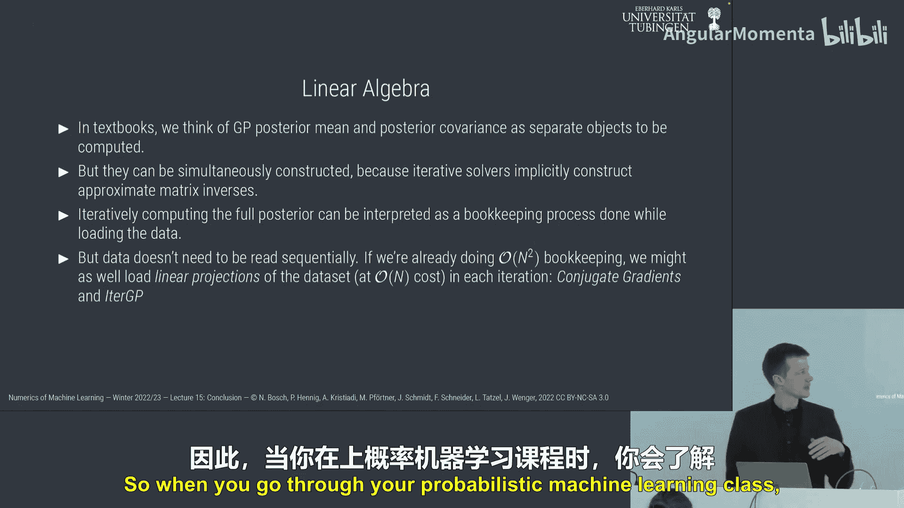

You need to solve these two problems。 right， There' is this， and there is this。

And those are two different。Objects， right，1 is calledos mean1 is calledos covariance。Now， if you。

 then you then you learn， oh， if you have the cholesky decomposition of this matrix in the middle。

 this black thing， then you can actually solve both of these efficiently because the Choleski tells you how sort of how to efficiently solve such linear problems。

So in a sense， you only need to do one thing。 You only need to。Computer Csky decomposition。

 then you're done。And then at some data point， which you might not even get to in a probabilistic machine learning class。

 someone else might come in and say， muchles is expensive。

 You can't do this with like a big data set。 So instead， if you have a large data set。

 you're going to use an it linear solver。😊，Like conjugate gradients。

 which we then discussed in lecture number 3。But quantumju gradient is actually not a matrixisticcomposition。

 at least not the way it's presented in a textbook。

 It's an optimization method that solves catdratic problems。😊，These square problems like these。

So if you use such a method， it may seem like。There are two different optimization problems here。

 right， There is an A times x1 is B1， And then there is an A times x 2 is B 2。So you to run。

This algorithm twice， right， to solve two different。Linear systems of equations。 In fact。

 if you have many points where you evaluate this， you might have to run it a lot because this might be many。

 many different points where you want to run this on， right。But， actually。

So the conju gradient is just like Joesky。 It's a method that estimates the inverse of the matrix just as much as it estimates the solution to this particular linear system of equations。

😊，It's just that the properties of Cleski are particularly nice。

 If you talk about the solution of the one linear problem it's actually trying to solve。😊。

So that means we could actually use conjugate gradient。To do both of these things at once。

 we just ran it on one of the problems。 now E， at least， and。

Use the numbers it constructs to directly also estimate an inverse which we can use to solve。

 to estimate the posterior uncertainty。And when we do that。

 then there's actually an additional structure that is really interesting to， sort of think about。

 which is that this algorithm then。😊，嗯。That sort of two things at the same time。

 It learns from the data。And that gives you a finite uncertainty at the end of what the true function is。

And it also learns what the inverse of the matrix is on this finite set of data。

 And those two together， if you stop at an early point， tell you how。😊。

You uncertain you should actually be about the entire problem because the errors on your estimate of。

 I don't have to I shouldn't go too deep。Actually， it is choeski。 sorry。 So the errors on the。we go。

 we here the error on the， on the function that you're trying to estimate at the end。 that's this。

The dashed line here， right， So this error between the solid black line and the dash line。

 they come from two different sources of uncertainty。 One is that theres only a finite data set。

Which doesn't tell us what the two function is。 And the other one is that there's only a finite number of computations less than the entire data set。

 maybe， which。Don't tell us yet what the full solution would be on the full dataset。

And funnynily enough that those can both be tracked at the same time。

 using an algorithm that looks pretty much like Cleski， like a generalization of Cleski。

 It still keeps track of of an inverse of the matrix。

 But it is a bit more general in how it assumes the observations。

 the projections of the matrix to be constructed。 they come from some policy in here。

 And if that policy is that theif1， which just one after the other loads the data in at as locations in input space。

 then you get something like Cleski。 And if you use a smart policy。😊。

Then you might actually converge much faster。There's a price to be paid， though。

 for that smart policy。 If you want an algorithm that very quickly figures out how it could be good on all of the data。

It needs to take into account when it plans which directions it's going to walk into all the。

 all the data。And that means that each iteration of this method will be quadraly expensive in the dataset size。

Rather than linearly expensive fortuleski。This doesn't matter in the limit。

 because once you've solved the entire problem， everything is is still enced， right， because。

K iterations of cost n square。For。For K equal to n is n cubed。And。

N iterations of cost n times K square are also end。No， sorry。 K innovations of cost n times k square。

 So here we go。Are asymptically also intense k cubed。

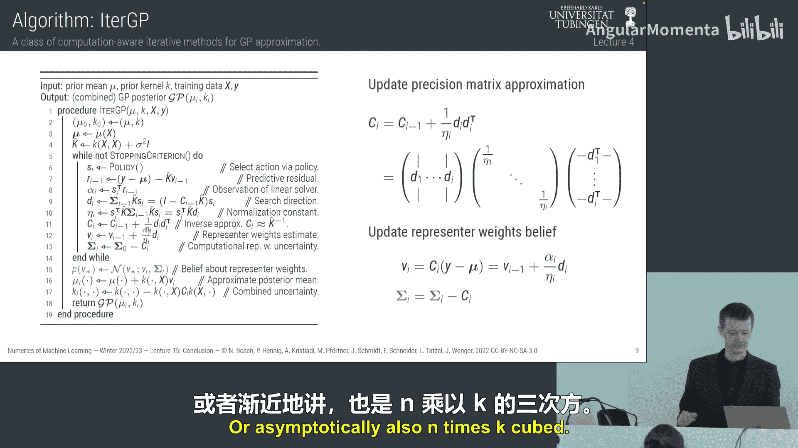

So the high level take away from the linear algebra orbit bit。Quically you said something about。

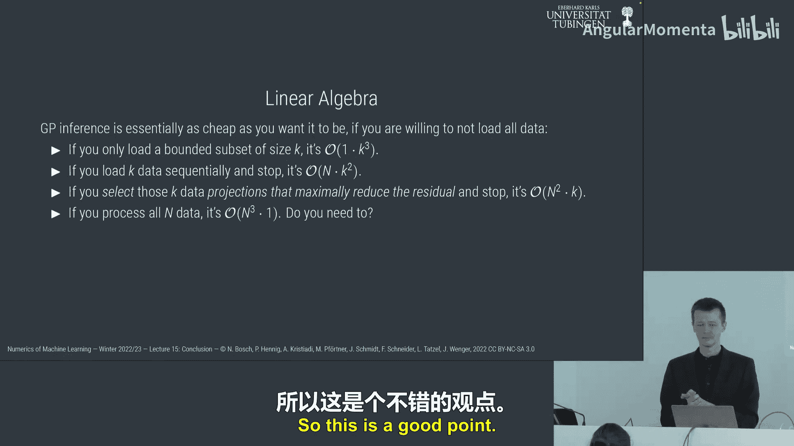

track both uncertainties。But the way I understood this is that you only know the sum of the uncertainty。

So you're tracking both you go through the entire data set you can in retrospect。

 see how much computation。So this is a good point。I said you can track both uncertainties。

 We can't track them individually。We can't track one and then the other one， but we can track both。

 We can track the sum of them， which is the sum of this screen in the blue region。

And if you want to know which of them is which。Then you need to do a computation that's cubically expensive again。

But arguably， this is what you want， right， There's a data set on your disk。

 You haven't looked at the whole thing yet。 How uncertain are you。 That's the answer to it。

If you want to know， well， once I've looked at the whole thing， how uncertain will I be， Yeah。

 then you have to do a complicated computation。 of course。

 because you'll have to look at the entire data set and figure out what it's going to be， right。

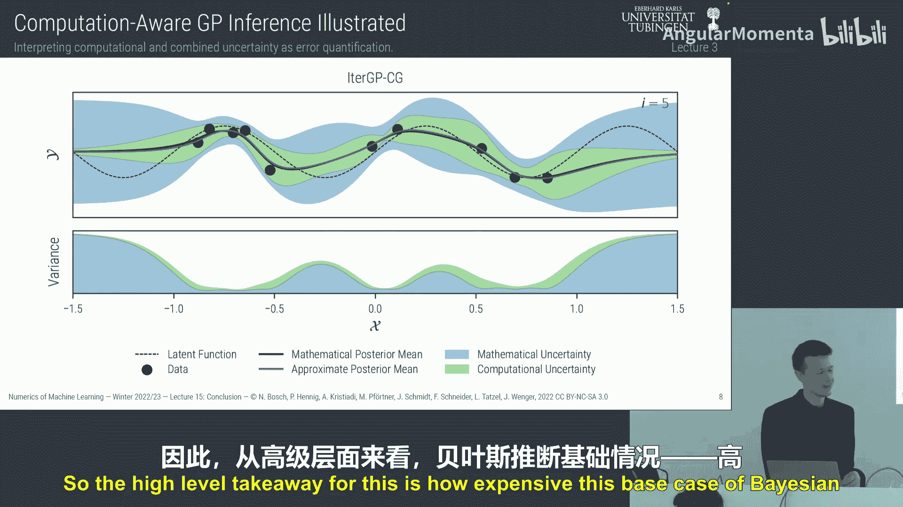

So the high level takeaway for this is。How expensive these this base case of patient inference。

 Gaus process regression actually is。Is much more subtle than what you might have learned in in a textbook lecture。

So instead of saying solving linear problems is crbly expensive， that's a worst case statement。

We actually have found some very subtle gradations。😊，Which call something like those four points so。

If you decide。To never look at the entire data set。Then， of course， trivially。

You're not gonna have to pay for this， right， You only load。

 if you have a data loader that only take only loads K data points。

Then you can do whatever you want with them afterwards and。Computing。

 the estimate is going to be O of K cubed。And if you use that data to construct your posterior uncertainty。

 as long with your posterior mean， everything's fine， right。

 the only thing you've done is you haven't looked at the whole data yet。Now， if you decide。To。

Load the entire data set。But only do K iterations on it， You can construct an algorithm like Cleski。

Which gives an estimate， of cost linear in the data set， and quiteraly the number of iterations。

With an associated， meaningful uncertainty that keeps track of how much of the information about the data you've loaded so far。

 It's a bit more than if you've loaded only K data points cause it kind of knows where the other data data points are。

 but it hasn't kept track of how they interact with each other yet。

If you want an algorithm that is very efficient at loading the right kind of data from disk so that it converges very fast。

 then each iteration is going to be more expensive because in every one of these n steps you will have to look at all of the other end data points to decide which of them you want to load and how much of them you want to load。

 that's going to be an algorithm that will be quadratly expensive in each iteration，4K iterations。

And then finally， of course， you can also do Cleski。 You don't care about it。

 You just say load the whole thing， do whatever you need to do。 Tell me what the right answer is。😊。

And then you're going to pay cubic in the number of data points。 And afterwards。

 you'll still be finitely uncertain because you only have a finite data set。

So why make this strong decision to always look at the entire dataset。

If you're going to be finitely uncertain afterwards， anyway。

 the size of your dataset set often is completely independent of the problem you're trying to solve。

Well， not not completely， but it's not directly related either。

 It's not like some magic oracle tells you exactly the 863 data points that you need to solve the task at hand。

 But it just says here are my 10000 points。 Go ahead， right。😊。

So when you're operating on a data of some nontrivi size。

 it makes sense to think about how you operate on that data， how you load and which order。

 how much time and compute you invest into each individual iteration。

Which gets us to the next setting where we， in some sense。

 operate on an infinite dimensional data set。😊，One。

 where we get to decide how often we want to evaluate and then be careful about。

What we do with that information。That simulation where we initially spoke for three lectures about。

 in particular。Systems that evolve through time， where we focus on the time domain and those are。

 although that's a little bit cutting it a bit too short。

 often associated with ordinary differential equations。

 So maybe a simple way to phrase it is ordinary differential equations are differential equations。

 where only the time dimension is explicitly written down in the equation。😊。

So for such systems that evolve through time。요나단쥬미。First came in election number 5， and told us。

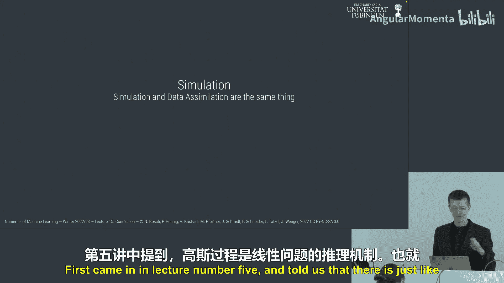

That there is。Just like Gausian processes are the inference mechanism for linear problems。

 So problems where the data relates to the unknown function in a linear fashion。😊，For time series。

 there is also an algorithm for linear time dependent or time invariant problems。

 That means where every date the the the that the evolution of the state through time is a linear function of previous values of the evolution and observations are only linear transformations of that state space。

 and observations have Gausian noise。 So that's a special case of Gausher process inference。

 and this algorithm is called Kman filtering and smoothing。😊，It's actually。

 if you like two algorithms。 but in a way， it's also just one algorithm。

 which implements message passing on a chain graph like this， forward and backward。

And this kind of algorithm， do I have a slide for it， Yes， is very easy to write down。

 And in particular， it's also linearly expensive。In the number of time steps。

So if you're observing a system that evolves according to this linear Gaussian relationship。

By the way， there's a limit case of this called a linear stochastic differential equation。

 But that's sort of。What this is leading to， right， If you have a system that evolves。

 according to this。Linear Gaussian relationship。 Then there is an algorithm that can incorporate linear Gaussian observations of that system in linear time in the number of observations。

It's not linear in the number of elements in the state space。

So the number of things you're tracking through time。In that， it's actually well。

 at most cubic because it involves this inverse of a matrix here。

 So everything we just heard about inverses of matrixes in the linear algebra would also apply here。

 So you can sort of combine everything you've learned about linear algebra in here。

 You can open up a box and say， there's an in image of a matrix written down here。

 Now let we open up a toolbox for linear algebra and apply all of this stuff over here。😊。

This is maybe an interesting aside， right， So this happens in numerical。Computation all the time。

 We are building one solution for a harder problem from simpler solutions to simpler problems。

By nesting these types of algorithms with each other。

 And so if you know about a low level of this computational hierarchy。

 that's useful because you can use it to speed up things higher up to hierarchy。😊，Okay。

 so that's the filter。 That's the forward pass。 So， what this algorithm does is just intuitively。

 it starts at the left end of this chain。😊，Here， with an initial belief over what this thing is and then works its way forward through time towards the end。

 And whenever it encounters one of these data points， it can。Include them。

 And if it doesn't encounter them， actually， you don't even have to do the step， but you can。

 And then you get an explicit representation of what this latent state looks like with a probabilistic uncertainty。

 And then once it reaches the end， we switch from this algorithm to this algorithm。

 which is called the smoother， which is a bookkeeping algorithm。😊，That， in a sense。

 informs all the earlier。Variables in the chain about the observations that it has made in the。

 in the future。So this， that's why this code looks simpler for the smoother because there's no new data to account for the data has already been added。

 Now， we just have to do the bookkeeping to make sure everything is consistent with each other。And。

Okay， there's this fast algorithm。 And then your not actually ended。😊。

By pointing out that you can apply this class of algorithms also to settings where the observations。

Are not。A linear Gaussian transformation of the state space， and。The step from one。

State in time to the state at the next point in time is not a linear Gaussian function。

 but a non nonlinear function。And in particular， that algorithm。

 which is called the extended car Kman filter， is it's sort of the。

 the pedestrian nature kind of thing。 It's like it's not quite a kman filter because things are not linear。

 Well， then let's just make them linear。 So you do tailor approximations wherever you need to do them。

 You just。Pretend that the， the functions you care about are linear by taking the nonlinear function and computing its value and its gradient。

 or its Jacobian in this sense。And then just treating it like a linear function。Everywhere。

 so both for the dynamics， that's this F function and for the observations。 That's this H function。

So this is actually an algorithm that has been around for a very long time。 It's been studied in。

Control engineering， systems engineering， signal processing。

 whatever the words are for this as very fast algorithms， The original rocket science， maybe。

But what we did with it in the next lecture， lecture number。7， I guess。

 by Naanaier was to observe that we could use this。To include information about。

Non nonlinear relationships between the states in。The state space。In particular。

If we take a state space that consists of values of a function。And they are derivatives。First。

 derivative， second derivative， third derivative。 Then we can use this mechanism to include information about nonlinear functions that relate derivatives to each other。

 And those are called differential equations。😊。

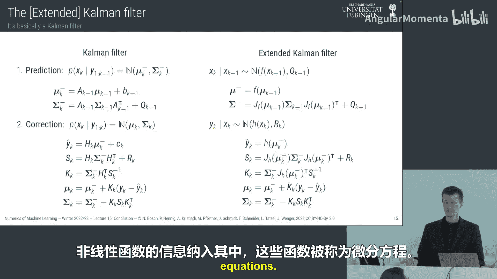

And that's it actually。 So it turns out there is an algorithm that looks like a filter。😊。

And works like a filter。And performs like a filter that solves differential equations。

And what I've now done is I've weve written down this like this is actually a slide from。

 from Nana is lecture number 7。 And you may have noticed that I didn't mention lecture number 6 because lecture number 6 was this interlude where Naya told you how classic OD E solve was work。

😊，And these methods are these beautiful pieces of a arcane code that was written in the 80s that performs extremely well and is very robust。

 And it's a totally close box that no one can touch anymore because it contains these magic numbers。

😊，Bcher tableaus that define gains from individual evaluations made at particular point that no one is allowed to change because then the proofs don't work anymore。

And in fact， so Nataya only mentioned this in passing for these classic methods。

 these proofs V are super complicated。 So for thesega Huta methods in particular。

 which are like the most cherished form of OD E solvers around。😊，There are even。

Pure math studies on the structure of this algorithmic landscape and why certain kind of solutions exist and why there are sometimes gaps in convergence order and so on。

 So they are really rigid。 Its really nothing you could change。

 While this framework here is super flexible。 It's a very kind of computer science way of addressing simulation。

😊，It's just a k filter。 so we can decide where we want to evaluate， what we want to evaluate。

 We can linearize everything。 We can use the tools of modern。😊，Differentiable programming。

 I'm not even going to say machine machine learning。 So if you have access to gradients。

 we can use them， and we can construct。诶。Algothm that is set up。In the following way。

We first write down a particular linear。Gausian system。

So a markov chain of states that says the states evolve， according to some simple。

 linear stochastic differential equation that can be solved in closed form with came filtering and smoothing。

And then。We just include knowledge about a differential equation by saying at various points in time。

 I observe that some algebraic relationship between the states holds。So in particular， if I say the。

 the difference between the first derivative of x at time T and some function evaluated at the0 derivative of x at time T is 0。

Then that's encoding an ordinary differential equation。Right。But I could actually include。

Any algebraic implicit equation here， right， I could just write deelta of G of x。All effects。

Just G of x is 0。Whatever G is， as long as G is sufficiently regular， differentiable and so on。

 I could put anything in。So not just ordinary differential equations。But also。Algebraic equations。Or。

Continuous sort of symmetries， right， we could say if you move along some direction in Xspace。

 things do not change。This can be used to include continuous group symmetries， Hamiltonians。

 this kind of stuff。Or。Partial differential equations， which I'm going to flash。

Add you in two slides。But。We can also include all sorts of other information。 We could， for example。

 include the fact that we have observed the system at various points in time。

 So if I tell you that there is a dynamical system that follows some laws of nature。Given by an。

 an ordinary differential equation and some Hamiltonian that is conserved。

 some league group symmetries that hold across time。 And also。

 I've measured that system at various points in time。 So I know what kind of path it took。

 Or maybe I know something about where it started and where it ended or whatever， right。

 Then I can include all of this in the same algorithmic language。😊。

And that's kind of neat because it means I don't have to know about this very complicated toolbox with all these different algorithms。

 W Kuta and geometric integrator and what they are all called。

 And I just need to know which one to call in which setting。 But no。

 I can just use a caramel filter and be done。😊，And in particular。

 if there are some parts of the state space， if there's something in X。

Which doesn't actually show up in this equation。Because this equation kind of doesn't use it。

Then I can use the other types of observations to inform myself or the system。

 the algorithm about what those values might be。And we saw an example of this in this Covid setup。

 right if there is some latent force in your dynamical system。Like contact rates that you don't know。

Then observing the trajectory of the system alongside with a differential equation。

 can tell you what a latent force was。It doesn't have to， of course。

 depends on what the differential equation actually is and how the latent force interacts with the trajectory we got to observe。

 There might be subspaces that aren't identified by those observations， but。

Up to non nonlinear corrections， the filter is actually gonna take care of this。

 It'll just notice that the Jacobcoian has degrees of freedom that aren't identified by the observations。

 And you're just uncertain about them。 So that's the value of uncertainty in computation。

 that it's maybe okay to do things。😊，That don't have a full solution。

As long as you know that you haven't found a full solution。Yeah， that is the。Actually。

 already everything I wanted to say Yes。 I and of。😊，Hahaha。😊，I don't know。I actually don't know。

I haven't even looked at the， at the， at the corresponding question in the exam。 So I don't know。

 Maybe， maybe not。 I really don't know。It's good that I didn't look at it before。

 I really don't know。This is a perfect poker face from Natanana at the moment， he goes goes。😊，Good。

But I， what I， what I would say is， of course， that。Notwithstanding the exam。It's。

 I'm not saying nobody should know about Uuta methods anymore。But I do think that they are。

It's maybe entering a point in， in sort of time where you don't。

 you don't need to know everything about all these simulation methods anymore。 It's also a bit weird。

 But if you， if you， if you use these simulation packages where whichever stack you're working in。

 you have the choice between 20 different simulation algorithms， by now。

And they are typically all motivated by being able to do one thing particularly well。Like。

Keeping some Hamiltonian constant。Or working well on a particular class of differential equations that are stiff in some sense。

 or being scaling particularly well to some settings。

And not all of this is actually as relevant anymore。

 If you're thinking of a simulation method as essentially a filter， then you're allowed to do， you。

 youre able to do many things that for which you would。

 you need to use a specialist method otherwise。😊，And combine them with each other。 And， in fact。

With a few caveats， you are actually also able to do things that don't have a full solution that are not fully identified by the information available。

😊，Of course， that doesn't always work。 And there's sometimes a bit dangerous to do that because we are still working in a linearized Gausian regime。

 and there might well be disturbances and issues in your dynamical system that aren't captured by this linearization。

Sure， and then that's potentially a problem。What's maybe also a takeaway at this point is that here。

 we really very explicitly think about information as the central object in computation。

So what these methods do is they manage information。 We also call these terms。

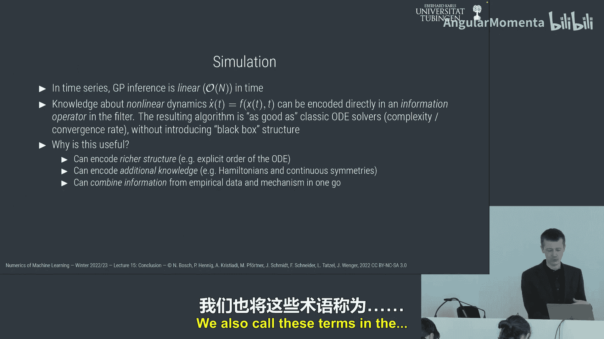

In the。We also call these tops。 sorry， this， where to go this thing。

 We call these information operators right， is this the term in the algorithm that updates your knowledge about what a dynamical system does。

 It's called an information operator， because there isn't really a difference between information that comes from the disk or from a sensor that is attached to the computer and information that comes from the programmer who is written it down as an algebraic equation that goes into the mechanism。

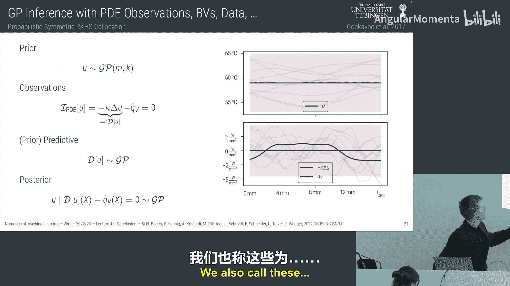

Or maybe some other fobs of information。 So the classic kind of idea of a prior， right。

 Maybe you have a scientist who just tells you well that the solution should be something like this。

 right？ Then you can encode that in a language of information operators。😊。

That would otherwise be very difficult to write down in math。

So whether the information comes from the chip。Or from the disk doesn't really matter。

 It's just a number。And the number doesn't have a stamp attached to it that says I was collected from like this particular source。

 It's just， this is how much information I have about your system。

 And that's encoded into information operator。It's also， by the way， I found a nice aspect that。

The information operator acts as this kind of interface between the user and the designer of the algorithm。

So if you just want to use and one of these filtering simulation methods and you want to include information。

 The only thing you have to provide are these objects is encapsulated bits called information operators。

You don't have to write down the filter and the smoother。 Actually。

 that can be done by someone who designs the algorithm。

And then we got a maybe very painful lecture to point out that you can also use this to solve partial differential equations。

😊。

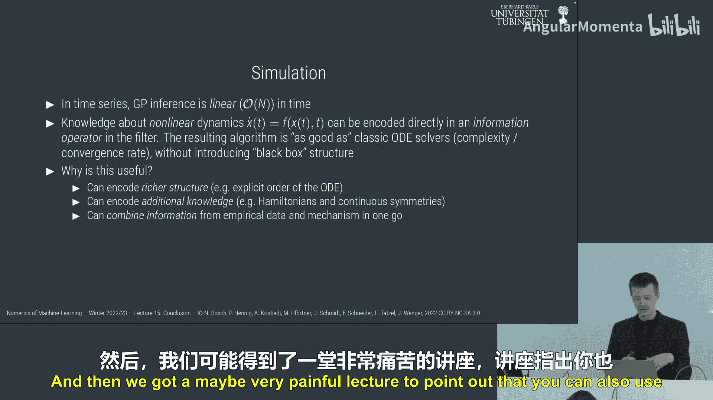

And。I'm not going to redo everything that Mavin did。 but instead。

 I'm going to tell the high level story again。 So solving。

Partial differential equations is essentially the same thing。 We have a differential。

 We have an equation that says， well， we typically write differential equation。

 partial differential equations in a form。 I think Marvin did this as well。 Is it somewhere on here。

That looks something like T。Of V of X and T。Is。Maybe even with brackets around this is some function of V of x and T。

Right， where D is a differential operator， which contains lots and lots of parel derivatives。

V is the solution we care for。 It's a function， and it depends on space and time because now we're thinking of spatial。

 temporal systems。So。A weather forecast looks like this。Right。

 they are all these forces hidden in here， things that we know。

 like you know tensities of air and velocities of the of at， at an initial point and so on。

 And we just know that that they somehow relate to each other。But really， what this is。

 is it's just another one of these。Equations that go like this。

It's just now that instead of a state space X that goes through time， we have this function F。

 which depends on time and space。And so we have to be a bit more careful with how we do the computation。

😊，And a filter does not like immediately solve all of our problems anymore。Because we might have。

 so one simple thing to do is to put a grid in space and then solve it on a filter across time。

 But if that grid has many points， then this big inverse in the Carel filter still shows up and it still matters and it still makes everything slow。

😊，And what Marvin pointed out was that in a particular case where this here is a linear operator。

 So where we just have a linear partial differential equation。😊。

Then this can be solved as an instance of Gausian process regression。Where we， in particular。

 if this is also linear， sorry， If it's a very simple， simplest form。

 but this is where both of them are linear， Then we just observe a linear projection of。

V across various different operators， and then。Things are fine。 It's just Gaus process inference。

 except for the fact that you may be really worried because this is a statement about functions。😊。

And functions are somehow not the same as vectors， right。

 So they are potentially dangerous because function spaces are very nasty， potentially。

 and not everything you've learned in linear algebra applies and function spaces。

 So you've sort of learned to be very about this。 And that's why Marvin had this very complicated slide。

😊，That essentially， had contained the license。The the。

The model card that says you are allowed to think about functions in this setting as if there were really long vectors with infinitely many entries with some caveats。

 which come with a complicated theorem that Marvin had on his slides。😊，But beyond that。

 you can think of such differential equations as just doing Gaussian process inference with a really interesting observation model。

😊，And what do you do if those are not linear well。There isn't really the full answer for it yet。

 It's also not on this slide， but you can probably imagine that it's going to be a little bit like in the O D E case。

 just linearize everything。😊，As much as you want。And then you can do the same thing。

We did for ordinary differential equations。 You can write down a generative model for functions。

 a Gaustion process at the top， and then inform it about various sources of information。😊。

In particular， sorry， you can inform it about the fact that there is some partial differential equation that holds。

That relates the values of this function to each other in a nonlinear or linear sorry in a linear fashion。

 but according to some linear operator。Then you may also know something about the boundary values of this function so that its derivatives at some point are 0 or that the value of the function at some point。

 minus some shift is 0。And you might also measure this system at various points with a sensor that actually measures what's going on。

 And then all of these just get you combine together because they are all information operators and you。

 they all show up in a big Gausian process inference scheme that builds a big gra matrix with kernel matrices that have operators applied to them from the left and the right。

😊，You end up with a large least square linear algebra problem。😊。

And then we go back to lecture number 2 and 3 and redo linear algebra。

And we end up with some uncertainty， quantified representation of what we know about this dynamical system。

 which we've measured at various points。So in the future。

 whenever someone comes up with differential equations in machine learning。You don't have。

 you don't have have to be scared about them anymore。 right， They are just。

 just just one source of information。So maybe for your generation， this isn't even a thing anymore。

 But I distinctly remember that。Up until not so， not so long ago。

 differential equations were really not a thing that happened in machine learning。

 Everything was just observing a function， lots and lots of regression。

 classification kind of problems。 And now everyone's talking about diffusion and partial differential equations and neural operators and neural ordinary differential equations。

😊，But， as you can see。They are really just a step。From observing a function to observing a projection of the function。

😊，And the fact that it' sometimes nonlinear shouldn't be a problem because we also often observe functions in a nonlinear fashion。

 In classification， book standard boring undergraduate bachelor's。

 classification is already a nonlinear observation of a function。

 Logisticically regression is a nonlinear observation of a function。😊。

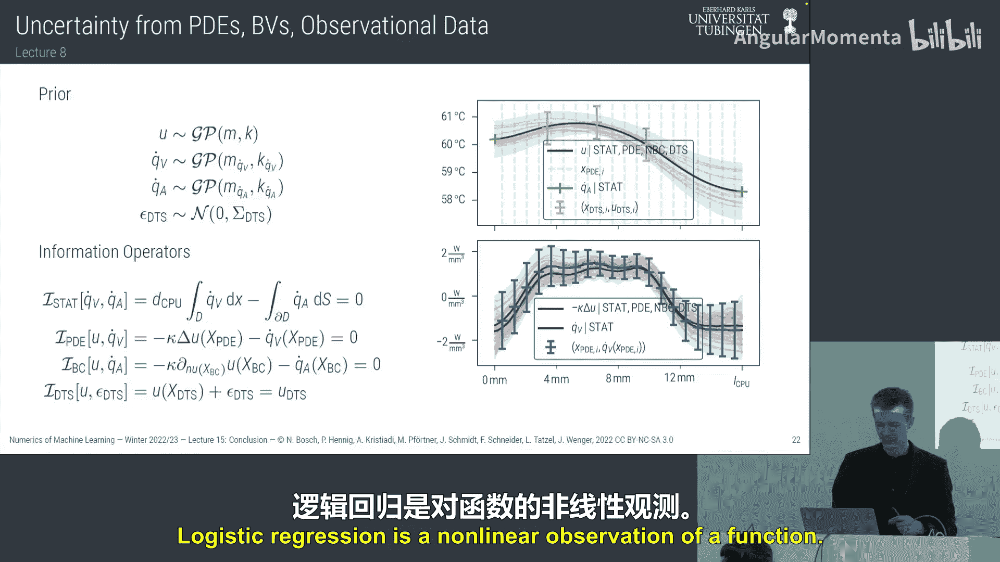

Okay， at this point， if we， we were close to Christmas and we moved to integration。

 And here I'm just going to say few things again because I did that lecture。

 So I kind of don't have to repeat myself too much。😊，We started out lecture number 9。

 talking about what do people normally do when you hear integration in probabilistic inference。

 Monte Carlo。 Monte Carlo is a beautiful set of algorithms that turn a deterministic inference problem into a stochastic inference problem。

 a statistical problem by so to try trying to compute such integrals by instead drawing random numbers from the probability distribution described by this P。

 And then evaluating a sum rather than an integral。

 And the nice thing about this approach is that it has some interesting statistical properties。

 It gives an unbiased estimator and that unbiased estimator works on pretty much any integration problem。

 So that's nice。 It's an algorithm that works for everything。😊。

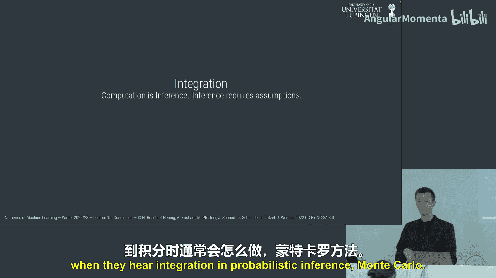

Well， actually every Leic integral function。 But for basically any integral。But it also has a cost。

 which is that this estimate converges slowly。 So as a function of the number of evaluations of the inte。

 you get a convergence rate that is at best one over the square root of the number of samples。😊。

For the expected error。Al， so the rate at which the estimate of the integral converges to the true value of the integral is one over the square root of the number of samples。

 And， in fact， that's a best case estimate， depending on which algorithm you use。

 it might be much worse。Both because this constant here might actually depend somehow nastyly on the problem。

 or and maybe more importantly， because the algorithms we actually use in practice。

 Macov Chi Mon Takalo don't achieve this way。 They just achieve it asymtically。

And then election number 10， I guess， before Christmas。

 we looked at sort of the polar opposite the entirely different kind of approach。

 which is not to say， I don't know anything about the problem。 Let's instead。

 let's just draw random numbers and hope that everything just sums up。 And instead。

 let's spend as much time as we want trying to model the in really well。

 And then learn what its integral is from carefully chosen evaluations of the， of the in。😊。

This is connected to the idea of Beijing quadwiature。 So we start out again。 Of course， by now。

 this is natural to you with the Gaussian process prior on the inte。😊。

That is related to a Gaussian process， or actually just a Gaussian marginal variance marginal distribution about the integral。

 Now， if you condition this distribution on evaluations of the function at various points。

 then you get an estimate for the not just the integral， but also the integral。

And that sort of one thing we had to do to make this work is to find kernels for this Gauss process。

 which are integralteable in closed form。So that we can lift。

 if you like the problem of computing an integral over some function。

To the problem of integrating the representation of that function in some reproducing kernel Hiber space。

Represented by some evaluations of the function。So this constrains us a bit because we now need to be able to compute the integrals over the kernel。

 this one and。😊，this one。But beyond that， it's an algorithm that allows us to integrate。

 And we saw that in some settings， in particular， low dimensional problems， this。

 this class of algorithms can actually perform really， really well。😊。

It can converge much faster than Monte Carlo。Polynomally fast， not square root fast。And， in fact。

 there are even special classes of algorithms that converge much faster than that。

 like super polynomly fast。😊，Admittedly， this mostly works for low dimensional problems and scaling it to higher dimensional problems is tricky。

😊，Scaling in the sense of building algorithms that actually still converge fast in high dimensional problems。

It's not so hard to build versions of these algorithms that work as well as Monte Carlo in high dimensions。

 But then again， why would you do that， You might as well just sum up a bunch of random variables。

So the main takeaway at this point in the lecture course was not so much。 Oh， if you need。

 if you need to integrate something， let's now use。Paient quadvaature。

It's more this sort of philosophical observation that when you're using an algorithm that works for everything。

It's typically going to work。Badly， for almost everything。So you're paying a price for geneity。

 algorithms that work on a large class of problems tend to work not so well on every individual instance from that class。

 While if you build an algorithm that works well only for a very small class of problems。

 then they might work really well on each individual of those problems， But， of course。

 they might break badly outside of that class。😊，And this。Of course。

 is sort of reminiscent of visualian inference again。

If you have a prior that puts a lot of mass on a small constrained space。

 then you don't need much data anymore to do inference in that space。

But if the prior assumptions are wrong。If you're actually facing a problem that isn't in your hypothesis class。

 then all the bes solve。 The algorithm might work totally badly。

So what does this mean for computation， It means。That if you think about this sort sort the social aspect of computation。

If you at your algorithms from a theorist who builds algorithms for a living。

Then that person you're buying your algorithm from is incentivized socially by the academic system to build methods that work on a large class of problems because nobody。

 well， few people in the world get to， get to write a paper about how to solve problem X and only problem X and then never have it have to solve it again。

 typicallyyp， they get to solve get to write papers about how to solve this class of problems with this beautiful algorithm。

So if， in practice， though， youre， if you're the one actually building a solution for a commercially or a scientifically socially valuable problem。

 you actually only have one problem to solve。So you can increase the performance of your method。

 Sometimes if you know what you're doing and you build a customized method that works well on your problem。

Only to the point where you actually put in things that you really know about your problem。

 not where you invent stuff that doesn't hold。

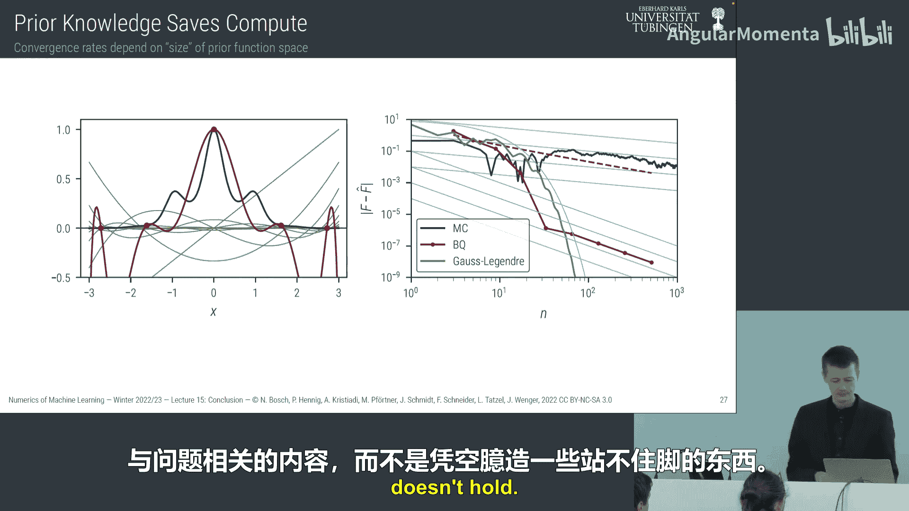

At that point， we had a Christmas break。And then we came back after Christmas for kind of a change of step。

😊，Coming through problems that。Nerical problems in contemporary machine learning that arguably do not have a beautiful solution yet。

Which are nevertheless so important。 So in fact， they are sort of thr the entire community that we need to talk about them anyway。

And here， our message was， I think， quite different from before。 like in the before Christmas。

 there's all this， oh， look at all the stuff。 we know， we can do things like this and this and this。

 And then afterwards， it was more。😊，Look， this is something that nobody really knows how to do。

So maybe it's interesting for you to think about it。And also， to understand why it's so hard。

Not because。Just we don't know how to do it。 But because basically no one out there really knows how to do it。

And training deep neural networks is the prime example of this。

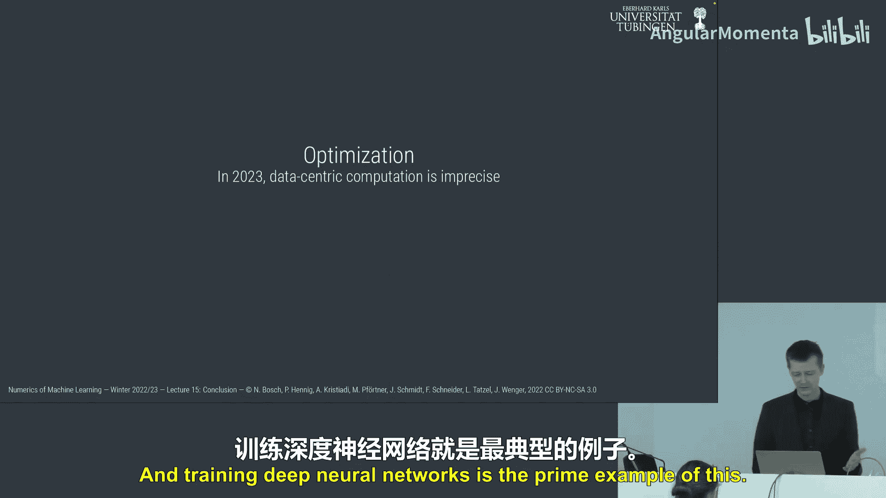

So，嗯。I'm not gonna to show all of the slides， again。Frank came in in the week after Christmas。

 and he showed you this list of all these optimizers。

1 hundred and 20 odd of them and argued that pretty much all of them work equally well， more or less。

 with minor variations。😊，And that you might as well use Adam to train your deep neural network。

 So to solve optimization problems that are of this sort of type that we'll discuss for a few minutes。

And that might sound at first。 Actually， let me go one deck。

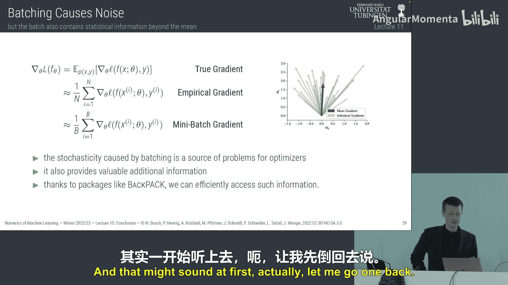

It might sound at first， like this problem is solved， right， Adam。 Everyone just uses at is fine。

 But actually， these algorithms are fundamentally frustrating。 They' are really bad to use。

 They need babysitting。 They need hyperparameter tuning。 They don't always work。

 You need to initialize that network work。 Well。 You need to figure out what the algorithm does while it trains。

 and you need to even even decide when to stop it。😊。

So this is strikingly different from the situation optimization people used to study not so long ago。

So when I went to university， optimizationim lectures and tutorials consisted of people telling you that there is this algorithm。

 we can just download and it works， and it's perfect。😊，I was actually once story time in a， in a。

 in a tutorial in a machine learning summer school by Stephen Boyd， one of the grand。😊。

EEmuns G of optimization， who spoke about。Comveex optimization。And he actually。

 at several points in his tutorial， did this running gig where he said。

 unless this this isn't isn't this method， I can solve this in this problem。 and then。And。

Would you like to know how it works。 Well， that's none of your business， He kept saying。

 because you don't， you don't need to know these massive these things are now packaged。

 You just have to write down the problem in the correct formulation。 And then it' then it' solved。

 And there are these perfect algorithms that are super fast， and they solve every problem。

That's what optimization used to be like。 It was just。Hit the button， and it worked。

And it's not like this anymore at all。 Instead， we have the Epolar opposite of it in machine learning。

 Now。 We have engineering teams of 100 people working on large language models。

 having weekly meetings to decide whether they want to lower the learning rate a bit or change the batch size or go back to a safe state that they did last week。

 because in the meantime， the gradients have exploded。😊。

So we're actually at a really interesting point in time with this that。😊。

These methods don't really work， right。So they work kind of。 They train something。

 and it's good enough to get public attention and get lots and lots of money to do so。

 But it's really not efficient。 It's not an efficient use of resources。😊，So why is this？😡。

And then you could think of three different reasons why that might be。

 One might be that these problems are really large， right， La language models。

 billions of parameters。But I think that's not so strong an argument， because。

Optimization has dealt with million dimensional problems already 30，40 years ago。 And really。

 there's not so much fundamental mathematical difference between a million dimensions and a billion dimensions。

 right， And chips have become bigger and smarter and faster。 So that's not really the problem。

These problems are also not convex， and classic theory of optimization mostly applies to convex problems。

 fineine。 But then again， in the 70s， people were already applying cout methods to non convex problems and got them to work。

 They didn't have guarantees， but they worked， so。😊。

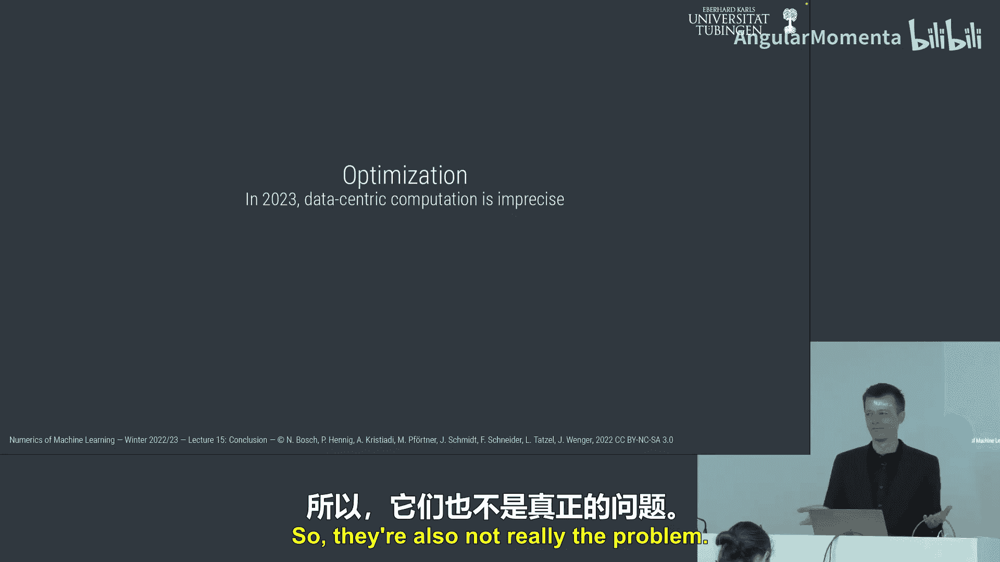

They are also not not really the problem。 No， the problem is stochasticity。 And with that。

 we are right back at the center of this lecture course about uncertainty in computation。😊。

So what actually happens when you train a everyone neural network is that youre not minimizing the population risk。

Because you'd already have finite data， anyway。But you' are also not minimizing the empirical risk。😡。

Because。So the second thing， where is the pointer It's gone。 Okay， I'll pump with my mouse。

 this thing。That's what you would do if you have finite data， but infinite compute。

 but you don't have infinite compute。 You have finite compute as well。 So instead。

 youre actually evaluating the mini batch gradient。

 this object that looks like a distribution of a bunch of arrows around a batchmin。😊。

And that drastically reduces the performance of optimization algorithms because it introduces very。

 very significant noise。😊，Noice that is， in fact， actually larger than the signal。

So this picture is actually a little bit misleading in two dimensions。 So the typical。

Btch average gradient doesn't even point in the right direction。

Like the inner product between the top line。 Sorry。

 the second line and the third line isn't even larger than 0。Typically， speaking。

So we can't even think of this as a small perturbation。

 It's not the sort of thing that you study in a numericalital analysis。 where you say， oh。

 let's have this algorithm that works perfectly。 If everything is correct。

 And then let's imagine that we actually have have a small error epsilon and do some forward or backward error analysis to figure out what what the disturbance is going to be。

 No， because the object you're computing that the the disturbance between the thing you want to compute and the thing you get to compute is not small compared to the thing you want to compute。

😊，So you really get just access to a source of random bits that have a little bit of structure。

 And the name of the game is to get as much information as possible out of those random variables。So。

反。Made， may several points in his lecture。 but one of the points that I want to particularly emphasize is towards this end。

 which is that。We don't need to despair at this setting。 In fact。

 it offers lots and lots of interesting new avenues to try。 Why。

 because we actually get access not just to this red arrow in this picture over there。

 but also to all the golden arrows。Because they are being computed anyway。

When you compute your batch。So， this object here。Is fully computed and fully accessible。

During training。So we that， the typical deep learning libraries only give you back to some。

 the mean gradient。 But actually， if you really want to， you can get access to all of these things。😊。

And now， suddenly， you have a much richer source of information available。

 an array rather than a vector。😊，An object that you can study and think about and do a new interesting things with。

 You can also compute the gradient of this object。😊，So curvature estimates。

Using automatic differentiation， just like we use the gradient of the loss to construct this object。

 So we can just keep going deeper and deeper with automatic differentiation。😊，And then， look。

 as thatel came in。In lecture number 12 and said， yeah。

 you can actually maybe make use of such curvature estimates to build interesting algorithms like the classic optimization methods。

 Newton based Newton type optimization。 And you just have to be a bit careful because were now in this sort of deep setting where all of these three problems that I mentioned before apply。

 So a the model is very large。 So these curvature matrices are even larger， quadratically larger。

 So they are super huge。 So we can never hope to actually look at the entire hesian。

 We have to be smart about which bits we compute。 Secondly， the problem is not convex。

 So the hesher is't positive definite。 So we'll need to work around that。 For example。

 by working with other matrices， which are guaranteed to be positive definite。

 like the generalized cause Newton， the fier and so on。😊，And， of course。

 everything is stochastic still。 so naive， second auto methods don't work。

 And that's where we are at the moment as a community as well。

 Not just here in this lecture lecture hall， but pretty much across the entire world。

 there isn't a conclusive answer。😊，On how to train deep neural networks。 And I'm personally。

 my prediction is， it's going to be super exciting when such an answer emerges。

 And you're going to know because it's going to make training deep neural networks。😊。

Unbelievably faster， like， it's gonna be orders of magnitude change in performance。😊。

And that's going to change how we do machine learning。So let's see when it happens。Meanwhile。

 I don't want to leave you hanging with this and to say， it's gonna come up something。

We can also make use of these， these quantities that I sort of hinted at to do other things than training。

 they don't just need to train the neural networks。

 We also need to do other things with them once they are trained。 for example。

 we want to know how much they actually know Which parts of the weight space are constrained and which parts are not。

 What does the model know and what the does it not know。 How uncertain is it。 And I did one lecture。

 Well， I did it。 But Ats wrote it， to show that we can use these quantities。

 These curvature estimates。To。Construct。Uncertainty estimates for deep neural networks in various sort of lightweight ways。

Using the idea for Laplace approximation。So we actually， Ill go to。Yeah， I'll keep it here。

 So I don't if it have a， I didn't take pick a slide for La plus。 Okay， but so you all remember。

 the idea is you train your deep neural network in whichever way you like until you found one point in weight space。

😊，That is your best guess for what the weight should be。

 So that's when your optimizer gets switched off。 It never actually determines itself。

 You switch it off。😊，And then at that point in weight space。

 you compute some approximation of the curvature。Of the loss function。

With respect to the weights of the network。So that tells you in which direction the loss is flat。

Across the data。The training data and in which direction， it's steep。

So if I move weight space in this direction， then a lot of the training data will be misclassified。

 so I should stop。😊，Right， if I move in this direction。

 nothing is going to change in the training data。 So I might as well move in this direction or this one。

And that that gives a notion of uncertainty， right， This dimension is uncertain。

 This dimension is very confident。And we translate this into a Gausian distribution by taking this curvature matrix。

 taking minus it， and taking the inverse of the curvature。

 And then we get a Gausian covariance matrix。 And at covariance matrix， we can plug into。

 for example， simple linearizations of the loss to get this predictive uncertainty that you see over there。

😊。

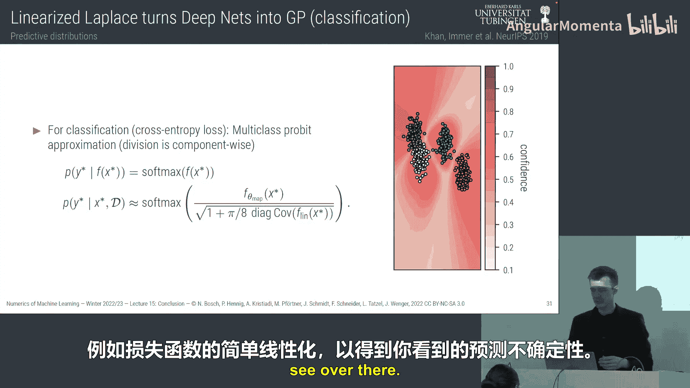

This kind of functionality can be used for various different use cases， in particular。

 can be combined with a linearization of the network in weight space to get。

A mechanism that essentially turns any deep neural network approximately into a Gaussian process posteror。

 a parametric Gaussian regression algorithm， posteror， approximately。😊。

But in a totally structured fashion， using only linear algebra and automatic differentiation。

No fancy Monte Carlo， complicated， expensive things。

In a way that can be done after training without messing up the performance of the algorithm。And。

I think I'll largely actually leave it at this。😊，And。Maybe。

 maybe one thing I wanted to say about this a is。Maybe笔。Once we reached this slide， they've also。

Traverse this。To another end of the connection between inference and computation。So。I said。

At various points across the course。 and also today。

 several times that you can think of computation as inference。 And if you're doing inference。

 you might as well do Bayesian inference。And it may sound like。

Being Beijing is the right thing to be to do and be sort of like for whatever philosophical reason。

 But actually， these results kind of show that it's a bit more tricky。

 Being probabilistic is important。 And being probabilistic for me just means measuring volumes in a space。

 figuring out how many degrees of freedoms are left and。😊。

Understanding which parts of your model are actually constrained by whatever information you have。

 data or computational information or mechanistic information and which parts are not。

Because quantifying uncertainty is important。But whether you need to do this perfectly by solving or applying based theorem and computing a correct posterior measure depends on the setting。

😊，In computation。You often don't want to be fully evas because that it's intractable。

 So we do Gausian inference。And indeed deep learning， similarly。

 we also don't want to be fully Baysian because it's gonna be very expensive。 So instead。

 we first try and find fast solutions。And then try to make them as good as possible。

I think that's generally a good approach， Whether we talk about numerical medical computation or deep learning。

 because if you want to do the perfect thing that is computationally intractable， no one will care。

 But if you do something that actually only adds a tiny bit of computational resources。

 but gives you something you don't otherwise have。 then that's value。😊。

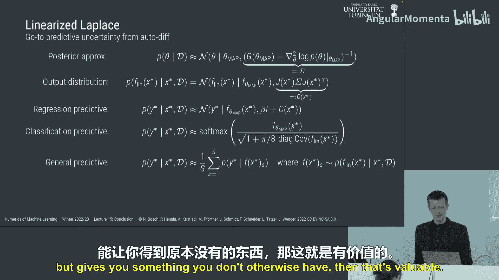

With that， I'm done with the main content of what I wanted to show you today。

Here are the big high level takeaways。 Comput is inference。

All of computation is managing information， manipulating it。On a chip。By loading data。

 either from the disk。Or being told about it by some human designer that writes down a law of nature that can be evaluated in various points。

 And whether the numbers come from the disk or whether they are available as information operators。

 the algorithm has to decide what to do with them。 So numerical computations are active。

Agents acting in an interaction with the data source。

It's very clear if you solve a differential equation that the algorithm has to decide where to discretize the problem。

 how many final computations to perform。 So it has to actively decide what it does。 But with data。

 it's the same thing。 If you do Gaussian process regression and you have a very large data or you do deep learning and you have a very large data。

 It pays to think about how much of that data you actually want to use how much you want to load and how much computation you want to do on it。

😊，If we do this， if we take this connection seriously。

 then we can build new data centric ways of doing computation。😊，That if you do them right。

 might be more flexible， easier to use and easier to generalize to different settings。

And they provide sort of design patterns like these information operators。

 like Gausian process regression， K filtering and smoothing and so on。

 and the pla approximations that can be used in very。

 in very flexible ways to include information from various sources。😊，And in the end。

All of this is numerical computation。 So machine learning for the person who builds the learning machine is numerical computation。

 So if you know about how numerical algorithms work。

 both the classic ones and our reinterprets of them。

 then that allows you to be a better machine learning engineer。 And if you don't know about them。

 then you're stuck with the tools that someone else makes makes for you。😊，Alright。

 I hope that you still use the chance to give some feedback。 This is the final feedback form。

 So if you want to write anything about the entire course into it， you can do so。

 scan the Q R code now because I have a few more things to show that， or， and to discuss。 And。

 of course， you have to talk about the exam。 But at this point， that was the content of the lecture。

😊。

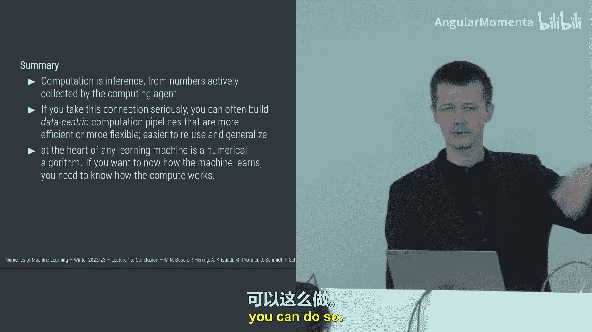

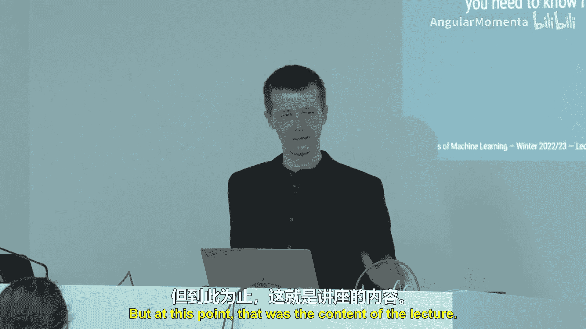

