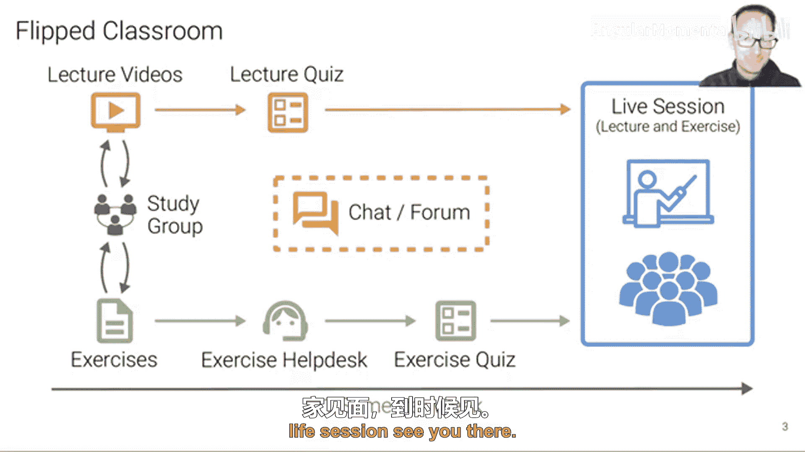

# 【精译】蒂宾根大学《深度学习》-p01-01--1.1-（简介：组织架构）--BV1eDbrzhENK_p1-

Welcome to Deep Learning， a lecturec at the University of Tubingham。

My name is Andrea Geiger and I am your instructor for this class。

Deep learning is a discipline of machine learning， and it has。Taking。The industry。

 but also academia in storm over the last 10 years。

 with new and more exciting developments coming up every year。 and many of you。

 you probably heard of。I wna kick off this lecture with。

A little announcement by a former president that you might be familiar with。

Hi， everyone， I am Barracks， and I welcome you to this lecture on deep learning at the University of Tobury。

As we all know， deep learning has revolutionized many research areas from computer vision over medicine and bioinformatics all the way to natural language processing。

 It has also brought us one step closer to intelligent systems that naturally interact with their environment such as self driving cars。

 Deep learning is part of the broader family of machine learning methods and is based on artificial neural networks。

 Deep models learn from large datasets to predict outcomes for unseen input such as images text or audio。

 and they can do that remarkably well， outperforming most classical methods of meeting benchmarks in the field。

 In fact， this video has been generated fully automatically by deep model called neural voice puppetry。

Neither my face nor my voice are actually real。 Thus。

 I can also change my voice in this class and reason his team will tell you everything you need to know to get started with deep learning。

 I hope you enjoy the class。

This， course， is taught as a so called flipped classroom。

 That means we provide lecture videos and assignments to you before the live session here in blue。

 where we all reconvene and discuss together in a physical。

Form it the difficult topics and your questions。As well as maybe some little tasks that we pose during these live sessions or questions that we do ask you。

So we provide these lecture videos in advance via YouTube。

And it is important for you to watch them before coming to the live session in order to gain anything from the live session。

We also recommend you to form study groups with your peers to discuss the content of the life of the lecture videos。

 as well as the exercises beforehand。And in order。To provide you a mechanism for self assessment and also self motivation。

We offer so called lecture quizzes that are provided online where you can assess yourself and also earn some。

Bonus points for the final exam。On each of the lectures and as well as each of the exercises。

And in addition， these quizzes provide us with the necessary feedback to discuss in more depth the topics that are hard to understand for the majority of the class。

So we provide these quizzes both for the lecture as well as for the exercise。In addition。

 we also provide for the exercises an online Zoom help desk where you can directly。

Get mentoring and help from the T As of this class。To solve the exercises。In addition。

 we also provide a chat or forum online where you will very quickly obtain feedback。

For questions that you might have on the lecture videos or the exercises。So a typical semester week。

Is as follows， you watch the lecture videos， you work on electric vi。You。Try to solve the exercises。

 Conult the study group or the exercise help desk， and then fill in the exercise quiz。

 And with all this knowledge。You come into the live session and you bring your questions with you。

 and then we discuss those in more detail。With all the other students。In the life session。

That's all I wanted to say， for now。I'm looking very much forward to meeting you。

In our first live session。

See you there。