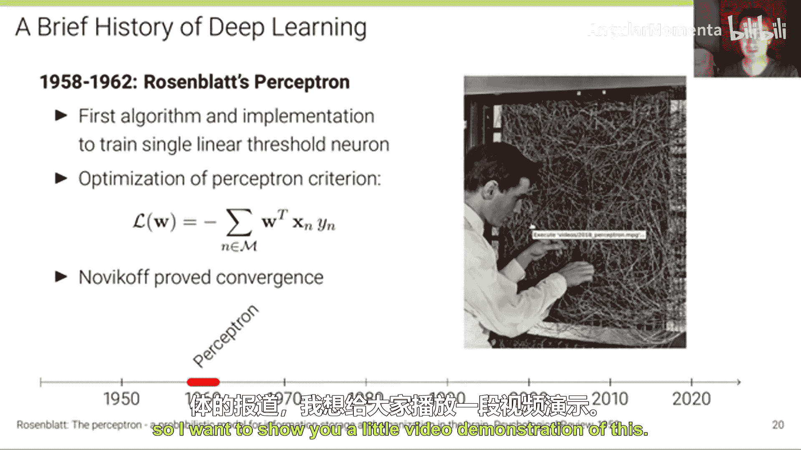
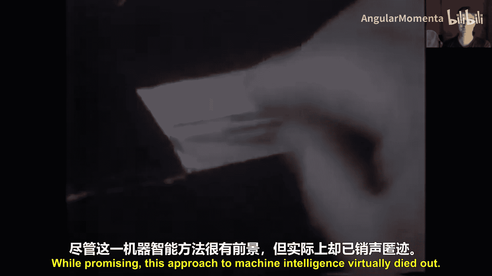
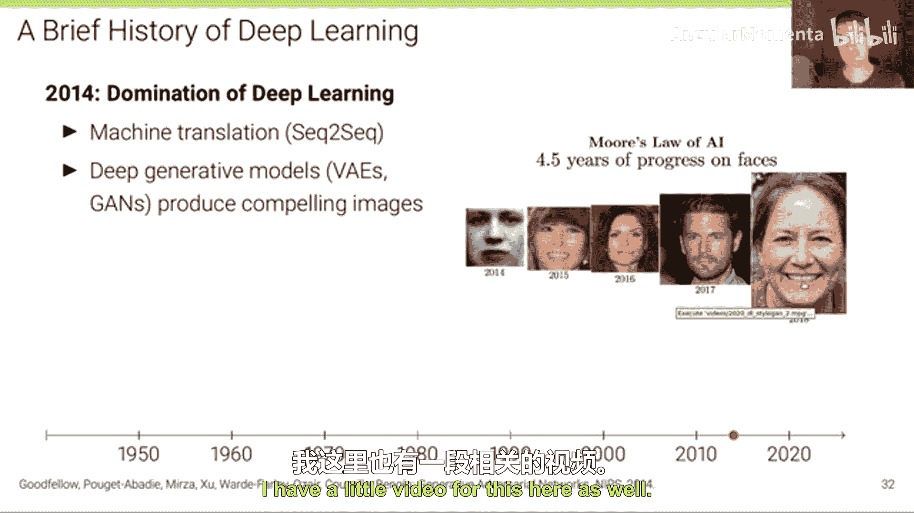
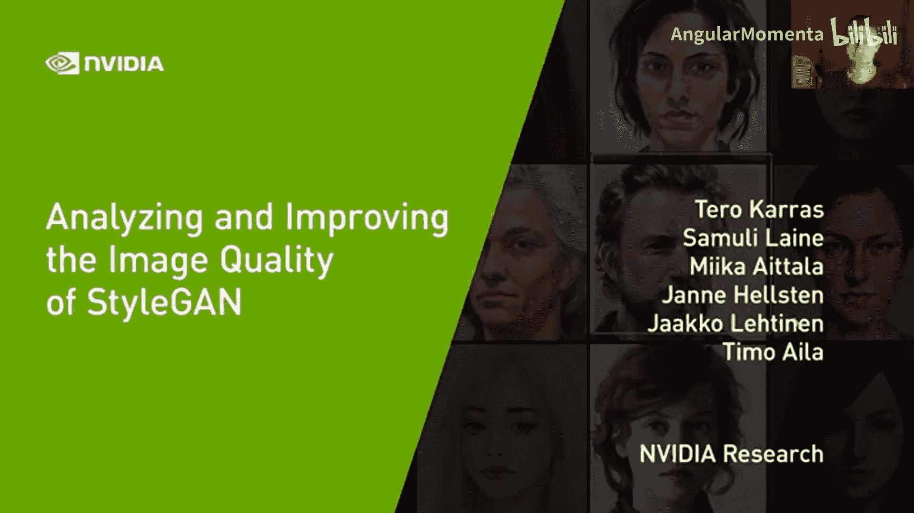
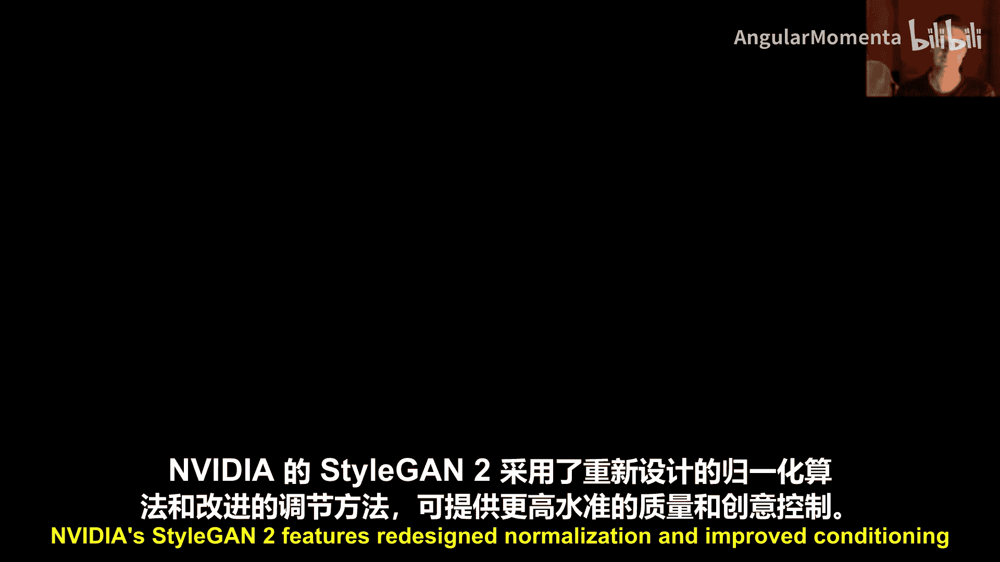
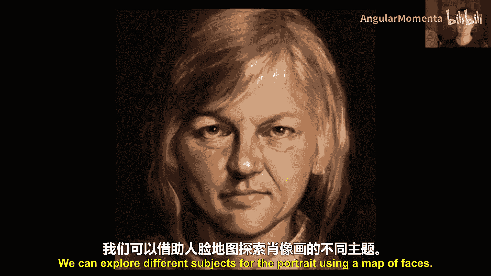

# 【精译】蒂宾根大学《深度学习》-p02-02--1.2-（简介：深度学习的历史）--BV1eDbrzhENK_p2-

In the second part of this unit， we're going to have a brief look at the history of deep learning together。

Deep learning has been developed in free waves。 This is typically what people identify as three different waves and the term deep learning didn't exist when。

These ideas started to grow。So the first wave was the wave of cybernetics。

 where deep learning was called cybernetics and was also called the golden Age。

With a lot of great discoveries and following great hopes。At that time。

 people were using simple computational models of the brain。

Simple computational models of biological learning to imitate biological learning。

And to learn simple rules。Which were shown successful for classifying simple patterns。However。

People realized。At some point that these simple models were not powerful enough in order to solve more complex tasks。

 which led to a decline in research。In the 1980s。嗯。2。The 20s。Deep learning has often been called。

Or been associated with connectionism。In connectionism。It was assumed that intelligent behavior。

Was realized through a large number of very simple units， very simple computational cells。

And it was also in that age where very important developments such as back propagation or sequence models have been developed。

However， this development was in the shadows。 It was overshadowed by a developments。

 So this is why it's called the dark age。The reason why it was overshadowed was that while these algorithms were working on very simple examples。

 big breakthroughs on complicated， very challenging。Real world examples as， for instance。

 the field of computer vision was looking at。Couldn't be demonstrated if his models。

Due to of a lack of algorithms， a lack of compute and a lack of data， mainly。And then finally。

 from 2006 to now。Deep learning was actually called deep learning。

And I would call this the revolution age。Where people demonstrated that with deeper networks。

 larger data sets and more compute。Deep learning。Was leading to state of the art results。

Doinating almost all leaderboards across different fields and disciplines。嗯。Well。

 let let's go back all the way to 1940。In 1943， my colgue and Pis here on the image。On the right。

 this is my color on the left is Pis。Developed an early computational model for neural activation。

Here on left you can see what this model looked like， it's called a linear threshold unit or neuron。

It's called linear threshold neuron because it's a threshold。

It's a threshold on a linear computation。Here， x is the data。And W are some weights。

X could also be some features of the data， so let's just call that features from now。Now。

 if we multiply these features with the weights。And this product is bigger than0。

 we assign plus one to that function。If it's smaller than 0， we assign minus1。

That's a binary decision。 that's why it's called a linear threshold neuron。

It has been demonstrated that this simple operation is more powerful than simple and or gates。

And orgates are special cases of this computation。But at the time。

 there was no procedure to effectively learn the weights。This has changed in 1958。

Where Rosenblt developed the famous perceptionion。Which was an algorithm， but also an implementation。

 an actual hardware implementation of this algorithm。To train the single linear threshold neurons。

And it was done using a what's called the Perceptron algorithm。

 which was optimizing the perceptron criterion shown here。

This is very different from what we do today using gradient based optimization with back propagation。

Because the linear threshold unit here。Is non differentiable due to this threshold， right。

So it cannot be learned with gradient based optimization。

 so that's why this auxiliary task here has been defined， which is simply saying， well。

 I'm looking at all the results that have been wrongly labeled。

 so M is the set of wrongly labeled examples。I'm looking at what the model does for those。

And I'm looking at the true label， which is plus1 or minus-1。

 and I'm minimizing a loss based on this incorrectly classified label such that they are。

 hopefully in the next iteration of the algorithm correctly classified。

This is what optimization of this criterion does。And it is indeed for this very simple model。

 an optimal thing to do。 It's not guaranteed to converge in in the smallest number of iterations to the solution。

 but it has been proven to converge to the right solution if a solution exists。 so if。

This given these features， the classes， these two classes here。

 it's a binary model are actually separable。This was a big success and made it to the media。

 so I want to show you a little video demonstration of this。

In the 1950s and 60s， scientists built a few working perceptrons as these artificial brains recall calleded。

He's using it to explore the mysterious problem of how the brain learns。

This perceptron is being trained to recognize the difference between males and females。

It is something that all of us can do easily， but few of us can explain how。

To get a computer to do this would involve working out many complex rules about faces and writing a computer program。

But this perceptron was simply given lots and lots of examples。

 including some with unusual hairstyles。But when it comes to a beetle。

 the computer looks at facial features and hair outline and takes longer to learn what it's told by Dr。

 Taylor。Andrew Croookhan's wig also causes a little heart searching。

After training on lots of examples， it's given new faces it has never seen and is able to successfully distinguish male from female it has learned while promising this approach to machine intelligence virtually died out。

。As you have already heard in the video while providing a working example of such a algorithm for training the weights of a single linear threshold neuron。

 it was heavily overhyped， for instance， Rosenbl claimed that the perceptron will lead to computers that walk。

 talk， see， write， reproduce themselves and our conscious of their own existence。嗯。

So the hopes and expectations were really high and if as soon as people saw that these couldn't be fulfilled。

This led to a tremendous mistrust in this technology。Okay。In addition， in 1969。

 Minsky and Pat published a book。Called perceptrons。Which。

Mathematically showed several discouraging results for this simple model。 For example。

 I showed it that。A single layer preceptrons cannot solve some very simple problems such as the XR problem。

Or counting。Yeah。Subsequently， this led to less and less interest and less and less funding in this area。

And also led to the rise of symbolic AI。Which dominated in the 70s。Yeah。In 1979。

Fukkushima proposed the neocniron， which was one of the predecessors of models。

 is actually quite similar to the convolutional neural network models that we are still using heavily today and which are amongst the most successful models。

In particular in computer vision。嗯。Here on the right， this is not Fukushima， what you can see here。

 whom you can see here this are Huble and Wsel and I show them here because this。

Fkushima's neocorchroton was heavily inspired by Huil and Visel's experiments in the 1950s。

In the 1950s， Hubel and Wel studied the visual cortex， the V1 areas in Cats。

And they found that there are different types of neural cells in this visual cortex。

 there are cells that are sensitive to the orientation of edges。

And there are cells that are insensitive to the exact position。They call the cells。

 simple and complex cells。This was a great discovery。

 and it was recognized with the Nobel Prize in 1981。

 And I want to show you a brief video of Hubel and Beasel。

 The researchers actually listened in to individual nerve cells firing in the anesthetized cat as they presented it with different visual images。

When we started working Torston and I in the late 50s， we set up our first experiments。

 and they didn't go well because at the beginning， we couldn't make the cells fire at all。

 We'd shine lights all over the screen， and nothing seemed to work。And rather， by accident， one day。

 we were shining。Small spots， either white spots or black spots onto the screen。

 And we found that the。Black dot seemed to be working in a way that。 at first。

 we couldn't understand until we found it was the process of slipping the piece of glass into the projector。

Which swept a lie， a very faint， precise， narrow line across the retina。 And every time we did that。

 we'd get a response。So I'm showing you this video not only because of the great discovery of Hubble and Viel but because also it is a very instructional video of how research actually works。

 in particular in computer science and deep learning。

A lot of the discoveries that we do are actually。't didn't went out as expected so we we are often not setting the experiments up for what we are discovering in the end。

 but it requires a lot of hard work requires a lot of experimentation until something is discovered that actually leads to a breakthrough such as in this case where the experiments we're not working very well in the beginning。

But by accident， they found that this little thin edge。At the edge of this。

 overlay was actually causing the neurons to spike。So you as the next generation of researchers。U。

Can be highly inspired and motivated by this。Yeah。So back to Fukushima's neocorrogen。

 Fukushima as already mentioned was heavily inspired by these discoveries of Hu and W。

 and they proposed a computational model that mimics。

These simple and complex cells that Hubble and bele found。

So we proposed this multi layer processing network here。For creating intelligent behavior。

 which is composed of simple S and complex C cells。

And those basically implement what we know as convolution and pooling。

 the two most fundamental operations in deep neural networks today。However。

 there was no back propagation algorithm at the time。So this learning happened using reinforcement。

Based learning rules。However。The model architecture was a heavy inspiration for what is very successful today。

 just using a different type of optimization algorithms。In 1986。The Beck propagation algorithm was。

Reinvent it， one has to say， was known already since 1961。

But the first empirical success really was demonstrated in 1986 by Roelhart Hinton and Williams。

The back Proagation algorithm。Its still。The main workhousese of deep learning research today。

 even after all these years。It's unthinkable at the moment to do deep learning without the back proagation algorithm。

And the reason for this is that it allows the efficient calculation of gradients in a deep neural network with respect to the network weights。

These deep neural networks， they have a huge amount of parameters。

 millions or even billions of parameters， so it's really important that in every iteration of the learning algorithm。

And we can very efficiently compute the updates to these weights。

 and this is what this algorithm provides。哦。It enables the application of gradient based learning to deep networks。

And this was a major breakthrough at the time。In 1997。Schmid Uber and Hoheider proposed。

What is now famously called long short term memory。Actually already in 1991。

 Ho Haida in his diploma thesis， demonstrated the problem of vanishing and exploringding gradients。

 which is particularly severe for sequence modeling tasks where you have variables over very long periods of time like text where you have long text sequences that you want to model。

And where you need to back propagate。Through all these steps and where it's very easy for the algorithm。

To ever， no。it's very easy for this gradients to ever completely vanish so that the algorithm doesn't learn anymore or to explode such that you don't end up with useful results。

Yeah。And as a solution to this problem for sequence modeling。

 the long short term memory has been proposed， which uses a combination of feedback loops and forget or keep gates to effectively bridge this gradient flow over very long time horizons。

 basically keep information store information efficiently over very long time horizons。

And this has really revolutionized natural language processing。But only very lately。

Has been actually gotten this peak in recognition and also in citations， as you can see here。

The algorithm was was not very well known for decades， but then from roughly 2014 to 2015 on。

When it was demonstrated， it is really working very well if you have large data sets and large computers。

啊。You can see this growth in citations， this is the citation numbers of this paper。And in。From 2059。

 it has been used also， it has completely replaced the machine translation and language recognition technology at major tech companies such as Google's。

So LSTM was a fundamental piece of making language processing at Google significantly better than it was before。

In 1998， Y Laon proposed。The convolutional neural networks。

 which as already mentioned is similar to the neochnetron portray traineded end to end using the back propagation algorithm。

It implements spatial invariance via convolutions and max pooling。

And uses this weight sharing idea to reduce the perimeter space。

So the real new thing about this paper was that now it was demonstrated for the first time that these convolutional networks which have been existing before。

 could be trained very effectively using the back propagation algorithm and led to very good results on a standard machine learning task。

 which we'll also look at in this lecture， which is this MIS Dit classification task。However。

At the time， the results didn't scale up yet to the complexity of computer vision problems that people were interested at the time。

And this was the reason why convolutional neural networks。

Became only became really popular from roughly 2006 to 2010 on。

Then another like really major breakthrough was then finally the demonstration of AlexNet on ImNet ImageNet is a huge data set and a benchmark called the ImageNet larger scale visualual recognition challenge。

which features 10 million annotated images and each image is annotated with one out of 1000 categories。

 for instance， a particular type of dog or a chair or a spoon， etc。So this was。

Where for the first time， such huge amount of data became available。And then。

Hinton in Toronto and his team demonstrated that。With a few tricks tweaking these basic convolutional neural networks。

 they called it AlexNe。嗯。We're able to win this very important benchmark in the computer vision community。

And this was a real breakthrough， this was an eye opener for the computer vision researchers because they saw for the first time。

 well this deep learning technology does not only work for this very simplistic digit recognition task with like this 28 by 28 pixel digits。

 but it really also works for very challenging task where the vision community is interested in。

And the reason for this success was that at this point in time， a lot of things came together。

 the availability of these huge data sets， this huge label data set such as ImageNet。

 the availability of GPU machines， GPU compute。And deeper neural and better neural network architectures。

And this really was the sparking point of the deep learning revolution。

 this is what many people point to even though it's not so black and white。

 but this is where people really widely recognize that this is something that is really is going to really change the world。

So here can see how the arrow on this benchmark decreases。

 so a it's not shown here but before that there was a kind of a stagnation of this number around 25 and 230。

 but then there was a significant drop like AlexNe was just significantly better than all its classical competitors in 2012 and then from there on there was a continuous progress again。

Beyond human level performance for this particular special task。

Now from 2012 on people realized that like big annotated data sets are really one key to solving these complex challenges and so there was a large number of dataset sets developed subsequently such as what I've shown here is the Kidie data that has been developed in my lab。

 but other data sets for various tasks like self-driving， image recognition。

 3DD learning language understanding， vision and language modeling。

Question answering are medical applications。However。

 creating real data is really expensive because you need to collect the data and you need to annotate the data。

 you need to hire people to say， well， this pixel is a tree， this pixel is a building。

 this pixel is a human， etc。Yeah。And this led to the surge of synthetic data sets。 However。

 creating the content of synthetic data sets is also very costly。 as you can see here。

But interestingly， even very simple 3D data sets。Very simple synthetic 3D dataset sets prove tremendously useful for training deep neural models。

In particular， for instance， in the case of optical flow for pretraining。

 so what it can do is you can create such a very simple data that is called flying chairs because it's just a bunch of CAD models that have been rendered in random orientation on top of random backgrounds。

 so it's very simple to generate if you have a collection of CAD models which nowadays is also freely available on the internet。

So if you use this quite unrealistic dataset set for pretraining your model。

 your model learns already some basic knowledge about the task in this case， optical flow。

 and then you can use this model and find unit， adapt the parameters on a much smaller data set。

Then previously need for the actual real task that you want to solve。

And this also leads us to this success story of deep learning in terms of generalization Deep neural networks are really good at generalization and this may be accumulatemulated in this cPR workshop paper here where the authors showed this specifically so here on the top you can see a standard like a predeep learning era image classification pipeline where the input is an image and then there' is this pipeline of extracting some features in a multistage process a lot of hand engineering goes into this and then in the end a classifier like a support vector machine or a neural network or a random forest。

Now a CNN convolutional neural network bridgees this directly so it goes directly from the image to the classification output right in this case there is a last layer could be a SVM or last layer of a CNN right so it's not directly going to the classification output but is's producing some features but from there there's just one more layer for classification。

And what they have shown in this paper is that you can train the CNN representation on a very generic task like imagenet classification。

And then you just update the last layer， like the support vector machine or a last layer of the neural network for a specific task on very little data and you get。

ACompetitive or performance is competitive to the performance of classical techniques。

And this was really surprising， right， So this meant that this or this implied that learning this CNN。

Based on。A very generic task produced very high level and abstract features that are extremely useful for a whole variety of tasks。

 here you can see some of the tasks that they have considered object classification。

 bird subcategoorization， human attribute detection， building retrieval， sculptture retrieval。

 image retrieval， etc， completely different data sets。

 yet the performance was even better than the classical techniques。

 there were specifically designed for these particular problems。

So this was one of the main insights into also for me， like this was an eye opener。

 this is opening the community's eyes。Demonstrating that these models are really general。

 they work really well。In 2014， Sla and Fergus published a paper on visualization of what these deep neural networks learn。

 the goal of this paper was to provide insights into what the network has actually learned because these networks are kind of black boxes。

 it's different from before where humans have hand engineered features now the entire model is a black box。

 so it's important to look at what the network learns。

So what they did is they visualized image regions， as you can see here。

 that most strongly activate various neurons at different layers of the network。

This is shown here for different neurons in different layers of the network。

 and they found that higher levels capture more abstract semantic information you can see here faces of dogs or wheels or eyes。

 while at the lower layers， you can see basic gradient information。

And this led to some further insights into these models and also to better the design of better architectures and visualization of neural networks and understanding of neural networks is a very active research area still today。

In 2014， it was also demonstrated and this is kind of counterintuitive because I've just said these networks are very like very robust and very expressive and they generalize very well。

 but in 2014 it has been demonstrated that at the same time they can be also very easily fooled。

Using what they called adversarial examples。And this has developed into an known research area of its own。

So what they've demonstrated in this paper is that accurate image classifiers can be very easily fooled by imperceptible changes to the image。

 so here you see the input image here you can see a very tiny it's magnified here just to see it。

 very tiny noise pattern that's added to this image so that the image looks like this。

 it basically looks exactly the same as before to the human eye。And the same for these other images。

And while the classifier before was predicting the right class with high confidence， afterwards。

 it put 99% of its confidence on the class ostrich for all of these images so you can basically manipulate any image by adding this tiny imperceptible change。

 deelta x， so this is the objective here， you want to add this deelta x， I want to find a delta x。

That is the smallest change， that's why it's an argument。

 the smallest change such that the class becomes different。Right？Yeah。

And so this was very surprising at the time， I still remember at the conference being in the back of the audience and looking at this presentation and this was just astonishing for everybody that this was possible。

Now， from 2049， things have started to develop extremely fast， so for instance。

And deep learning has dominated across。A whole variety of tasks and research areas。

 not only in computer vision， but also in natural language processing。And medical and bioinformatics。

 etc。So in 2014， for instance， they have been the first really successful deep models for machine translation。

 translating between languages。And they have been also very compelling shocking results almost of deep generative models。

 deep generative models are models that and we'll look at these models in this lecture as well。

That in an unsupervised fashion， train a generative process， a generative model of a data set。

 so you give it a data set of images， you give it like thousands of images and it trains a generative process where given a random number you can。

Go through this process and produce a novel image and that image。Shows。

Something that's not in the data set but that comes from the same distribution that lives on the same manifold it's an extremely challenging problem because of space。

The image manifold is just extremely complex， It's an extremely difficult task， but there was。

In very few years in only four years， an insane progress on this problem you can see like these first images that have been generated by this type of models were very coarse。

 but then over the years you can see on the right the result of the style gun。

 style generative adversarial network。which produces all these little features of the hairs。

 it's really hard to imagine that there is a model that can produce even more realistic results than those。

 which are almost hard to distinguish from a real photograph。

I have a little video for this here as well。

Gands or generative adversarial networks have captured the world's imagination with their ability to create AI generated images of landscapes。

 animals， cars， and people without any human supervision。

🎼And V Stgan 2 features redesigned normalization and improved conditioning that delivers a new level of quality and creative control。

For this demo， we use Trans learning and trained the model on an NviIDdia DGX system using a large data set of unique paintings。

🎼It can produce endless variations of AI generated characters in a seemingly infinite variety of painting styles。

🎼With a prototype Ui， we can fluidly create portraits by separately controlling the content。

 which is the identity， expression and pose of a subject。🎼In the artistic style。

 including the color palette， light quality and brush stroke。

🎼Small fluctuations and details such as hair and eyes showcase Stgan's ability to create multiple coherent versions of the same image。

 similar to an artist creating variations on a theme using the same subject。

We can explore different subjects for the portrait using a map of faces。

Each is the result of a randomly generated input to the G。🎼As we move around this map。

 the portrait subject smoothly blends between faces。

🎼Stopping between the long haired girl and the man results in a subject whose appearance seems to lie half way between the two。

🎼Notice that the painting style， the blue gray background and the light quality stay fixed as we navigate the subject map。

The image grid on the left shows a style map。So while these models work very well on faces。

 getting them to work on。Like a broader range of images like what is， for instance。

 available in INe with these 1000 categories。It's harder。

 but there is continuous progress towards this goal as well。There have been also。

Major breakthroughs in， for instance， the prediction of molecular properties， for instance。

 for generating novel materials using neural networks that operate on graph structures。So in summary。

 there have been like from 2014 on dramatic gains in vision and speech and related areas。

 which was often referred to as the Moores law of AI like every year we' were kind of seeing the error rates become half of what the error rate has been the year before。

In 2015。Deep mind。Demonstrated impressively that they could learn policies。

 policies are state action mapping， so agencies and to what it does through random exploration and reward signals。

 this is something called reinforcement learning and they demonstrated that you can also enrich reinforcement learning with deep neural networks if you do it cleverly and play a variety of Atari games。

 learn to play a variety of Atari games。While having never observed any human playing these games just by trial and error。

 however， not all games have been equally easy and some games remained hard。

And are still hard today in particular games that require reasoning that require remembering and thinking long ahead。

 it's very difficult to dev。The reward like to put to say where the reward signal should actually go into the weights of the neural network。

It's called a credit assignment problem。In 2016。Or it all had demonstrated that these neural networks are also extraordinarily good in producing。

An audio。So here's an example of speech generated with these models to mimic human voice aspects of the sublime in English poetry entertaining 1770 to 1850。

And here is an example of generated music。Another interesting work that Id like to show you is style transfer。

 this is actually work that has been done here in Tuubingham by Matthia Beakas Lab。

What they showed in style transfer， what they demonstrated is that these networks。

That are trained on dataset sets such as ImNe are extremely powerful。

Or learn extremely powerful feature that allow， for instance to manipulate photographs by adapting the style of a different image。

 so here is an image of tubing and this is a style image and you can now produce an artistic version of this image it looks like it has been drawn from a professional artist。

But in this case， it's done using a neural network。Combining these two。So it's really fun。

 theres an online app you can try it yourself。In 2016。嗯。

Deep Mind has further demonstrated to master the game go for the first times was like kind of one of the last chess was already like mastered several years ago so Go was a much more complex game where just boot for a search that doesn't work anymore。

 so what they demonstrated is that for the first time a computer program was able to defeat a professional player。

 they probably have heard about this Alphago computer that was able to beat lease at all。

In 2016 and then in 2017， Deep Mind has produced a new version of this algorithm called Alpha0。

 which in contrast to the first one didn't require to look at。Professional game plays。

 but learned entirely through self play play against itself and at the same time was able to master not only go but multiple games。

There have been similarly important breakthroughs in the computer vision community， for instance。

 in recognition， this is just one of many examples called MarS RCN。

 which is a deep neural network for joint object detection and instant segmentation。

Wwhich outputs a structured object， it outputs an entire pixel map， a label map。

 a set of bounding boxes for an image， not just a single class label， like in the imagenet case。

There was also major breakthroughs in。languageguage models and we'll see some of these language models in this lecture。

In 2017 and 2018， two very important papers， highly cited papers。

 transformers and B were written Transers。Demonstrated that this classical recurrence in neural networks or convolutions in neural networks over time could be replaced by attention very effectively。

And Birt demonstrated that you can actually very effectively pretrain this model on huge amounts of unlabeled text。

 which is very easy to acquire on the internet。And then once you fine tune these models。

 you get a state of the art results on very challenging tasks such as the glue benchmark。

 So for instance， on on the first version of the glue benchmark。

 the algorithms have now achieved super humanman performance。 This is a benchmark that。

Tests abilities of machines in the best way humans can imagine to test these abilities such as paraphrasing saying。

 well， is this sentence saying the same thing as this sentence or question answering。

 looking at a Wikipedia article and answering a question from that Wikipedia article， however。

Computers still fail in dialogue， so while these algorithms are very effective in solving these specific tasks。

嗯。As an expert， if you want to engage in a dialogue， it's very easy to make these systems fail。

 it's very easy to make the system not pass the touring test。So this is in a sense。

 maybe it's a deficiency of these algorithms， but also a limitation of the benchmarks that we have today in。

Truly benchmarking， semantic understanding performance。Okay。Then in 2018， the touring Award。

 which is considered the Nobel Pri of computing has been awarded to like this。

What is often called the founding fathers of deep learning， Yosha Benjo， Jeff Hinton and Y Leon。

 who have basically kept the research in deep learning alive over this entire period where not a lot of funding was available for this type of research outside Canada。

Then from 2016 on in the computer vision domain， deep learning has mastered。

 finally also more difficult to master terrains such as 3D deep learning。

 where it's hard to specify output representations that are easy to predict using neural networks。

But then there were models coming along that could predict effectively voxel based representations。

 point cloud meshes or implicit models， as you can see here。

 so these are results in this case this is one of our models here that you can see on the right that are produced by just looking at a single 2D RGB image a 3D reconstruction predicted by looking at a single 2D RGB image which is quite astonishing。

哦。And these models have been extended to all kinds of properties。Not only geometry。

 but including also material， light or objects in motion。And then。This year in 2020， GPT3 came along。

 which is the first version of the language model of Open AI。Which is basically。😊。

Upcaling the existing language models to gigantic number of 175 billion parameters using a tremendous amount of compute to train these models on text repositories。

And so this has created a huge huge impact in the media because this was a model that was trained once。

 but then could solve many different tasks。So it has many use cases。

 it can actually write compilable computer code， it can write poets that are hard to distinguish from real poets。

 it can write block or news articles or behave as a chatbot。

So there have been some controversial discussions around this and I encourage you to look them up。

 it has now very recently licensed exclusively to Microsoft。Yeah。

 so to conclude this part of this unit， we have seen a brief history of deep learning。

 but there are still some challenges for you that remain。

For the next generation that needs to address those。For instance。

 a lot of the big success that we've seen is in supervised learning。

 where you need a lot of annotated data， which is very expensive to create。

So big trends now go back to what has already been a big topic in the 80s to unsubvised and selfsvised learning。

Also， learning on static data sets is not enough， we as humans， we interact with objects。

 we take objects into our hands， we play around with them。

So we learn through this interaction and this is important to also take into account and that's why。

 for instance， this previously disjoint research communities。

 robotics and computer vision are kind of merging together now。

Accur is another problem right while these models work super well in selfdr。

 you really need like a model that works extremely well humans they produce a fatality every 100 million kilo or so in order to achieve this level of accuracy you need an extremely good model so it's like far beyond the curies that we achieve in image recognition for instance。

The models must be also more robust right and often deep learning models they still work well on one domain where they have been trained for。

 but if there is very little data available for the new domain there where they shall be applied。

 they fail。and also robustness in terms of adversarial examples and understanding those from a mathematical perspective is very important。

It's also important to look at the inductive biases that these models have。

And the outcomes that are implied by these biases。Memory and computer is an issue the large scale language models and which models are trained on huge compute clusters while our the human brain on。

Requires a few hundred watts。And there's， of course。

 a whole bunch of ethics and legal questions around this topic。

And then maybe the question I I want to leave you with for this this part of the unit is， well。

 will this Moore's law of AI continue over the last couple of years， we have seen it to to hold。

But it's not so clear if it will hold over the next couple of years。

。