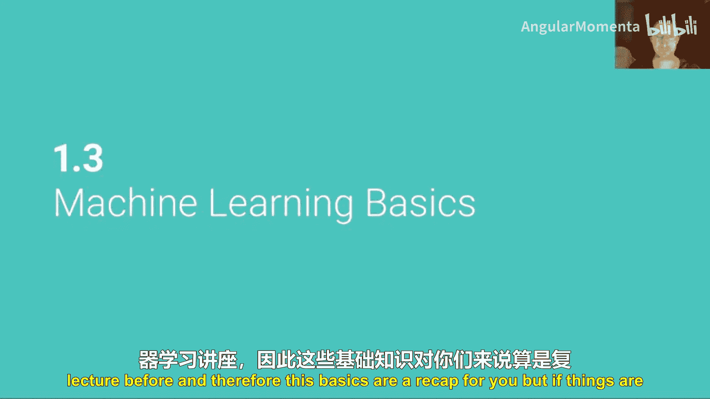
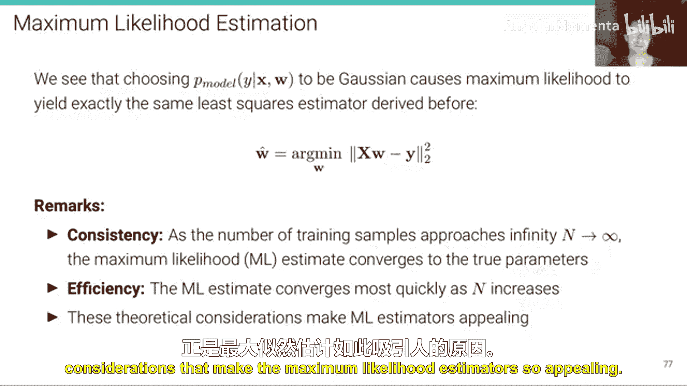

# 【精译】蒂宾根大学《深度学习》-p03-03--1.3-（简介：机器学习基础）--BV1eDbrzhENK_p3-

In the last unit of this lecture， we are going to talk about some fundamental machine learning basics。

Most of you will probably have heard a machine learning lecture before。

 and therefore these basics are a recap for you， but if things are going too quickly for you。

I recommend you to have a look at the chapter 5 in the deep learning book from Goodfe Eal。

 which describes the material that we cover here in preparation for the actual deep learning class that follows。

From the next lecture on in more detail。Let's start by having a look at the different learning problems。

There's various categorizations of learning problems， but here for this lecture。

 we are going to categorize intersupvised， unsupervised。

 selfsvised and reinforcement learning problems， and they all differ depending on the data is used or the supervision that is provided。

For example， in the case of supervised learning， we learn the model parameters using a data set of data label pairs。

 access input， wise output， and we have N such pairs。

Examples for supervised learning include classification， regression。

 or structure prediction problems。In unsupervised learning。

 we learn the parameters of a model using a data set without labels。

 it' just a data set of inputs X here。Examples include clustering。Like the K means algorithm。

 dimensionality reduction or generative models， which we'll discuss。Towards the end of this lecture。

In self supervised learning， we learn the model parameters using a data set that is made out of data data pairs。

 so we have x and x prime pairs。And such pairs in the data set。

Examples for this include self supervised stereo and optical flow estimation。

 or contrastive learning。And finally， in reinforcement learning， we learn a model。

Using active exploration from sparse rewards instead of a fixed data set So we have an agent interacting with an environment。

Examples include deep Q learning， gradient in policy， and acroriitique。In this lecture。

 we'll cover the first free learning problems。So let's start with the supervised learning problem。

And in particular， let's have a look at the distinction between classification， regression。

 and structure prediction。In classification。The goal is to predict。

Using a function F from an input X。诶。A discrete class label。In regression。

 we are interested in predicting from an arbitrary input x， a continuous variable。So the inputs here。

Can be any kind of objects， any kind of complex， continuous or discrete or mixed continuous discrete objects。

 for instance， images， text， audio， sequence of amino acids， etc。

The output is either a discrete or real number， it's important that it's a single number。

 so we are predicting a single discrete or real number。For instance， the label of an image。

Is it the image showing a dog or a cat？Or regressing a single number for the stock market。Eet ce。

In structured output learning， both the input and the output are structured objects。So again。

 the inputs can be any kind of objects， but also the outputs here can be any kind of complex structured objects。

Such as images， text， parse trees， folds of proteins， computer programs， etc。

So the difference between these here is really that in the top part， classification or regression。

We denote problems where we predict a one dimensional quantity。

 and here we predict a high dimensional quantity。Today we'll focus on the regression problem。

So here is a more visual。Analysis of this or overview over this。

Different classification regression structured output learning problems。

This is a very general image of a machine learning model。F。

 that has some parameters W and it takes an input X and predicts an output y。

And there's two main tasks associated。Or interesting to us， machine learners。

One is the learning task which entails estimating the parameters W from a training set of x and Y pairs in the supervised learning case。

 and then remember that in the supervised learning case we have a data set of X Y pairs。

And the second task is the inference task。 Now， given this W。

 this is fixed now after the training or the learning stage。

 we want to make novel predictions using this model here。So for a novel X。

 we want to execute that function given the fixed w that we have learned。

And predict a y for this novel X。哦。So let's look at some concrete examples here we have an example for classification。

 this is image classification。The input in this case is an image。

So it's out of the space of R to the power of w times H for width and height。

And the model maps this two in this case。嗯。A binary variable。嗯。A B or no Beach。

 so this outcome can take two different labels。Here's an example for a regression problem。

 which we are going to discuss in this lecture。In this case。

 it's an example for a stock a value prediction。 the input is， in this case a。

A sequence or a number of stock values。R to the power of n， so we have n such numbers here。

And the output is a single number。 for instance， the value of the stock tomorrow。

And this is a continuous number， so this is why this is a regression problem。

And here are some examples for structure prediction problems。

 which we're also going to discuss in this lecture， but in later lectures。So in this case。

 the input is an audio signal and the output is a sentence。

 so it's a sequence of words and each of these words here is from this。Set of words or labels。

 so we have all different words in the output domain here。

Here's an example for semantic segmentation where the input is an image and the output is a label map。

 so for each pixel in this image， this input image we want to determine what is the semantic glass label。

 background， can， monkey， etc。And here's never structure prediction problem in this case。

 this is 3D reconstruction， the input is a set of images。And the output is a 3D reconstruction。

 which for instance， can be specified by specifying the。Volume in terms of a voxel lies great。

 where for each of these voxels， we determine if the voxel is empty or occupied。

And we have M to the power of three such boxes because we have three dimensions。

 and if you assume that we have M voxels in each dimension， we have M to the power free。

Now suppose we want to predict a output that is 32 to the power of three dimensional。

 so it has 32 to the power of three voxels， which is actually quite small resolution。

And assume we have a binary variable per voxys here， which indicates occupied or free space。

How many different reconstructions are possible， how many different reconstructions could the model ever be？

Now， we have。Binary variables here so have 2 to the power of 32 to the power free。

Which is an insanely large number，Extremely large number。

And if you compare this number to the atoms in the universe。Which is also extremely large。

 we see that this number is even larger， so there is absolutely no hope that we can enumerate all possible reconstructions。

But we need to。Go with a more structured approach to finding a reasonable reconstruction out of this impossibly large。

 intractably large space of all possible reconstructions。

But now let's go back to the regression problem and let's look at what is called linear regression。

In linear regression， we want to make a prediction for the model parameters in a linear sense。

 and what does that mean？Let X denote a dataset set of size n。And let X。

 Y be such elements from that data set X， where the input can be high dimensional and the output is one dimensional。

 So y is a one dimensional variable。The goal is to predict y for a previously unseen input X。

So here's an example here we have the ground truth of the model and some noisy observations。

 so these are samples from this model with added noise。

This is what we provide to the learning algorithm。 Now。

 we want to learn a model such what when we execute that model at。A novel location X。

 we get a sensible response y。How can we do that Well， we define an error function。

Anarrow function E measures the displacement along the y dimension。For instance。

 here this little red lines between the data points in green。And the model predictions。

 in this case in red， and the model is specified by the parametersmeter W。

So these are basically the errors that the model makes， and we want to minimize。

The overall arrow are the sum of all errors。In the case of linear regression。

 we choose a linear model for that function。 So here we have this function represented as a linear model。

 this is just the inner product。Between a weight vector W and the input features x。Right。

And the arrow function is simply the sum。Over all data points。off。

The square of the difference in the y direction between the prediction of the model F and the observation y and this little I indexes the element in the data set so here we some of all these small red lines。

We can rewrite this as such here， because we can。Simply plug in this definition of this linear equation here。

And what we did here is we transpose this term right if we apply the transpose to this expression here on the right hand side。

 we get x transpose W。So this doesn't change the result because the result of this inner product is a scalar。

And we have plugged in here， not the generic X， but the actual element in the data set。

 because this is the sum overall elements of pairs X and y we have this data set of pairs X and y。

Why did we make this transposition here well with that we can write this expression here more elegantly using linear algebra。

 so we can simply write this expression here as the L2 norm。

Of a matrix x times this weight vector w minus a vector y。And this。嗯。

Matrix x here comprises all these data points， this features x here as row vectors。

W is the same and y is simply a vector that comprises all elements of。The data set in terms of y。

 so all the y is in the data set。It's basically just stacking row bys these x's and y's into a linear system。

 and then if we compute the L2 norm here， the squared L2 norm actually。

Then we obtain exactly this expression， right， because we the L2 norm sums。

The squares of each element here。So here on the right we already see an example。

 this is actually already the fit， this is after optimizing this energy function。

 this is the best error that we can obtain， you can see that it's not zero because these data points that are sampled from the true model in green are noisy。

 so we don't obtain back true model we just obtain。An estimate of the model。And。We have in this case。

 a very simple linear regression model that has just a one dimensional input and a one dimensional output。

 So if we want to re writeite this in in terms of this expression here， we can simply choose x。

 this x here as one and。X， so this bold phase here always denotes vector or matrices in my slides and non bold phase characters denote or symbols denote typically scals。

 so these x are not the same variables， this is a vector and this is a scalar。

So the input here is or this should actually be a scalar x， so the input here。Is a scalar x。

 but the vector x is then composed of one end this scalar。

And the function is then w0 times 1 plus w1 times x， just executing this inner product here。

 and this is the fami form of the linear model， this is what was used here。So how did we obtain this？

minimizeimr of this energy function E。Well， in order to obtain a minimizer。

 we need to follow the gradient and we need to。Get the gradient to0 because we know that when we get the gradient to0。

 we obtain a a maximum or a minimum。Or a saddle point。

 depending on the function that cannot happen here because we have a quaratic function。

So what we do here is we compute the gradient， this is a symbol for the gradient of this energy function with respect to the parameters W。

Yeah。So I'm just plugging in here nowadays。Linear system from before。Okay。

Which if I write it out is simply the product between xw minus y transpose and xw minus y。Now。

Writing this out， writing out this multiplication here。 we obtain this expression here。 right。

 So we have w transpose x transpose x W。 This is this multiplied this with this。

 Then we have two times the cross term x W。Y， and then we have y squared or y transpose y。Yeah。

And now computing the gradient of this expression， the gradient is a linear operator。

 so it moves through these brackets here。The gradient of the first term is simply2 x transpose x W right because it's the gradient with respect to W and we have W here twice。

 So this is what remains here we have a linear term in terms of w。

 so the w simply vanishes and x transpose y remains。And for the last term。

 there is no dependency with respect to W， so this term is simply0 if we compute the gradient with respect to W。

So this is what the gradient of the arrow function， this is the arrow function here。

With respect to W looks like。As。Thisarrow function here is quadratic and convex in W。

 its minimizer with respect to W is given in closed form。This is simply a parabola in other words。

That means we can set this expression here to0 and obtain a closed form solution， setting this to 0。

 we see that the two vanishes and we can put this on the other side and then divide by this expression here so we get x transpose x。

Inverse。Times x transpose times y。And this matrix here is often also called the more penrose inverse or thepsa inverse because it allows us to compute the inverse of a non square matrix。

Which is the minimizer of this least square problem。So let's look at some line fitting examples now。

So this is the line fitting example from before， we have the ground truth here in green。

 the noisy observations and screen dots and the linear fit。

This is the linear least square fit of this model。To the data points。

 we can also look at what this arrow function E。Actually looks like。

 So here I've plotted the arrow function with respect to the parameters W1。

 You can see that as expected， this is a parabola。 This is a squared。AF。Square function。

This is evident by looking at this equation here， which is a square equation with respect to the parametermeter w。

Okay， so let's look at what we what else we can do with this simple linear least square model。

It might sound that linear least squares allows us to only fit linear models of the data。

 but that's not true because we can transform the input using nonlinear transformations。

Into nonlinear features such that using this least squares approach。

 we can in closed form solution also estimate the parameters of， for instance， a polynomial。

 and that's what's called polynomial curve fitting。

So let us now choose a polynomial of order M to model a data set X。

This polynomial can be simply written as the sum of thisial mononomial x to the power of J。

 so we have the sum。Of M mononoials， where the first monomial is just  one x to the power of0。

 then we have x x squared， etc。Alright so now we can write this in the same way as before weight vector transpose x where now these features have a very specific form。

 so in this case the input to the function is still one dimensional right the x is one dimensional。

 but the features are computed from this one dimensional input。

By simply stacking the monoomials into a vector， 1 x1 x2 until xm。

 and this is how these features look like here。This allows us to express this polynomial curve fitting model using a very simple linear expression。

 it's linear in W， it's not linear in this inputex。Now， as we know。

 there's two tasks in training we want to estimate is parameters w from the dataset set x。

 and during inference we want to predict y for a novel x given the estimated parameters w。

Note that these features here are just one particular choice， they can be anything in practice。

They could include， for instance， multidimensional inputs such as images or audio signals does need to be a one dimensional input。

Or there can be any other nonlinear transformations of the input such as radial basis functions。

 sine and cosine functions， etc in this particular example of polynomial curve fitting。

We're having monoomial features。Now， how can we estimate W from the data set？呃，X。Well again。

 we define an arrow function as squaredarrow function here。Which looks the same as before。

 so we minimize for each data point to sum overall data points。It will minimize。

This squared arrows between the predictions of the model and。The observations why。Again。

 it's important to note that thisarrow function is linear in w but not in x means。With respect to W。

 we obtained the same problem as before， we have a quadratic problem that has a closed form solution。

So we can also write this slightly differently here we have the energy again。

 we can replace this term now with this linear model that we have assumed。

And we can also write out linear model of this this dot product explicitly in terms of the sum over the elements of W and X。

Now we can rewrite this energy function here。In matrix vector notation。

 in order to transfer this into the same format as we have used previously。

 the same format as the linear regression problem was。How can we do that Well。

 if we inspect this equation here， we see that we can choose a matrix x。

Where in each row we stack the mononomials， so we have in each column an element of this mononomial vector of this feature vector。

 1 x x squared until x to the power of M， where M is the degree of the polynomial。

And each row is a different data point， that's why I used the subscript I here for the data index。

So we have one row for the first data point， one row for the second data point。

 these are basically the features of the ifF data point similarly。On the right hand side here。

 we can stack all the observations into one single vector。 So the first observation。

 the second observation， and so forth。And then we have the weight vector W。

Now if you formulate this matrix and this vector as such。

We see that we have the same formulation as before for the linear regression problem。

 we can formulate this arrow function or this energy function here。

Using a difference between a matrix vector product and the observation vector y。哦。

So let's look at some polynomial curve fitting results now。

So what I show here are plots of the curve fitting， of the curve fitted using different。

degreesegrees m。So here you can see a data set， the ground roof is here in the green thick line。

And the noisy observations are in blue， this is what we fit the model to。

The polynomial fit isn't red。And the test set where we want to evaluate our model is in blue。

The test set and the observations are sampled。In the same way， from this green true。Andly model。

So here on the left， what you can see is a fit of a polynomial of degree0。

 which is simply a constant。Can see that it is not a very good fit to this model。

 We call this an underfi。 It does never fit。The training set， the observations here。

 neighbor the test set。On the right， we see a polynomial of degree1， which is a linear model a line。

Again， this is an underfi。 It does never fit the training set， nor the test at well。Now。

 if increase the order of the polynomial to free， we get some quite reasonable results for this data set。

If we increase further to m equal 9， where we can reduce m equal 9 means the polynomial has 10 degrees of freedom because we have this one bias element。

This means we can reduce the error to0 because we can always fit exactly a polynomial with the number of degrees of freedom to a data set with the same number of points here we have 10 data points。

 the green ones。Okay。But the fit is actually an overfit。

You can see that it oscillates heavily and while it fits the data points exactly the training set exactly here in green。

Predictions for novel predictions for novel points here in blue are not necessarily good。

 so for instance here we have huge deviations from the true model。

 you can see that this red curve deviates and oscillates heavily from this green underlying true model。

Now， choosing the correct degree M is a model selection problem。

This is called a model selection problem because we have different models。

One model for each degree of freedom。That we can fit to the data set。

But not all of them are equally good。And what we really want in machine learning is we want a model that is good not only on the training set。

 but also on the test set， because this is where we want to do predictions in the future。

So in summary， we want to perform well on new previously unseen inputs the test set here in blue。

 not only on the training set in green。This is called generalization。

 and this separates machine learning from optimization in optimization。

 we are just interested in fitting a model to observations in machine learning we are always interested in a model that generalize as well。

The assumption that we often make in statistical learning theory is that the training and the test data are independent and identically drawn from the data distribution P data of X and Y。

This is important because this assures that we can make certain statements about the learning problem。

In this case， this data distribution has been chosen as follows。

 we first sample an x location uniformly between0 and 1 and then conditioned on this x location we sample a y location by adding some Gausian noise so we have this sign this underlying sine curve here and we add some Gaussian noise with。

嗯。Standard deviation s my。So。Let's quickly recap the terminology that we're using here。

Capacity refers to the complexity of functions which can be represented by the model。

 for instance here we have a too low capacity here we have a capacity that's about right and here we have a capacity that that's too high。

 the model has too many parameters。It overfits the training data。

 and it doesn't generalize well to the test set。Underfitting refers to models being too simple that do not achieve low error。

 not even on the training set， this is the case here。

 and overfitting refers to the scenario where the training error is very small。

 but the test error also called the generalization error is very large。Okay。

so we want neighbor of those。 We never want the model that's underfitting。

 nor a model that's overfitting。 We want a model。That's performing well。On the test set。

That general lies as well。Here is an example where we can see the generalizationarrow for various polynomial degrees m。

Here on the X axis we visualize we plot the degree of the polynomial from 0 to 9。

And the model selection problem now is to select the model with the smallest generalization arrow。

Or the test  error。Here you can see that the training error continuously drops if we increase the degree of the polynomial。

 which makes sense because we know that for a polynomial of degree 9。

 we can fit a data set with 10 data points exactly。However。

 while the generalization or the test arrow in the beginning decreases towards the end。

Or after at some degree， it starts increasing again。

And this is exactly happening when we start overfitting right so the test error goes down and the training error goes down and the test error goes up。

 this is the case。For the overfitting case。on the left， we have underfitting。

Neithever of these models or errors are small。See on the right， we have a very small training arrow。

 but a very large test error。 And what we want is the best model is the best model that produces。

A small or the smallest g error。In general， to choose the best model。

 we therefore need to split the data set and the data set is typically split into a training。

 a validation and a test set。And we choose the hyperpermeter， for instance。

 the degree of the polynomial， the learning rate and neural networks， etc， using the validation set。

It's important to evaluate only once on the test set， in fact， often the true labels。

 the true whys for the tests that are often not available。

 so we cannot evaluate more than once on the test set。And we need to have a model in the first place。

That's good， which we determine using the validation set。 Here's a split of how this。

A split that's commonly chosen into 60% training， 20% validation and 20% test。

When the dataset set is very， very small， we might not have enough examples for splitting the dataset set further。

 so we can use techniques such as Kfold cross validation instead of a fixed split as shown here。

 however， in machine learning often the dataset sets are very large and this is not a problem。Okay。

 so the next。Th that we're looking at is called a rich regression。This。

Is a way of also reducing the model complexity， but not by discly changing the degree or the order of the polynomial。

 but by adding a regularization term。So we have a continuous parameter that we can tweak。

So above they see the polynomial curve model again。

This is this inner product of this weight vector W the with the input x， the features of the input X。

these features are mononoials。And。On the bottom we can now see what the rich regression problem looks like。

 so this is the arrow function of the rich regression problem where in red I show the changes with respect to the model that we had before。

What changed is that now， in addition to this reconstruction error that we had before。

We now have an additional term， which is called a penalty or a regularizer， and that simply。

Tells the model to choose a solution that， on one hand， fits well， but。

With some weight Lata here that we can choose as a hyperpermeter also makes the weight small。

 the model weight small。And why is it making the model weights trying to make the model weight small well？

Because。In the case where we have this overfitting behavior from before。

 this typically happens when the weights become very large。

 where the model fits the training set very well。But is not able to generalize due to these oscillations that we have seen。

 Now， this is a way of avoiding this。So the idea here really is to discourage large parameters by adding this regularization term with some strength alpha some strength lambda。

 that is a hyperparameter that we can choose here。And。This problem is also quadratic in W。

 you can see that on both sides here we have an expression that's quadratic and W。

 which means we also have a closed form solution to it。

And this is what you can see here at the bottom again in red， the changes to before。

We simply add a this lambda times the identity matrix to this xt。X term here。How does this look like。

 So here we have used。The same model and data set from before。

 this is actually this model with polynomial degree 9。

 this one here on the right that heavily overfis without regularization。But now in this case。

 choosing a mild regularizer， lambda 10 to the power of minus8。

 we already get a much better fit than without it。And here on the right。

 we have chosen a very strong regularizer where the model basically remains constant zeroem。

 so now we have the endfitting situation。Here the capacity is about right here we have underfitting again。

What I visualized here is the model weights with respect to the regularization weight and again。

 you can see that if we choose this regular rise very small， we can see that these weights。Wildly。

V and the magnitude of them is very large， so it becomes ill conditioned to the problem and if we increase the regularizer。

 the weight its becomes smaller。On the right hand side。

 you can see a plot similar to the one before where the training error and the generalization error or test error are plotted over the regularization weight now。

 not over the degree of the。Polynomial， but over the regularization weight。

 And you can see exactly the same behavior。 we have an area and a region here where we have overfitting where the regularization weight is very small。

 So the training error is is very small， but the test area is very large。

 and then we have this side here where the。Both the training and the test error are large。

 and we want to choose this point here， which is where the generalization or test error is the smallest using a validation set。

So looking a little bit more general at this problem。

 we talk about estimators and their bias and variances。

What we have seen so far are effectively point estimators。

And speaking more abstractly about estimators， we can call a function G an estimator if it maps a data set X to a set of model parameters W。

 and we denote this w with a head here in order to explicitly mark that this is an estimate of this point estimator。

It's called a point estimator， because given a。Specific data set gives us one single parametermeter vector。

 such as， for instance， using rich regression， we have a point estimator by executing this equation here that's a closed form solution。

For obtaining the parameters。A good estimator is obviously a function that returns a parametermeter set close to the true one。

And。We assume that this data that the data set that we have drawn is drawn randomly from from the underlying data distribution。

 which means that each element of the data set is。Independently drawn from this data distribution。

Therefore。Any function of the data is random。And W had。

This point estimator is a random variable itself， this means if I choose different data sets from this data distribution。

 I obtain different estimates。I choose。Different data sets， let's say with size 10。

 as we have seen before， but each time I choose a different one from the underlying data distribution。

 I get a different W。And this leads us to this bias。

 in terms of terminology of bias and variance and the so called bias andvari dilemma。The bias of a。

Point estimator。Is the expected value of the point estimate over all data sets that I can draw from the data distribution。

Minus the true value of the parameters， the underlying model， underlying the true model basically。

So this is how in expectation， the point estimator deviates from the true parameters。

And its expectation is over the possible data sets that we can draw from the data distribution。

We say that this point estimator is unbiased if the bias is zero。A good estimator has little bias。

On the other hand， we have variance， the variance of a point estimator。Simply。The variance over this。

Estimates W had over all data sets X， this is just how we can express variance in terms of expectations。

And the square root of the variance is often called a standard error。Now。

 a good estimator not only has little bias， but it also has low variance。

 so we want to have both bias and variance low。Now。

 this leads to the so called bias variance dilemma。Statistic learning theory tells us， unfortunately。

 that we can't have both。 We can't have an estimator that at the same time has little bias。

And low variance。There is a trade off that we have to make。Let's look at a concrete example。

 This is again the example from before。Well in this case， we are fitting a polynomial。

 now in this case， to only three data points。And we are fitting it。100 times。To 100。Data sets。

Composed of three points that we each time draw differently from the underlying data distribution。

In this case， you can see that the true model is a line， this is the green line。However。

 we have large variances If we look at this random。

Add these estimates to the randomly sampled data points。 right， This is these red lines。

 Each red line denotes one estimate to one particular triplet。Of points。

 one particular data set that we've drawn from the data distribution。

And so this is what happens if we choose a rich regression point estimator with a small regularization weight。

 if a small regularization weight we have large variance， so all of these curves are very different。

 but if we take the mean this is in black here， the mean of the parameters is simply the mean over this estimated parametersmeter W。

 we see that the mean model is actually quite a good fit to the ground truth。On the upper hand。

 if we choose a strong regular riser， we obtain less variance in the predictions。

 can see that these red lines vary much less than before。However， the model has a bias。

 if we look at the mean again of the parameters of these red estimates here。

 we see that the corresponding model deviates much more strongly here from the true model in green。

And this is illustrated here。In fact， this bias variant straight of can be expressed mathematically。

The total  error。Here。That we make is exactly equal to the bias plus the variance of the point estimator。

So what we want is we want to find the smallest point here is we want to choose the model complexity such that the total error is minimized。

And this is the case when we have this trade off dis balance between variants and pious。

If the model complexity is too low。Then then we have a strong large bias。But low variance。

 if the model complexity is high， we have large variance and low bias。However。

It seems it might not be the case。In all situations， and that's interesting。For instance。

 in deep neural networks。The test arrow decreases with the network web。

And there's an interesting blog post I'd like to encourage you to read， which might。No。

Bring you forward in thinking about this problem more。嗯。Okay。Now in the final part of this unit。

 we're going to be talking about maximum likelihood estimation。

We talk about maximum likelihood estimation as a reinterpretation of the results that we've previously seen by taking a probabilistic standpoint。

Let X be a dataset set again with sample strong IID from the data distribution。

And let now the model be a parametric family of probability distribution。

 so here we assume from a probabilistic viewpoint that the model is actually giving us a distribution over outcomes。

 not a point a point estimate of y， but a distribution over y's。

Given the inputs X and the parameters W。And we will see in a bit why we do that。Now， in this case。

 it is a conditional maximum likelihood estimator because we condition on the inputs x。

 this conditional maximum likelihood estimator for W is then given as follows。

So this estimate W hat equals MLl means maximum likelihood equals。

The maximal value that this model distribution here can take with respect respect to the parameters W and y and x here are the data set。

 so this is again the same notation as before， y are all the observations and x are all the inputs stacked in rows here。

Now， because we assume that this data set has been drawn IID from the data distribution。

 we can make the IID assumption here or exploit the IID assumption。

Such that this becomes equal to this here。 So we have instead of the distribution over the joint of all the outcomes。

 we have now the product。Over the model distribution of the individual predictions。

 given an individual input X I producing an individual prediction Yi。

So these are individual elements of this data set now。I then we can。

Exploit this ID assumption here by replacing this with the product。Assuming that all the Y eyes are。

 these despairs are independent。So it's a fundamental law of probability is independence。

And then we can simply rewrite this by taking the logarithm of this expression。

 the logarithm is a monotonic function， so it doesn't change the arcax right。

And arcmx is basically for the ones who are not familiar with this expression is basically returning the W that maximizes the expression inside。

So we can take the logarithm because it's monotonic， it doesn't change the maximal element。

 just changes well its value， but we are interested only in the element itself。

U and then because the logar room of the product is the sum of the individual logar roomss。

 we can pull this logarm inside here by swap the product with a sum。And as a result。

 we obtain the what is called the lock likelihood， this is a sum over the logarithm of the model predictions。

好。Okay， so what did we gain let's assume for a moment that the model distribution is a Gaussian。

Where the mean is。A linear function of x and W， so it's exactly this linear expression from before in a product between W and x。

And the variance is sigma。If we now plug this。Into this maximum likelihood estimation expression from before。

We are per as equation here， this is simply。The Uniivari， Gaussian distribution。Now。

 taking the logarithm here， we obtain this expression， so we obtain the logarithm of this。

And the logarithm of this。Simply cancels with the exponential。So we get this expression here。

Which remains。Now the artrc marks of this expression here。

Its simply the arcms of the right hand side of this equation because the left hand side does not depend on w。

 it doesn't change with w， it's constant with respect to W。So， we obtain。

And also we can remove this constant factor here， so we obtain this expression。Now。

 if we replace the arc max with the arg min， we can remove the minus。And we see。Again。

 using using the same reasoning as before that this expression is equal to this expression。

 which is familiar to us， right？ This is the same expression as we have seen before。

 in leastqueer's estimation。So we see that choosing the model distribution as a Gausian causes the maximum likelihood estimator to yield exactly the same least squares estimator result derived before。

Again， shown here。There's various variations thinkable here。

 So if we were choosing the model distribution as a laplace distribution， we would for instance。

 obtain not the least squares expression， but a minimizer of the L1 expression so you can see here。

The norm， the L2 norm， has been replaced by the L1 norm。

Or otherwise assuming a Gaussian distribution in addition。

To the Gaussian distribution over the observations。

 assuming in the Gaussian distribution over the parameters W and performing a maximum a postturi estimation as shown here。

 So this is simply applying a base rule right， we have the prior over W。 this is a Gaussian。

 and then we have。The Gaussian distribution over these observations here。

We obtain a posterior expression， so we obtain the probability of W given y and x。

And if you execute this mathematically， you see very quickly that you'll obtain a rich regression in this case。

So， there is this connection between。Maximum likelihood estimation and。

This linear list squares problems that we've seen before。Now， why is this important well。

 maximum likelihood estimators are actually a very important tool in statistical learning theory because maximum likelihood estimators and mild assumptions are known to be consistent。

This means as the number of training samples approaches infinity。In other words。

 as n goes to infinity。The maximum likelihood estimator converges to the true parameters。

And they are also efficient。What does that mean well。

 it means that this maximum likelihood estimator converges most quickly to these true parameters as n increases amongst all estimators。

 it is the one that converges most quickly。And it provides a nice connection between this probabilistic interpretation。

It's interpretationation using probabilistic distributions for the model。

And this least square formulation。And these are the theoretical considerations that make。

The maximum likelihood estimator is so appealing。

Yeah。