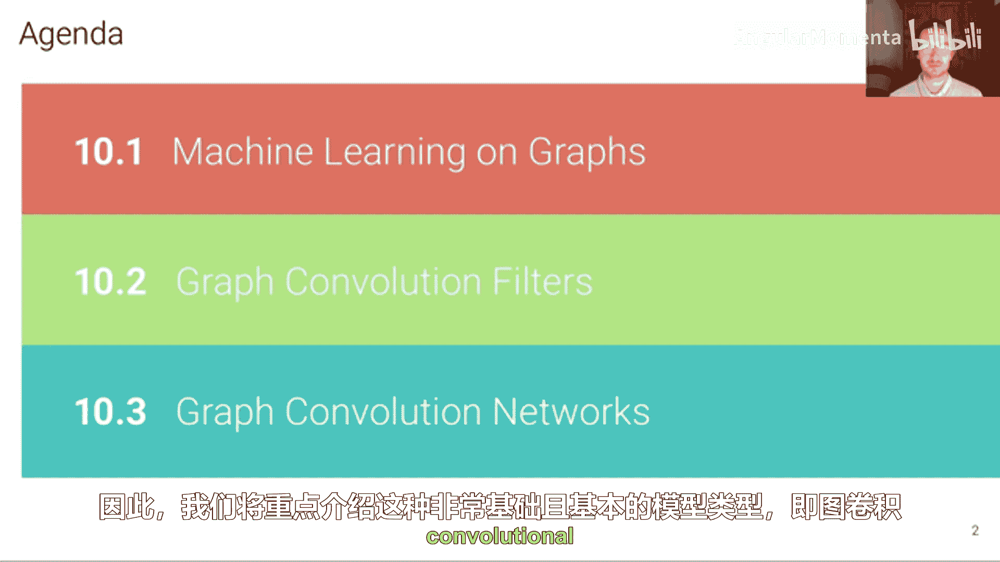
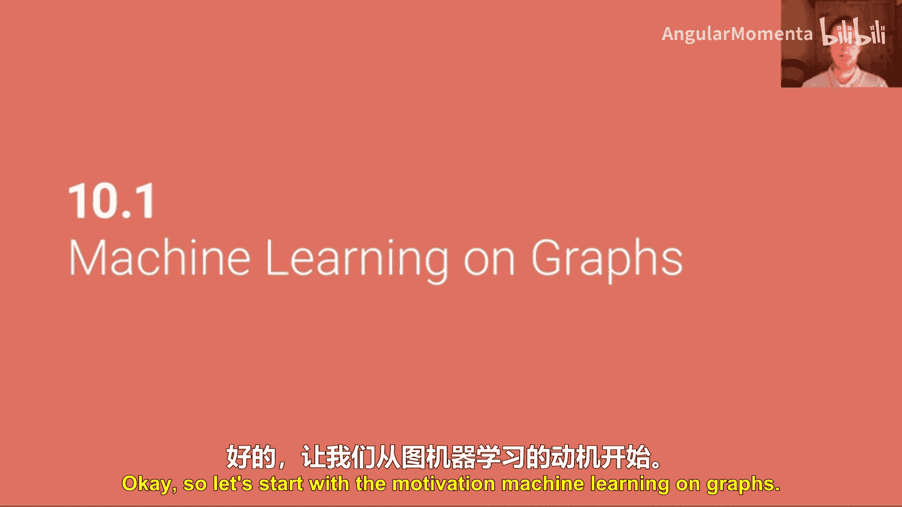
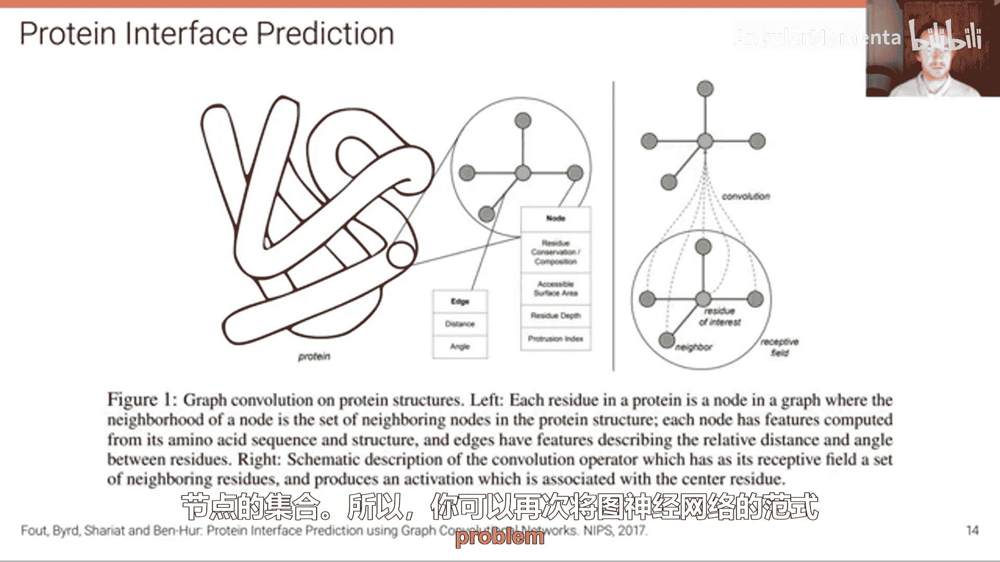
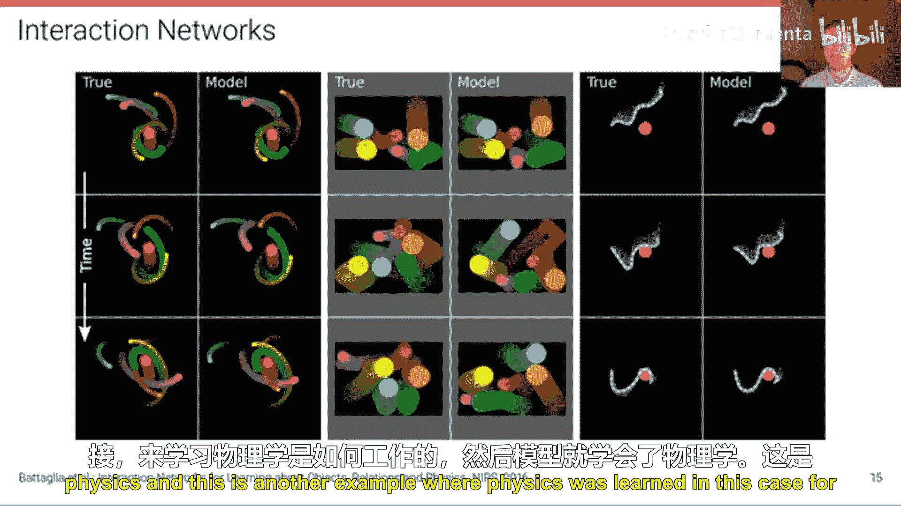
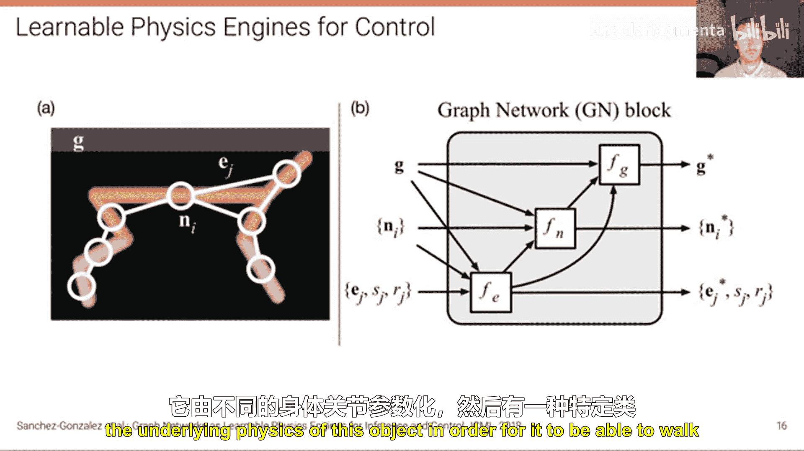
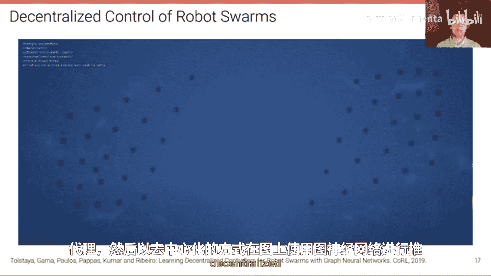
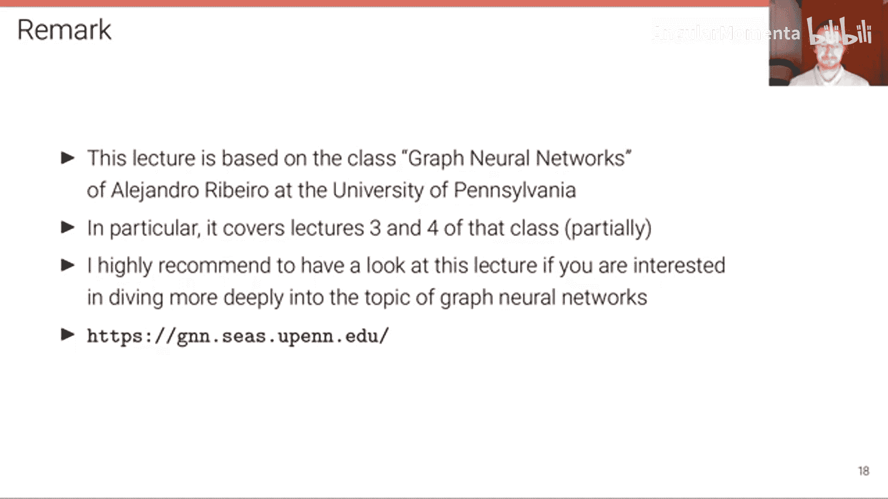

# 【精译】蒂宾根大学《深度学习》-p04-04--10.1（图神经网络：图上的机器学习）--BV1eDbrzhENK_p4-

は。This lecture is on graphraph neural networks。Which refers to a。

Category of neural networks that take a。Signal on a graph as an input and produce a signal on a graph。

As output。This lecture is structured into three units and the first unit we're going to discuss a motivation for learning on graphs。

And we are going to have a look at several applications。Of this model category。In the second unit。

 we're going to discuss。The basic unit of a graph convolutional network。

 which is a graph convolutional filter， and in the third unit we're going to then finally discuss graph convolutional networks。

 which are a specific instance of graph neural networks。

The fields really has exploded over the last decade。

 and so there's a lot more algorithms and models available than we could possibly cover in a single lecture。

So we'll focus on this very fundamental and basic model type， the graph convolution network。

Okay， so let's start with the motivation machine learning on graphs。Why do we need it。

We've seen that multilayer perceptrons are very flexible function approximators。In fact。

 they are so flexible that even a MLP with just a single hidden layer。

Assuming that that layer might be wide enough。It's able to approximate any possible function that we like to。

However， we've also seen that these MLPs don't really scale， for instance， with input dimensionality。

 if we have a very large input。Let's say a megapixel image。

 then the number of parameters in a model quickly explodes。And as a consequence， the model overfis。

Now， for。Structured。Signals that live on a grid， either a one day gr， a time gr， let's say。

 or a 2D grid， such as an image。Convolutional neural networks can address this issue。Okay。

The problem with convolutional neural networks， however。

 is that they only work for such regular grid structured data such as images。

But a lot of data can not easily described on such a regular format。For instance。

 molecules which have a graph structure that cannot easily be brought into such a regular regular grid structured format。

So what we try to do in this lecture is we try to seek a model class。That scales better than an MLlP。

But at the same time， it's more flexible than a convolutional neural network。

So we want something in between。 We want to generalize convolutional neural networks to be more flexible。

 But at the same time， we want to have something that also works for。Large data sets。

 high dimensional data。Here is another illustration of the same。Argument。We know that。

We can process data as we see here on the left with a convolutional network very well because this is grid structured data and assuming that we have a filter assuming translation equivaris。

 we can with relatively few parameters process such type of data。Now the question is。

 how can we build a neural network for general graphs as we see here on the right an example。

 and the answer is a graph neural network or。A specific instance of this。

 a graph convolutional network。And the goal here really is to， as we do。

 in the case of a CNN on the left。Also exploit for this graphs the local structure， which is key。

 we want to exploit the graph structure， the local connectivity structure of the graph is the prior information that we want to exploit from the graph in order to build a model that generalize as well。

Graphs are descriptors of the signal structure。Where the signals are stored at the notes。Here。

 we can see the notes in。Dark color。And the edges in light color express similarity between signal components as edges in this。

2D grid in this 2D convolutional grids。Like an image grid also express closeness because if we want to go from here to there。

 we have to do two hops if you're going to go from here to there， we need to do four hops， etc。

However， as we will see in this more general graph formulation。

This gridit doesn't need to be regular， and the edges can even have weights that differ from each other。

So we can have a different weight per edge。就。And what we're also going to see is that these convolutions that we define。

 like the convolutions on the 2D grid， we're going to define convolutions on the graph。

These convolutions are going to be polynomials conditioned on the graph structure that's encoded in a matrix derived from the graph。

And what we are intuitively doing is we are applying a filter as we apply a filter。

 a convolutional filter on the 2D grid structure， we are applying such a filter on the graph。So here。

 what we want to do in this illustration is we want to compute a value for the red dot。

And we're doing this by computing the dot product between the elements in green and red with a convolutional filter。

And we're trying to seek the equivalent now for。General graphs here on the right。

By exploiting locality， so as you can see， the green dots here are also just one hop away from the red dot。

And if we build a larger filter， which we can easily do with this formulation that we're going to develop。

We can also spend larger neighborhoods， So this is a neighborhood that spends two hops can go in two steps to the boundary of this filter。

 And here we also have such a filter that is two hubs away from the。

Notes where we want to calculate the value for。Before we go into details。

 let's have a look at some applications。 Why is this actually useful？Okay。

So this is a slide I took from a talk from Peter Batalia at an Alice workshop。

And it shows some of the possible applications of graphra neural networks， we can for instance。

 see that in order to do predictions for molecules， for instance， certain properties of molecules。

 graphra neural networks are great tool because molecules are structured as a graph or can be easily represented with a graph。

Similarly， if we want to categorize biological species。

Then we want to do inference on also on a graph， on a tree in this case。

 and this can be easily modeled with such a graph neural network as well。

If we think about language processing， then we have to deal often with parse trees and parse trees are also graphs so they can also be formulated in this graph neural network paradigm。

Similarly for modeling subatomic particles or everyday scenes where we model the compositional nature of objects using a tree。

 which is a special form of a graph。Or for instance。

 code where we want to build a parsel for source code。

So I'm going to now show some of these applications in more detail。

 The first one is scene graph generation。 This is actually an application where we want to output a graph。

 but this can also be done with a graph neural network。

 So the input here is an image and we run an object detector So we get proposals for objects。

 but these objects are all interrelated。 So the hope is that。

If we can learn something about their relationship。For instance。

 the relative location of two particular semantic classes like。You know。

 the birds and the tree branch。Then we can do better predictions because we can exploit this structure。

And so we can see a possible scene graph that's called a scene graph here on the right。

Where now not only the objects， but also their relationships have been inferred。

 So it's a richer representation of the input image than just。

A set of bonding boxes that represent the objects。Similarly。

When we want to track multiple objects in a video sequence as here on the left。

We can also represent this problem with a graph， because we have a time series with。

Where the nodes are the detections in each frame so in each frame we have multiple object detections and now we want to associate detections over time。

 so we want to find out the most likely trajectories and so we can formulate this also as a graph where all possible connections are modeled as a graph and we want to figure out which of these connections are actually the ones that lead to the correct tracking result。

Here's another example， this is on authorship attribution。So in this case。

 we're looking at a large body of texts from two different offers。And we are looking at a graph。

Over function words appearing close together。 function words are。

Insignificant words that tell you something about the particular writing style of a writer。 and so。

Depending on how frequently the writer uses two of these function words close together。

 we can infer something about the writing style and you can see while these two graphs look at the first glance they look quite similar if you look closely。

 you will spot some important differences and these are the differences in writing style and so processing this graph。

off。Where the notes of the graph are function words。

Allows us to distinguish who has possibly written that text。

Similarly for recommender systems here in the recommender systems。

 the nodes at the boundary of the circle here represent customers and the edges represent their average similarity in terms of product ratings and if we have now we want to infer a possible product rating for a customer but we don't have that rating yet because to present that product to the customer but maybe we know that this customer rates very similarly then another customer then we can do such an inference for this missing connection。

We've mentioned it before learning molecular fingerprints is another important application for graph neural networks due to the inherent graph structure of molecules。

And in this case here， for instance， this is from the paper here on button from Dev Nu Ial。

 convolutional Networks and graphs for Learning Mo fingerprints from NPS 2015。

The goal was in this particular experiment。To predict。ToxicTity。To predict toxicity for molecules。

 And so this is a naturally formulated in。The graph language in graph language。

This is another typical problem for graphs， protein interface prediction where。In this case。

 each recidum in a protein is a node in a graph but the neighborhood of a node is the set of neighboring nodes in the protein structure。

So you can then again apply the paradigm of graph neural networks onto these proteins for making a prediction on this problem。

This is an example for interaction networks， papers calledInaction Networks for Learn about objectsject。

 Re and Ph。And the goal here is to learn physical properties without injecting this knowledge into the model。

 So here can see over time， how。Different objects。U。Gravitate around each other。

Or orbit around each other。 Think about this as planets。

And we have an a large number of these observations。

 and now we have a graph neural networks that models the relationships between these objects in order to come up with a prediction that looks similar to the ground truth。

Here we have such a billiard ball situation where we have balls that might collide with other balls or with the wall and we want to do a prediction of like the future of such a sequence。

 or here on the right we have such a cloth。That falls down onto a rigid object in red。

 And then as a consequence deforms。 and we want to model this。

 And so we can learn how physics works by。I'm formulating this cloth as a set of nodes that are connected through a graph。

And also， to。The other elements in the scene。 and then a model learns。Physics。

And this is another example where physics was learned in this case for control here you can see a little。

Walking object or walker that has that is parameterized by。The' different。Body joints。

 and then there is a certain type of graph neural network that infers the underlying physics of this object in order for it to be able to walk。

And here's one more example， this is an example where we have a swarm of drones。

And we want to control that swarm of drones in a decentralized fashion。

And Graph neuralal networks are great at that because we can often process information very locally and then send this information wirelessly to the other agents。

And then in a decentralized fashion， implement inference over a graph using a graph neural network in order to。

 for instance， obtain a certain formation flight。

This paper is called Learning decentralized controllers for robots farms with craft neural nets。

So far for the motivation， one little remark， this lecture is based on the class graph neuralal networks of Alejandro Ribiro at the University of Pennsylvania。

In particular， it covers lectures three and four of that class in parts and it's a great lecture I think。

 so I highly recommend to have a deeper look at this lecture if you're interested in diving more deeply into this topic of graph neural networks。

I give you the link to the website here。

