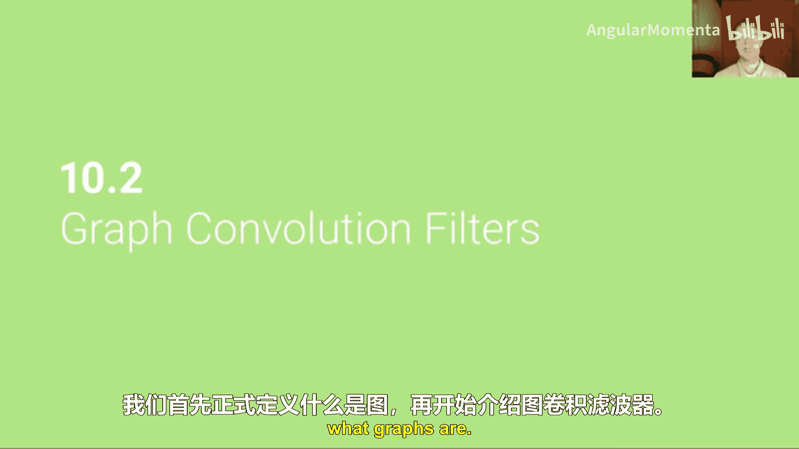
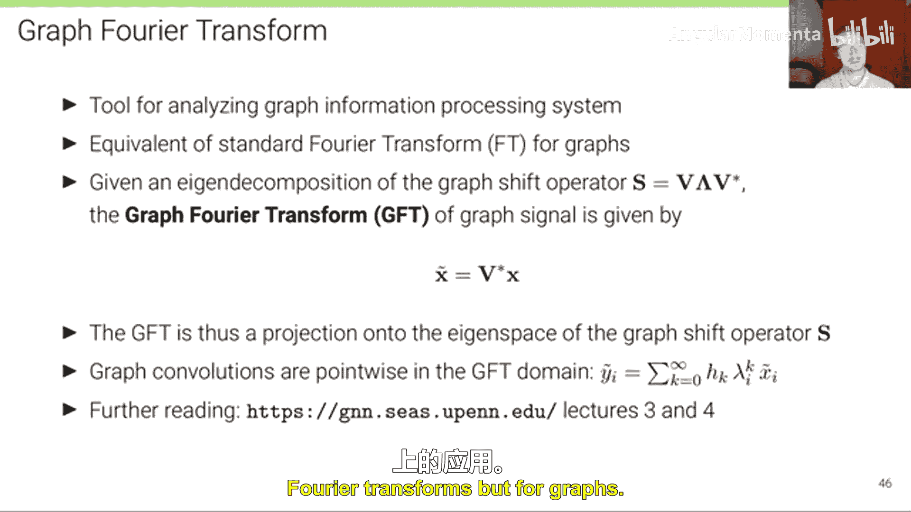

# 【精译】蒂宾根大学《深度学习》-p05-05--10.2（图神经网络：图卷积滤波器）--BV1eDbrzhENK_p5-

We start our exposition of graph convolution filters by first formally defining what graphs are。

And we do this by looking at so calledled directed graphs。Directed graphs are triplets。

G that stands for graph is a triplet。Of a vertex set， V， an H set， E， and a H rate set W。

Where the vertices here in blue are sometimes also called nodes。Are defineds。As a set of n labels。

So the vertex side。The set of integers from1 to n， where n is the number of vertices in this case，5。

Eches are ordered pairs of labels i J。And we interpret。In the context of graph convolutions， I J。

 the H I J。As theote I being influenced by the node J。

So the intuition is a little bit the opposite of how graphs are normally defined。

 And we'll see this also in terms of。How the errors are oriented。Yeah。And they waits。

That are associated with each H W I J。Are real numbers。

That are attached to these edges and they determine the strength。The interaction strength。

Between two node， in particular， WIJ。Determines the strength of the influence that node J has on note I。

But not the influence that note I has on node J， which would be W J I。That's important。

We draw such a graph。By drawingarrows between vertices。Where。

Errowors are always drawn from node J to the influence node I for an H I J。So for example。

 here we have。An edge。1，2。That is represented in this graphical illustration by an arrow from2 to one。

We don't have an edge to one that would be represented by an arrow from one to2。

But this maybe a little bit counterintuitive definition of。Influence。

Make sense if we look at the matrix algebra later on。So the only thing we need to keep。In mind。

 here is that the arrow indicates。The direction。In which the influence is executed。 So node 2。

Has an influence on node 1， which means that。If we execute these graph operators that we later define。

That means that some of the information， some of the signal that was present in node2。

Gets transferred to node 1。Yeah。It's also important to note that HIJ is different from HJI。

In a direct graph， we can have， for instance， H I J， as in the case here， but not H J I。

In some cases， we might have both。For we， we don't necessarily have to have both。

Both are possible and both are different。If both edges。Our part。

 like the edge from I to J and the edge from J to I， are part of the edge set。

Their weights can still be different。In a directed graph。

 there is no restriction that the weight from H， the weight 5 free。And the weights35 are the same。

Okay。A graph is called symmetric。are。Undirected。Sometimes as well。

If the edge set and the weights are symmetric。Yeah。And the edge side is symmetric， exactly if。Yeah。

IJ， the HIJ being part of the edge set implies that also the HJI is part of the edge set。

And we indicate this here in this graph by simply having two sided errors。

 so all of the connections that we draw in such a graph。Are two sided arrows now， either。

 we have no connection like here in this case between  4 and 5。Or we have a connection from。

Free to five and from five to three as well。And。😊，Furthermoremore。Not only both edges are there。

 but in this case also the weights are symmetric。Which means that WIJ is the same as WJI。

 there is basically just one value at this edge and that xs in both directions。Furthermoremore。

 a graph G is called uned。If it doesn't have weights。Yeah。Equently。

 we can say that all weights are one。And this is the typical way of formulating this and we are going to have a look at some of these examples in the following slides just because weights of one are simple to work with。

In this case， the graph structure just tells us what is close in terms of the edge connectivity。

But each edge doesn't contain any additional information on how close two node are with respect to each other。

If we look at this particular edge compared to two other nodes that are directly connected by an edge。

But that could have in the case of a weighted graph could have a different weight。

 So here all the weights are the same。W Ij is one for all。IJ edges in the edge set。

Anroided graphs can be ever directed。Are symmetric。

But most graphs we encounter in practice are actually weighted for many problems that we will see。

 we have weighted graphs and if we have this weighted information。

 of course we should take it into account， this is part of the prior knowledge as is the graph structure。

So the more prior knowledge we can take into account into our computations。The better hopefully。

 our predictions are。So we'll see。Cymsymmetric。Or directed graphs。

 and most often they will have weights in practice。Graft shift operators。

This is now the transformation。 We're going to talk about the transformation that operates that defines a graph that is。

The mathematical mathematical formulation of a graph。 and theres。Multiple options to define this。

 they are all derived from the graph structure， from the vertices， the edges and the weightset。

The first。Shift operator that we define， all of these operators that we're going to define here are shift operators。

 as we'll see in the end。The first operator that we define is。The simplest one。

 which is just the adjacency matrix。So here we have a symmetric graph。In this case。

 it's an unweighted symmetric graph where we have just weights one。Or0。

 if there is no connection between nodes。And the adjacency matrix of a graph G。

Is then the sparse matrix A。With nonzero entries。嗯。

Exactly at these elements where we have a weight defined。Or we have an edge defined。So AI J， this is。

Indexing into that matrix at element I J。Is equal to WIJ， the edge weight。

Exactly when we have an in the edge set。So for instance for this graph here。

 we have an edge between one and  two， this is the green edge。

 so we have a one here at this location， which is in the first row and the second column。

 similarly because it's a symmetric graph here， we have a one in the first column and a second row。

はい。W 1，2， and W 21。And the same holes， for instance。

 for this blue edge here where we have a one here in row  one and column3 and in column 1 and row free。

 So if we continue this process and filling in once。Based on where we have edges in that graph。

 we got this matrix。And all the remaining locations are zero。And this is called the adjacency matrix。

If the graph is symmetric as in this case。We immediately see that the ajacency matrix is also symmetric。

In other words， a equals a transpose。Or。The matrix here is symmetric at this axis。

The next thing I'm to define are neighborhoods and degrees。

 so we're consider this graph here in this example now。The neighborhood。What you call here。

N of I of node I is the set of nodes that influence node I。So mathematically speaking。

And of I is the set of Js， for which the H I J is in the edge set。 Remember， we have set。That's。

For the for any edge， with any eye。For any edge I J， J is influencing I。

 So we need to look at the entire edge set and need to look at the edges that have J。嗯。Yeah。

And that have I as the first component。And then we we accumulate all the Js into this set。

 and this is the neighborhood。This is the set of all the nodes that have an influence on node I。

 In this example here， we have these two green arrows。

Then indicate that both node 2 and node 3 have an influence on node 1。

But there is no edge from node 4 to node 1， and there is no edge from note 5 to node 1。Therefore。

The node one neighborhood is the set to and free。The two ver is two and free。The degree。

 D I of node I。Is then the sum of the weights of its incident edges。So we have a weighted graph here。

And in this particular case here， we would sum up the values W12 and W13 to get the degree。

Of node one。In the case of an。Unweighted graph， for instance。We would have a one here and a one here。

 So the degree of that node 1 would be2。Okay。In other words。The degree specifies how many nodes。

And how strong they have an influence on that particular node we want to compute the degree for。

This is the neighborhood and the degree of a node I。Now。

 the degree matrix D is a diagonal matrix where we put these degrees at the diagonal。嗯。So， we have。

In this case of an unweighted graph here， we have two for node 1。

 we have three for node2 because theres three incident edges， one from node 1， one from node 3。

 one from node 4， we have three for node3 because there's also three incident edges。

 but we have just two and two for node 4 and 5 because there's only two incident edges each。

And it's zero everywhere else because it's a diagonal matrix。

We can also write D in terms of the adjacency matrix。In。And this is very simple。

 so we can write this as T equals the diagonal matrix of the vector a。

Where we multiply the matrix A with the one vector。

If we look back at the adjacency matrix here of this same graph。

If we consider a one vector here multiplied with this matrix。

 then we are in the first element we are getting is some of these two elements。

 which is2 in the second。Element we get to sum of these three elements， which is free。

 And so we arrive at the same。Matrix stack。operator here just indicates that we're taking a vector and converting it into a diagonal matrix。

This is the Diek operator。Now， the next。Graph shift operator。

 so these haven't been graph shift operator， the degree matrix in the neighborhood。

 but the Chastenency matrix was a graph shift operator。

 The next graph shift operator that we're going to define is thepl。

The lapblian matrix L of a graph with adjacency matrix A is defined as the degree matrix minus the adjacency matrix。

 so we take this degree matrix here that we have defined here。

And subtract the adjacency matrix in the example from before we have this degree matrix here。

 we have this adjacency matrix here， and we have the resulting lapplian matrix L here on the right。

And we can already see that the degree is on the diagonal。

Which makes sense because we have only diagonal elements for the degree matrix。

 but no diagonal elements or zero diagonal elements for the adjacency matrix。

And the values of the adjacency matrix are。嗯。Nigated it at the off diagonals。

 so we get these elements here at the off diagonals。With the miners in front。

Now this can also be written explicitly in terms of graph weights。Which is clear right here。

 we just have this written component wise L I J is at the off diagonal is minus W I J。

 and on the diagonal， it is。嗯。This sum over the neighborhood， WIA。Now， the Lalaian matrix。

On the graph is called a a graph lapplsium。And the graph lapplian has the same properties for a graph then a lapplian matrix。

 which is the divergence of the gradient has on a regular domain。Okay。

We're not going to go into detail here， but it's， it's kind of a。It's measuring the smoothness。

 It's measuring。 if I'm taking a。A vector。A signal here we're having five dimensional signals， right。

 So this is a five。 if we would have a signal on that。Graph。

 a signal is a vector that associates one real number with each node in a graph。

 So here we would have a five dimensional vector。 If we will multiply a signal with this lapplian matrix。

Then if we would have。Elements， nearby elements that are defined through this adjacency matrix。

That are different from differing from each other than we would get。A， we get a large value。

 But if they have a similar value， we' would get a small value。

So it's measuring something like smoothness。嗯。Or curvature。Now， what we can do is fer。

And to normalize both the ajacency matrix and the lapplian matrix。And this is useful in particular。

 when the graph is very inhogeneous， when we have。Some notes that are very far from other notes。

And some nodes that are very close， so if we have some weights that are very large and some weights that are very small。

 or if we have some nodes that are connected to many nodes in a graph and some nodes that are connected to only few nodes in a graph。

And。😊，We can normalize， simply by。Dividing each element。By this square root of。D I DJ。

The degrees of these node。And if we write this in matrix notation。

 we have the normalized hjacency matrix a bar equals。The degree matrix。And to the power of -1 half。

Times the adjacency matrix times the degree matrix of to the power of minus1 half。And similarly。

 we can normalize the pla matrix。And using these normalized matrices as shift operators。

 as graph shift operators as representations for the graph。

Is advantageous in particular if the graph is very heterogeneous。

 so we're kind of normalizing the influence。Over the cross。Now， this is one crucial slide。

The graphra shift operator， this is what we define here。

 represents any of the graph matrix representations that we have learned about。

So in the case of the adjacency matrix， the graph shift operator S is a。

In the case of a laplationian matrix， the graph shift operator is L。

In the case of a normalized de Chaency matrix， the graph shift operator S equals a bar。

 and in the case of the normalized lapplian matrix。The bar shift operator。

 the graph shift operator equals。mEbar。If the graph is symmetric。

 the shift operator is symmetric as well， that's clear。

And the reason why we define this graph shift operator so broadly is that while the specific choice of S matters in practice。

Comparare， for instance， normalized lappl versus regular lapplian。嗯。

The analysis that we're going to do holds for any choice。 So we're going to just consider S from now。

 no matter what you will use in an implementation， there's different。

Graph shift operatorsators that people are using for different applications。

 and all our mathematical representations of the graph to capture the structure of the graph。

 the adjacency matrix or the lappl matrix， which are actually quite related there lapbl matrix is just D minus the adjacency matrix。

They both capture the structure of the graph， and they both allow for a。

 as well see a diffusion process on that graph。So we are just going to consider this general notion of graphra shift operator as from now on。

We've already talked about graph signals。 What are graph signals。

Consider a graph with end notes in this example free and a shift operator S。

The shift operator S is directly defined by the structure of the graph。In this case here。

 we have justice free directed。Edges， so we have only in this。In this case。

 we use the ajaency matrix as a simple shift of a rate。

 So we have the shift of a rate that has element1 here at the first row and the second column because we have this。

Atdge1，2 here。Where2 has an influence on one。And so on。So we。

 we consider this graph G with end nodes that is formalized through its。

Or represented through its shift operator S mathematically。And then we consider a graph signal。

 which is a vector。 In this case， it's a three dimensional vector that assigns one real number。

1 scalr to every note。Okay。And S encodes the expected proximity or similarity between the components of x。

Then multiplication with the graph shift overator of the input signal X。

 the signal that is defined on that graph。This is the input。Also， when we do inference。

 this is the input to our algorithm。So we're doing a convolution through the graph shift operator。

 as we'll see shortly。On that graph and the input is x and the output is y。

So the multiplication of x with the graph shift operator S yields a diffused signal over the graph。

Mathematicically， we write y equals matrix S multiplied with the vector x， which is the graph signal。

Or if we use an element via notation like this。And this implements a local operation where values are mixed with neighboring values。

 what we see here in this example is a very simple graph and we have two examples here of applying two different input signals to multiplying those with the shift operator。

So here we have the shift operator S that represents the jaency matrix of this graph assuming we have an unweighted graph where all the weights are 1 If we assume an input signal 1050。

 we see that after multiplication with this matrix S we get 5010 and this is also what we expect because in the simple case we have that node 2 influences node 1 and it's exactly what happens。

Notode 2 was represented with value 5 before， and now after applying the shift operatorator。

 node 1 is represented with value 5。And similarly。We have for instance。

 that node one influences node3， so we have this 10 which is now getting transferred this case is just a simple permutation matrix。

 it's getting transferred to the third location in that vector。

And you can imagine now what happens if you have multiple errors that point to one node。

Or in some cases， people even introduce self errors， like errors that go from the node to itself。

Then all this information gets mixed up。 In this case。

 it's just permed If every application of the shift operator is permed， but its still diffused。

 We're shifting information around in the graph based on。How the errors are defined in the graph。

In the simple graph， it's just a permutation。Now， similarly。

 if we take this as an input signal of 5010。And multiply with the shift operatorator， we get 015。

 So we see again that， for instance。5， which was at location one， is now shifted to location3 and 10。

 which it was at free， is now shifted to location 2 so we getting。We can define。

 or we can see that this。Shift operator， in this case。

 a simple adjacency matrix of this unweighted graph defines a diffusion process。

Where the signal gets diffused over the graph。But with each application of the shift operator。

 we're just diffusing by one step by one hop by one edge。If there is no edge from。

 if we would have more notes here， like， let's say there's a fourth node here。

And there is a direct et from2， but not from free。 we can only pass information from free to that node by applying the shift operator twice。

With a single application， we can only pass information along a single edge。

And that's what a graph signal diffusion using the graph shift operator is。Now， as already mentioned。

 we can apply s multiple times to obtain a diffusion sequence。

That can be recursively written like this。 We have S X K。Which results in Xk plus1。

Where x0 is the input。 So we define x0 as the input to this diffusion sequence。

 This is the input signal。Similarly or equivalently， actually。

 we can write this diffusion process as a power sequence。Say that if we。

Unroll this diffusion sequence here， we obtain a power sequence where because we have the same shift operator applied at every recursion。

We just have xk equals S the shift operator matrix to the power of k times the input signal x。

In practice， you。You want to implement this variant here because it's computationally easier。

Here in this case you have to do a lot of matrix multiplications here you just have matrix vector multiplications。

 which is faster。But both are equivalent。And this one here is。

Sometimes easier to analyze mathematically。So we're going to use this in our analysis。

We have an example of this process here on the top where we see a little bit more complicated graph than we have before。

 and we see that we have a graph signal here indicated in colors and this。

Size of the circle indicates the signal strength that's。At a particular present at a particular note。

 this is the input signal。Now， if we apply this shift operator， if we apply s to the power of 0。

 we get the input signal again， so this is the input signal if we apply S1。1。

 one application of the shift operatorator。 we see how the signal starts diffusing。

 If we apply it more and more， we see how this。These large values that are these initial five nodes are diffusing over the graph。

So with more applications of this shift over， we're diffusing information more and more over the graph。

Yeah。So now we are ready to define graph convolution filters。Graph convolution filters。

 as mentioned before， are the basic building block of graph convolution networks。

We've seen how such a。Power sequence defines a diffusion process。And with with each K。

 we have a different state of diffusion。Now we can define this。

 we can use this to define the graph convolution filter。Given the shift over rate S。

That represents the graph under consideration。And some filter coefficients HK， these are scalarrs。

A graph convolution filter is a polynomial on the shift operator Ra S。

So we write the graph con filter H of S。Equals。嗯。The polynomial。The sum K equals 0 to infinity。

Double。That should actually be H。HK times。嗯。The shift operator to the power of K。

So here here we see what we see here is basically， this is the diffusion。This is the power sequence。

 This is basically the。The shift of a rateer。To the power of K。And because we can。

We can do this for any K。We can define such such a sequence。Yeah。

And now the result of applying this filter that we defined through this power sequence。

To the signal X。Is simply the following signal where we have this infinite sum over this coefficients times s to the power of k times the input signal x。

What this means is that these filter coefficients， which you can think of similar to the filter coefficients that we have in the kernel of a convolutional networks。

 but now in this case， the filter coefficients determine。

The importance of a particular diffusion state in this。Diffusion sequence that we multiply with x。

This is what can be learned in such a graph convolution filter。 It's different from the。

Fto kernel in a convolutional neural network in a sense that in a convolutional network。

We know about relative positions we can associate weights to a pixel in the kernel that's on the top left and on top right。

That's not possible here， in this case on graphs we are completely permutation。

 we must be completely permutation invaried。And therefore， we define these filters as weights。

On this。Power sequence of the shift operator as to the power of K。

Now the shorthand notation of defining this graph convolution is of writing this graph convolution is y equals H。

 and we have the star S indicating that we are having a graph representing by the shift over rate S。

X。And that's a graph convolution of the filter with the coefficients HK with signal x， of course。

 in practice we're not going to be able to compute this until infinity。

 so we're going to stop at some k minus capital K minus1， we're going to see that。うん。😊。

So is a finite filter。So we've seen that graph convolutions aggregate information from local to global neighborhoods。

Let's consider a signal X supported on J with a shift operator S and a filter finite filter in this case H。

Then the output of the graph convolution with this finite filter。Is。Y equals H。Convolulved。

Or S convolulveed with x。Is。H0 as to the power of0， which is the identity x。Plus。

 H1 S to the power 1 x。And so on times h k minus-1 S to the power K minus-1 x。

So we see that the graph convolution is actually a weighted linear combination of the elements of this diffusion sequence。

SK X， which we have discussed before。We are just。A performingform a。

A weighted linear combination of this SKX。Each SKX serves as a feature and we're doing a weighted linear combination of those。

We can also visualize this operation using a block diagram。Okay。

We've seen that graph convolutions iteratively apply a shift awaiting in sum so we can write it in terms of a block diagram that。

Apps a shift。Awaiting and dis sumation。So we start with x here。And so we multiply this with H0。

 and we get h0 times x。And then， we add。So we shift the x with the shift over rate S。

 which is S mathematically， it's s to the power of1 times x。

Then we multiply this with H1 and add this to what we had before， which is H0 x。And then， they shift。

The signal again。We shift the shifted signal。Let we get s to the power of 2 x。

 which will multiply with H2， the second or the third coefficient。And then we add it to the output。

And then we shift this shifted version of the shifted version of x。 We get S to the power 3 x。

We multiply it with H3， and we add H3 S to power 3 x。To the output。

 and so we get the con convolution output of this graph convolution filter。Okay。Now。

 what's interesting is that these graph convolutions as we have to find them in the most general form。

Actually， capture important special cases such as oneD time convolution。

Time convolution is actually just a linear combination of shifted inputs as we know so we have。

This input sequence here on the top。And if we want to compute a time convolution。

 which we have written down here， this is now the the correct notation of convolution。

 not like the the one with the plus that we had for defining。In a simple manner。

 convolutional networks。 So we have。K equals 0 to k minus1。

The filter coefficients H K times xn minus k in this case。

 So this is the just the definition of the regular convolution。In one day。

So what that means is that we need to shift the signal， which which is happening here。

 So we see how we shift this。Signal add location zero to the first location， second location。

 third location， and so on。This is indicated here by this shift operation。

And so we're shifting the input signal and multiplying the shifted signal with H after each shift。

And then we are adding it。To the previous output， similar as before。 And we do this multiple times。

To arrive at the。Time convolulved output， this is just a regular time convolution as a block diagram。

Now， the question is， can we express this time convolution via a graph convolution and what should the graph be？

Well， the answer is， yes， we can if we consider a simple line graph。

Where we have node0 influencing node one， node1 influencing node 2。

 so there's an edge from2 to one and there's edge from three to two and so on。

Then the corresponding adjacency matrix of that graph， assuming an unveed graph is this one here。

Imagine this matrix extending all the way to infinity to properly define the convolution。

 But here we just we're just looking at a5 by5 crop of this matrix。

 The important thing about this matrix is that it has zeros everywhere。

 but it has once just below the diagonal。Which means that if I multiply an input vector。Like x 0， x1。

 x2， and x3 with this matrix。Then I obtain a shifted version of that vector。

Because I have these elements just below the diagonal that are basically permuting the input vector in a way that every element goes to the next location。

So we have x minus1， x0 and x1 and x2 at the locations inside that vector where we had x0。

 x1 x2 and x3 and again imagine these matrices in these vectors to extend to infinity in both directions here。

In in previous time and in future time。So we have found a shift operator。

 a very simple shift operator that is。Allowing to to realize。嗯。

Regular time convolutions as a special case of graph convolutions。

And so we can use our standard block diagram here again from before where we have the shift operator now that shifts the input。

 and then we multiply with the coefficients H。 In other words。

 time convolution is a polynomial on the adjacency matrix of the line graph。

And can be expressed using the same。Graph convolution operation that we have defined before。Now。

 if we let the shift operator be a shift operator of an arbitrary graph， not just a line graph。

 then we will cover our more general graph convolutions again。

 this is a general graph that we see here where this little dots here， the height of these dots。

Indicates the value， the signal at each node。And then we can do exactly the same thing as before。

 but now on a general graph。Now， one last word on graph Fourier transform。 so this is。

Also a bigger topic on its own， so I just want to mention it on one slide。Briefly。

 graphra Fourier transforms are the equivalent of standard Fourier transforms。

 but not for graphs and they are an important tool for analyzing graph information processing systems。

Yeah。Given an eigen decomposition of the graph shift operator。

 so we have the graph shift over operator S here and this eigen decomposition into these three matrices here。

 the graph Fourier transform of the graph signal is given by the projection of the graph signal X。

Under consideration， onto the eigenspace。We star off the graph shift over radars。

So we have a very simple way of obtaining。嗯。The Fourier transform of a signal by just projecting it onto the eigenspace of the graph shift operatorator。

And the nice thing about。Opper workinging in the Foururier domain is that similar to the regular Fourier domain。

嗯。For the cleaning domain。Is that graph convolutions are pointwise in this Fourier domain so we can then like this whole convolution operator becomes a pointwise operator。

So we have a point by multiplication here。Now， yeah， this is a bigger topic as I mentioned。

 and if you're interested in this topic， I encourage you to have a further look into for instance。

 this lecture the link here。So I want to leave it for this lecture。

 we're going to leave it with this。Just this little overview of graph Fourier transforms。

 which are the。The equivalent of Fourier transforms， but for graphs。

