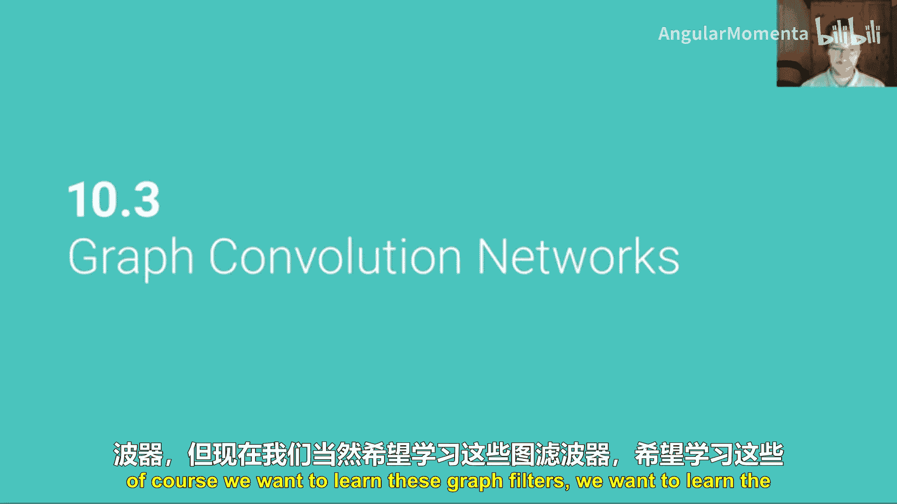
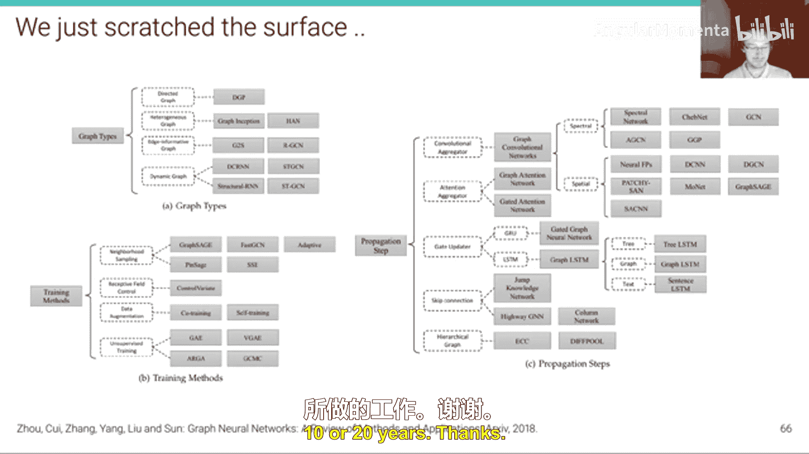

# 【精译】蒂宾根大学《深度学习》-p06-06--10.3（图神经网络：图卷积网络）--BV1eDbrzhENK_p6-

We've seen how。Convolution filter on graphs are defined with coefficient H。But。Now， of course。

 we want to learn these graph filters。 We want to learn the coefficients of these。

Graph filters。 and we want to stack these graph filters into Loer。

Networks as in a multilayer preceptron。We want to stack also multiple Fine transformations together with nonlinearities into multiple layers。

But now let's first look at a single graph filter。In that sense， a single。Linear layer。

Equivalent in a multi layer perceptron。And see how we can learn the filters。

Let's calligraphic D denote the data set of input and output signals on the graph。

 as well as the graph representation itself。 So this data set。Is composed of triplets， X， I， Y。

 I and S I。Potentially。This data set could contain。Elements from different graphs。

And we could train a graph filter。That is。Becoming robust to different graph representations as long。

As in the test set， we're seeing。Graphs from the same distribution。Despite his graphs。

Being not the same， we can still process them with such a graph neural network because S is known for both the training and the test graph and the neural or the graph filter in this case has learned to work well。

On the whole distribution of graphs， this is the beauty of graph neural networks。

You can train graphra neural networks on a set of graphs， and apply。Them on a， on a different。Gra。

Which is of course not possible if it would just have a multilayer perceptron on the vergees defined。

Yeah。So now， let's。F8 of。Input signal X and graph shift over rate as denoted graph filter。

Which means in the notation that we've used in previous lectures。By hat。The prediction。

 this is the output， the predicted output of this graph filter。Is F H。Of X and S。

Which is just this polynomial。Of the。Graph shift operator to the power of K and x with coefficients H K。

 which are now the parameters of this model。 That's why we indicated them here。

As a subscript of the function F。During training。We know。Seek to minimize a loss function。

 as we usually do in empirical risk minimization。Where we try to find H star as the minimizer of this objective。

 which is simply the sum over the entire data set of some loss function that compares。

The prediction of the model。The signal Y hat predicted by a model to the true output signal。

And this optimization， as is important， is only over the filter coefficients。

 the inputs X and the outputs y。And also the graphs。

 the graph representation in form of the graph shiftover operator， are provided as prior information。

Yeah。Now。In some cases， we might not be interested in inferring signals that have the same shape。

Output signals that have the same shape as the input signals。In this case， when the output。

Y is of a different dimensionality than the input signal or is not a graph signal。

Then we simply add a readout layer to this model。And we'll do this also。For models。

 for depot models that we'll look at in a bit。So we have used n as the number of vertices or nodes in the graph。

 which means the input signal is an n dimensional vector。

 Now we assume that the output is an m dimensional vector where M is not equal to n。So we can。

 of course， take。The prediction of this graph filter。

 which is n dimensional and multiplied with a M times n dimensional matrix。

 so called readout matrix R for matching dimensions。Typically。R is not learned。

 but is a design choice of the algorithm or the algorithm designer。

 So typically examples for the readout layers include if we want to read out just。

A value at a single node， then this read out corresponds just to a unit vector where the one is at the corresponding component that we want to read out。

If we want to。Read out a summation。Over like we want to do an average pooling。

Or a sun pooling over all the elements。Of the graph signal over all the n elements。

 Then we can just take the one vector， transposed one vector and multiply it with the output here in order just to take the sum over all elements。

 et cetera， et cetera。 So readout layer is used in order to produce outputs that are different of different dimensionally dimensionality than the dimensionality。

N of the input graph signal。 And for instance， a summation readdo would be useful in order。

To tackle classification problems where the input is a graph and a graph signal。

 and the output is a particular category。Okay， so this was about learning a graph filter。

 which you can think of as a single layer graph network。However。

 one thing is missing and that leads us to graph convolutional networks or one step closer to graph convolutional networks。

 which are graph perceptrons。 they are also single layer。Graph networks。But they combine。你。

Graph filter that we've seen before with a nonlinearity G that could be a point y sigmoid。

 to H or relu just as we applied them in the context of multiier percepts。

By adding such a nonlinearity， we go one step closer to making our model more expressive。

 The model before could only learn linear maps。 We just had a。A convex combination of this。

I graphra shift operators。With x and then H with this power series。So everything is linear。Now。

 with a。A non nonlinearity on top of this。We can learn mappings that are slightly more expressive。

 that are at least nonlinear， so it captures a larger function class。Its stay equivalent to。

The perceptron。Of neural networks。To define a and it's the first model that could。

 if you would use a sigmoid here， that could basically do classification。

To define a graph convolutional network now。We take these perceptrons and as an an MLP recursively compose these perceptrons。

 these graph perceptrons in this case， into layers。So we have a graph perceptron here。

Where now the H has an additional index L for the layer。And x。Has now an index for the layer as well。

 So we take the signal from the previous layer。We。Multipliied with the。With S to the power of K。

And then， with this scalar。Coicient H L K， the coefficient at layer L。And for， for。

 for that particular K here。And then we apply the nonlinearity and we obtain the signal at the next layer。

And then we recursively add more and more of these layers。

 and maybe at the end we have an additional readout layer。And， of course， we have assumed that the。

That x0 is the input signal， so we start with x。So it's just a recursive definition。

 a recursive application of graph perceptrons。As a shorthand notation for graph convolutional networks。

 GzNs with L layers， we simply write that the prediction is F。Subscript calligraphic H。

 which now comprises all the coefficient vectors，1 per layer。Of x。And the graph shift of rate S。

Which is equal to the last element of this recursion， x big L。The last layer。And again。

I mentioned this multiple times because important to graph shift operator as is given is the prior information that they give to the model。

And that is encoding the graph structure。So here's a block diagram of how this would work for a model with three layers。

 we have layer 1，2 and3， we input X the signal， then we multiply that signal with this power series here with this coefficients H。

1 k。And we get C let's pump through this pointwise non nonlinearity， so for each element of C。

 we apply element wise separately to each element this。Sigmoid in this case。 So we get x1。

 and then we do the same for x1。 We get x2。 We do the same for x2， and we get x3。

You can see that S is always the same in each layer we're using the same power series。

 but the coefficients they change。And the red coefficients here are the learnnable parameters of this model。

This is a graph convolutional network。More specifically， it's a graph convolutional network。

On signals where at each note， we have a single real number， a scalar。

Now learning a graph convolutional network works the same as learning a graph filter。

 we again have the data set D where we can have again different graphs for different elements of this dataset set。

And then we have F calligraphic H of xs the GzN with filter set H。And during training。

 we seek to minimize some loss function that measures the discrepancy between。F H。

 the prediction and y the ground truth signal， output signal。And this optimization is over。Age。

All filter coefficients。The graph shift operator has given us prior information。

And the data set may comprise multiple different graph instances。And empirically。

 and this is similar to ML LP， deeper cheesy ends work better due to this layered stacking of。嗯。

Convolution and non nonlinearities。 And this is exactly the same as in。In CNNNs， for instance。

 where you have also convolutions and nonlinearity stacked together。no。As we mentioned before。

Graph convolution networks are。More flexible than CNNs。

But they are less flexible than multilayer percepts。

 as they are a special case of multilayer perceptioncepts。

If we consider a very simple form of a multi layerer perceptron with a。Pointwise non nonlineartic G。

Let's say a sigmoid。And ignoring the bias for now， we can define this recursively using this representation。

Now， if we compare this to this。we see the trainable parameters highlighted in red。

 we see that this model is more flexible because we can use this model to represent this model on the right。

So this is a special case， the graph convolution network gives a special case of the multi layerer perceptioncept。

We also have a linear transformation， but in this case we have a projection onto this S to the power of K matrix and then we have just a scalar coefficient H。

 while here we can learn an arbitrary matrix W that can be equivalent。嗯。To this power series here。

 or it can be not。Now SGZNs are a special case of MOPs。嗯。They attain a higher training cost。

 in other words。Over the training set。 And now in this case， we are using the same S。

As the same graph and the same graph representation as for all the data points。

 because otherwise in MLP， we couldn't execute on different graphs。

Because an MLP is is by definition， is' not permutation equivalent as a graph convolution network is。

So S these GCNs are a special case of MLPs。To perform like the training error that we see of an MLP。

 assuming that we have a good training algorithm， good enough training algorithm is always smaller or equal than the training error of A GCN。

Now， this is maybe a little bit counterintuitive in the first moment。

But the important thing here is that。GeeZNs generalize better to ancient signals。

As they are able to exploit internal symmetries of the graph signals encoded in the graph shift operatorerator by using the graph shift operatorerator。

 which the MLP does not。The model。May perform a little bit worse on the training set。

 but generalizes dramatically better to new signals on the same graph or two new graphs。

And furthermore。The graph convolutional network is the only。Model in this comparison。

They can handle different graphs where we can have an optimization during training time and also at inference time。

 we can apply this model to different graphs。 We can do the convolution to different graphs because S。

Informs the model about the structure of the graph。 we're always projecting through S。

 So the dimensionality of x is linked to S。And not to some generic globally trained parameter matrix W。

So does the beauty about graph convolutions。Here's a little illustration on the generalization properties。

 assume the training examples are all similar， somewhat similar to this。

Example signals shown here on the left。By the way， the signal strength is indicated here in terms of the。

strengthng of the blue color。So we have this strong signal at vertex 9 and a weaker signal at 10 and no signal at  five and6。

Now an MLP would learn to predict signals that look like the middle signal rather correctly。

But it's impossible if I have just training examples that look like this one to generalize to a signal here on the right。

 So the prediction if this would be the input to the MLP at test time， if at training time。

 I have only observed examples that look like these。It's likely to be very bad。However。

 the GZ end will succeed in this case as it knows the underlying structure of the graph。

It basically performs convolution along the graph by knowing the structure of the graph。

 so it can infer that at node6。In the input， there is nearby nodes that have a strong activation。

 And so this pattern here is the same pattern as this pattern here， just。

It's occurring at different notes in the graph。So there's this。This equivariance， the equivalent。

 the equivalent of。The translation equis on。Convolutional neural networks we see here。

As the equi on the graph convols。Yeah。嗯。What we've seen so far。

Our graph convolution networks that are limited in the number of features of their input。

 in particular we have assumed that the signal is one dimensional。For every vertex in the graph。

The input signal has one scalar。Now this is restricting both as an input but also as an intermediate representation。

 so we want to generalize this to allow for multiple features to allow for vectors。

 every vertex is now in a multi input multi output GZNS in a multi input multi output is a。

A feature vector。So we first define filter banks。Fto banks。

 output would put a graph signal in a matrix form。So here we have a graph signal。

 this is a scalar per。Note in the graph。And the filterbank outputs。A feature vector， per note。

So for instance， in this case， at node 6。We have free values in。In the output of this filter bank。

How does it do that well， it's basically just applying three different filters independently on the input signal X。

 so we take the input signal X。We pump it through the first filter， we get C1。

 through the second filter， we get C2， and then through the F filter， we get Cf。

So each of these Cs here is a graphs of one dimensional graph signal what we have specified for each vertex。

One real number。 But now we have F of them， so we have effectively specified。

A a feature vector for each vertex。You can think of this as a book where at each book page。

 like here。The book where at each page of the book。

 we have specified a 1 D signal such that if we look at the entire book。We have。A vector per node。

This is a filter bank。Now， if we assume there's。F input features per node。

And we have a filter band with G filters。Then we process each input F。With each filter， G。To yields。

Outputs that are f times g。What this means is that this memo graph filter therefore generates an output with F times g features per node。

 so if we apply this over multiple layers， we have an exponential growth in the number of features per node。

 which is not desirable。Okay we can see this。 we have multiple input features per node。

 and then we have at the output we have because we have multiple filters。 we have this one dimension。

 and then we have multiple。Input features the second dimension。

 so we have this F times G number of features per node。And in this illustration here。

 each of these use is a graph signal where we have specified one。Scalar， pern。So in this case here。

 we would have F times G skaters per node。Now the solution to this is simply summing。嗯。Over F。

 So we're summing these。Here over F to obtain exactly G features per node。

 And then we have an operation that maps from。F features per node，2 G features per node。

But is it a sum in here。Now this looks a little bit complicated。But we can using matrix notation。

 using the beauty of linear algebra， write this in a very compact matrix notation。

 and this is the memograph filter that you will see in many papers。

And this can simply be written as a matrix C。Equals this sum this polynomial over S to the power of k times the input x times。

The filter matrix H K。Where。The columns of C correspond to the G feature values and the row correspond to the n verticies。

And then we have this n times n graph shift over rate。And then， we have。

A input signal that's n times F。 So for every of these n node in the graph， we have F features。

And then we have this。A featureature matrix HK， which is F times G。 So overall， we obtain n times G。

A matrix of dimension n times G。And this is exactly equivalent to this formulation。Now。

 to define a memo。GZN， a multi input multi output GZN。

 we can recursively compose these L Mimo filter layers， as we did before for the standard GCN。

 where we had just one dimensional features at every node in the graph。

And we obtain this expression here， where again， x 0 is。X， the input of the first layer， and this。

Okay。H LK matrices here are the parameters。That we want to optimize over。

 and they specify in each layer。From how many features we reduce or grow to how many features in the next layer。

And we can again write this in in a more compact expression as。

The matrix prediction y is F calligraphic H of X S。

Which is the output of the last layer of this network or the readout。

And where this calligraphic age is just。A set of all of these matrices that occur in this computation。

So， it's。This matrix H has two indices， it has index over the layers and over the case。

And the graph shift of again is just occurring once and is given us prior information is the same over all the layers。

So here we have a comparison of the。First， simpler GCN we saw in the Mimo GCN。

 you can see that the operations are almost the same except that we have replaced the scalar age with a matrix age。

And that the input and the output are now matrices and not vectors anymore。嗯。That's it。

One concluding remark， we really just scratched the surface in this lecture。 There's much。

 much more to graph neural networks， and。There's separate。Entire lectures dedicated to this topic。

 And if you want to dive more into it。I can recommend this review。

On graphra neural networks that reviews like。Work that has been done in this area over the last。

10 or 20 years。Thanks。😊。

