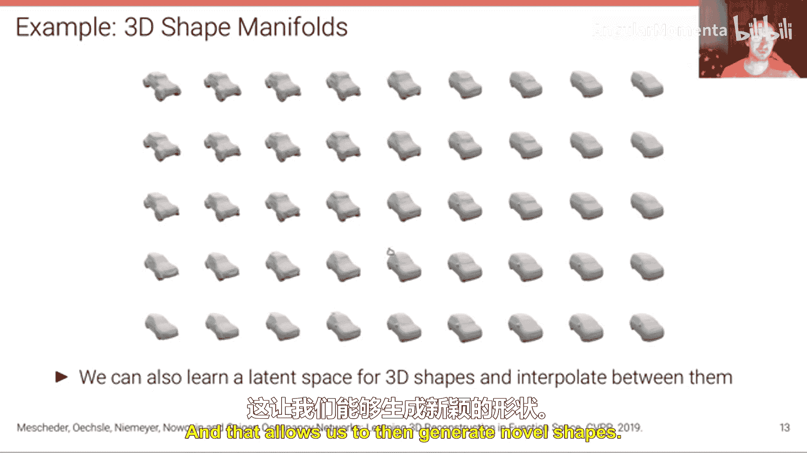
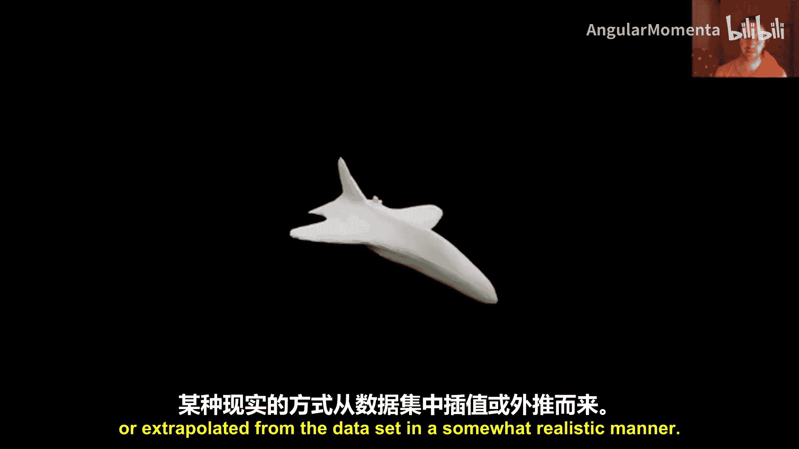
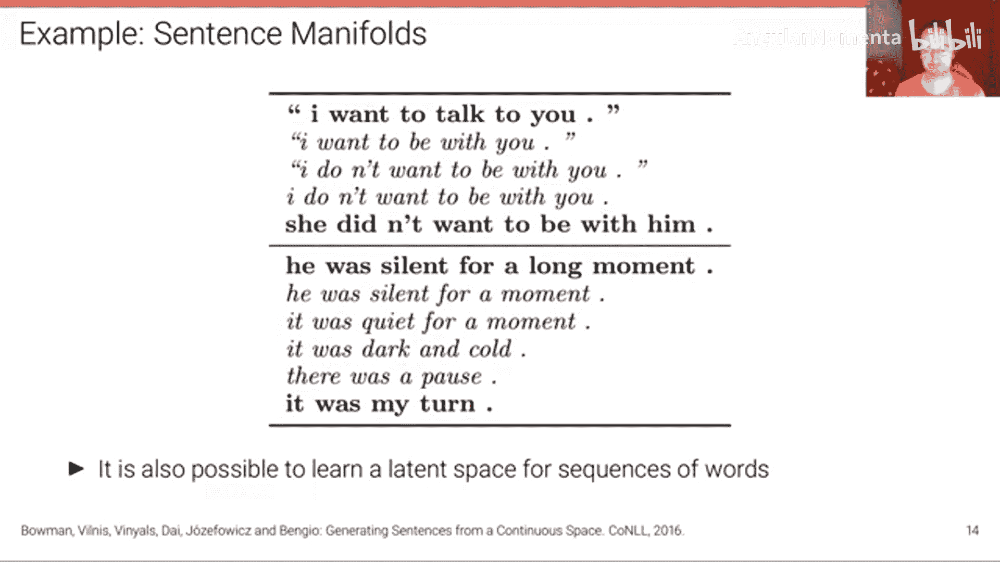

# 【精译】蒂宾根大学《深度学习》-p07-07--11.1（自编码器：潜在变量模型）--BV1eDbrzhENK_p7-

Welcome to the 11th lecture of the ST learning course。Originally。

 I planned to dedicate only a single lecture to the topic of generative models。

 but because these type of models have become so popular。And they deserve a more detailed exposition。

 I have decided to actually stretch this lecture into two lectures such that here in lecture 11。

 we focus primarily on auto encoders and in lecture 12， we discuss generative adversarial networks。

Here you can see a screenshot from the Google Scholar profile from Kingma and Goodfeellow and you can see how popular these techniques are today。

 they have been cited since only six or seven years， they have been cited more than 10，000 or 20。

000 times， so they are really，Fundamental building blocks across many applications of deep blur today。

This is the structure of this lecture in the first unit we will talk about latent variable models in general and motivate general models as well。

In the second unit， we're going to discuss one of the most basic and common latent variable models。

 which is called principal component analysis。In the third unit。

 we're going to discuss deep auto encoders， and in the fourth unit。

 we're finally going to touch the topic of generative probabilistic modeling。

With these type of latent variable models using variation auto encoders。

So let's start with latent variable models。This is a slide from the beginning of the course that contrasts the different types of learning that we encounter in machine learning。

So far。In。All of the lecture we have always focused on supervised learning。

Supervised learning on images， on sequences， on vectors， on graphs。In supervised learning。

 we learn a model using a data set where we have data label pairs。

 we always had an input and an output for a particular data point， so we had always a Tple。

 XI and YI where n is the number of data points。And examples for this are image classification。

 regression， structure prediction， predicting structures on graphs， for instance。

Predicting certain signals， semantic segmentations for images。

 etc in all of these cases we always have a data set where we need inputs and desired outputs。

In unsupervised learning。In contrast， we learn a model using a dataset set without labels。

So we're just giving XI n times or n elements， we have just a set of images or a set of audio signals or is large text Cora we want to train a model that's useful。

 that learns a useful representation just from the data you can already see that this is a really interesting paradigm because it doesn't require the labels which are typically quite difficult to obtain and so if you can train models if you can train useful representations with just the raw data。

 this is a very very nice thing to do。Examples of unsupervised learning techniques include clustering。

 dimensionality reduction， generative models， etc， and in this lecture we're going to touch on dimensionality reduction and generative models。

Some of these unsupvised learning techniques use latent variables to capture structure。

 and that is the topic for today， we're going to cover dimensionality reduction techniques and generative models that use latent variables。

That use a latent space that is of a smaller dimension than the data space to automatically capture the structure of the data without any labels。

Okay。So now first we need to define our terminology。The first。

Type of models we're going to encounter are so called latent variable models。

Lant variable models and I use this term not only for probabilistic models。

 but also for deterministic models in the context of this lecture。In some。Books。

 this term is treated as a synonym for probabilistic models。

 but I consider a latent variable model also a deterministic model。

 a latent variable model in this course， so for us a latent variable model is a model that allows for mapping between some observation space and some latent space。

Let's say we have the observation space， so x is， let's say an image and this observation space is r to the power of D。

 so FD。Input dimensions that could be W times H， the width times the height of the image。

And then we have a latent space that isq dimensional。And in a latent variable model。

 we have typically two types of mapping， sometimes we just have one type of mapping， which is G。

 that's why I put F in brackets。But oftentimes， and these are the models that we encountered today in this lecture。

 We're going to have both mappings。 We have the mapping。F with parameters W。By the way。

 I use the same W here for both functions independent of the fact that they could be different。

 I'm just referring to the parameters in general as a big set of parameters that's called W。

 so I'm always using the index W to refer to parameters。Also consistent of previous lectures。

So we have FW， which is a parametric function， for instance。

 a neural network that maps from the observation space to the lower dimensional latent space。

And then we have another function， GW。That maps from that latent space。

Back into the observation space， into the D dimensional observation space。

 and so we get a prediction X hat。That should be close to the original input。

 so we're trying to minimize the discrepancy between x and x hat。In latent variable models。

One of these latent variables gets associated with each of the data points in the training set that's important we can map each。

Point in the training set to one latent variable and we can map that latent variable back to its reconstruction。

 so there's always one latent variable attached to each data point。

The other thing that's important is that latent vectors are typically smaller than the observations in terms of their dimension。

 In other words， Q is smaller than D。And that leads to a compression。

 we're trying to look for a compressed representation of the input。

Sume X are images or audio signals， Then we're looking for a compressed representation。

Of these audio signals that best explains is audio signals。嗯。

So it must capture some relevant structure for explaining these images or audio signals。

There is a whole variety of different latent variable models， and。

One way of classifying W is to consider them as being either linear or nonlinear。

To be either deterministic or stochastic。And to either have an encoder F or just a decoder G F is called an encoder because it takes this observation space element and produces a compressed representation and G is called a decoder because it takes that compressed element and。

嗯。Reconstructs or tries to reconstruct back the input in the high dimensional space。And that way。

 exploiting structural regularity， exploiting that images live on an image manifold。

 trying to recover that image manifold， we're trying to recover the manifold of audio waveform。

So here's a little taxonomy of just a small number of techniques。

 but very popular and important techniques， there's of course many more。

 but these are the ones that are relevant for this lecture。

We are having deterministic techniques here on the left。

Principple component analysis is a detertministic technique that uses linear mappings for FNG。

 and an autoenr is a detertinistic technique that uses nonlinear encoders and decoders modeled through neural networks。

And then there's the probabilistic。Versions of these two。

 the probabilistic version of PCA is called probabilistic PCA and we're not going to cover this in this lecture。

But we are going to cover the variational auto encoder， which is the probabilistic variant of the。

ANo nonlinear auto encoder。And then in the next lecture。

 we're going to cover generative adversarial networks。

 which are also probabilistic generative models like variation autors。

They also allow for sampling data points。But。They don't have an encoder。

The next term we're going to know is the term auto encodeder。

Autto encodes comprise both an encoder as well as a decoder， in contrast to GNs。

 which just have a decoder， so here we really have an encoder F and a decoder G。

And they are called auto encoders because they predict their input as the output。

So this is a very simple diagram of how。This model works， we take an input vector X。

 then we pass this as input to a neural network FW that produces a latent code。

 This is a deterministic mapping in the case of an auto encoder is not a probabilistic mapping。

As it would be for a variation audit core， so it's a deterministic mapping that goes from x to C。

And then there's a number。There's aministic mapping that takes that compressed representation and tries to reconstruct that input。

And we call that X hat。And the reconstruction will typically not be the same as the input as there will always be some loss that we have to pay through this compression that we do。

And we're trying to minimize the discrepancy between the prediction and。

The original input to the model。So here's an illustration of this in the with an example of Ms。

 we have a Mnes digit， we feed at the through an encoder and get such a compressed representation。

And then we decode that compressed representation and we get。A reconstruction of the input。

That's not exactly the same as the input， but it's close to the input。Now the next term。

That we need to know about is the term generative models。

Geneative modeling is a really broad area of machine learning which deals with models of probability distributions。

Over data points， P of x w to。Get a good sense of the distribution of the data。For instance。

 images or audio waveforms。And the task of gene models is to capture dependencies of structural regularities in the data。

 for instance， between pixels in images。And we're going to refer to generative latent verbal models。

To the models that capture the structure in latent variables。

 but at the same time they are probabilistic。In contrast to art encoders。

 this mapping F and this mapping G is not a deterministic one。

 but it's modeling a probability distribution， as we will see in the last unit of this lecture。Yeah。

And models of this type are these models here that we have here on the right there。

SSttochastic models， not deter domesticmin models that allow for sampling new data points。

From the distribution， from the data distribution that we have approximated with our model。

That's why we're called generative， they allow for generating samples from the data set。

That wes to the model during training。Intuitively， what we are trying to do is we're trying to establish with a generative model a sort of theory for what we observe。

If you consider audio waveforms， we're trying to discover a theory of what generated that audio waveform。

 for instance， the type of speaker， maybe a speaker was female or male and the sequence of words。

Could be a good latent embedding that explains what the audio signal represents。Some gener models。

For instance， normalizing flows， which we'll not discuss in this lecture allow for computing the likelihood of the data P of x。

But most models that we have don't allow for this， for instance， VAEs。

 they only approximate a P of x， so we can't really get the data likelihood for a data point。

But they all allow for drawing samples from the data distribution。

 so they all allow from the model distribution， they all allow for generating new data samples。

Generative lant variable models often consider a very simple Bayesian model。

 a very simple Bayesian process。So here we see this process。

If we assume a generative process where we have a prior on the latent space， P of c。

And we have a likelihood that given a particular latent code C。

 but uses a distribution over models a distribution over the。Data space， the observation space。

And this is a generative process， we can first sample the latent code and then given the latent code。

 we can sample a data point。Now， multiplying these two together。

 we have the joint distribution P of x comma C， and if we now marginalize。See。Then we obtain the。

Marginal distribution P of x， right？In other words， we can also write this as the expectation。

Of P of x given z。When we take samples C from the prior over C。

 it's just another way of writing this。Again， the latent space is Q dimensional where Q is much smaller typically than the data dimension。

And the goal is to maximize P of x， so we want to maximize this probability here。

For given data set X by learning these two models， these are two parametric models that we want to learn。

Such that the latent variables C best capture the latent structure of the data that they are explaining the data well enough such that if we apply this generative process。

 we obtain samples。From the true。A distribution， data distribution。

We can also think about this exact， exactly this simple ba。

Geneativeflat and variable model using a graphical notation， this is called a graphical model。

 and the notation we are using here is called plate notation because we have this plate here。

What we have here is the parameters in orange and we have the latent variables in red and the data points in green。

 and we can see through this notation， this is just a very easy way to illustrate replicas。

So what is inside that plate is multiplied， you can see that there is for each data point there is1 x and 1 c。

 so we have again one data point associated with each variable with each latent variable or one latent variable associated with each data point。

And in contrast， the parameters are outside of that plate， so they exist only once。 they are not。

Specific to any data point， they are global。And we use a single W to refer to all the model parameters。

In all of this lecture。So let's look at some examples of what that might look like。

Here's an example of。A 2D data set in blue， data set。20 data points in two dimensions， x1 and x2。

And we also see a reconstruction。Of a。嗯。One dimensional latent variable model。

So what we have done here is we have applied principal component analysis。

 we'll see that in the next unit。Which allows us to。In this case。

 map the two dimensional data points onto a one dimensional manifold。Through a linear projection。

That's we can see that these points are linearly projected onto that line， this manifold and black。

And then the reconstructions are the points in orange。 This is what happens when we go the other way。

 we have these one dimensional manifold。And then we reconstruct these points from the manifold from these latent variables。

 and we get these orange points here。And now the goal of such a latent variable model。

 a linear latent variable model is to find the best linear。

Model such that the reconstructions are as close as possible to the original data points。

You can see that this is the case here as these for this particular line here。

 projecting onto that line means that。The reconstructed points。

Are as close as possible to the original data points。Orange lines here are minimized。

 There is no line that you could think of that could give you。No black line。

 no manifold that could give you smaller reconstruction arrow than this particular line that goes exactly through these points and aligns with the direction of the largest variance。

Yeah so blue is the data set and orange are the reconstructions， blue is X and orange is x head。

 and this is a linear model with a one dimensional latent space。

So let's look at some more real realistic examples。

 so these are visualizations of natural image manifolds and what we see here are only two dimensions。

 so we see how the reconstructions of that model look like if we manipulate the two dominant dimensions of that latent space。

One dimension is here on the x axis and the other dimension is on the y axis of this visualization and this can give us insights into the learned semantics。

 so for instance if you apply such a latent variable model on MNIS we can see that we can transition here on the x axis between a 7 and a 1。

And then if we transition along the y axis， we can transition from a 1 to a two or a0 so we have。

Numbers that look similar nearby in that latent space。

 And this is the structure that I was referring to， similarly for the。

Imagement for the face manifold。We have different facial expressions。On the X axis。

 we have different orientations of the face。And this was automatically determined through this latent variable model from an unlabeled data set。

 so there was no supervision given that was automatically determined。And in the Y direction。

We have different facial expressions。Different emotions。This is another example。

 this is from a paper from my research group called occupancyccupancy Networks。And in that paper。

 we developed a new 3D shape representation。And we also applied variational auto encoders on that shape representation。

Call that the variational occupancy encoder， and that allows us to then generate novel shape so we can traverse that shape space。

As you see here and generate。Cars or sofas or other objects that are not part of the original data set。

 but there are some somehow。Interpolated or extrapolated from the data set in a somewhat realistic manner。

And here's an example for sentences。Its also possible to learn a latent space for sequences of words。

And then we can also interpolate between these sequences。And here are two examples。

 so we interpolate in that latent space now from the first sentence in bolt to the second sentence in bold。

 I want to talk to you。I want to be with you。 I don't want to be with you。

 I don't want to be with you。 She didn't want to be with him。Or he was silent for a long moment。

 He was silent for a moment。 It was quiet for a moment。 It was dark and cold。 There was a pause。

 It was my turn。So you can see how the model tries to adapt the semantics in in a meaningful。

 somewhat meaningful manner throughout this transition while keeping the。

The syn tactics of the sentence， the structure of the sentence intact。

 which is for these discrete items for sentences is actually very challenging。

 it's more challenging than for。Real valued object such as images。

。