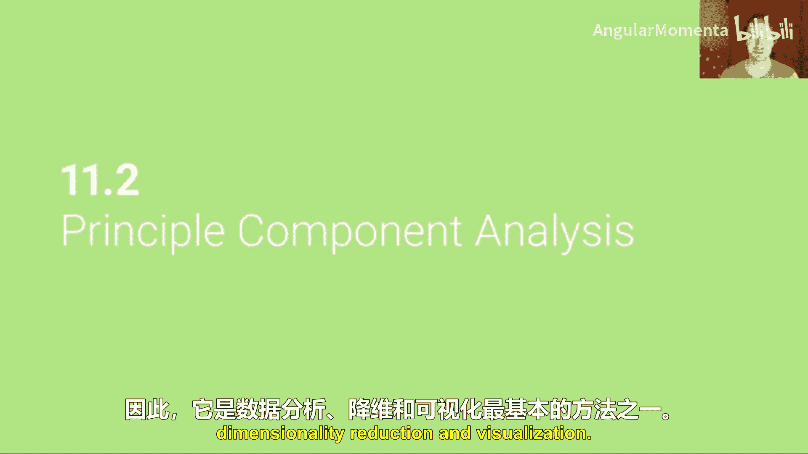
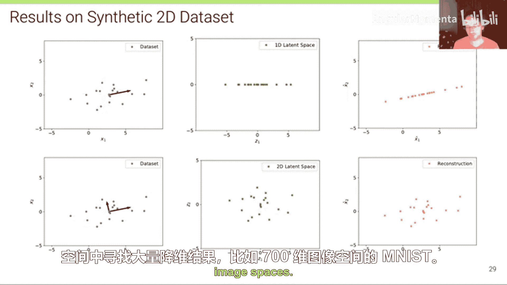
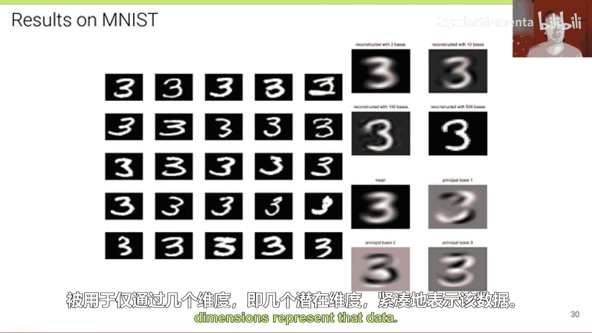
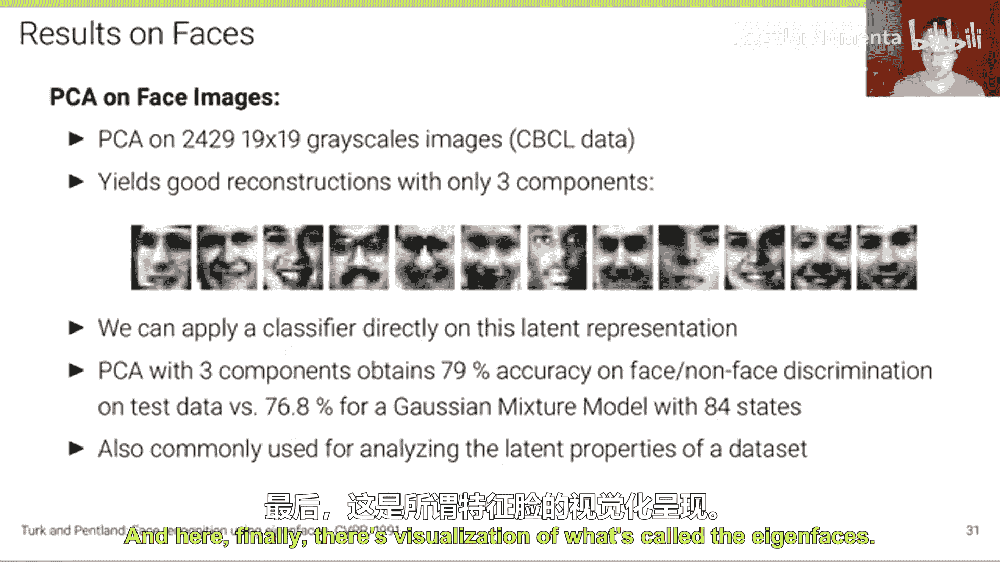
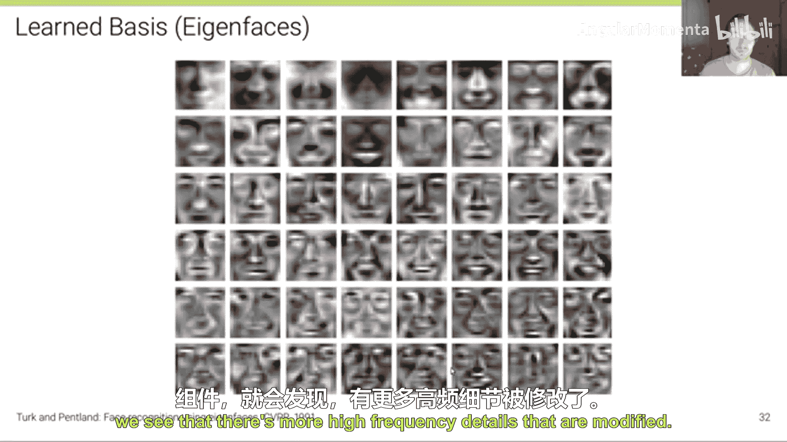

# 【精译】蒂宾根大学《深度学习》-p08-08--11.2（自编码器：主成分分析--BV1eDbrzhENK_p8-

This unit is about principal component analysis， which is maybe。The most。

Frequently used statistical tool for analysis of data。In particular。

 high dimensional data across many disciplines in science。Many of you probably already know PCA。

 so this will just be a brief recap for you， but in the context of this lecture。

 PA is relevant because it's a latent variable model that is deterministic and linear。

One of the most fundamental。Approaches to data analysis。And dimensionality reduction。

And visualization。

Yeah。So let's first talk about notation。We consider X。Boldts face x as a data set。

 and we are going to use a matrix to represent a data set where in each matrix row， we have a vector。

Such that the data matrix has n rows， one row per data point and d columns where the columns are the dimension of the data space。

So it's an r to the power of n times D matrix。Then let's see similarly be a matrix。

 but this is a matrix now corresponding to the latent variables where in each row again we store a vector。

 but now it's a latent code。This matrix also has N rows， but it has fewer columns。

 it has just Q columns instead of D columns， maybe Q is3 or2 is a small number。

Now while x is observed， C is unobserved， the latent variable is unobserved and needs to be inferred from x alone。

Okay。Typically， we assume Q to be smaller than D because we want the model to yield a compressed representation and we'll see examples of this。

In PCA， our goal is to learn a bidirectional mapping such that we have both an encoder and a decoder。

 and as such it's an auto encoder model。So we want to have a mapping from the latent space C to the observation space X and from the observation space X back to the latent space C。

And we want to have that mapping such that as much information as possible of x of this high dimensional space。

Is retained in C。For instance， if we think about images， emminous stitches。

We have a700 dimensional observation space because we flattened the images into vectors just as we did for the MLP exercise。

So here we would have 700 columns。And then we want to reduce that dimensionality to maybe just two or three。

So Q is just two or three。In other words， we want to encode x into a latent code C such that if we decode C back into x hat。

Where access is the reconstruction， then this reconstruction is a good approximation to the original X that we had observed。

Or encoded。 And in most cases， X head is not equal to X because we don't find a perfect mapping that perfectly maps in both direction。

 compressionpression is always a lossy process for real data sets。

So let's assume now the following linear mapping from a latent space to the observation space we have。

你。Prediction X head。This is now a vector。 This is one of these。

Oops this is one of these prediction vector analysis like this is a vector in that data set axis the input and X hat would be the prediction。

So the prediction vector is equal to the mean x bar is the mean plus a linear combination of basis vectors V。

And we have a C， this is a matrix the matrix of latent variable C where we index into the if row and the J column。

 so for every see the sum runs over from j equal 1 to  because we have Q columns in that C matrix。

So each row in that C matrix contains one of these latent vectors where each element of these latent vector。

Encodes the coefficient that we multiply with this space。Vctor V， in order to reconstruct X hat。

And we assume that we have this this offset to be the mean and the。

Basis to be an auton normal basis why do we do that well the mean is already the best reconstruction if we don't know anything。

 if we don't use any latent dimensionality of the data。

 the mean is the best we can predict if we don't have any latent。A codeode or latent dimensionality。

So x x bar， the mean is already is a good starting point。

 that's where we want to center our coordinate system on that makes sense。And then。嗯。

So that also makes mathematically make sense， but we're not going to derive it here。

 but that's the best approximation if we don't have any， if you have a Q equals 0。

 no latent dimensional latent dimensional Dp 0。Now， if we allow to have。😊，A basis that's。

1 or two or three dimensional， then we add these coefficients times the basis vectors and we choose an autonal basis because that spans our space well。

 there's other techniques that use a non autonal basis， but in the context of PCA。

 we assume an autonal basis that's a canonical basis。

 a canonical coordinate system you can think that you put that you center at x。Bar at the mean。

And that spans your data space and it should。Be oriented in a way that it explains the data set as much as possible。

Now our goal with this model is to minimize the L2 reconstruction loss refer back to the latent variable C and the autonal basis V。

So we write this as the loss of C and V。Is over all the data points to some。Of the prediction。This。

Expression here minus the the reconstruction， is's called the reconstruction minus the。Input。

 the original input。Right。Okay。And here on the right hand side， this is just。

 I've just plugged in X hat here and I obtained this expression。

This is the objective that want to minimize and we ask， well， what is C and what is V？Now。

 considering that we have assumed that V is an autonal basis that spans the space well， we expand。

The loss functions as follows， This is the loss function from the previous slide。

Now we can of course， pull that term inside that sum here。

 so we get this expression here so we haven't changed anything've just pulled this in。

And now what we have here is a quadratic expression。

 so what that means is we have the first term squared plus two times the first term times the second term is the second term here。

Times the second term squared。This is what I've written down here。And。

There's one more thing that has happened here， which is that if I take the square of this first term because v is an autonormal basis。

And if I take Vj to the power of 2。Then。I obtain one so that。That Vj vanishes here。

 and I'm left with CIj to the power of 2。Okay。Now， this is the expression from the previous slide。

And if we now want to minimize that expression with respect to x。

 what we have to do is we well sorry with respect to C。

 what we have to do is we simply have to set the derivative of this loss function with respect to C to0。

 if we take the derivative of with respect to CJ，Then this last term vanishes because it doesn't depend on C。

 and then all of these sums here vanish as well because we are only picking out one element which is depending on CIJ。

And that is two times Cj， this is the first one， and then we have two times Vj transpose。

X bar minus X I， and that expression must be equal to0。

 and that can be minimized in closed form so we have a closed form。Expression for this， which is。

The optimal solution is Cj star， we put a star here to note that this is the optimum。

Is minus Vj transpose x bar minus X。Now， if we take that expression and。

And plug it in back into this loss formulation， then we obtain the loss at the optimal value for C。

 the loss at C equals C star。And that simplifies now。The last term is unchanged。嗯。

But here in for the first term， we have。嗯。We have two times this expression。

 so we have minus Cj star squared。嗯。And the sum runs over J equal 1 to  Q so we have Cj squared minus2 Cj squared。

 so we obtain minus Cj squared。So this is the expression that is left if we assume that C is equal to C star。

Now we have only optimized with respect to C star with respect to C so far。

 now we also need to optimize with respect to B。Now the reconstruction loss from the previous slide。

At C star IJ can be slightly rewritten。So we take this expression here and we plug in the optimal value。

 we plug in this equation into here， we see that this is the same as having this sum over j equals 1 toq Vj transpose svj where s is the socalled scatterche matrix。

 that is the anormalized sample covariance matrix of x。Which collects from。

The entire data set i equals 1 to n。嗯。The the outer product of x bar minus X i with itself。

And why is that well， if you plug that。C， I J star into here。

 you see that you have this expression twice。 so you can。 then because this is a scalar。

 you can also plug in the transpose of that。 And so。嗯。The the second term。

Like the right multiplier here。Turns around， so we have X。B minus X times vj。

 a transpo times vj here。And then。嗯。VJ does not depend on the index I。

 it just depends on the index J， and that means that we can pull the sum。I equals 1 to n。

through this expression through J， and so we have this inner we are left with this inner term here。

 which is exactly the scatter matrix that I've written down here。Okay。Now。

 if we want to optimize with respect to V， now this expression。

Then we need to insert an additional constraint to avoid trivial solution。

And what we insert as an additional constraint is because we have assumed that v is an autonor basis。

 we know that the length of each of these basis vectors must be equal to one。

So we integrate that constraint into our loss function by adding a so called Lagrange multiplier。

If you're familiar with optimization， you've heard about Larians before。

It's basically a simple trick to make sure that if I compute the derivative of this with respect to now these new variables。

 they are added to the lost term to the dependency of the lost term here if I'm adding these new variables and optimizing with respect to those as well。

 if I take the gradient with respect to Lada。Then and set that to0。

 then I obtain exactly my constraint if you see look at the right hand side here。

 if I take of this expression， I take the gradient with respect to lambmbda J。

I obtain exactly Vj transpose Vj minus1。Must be minimal must be， must be close to0。

That's in a nutshell what Lagrange multipliers to， we add another variable in order to introduce a constraint into the optimization problem。

This variable is Lata here， Lata。Boldface Lambda is a vector that collects all the elements Lambda J。

Now， if we take that expression and we compute the derivative of this expression with respect to VJ。

 we obtain。So now we compute， we want to compute the derivative root with respect to VJ and set it to0 in order to optimize find the optimum with respect to VJ。

If we do that， we see that we have minus2 SVj from the first expression。

This term here vanishes and here we have2 lambda J Vj because we have this quadratic term here。

 so were left with a linear term in V。And we see that if we set this now to0。

 we obtain a very familiar equation。That's precisely the equation of an eigenvalue problem。

 and so we see that lambda and V now are the solution to this eigenvalue problem where we decompose the matrix as the scatter matrix。

嗯。Into a eigenvector basis。So this is exactly an aiging value problem。

And we know how to solve e volume problems we have good。

Aleggothms for doing that so we can just use these algorithms for solving this。

What we also observe is that as we have VJ transpose SVJ。This expression here。

Equal to because this holds equal to lambda J， Vj transpose Vj and because Vj transpose Vj。

Is one as the basis vector are normalized， the length is one。This is equal to lambmbdache。

We see that this loss here is minimized。By choosing for this。Basis matrix V。

 the eigenvectors Vj of S that correspond to the largest Q eigenvalues。So we saw to the eigenvalue。

Start with the largest one， and that explains most of the data and then we take the next one until we reach Q。

 which is the dimensionality of the latent space， and we stack all of these vectors into as columns into the。

Matrix into the spaces， matrix B。Yes。Okay。Now， this is the result that we obtained by this。

We have our linear model from the very first slide。And we have not obtained this matrix V where。

We have the columns of。This matrix to be the。Eigenvectors corresponding to the top eigenvalues。

 the largest eigenvalues of the scatter matrix S。And so we can write very compactly for PCA。

 the decoder and the encodeder as simple linear mappings。For instance， the decoder。

 this is exactly this expression here， is we are mapping a latent code through a linear map V and add this bias term the mean。

Of the data set to it and we obtain X， this is exactly this expression。

And then we can also do the opposite we can。嗯。We can bring x bar to the other side。

 So we have x minus x bar， and then we。Bring also v to the other side。

 so we have retranspose x minus x bar。And this is our encoder that brings us that yields the mapping from X to C。

So we have both the decoder that maps from C to x and the encoder that maps from x to C。

This is it basically。Here is the PCI model in this illustration I've just shown the。Basis。

Vctorors V in the matrix rotation V， I haven't shown the mean vector x here for simplicity。

 but of course it's part of this transformation from x to C and C to x。

 as I've shown on previous slide。And this is the formulation that we have。Used。

 we have minimized the reconstruction  error， the L2 arrow。And the PCA recipe is done very simple。

 given a data set， x of n data points。We first compute the data mean and the scatter matrix S。

And then we compute the eiging decomposition of S and select the Q eigenvectors corresponding to the Q largest eigenvalues to assemble V。

And then we simply have this decoder and encoder has this very simple。

Linear mappings to map between the two spaces。And this is what it looks like。

 so here is this 2D data set again that we had in the beginning。And what I show here is the。

These errors indicate， first of all， here in the center， this is the mean of the data set。

 this is x bar。Where this coordinate system is centered and the errors then indicate the two eigenvectors that have been found by PCA scales by the square root of lambda of the normalized scatter matrix of the empirical covariance matrix such that we have the length roughlyic corresponding to the。

Standard deviation in that direction。You can see that this vector is longer。

 so this has a larger eigenvalue。And the vector here is smaller so it has a smaller eigenvalue。

 the variance in this direction is smaller， the variance in this direction is largest。

And if we assume now a one dimensional latent space。

 what that means is we map all the data points onto that vector， that first， that largest vector。

 this is what indicated here with this line， this is the mapping that we do。

 and then we reconstruct the yellow points。And we minimize the reconstruction error。

 and this is exactly giving us the solution。That we've derived。

Now there's two different perspectives on PCA。We've saw that PCA can be motivated by minimizing the L2 reconstruction arrow。

However， we can also motivate PCA by maximizing precisely the variance of the latent points as we've already indicated here。

 this vector here corresponds to the direction of the largest variance。In other words。

 we like to find an embedding that captures most of the variation in the original data set。

Captures most of the variances while using a smaller dimensionality Q。

And to see this also mathematically， it's not very hard。

 we consider the following one dimensional encoding of a vector x。

 Now this is one basis vector that we project onto and we have our equation from before。

 this is exactly the same just。V is not a matrix， but it's just a vector we are projecting onto a one dimensional space as in in this example here we are projecting onto a one dimensional space。

Yeah。Now， if we consider this one dimensional encoding。

 our goal now is to maximize the variance in the latent space。

 It's no longer minimizing the squared reconstruction error， but it's。

To maximize the variance in the latent space。So we write the variance of C。

 the random variable here is x， but c depends on x。Is the expectation of。Well。

 C minus the expectation of C。And the whole expression squared。

This is just the definition of the variance， and I plugged in C here， this expression here for C。Now。

Here on the right hand side， we see that we can。Because the expectation is a linear operator。

 we can pull that expectation through this vector here。

And so we have the expectation and x bar is not a stochastic quantity ever。

 so we have the expectation of this is the expectation with respect to x。

 so we have the expectation of x which is exactly x bar。

 so we have x bar minus x bar so this term vanishes， so were left with this expression squared。

Now this expression is squared。Is this expression， the only thing I did here is I swapped x bar and x because if I swap at both sides。

 then it doesn't change the sign。And now we can see that this expectation here is exactly。

We transpose S V， S。 this is the。嗯。Normalized。Scatter matrix。

 so we have a proportional sign here because we didn'tize the normalized scatter matrix would be the scatter matrix。

Times1 over n。 we normalize with respect to the number of the data points。

 and this is what this expectation here would do。 So this is only proportional。

 but the optimization problem is， of course the same， no matter what the constant is。

But just to explain why we have thisproality here。So this is exactly what we had seen before V transpose Sv。

Now let us again assume an autonoral basis V。B 1 to V Q of dimension Q。

But we now want to maximize the sum of variance along each dimension。

Subject to the normalization constraints that we have before。

And this of course leads then to a very similar problem。

 the problem that we have already familiar with， so we have now this optimization problem where we want to maximize with respect to Lada and V。

 this expression here， again， we have the Larrange multiplier to accommodate the constraints that we is normalized and must be normalized。

 it's an auton normalmal basis。And here in the first expression。

 we have the maximization of the variance that we saw on the previous slide。

And this is exactly the same expression I had before。

 and we know already that a solution to this is given by the Q largest。😊。

Eigenvalues and the corresponding eigenvectors of S。Yeah。As little remark。

VJ transpose S VJ is the variance along the J principal component。

 If the scatter matrix S is normalized by the number of data points， in other words， if it's。没异议。

An empirical covariance matrix is an empirical approximation to the covariance matrix。Okay。

So this was a lot of math， let's look at some examples。This is the example that we've already seen。

 we have a data set， a 2D data set， with 20 blue points in two dimensional space。

 and we assume a one dimensional latent space， so Q is 1。And what we see here is the。

To eigenvectors that。Correspon the eigenvectors of the scatter matrix S。

They are scaled by the standard deviation。Now， what does the latent space actually look like here we see only the original data points and the reconstructions。

 So in this plot here have actually visualized。All the three quantities， so we have X on the left。

 we have C here in the middle and we have the reconstruction X hat on the right。

 and we have it for two cases， the first row is with a one dimensional latent space and the second row is PCA with a two dimensional latent space。

One dimensional latent space on the top。Two dimensional latent space on the bottom。Of course。

 it's the same data set here。 so the。Eigenve that corresponds to the largest eigenvalue is the same in both。

 but the difference is that here we have just one eigenvector。

 so we project only to this space and here we have two。

In the first row this therefore yields a one dimensional latent space。

 so all the points are on a line， there is no second dimension。

 I just use the same plot here to visualize it， we have just C。

And then if we map backwards with the linear map， then we obtain this reconstruction。

 which is exactly what we had before here。So this is D。Input the observations。

 this is the projection into the latent space， and this is the reconstruction。

If we do the same thing for a two dimensional latent space， then what we see is that， well。

 the latent space is two dimensional and we have some stretching of the points going on。

 so there's some normalization going on here。And then we have the mapping back into the。

Two dimensional observation space。And in this case， the points are the same。

 so the reconstructionarrow can be minimized to0， which is。O。

Because we haven't introduced any compression， it's it's a model that's not very useful。

 it's a model which which you can figure out what。How you your。

How large your variance is in each dimension， but it's not a model that that exploits the regular regular structure of a data set that in this case。

 the data set is there is kind of a manifold along this。Direction of the。

Larggest eigenvector and that can be exploited to compress the data。

This is a very simple 2D illustration of what happens also in higher dimensional spaces where we're looking for many folds of very high dimensional image spaces like an emist of 700 dimensional image spaces。

This is an example with MNT here we have。😊，A data set and we have different reconstructions with a different number of bases。

 so if you have just two bases， we get a very blurry reconstruction。

But then if we increase the number of bases here in this case， 506。

 we have a much more detailed reconstruction， but we need a lot of basis for such a linear type of model。

Here on the bottom we have the mean。Which is very similar to the reconstruction of two bases。

 and we also see the principal components where you can see。

What transformations are learned in the first case here for example。

 the dit is slightly rotated and stretched and here we have a translation and here we have kind of a scaling。

 so these are the most dominant transformations that the algorithm has learned automatically from the data and that are used to compactly with just few dimensions。

 few latent dimensions。

Represent that data。So this was an Mist now PC can we also applied to face images if they are well curated。

 they are all cropped to the same size， they look very similar but then you can get pretty good reconstructions with only three components as shown here。

And then also what we can do is we can take this PCA， this load dimensional space。

 this load dimensional embedding of each of the data points， and if there is a test image arrives。

 we can then classify in that latent space so we can take our training set and train a classifier in that latent space。

And then apply the same transformation to the test samples and classify。And this is， of course。

 very efficient。Because we have a much smaller dimensional space so we can build more potentially more powerful classifiers that with a small number of data generalized very well and for this example here there are some numbers。

 so PCA with three components obtains 79% accuracy on this phase non-face discrimination。

While a gaugeut mixture model with 84 states provides even slightly lower performance。

And here finally， there's visualization of what's called the eigenfaces thisRD。

Eigenves then rearranged reshaped again into a image matrix and you can see also here。

What changes you can see that there is some illumination changes and some low frequency changes that are learned in the first components of this。

U。Of this。Econvector space， and then if we go to the less important components。

 we see that there's more high frequency details that are modified。

