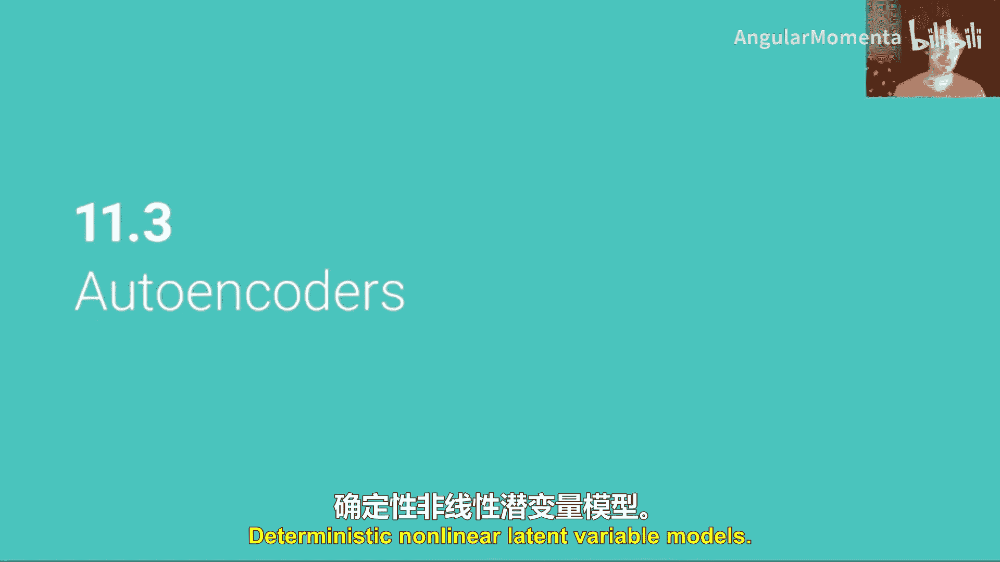
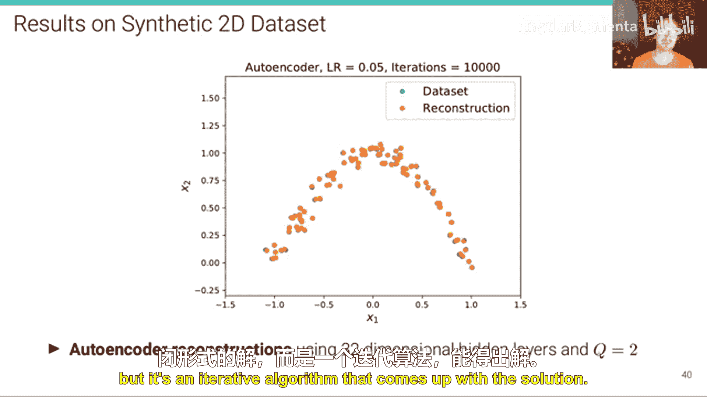
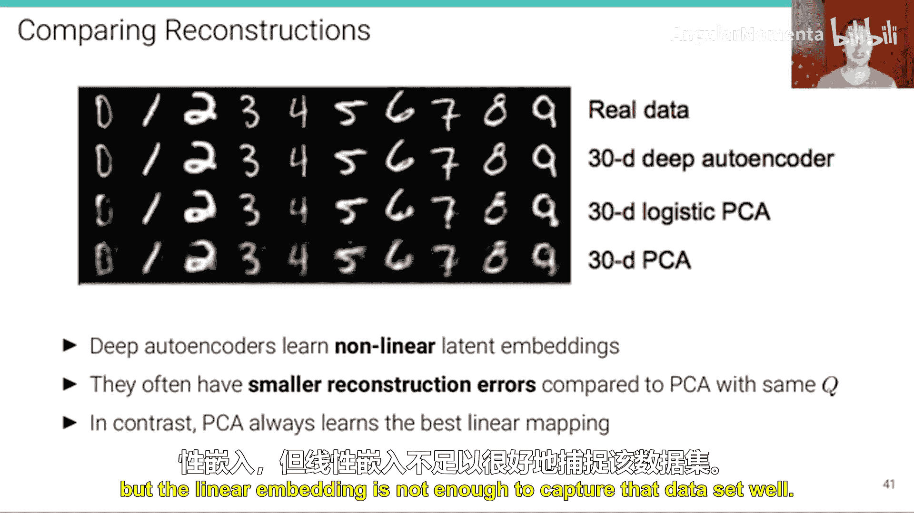
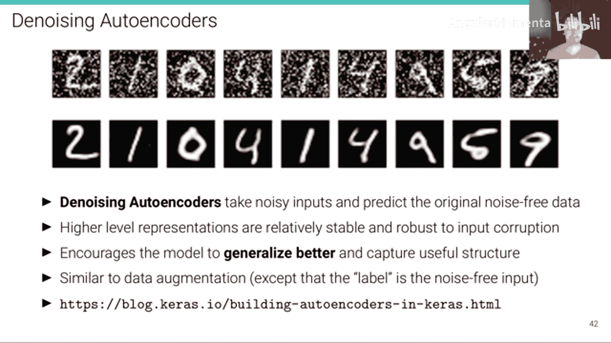

# 【精译】蒂宾根大学《深度学习》-p09-09--11.3-(自动编码器：自动编码器)--BV1eDbrzhENK_p9-

We have talked about PCA， which is a deterministic linear model in this unit。

We're going to be talking about general art encoders， which are deterministic nonlinear models。

Dtaministic nonlinear latent variable models。Here is the picture。 it's actually quite simple。

 it's very similar to the picture that we've seen before。

 except that the encoder function and the decoder function are now。

Not assumed to be linear but are represented by some neural network permetized who the perimeters W。

This can be a convolutional neural network or a multi layerer perceptron with several layers or a rec network or another type of network。

 such as a graph neural network。So in a general art encoder， we have a neural network。

And if you consider this entire block here as a neural network。

We have a neural network whose outputs are its own inputs and there is a bottleneck in the middle that tries to compress information。

 but now in contrast to PCA in a nonlinear fashion，But again， as in PCA。

 the goal is to minimize the reconstruction error and the most common reconstruction error is the L2 loss that we could minimize。

Now there is a relationship between auto Enrs and PCA in particular。嗯。

PCA is a special case of auto encoders， as you might have already guessed。So if we assume F。

The mapping from X to C。The encoder and。G， the mapping from C to X hat to both be linear without any activation function。

So number words， we have C equals， let's say Ax plus a。And x hat， the decoder result is B， plus B。

Then in this case， the entire mapping here becomes linear。I plug in。C into this expression here。

 so I get B X plus A plus B。So we can replace this with another matrix C。

 so we have a linear mapping， Cx plus C。And we know already that for this mapping。

 the optimal solution W star is given by PCA if we minimize the L2 reconstruction arrow。

So both are equivalent if we assume the encodeder and the decoder to be linear layers without activation functions。

Okay。That's。Basically all。Let's look at some results， some results where we have a。Altenr。

It's actually not a variational auto encoder that's wrong。 It's auto encoder should be auto encoder。

 So we have a number of different variants of auto encoders。And we compare that to PCA。The first。嗯。

Model is a simple PCA model。But we go from a two dimensional space in our illustrations to a one dimensional space。

Then we have an auto encoder model。Where we have just a linear layer that does the same thing。

 so we should obtain the same result。We have a version where we also go to one dimensional space。

 but in a nonlinear way where we go from the two dimensional space first to a 32 dimensional space。

 and then we map to the one dimensional space and then we map we have another hidden layer that again a hidden layer in this MLP decoder where we go from this one dimensional latent space to the 32 dimensional。

嗯。Decoder hidden。Space， and then we map to the reconstruction。

And then we have the same model where now the latent dimension is changed from Bdi to 2D and we observe what will happen。

I've actually implemented these three types of models using the educational framework and this is the visualization that I have obtained。

What you can see here are the results of an auto encoder on a 2D toy data set in blue。

 this is a cosine from 0 to pi。Okay。And we observe the data set in blue and the reconstructions as the yellow points。

 as well as the reconstruction errors indicated by this yellow。

Ls that connect the blue and the corresponding orange point。

So what I did is I encoded the blue points and then I decocodeded them and this gives me the reconstruction and I draw a line between the two。

Okay。And what we have here is an auto encoder with only one linear layer for both the encoder and decoder and the latent dimensionality of one。

And trained it autoing quarterr with a learning rate of 0。05 and this is the first iteration。

 so we don't have anything useful in the first iteration， it's a random initialized model。

 so we get a random projection。But then after 10 iterations already。

 we can see that the model converges to something that's better that has a lower reconstruction error than the initialization。

This is after 50 iterations。And then this is after 1000 iterations。

And if we compare this to the result of principal component analysis with a one dimensional latent space Q。

Then we see。That the results are indistinguishable。

 so we have an empirical proof now also that PCA and an odd encoder with a linear encoder and decoder layer。

Are equivalent。Now， still this is not a very good reconstruction。

 you can see the reconstruction errors are large。The manifold， there is a manifold。

 there's a manifold in this 2D space， but it's not a linear manifold。

 It's a curved manifold that we want to discover。So what I did next is I implemented that art encoded it。

I've showed you on the previous slide here， this odd encoder that has a nonlinear encoder and a nonlinear decoder with a 32 dimensional hidden state for both。

And this is what what is the outcome， of course there is we need more iterations to train this model because there's more parameters and there's more layers so back proagation needs longer time。

And this is the initialization， so the initialization is still random。

But we can also see that after 10 iterations we reduce the reconstruction error。

 but still it looks the reconstruction is close to a line or the reconstructed points are close to a line。

 but we can see now already at 50 iterations that this line breaks up into kind of multiple line segments that try to approximate the shape of the manifold in a better way。

If we have 300 iterations we can already see that the reconstruction arrow is largely minimized。

 of course we cant minimize it to0 because I added some noise to these points on the manifold they are not precisely on the manifold there is some noise。

So the reconstruction arrow with a one dimensional latent space will never go to zero。

 but it will become very small， and this is after 10，00 iterations where you can now see that the。

The approximate shape of this manifold has been captured by the nonlinear aingr。

And then out of curiosity， what happens if we use the same model。

 but with a two dimensional latent space， this is after the first iteration， this is 10 iterations。

 this is 50 iterations。 This is 300 iterations，10000 iterations you can see that the autoenr is capable of reconstructing the data set precisely。

 This is what we would expect because with  two dimensions， we can't actually。Again。

 anything we don't。we do not need to compress so we can basically even have a linear mapping for this needs to be discovered by the auto encoder still it's not。

It's not in this case， it's not a closed form solution。

 but it's an iterative algorithm that comes up with this solution。

We can do the same thing for MNIS， here are some results of reconstructions on MNIS。

In the first row is the real data。 the second row is the data from a deep odd encoder。

 the third is a。Logistic PCA model and the4 of is PCA。

And you can see that this nonlinear oddingta leads to more sharp。

 more crisp reconstructions compared to PCA using the same。Lant dimensionality。In contrast。

 PCA always learns the best line bedding， but the linear bedding is not enough to capture that data set well。

And finally， one thing I wanted to show you is a denoing so calledled denoing auto encoder。

 a denoing auto encoder is an auto encoder that takes noisy inputs and predicts。

 tries to predict the original noisefr data， so we're giving a noisefr data set like MIS and we're adding some noise to it。

We're adding some gausian noise to it。And the idea of such a denoing autoenr and here this is the result you can see that these digits are den quite well。

 the idea is that by adding this noise， we get more stable。

 more higher level representations that are robust to these input corruptions。

And that this encourages the model to generalize better and capture more useful structure and statistics in the data and doesn't overfit us as much as a regular auto encoder。

 and the idea is very similar to data augmentation it's basically just doing data augmentation to the input except that now we don't have a supervised learning problem。

 but the label is the noise-fr input itself。是。

