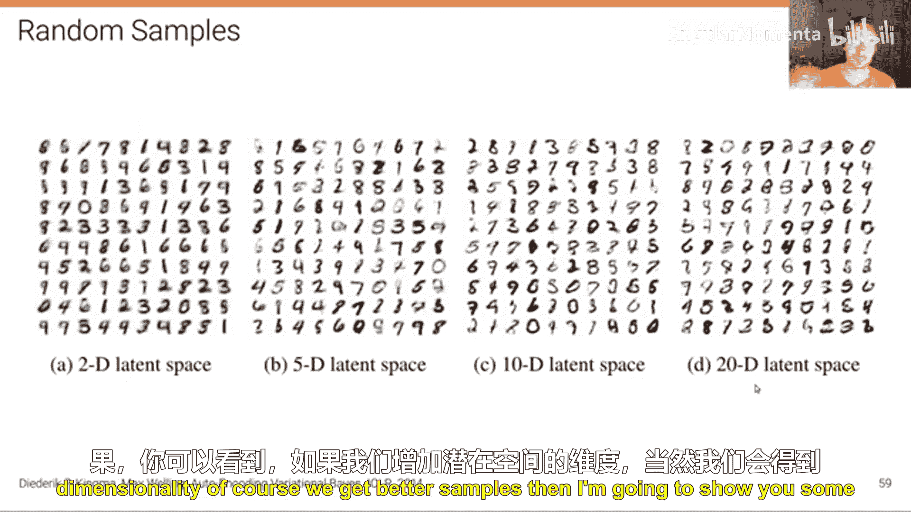
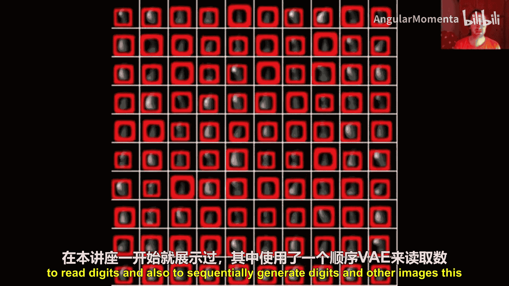
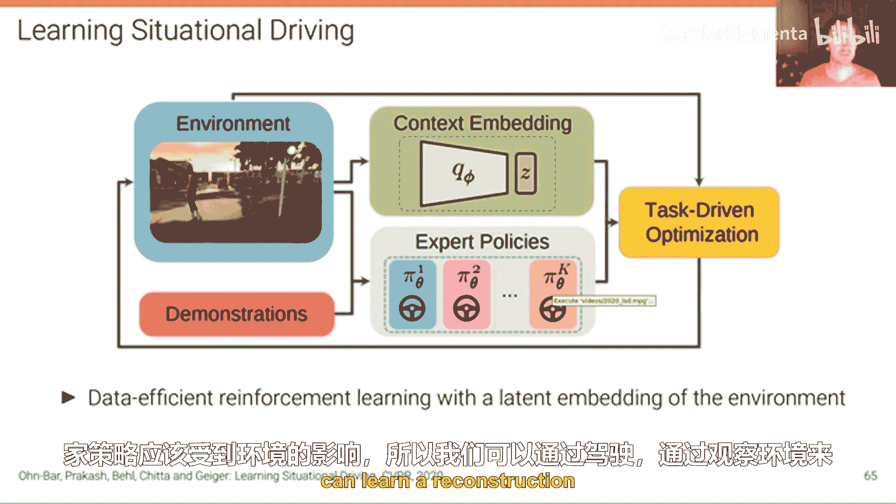
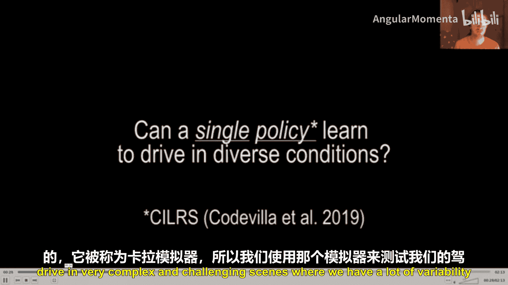
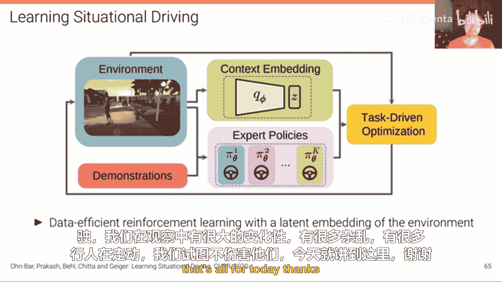

# 【精译】蒂宾根大学《深度学习》-p10-10--11.4（自编码器：变分自编码器）--BV1eDbrzhENK_p10-

After we have talked about two detaministic latent variable models。

 we are now going to talk about the first probabilistic。Lant variable model that we treat。

 which is a variational art encoder， one of the most popular models。

 most popular generative models today。So far we have discussed these deterministic models。

 but now we will take a probabilistic perspective on latent variable models with auto encoding properties。

Consider again the following Bayesian model of the data X。

This is the equation from the introduction to this lecture。

 where we have a geneerative process with a prior on the latent variables。And a likelihood X given C。

And integrating that over C yields the marginal or the data likelihood P of x。

 and that is what we want to。Optimize。That is what we want to maximize。And of course， we can。

 because we have the probability of C here and the integrate over C。

 this expression here is simply the expectation of。The conditional likelihood X given C。

With respect to the variable C drawn from the prior distribution。Now， in order to develop this model。

 we make some assumptions。That are needed in order to make this model tractable。

WeFirst assume that the prior model P of C is sampleable and computable。

 and we also assume that the likelihood model P of x given C。

 this conditional likelihood is also computable。What that means is we can sample from P of c。

 we can draw samples from P of c。P is a simple enough distribution that we can query samples from it。

And we can compute also the probability mass or the density of P of c and P of x given C for any given x and any given C。

These assumptions， as we've seen， hold true for auto aggressivegressive models。

 such as language models， but they fail for many other models， such as loopy graphical models。

Where approximations such as belief propagation must be used。In the context of variational autoenrs。

 we will consider very simple parametric distributions like Gaussians that are parameterized for neural networks to achieve this property that it's easy to sample from。

Now， in order to find the model parameters， W。The best model parameters is W。

 a sensible thing to do is to minimize the negative log likelihood or the cross entropy。

And this is the first expression here， so we want to find W star as the minimizer of the expectation over the entire data distribution x or samples from the data distribution is our data set。

Of minus log。And the data likelihood。 And now we are using a subscript W。

For the distributions to indicate that these distributions depend on some parameters in some way they depend on parameters W that we want to optimize。

Yeah。Now， this expression is simply the。Expectation of the conditional likelihood of respect to C as we have seen。

And we can of course， replace this。Expectation here with dis sumation over the entire data set as usual。

 so we obtain this expression here。Where now x has an index I。Yeah。Okay。Now， unfortunately。

 given our assumptions， computing Pw of x is still intractable。对。

Computing this expectation is still intractable。Because。The search space is too high。

We need to draw too many samples from the distribution on C from a very broad distribution on a latent space。

 We're not operating on a one dimensional latent space。 We're operating maybe on a。

A 60 dimensional latent space so it's a very large dimensional latent space。

 it's smaller than the observation space， but it's still large and so in order to properly estimate that quantity。

 we need to draw a lot of samples， too many samples for making a single gradient step。

So it's intractable。And the idea of VAE is to sides that this problem by introducing another model component。

 a so called recognition model。That's also parameterized by some parameters W。

 as's called QW because it's only an approximation。It's QW of C given x， so given a data point x。

 we're trying to encode that data point with a probabilistic model。

're trying to find a distribution over C。A model that predicts a distribution of C given the data point。

In the context of auto encoders， this is the encoder。

P of x givenancy is the decoder and Q of C given x is an encoder。

 and we try to train that approximate model such that it approximates the true unknown posterior PW of c given x。

 This is the true posterior that also depends on these parameters of this model， of course。

 but that is unknown。 we don't have access to that true posterior so we're trying to approximate it。

With a recognition model that tries to be close to a posterior， but it doesn't need to be precise。

It can be a crudeed approximation and is still useful。

Let's gain some intuition for this intractability that I just mentioned。

Imagine the observations being sound waves and the latents to be word sequences。

So imagine you're listening to a song and you want to。Recognize what was said in that song。

In other words， we are looking for a theory of the sound waves that best explains them。

 we're looking for dispoken words that have generated these sound waves。

And we want to minimize as usual， the cross entropy between the data distribution over sound waves and our model distribution of the sound waves as we've just。

Seen on his slide before him。However， this marginal。

Distribution P of X is intractable due to this very large search space over sea。

If we listen to a song， this this is equivalent to this intuition， if we listen to a song。

 it's sometimes unclear what the lyrics are because there's too much noise。

 there's too much going on in a song if we're listening to a song。

It's sometimes not clear what the lyrics are， what the text actually was。

 and were hearing words that weren't there。But if someone tells us the lyrics。

 we can certainly hear it。 We can verify it。 That means we can assign it the right likelihood。

 but we haven't。It was too hard for us to guess the correct lyrics。

 We had to have someone tell us the lyrics in order for us to suddenly understand the song。

And this is what I mean by search space， the search space over C over the lyrics is too large to just draw samples from a very broad prior distribution PFCc。

But if somebody tells us， gives us an intuition about what that sea should be。

 it becomes suddenly much easier for us。So the search base over the word sequences that explain the sound waves's heart as there is many sequences and we might not think of the right one。

Now we are ease。Use a recognition model Q。Permettriized by perius W of C given X that computes the word sequence given an observation that tries to give us a better idea of what is in where in that latent space we are looking for a particular data point。

And the great thing about this is that this model does not need to be correct。

 it can be accrued approximation to P of c given x as long as it is giving us a better intuition than just a very broad distribution。

 it's already useful and training this model jointly leads to a original autoenr that converges much more quickly and becomes tractable。

This is a never。Illustration I made to explain this。Intractability。

So what we have here on the left is。So what we want to do is we want to compute P of x。

Which is the expectation over C of Px givenancy as in the previous slides。Right。

And if we if we're looking just at the prior distribution over C。

 which is pretty broad and we are drawing， so this is the join distribution here in green。

 this is this slanted Gaussian P of x given C。 we have the latent code here on the x variable C and then the。

Data， both are one dimensional in this was simple example here on the y axis， this is x。

So if we want to compute p of x， let's assume we want to compute the likelihood for this particular data point X。

Then what we would do is we would draw samples， let's assume we would draw these free samples from the distribution PFCc。

 and so we get C1， C2， and C3。And then the conditional distribution P of x given c1 looks like this。

 it's just a slice through this。Joint distribution。

And the conditional distribution for x given C2 would be this。

 and the conditional distribution of x given C3 would be this。Just a slice， a one slice through this。

To de caution。 And we know that conditional。Distributions of Gausians are also Gausians。

 so we have a Gaussian here as well， it's just a 1D Gaustion in this case。Now。

 because this search base C here's just one dimensional。

 but it's actually much more higher dimensional。I's very large。

We have just missed the data point that we want to compute the likelihood for if we're now computing the expectation with respect to this free sample C。

 we see that in none of them， the likelihood model gives us a high probability while actually if we would compute a sample here we would have significant probability for that。

Particular data point。So we have done a very bad approximation to P of x。We have。

Under estimated the probability of X。On the other hand。

 if we have a recognition model Q of z that's conditional X。

 if we have a neural network that tells us the parameterss of a distribution here in blue。

 given a particular XI，And if that prediction is roughly corrected， that is， it's not super sharp。

 but it's。It's narrowing down the search space compared to this broad distribution and we draw three samples from this distribution。

 so you can see then we sample that likelihood or the samples that we draw to compute the likelihood are much better now。

 so we actually find the right probability for that sample in our words。That's the intuition。

Now what we do is we seek a tractable using this recognition model Q。

 which I'm from now and always highlight in red。I ignore the parameters for clarity here。

 but I highlight the recognition model Q in red。What we do is we trying to using this recognition model to seek tractable lower bound to the likelihood。

 which is called elbow evidence lower bound because it's a lower bound to the lock likelihood。

 which is sometimes called the evidence， the evidence。Of the observations that we make。

So the lock likelihood can be rewritten as the expectation over sea。

 so we're not changing anything because were。We're just adding this expectation over C and then we're adding two terms here that cancel and so this cancel。

 so this expectation doesn't matter。So it's kind of a trick we're adding something that doesn't matter to this equation。

嗯。So， when we have done this， then we can well we can。

Write this expression here as the join distribution， this is just the join distribution。

 and then we can。Add another term， Q of C given x that cancels also。

 so we haven't changed the equation again， but we have added another term。

 so we divide this first term here by Q of C given x。

 and then we divide Q of C given x by P of C given x， which is this term here。

So we haven't changed anything。And we have pulled them apart through the logar rule。Now。

 what we can see now。Is。If we take the expectation of the first， this is this first expression。

 but if we take the expectation。Of this term， with respect to C。

 then we have the kulac liplo divergence between Q and P。 this is what I've written here。

 this is just the definition of the Kulback liplar divergence between Q and P。

And what we know is that this k lipid divergence is always bigger or equal to0。

 that means that this expression here is always bigger or equal than this expression。

Because we have removed the term that's bigger than zero。And this is called the elbow。

 it's the evidence lower bound， it's a lower bound due to this inequality to the data lock likelihood。

And as we'll see， this lower bound is not tractable。In practice。

 Q is the variational approximation to the two criteriaerior。

As Q is represented by a family of functions parameterized in our case for a neural network。

So this can be considered as a variational problem， we are varying a function。

 and therefore the elbow is sometimes also called a variational lower bound。

And the divergence here measures the approximation error between the。Recognition model。

 the approximate recognition model and the true posterior。But that is intractable to compute。Now。

 the negative look likelihood。😊，Is therefore upper bounded。 So here we have the lock likelihood。

 Now we take the negative lock likelihood， So we have the upper bound。So we are were changing this。

Lower bound to upper bound。And we're changing Qmp。Because we have a negative sign here。

So this ised by this expression。And this expression here is just this expression if we pull apart P of c and x into the conditional and the prior on C。

 so's just the definition of the joint distribution。

And so we can also write this expression as just the first term divided by P of c minus log P of x given C。

 so it's just pulling this apart。Yeah。Then if we write it like this。

 we can see again that now this expression is a kulb lipiblo divergence， but in this case。

 a tractable one， it's one between Q， the recognition model and the prior on C。Yeah。

We choose the prior and the recognition model such that this is tractable to compute。

 and we'll see that。And on the right hand side， we have。The expectation of the negative。

 the conditional。Negative look likelihood x given C with respect to C。

So this bound comprises a KL divergence term and a conditional lock likelihood。

 this term is often also called a reconstruction error。

 this is a term that measures how close the recognition model distribution is to the prior that we put on the latent space。

 so regular riser on the latent space if we will and the right hand side is a reconstruction error that measures how good our reconstructions here we're doing a reconstruction given and C we are reconstructing X。

But now probabilistically， so were obtaining a distribution over x。

 how good that is with respect to the data points that we have observed。

Note how Q of C given x and P of x given C act as an odd encoder here。

 we have Q as the encoder that maps from x to C， and we have P as a decoder that maps from C to x。

 and that's why it's called a relational a encoder because it has this。Out of these equations。

 there emerges this auto encoding structure that is if you implement it in a computer is implemented。

And this is the variation al enr， so let's assume there's a data set， x of x1 to Xn。

 Xi are the elements in that data set and W the model parameters。

Then the variation autoing orderder minimizes this bound that we've just seen to the negative log likelihood。

 so we're trying to find W star， which is a minimizer over all the data points to this negative log likelihood。

Which comprises a。Approximate posterior， like a measure that measures the different discrepancy between the approximate posterior or the recognition model and the prior。

And the reconstruction term。And in a VAE， this recognition model is chosen as a multivariate gaus and parameterized bi neural network。

 which makes the computation of the KL term very simple。

And therefore it makes this variation approximation to the true posterior。

 that's why it's called a variational approximation here is a variational approximation to the two posterior because it's。

A'm parameterized by such a distribution。Or implemented by such a parametertized distribution。

And the likelihood P of x given is also permetized by neural network for binary observations。

It's chooseness Bernoulli for real observations， as we'll see later on， its chooseness。

 e Gausian or lapplian。If its chosen as Gaussian then。

 as we know this term will become a squared term if we execute the negative logarithm of a Gaussian。

Now， what do I mean when I say here that the likelihood model P of x given C or the recognition model Q of C given x are gaugesh and permetized by a neural network？

What I mean， let's consider the recognition model。 what I mean is that we have。A recognition model。

 but it's analogous for the prior or the reconstruction。The likelihood model。

So it's the same thing its just let's assume let's consider the recognition model here。

 So if the recognition model this is a distribution over C given x that's parameterized by this multivariate Gausian expression here。

 it's just a standard expression for a Gaustion。Where the parameters that are the covariance matrix and the mean vector are。

Functions of x of the input because theyre conditioned on this model this distribution is conditioned on x。

And depend on the parametersmmeter W and they're implemented through a neural network。

 there's a neural network。That after several layers like an MLP predicts sigma and mu。

From x and Sigma and mu are then considered the parameters of the Gaussian distribution。

And often they share the same backbone， so Sigma mu share the same backbone and then only at the hat it branches out and predicts sigm mu and typically we don't consider the full covariance matrix because we operate in relatively high dimensional latent spaces。

To high dimensional to represent a covariance matrix。 So we in version all encoders。

 we typically make the assumption that this is a diagonal matrix where on the diagonal， we have the。

The elements are the individual variances in each dimension。And these elements are then predicted。

 so we have。Q sigma is to predict， and we have Q mu elements to predict from x with our neural network。

So this is a slide that just briefly shows that assuming a Gaussian recognition model and a Gaussian prior。

 so we've talked about the recognition model， but the prior is also chosen often as a Gaussian and often it's even chosen as a Gaussian without any parameters。

Where we have just a multivariate Gaussian distribution， which is a standard Gaussian distribution。

 mean zero and identity covariance matrix。And here we drop the dependency for clarity。

 the dependency of Q， mu and sigma on x and w just to have less clutter in these equations。And。

If we observe that for this first integral here and the second integral here。

 we obtain this closed form expressions because these are Gausians， so it can verify this。嗯。

Then we can express also the col label divergence between Q and P。

 which is also an integral expression。We can represent this also with an analytic solution。

So what this tells us is that the kale term in the case of a Gausian recognition model and the Gaussian prior has a simple analytical solution。

 and this is the standard setup that's used because that's easy to differentiate。

 we don't need to solve an integral that would be intractable， but we have a very simple。

A term here that's only summing up a bunch of parameters。 U and sigma over the。嗯。

ALant dimension up to that2 be。九。그。Yeah， and the covariance matrix of the recognition model is typically chosen as a diagonal。

 so we have basically here we have only the diagonal elements， sigma I at sigma J in this expression。

 and we can already see that if mu is 0， let's say and sigma is the same we get sigma is one。

 then we get zero for this expression so we can already get an intuition that this kulic gl divergence is0 when both the recognition model in a prior predict the same distribution。

 so it makes sense。Okay， so so far about the intuition。

 So this is the variational ought encoder objective again。

 that minimizes of all the data points this。KL term and the reconstructionconstruct term。

As we have seen in this setting where we assume cautions。

 the gradients for the KL term with respect to W are easily obtained using BackP。

But for the reconstruction term， while the forward pass can be easily computed using sampling。

 so here we have a sampling operation and we can just draw samples and then compute that term。嗯。

The backward task requires differentiation through a sampling operation。

 We have the sampling operation here and the distribution that we sample from depends on parameters itself。

 and this is。This is not nice， is not we can deprive a estimator for this。

 but it's a very high variance estimator that's not very useful。For our purposes。And so what？

Kimma and Welling proposed in their variation auditing codeta paper is to use a trick that was known before。

 but that has been applied to the first time to this type of variational inference problem。

It's called the repermerization trick， and their trick moves the sampling。That we have here。

From being inside the computation graph of the neural network to the input。

 so here on the left we have the sampling that's part of the computation。

But what we can do for many distributions such as Gaussians。

 we can sample from a standard Gaussian and then we can。

We can basically do a linear transformation of the mean that's now a detertaministic function。

 so the difference here is now a mean is a deterterministic function as a neural network with permids w that detaministically depends on x。

 not stochically like here。And sigma is also the domestic function of x。

So this is a deterministic mapping that now depends on a variable that's sampled。

 but for back propagation to the parameters W here， we have a deterministic relationship。

So this is the trick we repermetize in order to obtain a deterministic relationship for back propagation while moving the sampling operation to the input layer。

Yeah。And it turns out that actually in practice a single sample。

 epsilon per data point x often sufficient is sufficient， depending on the mini batch size。

 if you have reasonably large mini batch size is 64 or 128。

 then a single sample gives you low variance gradient predictions。

So here is a picture of the two variants with and without reation trick。

 this is the one without is the vanilla VAE。We assume a Gaian likelihood model P of x given C in this example。

 so this is simply a L2 reconstruction error then。And we see that we have this nasty sampling operation that's inside our computation graph。

Now if you switch to the reparmetized version。Which is tractable as the sampling now has been moved outside into the input。

 and we can back propagate gradients now through this deterministic process here。

And this is what the repermerization trick does。And yeah， apart from this reconstruction loss。

 which is L2 for a Gaussian likelihood， we have， of course， also the K L term here， which is on。

 which is a regular riser on。The recognition model， which is the encoder in this case。

The trick works for Gausians and some other simple distributions like exponential family。

 and there's more details in the Kingma paper if you're interested in。

One remark about expressiveness Ves are very expressive and to illustrate this that like a mapping。

 what they effectively implement is a mapping from a latent space we have a latent distribution。

That's a very simple distribution， It's normal a standard normal distribution on latent space。

 but then we have a nonlinear mapping here that takes this。

Gusian standard Gaussian distributed sample in the latent space and maps that。To the reconstruction。

 to the prediction。And because we have this nonlinear transformation here through a neural network that's very expressive。

 we can take that standard distribution and realize something that's very complex in terms of the output distribution and this is illustrated here for a simple toy example where I've chosen the nonlinear mapping。

Mnually， so here's some samples from a standard Gausian distribution and here on the right。

 these samples are mapped。So this is the mean mapping basically is a neural network that maps the mean of each of these samples with these functions C over 10 and then C over the norm of C。

 and so we get a much more complex distribution that is you know that doesn't have this gausian unimodal shape here。

 it's distribution that dispers these。Points on a ring。

And so by stacking these nonlinear transformations。

 we can transform these very simple distributions into very complex distributions and that's what a VAAE does as well。

So VIE basically models the mean and the covariance vectors as neural networks that map the input to。

嗯。The output。 And they also。Yeah。That's mapped the latent code to the output。So finally。

 let's look at some results， this is the learned manifolds that we've already seen for faces and for MNS。

 you can see how this VAE captures naturally the underlying structure of this data set。

Here is some visualization of random samples now we have a generative model we can also draw random samples from。

 we can basically here draw a random latency from a standard gaussian distribution and then we can apply the decoder and obtain a reconstruction for it。

And。Yeah， and that is what is illustrated here and we see this for different dimensionalities of latent spaces and you can see that also if you increase the latent space dimensionality of course we get better samples。

Then I'm going to show you some other applications of VAEs finally and VAEs have been as mentioned in the beginning already applied in numerous domains。

 so this is just a very short overview of where they have been applied this is the VA the draw model that I've shown already in in the very beginning of this lecture。

Where a sequential VE is used to read ditits and also to sequentially generate ditits and other images。

This is a sequential application， its a combination of a VAE with a recurrent neural network。

This is called a deep convolutional inverse graphics network where we have a VAE on in combination with a convolutional neural network and a special training。

Scheme for weak supervision that forces the model to disentangle latent factors such as pose lighting texture and shape without actually putting a lot of supervision into that。

 so you can see that we can have the reconstructions match the originals quite well。

 this is from 2015 and the results are much better today and we can see what happens if you change some of these latent codes like the pose gets changed in this case are here in this case the elevation and this case the estimate of the pose get changed。

In this case， VAAs have been applied to motion forecasting from a static image。

Where the goal is to predict how the motion could continue and it's of course important that this prediction can be multimodal because it's from a single image is very uncertain。

What the motion should be。And so you want to have plausible motions。

 but they can be in different directions。And this is a state of the art。

TheE model is called vector quantized variational art encoder that produces samples。

 these are random samples from the model that are almost competitive state of the art。

 generative adversarial networks that we will。Learn about in the last lecture。

And this is the results that I've shown you already from our Occ network paper where you can also see how we learn a latent space visualized here in these two dimensions only of cars and upper objects of 3D shapes。

And we can use this。This V also to learn context embeddings， for instance， in this case。

 this is a paper on self-driving where we're trying to learn expert policies。

 but these expert policies should be informed by the environment and so we can we can learn a lot about the environment just by driving around just by observing the environment and can learn a reconstruction of that environment and that latent code that we learn as a byproduct serves as a very useful cu to solve driving task so we can then drive in very business in simulation is called the calla simulator。

 so we use that simulator to test our driving algorithms and it allows us to drive in very complex and challenging scenes where we have a lot of。

A variabilityability in the observations and a lot of clutter and a lot of pedestrians walking around that we try to not hurt。

That's all for today。

Thanks。