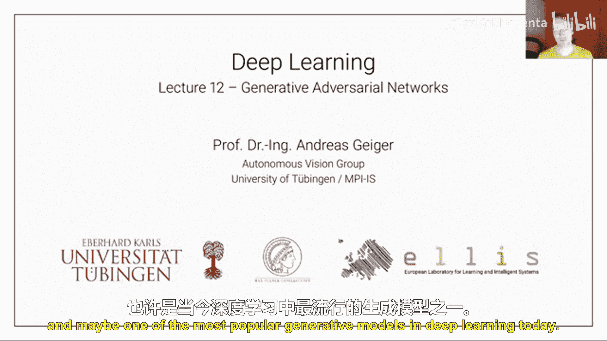
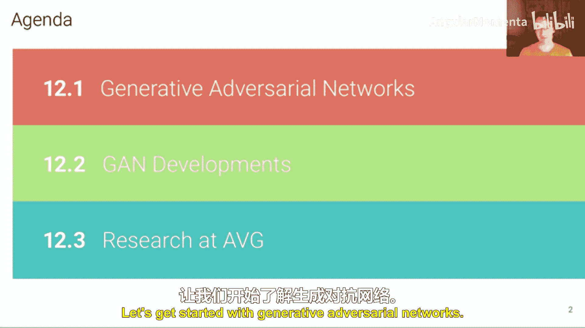
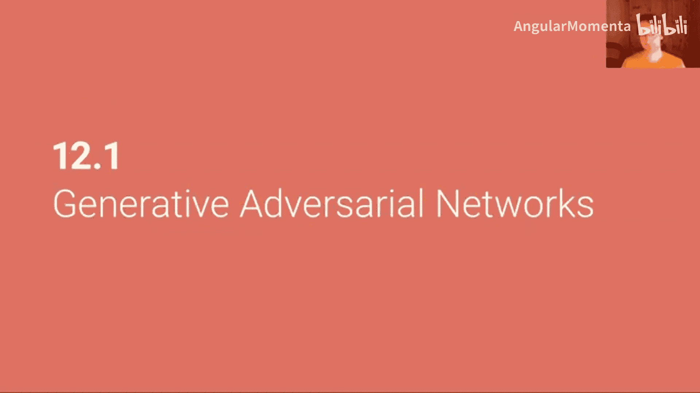
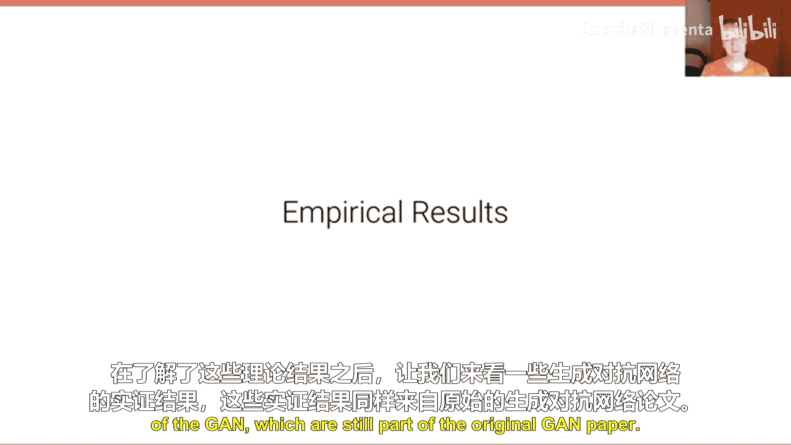
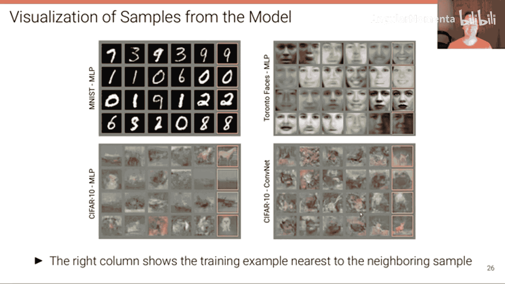
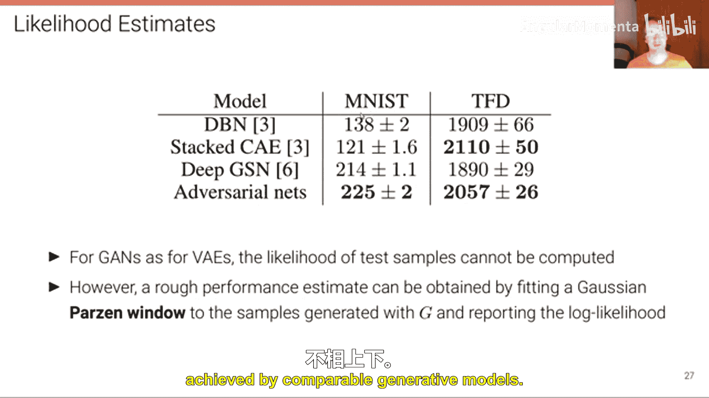
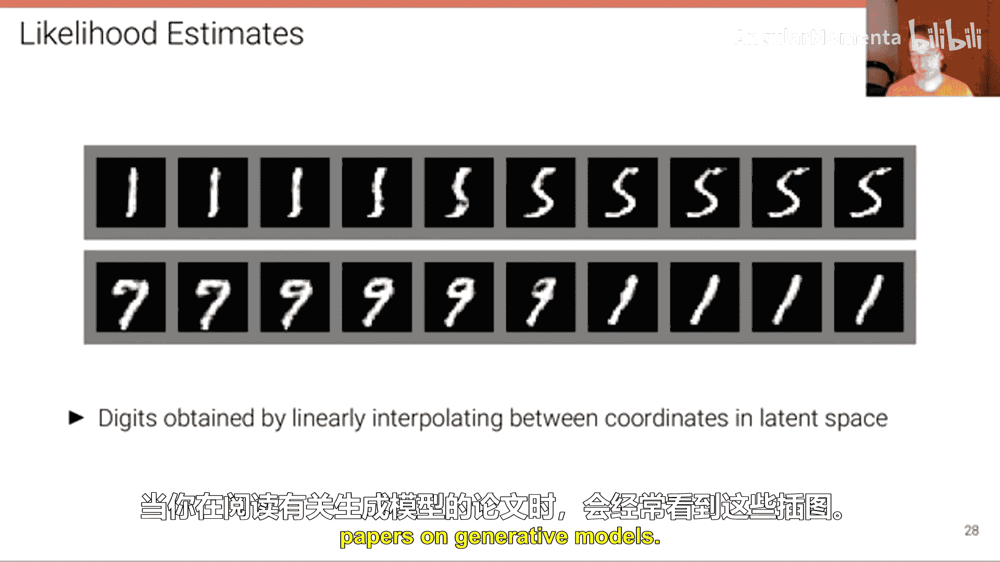
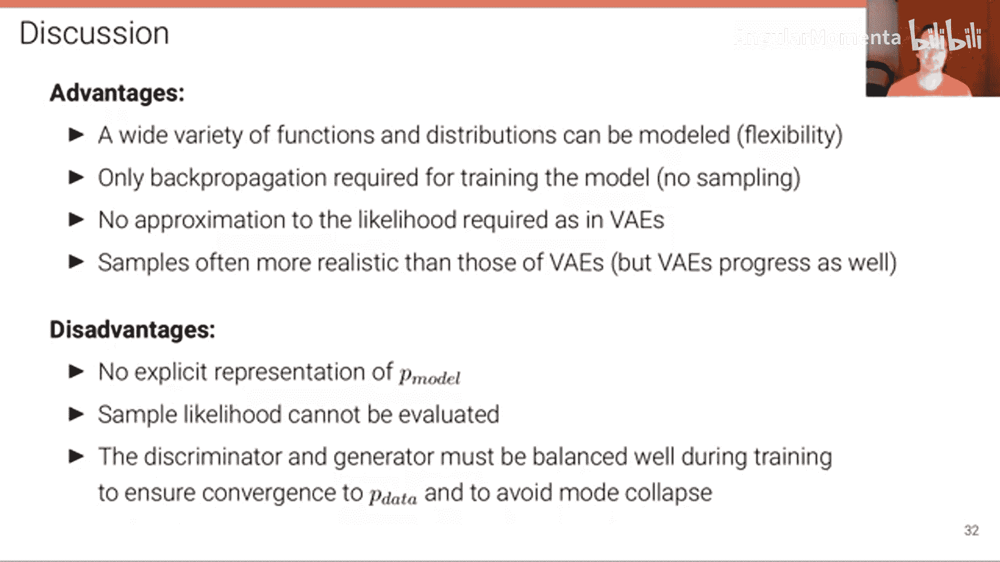

# 【精译】蒂宾根大学《深度学习》-p11-11--12.1-（生成对抗网络：生成对抗网络）--BV1eDbrzhENK_p11-

Welcome to the 12th and last lecture of the steep learning course。 Last time we've introduced。

Varariational auto Enrs。诶。Very popular。Generrative model that uses deep learning。

Today we're going to discuss generative adversarial networks。

 which is also a generative model and maybe one of the most popular generative models in deep learning today。

This lecture is structured into free units。In the first unit， we're going to discuss the basics。

 the basic principles of GNs。And we are going to follow very closely the original good fellow paper。

In the second unit， we're going to touch on more recent developments in the area of GNs。

 which is a field that's really exploding over the last couple of years。And then finally。

 I'm gonna give you a brief overview of the research that we're doing in our lab that involves。

Generative and nongenrative modeling， but a lot of deep learning in the context of computer vision。

The last unit is of course not relevant for the exam。

Let's get started with generative adversarial networks。

Before we start， let's briefly recap latent variable models as we have introduced them in lecture 11。

Lant variable models map between an observation space x。

And a latent space C of significantly lower dimension typically。Yeah。

One latent variable gets associated with each data point in the training set。

 that's why Cs are called latent variables。The latent vectors are smaller than the observations。

 so Q is typically smaller than D， leading to some form of compression。And models。

Are either linear or nonlinear， deterministic or stochastic？And they might have an encoder。

 or they might not have an encoder F。And we've seen a little taxonomy of some just a small subsection of all possible latent variable models that have been proposed here in this table。

And we have been discussing principal component analysis autoens and VAEs in the last lecture。Today。

 we're going to talk about generative adversarial networks， which are also probabilistic models。

 so they qualify as generative models they allow for sampling。New data points given a trained model。

But in contrast to variational auto encoders。They do not have an encoder。F。

 they just have a decoder G。And。They are trained using a completely different paradigmme compared to variation auto encoders。

你。So let's let's briefly also recap what a generative model is。

 The term generative model typically refers to any model that takes a data set drawn from。

A data distribution P data。And that geneative model learns a probability distribution P model to represent P data in some way。

 even that we are able to evaluate the likelihood for a particular data point。

That we are able to do inference or that we are able to draw samples from that distribution。

In some cases， the model estimates。嗯。P model explicitly。

 it estimates a model distribution explicitly。It represents the distribution explicitly。

 and therefore it allows for evaluating the approximate likelihood。

Or the density for a particular data sample。嗯。In other cases， however。

 the model is only able to generate samples from P model。

And this is the case that we are looking at today with Gs。GANs are a prominent example。

Of this family of so called implicit models， they're called implicit because they don't allow for evaluating the likelihood。

In contrast， a VAE。In a VAE， we are able to evaluate at least an approximate likelihood we're able to evaluate。

The elbow。In some other type of generative models that are typically less powerful than via E or GNS。

We can even evaluate the likelihood exactly。But for the VAs and for the GNs， this is not possible。

 So VAEs are able to approximate the likelihood they learn and model through approximate likelihood。

For the elbow andgans do not even approximate the likelihood at all。

 they don't consider the likelihood。And we will see how they do that。So GANS， in short。

 provide a framework for training models without an explicit likelihood。

 that's why they are called implicit models。It's impossible for those models to evaluate P model of x。

So here's a little taxonomy of generative models that I've taken from。

The tutorial on generative adversarial networks from Goodfeel 2017。Gended models can be。

Separated into such models that explicitly model the density。

And amongst those that explicitly represent or model the density， we have models that。

Where the density is tractable。Like in a pixel R& M where we have aable density。

Or we have models which only approximate the densities such as a variational auto enr using a variational approximation。

On the other hand。There's also。Implicit density estimation models， generative models。

And GNs are one of the most popular representative of this category of models。So what is a game。

 what is a generative adversarial network？As we've already said VAEs approximate intractable likelihood using a recognition model。

 that's what we've seen last time now GNs give up on explicitly modeling the density or the likelihood。

Instead， they use an adversarial process in which two models。Wch are sometimes also called players。

Are trained simultaneously。For a objective， they are competing for an objective。

 and therefore this is often also referred to as2 play a game。In particular。

 these two players are a generator G and a discriminator D。And we're going to use。

Capital letters G and D， to name these two types of models following the original exposition in the generative adversarial networks paper。

Okay。The generator G captures the data distribution。 That's the model。

That is responsible for modelling。The model distribution that should approximate the data distribution。

From which it should be possible to sample。New data points but look similar to data points from the data distribution。

The discriminator D， in contrast， estimates if a sample came from the data distribution or not。

So it outputs a probability。Outputs a probability1 if。It thinks that the sample。

Under consideration that is the input to the discriminator， that's why it's called a discriminator。

Is from the data distribution， and it tries to output the0。

If it thinks that this sample that it sees is a fake sample， it comes from the generator。

Now the goal of the generator G is to maximize the probability of D making a mistake， in other words。

 to fool it。And the goal of the discriminator is to become better in discriminating， real from fake。

And by having these two players playing this two player game。We can arrive at a model。

That we can arrive at a generator。That approximates。The data distribution。

The nice thing aboutgans is that。They only require back propagation for training。

The back propagation can be used to optimize this two player a game in contrast to many other generative models that require more sophisticated algorithms。

As such， there is no approximate inference required or no slow mark of chains。

That have mixing issues typically are necessary。And there is some theoretical results regarding optimality and convergence。

That we'll touch upon today also。But those require strong assumptions， as well as sea。

So let's make GNs more formal now。Following our。Usual notation let X。Be an element of RD。

Deote an observation， the copian image。Where D is width times height。

And let P of c be a prior over latent variables， C element of Rq。

 where Q is the dimensionality of the latent space。

Now we have a generator network G with parameters WG。That maps from the latent code to the。

Data space to the observation space。 So it produces a data point。Given a particular latent code。

And let's also call the induced distribution。The distribution that's induced by putting a prior on the latent space C and then having a deterministic function mapping from the latent space C to the observation space x。

Because called P model， this is the distribution， this is a distribution over x over a generated x。

 we'll call them x hat because they are predicted x。

 but they are predicted by sampling by drawing from a very simple distribution P of C。

 say a Gaussian distribution。And then pushing that sample through this nonlinear neural network。

To yield a。X or X hat。And that distribution， we're going to call a model distribution。

 That's what we're interested in。 That's what we're trying。

What we are going to try to make close to the data distribution。Then let D。

With parameters WD denote the discriminator network that maps from the observation space。

 so it takes as input， let's say an image。A generated or real image。And I maps that image。

To a probability。That is between 0 and 1。So the discriminator network outputs a probability。

 typically in the last layer of this discriminator network。

 we just have a simple sigmoid activation function to map。To 0， to the range 01。嗯。Yeah。Yeah。Now。

 this is the objective。The discriminator D and the generator G played the following two player minimax game。

With the value function B of G and D。It's called a minimax game because we have a minimization over G and a maximization over D。

Note that in the notation that we're going to use from now for simplicity， we're going to refer to。

Just G and D instead of the parameters of G and D， but of course when we implement GNs。

 we are going to be using a neural network for G and the neural network for D with parameters WG and WD。

 so effectively this minimization and maximization is over the parameters。

 but here we're just going to write we are maximizing over the family of possible generators and the family of possible discriminators。

To simplify notation。So were going we are optimizing this。Two player game here。

Where the optimal values for G and V are determined by。

The argument of G and the arc max of D of the value function B of D and G。

 where the value function is defined as the expectation over x sampled from the data distribution。

Of the logarithm of the discriminator of x。Plus， the expectation of C sampled from the prior。

Just typically a simple gaugeuseian distribution。On the latent space。

So the expectation over c of the logarithm of 1 minus d of G of that sample C。

Can see here that we have a。A generator that produces an X from that C。

 and then we have a discriminator that judges that X。And here we have an x。

 which is the data from the data distribution and a discriminator that judges that x as well。

So how can this be interpreted？Well， we train D to assign a probability 1 to samples from P data from the data distribution and0 to samples from P model。

This is easy to see。Here we are maximizing over D， which means that because D。

Outputs a probability between 0 and 1。 This means that。If we look at this expression here。

 for all the samples from a data distribution， we want to have d to predict1 because this is maximizing this expectation here。

嗯。For the right hand side， for the generated samples we want the opposite in this case we are also maximizing over D。

 but in order to maximize this expression here we want D become close to0。

Because if you have d equal to0， this is the largest value that 1 minus d can obtain。Or can attain。

Yeah。So here on the right hand side。Where we are looking at generated samples。

 the discriminator tries to predict0。And here on the left hand side， through this artrc marks。

 were trying to predict one for the samples from the data distribution。Now， G。On contrary。

 wants to fool the discrimator D such that it assigns probability 1 to samples from P model。

 here we have an argument over G。So in this case， we want to minimize this expression with respect to G。

Such that the parameters of G are optimized for the discriminator to output a0。Right的。

No sorry for the discriminator to output a1 because if you have11 minus11 is the largest value。

 I have a 0 here， so this is the smallest possible value that I can attain here for this expression。

 so this would be minimizing the value function with respect to G if the discriminator。

Predicts a one。For the samples that are generated by the generator。In other words。

 the generator wants。The discriminator to think that the samples that are coming from the generator are actually real。

And fruit is to player a game。Both the discriminator and the generator are becoming better over time。

 The discriminator becomes better at distinguishing real from fake。

 and the generator needs to keep getting better in generating more realistic samples that are more similar to the data distribution in order to。

fool the discriminator that's already good。That's the idea。Here's a picture that shows the same。

So here we have a。Sample C， a latent code C that's drawn from a。

Iotropic Gausian standard distribution。From a standard normal distribution。This is the C here。

 We pass that C through the generator network in order to obtain a X hat。

And then we are going to apply the discriminator network on Xhead。To obtain the probability。

For except being real or。You're fake。So D should be equal to0。If the。

A sampleample comes from a model distribution from a discriminator's perspective。

And D should be equal to one if the sample comes from the data distribution from the discriminator's perspective。

And so here on the bottom we have a sample that comes from the data distribution from the training set。

 this is x， we pass this x through the same discriminator network。

 this quality symbol here indicates that the weights are shared。

 this is the same weights WD and WD this is the same network So we're going to pass x also through that network and the discriminator now needs to decide for that。

Data sample， if that is real or fake。And then we are going to compose this together into this last function here。

拿地。The encoder and the decoder So this is。Well on the generator。

 I should have better call them generator and discriminator。

 so the decoder would be the generator and there is no encodeder this would be the discriminator。

The discriminator and the generator can be implemented as MLPs or confidenceants or recurring neural networks。

 depending on the application。And the Discriminator network。

D can also be considered as a loss function We learning jointly with the weights of the generator。

The model that we are interested in， we are learning a loss function， the discriminator。

After training， the generator is kept to represent the model distribution。

 so after training can throw away the discriminator network because this is what we are ultimately interested in。

 We're interested in this model。That can sample new data points from a latent code。

Such that these data points look like they are coming from the data distribution。

We don't need the discriminator。In most cases anymore。

Now there is some theoretical results as already mentioned。That showed that this miniax game。

Using some rather strong assumptions recovers exactly the data distribution for the model distribution。

 so P model equals P data the model distribution approaches the data distribution。

And some of these assumptions that are used are that D and D。

 these two networks are given enough capacity。And also， they are assuming that D star can be reached。

 so the optimal D value， the optimal discriminator。In each inner iteration here。Here。

 the optimal discriminator can be reached。For every update we do to the generator。

We'll talk more about this later。In practice， however。

 we must use an iterative numerical optimization。Algorithm and optimizing D in the inner loop to completion is computationally prohibitive。

And would lead to overfitting on finite data sets。And therefore。

 in practice what we do and what works well is we do alternating optimization of these two objectives。

 the minimization and the maximization。So typically we do K steps of optimizing T。

And then we do one step of optimizing G using a small enough learning rate。

 and K is typically also small between one and five steps。

And this is to balance the importance of the discriminator and the generator。

And balancing the two is actually quite important in order for these models to converge。Or two。

 not to diverge。This way we maintain D near its optimal solution despite not optimizing D infinitely long。

With every G update。So as long as G changes slowly， because we're always optimizing D jointly。

 we basically keep D near its optimal solution， we're going to see this also in some of the examples that I'm going to show。

So here's the algorithm。The basic G algorithm。While were not converged。For K steps。

We draw B training samples from the data distribution。

Then we draw B latent samples from the prior over the latent space。

 this isotropic ga on the latent space。And then we update the discriminator D by ascending its stochastic gradient。

So this is this expression here that we've seen before。If we go back。

We see here that both sides here depend on DO。We have to consider both sides of this expression here。

Here we have B， which is the mini batch size， we have the gradient with respect to the parameters of the discriminator。

 which we haven't made explicit here。For simplicity。上から。嗯。

Update this discriminator weights by ascending its stochastic gradient。And we get， of course。

 the gradients through back propagation。Then in the second step。

 we draw B latent samples from the prior again， the prior on the latent space。

 and then we update the generator by descending its stochastic gradient and now。Here。

 the gradient of the generator depends only on the second。Term here。

 So the first is constant with respect to the generator。 So it goes away and the gradients。

A just of respect to the second term。Conceeded。Here in this step here we are。

Ascending the gradient of the discriminator and here we are descending the gradient of the according to the gradient of the generator。

 this is this minimax game。The gradient trick。One thing that happens if you implement this algorithm。

One thing that you will figure out pretty soon is that early during training。

 when the generator is typically poor because it's randomly initialized。

 D has an easy time projecting samples with high confidence and what that means is that。嗯。

D often leads to values close to0， right。Remember again， D outputs a probability。It outputs one。

 if the sample comes from the data distribution， it outputs0， if the sample comes from the generator。

 and in the beginning， it has a particularly easy time because。

The samples that are produced by the generator are ratherendum。

 so D can easily reject these samples D can easily。Attain a value of0 in this expression here。

Now what that means is。That we have。A function， logarithm of 1 minus D of G of C。That。

 that is saturated that has。Very small gradients， so there is not much gradients that can be back propagated through the discriminator to the generator in order to update the generator weights。

This is illustrated here with the orange curve， we have the logarithm of 1 minus d of G of c。

 and on the x axis we have d of G of C。You can see that if D is close to0。

 we are in this saturated regime where we have very little gradients。Now。Instead of doing that。

 we can instead of training G to minimize this expression here。

We can train G to alternatively maximize the logarithm of D of G of C。Right。

This results in the same fixed point。It's basically the same optimization problem， but fruit is。

Transformation， we have now much strong gradients early on during training。

 and this is illustrated with the blue curve here here we have。Minus logarithm of d of G of C。

 because we are now maximizing。Just to put them in the same plot。

You can see that if we compare this to curved， then in particular in the beginning of G training。

 where the discriminator is overconfident in rejecting samples， we have much stronger gradients。

And then later on during training， we have weaker gradients。And this is something that's。

Called the grade intrigon that's typically done when traininggans。Some words about expressiveness。

We've seen this plot before for VAEes， and the same is true for Gs， similar to a VAE decoder。

 the generator in a again。Is very expressive。Consider， for instance。

 a random sample from a two dimensional isotropic a distribution。

That's mapped via this particular deterinistic function。

We observe that we get a very complex distribution from a very simple distribution。Now in this case。

 we have chosen this function for the purpose of this illustration， but of course。

In the context of GNs， this mapping here is a neural network with parameters WG。

That are learned during training， and that can。Result in much more complex。Distbuts。

For the same principle by taking a random sample from a very simple distribution。And。

Pushing it through a。Very complex， complicated nonlinear deterministic mapping G。Yeah。

To get a better understanding and more intuition about how GNs work。I've implemented。

Using plain numpy， a very simple example。With a a linear generator。So this is the example。

It's a 1 D example， it's easy to visualize。Let's assume the data distribution is a Gaussian。

 so the data points x， in this case one dimensional are coming from a one dimensional Gaussian distribution with mean mu and standard deviation sigma。

Now， let's assume we have a。Standard normal distributed prior， cautionian prior。On the latent space。

 on the one dimensional latent space C。So C， in other words。

 assembled from this gaussian distribution with mean zero and standard deviationviation sigma。Now。

We can already see that we can realize this mapping from distribution C to distribution。

The distribution over the data samples X。For a simple linear mapping。That。Yeah。

Changes the mean and that scales the distribution。 So it's a simple aine mapping in order to realize。

in order to generate。If we combine this deterministic function with the standard Gaussian distribution with mean0 and standard deviation 1。

We can obtain an arbitrary gaussian distribution with any possible mean and standard deviation。

Just through translation and scaling。For instance， if the standard deviation here would be one。

 but we would have a。Mean， there will be。Different than0 than we would just translate。

So we would have W0 of G would be。The translation vector or the translation。ASalar。

 and we would have a one here for W1。And so we can。ButIn other words。

 the generator is expressive enough， it has the expressive power in order to reach the data distribution。

This is how this model is designed。This is how this example is designed。Right。

So we consider the data distribution and the prior as two different 1D cautions。

And the discriminator now is a logistic， a simple logistic regression model。

 It's one of the simplest discriminators that you could think of。

Where we have now a logistic regression on。诶。A quadratic expression。

 a polynomial of degree 2 with respect to x， so we have three parameters here， W0， W1 and W2。

The first thing I did is I was implementing just a linear expression for the discriminator。

But it turns out that this is not enough because if you don't have this squared expression here。

We don't obtain gradients for the second moment。In order to estimate the variance。off。

The data distribution correctly。And so I've added this quadratic term here in order to make the discriminator powerful enough to actually distinguish samples from distributions with different standard deviations。

And that's also something that can be theoretically shown that for this simple example。

 using just a linear discriminator plus a sigm activation function is not enough。

 we need to have this quadratic term。Now for the example that you're going to see on the following slides。

What I did is I initialized the generator to be the identity， so I've initialized W0 to0 and W1 to1。

And I've initialized the discriminator to be sigma of x。 In other words， w0 is 0。 W2 is0 and W1。

D is one。What that means， in other words， is that the model distribution。

With respect to x is simply the standard gaustion distribution。All right， I'm taking a。

Standard distributed latent vector， and I pass it through the identity function so of course I get a standard distributed。

Distribution over the output。Exha。Now the goal here is to learn the parameters， WG and WD。

 these are these parameters here， such that the model distribution approaches the data distribution。

model distribution。Changes from mean zero and standard deviation 1 to mean mu and standard deviation Sigma。

And this is what it looks like。Here in this plot， this is for the first iteration we see。

Model distribution in orange。The prior in the prior distribution over the late in red。

 and we see the data distribution in blue， and we want the model distribution to become close to the data distribution。

We also see the discriminator values for each individual x here in green。

On the right hand side we see the range of the discriminator function on the left hand side。

 we see the。And probability。Density values for this data and the model distribution。

 which are both cautionus。What's easy to see here in this initial。Iteration is that。

And this is indicated here by these errors here is that the generator is the identity。

 So these errors here indicate the deterministic mapping that's represented by the generator that goes from the latent。

Space here on this axis is the C space to the observation space X。

Now what's happening when I run this model for 500 iterations is that。Both the。Model distribution。

And the discriminator get updated。So what you can see here now is that these errors have changed。

 They spread out because from a。Goshiff， standard deviation1。

We have to go to a gaussh here in blue with standard deviation 2。 And also。

 the mean is not at the same at 0 anymore， but the mean is slightly shifted to the left to -2 in this case。

 so we can see that。Overall， the orange distribution has slightly translated。

 has slightly shifted towards the left。And it has also spread out compared to the first iteration。

We can also see how the discriminator changes。Now the discriminator。Tells us。

That it is so this is the range of the discriminator between0 and 1。

 it tells us that all the samples from here are likely to come from the data distribution。

Because he cannot distinguish the two， but here on the right hand side。

The samples from the model are more likely than the samples from the data distribution。

In particular here， for instance， where we have much more samples of the model compared to the data。

And so the discriator has learned to reject these samples。

Or to reject the hypothesis that these samples are coming from the data distribution because it's much more likely for these samples that they are actually from the model distribution。

And so the discriator of signs。A low probability of these samples coming from the data distribution。

Now if we run this for some more iterations， here we iteration 1000。Iteration 1500。Iteration 2000。

In it duration 2500， we see that the model distribution has converged to the data distribution and that the same time the discriminator now is roughly 0。

5 everywhere because it cannot distinguish。The samples that are coming from the model distribution。

From the samples in the data set anymore。嗯。Here's another example were again starting with the same。

Prior and identity generator， but now we're having a data distribution that's slightly shifted to the right and that has the same standard deviation as the model distribution。

And if we run this two player game， we can see how the model distribution oscillates a little bit around the data distribution。

 but ultimately。Converges to the。Data distribution， but a discriminator that's roughly 0。

5 everywhere。Now， this is kind of surprising。Why is this working and in the original G paper。

 they presented some theoretical results？Some evidence for why optimizing this seemingly houristic definition of the mini Maxax game is leading to the model distribution converging to the data distribution。

And I want to show you these results now。Just to recap。

 this is a slide that we've seen in the beginning on how GNs are defined。

We have a generator G and a discriminator D。And we have this two player a minim game。

Where we are minimizing over the generator and we are maximizing over the discriminator。

 a value function。That is the expectation。offff。Over data samplesd from the data distribution。

Of the logarithm of the discriminator plus samples that are coming from the prior over the latent space of the logarithm of 1 minus the discriminator of the generator of。

The lant code。And we train D to assign probability1 to samples from the data distribution。

And zero to samples from the model distribution。And G to fool D such that it assigns probability1 to samples from the model distribution。

Not the first。Theoretical result is on the optimality of the discriminator that's called Proposition 1。

In the paper。What this proposition says is that for any given generator G。

 the optimal discriminator D is given by this expression。D star。

 the optimal discriminator for that particular generator G is。你。At X is。嗯。

The data distribution of x or the data likelihood of x divided by the data likelihood of x plus the model likelihood of x。

Now why is that？Well。The training criterion for the discriminator is to maximize this expression here with respect to D。

And here， what I've done is， I've just rewritten。The expectations in terms of integral。

 so we have the integral over x of P deta of x log d of x。

And the integral over c of P of c log 1 minus t of G of C。Nothing happened。

 I just replaced the expectation by its definition。Now。

 this expression here is equivalent to this expression where we have the integral over x。

 but here on the right hand side， we've replaced the。

Prior overs with the actual model distribution that's induced by combining。

Samples from the prior with。The stministic mapping G。You can see that the G has disappeared。

 but we're taking directly the model distribution that's induced by。

The prior and the generator mapping jointly。So we have P model of x log 1 minus d of x。

 and because this is ranging over x now， we can write this。As part of the same integral， jointly。

 with the first expression。Now going from here to here。Is non trivial。

And we're not going to cover it in this lecture， but this is a result from Me theory。

So the equivalence of these two expressions is a result of measure theory。Yes。But。

Assuming this is correct， we see that here we have a function that can be written as this expression here。

 we have a y。This is t of x。That maps。嗯。to。A log y， so A is P data and B is P model。

Plus B log 1 minus y。I just given this expression your names。What we now see is that。

What's inside this integral， this expression here。For any A B。Out of R2， except for the origin。

Achieefs its maximum。In the interval，01。Right D， remember D must be between0 and 1。

At A over A plus B。And this is。Easy to derive， we just have to take this expression and differentiate with respect to why and。

Set this expression equal to0 and we obtain a over a plus B。 so it's a good exercise to do。

And the second。pieceace of information is that the discri does not need to be defined outside the union of the support of the data distribution and the support of the model distribution。

Where。Both the data is the probability。According to the data distribution and the probability according to the model distribution are0。

So this excluding this origin here in other words。It's irrelevant for this consideration。

And therefore， concluding the proof。All right， so we have shown that。This expression here。

 what is inside this integral is maximized。For discriminators that output values between0 and 1。At。

P data over P data plus P model， and this is exactly what we have here on top。嗯。Now。

 the second theoretical result is on global optimality。This is a Forem one in the paper。

Fear in one states that the global minimum of the virtual training criterion。

And this is the virtual training criterion which is。V of G and T star and G。

 So the optimal discriminator， this is this optimal discriminator for a particular generator that we have just arrived。

That this， for this virtual training criterion。The global minimum is achieved for。

The model distribution being equal to the data distribution。And at that point。

 we have D star G being equal to 12。And V of GD star。

 this virtual training criteria and being equal to minus log4。Yeah。Why is that？Well。First of all。

Okay。嗯。If the model distribution and the data distribution。Are same。

Then this expression here here is clearly one half， right， so we have。A over a plus a is1 over 2。

So this is clearly true if this is true。And if this is one half， then here we have the expectation。

Of log of 12 plus the expectation of log of 12。And the expectation。

 so this expression inside the expectation on each side here don't depend on x anymore。

So the expectation symbol goes away on both sides， so we simply have the logarithm of one half plus the logarithm of one half。

And that's simply minus thegraph of4。And so it's easy to see that if the model distribution and the data distribution are the same。

 then the discriminator， the optimal discriminator is at one half。

 as we have seen also in the previous example。The discriminator。

Was uncertain about samples coming from the model or the data distribution？

And we also have the value of this virtual criterion being equal to minus log4。But why？

This is achieved exactly if the model distribution is equal to the data distribution。

The proof of this。Is just a few lines。We can reformulate this expression here in terms of the non negative Jensen Shannon divergence。

If we look at this expression here， we see that this is simply the coolback lipla divergence between the data distribution。

And the data and the model distribution and similarly。

 if we look at this expression here on the right hand side。

 we see that this is equal to the coolback gl divergence between the model distribution and the data distribution and the model distribution。

Now if we subtract。Loarithm of 4 here。From this equation， but we add it at the same time， so we add。

We multiply one half inside this expression and one half inside this expression。

Remember that inside the Kback label divergence。嗯。The second term here appears in the denominator of this logarithm。

Yeah。So we have just。嗯。Split the logar room of4 apart into two pieces and we。

Added one to this expression and we added another one to this expression。

 so we have one half and one half here。Which is exactly the same as removing the minus logarithal form and removing these two values here。

Now， if we inspect this expression here， we see that the expression here on the right hand side is equal to the definition of the socal Jensen Shannon divergence。

Between the data distribution and the model of the data distribution and the model distribution。

And because the Shannon divergence is a divergence， we know that it is。Bigger or equal to 0。

And it's zero exactly if the data distribution and the model distribution are the same。

So we have shown that the virtual training criterion。

Attains its minimal value if the data distribution and the model distribution are the same。

And at that point。This Jenen's shen divergence becomes equal to0 so that this minimal value of this expression is minus loerov form。

And this is concluding this proof。So we've shown that the global minimum of the virtual training cr is achieved indeed if the model distribution is equal to the data distribution。

That's what we want， we want a criterion if we optimize that criterion。Such that in the end。

 we have a model distribution that's equal to the data distribution。 That's our goal。

Now the final theoretical result is on convergence。Have we've shown this。

What the global minimum is but。Do we actually converge to the global minimum and this is Pro2 and maybe makes the strongest assumptions of all these criteria？

The proposition goes as follows。 If the generator G and the discriminator D have enough capacity。

And at each update step， the discriminator D is allowed to reach its optimal value D star G。

And the model distribution is updated to improve。This criterion here。

 which is again this virtual criterion from before， but now with respect to the model distribution。

Not the network， but just directly the model distribution。

Then we can write this as using the equation from before。

 this is what we know already right so this is just the G formulation。

 the criterion for the G with the D replaced by the optimal D for a particular G。And this is。

Proportal because what we are having here is a function that depends on the model distribution。

 so the first term here is constant with respect to the model distribution doesn't depend on the model distribution。

 so this is proportional。To， the supreme。Of the second term， which is this term here。

 with respect to D， the discriminator。Because we have assumed that this is the optimal discriminator。

So if P model is updated to improve this criterion。

 then P model converges to P data according to this proposition。And the proof for this。Is also。

A relatively simple。 The argument is simply that。The argument of the supreum here。

 this integral is convex and P model。can directly see that。And the supre doesn't change convex。

 the supre of convex function still convex and therefore。

This virtual training criterion here is also convex NP P model with the global optimum。

P model being equal to P data as shown in the theorem on the previous slide。

And this shows that under that these very strong assumptions were we optimizing directly for the model distribution and not its parameters。

 as we are doing in practice。嗯。P model converges to P data。

So here are some remarks on these theoretical results。

The theoretical results that I've just shown make very strong assumptions。In particular。

 the generator G and the discriminator D have enough capacity or assumed to have enough capacity。

In other words， the generator has enough capacity to represent the data distribution precisely。

 and the discriminator has enough capacity to always optimally discriminate samples from the data distribution and the generated distribution。

In other words， these models must be very， very large。

The second strong assumption that is theoretical。Results make is that the discriminator D reaches its optimum D star at every。

Outer iteration at every iteration where we are updating the generator。 And this is， of course。

Something that we can do in in practice， first of all， I would。

Lead to overfitting for very high capacity models in the presence of just a finite data set。

 and second， it would be very slow because for every gradient update on a generator。

 we would need to run。Like a lot of gradient updates on the discriminator so we can' do that。

And therefore， we have this alternating optimization that I've shown in the algorithm before。

And the final strong assumptions is optimize the model parameters that redirectly optimize the model distribution instead of its parameters。

 but of course the model distribution is represented in terms of parameters of the generator network。

So we can't optimize the model distribution directly， but we can only optimize its parameters。And。

This neural network G that represents the model distribution。It， of course， has critical points。

So this is the assumptions of the theoretical results。

 but in practice G and D have of course finite capacity and d is optimized only for a few steps and using a neural network to define G introduces critical points in parameter space。

 so of course we have local mini in practice。And so their practice scans often do not converge to P datata。

 they might even oscillate as well see。However。And the argument。

 this is the argument also of the offers and the argument why this is empirically quite successful。

Neural networks do work very well in practice despite all these problems of critical points， etc。

 and balancing the updates of G and D keeps D close enough to D star in order to back propagate meaningful gradients to G。

If you want to read more about these theoretical results。

 I recommend having a look at this website here as well。So。In order to。Illustrate that， indeed。

Training D only for a few iterations leads to a discriminator that roughly approximates the true。

The optimal discrimmininated D star， I have now included for this very simple one。

 the example where it's possible to actually calculate D star。

I've included a plot of T star in purple here， so it's the same plot from before。

 but now including this purple graph here， which is the optimal discriminator。

And I've also included the。Virtual training criterion where we have V of G and D。

 which is optimal for a particular gene。We can see that this value here。I。

Decreasing over time as the model distribution comes closer to the data distribution to minus 1。386。

 which is minus log 4。AndSo in other words， Jensen Shannon divergence become zero。

This is what is happening here。 So after the first iteration， we see the。

Estimated discriminator and the optimal discriminator are roughly aligned。

 the training criteria reduces。And it reduces。Even further until we reach minus 1。386 and the。

Discriminator that we have trained and the optimal discriminator for this particular setting are almost identical。

S。So after。These theoretical results， let's have a look at some empirical results of the G。

Which are still part of the original G paper。

So this is a plot that I've taken from the original G paper。

 and this shows samples from the model for different。Model strain on different data sets。

In all of these cases， the right most column shows the training example nearest to the neighbouring sample just to demonstrate that the model didn't learn the samples by heart。

 but it learned。Something， know it generates something that's similar， but it's not identical。

 it's not just training， or it's not just memorizing the data set by heart。Here on the left。

 we have the M data set。And again， with an MLP structure。

We can see that these samples look like samples from the actual MIS data set， they are quite sharp。

Here on the right， we have results in a Torontoto phase data set。

We can also recognize faces in these generated samples。

We can also see that on more challenging data sets this simple vanilla first G model that has been proposed has a hard time。

Both the。Multi layer perceptron， the fully connected version and a confident version。

 produce samples that。Somewhat。Resemble。Scenes like sceneries and animals。E。

 but it's really hard to recognize something in these images。

However。Over the last years， progress in GNS was tremendous and we're going to see results that look much。

 much better even on these more challenging data sets。그。

What has also been done in this original paper is that despite it's impossible for GNs to evaluate likelihood。

 what can be done is we can approximate the likelihood。Through very roughly。

 through fitting a Gauseian and partsson window to the samples generated with G and reporting that likelihood。

And so we have used that in that paper to demonstrate that the likelihood that has been achieved by unreal networks is competitive with likelihoods that are achieved by comparable。

Geneerative models。In what you see on this slides they are interpolation results。

 Interpolation is a good way of visualizing what the latent space looks like。

 What we're doing here is we are taking two。Different points in latent space。

And we are traversing that latent space linearly， and。

Generating samples at equidistant steps along this line。

So here we're going from a1 to a5 and you can see how the one slowly transitions。

 slowly morphs into the five。Here on the bottom， we go from a7， over a9 to a1。

So these are illustrations that you're going to see frequently when you're reading papers on generalative modelss。

Now， one major ph mode ofgans is called mode collapse and it stems from the fact that guns are just hard to train due to this minimax game。

They are harder to train than models that can be trained by simply minimizing a loss function or maximizing a likelihood。

In mode collapse， the generator learns to produce high quality samples with very low variability。

 covering only a fraction of the data distribution。 In other words。

 the models that are produced by the generator look very real。But。嗯。

The variability that is in the data distribution is not part of the model， the model。

Produces very similar samples for different locations in the latent space。Now， why is this happening。

 this is an intuitive interpretation here。Of why this can happen。

And it's really a consequence of this more complicated training framework of GNs。

Let's assume we have 1D。嗯。Modeelling problem where we have a bimodal distribution now。

 so let's assume we have a bimodal distribution over temperatures。

 we are measuring temperatures in Australia and Aliceli Springs and we are measuring temperatures on the soft pole and so we obtain a probability distribution。

 a bimodal probability distribution like this。Now， let's assume in the beginning the generator learns to fool the discriminator by producing values close to Antarctic temperatures。

 so it produces values。Close to that mode here。The discriminator can distinguish these An Arctic temperatures。

 but learns now because the generator has focused on that mode。

That all the Australian temperatures must be real。M。So the discriminator is。

 is very good at telling that the。Samples that are coming from Australian temperatures must be real because the discrimator only sees real samples for Australian temperatures。

Okay。Now the generator learns that it should actually produce Australian temperatures。

Because this is what it's great and tells it to do。 This is how it can， most easily。

Fool or continue fooling the discriminator。 But because the discriminator is uncertain about。

The Antarctic temperatures， it doesn't provide gradients on that mode。

 so the generator while transitioning from here to there。Abandance that mode。

 so it switches completely from this mode to this mode。

Now the discriminator can distinguish Australian temperatures because the generator has learned to sample Australian temperatures。

But it now learns that all the Antarctic temperatures are real。

And so the process repeats the generator is hopping between these two modes and。

It's playing this game with the discriminator where both are running between modes。

 but generator is never fully covering both modes of the distribution simultaneously。

There's multiple strategies for a wide mode collapse and in practice often multiple of these strategies are used in combination and this is just a small overview of strategies and I also put a link to a block that。

Spifies further strategies。 So one strategy is to directly encourage diversity。 for instance。

 what we could do is we could instead of having the discriminator just look at a single sample。

To have it look at a mini batch， because this allows the discriminator to compare samples across a batch to determine whether the batch is real or fake。

 whether the mode collapse has happened or not。是。Another strategy is called。

To anticipate counterplay。So， for instance。If we look into the future， for instance。

 by unrolling the discriminator for a few time steps。

We can anticipate the counterplay of that discriminator when updating the generator parameters。

And so this also is a strategy of stabilizing。Training of guns。

Another way of avoid mode collapses through experience replay。

Where hopping back and forth between modes is minimized by showing old fake samples to the discriminator once in a while。

We can， of course， also train multiplegans in the hope that multiplegans cover more modes。

 but this is a very。Histic strategy。 And it's also， of course， more。

Time consuming because you need to train multiplegans。And more recently。

 there have been new optimization objectives and regularization functions developed such as Vstein guns and grading penalties。

 which also lead to better conversions of gunNs and that are now。Come and be used in practice。

Here's an example of this unrolling strategy where we are unrolling for this anticipatory feedback of the discriminator。

 in this case， unrolling the GN discriminator for 10 steps。Which of course。

 is much slower than training a vanilla gun because now we need to unroll and we need to back propagate the generator gradient through the unrolled optimization itself。

But it's possible。And here on this very simple example， where in the right， you can see the target。

 it's a distribution with eight modes。We see that a vanilla gun here on the bottom does not converge to the right distribution。

 but it's jumping between modes while the unrolled gun here is able to actually recover that distribution approximately。

So， let's。Cllar is with a little discussion。Yeah。嗯。And in particular。

 let's have a look at the advantages and disadvantages of GNs。

One of the primary advantages of Kansas is that they can model a wide variety of functions and distributions。

 so they are very flexible models。And they require only back proagation for training the model so there is no sampling required。

 and there is also no approximation to the likelihood required as in VAEes。Also。

 the samples that are produced by GNs， as we'll see in a second unit。

 are often quite a bit more realistic than those of VAEs。But there is recent progress on VAs。

In terms of quality as well。However， the disadvantage of Kansas is that there is no explicit representation of the model distribution or the model likelihood。

So the sample likelihood cannot be evaluated。And also， the。Training framework。Is more complicated。

 trainingining is more difficult。It's notoriously hard。

Because the discriminator and the generator must be well balanced during training to ensure convergence to the data distribution and to avoid issues with mode collapse and other problems。

And getting the hyperpermeters right and getting the regularizers right is often an art on its own。

