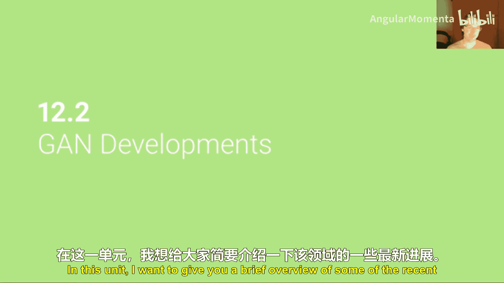
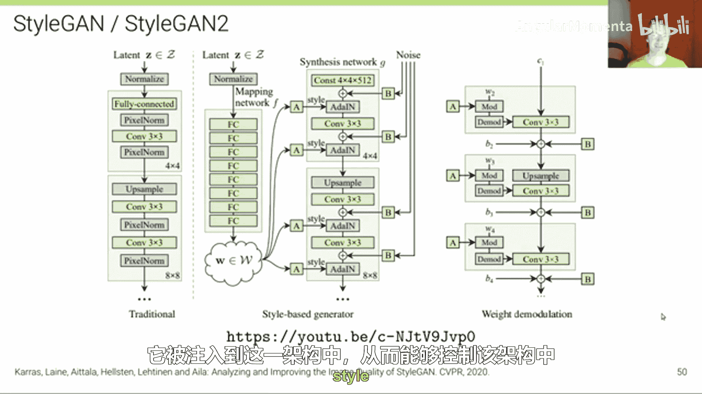
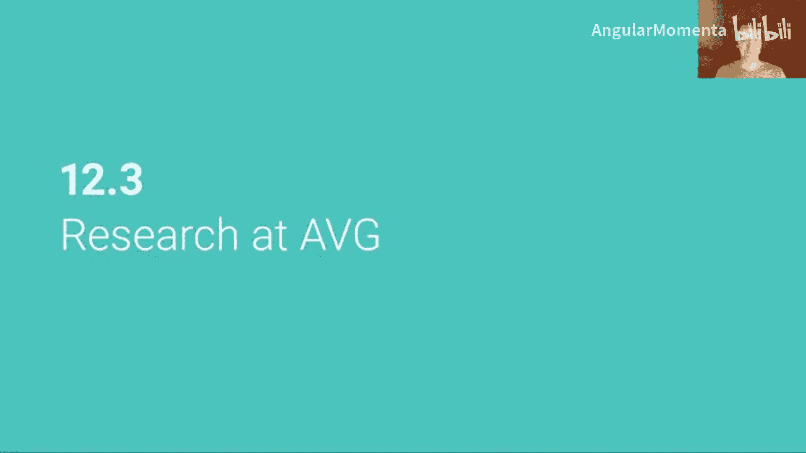

# 【精译】蒂宾根大学《深度学习》-p12-12--12.2（生成对抗网络：GAN发展）--BV1eDbrzhENK_p12-

The G model， the GN framework that was described in this landmark paper started。

A real revolution in the field with many follow up papers on applications and improvements of GNs and。

In this unit。I wanna give you a brief overview of。

Some of the recent developments in this area。It's really a。

Equivalent of Moore's law in this case of AI。Where here you can see four and a half years of progress。

Ofgans on faces in terms of the image fidelity you can see there。

Original results in the original G paper and compare it to results that are obtained today， which。嗯。

Are really impressive and where many people in the community were really shocked that this was possible to generate images with such a high fidelity and such a rich level of detail。

The first。Major step towards image generation with GNs is called DC GAN。

And it's basically a systematic search through the search space of possible architectures。

That work well in this mini Maxax2 player game framework。

And what they found is a set of basic recipes。That lead to models that produce high image quality。

For instance， what they did is they replaced pooling layers with stride convolutions in the discriminator and fractional strideide convolutions for assembling in the generator。

And we use batch normalization in both the generator and the discriminator。

They also removed the fully connected hidden layers for deeper architectures。

And they use reo activations in the generator， except for the output， whether they used it tonage。

And they used the leaky radio activations in the discriminator for all layers。 So this was really。

A very thorough and systematic empirical study on which architectures work well and because Gs are so notoriously hard to train。

 it's really important to get these hyperpermeters right。

So what they showed are samples on more challenging data sets that look much more realistic compared to the original G paper in this case here。

 samples of bedrooms bedrooms are。Complex scenes to represent with a 2D generative model that operates in the image domain。

Because there's a huge variety in constellations， in perspective。In appearance of objects inside。

 bedrooms， etc。Here are some examples of random latent code interpulations， where you can see。

 for instance， that here in the bottom line here there is a。

Object that appears to be something like a TV is slowly morphing into a window。Et cetera。Okay。

What they also show it in that paper is that you can do simple vector arithmetics。

What they did is they took。Average c vectors of samples。Of men with glasses that they have annotated。

And subtracted the average factor of men without classes and added the average factor of women without classes and then added a little bit of gauchian noise to the resulting latent vector。

And they obtained results like this。They can。Take a man with glasses and remove the man without the class and then add a women without classes。

 and you get women with glasses。So there's something semantically meaningful that has been learned。

As already mentioned， there was a real。Gan explosion over the last years directly following this original publication。

And there is even。Model Su that you find on the internet that you can keep track of the different models that have been developed。

One thing that's particularly tricky is how is the evaluation of generative models。

 particular because many of these high performing generative image models。

Don't allow for exact likelihood computation。And so one of the standard。Evaluation metrics today。

 which is not a perfect metric， but it's a。It's a metric that's commonly used is this so called fresh air inception distance FID。

And this is a metric used to assess the quality of images created by the generator of a generative adversarial network。

 and it compares the distribution of generated images with the distribution of real images based on deeper features of a pretrained inception V free network。

So the fresh a inception metric is the fresh a distance between two multidimensional Gaussian distributions。

 there is a Gaussian with parameters mu M and sigma M。IDe model distribution。

And the distribution of the inception V3 features of the images this is the distribution of the features of the images generated by GN。

 and this is the distribution of the same inception V3 features computed over the training set。

So if you take the fresht distance between these two gaussian distributions。

 this is the expression that you will arrive。So what happens here in other words is that there is a pre trained inception for a free network that has been trained on ImageNe。

And in the deeper layers of this inception network。

The hope is to find semantically more meaningful features， and we take these features。

For comparison of distributions， we obtain something that's much more meaningful than comparing。

Features early on in network where the features are much more local and more weak。

So this is one of the most commonly used metrics。That are used to for evaluating the performance of。

Gendative models and in the original paper where this metric has been introduced。

 they demonstrated that indeed it does something meaningful。 So if， for instance。

 if you add noise to the images， then this metric goes， the distance goes up。If you blur the images。

 then also the metric goes up。Or if you。Remove certain aspects of the images or manipulate the images。

Or add images from a different distribution， also the FID goes up。

So it's a measure of image fidelity and similarity with respect to a data distribution。

 but it cannot measure or prevent mode collapse。 It's not a good measure to tell if。

The images that are generated from the model are covering the data distribution well or not。

One major advance in the field of Ghan was the so called Baine Khan。In the vsang G paper。

 it has been observed that low dimensional manifolds in high dimensional spaces often have little overlap as illustrated here by these two lines。

And this is just。An example for what happens with image manifolds， let's say。

And what they also observed is that the discriminator of vanillagan saturates if there is no overlapping support。

 so if we have these two modes here with no overlapping support。

 then the G discriminator satates in these regions because there is no gradients。

And so what veststeingans do is they。Use the earth Mo as distance。

Instead of the Myanen Shanandndarginence， which can handle such scenarios and which provides meaningful gradients also in the case of non overlapping support。

And this also helps in stabilizing gun training。And never。Major advance that。

Has made G training more feasible， has led to less。

More stable gun training and less hypopermeter training is the introduction of regularizers such as gradient penalties。

In this paper here， for instance。A very simple grade penalty regular has been introduced。

That is simply penalizing the gradient of the discriminator with respect to x。

And it can be shown theoretically that locally this leads to convergence。 So you have here。

 for instance， a standard gun that is not converging where the parameters are oscillating。

And in comparison here， you have two versions using such gradient penalties where over time the parameters are converging to a equilibrium。

Now， a diegan if such gradienting penalties has been demonstrated to result in high quality samples。

 samples that are much more high quality than shown in the original Diggan paper， but without using。

A lot of these hacks that have been introduced to。Empirically stabilized gun training。

 so you can with a very plain DC scan network using gradient penalties to obtain samples as shown here in the case of bedrooms。

Or here， in the case of churches。Also， note that in some examples here can even see a。

Little inlay shutter stock inlay that has been modeled by the network because a lot of these images apparently had this inlay inside the images and so it was。

Remember as being part of the data distribution。And heres some results on faces。

GANs can also be used to translate between two domains。

 not just to generate an image from a latent code， but to go from an image in one domain。

 let's say X to an image in a never domain， say Y。And in this paper called Amaired image to image translation using Pscheconist adversarial networks。

 this idea of translating between domains has been used。

Where both a forward and a backward mapping between the two domains。

Where the domains themselves are the latent variables， then are becoming the latent variables。

Is trained jointly using different loss functions， a cyclecon loss that maps that basically measures how well a sample that's mapped from one domain into the other and back into the original domain。

Is aligned with the original sample。And also classical discriminator losses as in GNS。

And with these type of models， what we can do is we can take an input image and produce a painting out of it。

So we're whopping that image from the image domain to the painting domain。

 just by training on an unaligned。Unpaired set of images of real world photographs and paintings of particular。

Painer of a particular style。And then we can map back from that painting into the original image domain。

 And there is this reconstruction lost then that tries to make this too。The same。

And also recognize there is some ambiguity， of course， this red flowers here are。

Converted into yellow flowers and the be converted into yellow flowers。

Or here there's a conversion between。Horses and seabras and back to horses or between winter and summer and winter。

 or between aerial photographs。And aerial maps and back to aerial photographs。Or between facades。

And semantic labels of facades。Or between line drawings and actual photographs of objects。

So it's quite fun and you can play with this interactively on some web demos。

So here's some more results。嗯。In order to further improve the performance of GNS。

 one idea that has been introduced in this paper on progressively going GNS is to start at a low resolution train again just at a4 by four pixel resolution and then progressively during training at more and more layers to reach higher and higher resolutions。

 both for the generator and for the discriminator。And with this procedure。

 they were able to obtain very highly realistic images at very high resolution up to one meapix。

 which wasn't possible before。 And this is also one of the。嗯。

Basic models that is used in the state of the art， the basic approaches that is used in the state of the art G models today。

Okay。Another。group of researchers has analyzed how well GNs can scale to more complex data sets。

 particular data set it is hard to model its imagenet due to its huge diversity。

 so we've tried to scale class conditional GNs where there's a class label that's also an input to the GN。

To imagenet at fairly large resolutions of 512 by 512 pixels。

And they demonstrated that this is even possible without this progressive growing if you have just very large models and large mini batch sizes and consequently also large compute clusters。

This is done at Google， so it's at Google scale。And they introduced some。

Tricks that are important for making this work， such as autoagonal regularization of G and a latent space clipping。

And they explored variants of different。Regularization strategies。

 and they particularly analyzed the trade off between stability through these regularization strategies and performance。

 and they really found a trade off theirs that。In the sense that。If you include these regularizers。

 you get more stable， convergent， more stable behavior。But at the hand， on the other hand。

 you hamper performance in terms of the FID metric。

And so what they proposed instead is to monitor the。Spectrum。

 the singular values of the weight matrices of the generator and discriminator in order to determine when mode collapse happens。

 is indicated here。And to stop training at those locations。

 they found that this early stopping strategy compared to the regularization strategy of the discriminator leads to better FID scores。

This is Stgan and Stloggan2， which are the state of the art。

 consider the state of the artgan models today。And I highly encourage you to have a look at this video。

 which is really impressive。Stallagan uses。嗯。Gun training with regularization strategies。

 but using a novel network architecture。So instead of a traditional architecture。

 where there a latent code。That's input to a generative model。

The latent code in a style gun is mapped through fully connected layers into style codes at different。

That are input to a different。Layers in the generator architecture that starts from a constant code。

 And then there is an additional noise vector that's input also at the different layers It's injected into this architecture。

 which allows to。Control the fine grain style。

At different resolutions in that architecture。And with that， what they achieved is to synthesize。

Images that are more realistic than。Any images of any general model that have been synthesized before。

And by changing these， this input noise that I've just shown。By as sampling different input noise。

 they can obtain very complextochastic variations， like in this case。

 this is this green box here zoomed in。Variations in hair strands， while each of these。

Different variations by itself is coherent and looks natural。So here are some results of this model。

 this is from the website this person does not exist。If you go to that website。Every time you reload。

 you will get a new image from that model。And so this is what。

Many people got excited about the quality of this Dgan2 model in this case。

 it produces images that are very hard for human to distinguish from real images unless you are very familiar with this type of models。

 it's very hard to see the failures of this model。I want to show you of some examples of these models here。

Okay。Produces。Different types of humans， male and female of different hair color， beard， non beard。

Can produce a curly hair。 non curly hair can produce glasses， etc cea。Okay。

