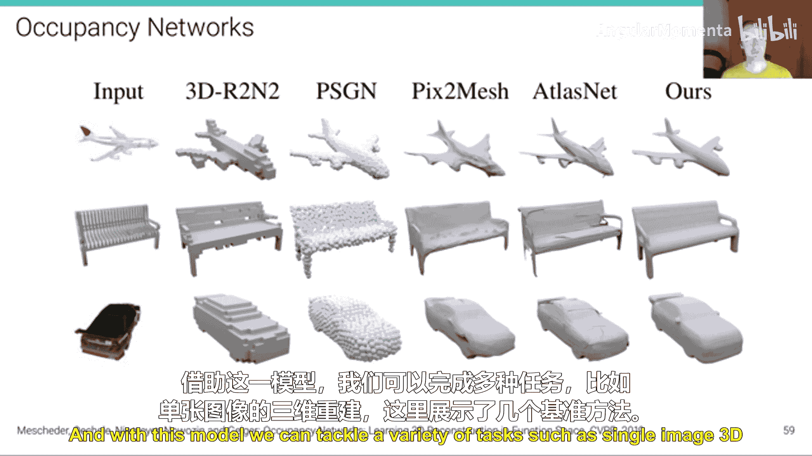
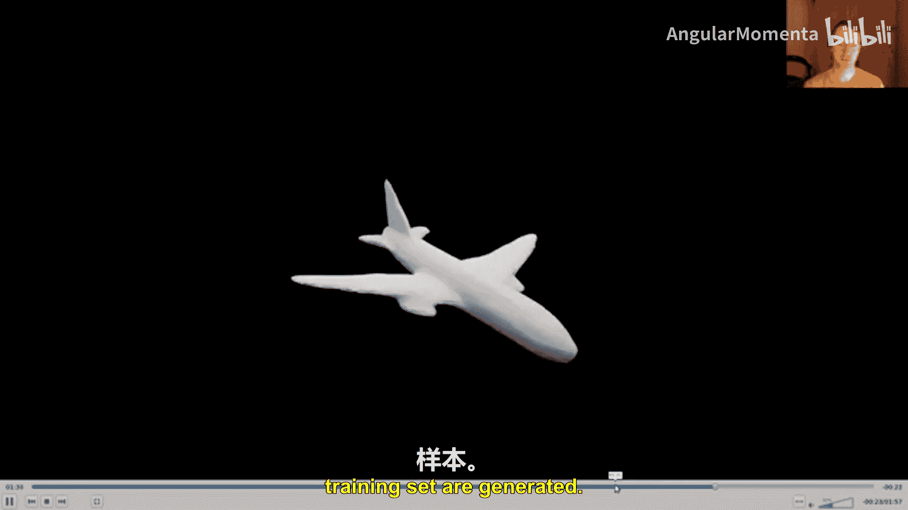
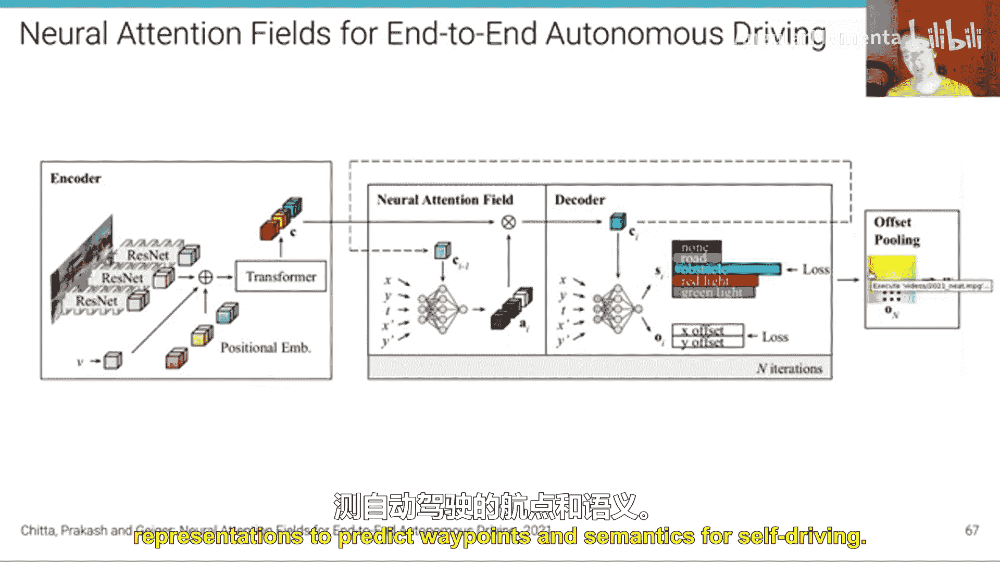
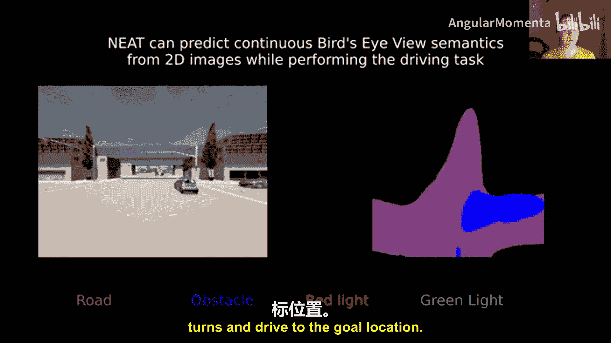
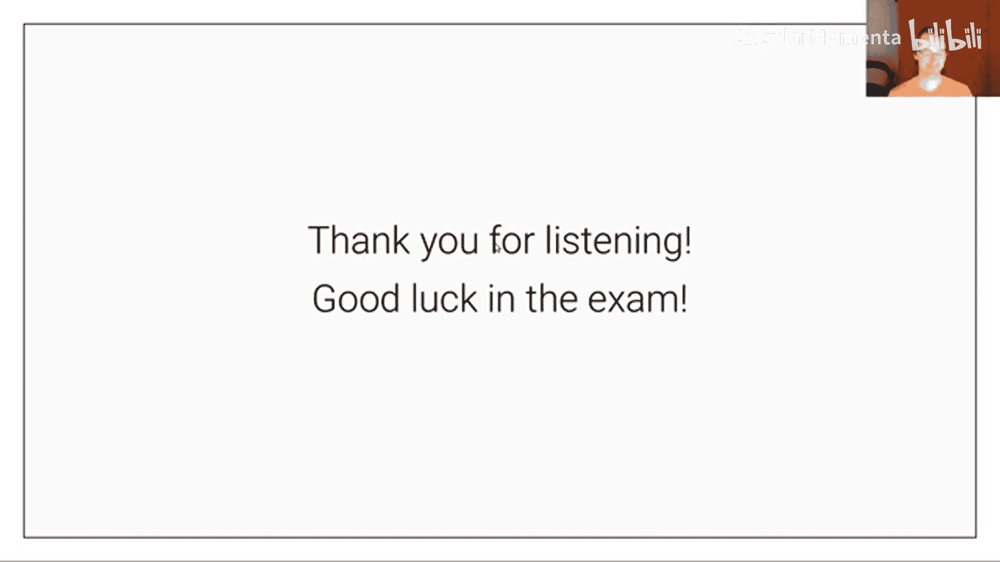

# 【精译】蒂宾根大学《深度学习》-p13-13--12.3（生成对抗网络：AVG的研究成果）--BV1eDbrzhENK_p13-

This lecture has discussed the fundamentals of deep learning Now in the last unit I want to show you some research examples of how we use deep learning in our daily research at the autonomous visionion Group。

Of course， the last unit is not relevant for the exam。

This is a picture of our research group a few years back。

And our goal is to create intelligent systems that can interact with a complex 3D environment。

And one task that we have to solve in order。For understanding a 3D environment is to understand the environment in terms of its geometry and in terms of its appearance。

And so one fundamental task that has to be tackled in this context is3D reconstruction。

 where from multiple or even a single image。嗯。We predict a 3D shape。

Using some form of neural network。Now， in this case， the input is relatively well defined。

 it's one or multiple images， these approaches often even work with a single image through machine learning and a lot of data。

But one elementary question is what should be the output representation and in fact。

 only in the last five years or so。There has been a significant momentum in the area of 3D deep learning before most of deep learning has happened on sequences and images and maybe graphs but。

Only in the last couple of years， people were able to take these models and apply them too。3D data。

There's a couple of pretty output representations that have been used。

 in particular voxels points and meshes， but all of them are discretizing space in one day or the other and therefore do not lead to reconstructions that are as detailed as we'd like。

For instance， point sets。arere typically not outputting a topology and meshes are discrete in terms of their verticies and are also very hard to predict such that the meshes are smooth and there is no self intersection。

 etc。So the key idea of the paper occupancy network that we proposed in CBPR 2019 was to not represent 3D shape explicitly。

 but instead consider the surface implicitly as the decision boundary of a London near classifier。

 so basically we want to train a classifier where the decision boundary separates the points inside in red from the points outside in blue。

So this is a function with parametersids Theta， it's a neural network that takes us input a 3D location and some condition。

 an image that we want to reconstruct the 3D shape for and outputs an occupancy probability。

Such that if we take the decision boundary 0。5 here shown in gray。

 we can separate with this bench shape in this case。

 the red points inside that bench from the blue points outside。And with this model。

 we can tackle a variety of tasks such as single image 3D reconstruction。

 as shown here with a couple of baseline methods， the input is on the left。

 it's just a 2D pixel matrix， a single image。

And on the right， you can see the reconstructions from that image and you can also see how detailed the reconstructions with this occupancy network are compared to the ground roof on the left。

And this is also possible from just very noisy point sets。

 you can see very sparse and noisy point set on the left and the corresponding reconstructions of various space lines and the occupancy network approach on the right。

So the model is really able to。Learn to reconstruct， even given very noisy inputs。

And learn to reconstruct wateright surface as well。嗯。The model can also be used in a。嗯。

For an unconditional generative model， what you see here are。

Lant space traversals of a variational auto encoder using this implicit representation where novel samples that are not part of the training set are generated。

This model can also be extended to 4D， and we have proposed such extension in ICCV 2019， however。

 going from 3D to 4D directly is difficult because of the curse of dimensionality。

 so we developed a model that represents the。The occupancy is shape only at a particular time instance。

 but then represents a velocity field in 4D， which is much easier。

 and we can then obtain the trajectory by solving an ordinary differential equation。

And we can back propagate through this ODE in order to update the gradients of the occupancy in velocity field in order to model 4D or to learn 4D reconstruction。

We can also use these techniques to model surface light fields。

 which is basically the appearance of each point on the surface of the object。

Conditioned on the viewpoint and the light location。 and then。Given a。

Input image and a 3D geometry such as a CA model we can then。

Using our train neural network infer a model where we can afterwards manipulate the lighting and manipulate the viewpoint。

There's a little video of these results。Where you can see for instance how shadows are accurately captured by the model。

 the right is the ground roof on the left is the results of the model。

 you can see that depending on the light location， the texture， if you will， changes。And we can also。

Model multiple light sources in the form of an environment map。

And get these speculular reflections on the car surface here。Now these implicit models。

The original implicit models as have been proposed are difficult to scale to large scenes。

 so we developed a combination of implicit models with the idea of 3D convolutions that now scales to very large scenes like room level reconstructions on the Meport data set as shown here。

Now， all of these approaches that。I have presented so far even required full supervision in terms of 3D。

 inside， outside occupancy values。A required。Known poses of the cameras with。

Image based observations。But what we also wondered is， well。

 is it possible to take these implicit models and this is a particular type of implicit model called a radiance field here？

And learn these models from unstructured image collection。

 where we have just a single image per scene and where we don't know the camera。On parametersrameter。

 we don't know the camera pose or the intrinsics。And we've presented a model that demonstrated that this is possible just from a set of RGB images。

We can recover。A disentangled representation where we can then afterwards， manipulate the。

Oppose the camera viewpoint， the shape or the appearance of the object and obtain the RGB rendering or a depth map or 3D geometry on the bottom row here。

this false color notation。This works for a variety of different object categories we've tested it for cars and faces and birds and cats。

And others。Another。Aspect of 3D modeling that we are interested in is to recover semantic information from 3D point clouds without supervision。

 So in this case， we're given just a collection of 3D point clouds of objects and we want to recover semantically meaningful parts。

That if we compose these parts together， yield a plausible shape。

 while each of these parts is semantically meaningful。 And we are using a type of。Geneative model。

 that is a。Deep is an example of a deep gene model that has an explicit likelihood representation。

It's called a flow based model that we haven't covered。

 that we didn't have time in this lecture to cover， but it's also a very interesting type of model。

And so heres some examples we have triedtus on hands and human bodies and all kinds of shapenet objects as well。

So these are shape pars where without ground through for the parts， we have recovered these parts。

In general， we are interested in disentanglement， which is an important。

Research area at the moment were given just a collection of images we trying to disentangleling the。

Underlying factors。 And in this case， were we're interested in causal factors， factors that。

We're responsible for generating the shape of an object。

 the texture of an object or the background information。 and we're trying to。Induce。

Weak biases into the model in order for the model to learn this disentanglement into this。

Casal factors automatically。 And then once we have such a representation that's disentangled。

 we can composite。嗯。Arbitrary shapes and arbitrary textures and arbitrary backgrounds and as we've shown in this paper。

This also leads to more robust classifiers if we use now such interventions for training a classifier compared to just training on the original data set。

 we can also do some latent space traversals and here's a little example of what this looks like。

Okay， so this was a fun project。Now we're not only interested in the perception aspect。

 but we're also interested in combining perception with control because we believe that only if we look at the control problem at an actual。

Feedback loop， in terms of a robotic system in this case of driving cars。

 we are able to learn something about how to develop better vision systems and so one thing that we we have done a couple of projects in this area。

 one thing we have looked at is what is a good intermediate representations for learning end to end driving policies。

And we found that。It's actually。More important to annotate the right parts rather than providing a very detailed semantic annotation as people typically do。

In order to even obtain a better。Policy success rate compared to a situation where we have very detailed class labels。

 but then the model， the visual abstraction model gets very confused and is not able to the policies are not able to drive well。

 despite having spent significant more time in annotating these images。

And of course we're also interested in better models for self driving。

 self drivingriving is a very complex task， it's mapping from a very high dimensionional input space。

 many images of many sensors， there is Liar， there's RGB information。

 theres other type of input information， there is maps。

We need to consolidate all of this information into a very compact representation。

 and this is really challenging in order to。Perform a。A good driving decision。So in this case here。

 we have developed a model that combines transformers as we have。

Learned about also in this lecture with these implicit representations to predict waypoints and semantics for self driving So here sir。

Little video with some results。So what you see here on the left is the driving policy that we have trained in action the only input to that policy is。

嗯。Multiple images and the policy。Learns to adhere to traffic rules and stop for pedestrians and vehicles。

And make correct turns and drive to the。

Goal location。If you。Interested about our research I recommend having a look at our block。

 we have a research block where we write little articles。

 five minute reads about some of our recent research works。That's all for my side。

Thank you very much for listening， thanks for joining this lecture。

 and I wish you all the best for the exam。

