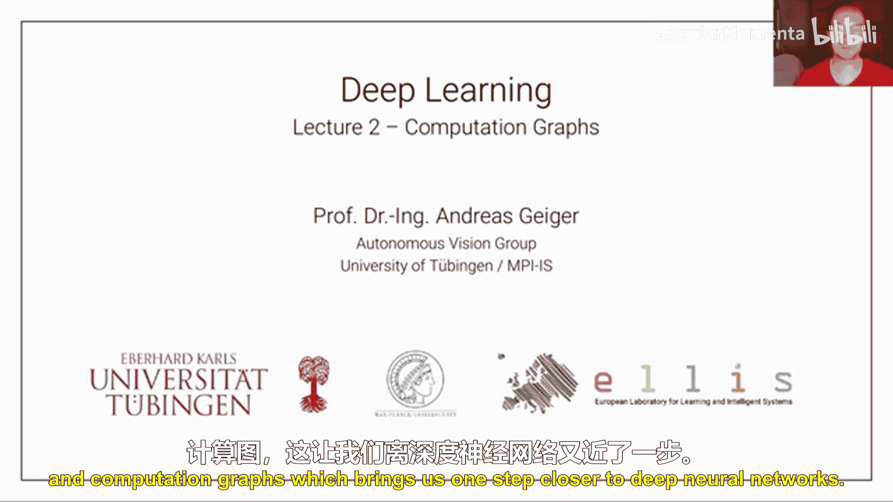
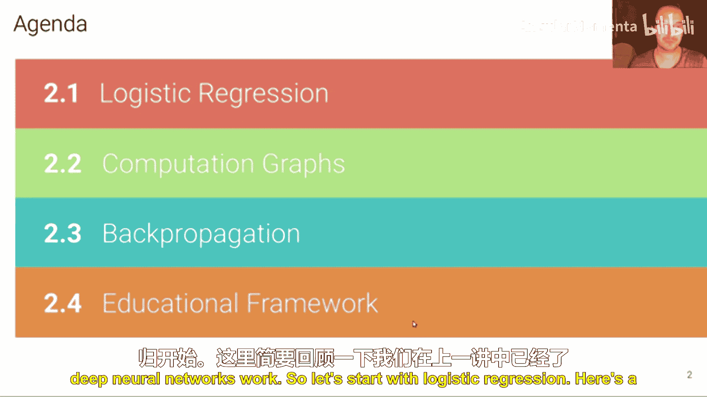
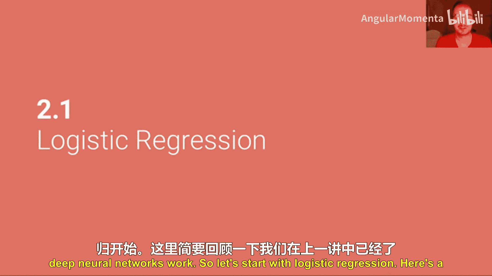
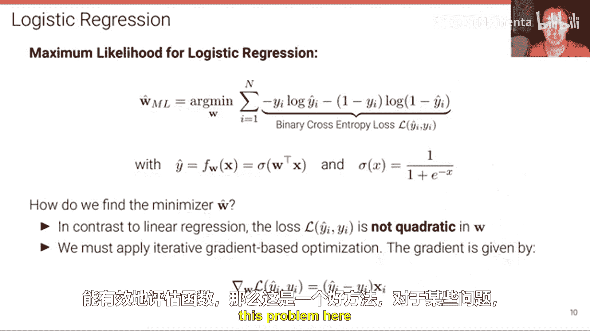
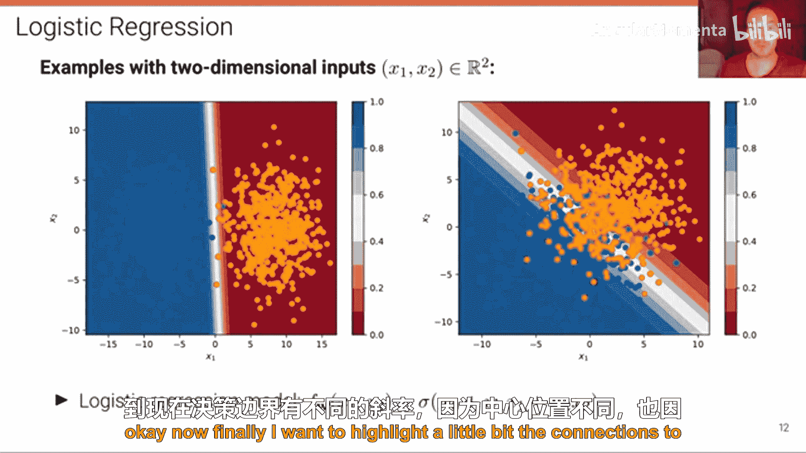
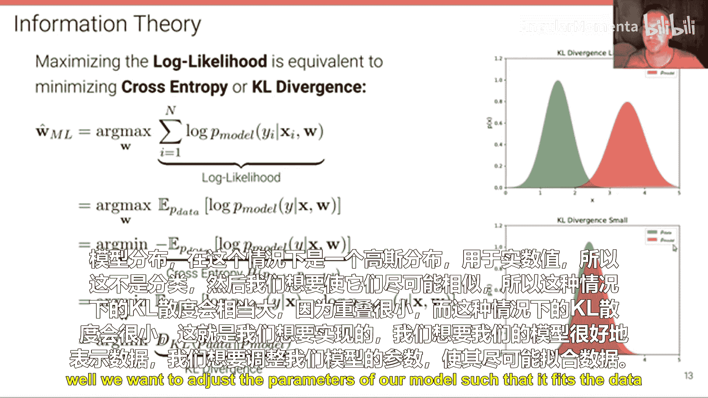

# 【精译】蒂宾根大学《深度学习》-p14-14--2.1-（计算图：逻辑回归）--BV1eDbrzhENK_p14-

Hello and welcome to the second lecture of deep learninging at the University of Tubingham。

Last time we have talked about linear regression and a maximum likelihood interpretation thereof。

Today we're going to talk about classification and computation graphs。

 which brings us one step closer to deep neural networks。

This is an overview of the agenda for this lecture。

 it is structured in four units in the first unit we are going to discuss the logistic regression problem for classification。

In the second unit， we are going to discuss computation graphs。In the third lecture。

 in the third unit， we are going to discuss the Beck Proagation algorithm。

 which is so fundamental for deep learning today。And in the fourth unit。

 were going to introduce briefly the educational framework。

 the educational deep learning framework that we are going to be using。

During the first part of this lecture series for understanding in depth， how deep neural networks。

Work。So let's start with logistic regression。

Here's a brief recap of what we've seen already in the last lecture。

This is illustrating the supervised learning problem setup。

We have a model here in the center that tries to predict an output y from an input X。

 and that Model F is permetized， you can think of this as a function which is permetized by some parameters w。

In machine learning now there is two fundamental problems that we need to solve。

 the first is the learning problem。This is about estimating the parameters of this model。

 parameters W from。A training set。Training set is composed of X and Y pairs here。 in this case。

 we have n elements in the training set。After learning。

 we fixed the parameters W and now we can use this model to make novel predictions for unseen inputs X。

 we can make a prediction Y。This is what is shown here。

So these are the two fundamental problems in machine learning。Now。

 last time we have discussed the regression problem where the input could be any structured object such as this sequence of stock。

 and the output is a one dimensional real number， in this case。

 maybe the price or the value of the stock at the next day。And this is a problem that can be solved。

 for instance， using linear regression。Now today， we are going to consider the classification problem。

 which is。Slightly different， the input is again， a structured object。

It could be the time series that Ive shown before， but in this case it's just an image。

So this doesn't matter， it could be any object。And the output is a binary variable。

 it's binary because it has only two possibilities。 it's just two different labels here。

 it's not a multiclass classification problem， which we are going to discuss later in this lecture。

It just has two possibilities， in this case we are trying to classify if this image is depicting a beach or if it is not depicting a beach。

Okay。So last time we already got to know the maximum likelihood estimator。And more precisely。

 the conditional maximum likelihood estimator， because we are conditioning on some input X。

 we're not just。Trying to model a distribution y， but we are trying to model a conditional distribution Y given x。

Now， what you can see here is the。Maximum lock likelihood estimator and we have the lock of the product。

 which is sum of the logarithm。However。你。The estimate that we obtain the arcm is the same as the maximum likelihood estimator would return。

As the logarithm is a monotonic function。In practice。

 we prefer often to use this log likelihood estimator， both for numerical reasons。嗯。

In when implementing these algorithms。Because this is resulting in more stable computation。

 but also for mathematical reasons and also for connections to， for instance。

Concepts in information theory。So we'll mostly use the lock likelihood estimator from now。

 which returns the same it doesn't return the same value， but it returns the same maximum。

The same parameters W， and we denote the estimate as W hat with this hat indicating that this is an estimate of the true parameters。

So now what we want to do is we want to like to perform binary classification。So， the output。Is。

Out of this。The output can take only two possible discrete labels here，0 or1 to simplify。

And the question is， how should we choose the model distribution in this case？so probably。

The Gaussian is not a good choice right because the Gaussian models a continuous distribution。

 So what is a good distribution for this case well。It is the beulli distribution， of course。

 which models exactly this binary classification problem。So here we see the benoli distribution。

You on the right hand side。And we have SY hat here。Some prediction of some model。

 which we're going to discuss in a second。 So this is just。a。A real number。

That is predicted by some model， and then the y is the true label from our data set。

 so this is the y that goes into here， which is coming from the data set into this model distribution。

And so what this does is basically picking over this term or picking this term， for instance。

 if y is0， then this term here is1。All right， so in this case。The first term here。

 y hat to the power of0 becomes 1， it disappears effectively。

 and we're choosing this as the prediction，  one minus y hat。

You can think of this as the probability of predicting the positive class， the one class。So。

You can already see that if the true label is0， then we would prefer a predictor that also predicts0 because then this entire term will be close to one。

 so will' be close to the maximum value that the probability can take。This is a discrete probability。

Conversely， if y is one。Then the second term will disappear because we have 1 minus1 is0。

 so this term to the power of0 is 1， so this entire term here will disappear。

And we are left with the first term here， which means why hat， and in this case。

 our predictor should predict the number that's close to one because then we are maximizing this probability。

Okay， so the question now is well， this y hat is some prediction that must depend somehow on the input X。

 right， this is our prediction。This is the probability that we want to assign to the class one。

And it must depend also on some trainable parameters W， so I denote this function here simply as F。

W of x。 and we're going to use this Y hat still several times on the few following slides just because it makes the entire formulas much simpler compared to directly sticking in this F w of x。

So you can already in your head try to remember that is why head is the prediction of the model and it even though it doesn't it's not explicitly indicated here。

 it depends on the per just W and the input X。And。So。嗯。In summary， we assume the spinli distribution。

Well， y hat is simply a shorthand for Fwx of x。Which doesn't include explicitly these parameters。

 but they are there right so this function depends is y hat depends on W and x Another question is how how should we choose it。

 how should we choose Y hat or FW of x。Well。We are working with this is a discrete distribution P model。

 the model distribution is a discrete distribution because we have a discrete outcome here。

So what we know is that FW。Must be within0 and1 It must be a proper probability。

It cannot be negative。And it can also not be larger than one， it's not a density。

 it's a discrete probability， so it can be maximally1。

It's not the case that one of the classes can have a higher probability than one if one of the classes has probability 1。

 then the upper class must have probability zero。嗯。

So how can we effectively implement this requirement？Well。

 what we can do is we can use what's often called a squashing function。Or a sigmoid function。

 right so these are two terms for the same function。So we choose this F。

As the sigmoid function of a linear function， Sigma here is denoting a sigmoid function that is。

This expression here on the bottom one over 1 plus E。Minus X。

So we take the linear combination of the weights and x this is slight linear regression here。

But then we do a nonlinear transformation to it。We push this through a nonlinear transformation sigma that is expressed like this。

Now， why do we choose this form for Sigma？Well， because this is a very special form and I have plotted here on the right。

 this is the sigmoidoid function sigma。You can see that it passes through 0 at 0。5。

 and then at a value of  five or so it very quickly。嗯。Ds at a value of asymptos at a value of one。

 it doesn't。Go beyond one， and similarly。At-5， when it goes closer to minus infinity， it。

It tends to the value zero and doesn't go below zero。

So what this function effectively does is it takes a unbounded range of the real numbers。

 so this on the x axis here we have the real numbers。

 this is basically what double UT times x is returning we have no restrictions here so it can be any real number is the scalar that is returned here。

And it transfers this domain of real numbers to the domain from 0 to 1 to the interval0 to 1。

 so we know that after applying this squashing function that' why it's called squashing it's squeezing the values to the interval 0 to 1 and that's exactly what we want。

 because we must fulfill this requirement that the outcome of this function is between0 and 1 to be a probability probability。

Okay。This is also the reason why this is called logistic regression because this is the logistic。

 it is also sometimes called the logistic function。Logistic transfer function。

And this is a requirement because we are dealing with a classification problem here。

So now let's put it together。 We have the maximum likelihood estimator。From before。

And now for the model distribution， we plug in the benoulli distribution here。Where this y hat is。

The sigmoid of。W transpose x。Or Xi in this case， because we are considering a specific data point here in this equation。

Now， because we have the logarithm of this expression。

 we can transform it slightly so we can we have a product here so we can split this up with a sum。

And so we have the logarithm of the first term and also this exponent here we can pull in front based on the logarithm rules and the same on the latter term。

And then instead of maximizing， we can also minimize this expression by writing a minus in front。

Just changing the plus into a minus and minimizing is the same， of course， as maximizing this。In。

Machine learning， we often don't maximize likelihoods， but we rather minimize loss functions。

 and that's why we are writing it this way here。And this latter term here now has a specific name in the machine learning community is called a binary cross entropy loss。

It's a binary cross entropy loss， and for the loss， we often use this symbol here L。

Cligraph L is a loss。Between the predicted why and the true why。

And as the lot name loss indicates a loss。A high loss is bad， and a low loss is desirable。

 So we want to minimize the loss。 We want to。Compute the overall minimum over the data set of all these individual losses。

So as already mentioned in machine learning we use often the more general term loss rather than what we have used before in linear regression。

 thearrow function。And the reason is that this loss term is more general。

 It's not necessarily an error between observations。 It could also be， for instance。

 an inductive bias that we want to encode。 It could be， for instance， a。

Ecoding a regularizer over the network weights。嗯。Or some some more complex object that is hard to describe as an arrow。

 And it's， it's a measure of the loss that is incurred by。

Assigning a certain label or making a certain prediction right。

 which is the loss can be different from the error。

 it could be that some error that I do has a higher loss because I want this error to occur less frequently that's why a loss function is in terms of the definition is a more general term。

Now this formula has the following interpretation， what we want to minimize effectively is the dissimilarity between the empirical data distribution P data。

Which is defined by the training set。And the model distribution， so。

We want to find a parameter for our model such that the prediction of our model is most similar to our data and effectively both distributions are the same。

 this is what this expression tells us and we will go into the details a little bit more。

So let's look at this binary cross entropy law， so now we are looking only at this expression for a single data point I。

And this is what I write down here as this binary cross entropy loss。

So we can rewrite the binary cross entropy loss as follows， so if Y I equals 1。

Then we are considering the first term because the second term disappears because we have 1 minus1 is0。

If Yi equals0， then the first term obviously disappears。So if the true label is one。

 then we have this curve。Which depends on the predicted why。Otherwise， we have this curve。

And I plot it here for you these two curves， so in the case that Yi equals 1。

 we consider the blue curve in the case that the true label is0， we consider the red curve。

And what we want is we want to minimize this curve。So when are these curves minimal？

For y equals1 for this blue curve here， we obtain a small value if also the prediction y hat is close to one。

 so if we are in this area。Conversely， we have a high loss if the prediction would be like close to zero。

And the would be the true label would be one。And similarly for the true label being0。

 we want to minimize this loss so that the y hat， the predicted value is also close to zero。

 so this is very very intuitive。Effectively， what this means is that this loss L is minimal if the predicted y is。

Close or equal to the true y for the data point I。And this loss function here。

Can it be extended to more than two classes you can think about these as probabilities right and we can have more than two in the case of two then because this's a two simplex。

 we have just the one minus the first here， but we can consider our higher order simplex here where we have multiple outputs。

 discrete distribution not over over two but over multiple。

So we'll talk about this in a later lecture。So let's look at this result a little bit more visually。

 and I found this on this towards data science blog post here。

 which I found quite a nice illustration。So a simple 1D example we have on the x axis our features。

 this is the input 1D。And then here we want to classify between positive and negative。

 so the only thing we observe from the data is the x value and then we want to tell for a particular x value is it in the positive class or in a negative class。

 you can see that they are discrete， they're only taking values 1 or values 0。

So this is the data set we have a set of positive samples here in green and a set of negative samples in red。

Negt is equal to y I equals 0。Now what we want to do is we want to fit such a logistic regression model。

 which has this logistic curve here。A very simple one。

 which is basically taking just a bias plus a weight times this x value here is is a very simple linear term。

And then pushes this through this nonlinearity that you can see here。

To fit to this dataset and what you see here is already the fit to this dataset set。Now。

 how do we interpret this in terms of probabilities and the loss function？Well。

 the probabilities of the classifier。This is this curve here for the positive samples are shown with these green bars here where each of these green bars is basically extending all the way up to the curve because this is the probability that the model assigns to these positive values。

Now you can already see that for the positive values， this is not ideal。

Even though overall this is the ideal classifier here， this sample， for instance。

 of the data set is only classified as a positive value with maybe 0。4 probability。

 so it has a higher chance based on our classifier to be in the negative class。And。

But what you can see is already the criterion that we want to optimize。

 we want to obviously for all data points， we want to maximize these probabilities being correctly assigned。

Now， unfortunately， with these features， it's not possible to do this perfectly， right。

 because we have not only the positive points， but we have also the negative points。

 and these are the probabilities for the negative points。 So in this case。Bars extend from the top。

You can see also that like on on the left hand side， we are quite confident。

 right we have high probability now this should be actually reverse。Um。

 but like for this outlier here， we we have a very low probability。

 you have actually a higher probability， this is this region here of being the positive class。😊。

Right yet we have to maintain this balance right we want to train a classifier that represents the entire data set。

This is the sum over this。Across entropy that were computing， right。

 this balances the influence of these data went。Now we can put all of these probabilities together。

And we can because it doesn't make sense to have them hanging from the top。

 we can just put them to the bottom。 So this is the same as this just that we arrange them from the bottom。

And again， red is negative and green is positive。 and what we now want to optimize is basically these probabilityities we want to maximize them or equivalently。

We want to minimize the negative logarithm， and this is the negative logarithm here。

 you can see that for instance， this red point here that is classified wrongly has low probability for the correct class。

 has also a high loss。And it makes sense， right， because it's。It's given the parameters of the model。

 even for these parameters are optimal because the data set has so much confusion has a high loss。

 right， And so what we do then， And this is where the balancing comes in is we we minimize the mean or the sum over all these。

Negative lock probabilities。So this is basically an intuition of what we are doing。Now。

 this is the model， the full model， maximum likelihood model for logistic regression that we have been looking at。

So we are trying to find the optimal weights W， and it is binary cross entropy loss over all the data points。

Where the model predicts。W hat via this logistic function of a linear function。

And this is the logistic function or the sigmoid。Now the question is， well。

 how do we actually optimize this， right？In case of linear regression。

 which we had discussed in the last lecture， it was easy because the loss was a quadratic function in W。

Now， in this case， the loss is not a quadratic function in W anymore if you look at this loss。

And if you look at where W appears， W appears here inside the sigmoid。

 which is a nonlinear function already right， so it's linear here。

 but then we pass it through a nonlinear function。And then we take the logarithm of this nonlinear function。

 which is also a nonlinear function， right so this is highly nonlinear。

Transformation of this linear model。 and so we don't have an。

Easy expression as we had it in the quatic case for the linear regression task。Now， what can we do？

In this case， if there is no closed form analytic solution。

 we need to apply some iterative optimization technique。

 which is based on gradientsLuckiily we can compute gradients， so that's good。

And so we can use a gradient based optimizer that slowly follows the gradient to a local minimum starting from some initialization following to the local minimum。

 actually in this case， the situation is great because。

Despite this not being a gradratic function that is easy to minimize。

 we need to apply this iterative algorithm。It's still a convex function can be shown that this problem is a convex problem。

 so we know that we don't fall into a local optimum if we do if we apply a gradient based opt so we end up with the global optimum that's good。

 but we can't reach reach it in a single step or analytically we need to apply an iterative gradient based algorithm。

And for all the gradient based optimization algorithms where the gradient is needed。

 we need to compute this gradient， which is the this is here， the NaPla operator。

 this is simply saying we want to compute the gradient vector of this function with respect to W。

What is nice is that in machine learning in these machine learning problems。

 often the loss function is actually a one dimensional quantity right this is also the case here。

 This is a one dimensional quantity， which means this is not a Jacobian， it's not a matrix。

 but it's just a vector， it's just a a one dimensional quantity which we。

For which we compute the derivative with respect to a number of weights in this case。

As many weights as we have here in our model， is a vector。

And the nice thing about this particular objective function is that。Despite in the first step。

 the gradientding looks quite complex。It simplifies a lot when you do the analytical derivation。

 and this is the final form of the gradient of the binary cross entropy loss。

Of this logistic regression model。 So it's very， very。V it has a very simple form y hat。

 the predicted y minus the true y times x。Good。And now。

OneSince we are able to compute this gradient analytically。

 we can apply it inside a iterative gradient based optimizer。

 which tries to go stepwise towards the optimum， so the simplest optimizer that we can use and one that's actually used。

Nowadays heavily even for it's so simple in deep learning is called grade in descent。Well。

 it's a variant of gradient indesscent that's used， but in this case。

 we're using gradient indesscent。So what we do is we pick a step size atta。And a tolerance value。

 epsilon， and then we need to initialize the weights that we optimize。AndCa them W0。 here。

 This is the upper index is the time or the iteration index。And then we repeat until this vector V。

Is smaller than some epsilon。 we iterate a procedure that computes the gradient right so this is basically the this vector V is the gradient。

Of this function， which is basically the this is over the entire data set。

 So we this is a bold face y and the boldface y hat。And here on the right hand side。

 this is the loss， the cross entropy loss per data point that we've seen before because the gradient operator is linear It's a linear operator。

 we can pull it through the sum over the data points。

So what we need to do effectively is we need to compute the sum over the loss， right？

When we compute that gradient， so we can pull this gradient inside the sum。

 that's what has happened here。So this is the gradient of the loss function over the entire data set。

And then we optimize this until this gradientding becomes small until we converge to a A。

An extreme value of this function， here you can see such a function in terms of this ISO surfaces。

And we go always into the direction of the negative gradients in order to go towards smaller values in this。

Energy landscape or in this loss landscape here。 So this is updating W。

 This is the next iteration of W W1 equals W 0 minus the negative gradient in times the step size。

Now this brings you closer to the optimum。But there's several variants that work a little bit better。

 so one is line search where this is actually the green curve here where you go into the direction of the gradient。

 but you search for the smallest value so this is here at this point its the smallest value because it increases in both direction and you stop here and then you go in this direction and go in this direction。

 this direction etc。So if you can evaluate the function efficiently， then this is a good thing to do。

You can do even better for some problems by using the conjugate gradient method where you're not going into the direction of the gradient but into some conjugate direction that brings you more directly to the optimal value。

Right。And there's other techniques like LBFGS， etc。

But what is common to all these techniques is that they require a gradient。

And this is what we have analytically derived for this problem here。

So now let's look at some results of logistic regression fits using this iterative。

Gradients based optimizer。 So this is a 2D example here you can see the formula at the bottom we have。

The function FW is now based on two inputs， x1 and x2 is a two dimensional domain。

And we have a logistic that's based on a linear combination of those plus some biased term W0。

Always when I'm writing bold phase X and I'm referring to a vector of x and typically I include the bias vector the bias value there as well。

 so this means that if I write a boldface and the first element is always a one and then the other elements are x1 x2 etc so that we come up with this expression here now for this simple two dimensional case I made it explicit so we have the bias and they have this so we have three weights basically but two inputs。

Yeah， and we have this data set。 So two different data sets here in this case。

 So on the left we have the blue points are the negative class and。As actually the opposite。

 the blue points are the positive class and the red points are the negative class。

 We try to fit this logistic regression model。 you can see already that this results in a linear decision boundary。

But we are able to optimize also the slope which gives us some indication about the confusion right so this is basically the white line indicates this is at 0。

5 where we would classify a new point as exactly likely of being in both classes。

 if it's a little bit right of the white line， it would be more likely for our classifier to be classified as the negative class if it's a little bit left of this line。

 it would be more likely to be classified as the positive class。And here on the right。

 it's a little bit different because these two data sets， these two clusters are overlapping more。

 so there's much more confusion。And they are a little bit different arranged。

 so the center is different from here and you can see that now the decision boundary has a different slope because the centers are different locations。

 but also because there is more confusion between these points。

 the classifier also exhibits the same behavior of more confusion by having a smaller slope so that there is a。

The transition between the blue and the red class is not as quick as here。And so this can be。

A modeled by this weights。W，0， W1 and W2。The slope of this sigmoid function。Okay。

Now， finally， I want to highlight a little bit the connections to information theory even though we don't have time unfortunately to go there into a lot of detail。

 but it's highly connected and there's very interesting connections。In particular。

 maximizing the lock likelihood is actually equivalent to minimizing the cross entropy or the KL divergence。

 which are both fundamental。Inform information theoretical ready quantities。So here on the top。

 we have our local likelihoods maximization problem。

This is the same as before we have the model distribution。We have this artrc marks。

 we want to find the parametersids w that maximize the sum overall data points of the lock。

Model probability。For this data points。With respect to W， this is our estimate。

 this is called the lock likelihood。So this is what we know。Now。

We can rewrite this using an expectation。Why， well。

 what we do here effectively is we are looking at an empirical estimate over the data distribution。

 right， we are we are just basically。Well， if we would write one over N here， it would be the mean。

 then we would look at the empirical estimate of the data distribution。

But one over n is a constant with respect to W so it gets absorbed into the Arcmax operator。

But for a moment， think about this equation here as having a one over n in the beginning。

Then this would exactly correspond to the definition of the expectation operator。

 which is basically expectation over the probability of the data points right so each of the data points。

It's a sampling based。Estimate here。Of the lock model distribution， so we have now y and x。

 and if I write an expectation here because I didn't have enough space。

I write just expectation of P data because we know what the expectation is over。

 it's over the data distribution， which is pairs of x and y。More correctly。

 I would have needed to write here a pair of bracket。X R x and comma y。

Sampled from the data distribution which is effectively what's happening here。

 we have n samples from the data distribution， that's why it's equivalent to writing the expectation over the data distribution for these samples x and y。

And then in the argument it's the same term as here。Okay。

So we have the expectation over the data distribution。Of the model distribution。Now we can。

 of course， write this arc max in terms of an argument if we replace the plus with a minus here。

 same as before。Why do do did they do this because now this becomes a very well known quantity in information theory。

 which is called the cross entropy， it's a cross entropy between the data distribution and the model distribution and it has。

A tight connections to the entropy and to the Kback liplo dirgence that we come to in a second。

So this is called the cross entropy between the data and the model distribution。

Now what we can do also is we can take this term and we can add inside this argument here。

 we can add the lock。Data probability of Y give next。

Why can't we do that well because the data probability， this data distribution does not depend on w。

 so it's changing the value of this function， but it's constant with respect to W so we can just add it。

Doesn't change。The minimizer。Of this expression， so it is correct to write this。Yeah。Now。

 what we have here is the last term together with this expectation。

 so if you would basically factor this in， it's also a linear operator。Is the cross entropy。

 and the first term is simply the entropy of the data distribution。

So we see that we have effectively we have some minus this times the expectation is。

They cross entropy， and here we have the entropy， so it means that we have the cross entropy minus to entropy。

And this in information theoreic terms is called the Kac liplo divergence。

 which you might have heard from other lectures before。And the coolback label of divergence is。

Is a divergence， so it's a measure， it's one of many divergences， but it's a measure。

 divergence is a measure of the similarity of two distributions。

 and that's what we referred to already earlier in this unit。So what we try to minimize。

And this is a nice intuition here。By computing the maximum likelihood estimate of the parameters。

 what we trying to minimize is the distance between two distributions more precisely between the data distribution given by the data set。

 the empirical data distribution， and the distribution of our model given its parameters w。

So here's an example。Let's assume the green one would be the data distribution and the red one would be the model distribution in this case。

 a gation for real values， so that is not classification then we want to make them as similar as possible right so the KL divergence of this situation here would be quite large because the overlap is small and the KL divergence of this situation would be small and this is what we want to achieve we want our model to represent the data well we want to adjust the parameters of our model such that it fits the data as well。

