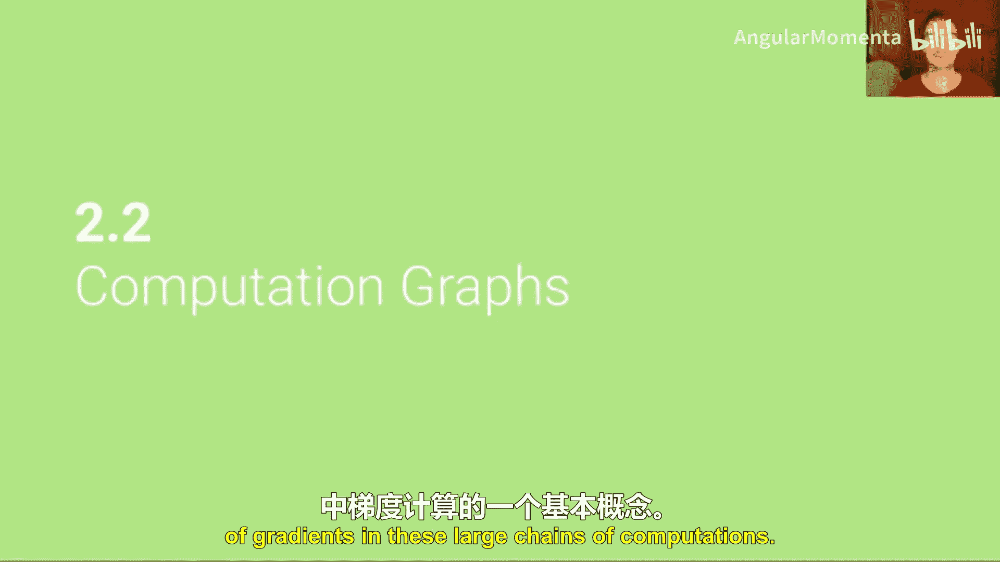
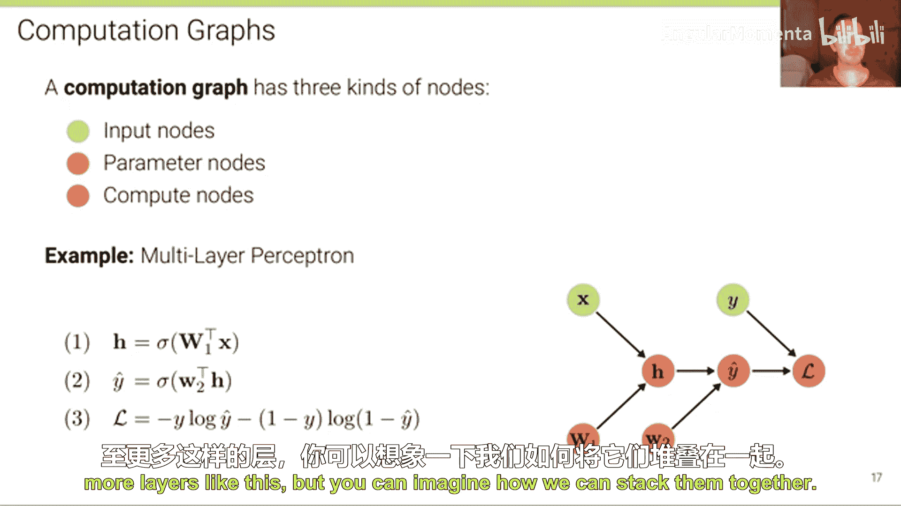

# 【精译】蒂宾根大学《深度学习》-p15-15--2.2（计算图：计算图）--BV1eDbrzhENK_p15-

In the second unit of this lecture， we will introduce computation graphs。

Which is a fundamental concept to understand。Computation， larger change of computations。

And also the computation of gradients in this large chains of computations。

So here is again， the maximum likelihood。esttimator for the logistic regression model that we've seen on the previous slides。

Yeah。So we've already seen that minimizing this。Requires solving a nonlinear objective that doesn't have a。

Analytic solution and therefore requires a gradient based optimizer。

 so we need to compute the gradients。Of this expression。Luckily， in the above case。

 the gradient is fairly simple to compute。And I leave this as an exercise， but I illustrate it here。

 it's simply the prediction of the model minus the true value， the true label times。And the input。

At data point I。It's a very simple equation。Unfortunately， it's not true that。

These gradients are so simple to compute in general for more complex models that we are interested in this lecture。

 in particular， for deep neural networks that layer a lot of computations where you simply can't。

With pen and paper， derive the gradients with respect to any of these millions or billions。

 the gigantic number typically of parameters。Just using pen and paper。

So the question becomes now and this was also the question for a long time in the deep learning history how can we basically efficiently compute this and so this was for the first time demonstrated in the 80s that this is actually possible and this was what was helping the breakthrough of deep learning so how can we efficiently compute the gradients in the general case？

So the key idea。Off competition graphs。the efficientff computation。

 this is what the back propagation algorithm does， but in order to understand the back propagation better we need to understand what the computation graph is first so the key idea of computation graphs is to decompose complex computations into sequences of very simple。

 more atomic assignments。And we call the sequence of assignments a computation graph。

 or some people also call it the source code because like a computer program that you execute line by line。

 like assembly code。The forward pass then takes a training point X and Y。

 as input and computes a loss from that。So this is what you can see here。As we will see。

 the gradients of this loss can be computed using a backward pass。calleded a backboard pass。

 It's why's called a back propagation algorithm in the next unit。And the key。

Message of this slide is that both the forward pass and the backwardboard pass are efficient to compute。

And this is。Because we we can exploit dynamic programming。

 That is we can store and reuse intermediate results。 We will heavily reuse intermediate results。

 instead of。Recomputing them。Both in the forward and the begward pass。

And this decomposition and reuse of computation is really key to the success of this spec provocation algorithm。

 Without this， it wouldn't be possible to apply this algorithm to the size of models that we apply to。

 It would be unthinkable to optimize。Deep networks with millions or billions of parameters without this decomposition and reuse of computation。

 And that's why the back propagation algorithm， which adjustss millions and billions of parameters in our deep models。

 is still the primary work cause for deep learning today。

So now let's look at what a computation graph is。A computation graph。

 as we will define it in this lecture， has three kinds of nodes。Input notes in green。

 Permeter node in orange and compute notes in red。Also。

 the loss function is a compute node in our setting。The input notes。Don't have parameters。

They are the input of。Our learning problem， they are basically the data set。

 this is where the data goes into the computation graph。So for instance。

 we have the x and the Y here。The parameter node is where the parameters of the model are stored。

And this is what we want to update。 This is what were interested in when。

Computing back propagation when back propagating gradients， we are interested in。

 well we need to back propagate gradients for all nodes。

 but what we're really interested in the end is the gradients for these parameters because this is where the updates are applied to。

This is what we want to estimate。And。Finally we have the compute nodes which could be over the final node is loss function or intermediate compute nodes that take inputs。

 for instance， input nodes or previous compute nodes or parameters。And produce a result。

Which compute an assignment。we assign a variable。Of the value to a variable。

And this is how we can decompose complex computations into a sequence of simpler computations using this graphical formulation。

So here we have。We are looking at a very specific example of linear regression。

 So what do we need to do in linear regression well。And this is the source code here， right。

 has the source code has three four lines of code，1，2，3 and4。

 These are four assignments that we need to compute。Can think of this again as assembly code。

 for instance。So the first thing we need to do is we need to multiply x the input x。

 this is a 1 d example， so we have 1 d input x with a one dimensional permeter w1 and this is happening here。

So U is assigned。The product of W1 and x。So now we have U now we need to add the bias term， so to U。

 we add the term W， the0， the peri w0 here in orange。

And adding W0 to U results in the assignment of Y hat。

 this is the prediction of the model already in this simple linear case， right？Simple linear model。

So we have the prediction why hat now。In the last lecture， this was called F。

 but here from this lecture on we are often used the Y hat notation as the prediction。

And then the next step we need to do in order to be able to compute the loss is to subtract from this prediction the true value y。

 which is the input from the data set， so this is a point in the data set that corresponds to the input X。

Y it corresponds to input X， so we subtract and call this or assign this value to the variable C。

And then finally， because we want to compute as a loss， a L2 loss， so square of this difference。

We take this value C and compute this square and we assign this computation result to the variable L。

And this is how we write。你。Linear regression problem。

 which we could also write in a single line how we write it as a sequence of atomic operations。

Now there' is multiple levels of granularities that we can use。

 this is a very fine level of granularity that we have used here。

But we can use more coargraed levels of granularity as well。

 and what we want to choose depends on how big we want to make these atomic units。

 which level of atomic units we still can handle， for instance。

 in the educational framework that you will work with。

 we have one unit that is responsible for for an aine transformation。

 for a linear transformation that includes both the bias and。嗯。The multiplicative part。

So in this case here we could combine one and2 and then we would change this computation graph as such。

 so now we this one and two step have collapsed into one step which directly computes this aine transformation from x2。

The assignment y hat and so this graph now takes us this y hat and this graph takes as input is no it takes as input。

X and both WC and W1。And we can also， for instance， collapse the loss， we can say， well。

 maybe we want to compute not。These two things here independently。

 but we want to compute them jointly， we want to compute。嗯。

Y hat minus so the prediction of the model minus the2 label squared directly。

 and this is what we did here。That's so just last。No here collapses。

 and we have just two computation steps。 so this is the first step。 If if you're going left to right。

 we have one step here and a second step here。So there's multiple ways we can write this and it really depends on how we want to implement it and how complex we can go。

And still efficiently implement this。Here's another example for a logistic regression。

Where the input is first transformed into a variable U。

 so we have a fine transformation that takes x W0 and W1 and computes U。

And then we pass this U through a non nonlinearity sigma function here。Again。

 this could be decomposed into individual operations。

 We have just summarized it here as a sigma function because it's not。Too complex as operation。

And this produces the assignment of why hat。And then we have this loss function。

 which is the binary cross entropy loss。That compares y hat with the true level y。

We could also write this in terms of。A weight vector， W and a。Input vector X。

 So now we have simply replaced。This two scs with a weight vector。

 and we have to replace this x with a vector， for instance，1 and x1。To incorporate the bias。Right。

When we work with the educational framework， we will work with vector operations。

 and so we'll always consider this kind of setup。Yeah。

And what we can also do is we can stack two of these operations。Behind its other。

And this is already a sneak preview to what we will talk about in the next lecture lecture number3。

 which is called a multilayer perceptron， this is the first deep model that we consider it's deep because it has more than one layer has already two layers a layer as a layer we denote not all the layers basically except the input layer So in this case we have a hidden layer and an output layer。

 so it's two layers a regression logistic regression model has only one layer just the output layer。

So in this case， we have。A a fine transformation。Of x with this weights matrix in this case， W。

 which produces a vector that is。Past element wise through this non nonlinearity thus resulting in a vector of hidden。

Information H as a H factor。Feature vector H and then that vector H is then multiplied with a weight vector in this case to produce a scalar。

 so this is W2。Then past， the scales passed also through a sigmoid non nonlinearity to result in the assign or to lead to the assignment Y hat。

And then we are applying the binary cross entropys here。

So this is already you can already see how we can now with these computation graphs。

 model different levels of granularity elegantly and how we can stack larger computations。

 this is already this is still a very small model right。

The deep networks that we will talk about later in this lecture have 50 or 100 or even more layers like this。

But you can imagine how we can stick them together。

