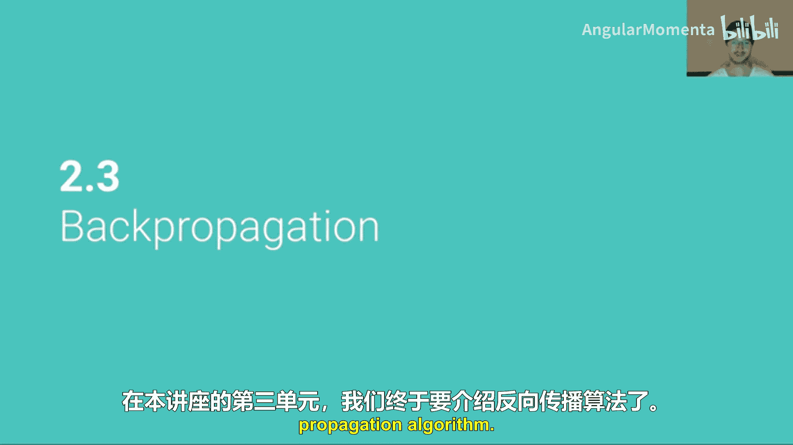
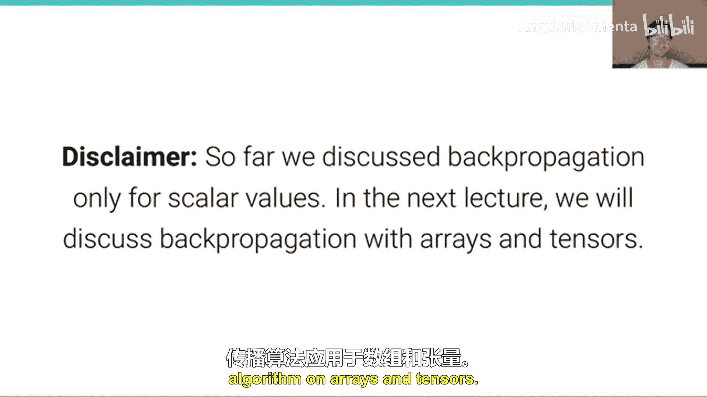

# 【精译】蒂宾根大学《深度学习》-p16-16--2.3-（计算图：反向传播）--BV1eDbrzhENK_p16-

In the third unit of this lecture， we are finally going to introduce the back Proagation algorithm。

Remember that most maximum likelihood problems don't have a closed form solution。

 and therefore we need to utilize gradient based optimization techniques。

And in order to use such gradient based optimizers。

 we need to find the gradient of the model of this negative lock likelihood with respect to the parameters W of the model。

Or more generally what we want to do is we want to optimize a loss function with respect to the parameters W。

 so here we have a loss function indicated by this calligraphic L that depends on a data set here is y in bold phase and x in boldface indicates the entire dataset again stacked into rows and the perimeter vector W。

And if we write this out in terms of the individual data points。

 we get the gradient of the sum overall data points because we assume the data is drawn IID over the individual loss function。

 so this is this term here。L for each individual data point， Y I， X I and W。

And n indicates the number of。Data points in our data set。

And because the gradient operator is linear， we can pull this through the sum here。

So this is equal to the sum over all the data points of the gradient。

Of the loss function refers back to the parameters W。So in this notation， I've used。

X I and Y I as the data set。With elements。In the following。

 we're going to consider the computation of gradients with respect to a single data point。

 so we're only going to look at this expression here。

If we want to find the gradient with respect to the entire data set， we simply need to sum。Over。

All of the gradients that we have estimated for each individual data point。So basically。

 from this expression here， we get a vector which is。The gradient of this loss function。

 the scalar valued loss function with respect to all the parameters。

That we have that could be millions in our neural networks。

And then we have such a gradient in vectoror for each。

 or we calculate such a gradient in vectoror for each data point I。

And then we sum up element wise these gradient vectors over all the data points in order to obtain the gradient vector with respect to the total loss function over the entire data set。

And once we have that， we have found the gradient， we can take a step into the gradient direction。

Which is called gradient descent。So the gradient with respect to the entire dataset set X is obtained by summing up all the individual gradients。

 all these individual gradients。And on the following slides。

 we will look at how we can actually compute these gradients efficiently。

 which is not trivial because we have in in large neural networks。

 we have millions of these parameters。 So it' it's important that this。

Computation is very fast because we need to do a lot of great and decent steps。

In order to arrive at the local minimum。Okay。So in order。

To understand the Beck provocation algorithm， that's basically just。

One rule that we have to understand， and that's a rule that we already knew from a high school。

And that is the chain rule。And the chain rule tells us that if we have a concatednation of two functions。

 F and G。 So here we have a function F that depends on the result of a function D。

And that function G depends on some value x。Than the derivative。Of that function F。

With respect to the parameter or the variable x。Is equal to the derivative of the function F with respect to the derivative of the function G times the derivative of the function G。

With respect to divided by the derivative of the function x。Right。

So this is the simplest form of the chain rule。Now。

 what we're also going to need in this lesson here is the so called multivari chain rule。

And the multivariate chain rule is concerned with compositions of functions。

Where in the argument of a function， we have a set of functions。

And each of these functions here depends on the same variable x。

So that's the difference between these two here we just have f of G and here we have f of G1 to Gm。

 and all of these functions G1 to GMm depend on the same variable x。

 and what we want a compute is the derivative of this composition of functions with respect to the variable x。

And what the multivariate chain rule tells us is that this derivative is simply the sum。Overall。

 the individual。Chain rules here。 So that's the derivative of F with respect to G。

Times the derivative of G。With respect to Dx。And that summed up over all the functions I。

So these two rules are really。The only thing that we're going to apply throughout this lecture。O。对。

So let's look at the most simple form of backproagation algorithm， one of the most basic examples。

 which is basically just the chain rule in a slightly different form。For now。

 we're going to not make any distinction between no types。

Remember that in computation graphs we have defined input nodes and parameter nodes and compute nodes。

For now， we're going to just consider notes， so we have all the notes in red here。

This is the color that we've used for compute nodes before。

 but we're not going to make any distinction at this point。

 the only thing that we want to do is we want to compute gradients with respect to any of these nodes。

So we want to compute gradients of this。This final output note， which we call L here for loss。

Actually， in this case， it doesn't need to be a loss function could also be C， for instance。

It's not necessarily a loss in this simple expression。

 but because we are going to consider loss as always the output as the output note in the following。

 I've used the loss symbol here as well。And what we're interested in is the gradient of this loss with respect to the loss itself。

Or the variable y or the variable x。Okay。So this is a very simple computation graph where we have。Y。

 depending on x and L， depending on y。And the expression that we want to formulate here is simply L equals 2 times x square。

 and we have decompost this in the sense of atomic operations in a computation graph as we've discussed in the last lecture as follows。

In the first step， we calculate y as the square of x。And in the second step， we calculate L。

As two times y。So composing the two， we obtain two。X to the power of 2。Okay。So now。

What we're going to do is we're going after running this forward pass as after actually calculating the value of L for a particular input X。

 we' are going to run a socalled backboard pass。 That's where the name back propagation is coming from。

 So we're first going to run a forward pass in the direction of the black arrows in order to compute L from the input X。

So assume x would be one， then we would have。L equal 2。And then we're going to run a backward pass。

 I will indicate this in the following slides and with blue arrow while we backproagate gradients from the output node。

 which is always L in our case， to each individual node such that at each individual note we can read off the gradients with respect to that node。

 the gradients of I must say L with respect to each of these nodes。

 that's what we're interested in gradients of L with respect to any variable in this computation graph。

And I'm going to use two different colors here for indicating two different types of quantities。

I'm going to use a red color for back propagated gradients。

And I'm going to use blue color for local gradients。

Gradients that are locally computed based on this assignment formulas here。

 based on the local functional form that is present at a particular note。

So the backward pass starts at the output node L。And it computes gradients backwards。

The first thing it does， it computes the be gradient of L with respect to itself。

Which is obviously one。SoThe partial derivative of L， with respect to L is one。

 Not that here in in this notation， we are always abusing。Derivative operators a little bit。

 So we're always using partial derivative to indicate that we're computing a derivative of respect to any。

A possible parameter within that entire expression。Even for that。That might be actually a。You know。

 that might might only occur within an inner inner inner function of that expression。

 so whenever I'm going to write partial of L with respect to or divided by partial of any variable。

 I mean the gradient of that output node with respect to any of these variables inside。

Okay so in order to compute now the gradient of L with respect to y。

 which is what I'd like to do first， and which I write at the bottom below y here。

 what I need to do is I need to apply the chain rule。

 which is I need to compute the gradient of L with respect to the gradient of L times the gradient of L with respect to the gradient of y。

This looks a little bit ridiculous here because what we're really interested in is only the gradient of L with respect to gradient of y。

But you will see that writing it in that form makes sense if we go further back in this simple computation graph。

Okay， so this is obviously correct right if we the L。

 the partial L here cancels so this is exactly the same as the gradient of L with respect to the gradient of y。

So what is the gradient of L with respect to the gradient of y， Well， it is 2。

 which we can see from this expression here。So the gradient of L with respect to the gradient of y。

Is L with respect to y is。The gradient of L with respect to L times the gradient of L with respect to y。

Which is1 times2， which is2。So we have now back propagated the gradients until here。

So now we can do one step further right so we we're going from the second expression here。

 so we're going backwards， now we are calculating the first expression。

 the gradient with respect to the first variable。Which we have in the forward pass completedd first。

And we do exactly the same thing。 So now what we do is we compute the gradient of L with respect to x。

 So this is what we want to compute。 And this is exactly the message that we're sending here is exactly。

Again， the chain rule it's the gradient of L with respect to y times the gradient of y with respect to x。

 Obviously this is correct， This is the same as the gradient of L with respect to x。

Because the partial y here cancels。Now the gradient of L with respect to y we have already computed。

 this is the back propagated gradients from this node here， we have back propagated it here。

 so this is something we have already computed in the previous iteration。

So the only thing we need to do is now we need to multiply the local gradient。

 which is the gradient of y with respect to x。Which is。Two x。And this is what happened here。

 so the gradient of L with respect to x equals the gradient of L with respect to y times the gradient of y with respect to x。

And that's the gradient of L with respect to y。What we have calculated at this point times2 x。

 which is a local gradient。And now we have found the gradient of L with respect to x。

 and you can imagine that we can go further backward in such a chain or in such a tree in order to back propagate gradients even further。

What were ultimately interested in is to back propagate gradients， of course， to the weights of。

A parametric function such as Lo regressor or a neural network。We'll see that。

In the following slides。So that。Was maybe a little bit abstract， so let's make it very concrete。

So what we do here is we plug in the actual numbers so the gradient of L with respect to L is 1。

So we plug it in here， and then we multiply it with the gradient of L with respect to y。Which is2。

And one times2 is 2。So this gradient here， the gradient of L with respect to y。

 which is what we have calculated here。 We have back propagated ti。

 Can imagine thesearrow back propagating the gradient that they compute like。

From the previous node and the local gradient to this location here， so we just copyied here。

Now this。Is then coming up here， it is the same expression here。And we multiply it again。

 we multiply the back propagated gradient not the two in this case。With the local gradient。

 which is2 x。So we have 4 x。So we sent this gradient in 4 x to this location， so we got 4x here。

And as you can see。The gradient of L with respect to x is obviously for x。Of course。

 when you implement this on a computer for doing an actual forward and a backward pass。

 you will fill in actual values for x so the。For the current input and output， you know the values。

And you also know the values for the current state of the perimeter vector。So for x and y and for W。

 we don't have W here yet。 I'll see that on the next slides。

 But for all the values at a particular iteration， we have。We know the values。

 so we will always insert the actual gradients， not this symbolic gradients here。

 but we will actually have real values that we input here。Okay。

So we've made it a little bit more concrete， now let's make it a little bit more abstract again。

What I've done here is I've replaced the concrete definition of these functions here。

With abstract functions。 So what I write here is instead of y， it's just a functioned y of x。

 instead of L， it's just a loss function L of y。So the expression reads like this， L of y of x。

So it is the most generic form I could express this particular computation graph with。

And in this small general form， I have。The backward pass as the gradient of L， with respect to y is。

Gradent at node L times the local gradient。And because this is always one。

 I have just a local gradient here。And then the gradient of L with respect to x。

This guy here is the gradient of L with respect to y， so what I've computed previously。

Times the gradient of y with respect to x， the local gradient here。By reversing this arrow。Okay。So。

 this was。The most simple example， it was basically just applying the chain wall。

Playing the chain world twice。So let's look at a slightly more difficult example now。

 And this is an example where we have a fan out bigger than one situation。 F out means the。

Number of connections that are outgoing from a particular note。Before we had a chain。

 so every node was having one outgoing connection now in this case。

 Y has multiple outgoing connections。Why sense to you and to the。

So we're looking in this particular case here at this loss function。

 it's L of u of y of x and v of y of x。So the forward pass in this example looks as follows。

Y is computed as y of x。So it's this function of x that we evaluate at x， the input x。

And then we evaluate y u of y and v of y， these are these two here。I am。Use the same iterate here in。

In this enumeration， because they they are processed at the same time， basically， right， so they are。

They are branching out and processed at the same time。And then we have L。

Which depends on both U and V。Okay。So let's compute the backward pass now。

Starting again with the output node L。We have。The gradient of L with respect to U U is the gradient of L with respect to L。

 which is 1 times the gradient of L with respect to U。And similarly。

 the gradient of L with respect to v is the gradient of L respect to L times the gradient of L with respect to v。

Okay， so far so good。This was step three。Now let's look at step two。Going one step further。

The gradient of what is the gradient of L， this is the gradient of L with respect to y。Now。

 the situation is different from before in this case。

Both U and V send gradient information to this variable here， to this variable Y。Namely， you sense。

The gradientd of L with respect to you。This is what has been computed at the U location。

 timest local gradient from U to y， and similarly， v sends the gradient of L with respect to V。

This is what has been stored here in the previous iteration of the back propagation algorithm。

Times the local gradient from v to y。So。What should this expression then read like？Well。

Remember the multivariate chain rule that we've seen before。

 we have exactly the same situation here So if you look at this loss function， we have a loss。

That depends。On why， Y are two functions， U and V， both U and V depend on why。So if I ignore。

The argument of Y x here。This is what this loss function would read L of U of y and V of y。

So what we know is that from the multivariate chain rule， the gradient of L with respect to y。

Simp the summation of L with respect to U and U with respect to y plus the gradient of L with respect to V and V with respect to y。

So this is simply。A local application of the multiberry chain rule at one particular note。

And this is what I've。嗯。What I've written over here。Of course。

 both these terms have local contributions in blue and this back propagated global contributions in red。

Okay。So it's important to remember whenever we have such a fan out situation。

Whenever one variable sends to multiple variables。Whenever we have an expression like this。

We need to in the back propagation pass。Basically， whenever we have a head to head relationship when there is two arrow heads that are pointing to the same variable。

 we need to sum up all the gradients。This is what has happened to you。Or here。

That's basically basically it。And then in the final step， because we're not done yet。

 we compute the gradient of L with respect to x simply as we know it already。

As the gradient of L with respect to y， this is basically what we have computed in the previous step as this summation here。

Times the local gradient y with respect to x。Of course。

 this is an abstract example where we don't know the precise form of each of these individual functions。

 so we cannot。Look into this feror and unless we would specify this function in detail。Yeah。

So now we are basically ready to implement the back propagation algorithm。

How could we implement that back propagation algorithm in Python？A convenient way to do so。

 and this is also what the educational framework does is。

To consider each variable or note as an object that has certain attributes。For instance。

 the value and the gradient。So let's say we have a variable x that has a value。

 these values are computed in the forward past。And it has gradients which are updated in the back Pass。

So the values， they are compute in the forward task， this is basically just。

Writing out this program here， the sequence of assignments。In python。There we have。

The value of x is basically the input。Let's say the image or whatever signal comes into the model as an input。

And then we have y， the value of y。Is the function Y evaluated at。X value。

And then U value is the function U evaluated at y。Vale。And then V。Is function V。

 this one here evaluated at y value， which has been computed here。And then finally。

 we have the loss function， which is simply depending on an evaluation of the loss function L that depends on the value of U and the value of V which have been computed here。

Okay。Yeah。Similarly， we can look at the backward pass again， I've used the red blue notation here。

To indicate if it's the back propagated global component of the gradient or if it's the local contribution of the gradient。

So how do we implement the backward pass？Well， first of all。

 we would set the gradients to0 because we're going to additively update them。

 so we start by setting all of them to0， X， Y， U and V CRt are set to0。

And then we start with the gradient of L with respect to L， which we know is 1。

 So this is this term here。This is one whenever I use this notation L grad or Ugrd。

 what I mean is basically the gradient of L with respect to the variable。嗯。

That has this attribute cr。So for instance， y grad is the gradient of L of the loss of the output node with respect to the variable y。

Okay。So now we've initialized with L grad equals 1， and now we can calculate U grad。

 so this is this equation here。S Al grat， which is one times the local gradient。Elp。

 with respect to you。Evaluated at the。嗯。Value of U and V that have been computed in the forward pass。

 So it's important to note here that we need the values that have been。

Calculated in the forward past， because we need to。We need to evaluate the。

Gient at these particular locations。 So it's really a concrete。Value that。

The evaluation of the gradient at a particular。Value returns。 The gradient in itself is a function。

 and it's evaluated at U and V in this case。Similar for V。It's the gradient of L with respect to v。

 which is a function， which is evaluated at the value of U and V。And then we have y。

 and this is now a special situation， but we have。A sum due to the multivariate chain rule that we've seen before。

 So what we do here is simply we execute this line twice once we add the gradient for you and once we add the gradient for B。

 Both the global component multiplied with the local component， which is evaluated at。The value of y。

And then finally， we update a gradient of x。As gradient of y times the local。

Dative of y with respect to x evaluated at the value of x。Okay。So。

Let's look at a slightly more real example in the sense of machine learning。

 and this is the example that I'm showing here is the logistic regression example that we've already seen before。

 also in the context of forward propagation in computation graphs。

So this is the formula that we've already seen。BCE denotes the binary cross entropy loss。

And what happens here is basically， simply we have a aine。Functioned U that linearly combines。W0。

 W1 and x。So it's this linear function U。Then we have the sigmoid。Operation here。

 that returns se hat。And it takes in you。And， finally。

We compare y hat to y using the binary cross entry function， which is defined like this。

Here on the top， for space reasons I've used just the abbreviation PCE。

 and so this is basically the entire expression on the left。Written in a single line。Yeah。Okay。

 so this was the forward pass。 So let's look at the backward pass now。In particular。

 what we want to do is in this case。And this is different from before we want to calculate the gradients。

 but we are not interested in the gradients with respect to any variable in this graph。 For instance。

 we are not interested in the gradients with respect to these green input variables here。

 We could calculate them and sometimes we really do like in the case of style transfer where actually the input is modified and that's the beauty about the back proag algorithm。

That it can compute the gradients with respect to any variable can even compute。

The second derivative by executing it twice。But in this case here。

 when we are interested in training the parameters and learning the parameters of a logistic regression model。

 we're really just interested in back propagating the gradients from L to W1 and W0 so that we obtain the gradients of L with respect to W1 and W0。

 which are then used in the gradient based optimization in our iteration loop in order to update the parameters of the model。

So here you can see we have used now the same notation that we have defined in the previous unit where green are input variables。

Orange are pyrammeter variables。And we are interested in the gradients with respect to the parameters。

And red are the compute nodes。So let's apply the back provocation algorithm to this example。 again。

 we start with the gradient of L with respect to L， which is1 at the output node。

But we're not back propagating to why we're just back propagating to why had in this case。So what。

It's the gradient of L with respect to Y hat， Well， it's the gradient of L with respect to L。

 which is1， so this goes away times the gradient of L with respect to Y hat。

Which is simply this expression here， so if you。If you calculate the gradient of this term here。

 you end up with this expression。Okay。Then in the second step。

What we do is we compute the gradient of L with respect to U。

 which is the gradient of L with respect to Y hat that we have calculated in the previous step。

Times the local gradient of y hat with respect to U and the gradient of y hat with respect to U simply the syigmoid is the sigmoid of u times 1 minus the syigmoid of U。

I recommend。To do as an exercise， both of these derivations which are really simple but also quite instructive so that you see how you get from this expression to this expression and from this expression to this expression。

 which are both the gradients of these expressions。Okay， so we have。

Relatively compact terms now for this local gradients。

And what we finally do is we compute the gradient of L with respect to W0 as the global contribution。

 the back propagated gradient l with respect to U from the previous iteration of the algorithm。

Times the。Createating of view with respect to W zero。

And the gradientd of U with respect to W is0 is 1。So we end up with the gradient of L with respect to you。

And we can do the same thing for W1， the gradient with respect to W1 is the gradient of L with respect to U from the previous iteration。

Times the gradient of u with respect to w1。 the gradient of U with respect to W1 is x。

 so we end up with。L with respect to U times x。And again， of course。

 when we apply the back Proagation algorithm on our computer。

 we calculate the values in the forward pass and then V。

Calculate the gradients in the backboard pass。And immediately evaluate them at the values that we have calculated in the forward pass。

Okay。So， in summary。What we've learned in this unit is we can write mathematical expressions as a computation graph。

And that decomposes complex expressions into much simpler computations that are tractable and where we can apply efficient dynamic programming to solve for both the values in the forward pass and the gradients in the backward pass。

So the values are efficiently computed。In the forward pass and the gradients are efficiently computed in the backward pass。

 and this is really why back provocation is still the primary work cause of deep learning today。

 because it allows us to calculate the gradient in particular， using parallel computing hardware。

 This is an algorithm that is highly parallelizable。

We can calculate the gradient of an objective function of a lost function with respect to millions or sometimes billions of parameters。

In in the matter of just a few seconds or minutes。Right， said his is De。

The forward direction its the backward direction。What we've also seen is that multiple incomecoming ingredientss are summed up。

In the backward pass， if we have this head to head relation in the backward pass。

 it's not happening here， but it was happening in this case before， and it's also happening。

 for instance， in the case of a multi layer perceptron where we have fully connected relationships between adjacent layers in a neural network。

Such debt。There is。诶。A lot of notes。That's sent to multiple nodes in the next layer。And this is。

The summing up is a consequence of the application of the multivariate chain rule。

And the really beautiful thing about this is this application of the chain rule and this modularization is that each node must only know how to compute the gradients with respect to its own arguments。

 This is basically what we had in blue on the previous examples we only need to calculate these local gradients we don't need to know anything about any other nodes in the graph。

It's very decomposed。It's always good if we can decompose things， it makes things simpler。

And then finally， a final remark， when we now want to apply this。嗯。

Forward backward past this back propagation algorithm to optimize the parameters of a model。

 such as a logistic regressor。 Of course， we need to calculate the gradients over the entire data set。

 And what we've just discussed is only the calculation of the gradients with respect to a single data point。

 right We have taken a single data point。 And we passed it through this。Computation graph。

In order to compute a loss for that single data point。In this case， X I。And then。Compared to Y I。

 but what we need is we need the gradient of the entire objective function。

 which assuming Iid data is simply the sum over all the data points of all the gradients。

 So what we need to do effectively is we need to apply this spec propagation algorithm many times。

 namely as many times as we have data points。In our dataset set。

 in order to obtain the gradient of the of the loss function。

 the overall loss function of the entire dataset set with respect to the parameters W。

So we apply the back propagation algorithm n times， we get the gradient。

 and then with this gradient we can do one gradient update step in the inner loop of the gradient based optimization algorithm。

A little disclaimer so far we've only discussed the back propagation algorithm for scalar values。

 but in the next lecture we will see how we can apply the back propagation algorithm on arrays and tensors。

