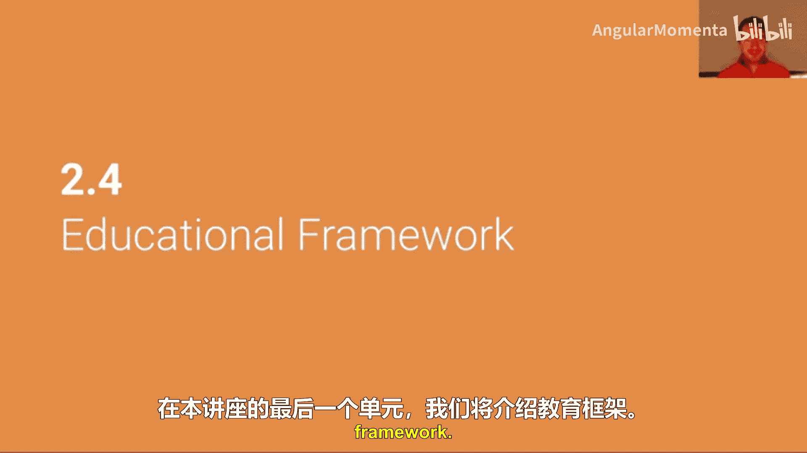
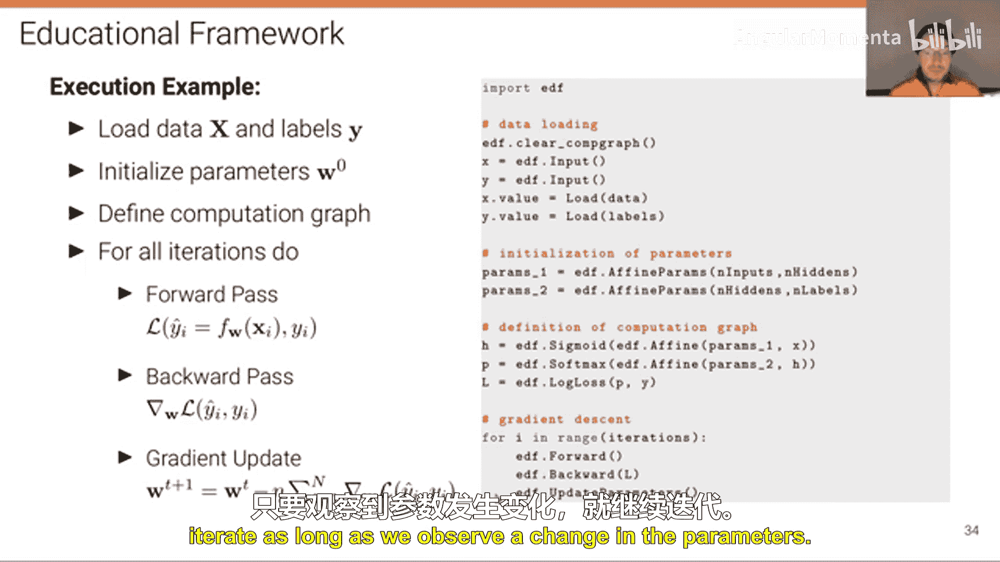

# 【精译】蒂宾根大学《深度学习》-p17-17--2.4（计算图：教育框架）--BV1eDbrzhENK_p17-

In the last unit of this lecture， we're going to introduce the educational framework。

Let's first summarize the。Content of the last units with the simple training recipe for grad descent on a computational graph。

Using the Beck propagation algorithm。We start by picking a step size eta and a tolerance value epsilon。

 and then we initialize the parameters W at iteration0 to some value， say a random value。

This is the initial state of the parameters。And now we repeat until the magnitude of the gradient。

This here is the magnitude of the gradient。Falls below this tolerance， threshold epsilon。

And what we repeat is this following three steps in the first step for each data point。

 we calculate the forward pass and the backward pass to compute the gradients of the loss function with respect to the parameters W。

In the second step， we calculate the overall gradient by summing up all the individual gradients。

Of the individual data points。And finally， we take one step into the negative gradienting direction。

A step width step size， Eta。Now this is the algorithm for gradientding descent on computation graphs。

And the question is， how can we implement this in Python？

We' are going to use in this lecture or in the first half of this lecture series。

It so called educationalal framework EDF， which is 150 lines of Python Ny code that implement a deep learning framework。

And that has been。Established in the context of a class taught by David Mc Allister。

One of the pioneers of artificial intelligence。At T TI Chicago。

This educational framework allows us to understand the inner workings of a deep learning framework in depth。

 and this is important。When listening to a lecture or a talk。

It is often easy to miss the details that are required to get a good understanding of how。

The discussed concepts actually work。And only by implementing these concepts， oneself。

 one gets a good understanding of what has actually been missed。

The implementation of these concepts allows us to pinpoint where we don't understand where we have still a lack of understanding of these concepts。

And that's why it's so important。And the other reason why we're using this educational framework is that it's very compact。

 it allows us to understand each single line。It is a little bit less than 150 lines of Python Ny code。

 not using any other libraries， so it's easy for us to go through each of these lines and see and try to understand what each of these lines is doing。

So let's look at this educational framework a little bit in more detail。It's using Python。

Which means that variables are bound to objects。So for instance。

We have variables that describe the input or the labels or that are simply of particular compute nodes in that。

Computation graph。Or we have values which are attributes of these variables。

The different types of nodes in the computation graph are implemented as classes。

We have input classes， parameter classes， and computational node classes。Yeah。

When we have introduced computation graphs， we have associated different colors to the different nodes or different types of nodes in the computation graph。

 we have colored the input node green， the perimeter node orange and the compute node red。

 and for each of these nodes we now define class templates that we can use to inherit from these class templates。

 more concrete implementations of these classes so for instance for the compute node。

From the compute node， we can inherit a class that's called sigmoid and that implements the functionality of。

The sigmoid non linearity within a。Logistic regression model or D neural network。

Here on the right hand side， you can see the abstract definition of the base classes。The input class。

Has an initialization function and a function for adding the gradients which are empty because we are not interested in adding gradients to the input variables and also because the input variables don't depend on any other variables。

The Per class。Has a initialization function that。Coopies and stars the value of that parameter。In。

It the itself。And appends these parameters to a perimeter vector because later on well need to sum up these parameters in order to get the computation result。

 so we need to store them in a global perimeter vector。

It also has a function for adding up gradients。This function。

Simply sums up all the gradients along the data dimension。We're going to get to this in a second。

 but what this model does is it computes。The values in the forward pass and the gradients in the backward pass for all the data points simultaneously。

And this is for efficiency reasons because it。Allows to utilize efficient matrix operations in Python。

The perimeter class also has an update parameter function that takes a step into the gradientd direction。

 this is what is utilized during gradientding descent。

And the compute node function also has a function for adding gradients because we also need to update the gradients of the compute nodes themselves。

Okay。In order to execute。The computation graph。We need to define a forward and a backward function。

Forward function takes the inputs x and y and the current state of the parameters W。

And goes left to right through this computation graph in order to compute all the intermediate values all the way until the head node。

L， in this case， loss。We have stored all these computation notes in a list comp notes。

 and we have stored them in a way， such。That they are stored left to right。

 which means that when we arrive at any particular node in this list in distort sorted list。

Then we know that all the previous nodes have already been computed so we can utilize their values。

Thus， in the forwards。Pass of the back Proagation algorithm。

We simply go through the sorted list of computation nodes and for each computation node。

 apply the forward function that is implemented inside that computation node。嗯。For the backward pass。

 we first set all the gradients of all the computation notes and all the parameters to0。

And then we go backwards， this is the Python notation for going backwards through a sorted list。

 so we go backwards starting from L and propagate the gradients backward。

 iteratively calling the backward function of each compute node。

In order to send gradient updates to its parents。We'll see that on the next slide。And then finally。

 we have an update parameters function that loops through the list of parameters。

And updates or calls the update parameter function for each perimeter。As a little remark。

And I've mentioned that before， the forward and backward function compute the forward and backward passes respectively over the entire data set。

And the reason for this is that matrix operations are very cheap because they are implemented very efficiently in Python while if we would go over the data set with loops。

 we would be much slower。So this vectorization is very important to exploit。Furthermore。

 if we would have GPUs hardware available。Then we could even parallelize this computation because the computation。

 the forward pass of each individual data point is independent of each other data point。

 and the backward pass of each individual data point is independent of the backward pass of other data points。

 and so we can in parallel with parallel computing hardware run all these forward passes and the backward passes in parallel。

Let's look at a concrete example of a computation node。In this case， the sigmoid function。

 which looks like this， and the gradient of the sigmoid function can simply be stated in terms of the sigmoid function itself。

 which leads to an efficient implementation。Here on the right。

 you can see the python definition of the sigmoid class。

 which inherits from the class computation node， as you can see here。It has free functions。

 an initialization function， a forward function， and a backward propag function。

At initialization time， we simply add the node itself to the list of computation nodes。

And we store the。A parent of that note。In that class itself。

 self dot x equals x means we take the parent， which is an input that sigmoid。' this x here。

 which is the input that could be another computation node。 let's say an a computation node。

That does some computation and then inputs to the sigmoid function。In the forward function。

We calculate this form this this expression here， the sigmoid expression here。

 So first we compute a bounded value of the value itself in order to avoid numerical。Problems。

And then。We implement simply dysfunction here， which you can see here。And for the backward pass。

 we implement this function。But what we do， actually， is。

We implement that function and multiply that function with the back propagated gradient de gradientd at the node itself and pass this as a message further on to the parent。

This is what we discussed in the previous unit， this is what you can see here。

 so what we're doing is we're not executing an operation on the class itself。

 but we're looking at the parent which is start in self do x and we're adding a gradient to the parent to the computation node X。

And what we are adding there is exactly this message that we're sending。

 this was what we have illustrated in red and blue in the previous unit。

This global component and the local component of the gradient。

The global component is this first part here。 This is the gradient at the sigmoid computation node itself。

 and the local component is。The derivative of the sigma node with respect to x， So it's。

The sigmoid times 1 minus the sigmoid， we can exploit。

Here that we have been able to express this derivative with respect to the sigmoid itself so we can just simply utilize what has been computed in the forward pass。

So it's important to note that in this backward path， the gradient is sent to the parent node， self。

 x。And now let's put it all together， let's execute a concrete minimal example。

 this is a very small multi layerer perceptron that we will discuss in the next lecture actually。

 but you can just think of it as stacking two logistic regression models on top of each other。

So here on the right， you can again see the source code and on the left the。In form a description。

So we start by importing the educational framework。And then we clear the computation graph。

 which is always something that we should do before executing anything on these computation graphs。

We start then by loading the data， so for x dot value， which is an input。instance of the input class。

 we load the data and for y that value， we load the labels。We then' initialize。

Two sets of parameters。More specifically， two sets of Eine parameters， pers 1 and perms 2。

And those Fine parameters take us input number of input。

Nots and the number of output nodes of that specific layer。

So we're going from N input nodes to N hidden nodes and then to end labels in this particular simple model。

And given these definitions， we can then define the computation graph itself。

 which is simply expressed as a concatenation of functions， is very elegant。

So we have in this particular example here an aine transformation that depends on the parameters and input x。

Followed by a sigmoid No nonlineararity。Which results in this hidden layer H。

The hidden layer h is an input to another aff fine transformation。

And followed by a soft max transformation。 We haven't discussed the soft max transformation yet in this lecture。

 this will come when we discuss。Multiclass classification problems。The output of the softm。

Is a probability vector that we can then input to the log loss。

 which is the cross entropy function between P and the labels y。

So this specifies the computation graph。And then we can execute the gradient decentcent algorithm by looping over all iterations。

 running a forward pass。And then running the backward pass， starting from the head note L， the loss。

And then finally， update the parameters， and be iterate。

As long as we observe a change in the parameters。

