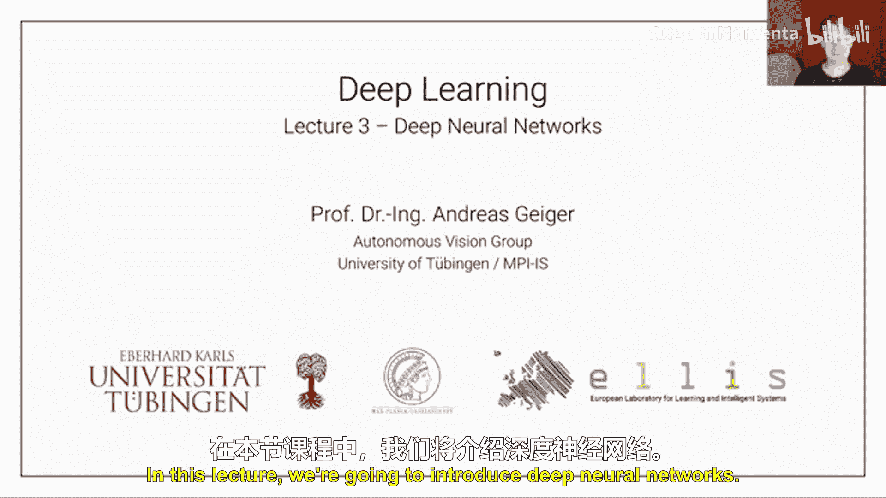
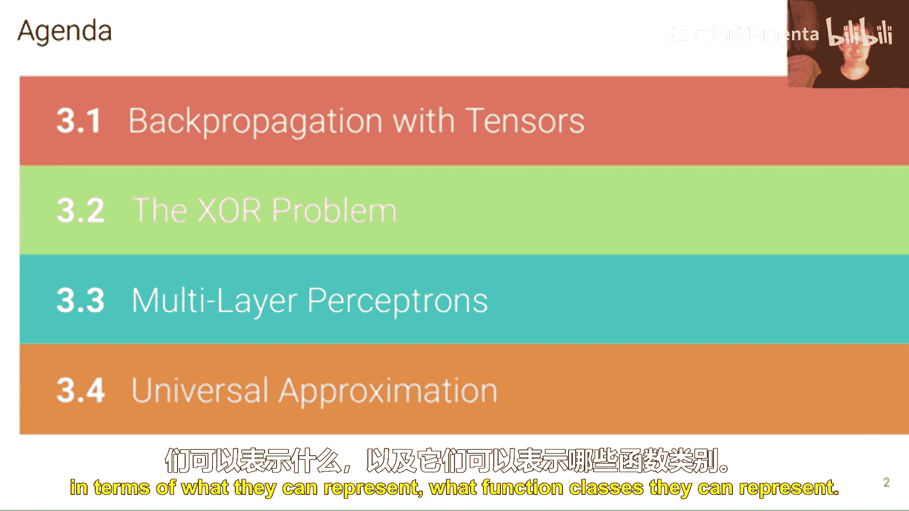
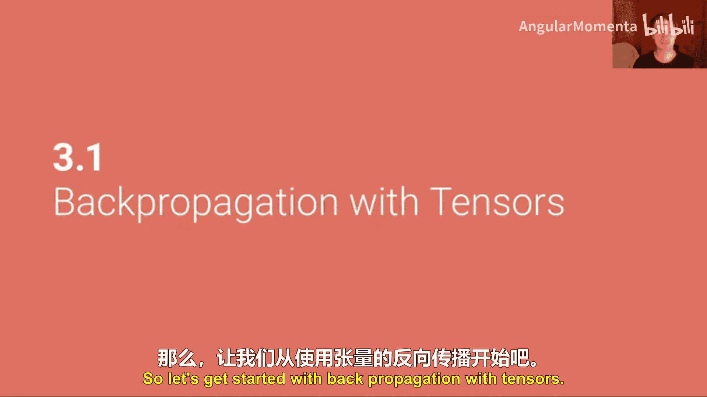
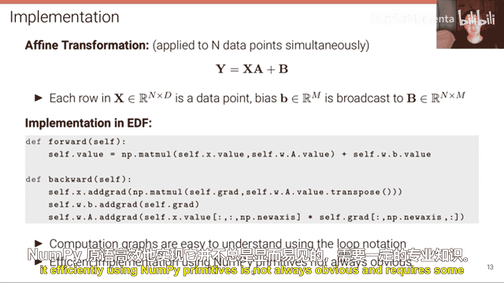
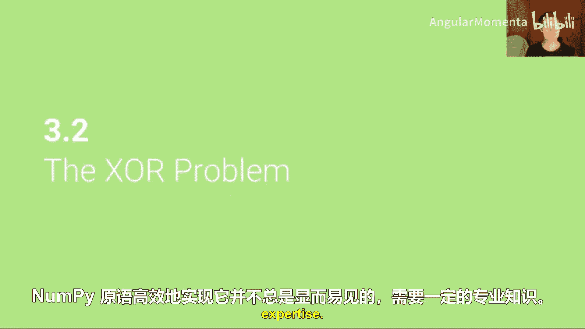

# 【精译】蒂宾根大学《深度学习》-p18-18--3.1-（深度神经网络：张量反向传播）--BV1eDbrzhENK_p18-

Welcome to the third lecture of deep learning at the University of Tubingham。In this lecture。

 we are going to introduce deep neural networks。

The lecture is structured into four units in the。First unit。

 we're going to continue our discussion on backproagation this time with Ars and tensors。

Then we are going to talk about the famous X or problem。

Which led to this decline of deep learning research in the 70s。

And then we are going to introduce our first deep neural network。

multiulti layout perceptron and finally we're going to discuss some properties of these multilay percepts。

In terms of what they can represent， what function classes they can represent。

So let's get started with pe provocation with tensors。

So here's a little recap as this。Unit directly builds upon。Unit 2。

3 where we have started our discussion on the back propagation algorithm。

And this is just a recap of one of these。Computation graphs and how back propagation works in these computation graphs。

嗯。So here in this case， were considering a loss function that depends on x via our functions U and v and y。

And which we can write in terms of this program here on the left。Y of x， U of y。

 v of y and L of U and v， or if we write it in terms of a computation graph。

 we have this computation graph here on the right。完了。

Now in the goal of the back propagation algorithm is to calculate gradients of the loss function with respect to any variable in the computation graph。

And for that， we need to first compute the values of each variable。Using the assignment sequence。

 the program。In the so called forward pass， we go along the direction of these black arrows。

And then we go backwards， propagating the gradients backwards to all the individual nodes in the graph。

this is called the backward pass。We start with the gradient of the loss function with respect to itself。

 which is one， and by applying the chain rule of this。Current or global gradient here。

Times the local gradient of L with respect to U， and obviously we obtain the gradient of L with respect to U。

 which we store at this node in the graph。We also go backwards this edge and obtain the gradient of the loss function with respect to V。

 which we store at the node V。And then we continue to go backwards by applying the chain rule。

 for instance， we。Calculate the gradient of L with respect to u。

 which we have stored here times the local gradient of u with respect to y。 this is this edge here。

And we calculate the gradient of L with respect to V。

 which we just need to read of because we have started here times the gradient of V with respect to y。

And since we have this head to head relationship here at this node Y。

 since theres two arrow that are joining at node I。

 we need to exploit the multivariria chain rule here and add up all the incom ingredients。

 this is indicated here。And then we continue and using again。

 the chain rule propagate the gradient fervoor and calculate the gradient at this node here。

 the gradient of the lost function with respect to this variable。

Now we have calculated all the gradients of the loss function with respect to any of the nodes in this graph。

How can we implement this？Well， each node in the graph。

We consider each node in the graph as an object in the sense of object oriented programming。

This is what we are doing in the educational framework。

And each of these nodes has or each of these variables has a attribute， a value attribute。

 and a gradient attribute。The values are computed in the forward past。

 so we'd simply follow this assignment sequence and implement it in our programming language。As such。

And then we start the backward pass by setting all the gradients to serum。

 so x grad is the gradient of the loss function with respect to the variable L Y grad is the gradient of the loss function with respect to y etc。

And then we set the gradient of the loss function with respect to itself to one。

 this is where we start。The head of the graph， the final node of the graph。

And then we back propagate this gradient by applying the chain rule。

 so we compute the gradient of the lost function with respect to U as the gradient of the lost function of respect to itself。

 which is one times the local gradient of the lost function with respect to U。And。

We need the values that we have computed in the forward pass here。

Because we need to evaluate the gradient at the location of。Hong。These variables。At these variables。

So we do this for U， we do this for V to complete the gradient of the loss function with respect to D。

And then here you can see that we have been using here this plus equal notation in order to be able to sum up multiple gradients。

 which is important because we need to do this at these points where we have two hats in the backward pass pointing towards the same node。

So here we have this situation where we add to the。

Attribute gradient of the node y twice because we have this head to head relation here。

And then we continue to x。Okay。So far， so good。Now， what we have considered so far。

Is computations on scalrs so we have considered functions like this one here where we have a scalar。

 typically when I in the notation I'm using here on my slides I use。Nonbol symbols。

 nonbol small symbols for scs， and bold symbols are reserved for vectors or matrices。

Marices are typically capital variables and。vectorctors are bold。non capital variables。

 So in this case， these are all scals。 we have this aine transformation。

 we have a 10 to 10 sigmoid mapping。And that outputs are 1 D volume。 So these are all scalrs。

 input and output。Now what we want to consider now。

 which will make our life much simpler when we go on to consider deep neural networks or our first instance thereof。

Multilayer perceptrons。Is to be able to express computation graphs not only in terms of scalar variables。

 but in terms of。Higher auto variables such as vectors or matrices or tensors。

So here we have an example where we have。诶。A fine or linear transformation in terms of a vector。

 so the input is now a vector x。That is multiplied with a matrix a。

And where we add another biased term B， this is a vector as well。

And then we apply a sigmoid function。The sigmoid function here is still a 1D to 1D mapping which is applied element wise。

 this is a little bit implicit in this notation， but this is what this notation means if I use the sigmoid of a vector。

 then I mean I applied as elementwise to the vector。And then of course。

 the output is a vector y as well。So again， S in the scalar case。

 the matrix A and the vector B are objects with attributes value and Gr。

 where in the forward past we want to compute the values and in the backward pass we want to compute the gradient of the loss function with respect to this。

Marices and vectors。So for instance， a grad stores the gradient of the loss function with respect to A。

 and B grad stores the gradient of the loss function with respect to the vector of B。No。

If we were to compute a gradient of a vector with respect to another vector。

 we would obtain a matrix， which is called a Jacobcoian matrix。However， in deep learning。

 we are almost always dealing with a special case where the output node of the computation graph。

 the lost node is a scalar。Value。Returns a scalar value。Even if we were。

 if even if we would have multiple loss functions， we would typically combine them linearly with some weights in between。

 and the overall loss function with respect to the variables would still be。

A scalar loss function because we want to optimize it and we want to optimize a single value。

This means that the gradient of the loss function with respect to any variable in the computation graph doesn't change。

The dimensions of that variable。 So the gradient of。

The variable of the loss function with respect to the variable has the same shape or dimension as the variable itself。

For instance， a gra， which is the gradient of the lost function with respect to the matrix a has the same shape or dimension as the matrix itself。

 so if the matrix is a let's say free by free matrix， then a gra is also a3 by3 matrix。

 it has the same dimension has the same number of values。Okay。So now， how can we go about it。

 How can we actually now。Run the back propagation algorithm not on scalers， but on this。

Vctorors or matrices。The key insight here is that。Any matrix vector computation like the one that we've seen before。

Can be written as loops over scalar operations。Here I've used the substitute variable U。

 which is a vector to substitute Ax so that we can in a first step calculate u。

And then in a second step， calculate why。If I were to express this。Equation here。

 using scalar operations， I can do so using loops over the scalar operations。

And this is illustrated here in the bottom。So we start by setting all the values。

Of the variable u of the vector u to0， so we have a loop that loops over all the entries of U and sets it to0。

Yeah。And then we have another loop， this is a loop over two indices， I and J。

Where we now implement this matrix vector operation here。As this loop over I and J。

 what we do here is we add to U at index I。The value of a at location Ij times the value of x at location J。

 this is exactly implementing a matrix vector product。If you look at it。😊，You see that we have。

And multiplied each element of J to this matrix A at the correct J。And we do this for each。嗯。

Index I for each row element I， so I is the row， and J is the column of this matrix x。

This is straightforward。A loop。A definition using loop， loops of a。Matrix vector operation。

 this is how it would be implemented on a computer。

And then for calculating the value of y we can again have U a loop over all elements of I now this is completely independent of each other。

 we don't have to consider any other variable inside because we have just like a。

Eleement wise application of the sigmaoid。The addition is， of course， also element wise。

 so we can do this completely。Independent of each other。

 and we simply apply the sigmoid of U plus B at location I or index I respectively。As you can see。

All of these equations that you see here are purely scalar。Operations。

Because here we have indexed into matrixtri a， we have indexed into a scalar element of index a at location I and J。

Now this is great because now since we have reduced it to the scalealar operations。

 we can basically reuse the same ideas。The same derivations that we made before and define the back propagation algorithm exactly the same way because we have effectively just a more complex set of scalar operations。

 but it's still scalar operations。 We've broken it down into loops over scar operations。

So let's look at the back provocation of this particular equation。

 so for the back provocationation we start here with the last line and then we can go back to this line。

starting with the last line。This is just a repetition from this slide before of this last line。

 this is the forward pass。Now if we want to compute the gradient of the loss function with respect to U and with respect to B。

 we simply apply the chain rule and because this is completely each row。

Or each index I here is treated completely independently。 This is really trivial。

 It's exactly the same thing that happens here as before we。

 we again using this ad notation because we assume that there might be other。

Varis in the computation graph that might also add gradients into this node。

 so we're always going to use this plus equal notation here。

But what happens here is this's very simple， its simply this equation is simply saying the gradient of the loss function with respect to U and location I is the gradient of the loss function with respect to y times the gradient of y with respect to U。

And the gradient of why of respect to you is。The derivative of the sigmoid times the inner derivative。

 which is one because we have just a。A linear expression here。 So this you。

The derivative of you with respect to you is one。So again we have。

The spec propagated gradients and the local gradients。And it's again。

 just the application of the standard chain rule。And the same for the gradient of the loss function with respect to B is again。

 just the gradient of the loss function with respect to y times y with respect to B in this case。

 and again， B appears only linearly here。 So the gradient of B with respect to B is1。

It doesn't appear。Okay， so let's go back now one step to this second equation from the forward pass。

 which just this one here。 Now we have already computed the gradient of the loss function with respect to U and B。

 what we want to compute now is the gradient。Of the loss function with respect to A and x。

Now here becomes a little bit more tricky。Because we have a more complex relationship。

Here in this case， we have a loop over IMJ。And the value of you at I。Is。A sum over multiple terms。

 so we need to sum over multiple Js here， right， because this is a matrix vector multiplication。

There's multiple A's and multiple x's that play a role when we want to calculate the element I of variable U。

However， this is。This equation here itself is a scalar equation。

 and it can utilize again the same chain rule as we've used before。For instance。

 the gradient of J with respect to a at location I and J。

Is simply the gradient of the loss function with respect to U at location I。

Times the gradient of you， with respect to。A at location， I and J。And you can already see that the。

The value or the variable IH appears only once here， which means。That from this。

The sum of multiple terms here。We only draw in the value of x at location J because only at that location。

 we have this。Variable AI J appear。And this is why we draw in this element here。And then of course。

 we do this for all the elements of the matrix A or of D。The gradient matrix。

And then we do the same thing for the gradients of j with respect to x。

So what we've effectively done now is we have reduced the seemingly more complex。Backck propagation。

 algorithm for。Vectctorors and matrices。Back to the scalar case by considering loops over scalar operations。

And that's a very simple way of looking at the back propagation algorithm also of implementing the back propagation algorithm because it's quite obvious to understand。

In practice， all deep learning operations can be written using loops over scalar assignments。

And this also works for higher order tensors。 It doesn't stop at matrices， often in deep learning。

 we have。AFourth of order or fifth order tensors， a tensor is a higher order generalization of a matrix。

A matrix is say a 2D structure and a high order tensor could be 3D or 4D。

 in this case here we have a 3D tensors。And we have a loop here over four indices because we have this multiplicative contraction here。

Of this tensor。This three dimensional tensor A and B。But again， we can express。

The forward and the backward path using these scalar operations。

 which allows us to very easily write them down。Okay。So another。Aspect of deep learning。

 where this higher order tensors operations on matrices and vectors is relevant is when we consider。

Mini batching。So what is mini batching？Let's first motivate why we need it。

Source code or the programs or the sequence of assignments that we always consider in the previous slides and in unit 2。

3。Has two components。 There is a slow part to it， which is the sequential application of operations。

 as we would code them in Python， But there is also a fast part in it。

 which is this vector and matrix operations that can be very efficiently executed in Ny。

 for instance， using this blast。Single instruction， multi data instructions。So even on the CPU。

 you get some。Some benefit of parallelluralism using special Cdi operations。

These are highly optimized。Operations that we can just call with Nmpy， right。Much less。

Orders of magnitude less efficient if you would write a vector matrix operation in Python as a fall loop compared to running this on this highly optimized。

Binary blast code。And similarly， if we were implementing deep neural networks on GPUs。

 which is come in practice today， and this is actually the reason why they are so popular because we have now a tool for very efficiently training them。

We can utilize tools like Kuda， where we can。Run these operations。

 which are often highly proliizable， completely imperable on a lot of kernels of these。GPU cards。

 where we can have maybe 40005000 parallel processing units that completely imperable。

Execute these operations for us。So there is this slow part where we have sequential ordering in the way we execute。

The operations。 And then we have this fast part， which is this vector matrix operations that appear。

 for instance， in this aine。嗯。Term that is the argument of a sigmoid。Now， our goal should， of course。

 be that the first part dominates the computation in terms of the wall clock time。

Push as much of the computation that we do overall， into the fast part。Offf the code into this。

Mectctor matrix operations。哦。In other words， we want to reduce the number of slow sequential operations。

 for instance， python loops or the operations in a computational graph by running fast vector matrix operations。

 and we can do this， for instance， in the sense of doing gradient descent。

 we can do this by running or obtaining gradients over multiple data points at the same time。

We can at the same time input multiple data points into a computation graph。

Pass then through the computation graph forward， and then in parallel。

 also compute the backward pass to obtain the gradients of the loss function with respect to the parameters。

Of all the data points in parallel。 and that's called mini batchching。

 And that's really essential for making deep learning。Efficient and fast and and useful。

And it's also used in stochastic gradient descent that we're going to talk about。In the next units。

So here is an example of the aine and sigmoid transformation。

Applied to end data points simultaneously。So in this case here， I've written X A instead of Ax。

Because what I did here is I've used the standard notation of stacking each data vector x into one row of the matrix x。

 so matrix x is a matrix with n rows， which are the data points， one row per data point。

And D columns， which is the dimension of the data points。

Let's say we have 32 input dimensions and 100 examples， so we have a 100 row 32 column matrix x。

Each row in x is a data point。And then we multiply this with matrix A， this is the linear part。

The multiplicative part of the linear transformation。And then we have our bias vector。

 which is a M dimensional vector， which is broadcast into a matrix B with N rows and M columns broadcasting is a very standard operation in Python if you're familiar with Python or Putnam P。

Which is basically in this simple case here， just copying the vector B into all the rows of the matrix B。

 so all the rows of the matrix B have the same。Elements。Which is the vector B。Yeah。

 and then so this equation here， then does the linear transformation。

Of all data points simultaneously because of the way we have written it and the broadcasting of B into matrix B。

 And then we apply again， element wise， in this case， not to a vector。

 but to all elements of the resulting n by M matrix。

The syigmoid transformation to obtain a n by M matrix y。

 which is the output of this rhi plus sigmoid transformation。

If we write this down in terms of source code。We now have loops。Here's again。

 the point of loops and loops over scalar operations。 Now we have loops also over the。Btch index B。

 so this is the index of the element within the batch。And you can see that。

The variable U depends on this and the variable x。And the variable， y。

 So the input and the output and all the intermediate calculated variables depend on this additional batch index X B。

 which is。The index of the data。The parameters， in contrast。

 they do not depend on this additional batch index because it's an index of the data Its not an index of the parameters。

 The parameters are the same。So A and B do not depend on this index instead if we do engrad in update now。

We do this gradient update for all the batch elements onto the same。Gient elements of。

Pyramid just that we're interested in A and B， for instance。

Also and we'll see this in the next slides by convention the gradients are averaged over the batch。

 this is a little bit of an unfortunate convention because it doesn't directly correspond to the maximum likelihood principle that we've seen in the previous lecture。

Well， we wouldn't have this averaging， but it's just a convention that we average over the batch when we calculate the gradients。

So how can we now efficiently implement this？Let's consider only the aine transformation。

 which is the inner part of this expression here， so does the aine transformation again applied to end data points simultaneously where we have this input matrix X with the rows during the data points or the inputs if it's a intermediate layer in some deeper network could be the output of the previous layer。

And then we have this bias P broadcast into matrix B。And the result is why。

So how would we implement this very concretely now in the educational framework， Well。

 the forward pass is is just a standard nu。Expression of a matrix vector multiplication and an addition。

 And these are all very efficient Ny operations， as I mentioned before。 So this is something that。

That is very efficient and fast， so that's why it's important to pass as many data points as basically fit into our memory。

In parallel through these operations， because as soon as I execute these operations。

 I am not within Python anymore， but I am inside these blast operations where this entire expression is evaluated very fast。

However， it can be tricky to define these loop over scalar operations in this case for the forward pass。

 it was easy， but it can be tricky to define this。For more advanced。Backward operation。

So in this case here is still simple。If we have the gradient of the loss function with respect to x。

Then this is simply multiplying the gradient of the loss function with respect to。嗯。Why。

Times the gradient。Of y with respect to x， which is。A transpose。If you would translate。啲。嗯。

On the loop over scalar operations that we have。Derived on the previous slide。

You would see that this corresponds exactly to this expression of the matrix multiplication of this。

Mattrix with respect times the。嗯。Transpose of a。And then for B， we have the gradient。

We have just the gradient of the loss function withs back to y。

Because the gradient of y with respect to B is one。However。

 the gradient of the loss function respect to a is a little bit more challenging。 Again。

 in this loop over scalar notation is kind of。Obviouslyvious， it's very easy to see， however。

 to translate this， because we don't want to use here， Of course。

 loops in in plain python in order to translate this into efficient nupy primitives can be hard in this case。

This corresponds to this。Strange expression here on the bottom， where we have。

This new access generation and。A product of a tensor that corresponds to this。

This relatively simple loop over scalers and you need to be almost a little bit of an nuier wizard to actually come up with these expressions and that's also why the complicated expressions we will provide for you in the educational framework so。

And that you don't need to implement them yourself。So in summary。

 computation graphs are easy to understand using the loop notation。

And we really just have loops over scalar operations。

 that's why we are just applying the scalar chain rule and in this case as well。However。

 implementing it efficiently using Ny primitives is not always obvious and requires some expertise。

