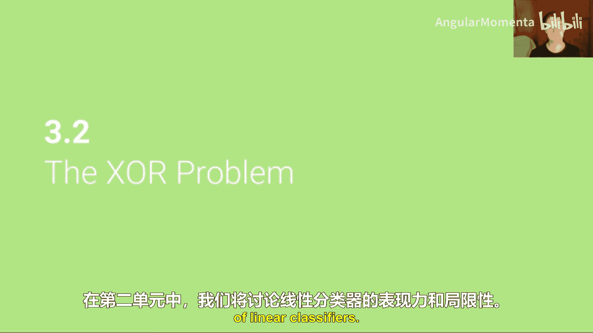
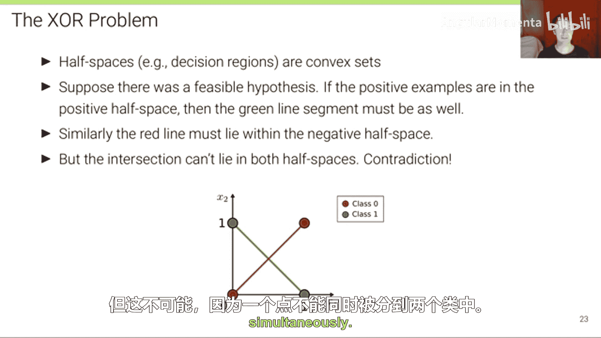
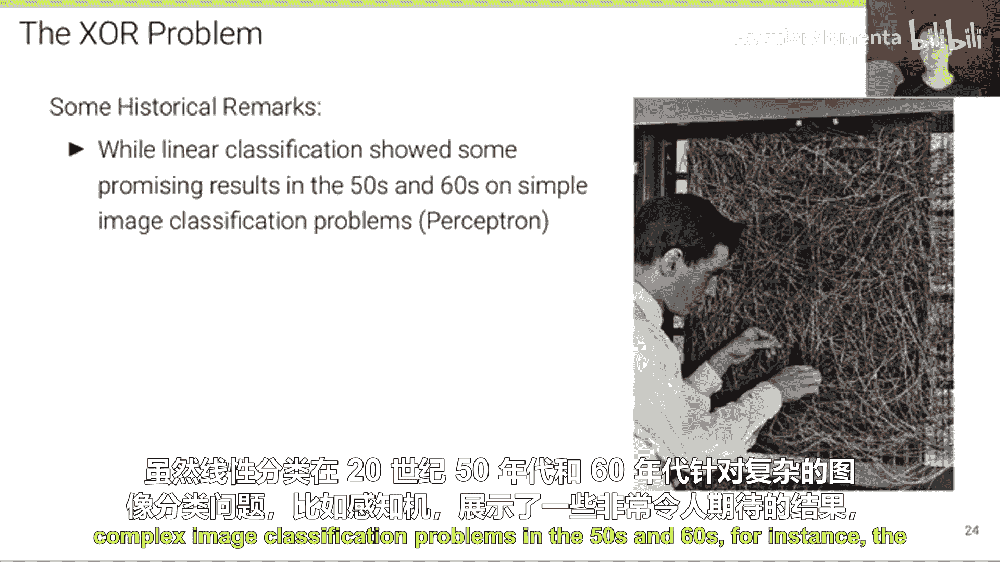
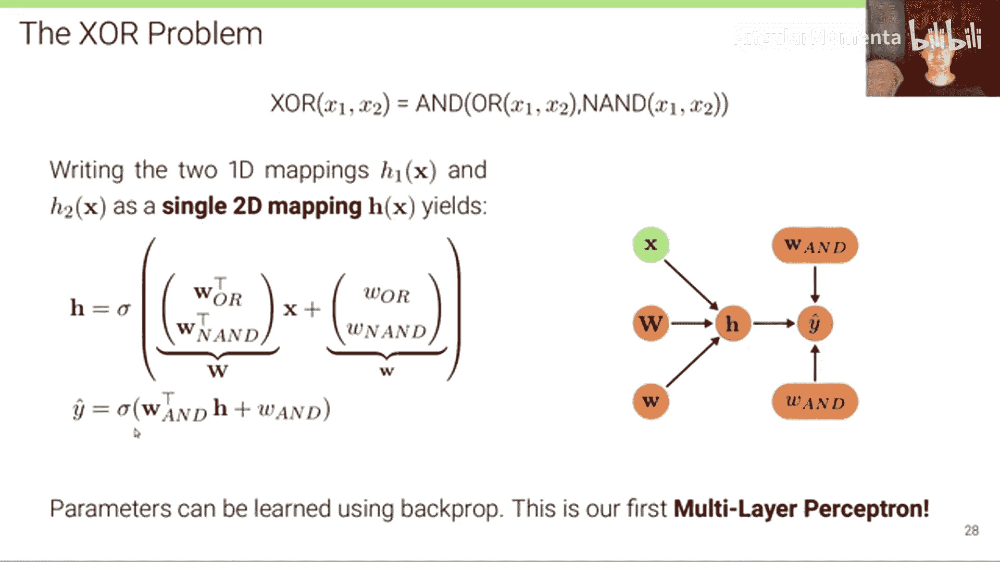

# 【精译】蒂宾根大学《深度学习》-p19-19--3.2（深度神经网络：XOR问题）--BV1eDbrzhENK_p19-

In the second unit， were going to discuss the expressiveness and limitations of linear classifiers。

Let's consider our。Logistic regression model from the previous lecture。To remind ourselves。

 the logistic regression model is the model where we have a linear or a fineine transformation between a weight vector and a input vector x。

Which returns the scalar that is passed through a sigmoid nonlinearity that squashes the range。

 the infinite range on the real axis to the range0 and 1。

And this resulting value between0 and 1 is interpreted as a probability of the input X belonging to class 1。

The question now is which problems can be solved with such a simple linear classifier？Here again。

 we have the sigmoid function， you can see here， which crosses the value of 0。5 at0。

So let's assume now we are in the 2D domain， so we have a 2D logistic regression problem。

Where we have three parameters， one for the first and one for the second dimension of W。

And then the bias W zeroorem， so three parameters in total。With a two dimensional input。

The decision boundary of our。Logistic classifier is exactly at 0， because at 0。This sigmoid function。

 so0 x equals 0， so the input of the sigmoid is 0。Because at0。

 this logistic function or the sigmoid function changes from。Values that are smaller than 0。

5 to values that are larger than 0。5。In other words， if I'm in this on the right half。

Of the space here。The probability that I'm deciding for class 1 is higher than the probability that I'm deciding for class。

0ro。Conversely， if Im on the。Left side of this decision boundary。

 the probability for deciding for class1 is lower than the probability for deciding for class0。

Because obviously the probability of deciding for class 1 for class 0 is 1 minus the probability of deciding for class 1 and probabilities are bounded by one。

 which means that if one in the binary case， one of these probabilities is larger than 0。5。

 the other proba must be smaller than 0。5。嗯。Okay。That means the for our decision boundary of the linear classifier。

 we have this expression here， x equals 0， this is the decision boundary。

 so we decide we are basically undecided about the class if。

X or W transpose x plus w0 equals exactly  zero， then we're exactly at the decision boundary。If this。

Condition here holds。And we decide for class 1， if。W transpose x。Plus W0 is bigger than 0。Right。

We are in this region here。Or in other words， if wT x is bigger than minus。W 0。

And we decide for class 0 if w transpose x is smaller than minus w0。

 then we are on this side here of our logistic function。

 where we are having a probability of less than 0。5 of deciding for class 1。

 which means we are deciding for class 0 with higher probability。Right。Okay。

So what you can see here on the right is only the visualization with respect to this sigmoid function。

 of course， this decision boundary in x in like the bold x space in this two dimensional x space is in a。

It's in a2 dimension dimension space and we will see that later so we have a。

A line in that space that separates one side from the other side。But of course。

 this scalar here is then something that we can simply visualize with a 1D plot。Okay。

So now let's look at some concrete problems that we can solve this simple classifier and let's look at some of the most simple problems that we might want to solve。

Some logical。Bullion operators， let's start with the R operator。Just to remind ourselves。

 I have put the expression。For the classification rule on the top here。

 So we're deciding for class one， exactly if。The inner product between the weights W and x is bigger than。

Minus W0 on the biased term。Okay， so we have a two dimensional space， we said。

Which means that we have four possible inputs， 0，0，01，10， or 11。And if we consider the R operation。

 this is what the output should be。0 and0 maps to 0。 and if any of the。X1 or x2 is 1。

 we obtain a1 as an output。This is the simple definition of the logical or operator。

Not a question is。How do we choose our free parametersters。

Which are the elements of W and W0 such that we can implement this R operator with this classifier here。

 I it even possible？In other words。What do we need to fill in here for W and for W0 or minus w0 actually。

 such that this rule correctly separates this class 0 and1 for this particular binary example？

Let's look at an illustration of this problem， so here on the bottom I' have drawn the x1x2 space。

And。I've drawn the four data points at 0，0，01，1，0 and 11。And using color。

 I've indicated which class they belong to。For instance， the data point at 00 belongs to the class 0。

 and all the other data points belong to class 1。Now the question is， can I find a。Decision boundary。

 a linear decision boundary because we have a linear classifier here。It's a linear equation。

That separates the red from the green points。And from this visualization， it's very intuitive。

Obviously， I can do that， right， I can find a line that separates the red point from the green points。

Another question is how do I need to choose W and W0？Well。

We can set W and W 0 by thinking about them， for a moment。For instance。

 what we know is if we have the000， if we pass in the000 here。

 which means that the entire expression here becomes0， this may not be bigger than。

The value on the right， which means the value on the right must be bigger than zero。

So let's choose it as 0。5。If we choose it as 0。5 and we plug in10。

 this is this value actually is a1 zero， so for x 1 f1 for。X2， we have zero。嗯。Right right。

And we choose this vector here as the vector 1 and1， we obtain a1 here， which is bigger than 0。5。

 so these points would be correctly classified。The intu why I've chosen the vector W as the vector 11 is that I want to find a decision boundary that has a normal into the direction of the diagonal here。

 so the normal must be something that is proportional to 11。

 so I've chosen 11 because I know that this decision boundary the normal of the decision boundary must face into this direction 11。

So if I've chosen 11 and 0。5 as minus w is 0， I've classified these two correctly。

 what about the other ones？If I look at this one here， I have0 and1。Sorry。

 if I look at this one here， I have。0 and one。For x1 and x2， so I also get1 here if I have1 and1。

 so I'm also classifying correctly， and if I have both x1 and x21， then I get a2 here。

 which is also bigger than 0。5。So this is clearly the correct decision rule。

By just verifying manually and tuning and tweaking these values manually。

 just using our intuition again， I've chosen this vector here the normal。

As one one because I know by looking at this。Ploot here that this decision boundary should be oriented that way。

 and then the only remaining。Unknown was this value。

 And I have just chosen it based on trial and error and to separate this and this from。

The data point here。Right。Okay。So what about other operators， Let's look at the end operator。

You can see an example for the。Decision table for the end operator，0，0 maps to 0，01 maps to 0，1。

0 maps to0。And only one in one maps to one。In other words。

 we have the situation here where these free notes here are the negative class or class0。

 and this is class 1。So how do we need to choose the values now？Well， again。

 we have a decision boundary just by looking at it。

 which has the normal facing into the same direction as before。

 so we should probably choose  one1 here， but a different bias term， so what should the bias be？Well。

 0。5 wouldn't be the right bias because then if I would look at this point here。

 we have seen it before， this would be classified as class 1。And I have。

One times well for this point， maybe we have1 times1 plus0 times 1。Is one is bigger than 0。5。

So I need a biased term here that is bigger than 0。5 that's actually bigger than 1， so I choose 1。5。

 I choose a line that passes through the intercept 1。5。In this case。These two points here。

For which the scalar product here is one because only one of these two is one and the average0。

They are both smaller than 0。5， so they are classified correctly as class zero。On the other hand。

 this point， where we have one and one。The inner product is2。

It's 1 times 1 plus 1 times 1 equals 2 is bigger than zero 1。5。

 so it's classified correctly as class 1。Yeah。Okay， let's look at yet another example。

 so here we have the land operation， this is the not end operation。

Now since we already already know how the end operation is defined。

 it's pretty clear how we have to define the not end operation， which is just the reverse。

 you can see here the the outcome that was one before is0 and the ones that were0 before is 1 or in other words these three points are class1 and this one here must be classified as class0 so in this case the normal is obviously must face into the ever direction。

Right。And also， we need to change the sign of the bias term here。So in this case。

 if we look at some examples， for instance， the example。1，1 here。Now。

 if we multiply this with this weight vector， we had minus2。And minus2 is not bigger than minus 1。5。

 it's smaller than minus 1。5， so it's correctly classified as negative class。On the other hand。

 if we set x1 or x2 to1， and the other one is 0， we get a minus1 here， which is bigger than -1。5。

 so it's correctly classified as class 1 if we have。0 and0。We get0 overall。

 which is also bigger than minus 0。 at 1。5。So this point here is also correctly classified as class one。

Okay， so we see that we can。Represent a whole range of simple logical operations using this。

Simple linear classifier。But now let's look at the more tricky case， the X R case， the I over R case。

The I or operator or X or operator is defined as。Mapping。Only the values that are over1。

And for the other variable， 0。or one for one variable and the other variable is0 to one。

 so only where we have a difference in the variables we map to one， if both are the same， we map to0。

If we now。Plot this expression here on the right hand side， visually。

We see it becomes much harder now as a decision problem， because。

We have these two red points that are opposing each other and these two green points that are opposing each other。

So it's not obvious how we would find a decision boundary， for instance。

 if we would look at the decision boundary for the or operator。

 we could see that it would correctly classify。These three points here。

 but not this fourth point here， because this would be classified as green as class 1。Similarly。

 if we would look at the Nant situation at the Nant operator。

 the Nant operator would correctly classify these three points。But not this point。

So what should we do。It seems like this is not a problem that is。That we can。Linenially discriminate。

So visually it's really obvious that the X operator is not linearly separable， and this is true。

So maybe let's first look into it a bit more formally。

 can we actually formally convince ourselves that this is true？

Why is the X R operator not linearly separable。In order to see this。

Let's step back for a second and just recap for a moment what a convex set is。 A set S。

 So here I have shown。Two sets here in green， a set S is called convex。

 If any line segment connecting two points in S lies entirely within the set S。Or more formally。

 if two points， x1 and x2 within the set S。Then。Any point that is that can be expressed as a linear combination of lambda x1 plus 1 minus lambda x2。

Where Lambda is from the。Interval0 to1。Must also be in the set S。Or visually。

If I consider this set here。And I take these two points。

 then all the points that are in between must also be inside that set。

We can already see that the left example is not a convex set。嗯。On the other hand， on the right side。

 if I look at these two points， all the points in between are inside the set。

And we cannot find any two points in that set where this doesn't hold true。So this is a conve set。

Okay。So。Let's recap。Briefly what our decision regions actually look like。Let we go back。Here bud。

Look at one of these decision regions， we see that this decision reaches here。

 so the region where we decide for one class and the region where we decide for the other class。

Are actually half spaces。They are separating the two dimensional plane into halves。第二。

They have an infinite extent into into these directions here。

 but they are bounded by this linear decision boundary here so we have。

A separation of a two dimensional space into two half space is through this decision boundary。

And it's clear that a half space is a convex set。 There is no two points inside a half space here。

That which is indicated by this gradient， but actually it's reaching into infinity into each direction and infinity。

 just bounded by this distant boundary here。It's clear that if I look at any two points in that。

In that half space， all intermediate points are also inside that half space。

That means half spaces are convex sets。Now， suppose there was a feasible hypothesis。

If the positive examples are in the positive half space。

Then all the points that are in between must be as well。By the definition of a convex set。

 because a half space is a convex set。So let's say while we have these two points here of our original X or example。

 then all the points in between must also be in。The half space in the green half space that half space that classifies for the class one。

Similarly， the red line must lie entirely within the negative half space。嗯。

But we can already see that this doesn't。That this cannot be because the intersection point。

 the point where the red and the green line intersect cannot line both half spaces。

 So here we have our contradiction。We have found a point。That supposedly lies。In both。

 the space that is classified as class0 and the space that is classified as class1。

But that cannot be true because a point cannot be classified into two classes simultaneously。

Okay。So now we have convinced ourselves formally， more formally that this is correct。

There is no linear separation of the XR problem。And I want to complement this view with some historical remarks。

Well， and we have seen this already in the first lecture。

We're talking about the history of deep learning， while linear classification showed some really promising results。

 even for complex image classification problems in the 50s and 60s。For instance， the perceptron。

The limitations became clear， very soon。As they have been written down in Minsky and Papper's book Perceptrons in 1969 as well。

For instance， the X R problem is a very simple problem， just four data points。

 but it cannot be solved as the model capacity。Its not enough the model capacity of a linear classifier is not enough to separate。

The classes correctly because the model capacity of a linear classifier is inherently limited to linear decisions so we can only make linear decisions not even。

So if this simple problem correctly and this。LED to a decline in interest and research in neural nets in the 70s。

But the question of course is well， we want to solve nonlinear problems is not enough to just solve linear problems。

 So what can we do about it， How can we solve nonlinear problems。Well。The first thing we can do is。

 as we did previously in the case of polynomial line fitting。

 a polynomial curve fitting where we were using a linear model to fit a nonlinear function。

 we can again。In this case， consider an extended feature space In the case of polynomial curve fitting。

 we were adding mononomials as features。 Now here we can also add features。 for instance。

 instead of considering the vector x directly， we can consider the vector psi of x the feature vector as x concatedninated with。

The product of x1 and x2。So we have the original x 1 and x2。 This is the original vector x。

 and now we have concatedinated it with。X1 times x2。 So what does this change？So here on the bottom。

 you can find now the feature table for this situation where we have the features for。U。

Each combination of inputs， x1 and x2。It might not be obvious that this helps from this table。

 but it becomes more obvious if we look at a visual of it。So here on the right， I've drawn again。

Similarly to the previous 2D examples， but now in 3D。

 I hope you can recognize these three dimensions here by the unit cube I've sketched in gray。

So I've plotted these four points here， the feature points now in three dimensional space。

 in this feature space。So for instance， we have this negative point000 and also 111。

And then we have this 2。010 and 100。Which will be classified to class1。And now you can already see。😊。

That in this lifted space， in this higher dimensional feature space。

 it now becomes suddenly possible to separate these classes。For instance， by this plane。

It's of course difficult to draw in3D so I did my best here。

 I hope you can see I draw basically the not only the plane but also the line segments here indicate where the plane intersects the unit cube to better see the plane。

You can see that the green points are below the plane and the red points are above the plane。

And now we see that even a plane， which is a linear decision boundary just in a three dimensional space。

Allow us to solve this originally nonlinear classification problem。

 classification problem that was nonlinear in 2D space now in 3D space we can actually solve。

And this is analog analogous to the polynomial core fitting examples that we've seen in the first lecture。

Or also to the ideas in support vector machines where we use kernels to lift the feature space。

So here's another example to illustrate even more， this is from the deep learning book that the representation actually matters。

If we want to find a decision boundary that separates this blue from the green class here in X Y space。

 it's impossible with a linear classifier。However， if we transform this data set into。

The R and Fita space， which is now in polar coordinates， so r is the radius。

 so we have a center here and then we express each point in terms of the radius and its angle okay。

Now you can see if we have this other also in this case。

 two dimensional is not like a higher dimensional and the original input spaces it's just another representation。

 we can see that now suddenly it becomes possible to actually separate the two classes with a linear decision boundary。

So the representation of the data really matters and that's what deep learning is about to find good representations at intermediate stages of a computation graph as we will see in the next unit。

But of course， the question is well how to choose the transformation in this case。

 we have looked at this。对啦。And we've seen that maybe the polar coordinates are a good idea。

But this can be very hard in practice， yet it was the dominant approach until。The 2000s。

 at least in vision and speech where people are manually engineered， for instance。

 sift descriptors to describe image regions using histograms of gradients。

based on the intuition that this histogram of gradients capture relevant properties and abstract a way irrelevant。

Invaris。Now。Designing these features by hand is clearly not the best thing you can do and it turns out that all this or in most cases。

 as long as you have enough data you can train from or learn from。

It's always better to have an algorithm， a computer to design the feature spaces for you and this is。

What representation learning is about， instead of hand designing these representations。

 instead of dis specifying well we want to have polar coordinates， we want to learn this。

 we want to learn these intermediate levels of our network such that these features emerge that are easy to classify in the end。

In other words， now the human doesn't need to choose the correct function anymore。

 the correct feature representation， which is effectively just a function。

But only needs to provide the right function family for the。

Optimizer to optimize in and to retrieve the best function from within that family， right。

Instead of designing the function itself， we are going towards designing families of functions。Okay。

 so let's go back to our X or problem and what that means for our X or problem we haven't solved it yet with the original。

Linear classifiers， we have extended the feature space。

 but we have used our intuition and was a little bit like magic。

 but now how can we actually do this in the principal way？Well。

 we have seen that there is a linear decision boundary that does something useful， it's not correct。

Because it doesn't correctly classify the red point。

 but at least it can separate the red and these two green points。And this is the R operator。

Similarly， we have seen that there is an N operator。

 a not and operator that correctly separates these three points from each other。嗯。

And you can already see that by combining these two。

I can get a classifier that does the entire classification correctly。

Which is the Xor if I combine the or and the n with an end operation。

Then I obtain exactly the x or a classifier。Right。N words， a point。Like the green points here。

 they must lie both。On this side， on this half space of the or decision boundary。

 and they must lie on this side of the end decision boundary。

And all other points are classified in the class zeroem。

So this is how I can now express the XO operation using the free operations that we've seen before。

 the end operation， the or operation and the end operation by first。

Calculating the R operator of x1 and x2， then the n operator of x1 and x2。

 and then combining these two with the end operation。That's cool， no。

So now what does this mean in terms of a computation graph in terms of a program。

 what this effectively means is because we can express each of these as individually as logistic aggressors is that this above expression here。

Can be rewritten as a program of multiple logistic regressiongressors。

So we have one regressor that here is a linear function with a logistic。Step function， Lo。

Activation function。That represents the or operator。

 and then we have this one here for the N and then we combine the or and the Nant results。

 so H1 and H2 is then stacked into this vector bold H。With the end operator2 yields Y hat。

 which is our prediction。Right。And I haveote it。These two here as H1 and H2。

 because these are hidden layers。 It actually our first multilayer perceptron that we're looking at here。

 These are hidden layers in our computation graph because we have an inputex that feeds to some computation node。

 some hidden nodes for which we don't have the observations for。

 We only have the observations for the output Y。Or outputput Y hat。

And then these two hs input to my hat。And for all of them， we have of course。

 the parameters here in orange， we have the ones for H1 which are the parameters for the R operation。

 the parameters for the n operation and the parameters for the and operation。So again。

 note that H is a nonlinear feature of x because we have passed it through this nonlinearity。

And we call H a hidden layer Now we can simplify this computation graph here on the right a little bit by combining these two equations H1 and H2。

As you can see these are scalar equations and as before we can now apply the sigmoid function element wise to the output of not scale this is a scalar expression here。

 the output， we can also do this on vectors。So we can rewrite the 21D mappings H1 and x2 H2 as a single 2D mapping bold H。

By it。Stacking the W vectors for the R and the Nand operation and multiplying with the x。

 So this is now a matrix。Bolt W。And also by stacking the scalar biases， WR and WNand into a vector W。

Now we have a matrix vector plus vector operation。And we have an element wise application of the sigmoid to obtain a two dimensional vector H。

And this is the resulting computation graph here。We have to input X。

That feeds to the hidden layer age。And then the output Y hat depends on the hidden layer age。Now。

Before we have specified all these parameters by hand in order to define the the R and the nand operation。

 But， of course， we don't know these parameters。 but the beauty about specifying this problem using these logistic regressors is that this is now fully differentiable。

 We don't have non differentiable step functions here。

 But we have differentiable sigmoid activation functions。

 which means that we can start from a random guess。For all of the parameters for。

The matrix W and the bias vector W and for W and and for W。And non bold face and the bias。

So we start with random parametersters。And then we optimize for our data set。

And learn his parametersters using。Gradian descent where the gradients are computed using the back propagation algorithm and this is really our first multilayer percepttons a multilayer perceptron because we have two layers here。

 Each non inputput node is a layer in this graph each computation node that is not an input is a layer in this graph so we have one hidden layer and one output layer or you can see it also here on the right we have these two expressions。

 these are two layers both are aine plus sigmoid transformations aine and sigmoid transformation。

