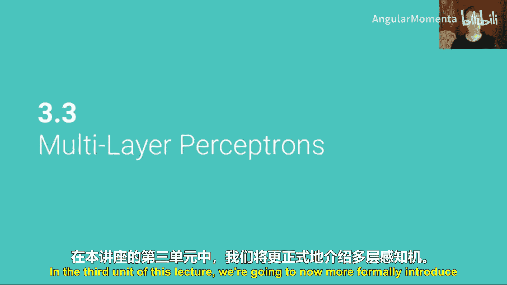
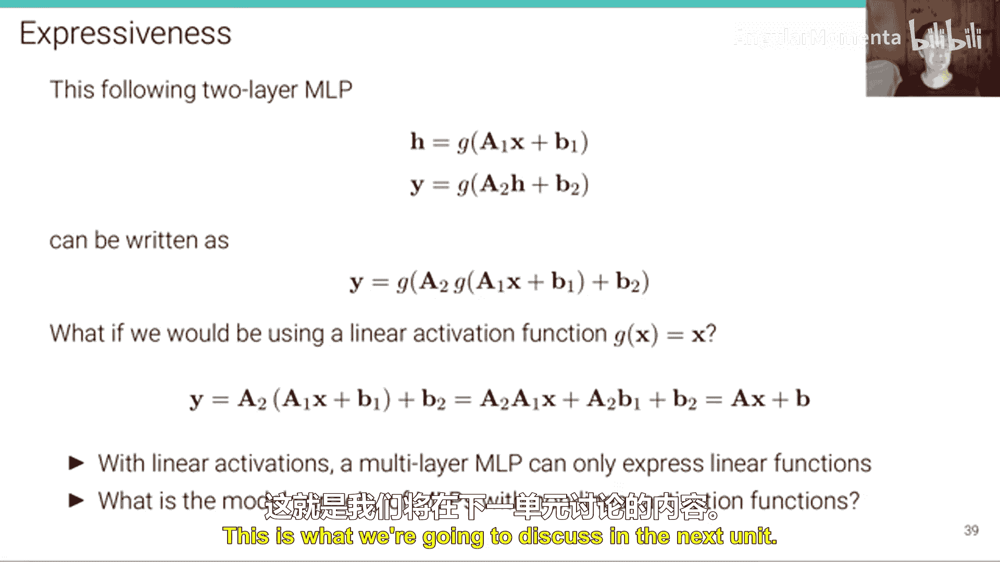

# 【精译】蒂宾根大学《深度学习》-p20-20--3.3（深度神经网络：多层感知机）--BV1eDbrzhENK_p20-

In the third unit of this lecture， we're going to now more formally introduce multilay perceptrons。

Multi layer perceptrons are feet forward neural networks。And feet forward here means that。

They are structured in layers， and there is no feedback connections between layers。

 Each layer only feeds forward information to the next layers。

 starting from the input all the way to the output layer。

And they compose several nonlinear functions。Functions as we've seen before， are fine plus Lo。

So here you can see an example。That we can。Consider a function F of an input X that is decomposed as a function of hidden layers。

 So first x is input to H1。And then the output is input to H2 and that output is input into H3。

 and that output is then input into Y head， so the last layer， the output layer that predicts。

Final prediction。And so these all layers that are not the output layer that don't receive direct supervision。

 that don't receive direct the training label， the training signal are called hidden layers because they are。

Not directly observed。 There are layers that in intermediate stages of the neural network try to learn useful feature representations for the output layer to predict or classify correctly。

The data only specifies the behavior of the output layer， that's where this name hidden comes from。

And each of these layers。Your eye is 1 layer，1，2， free。Comprises multiple neurons， J。

 which are implemented as aine transformations， followed by some nonlinear activation function。

 that could be， for instance， a sigmoid activation function that we've seen already， but we have。

A whole variety of activation functions that we can use at our disposal today。

 and well see some of them。So here's the generic expression right。

 in contrast to what we've seen before is that in this case here now we have multiple neurons。

 multiple units。They are called neurons， because of their。Neuroscientific。嗯。A motivation。But really。

 they are just these aine plus plus nonlinear activation function expressions。

We have for each layer I， we have multiple neurons J。And as such。

 we have also multiple times to do this transformation。

 of course we can do this in again using matrix and tensor operations to stack them into bigger matrix tensor operations that are efficient to compute。

Each neuron and each layer。And that's specific to multi layer perceptrons is fully connected to all neurons of the previous layers。

 This is where the structure of these layers becomes apparent。

 And we will see that on the next slide。 Youll see there is multiple layers。

And there is no connections of neurons within a layer。

 but there is connections of neurons between layers and in particular， between adjacent layers。

 all neurons are fully connected。This is a matter of the architecture and the multi layerer perceptionceptron is a specific architecture。

 there's many more architectures that have been developed and that are used today。

 but this is just one of the most basic ones。And the overall length of the chain of this computation of the model is the depth of the model it's called the depth of the model。

 and that's where the terminology deep learning comes from。

 We are stacking many of these hidden layers on top of each other or behind each other so we get a deeper and deeper model。

And we'll see the relevance of this depth with respect to what's called the width of the model in the last part of this lecture。

However， I personally find the name multilay perception a bit misleading as it's used for modern neural networks that are trained with back propagation and that have differentiable nonlinear activation functions that are continuous and this is in contrast to these threshold units that are not differentiable and they were used in the perceptron algorithm。

So that's why I think it's a little bit misleading to call these perceptrons because actually neighbor the perceptron algorithm is used to train them。

 we train them with back propagation。Nor the linear threshold unit is used。

 but it's that we use an aine plus a differentiable activation function。 So it's kind of fun。

A smooth approximation of the threshold unit。So what does a multi layer perception look like so this is。

An example of a multi layer perceptron network architecture。

You can see here the inputs on the left this is the input layer， then we have three hidden layers。

And then we have the output layer。And the variables within a layer are not connected。

 but within variables of one layer are fully connected to all the variables of the previous layer。

So for instance， this variable here is connected to all three variables of the previous layer。

In my notation here， Im using the first index of the hidden layer variable or the neuron in a hidden layer as the layer index。

 and the second one as the neuron index within a layer。Yeah。

The depth of a neural network is specified as all computation layers。 So we ignore the input layer。

 but we have just the number of computation layers。 in this case， we have。And network of step 4。

 so we have。1，2， and three hidden layers， plus an output layer in the case of a logistic regression model。

 we would just have。One computational layer。 So that would be a network of depth one。

The simplest multi layerer perceptron or the you know the first model that we could actually call deep is a model with two layers that has one hidden layer and one output layer In this particular case we have an example of four computation layers。

 so the depth is four。The width of a layer is specified as the number of neurons in a layer。

 so here in this layer we have three neurons here we have two neurons and here we have three neurons again。

And so this network depth and the network width are。Central。

Characteristics and design parameters of multi layerer preceptrons。Because we can choose them freely。

 depending on the application that we're considering if we have very little data and a simple classification problem。

We， of course。Use less parametersters。Sler networks in order to not overfit。Et cetera。

So neurons are grouped into layers， each neuron is fully connected to all previous ones。

And a hidden layer here in vector notation it is basically this H with just one index。

 the boldface H indicates the value of all nodes in a layer concateninated。Is simply a。

Aine transformation of the previous layer， so for instance。

 this here is an aine transformation of the previous layer， this is the H minus1。

And followed by an activation function that's applied elementwise to the resulting vector。

And the parameters in this case are H and B。And please note that in this。Specific。Visualization here。

 I'm omitting the perimeter nodes because it would get too cluttered。

 but each of these red nodes actually has a little。

 you can think of each of these red nodes having a little perimeter node attached to it。

Which is the A and the B for each of these nodes， or you can also think about。These nodes as one。

 collapsing it to one and then having one permeter node like the matrix A and the vector B associated with it。

Just for clarity here， I don't show them。Here's exactly this collapse notation where instead of the。

 you know。The one dimensional nodes and neurons here we have combined them into vector。

 So we have an vector valued input and vector valued hidden layers and a vector valued output。

And this is again， a slide about the perspective I've already presented previously when introducing these models。

whichhich is about。嗯。嗯。A layout computation。That changes the representation。

So here we have a specific input。Representation， so， for instance。

 the data set is embedded in this two dimensional space here。 and by passing this。Data points。

Fruit is nonlinear layers， we are changing the representation， so for instance。

 if in at last hidden layer。We call the representation psi， so we have now psi of x。

 this last hidden layer， you'll think of it as computing psi of the input x。

And if I draw this psi of x， in this case it's also two dimensional examples。

 so we're transforming from 2D to 2D。Then the goal of representation learning is to learn a useful representation。

At the last hidden layer， such that this output layer which is effectively just a logistic regressor in the classification case。

 it's exactly each of these individual errors here is just a logistic regressor。

 so the last one is also a logistic regressor， which means that it can only linearly distinguish data points。

So what this first layer should do is we should transform the data in a way that it becomes linearly separable and this is illustrated here。

And in ideal situation， we would transform all these these data points here through these layers such that in this。

Hidden layer free。 We get a representation that is sub linearly separable。

And where the class0 and the class1 can simply be separated by this final linear logistic output head。

And here you see an exemplary decision boundary in red。So this is the。Perspective。

 I'd like to give you on how to think about this。These models and why it's called representation learning because really what we learn here is a transformation of representation。

 so if each layer we should learn a better representation such that it becomes more the data points become more easy to classify。

 become more separated with each layer。Here's a couple of examples of activation functions that we can use。

 We have already seen the sigmoid activation functions。

 but there is other activation functions that people use。 The sigmoid is inspired by neuroscience。

 but it turns out that it's not ideal because it has very quickly saturates and then when once it saturated the gradients are very small and if the gradients are small it means the network doesn't learn anything anymore because the gradient。

Desent based optimization algorithm。Doesn't。Update anymore because the gradients are0。

 So one very popular function that's used these days is the raillo or the leaky raillo raillo stands for rectified linear unit where。

We have you know。That's simply a max operator between 0 and x。

 So we clamp this linear function here at 0。 So we have a linearity。 It's not even differentiable。

 turns out it doesn't need to be differentiable。 We can train neural networks also with non differentiable functions。

嗯。But the important thing is that the gradient， no matter like how far I go along the X coordinate is always there。

 there's always a gradient here， in this case actually there' there's even a gradient everywhere。

And this is a very useful property。 And it turns out that it's it helps in learning models more efficiently and faster。

 despite deviating from the。Neer scientific example。Now this is just a teaser for the next lectures。

 we're going to go into these activation functions into more detail。

So coming to the neural motivation， actually。The reason why these units are called neurons and the networks are called neural networks。

Is that they are inspired by the brain。Neurs in the brain are also structured in layers。

 similarly to MLPs being structured in layers。And these neurons in the brain。

 they receive input from many other units and compute their own activation function。

And the sigmoid activation function is guided by neuroscientific observations of how。

 how these functions actually behave。 Now， of course。

 we don't have continuous functions in the brain rather we have。Electric signals。

 impulses that are sent， so there's an example here。

 but the rate of signals and the rate of impulses can be modeled with such functions。

So here's an example where we have a single neuron。And they then writes。

Receive incoming electric signal signals through the synapses for the neurotransmitters。And then。

The signal is accumulated in the cell and is this is basically the linear combination。

 you can think of this as linear combination in a logistic regression model。

And then we have an axon that transports this information to another a little bit further away reaching the brain。

Where then at this terminal axon hat here， the information is then passed on through the neurotransmitters through the synapses to denrites of our cells。

There'ss there could be multiple other cells here that receive from this。Neurron here。And so that。

The axon here determines basically the weight or the strength of which this information is transmitted。

And this is how these neural networks in the brain。Relate to the artificial neural networks。

 very loosely speaking， of course。At the。Physical level， they operate quite differently。

And furthermore， the architecture and the training of modern neural networks differs radically。

In this course， our main goal is not to model the brain。 This is really important。

 Our main goal is instead to achieve statistical generalization。

 We want to have models that perform well。 We don't。 We are inspired by the brain。

But we don't want to replicate the brain， we want to rather develop models that work well。

 that generalize well， that work well with little data， etc。And this is where。

Neosscience deviates from deep learning。Okay， so now how can we train an MP。

 we have seen training algorithms before again here we are going to use gradient in descent。

Or what's called stochastic gradient in descent。Stochastic gradientding Descent is a version of gradientding descent where we are going to pick mini batches instead of the entire data set for computing gradients。

 because if we have a very large data set， let's say imageNe with millions of data points。

It's very inefficient to compute the gradient with respect to each data point because we need to compute millions of gradients。

 this doesn't work in parallel anymore on the CPUR or on the GPU。

 so we need to do it sequentially instead what we do here is we compute the gradient only over a smaller subset of the data。

Which is then effectively an approximation to the true gradient。

 it's a noisy approximation to the true gradient。But it still contains useful information and due to the stochasticity。

 we also have some useful properties of sometimes being able to jump over a local minima。

 so it's actually quite useful to have some stochastic process inside the gradient and decent operation。

Yeah we'll talk more about optimization algorithms。

 but the very basic version of such a gradient in descenter stochastic gradient in descent algorithm goes as follows。

So we initialized the weights。For instance， randomly， we pick a learning rate。

And then a mini batch size。 This is the size of the data points we want to process in parallel。

This is typically the size of data points that fits at the same time into the GPU memory and they can be at the same time forward and backward propagated。

In the context of the back propagation algorithm， so let's say we have a data set of 10，000 examples。

 but there is only 100 examples that fit into memory so we pick a mini batch。

 a random mini batch of 100 examples every time in every iteration of the algorithm。

And then we we first draw this random mini batch， so we draw these 100 examples randomly from the data set。

 you could also do it sequentially， but theoretically it's more correct to draw them randomly。

And then for all elements of this mini batch， let's say we have a mini batch of size 100 and for all 100 data points。

 we do， if we have a GPU， we do that in parallel， we forward propagate X through the network to calculate the intermediate。

Values and also the output layer。 So these are the H1， H2 hidden layers and the output layer Y hat。

And then we back propagate gradients through the network to obtain the gradient of the loss function with respect to all the parameters that we're interested in。

 these are all these A's and B's that are sitting inside these little node in the MLP that we've seen before。

So we do this for all elements in the mini batch。And then we update the gradient with the we go one step into the negative direction of the average。

 this is the average gradient over the mini match。嗯。And that's basically it's very simple。

If the validation error decreases。We have again a training and a validation set。

 so if the validation error continues to decrease， we go to step two， otherwise we stop。

Because we are starting to overfi again。Some remarks。

Large data sets typically do not fit into TU memory。

 that's why we typically for large dataset sets have a batch size that's smaller than the dataset size。

 for instance， 100 compared to 10，000 data points in total。

Now the examples that we'll show on the next slides are actually quite small with just few data points so we can choose the mini batch size as the data set size。

 so it's actually not a mini batch but in every iteration we are just computing the gradients。

The average gradient over the entire dataset set。So here's some notes on levels of abstraction you've already seen that。

We need to think。When we design these networks， we need to think of multiple levels of abstractions simultaneously so we need to think about。

The optimization algorithm， we need to think about the network structure， structure of the layers。

 the size and width of the layers， we need to think about how to efficiently implement our operations using vectorized operations and about the arithmetic operations themselves。

And it's really key to becoming a good engineer in machine learning or in particular in deep learning。

 that you're able to simultaneously think about these multiple levels of abstraction。

And it's not only key for deep learning， but in general。

 as a research it's key to be able to simultaneously think about multiple levels of abstraction in order to make new discoveries。

Here's a famous quote from Donicnv。Who sets？Not in the context of deep learning。

 but in the context of programming in this case。The psychological profiling of a programmer is mostly the ability to shift levels of abstraction from low level to high level。

 to see something in the small and to see something in the large。 but that's really key。

Not only for deep learning。But in particular， for deep learning。Okay。

 so now let's look at our XR problem again and let's finally solve it。

Here I've utilized this fantastic demo from Encappartti that's still online on this web link that you see below。

And this and I encourage you to have a look at yourself at this demo。

 so in this demo you can live in your browser， train and neural network。

Specify the neural network in such a textual interface。 In this case。

 I've used a neural network that has。First in the first hidden layer has two neurons。

 and then it has one neuron in the output layer。And as activation function。

 I use 10h instead of sigmoid because it has better convergenence properties for these simple examples。

 these not normalized input examples that we have here。And as an output。

 I'm using a softm that in this particular case corresponds actually to the to the sigmoid function。

 So this is really exactly the implementation of this。X or。Intuition that we've developed before。

 that can be represented by。Two logistic regressors。 And then on top of these two results。

 one logistic aggressor that does something， but in this case。

 we are not specifying that the first one should be an R and an and and the second one should be an and。

 but we are just randomly initializing the weights and we let。SGD。

 stochastic gradient descent to its magic， and this is the result that it obtains。

dependss a bit on the inization actually， turns out that it doesn't converge like super rapidly。

 but it converges to this and you can see that it does what we expected basically separates the red from the the green points in this case。

Here's a more challenging problem with more data points that are less separable even than the previous ones。

 and you can see what the model does， this multi layer perceptionceptron does。

If I'm again just one hidden layer， multi layerer perceptron， so it has just two layers。

 a hidden layer and output layer， but what I'm changing here is the number of neurons in the hidden layer and you can see how the complexity of the decision boundary changes if I'm increasing the number of neurons and if I'm increasing into 50 neurons you can see that it's almost overfitting。

So the number of neurons that is set the architecture itself is a regularization parametermeter。

 it's an essential parameter of your architecture。 you can regularize your networks using weight decay。

 we're going to talk about this by basically doing a。

m putting a quadratic loss on the weights themselves。

 but you can also regular by just reducing the number of neurons， for instance。

So let's finally to conclude this unit， talk quickly about expressiveness。

This following a two layer MLP that we see here， this is exactly a two layer MLP。

 as we've seen on the previous slides， can be written as in a single equation。Here we have just。

Substituted this H into here。对。This is this H。Now the question is what？

What happen if we would be using a linear activation function instead of a nonlinear activation function？

What do you think would happen if we would choose linear activation functions？Would in this case。

 a deep neural network also be a better choice， a more expressive choice than a simple linear classifier that has just a single layer？

And would more layers help going beyond two layers， going towards three and four layers。Now。

 the answer to this question is。No。And the reason for this is that。Any。

 no matter what the depth of this。Multil layer perceptron is if I'm choosing the activation functions as linear。

 I can always recombine by multiplying in the matrices。

 the equations such that I end up with a linear equation again so here in this particular example for a two layer MLP。

 this is the equation that I obtain if I'm removing the G。

Because I'm assuming linearity of the activation。And then I can。Multiply in a2 here。

 so I'm getting this expression and then what I see is of course this this expression here is just a vector so I can relabel that vector SB and this。

Matrix here is just another matrix which I can relabel its matrix A， so I didn't gain anything。

 I' have just added redundancy， which is actually a bad thing because。

If I would optimize this with a nonlinear optimizer。

 it would be harder to optimize with this redundancy and dependency between variabless。

But it turns out actually it's a linear problem so it has a closed form solution and we didn't gain anything in terms of expressiveness。

 so the bottom line here it' really crucial that we have these nonlinearities interleaved between these aine transformations。

 otherwise we wouldn't gain anything in terms of expressiveness。With linear activations。

 a multi layer perceptron can only express linear functions。

So what is the model capacity of MLPs with nonlinear activation functions actually。

 this is the more interesting questions right， if we are having these nonlinear activation functions。

So is it better to build deeper networks， is it better to build wider networks。

 how deep do we need to go in order to express arbitrarily complex functions， for instance？

This is what we're going to discuss in the next unit。

