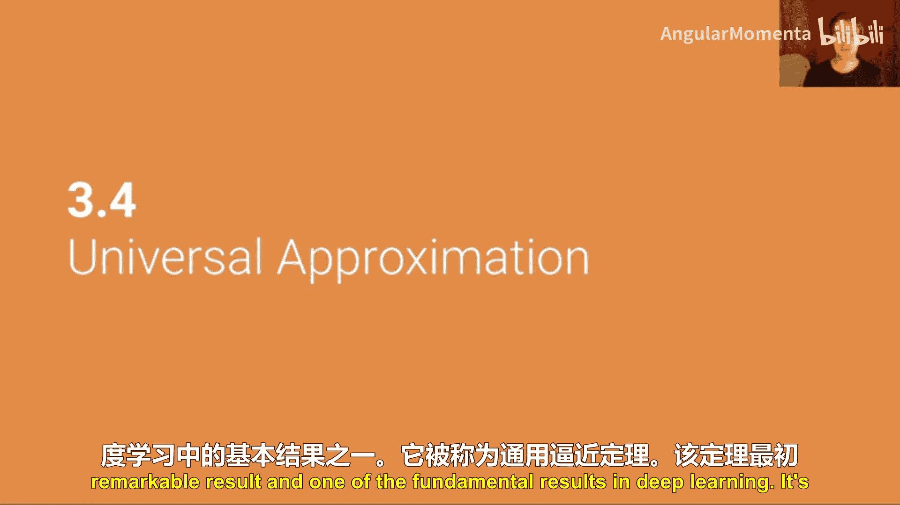
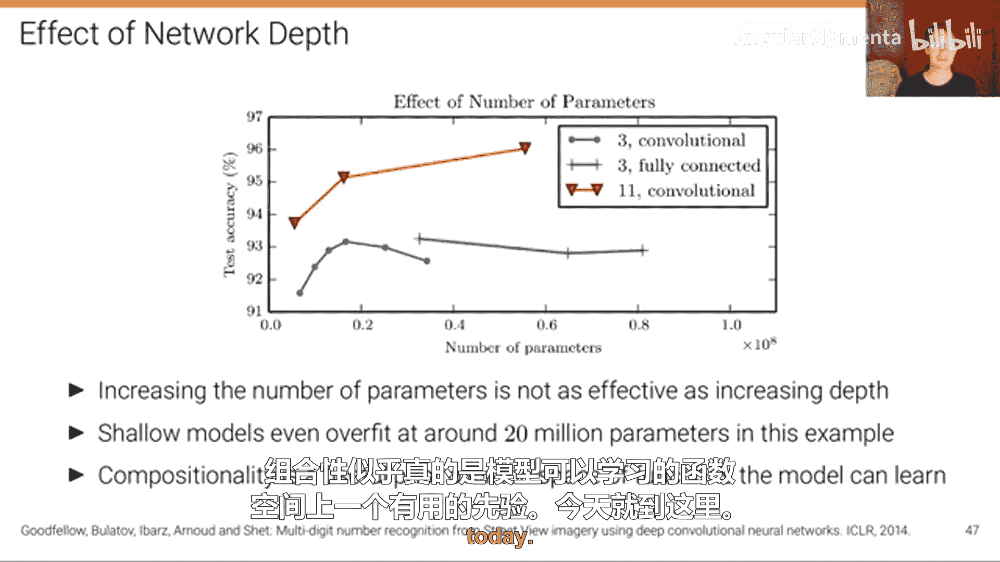

# 【精译】蒂宾根大学《深度学习》-p21-21--3.4（深度神经网络：通用逼近定理）--BV1eDbrzhENK_p21-

Welcome back in this last unit of the lecture， we're going to talk about the expressiveness of multi layero perceptrons。

In fact， a multi layer perceptron with just a hidden layer is able to approximate arbitrary continuous functions。

Up to arbitrary precision。If one allows to increase the number of hidden。Uns。

 the number of neurons in a hidden layer。Arbitrarily。

 and this is quite a remarkable result and one of the fundamental results in deep learning。

It's called the universalversal approximation theorem。

 it has been shown for the first time by Sabeko。In a paper called approximation by superposition of a sigoidal function。

And afterwards， by several others in more general cases。Here's the fiim that I took from this paper。

Let sigma be any continuous discriminatory function， then finite at sums of the form， this form here。

 you recognize this form as a aine transformation plus a nonlinearity followed by another aine transformation here。

So finite sums of the form G of x。Are dense in a space of continuous functions。

 C of I N on the n dimensional unit cube I N。In other words， given any function F。Out of this。

Space of continuous functions on the unit cube and epsilon bigger than0。

 there is a sum G of x for which the following holes。D啊。Distance between G of x。

And f of x is smaller than epsilon for all x in the unit cube。All。

Forem that is very intuitive to understand。And it has been proven for various activation functions。

 including sigmoids and res， however。The proof is quite technical， and it requires。

A good understanding of measure theory and it's probably not too hard to follow for mathematicians。

But it's beyond the scope of this class， so we're going to skip a formal proof of this theorem where we're going to give some intuitions on some specific cases of why this holds true。

And we are first going to look at the binary case， So we're looking at not the case of you know。

Continuous functions， but at the case of discrete functions。And there it's very easy to see。

So here we have an example where we have a three dimensional input， x1 x2x free。

 so there's eight possible combinations here in this table， I've just drawn three of them。

 but there's eight。And。A one dimensional output y。That is predicted by a multi layer perceptron with hidden layer H。

And both the input and the output are binary， so the input x' and the output y can only take0 or 1。

And let's， for a moment， assume。We these hidden units are linear threshold units。

So they are basically the units that we've seen in the perception algorithm where we have an Iine transformation and a comparison so this is comparing if the result of this transformation。

Is bigger than0 or not？Each of these hidden neurons is connected to all input variables。X。

 so we write bold X。To encompasscomp all these variables x1 to x3。

And this bracket here is called the Everson bracket and it returns one if the argument is true and it returns zero if the argument is not true。

So we are having basically a step function that steps from0 to 1 exactly when Ax plus b becomes bigger than0。

And then we use a linear combination of these step functions。As our predictor。And the question is。

 can we formulate parameters， A's and B's such that we can represent any possible function。

 And the answer is yes。And the intuition。And how we're going to do this is that each of these hidden units here will recognize one possible input vector。

 so one possible combination of x1 x2 and x3。 So for instance。

 we have one neuron that's specifically tuned to recognize 011。Which means that we will need。

An exponential number of hidden units to recognize all possible inputs in this binary case。

 which is of course not a problem。For free input variables。

 but you can already see that this becomes problematic if the input dimension grows beyond。

This simple case。Now the question is how can be set A and B for each of these neurons that they are tuned to one specific input combination。

 and here's an example， this additionalarrow here indicates the bias。

Term and we have the other errors here， the numbers close to the  errors indicate the weights the at this corresponding。

Errowors。Inputs， the weights that are multiplied with the corresponding axis's。

And so what you can see is this is。😊，In black here is the setting that we have chosen for recognizing the vector 011 and outputting 1。

And you can see that this is correct because we have chosen。

 you know we have chosen 1 and 1 for x2 and x3， so they are recognizing this and we have chosen minus1 for the first one such that if the first one would not be0。

If it would be one， we're lowering the。嗯。TheThe activation。And then we have a bias of  minus0。5。

 which means that only if x2 and x3 are 1 and x1 is not 1。

We are obtaining a number that is higher than。1。5 if you put the B on the other side。

 which is higher than 1。5 or if we subtract from 1 plus1， if we subtract minus 1。5， we obtain 0。5。

 which is bigger than 0。But if we would change this x121。

 then we would subtract  one again and we would obtain one， which is not bigger than。1 minus1。5。

 which is not bigger than 0 because it's minus0。5。So as you can see， we can design this。

Units and their weights in a way that each of these units。嗯。

Corresponds or recognizes one particular situation and then outputs the corresponding。Value here。嗯。

However， we need2 to the power of D， an exponential number of units to recognize all possible inputs。

 and this is the binary case becomes even more problematic if we have the continuous case。

Now one thing that we've assumedd here is that we have linear threshold units and of course。

 learning linear threshold units is high， as the gradient is zero almost everywhere and they are not differentiable。

So the solution here is to replace the hard threshold units with soft threshold units such as sigmoids。

 so here you can see the sigmoid function in blue。And what you can see is that with these sigmoid functions。

 we can actually in a soft or in a differentiable way， if you will。

 approximate these non differentiable step functions by。Ching the parameters。

 changing the input weight for instance， so here I've plotted multiple sigmoids。

 so this blue one is the sigmoid that we've seen before。

 but if we plot sigmoid of 2 x we already see that it becomes closer to a step function if you plot sigma of5 x then it becomes even closer to the step function and at 50 x it becomes almost indistinguishable from the step function so we have a differentiable alternative。

 a soft threshold function that we can tune such that it's sharp enough but still differentiable for being trained with gradient indecent based algorithms。

嗯。Yeah， so some comments， the universality of two layer networks。

 multi layer perceptrons with one hidden layer is really appealing。

Univeity means they can represent any possible function， but there is an important caveat。

Multiple actually， so first of all， they require exponential width。

And this leads to an exponential increase in memory and compute time at some point。

 at some complexity of the problem， we can simply not use these models anymore。And moreover。

 and maybe even more importantly。These models do not lead to generalization。

 or universality doesn't mean or imply generalization actually quite the opposite。

If we are increasing the capacity， the number of parameters in the model exponentially。

 what it means is that the network simply memorizes the inputs。

 This is also what happened here we have simply defined one hidden unit that memorizes one specific input。

And this is， of course， not what we want because we want to achieve good performance on the validation set。

We want to achieve low testera。 We want to achieve。A high degree of generalization to the test set。

So memorizing。Or simply overfitting doesn't really help us。In contrast。

 so this is one aspect that we have modified the width of this network。

 we have kept the depth the same。 it's always two layers。

 but we have changed the width of the network。Now what's crucial now and what people just understood over the last couple of like 20 years or so is that actually。

What really matters is the depth of the networks well with this infinite wide networks we can represent any function。

 the representations are useless because we are basically just overfitting。

But if we use deeper networks with less wide layers。

 we can represent complex functions more compactly。In other words with less parameters。

And these deeper networks， they induce a very important inductive bias onto the solution space。

 which is。You can think of it as inducing the bias that complex functions。

Can be modeled as composition of simpler functions。

This is a very appealing property right because simpler functions are easier to do and easier to understand and creating complex behavior from something simpler that's appealing。

 but it seems that it's actually true in nature and that this actually happens and that's why deep networks work or generalized so much better than just using a shallow network。

 this is a non-deep network like a two layer MLP that is very wide and still universal。

So these deep networks lead to more compact models and empirically better generalization performance。

So there's also a simple binary example here， this parity function that I show here。

It's a function of x1 to xd， which outputs one if the sum of these x is odd and a0 if it's even。

So this function， you can show that it requires an exponentially large shallow network。

In the number of inputs D。But it can be computed using a deep network whose size is just linear in the number of inputs。

 so it contrasts these two extremes very well。嗯。So here is a result from the paper of a Monte far et al on the number of linear regions of deep neural networks。

 and this is about an intuition like this the paper is theoretical but。

This figure is an intuition of why。Deper networks are useful and this is called a space folding intuition。

 and it's an intuition for a specific。Activation function called the absolute value rectification Uni。

 where we have basically just an absolute value as the activation function。

It provides a geometric explanation of the exponential advantage of deeper networks as follows。

 so think of this white sheet here as the space on which the input data lives in this case two dimensional。

 but it could be higher dimensional right could be arbitrarybitr high dimensional。

And so what happens effectively with these？Absolute value recification units is that。

Entities are mirrored onto。Along the axis defined by the hyperplane。

 so this is the mirror axis of symmetry， which is given by the Hyplane defined by the weight and bias of the respective unit。

And so complex functions like the green one here arise simply as the mirrored images of simpler functions。

 you can think of this as the sheet as a folding this sheet here multiple times。Right。

And you can see that we have multiple times， we have a symmetry here。

 we have a symmetry at this axis， but then we have also additional symmetries here at this axis and at this axis。

 right， and so by by folding this sheet of paper or space multiple times we can。Very quickly。

 with just a few layers， just by increasing the depth， adding some more layers。

 we can create very complex patterns for which we would need a lot of exponentially many neurons if we would want to keep the depth fixed and just increase the width of this hidden layer。

So complex functions arise as in this case， as mirrored images of similar patterns and there are similar intuitions for our activation function。

So here are some empirical results， finally， this is from the paper from Goodfelow et all on a task of multi multidit number classification。

Which shows that deeper networks generally is better on the X axis。

 we have the number of hidden layers。And on the y axis we have the test accuracy。

 so effectively the inverse of the generalization error hires better。

 you can see that the performance steadily increases when increasing the number of hidden layers。

One difficulty with deeper networks is that they are harder to train。

 It's harder to back propagate gradients because gradients can get lost。

 can can explode and can vanish。 So you need to take appropriate countermeasures like renmalization or skip connections。

et， in order to counteract this， but this is something we'll discuss in a later lecture。

 but in general， if you design proper networks， you can get a huge benefit from depth that you can't get from Li。

And here's a comparison of。This effect of network depth versus widthI。

Increasing the number of parameters is not as effective as increasing depth。

 So here's just this basically just a control experiment where for a network， let's say here。

 this one here， this is a convolutional neural network， which we'll talk about in。

One of the following lectures is a very important type of network architecture with a very strong inductive bias in addition to the。

Bs of the layers is an additional inductive bias there that is very powerful for image recognition tasks。

 which is done here。 So here we have a。Convolutional network with three hidden layers。

 and we have one with 11 hidden layers here。And you can see that with three hidden layers。

 if we just。Keep increasing the number of parameters we at about 20 million parameters we start。

To see a decline in testoc Cruion is。The overfitting effect， we're overfitting。

 we're increasing the model capacity， but we're overfitting。However， if we're using a deeper network。

 we can increase the number of parameters more while still increasing test accuracy or improving generalization performance。

So it Sims。Also empirically， that compositionality is really a useful prior over the space of functions the model can learn。

嗯。

That's it for today。