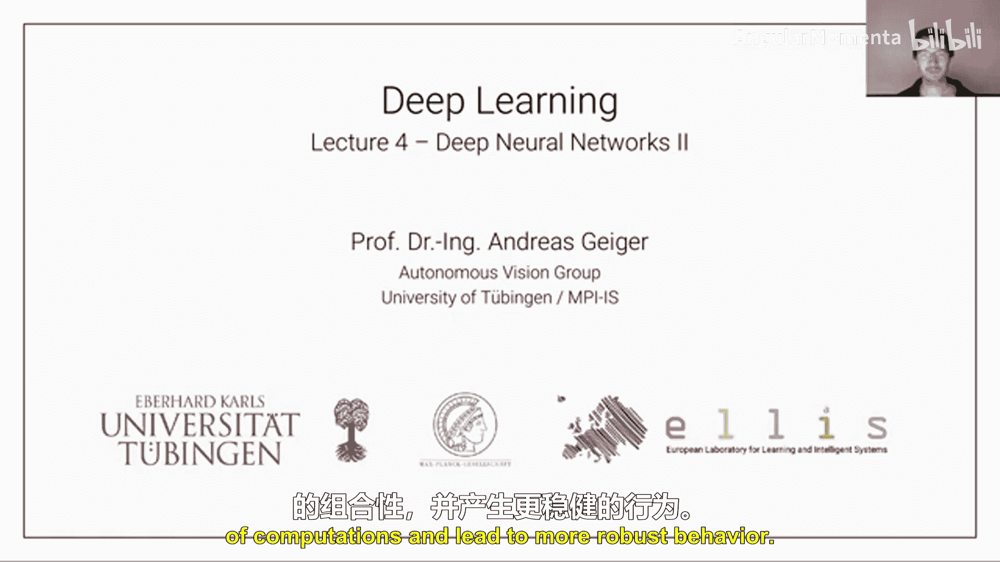
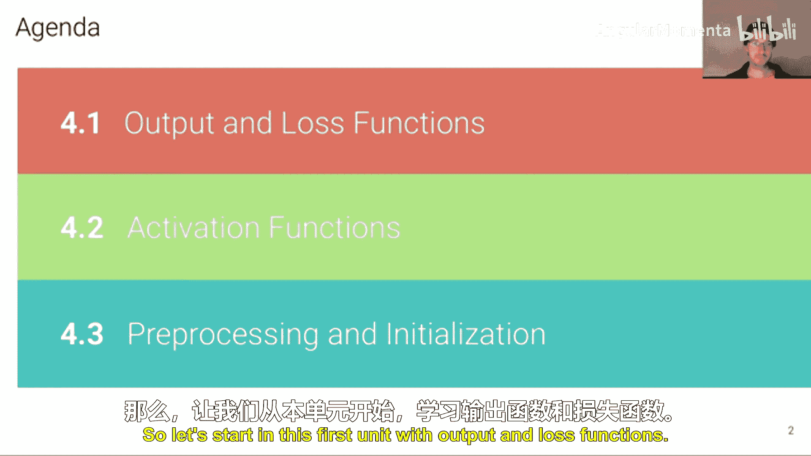
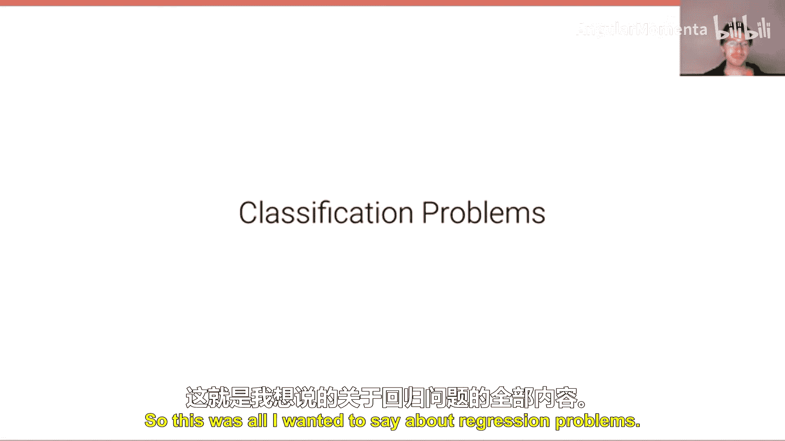
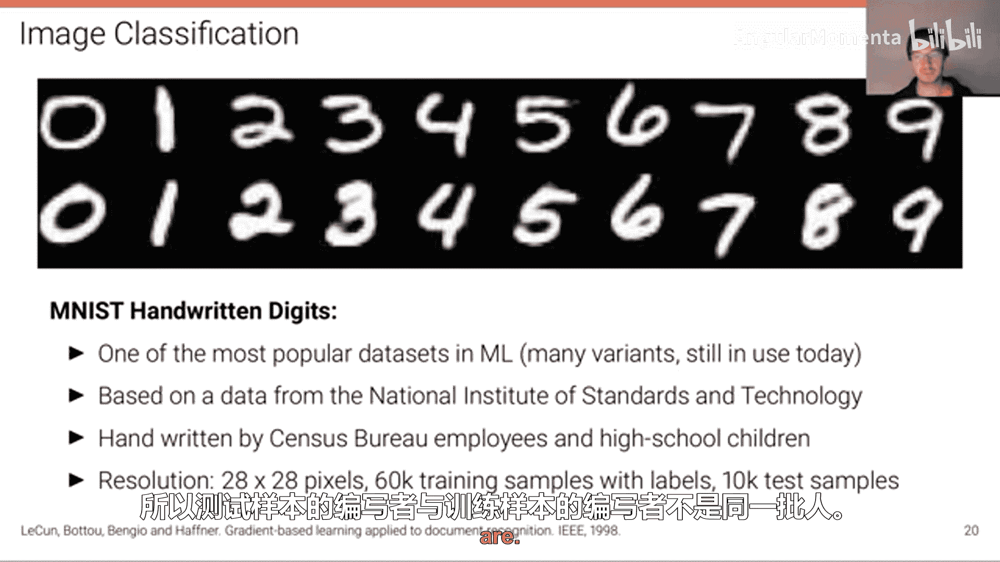
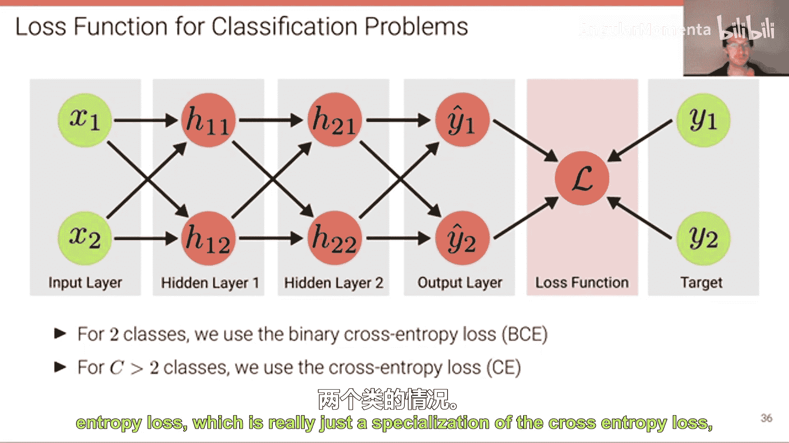
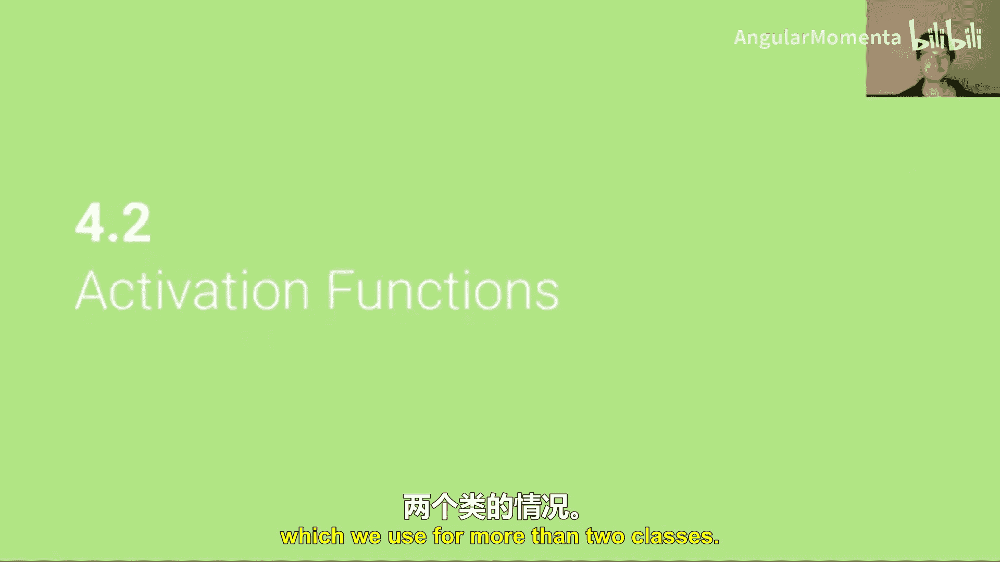

# 【精译】蒂宾根大学《深度学习》-p22-22--4.1-(深度神经网络-II：输出与损失函数)--BV1eDbrzhENK_p22-

Yeah。Hi and welcome to the fourth lecture of deep learninging Last time we talked about multi layer perceptrons。

The most basic form of feed forward neural networks。And we've seen that even very simple ones。

 very shallow ones with just a single hidden layer。

Basically two layer neural networks are able to represent virtually any function。

But we've also seen that this is not necessarily a good idea and in order to have models that are both。

Expressive。While also being able to generalize， well。

 we need deeper models that make use of the compositionality of。

Computations and lead to more robust behavior。Today we're going to continue talking about this basic form of feed forward networks。

 multi layero perceptrons， and we have a deeper look at output and loss functions。

Activation functions and also data preprocessing and weight initialization。

 which are all very important in order to make neural networks work well。

So let's start in this first unit with output and loss functions。

So here we see a very simple feed forward neural network where we have a two dimensional input。

 x1 and x2， and it feeds into two hidden layers that have two nodes each。

 so these are all one dimensional compute node so the output is a 1D quantity after the nonlinearity。

And then we have an output layer that computes a prediction y hat。

And then we have a loss function computes that compares that prediction y hat to the target y。

Which is given by the data data， so data set provides x and y labels。

So in the first part of this unit here， we are going to focus on the output layer and the loss function here and the choice of both of them。

dependss very much on the tasks that we wish to solve。For instance。

 both of them change depending on if we are looking at regression or classification problems。

 So if we are looking at continuous or。Discrete predictions why hat。

That's what are we going to see today。Of course， this was a one dimensional example here， of course。

It's also possible to predict higher dimensional outputs as shown here in this case， of course。

 the loss function needs to compare。YY1 and y2， the prediction to y1 and y2 the target。

I're going to see both today。So first of all， let's think about what is our goal during optimization。

 what is the goal in optimizing the loss function actually well in some form at a very abstract level。

 we want to simply try and make the model output which is our prediction in red here similar to the target。

Which is coming from the data set。So here we're looking at a two dimensional y1 y2 output space。

 and we're having a prediction in red and a targeting in green。

 and we can already see like if we look at， for instance， an Ecclidean cost measure。

 an Ecclideion loss function that，In this left example here we have a higher constant on the right。

 so our optimizer should if its minimizing this distance here between the green and red point should make the prediction over time during the optimization。

 while updating the parameters of the neural network should make this red point come closer to the green point。

It's also useful to think about this in terms of distributions。

 which we are going to use a lot in the next couple of slides。

And which are a good motivation for us for deriving specific loss functions。Okay。

In terms of distributions， the model might predict in a very simple form here。

 a Gaussian distribution in red。And the data distribution is in green here and what we're trying to do is we want to align the model distribution and the data distribution again here we have a conditional predictor so we want to what we show here is the probability of y given x。

 given some input x。And so we can measure， for instance， this。

Disrepancy here in terms of the Kback light blood divergence。

And so the coolback light load divergence， if you would compute it on these two garsians here。

 would be quite large because the overlap between these distributions is pretty small。

On the other hand。😊，On the right side， the overlap is very large between the two distributions and so the K plate divergence or distance is small。

 which means that these distributions are well aligned again over the curse of optimization from such an initial state of our model parameters we want to arrive at a model that does a prediction that aligns very well with the data。

So this is the goal of。What we want to actually achieve during optimization。

Now the question of course is well， how to design a good loss function。

 so far we have just seen very abstract examples without naming explicitly or formally stating a loss function。

First of all， a loss function can be any differentiable function that we wish to optimize and can express our belief about a cost that would be incurred by a particular state。

That we are predicting or particular decision that we're making。

So it has connections to decision theorem。However， what we're going to do today is something which is more elegant。

We're not going to define loss functions based on our intuition。But instead。

 we're going to derive them based on the maximum likelihood principle。

Which is nice because it removes the burden of manually designing cost functions for each model。

 we can just always come back to the maximum likelihood principle。

 look at the maximum likelihood principle and derive a loss function for our problem。

And it also gives us a nice connection to a probabilistic interpretation of the model that were having。

 so it's always good in my opinion， to think about loss functions。

 not only as cost functions but also in terms of the maximum likelihood principle in terms of a model that is predicting a distribution。

So what we're effectively doing when considering or deriving the cost function from the maximum likelihood principle is that we consider the output of the neural network not as a point estimate。

not as predicting a single value， but predicting a distribution。

 so other words the neural network does a point estimate for the parameters of a distribution。

 it predicts concrete values but we consider these values not as the target y directly。

 but we consider them as the parameters of some distribution over the output y。

 and that's what we call the model distribution P model that we've seen already in earlier lectures。

Okay， so this is the maximum likelihood formulation。

 What we want to do is we want to and we've seen this before， we want to find the parameters。W hat。

ML stands for maximum likelihoodlihood。That maximize the model probability over the data set。

 and so y bold and exportold here denote the entire data set where we have。

One dimensional outputs that are stacked， like for the entire data set stacked into a vector。

 and we have this。Input matrix X， where the columns are the features and the rows or maybe pixels and an image。

 and the rows are the data points。And W is just a generic notation for the parameters you will see throughout the lecture that sometimes we're using also A and B if we're referring to very concretely parameters of an aine transformation。

 but in general when we talk about W， we mean simply all the parameters of a model。

 in our case a neural network。Good， okay， so we can use the ID assumption。

I'mAssum that all the data points are independent and identically distributed。

In order to simplify this expression into a product over n individual predictions for individual inputs X。

And then， of course， we can take the logarithm of this expression。

 which then converts this product into a sum。Because the logger of is monotonic。

 it doesn't change the maximum， so it's still the same problem。And this is called thelock likelihood。

We're using the logar of Mo in practice because it makes our implementation much easier。

As you will see later， we are going to often deal with exponential functions。

Also the sigmoid that we have already seen is an exponential function。

 and so if we input values to an exponential function and these values are large。

 this exponential function will this exponential expression will become very quickly。

 very large will explode in the sense that it can not be represented anymore with the data representation that we're using like signal or double precision。

And so it's good to look at lock representations which don't have this problem。

But this will come up later through the lecture。 Okay。

 so here we have the maximum lock likelihood that we want to maximize。Now。Here in the last slide。

 this model was a generic description of a model distribution。

 but how do we represent this now with a neural network， right？And as I mentioned before already。

We can think of our neural network as predicting not a point estimate， why。

 but the parameters of a distribution。So for instance， here， the model distribution P。

 I omitted the model here， but this is P model， this is this one here。

 the model distribution given an x and per just w。Predicting some y is a Gaian。

 this is the expression for a。Uniate caution。And as you can see。

 the mean of that Gaussian has been replaced by a function with perms W。

 and that function takes as input X and is precisely the feet forward neural network or multilayop preceptron。

So we have this multilayer perceptron FW of x， which is this part here。That predicts mu。

 which is the mean of the Gaussian， and we insert that mu at this place where the mu would be in the Gaussian distribution。

So the neural network makes a prediction for the mean of the distribution here with this dashed line。

And what we then want to do is do we want to maximize the probability of the target value y this is coming from the data set under this distribution。

 So in this concrete case here we see that the probability for the target is not0， it nier0。

 never is it maximal， so what the model will then。Has to do is to change the parameters of this neural network such that is prediction for this particular input x that corresponds to this target y。

Comes closer to the target such that the probability of the target under that distribution becomes larger。

Think about moving this Gausian bell here a little bit to the right by 1。5 or so。

 then the probability of this。Value here， which might be located at。I know minus 0。5 becomes larger。

 it becomes maximal。So this is how we're going to think about。

The maximum likelihood principle and loss neural networks predicting parameters of distributions。

So let's quickly recap the different types of problems and this is what we're going to look at today。

 we're not going to look at complex structure prediction problems we're going to look at simpler regression and classification problems。

 So in regression the input is an arbitrary object。And the output is a real number。For instance。

 the value of a stock。In binary classification。The input is an arbitrary object， let's say an image。

 and the output is a binary variable， in this case， beach or no beach。

And then one more thing that we'll consider today。This is what you know already。

 one thing that we consider in addition is multiclass classification where again the input is a structured object like an image。

 and the output is a discrete random variable in this case with four different states or possible labels。

So the image is classified as being ever or depicting ever a beach， a mountain， a city， or a forest。

So whenever we talk about。Classification with more than two classes。

 we talk about multi class classification。And so we're going to make this distinction today and we're going to learn how to define loss functions and output layers for these different types of problems。

 regression。Binary classification and multiclass classification。Okay。

 so let's start with regression problems first。We've seen this Gaussian distribution already， right？

Everybody is familiar with a Gausian distribution， this is the form of the Gaussian distribution on the right as an example of such a Gausian distribution。

 therefore， why we depict the probability density of over y。

A Gaussian distribution is pertriized by a mean mu and a standard deviation sigma。

 or the variant sigma square。One characteristic of a Gausian distribution is that it has fintails。

 which means that the probability of y goes very quickly to0 as we go towards plus or minus infinity with y。

 which means that if we go into this direction here the distribution very quickly decays and we are reaching a value that's very close to0 very quickly。

That means this distribution penalizes outliers strongly。

 what does that mean if I have a data set of some points that are。Fithfully， following。

Gussian distribution， let's say they are distributed around here。

 but I have one point that's distributed here， this means that this one point has a strong influence on the estimate of this distribution。

Because it will have extremely low probability if the distribution would focus only on what's called the inliarers。

What's the the correct observations， So if I have an outlier an incorrect observation that would。嗯。

That will basically influence the distribution a lot。

 and that's why we're going to talk about a different distribution also in the following slides。

That doesn't have this problem。But let's stay with the Gausian distribution for a bit and this is actually what we've seen already in the context of maximum likelihood estimation in the first lecture。

 but the only difference to the first lecture is that now we have a neural network that predicts the peri mule。

 not a very simple。Linear model， but now this is a arbitrarily complex non nonlinear transformation。

MLP， let's say。So we assume the model distribution is a Gaussian where the MLP or the feed forward network predicts the mean of that Gaussian distribution。

 and sigma is just kept constant to some constant value doesn't actually matter which value。

Then we obtain， as we've seen in the first lecture already。

 if you go through these equations like here in the first equation。

 so this is basically the maximum likelihood objective or maximum lock likelihood objective。

If we then plug in this equation here， we see that this is the first part comes in front and the second part here in the back。

 the exponential cancels with the lockerith。Which I previously already mentioned is a good idea to do。

And that's the reason why we use the log likelihood。

The first expression here is constant with respect to W W does not appear in the first expression。

 which means we can just remove the first expression。

The arc mark stays the same because it doesn't depend on W。

 So we're left with the second expression one over2 sigma square is also。

AConstant with respect to W doesn't depend on W in this case， so we can also remove it。

 so we're left with this expression。And we can reformulate this by removing the minus and minimizing instead of maximizing。

And this gives us the loss function finally， so from this maximum likelihood principle。

 by changing the sign we have derived derived from a maxization problem， a minimization problem。

Which means that we minimize a quantity and that quantity is called the loss function。

 and we can read off from that expression here how that loss function looks like it is a squared loss because we have a F。

 so the prediction of the model minus the target。To the power of two here。

 And we do this for each data point。 So it's actually the sum of squares。

 But this expression here is called the squared loss， sometimes also called the L2 loss。Yeah。

 so we've seen already this is a loss that's strongly affected by outliers。By wrong data points。

And so people in practice often use a different distribution。 And this is a distribution。

 This is one example of one of these other distributions that is less。Prone to these outliers。

It's called the Laplace distribution。Has a similar form to the Gausutian distribution。

 except that now in this exponential expression， we have the absolute difference between y and mu。

 which is in for the lablast distribution called de location parametermeter。

 but you can think of this as the mean of the Gausian distribution。

So the difference is now that the distribution， the normalization constant has changed slightly because we have this absolute difference here and we have the absolute difference。

We have the location mu， which is in this example here on the right here， the location would be0。

And we have the scale B， which similar to the standard deviation for the Gaussian。

 determines the width of the。Distribution。 So if we have a larger B。

 then the distribution decays more slowly towards larger and smaller wise。

 so it is wider Basically if we have a smaller B， then it becomes sharper。

In contrast to the Gaussian distribution not this distribution has heavy tails or heavier tails。

Which means that P of y。Goes to0 much more slowly。As y reaches plus or minus infinity compared to the Gaussian distribution。

 So we have much more weight at the tails here， much more probability mass。At the tails。

And therefore， it penalizes outliers less strongly and is often a preferred choice in practice。

Or amongst preferred choices for regression problems in practice。

Now what happens if we do the same calculation as before for the Gaussian。

 but now with the lapplaceian distribution， so again we have a model distribution where the model distribution in this case is now a Laplace distribution for which the location parametermeter is predicted by the feet forward neural network with perimeter W。

And B is on。Arbitary， but constant。A scale parameter of the Laplace distribution。

If we plug in this into our。Maximum log likelihood formulation， we obtain this expression here。

We again see that the first expression here does not depend on W so we can ignore it in our maximization problem。

And the same is true for1 over B， which is constant with respect to W。

 so we arrive at this expression here。And then again。

 we can convertge the maximization problem into a minimization problem。And from that。

 we can read off the loss function。Now the loss function looks very similar to before。

 except that this square has been replaced with this absolute brackets。

In other words we minimize absolute words L1， which is more robust than the L2 loss we've seen before。

Okay。Now， so far， we have only predicted one of the two parameters of these distributions。

 but it's also possible to predict both parameters。In this case。

 we're considering a lowplace distribution again。But we're predicting not only the location。

 but we're also predicting the scale B， so we're predicting both mu and b B appears twice。

 so you can see appears here and here。We've both the location mu and the scale B with a neural network。

And I've written F of W and G of GW here as if they were different neural networks。

 but I've used the same permid just W to indicate that。Often， these networks are。

Largely the same so that the whole backbone， the whole。

 like the first part of the renewal neural network， all the layers are the same。

 And then there's maybe one additional。Output layer， which is the hat。That is different from the two。

1 predicts F， and the other predicts G。But I've indicated this with the w that the W is just a universal representation for the parameters of this one neural network that has like a larger backbone。

 maybe five layers， and then there's one additional output layer for F and 14G where the parameters are different。

But in this case， subsumed into this big parameter vector w。

so F and G is basically one network with two output heads that might be slightly different。

But of course， I need to make the distinction here in this equation to make distinction between the location and the scale periid。

Okay， so if we do this， then。The resulting expression doesn't become as simple anymore because of course we can't。

Ignore this expression or this expression here because they both depend on w so they remain in the equation。

 so it's not a simple L1 loss anymore， but it's a more complicated form of a loss function。But again。

 it's important to highlight here that we have derived this loss function in a principled manner from the maximum likelihood principle by assuming a certain distribution over our data So if we have knowledge about the distribution of our data。

And often that's the case， we can come up with a loss function as here。

That would be hard to specify otherwise。Now the advantage of predicting both parameters。

The location and the scale in this case is that we can now explicitly model or ask our model to estimate。

 to give an estimate a prediction for the allatoric uncertainty with the neural network itself。

So the allotatoric uncertainty is basically observation noise might be。

An observation where from that observation， it's simply not clear what is on that image。

 Let's say the。You're looking at images of animals。

 but for some reason the lens has been covered or it was dark and so it's really hard to see the animal even as a human it would be hard to tell is it you know which animal it is in this case it's actually regression problem so maybe animal is not a good example so it should be you know。

um。If we stay， you know with making measurements from an image。

 let's say predicting the height of some object。If the image is too dark it's maybe hard to see and so we want to predict or we have the advantage of predicting now also this uncertainty by predicting the scale parameter if the scale is large this means we have high uncertainty the distribution will be very wide if the scale is small we have low uncertainty and the model can learn this right can when it's certain it's better for the model。

To predict a small B because then it can put more probability mass on the right location。

 but if from the input it's not exactly clear what it is。

 it's not a good idea to have a small B because if the distribution is too narrow and we are slightly off。

We' have a very low probability for the target y because we are slightly off。

 that's the intuition behind this。So the model itself can now trade off。The location and the scale。

 and that's also the reason why this scale permeter appears twice it appears here in this term and it appears here in this term。

Here's an example where this is another example where this is useful in this case where this is a classification problem。

We are trying to predict a category for each。Pixel。

But you can also think about predicting depth values for each pixel from a single image。

And often it's very hard predict to make exact predictions at boundaries because at boundaries。

 we don't know what is exactly the object class because it could be that a pixel is either on the foreground object or it could be on the background object。

And similarly for the depth， it's hard to tell at the boundary。

 is it the foreground or the background， and so in this case the model has accurately captured this by predicting high uncertainty or large scale permeter if we will be looking at the model before。

Add boundary regions， which you can see on the right。Okay。Okay。Finally。If we're talking bos。

Regression， we're talking about distributions。 Then all the distributions that we have looked so far at are un model。

 which means they are not。They cannot represent multimodal data distributions。

Let's say maybe if you want to make a depth prediction， then。You have a multimod。

Behavior or multimodal prediction they want to make because。Well， at the edge of an object。

 you don't know exactly if that pixel belongs to the foreground or the background。

 but you're pretty sure its or it's ever the foreground or the background。

If you would just have at your disposal a lapplaceian or a Gaussian which has a single mode。

 a single peak， then it's hard to express this， but you can model mixture densities as well。

 so here's a mixture model in this case a mixture of two components。

It's a simple lap Plaian distribution that is now added over the number of components。

 So we have now a prediction for。AP for the。Location and for the scale for all the M components in this case。

 big M is 2。So we make a prediction for the mean and the scale of both of these distributions and then we sum them up and we weigh them relative to each other with this This is another prediction from the model actually。

Or it could also be fixed。So this is， in this case here， it's fixed。

So it's another parameter thats is between0 and 1 and sums to one。

It's called a mixture density network with in this case， a mixture of Laplace distribution。Okay。

So what we haven't talked about yet is like what should actually be the output layer when we。

Tackling regression problems。The hidden layers， so far we have discussed a simple combination of fiine transformation plus some activation function。

 a sigmoid activation function and。In the following unit。

 we will get to know more activation functions。But what should be the output layer Well。

 of course the output layer is also a combination of its inputs， so we have an aine transformation。

But if the output for most of the output， like， let's say we want to predict the mean of a Gausian distribution。

 which is within。Which lies on in the real numbers， a space of real numbers。

Then this output layer is only a linear layer， so we have an aine transformation and nothing else。

 there is no activation function， or if you wish there is a identity activation function。

 a linear activation function。But there's no nonlinearity required because the linear prediction is already going into the right space。

 It's already going into the space of real numbers。 We don't need to do anything else。

 And that's very different from the ever。Like the classificationification problems that we'm going to see later on。

It's also different from the case where we want to predict a variable that's not within the space of real numbers。

Let's say we want to predict the scale parametermeter of the Laplace distribution。B。

The scale parameter are also the standard deviation parameter of a Gaussian distribution。R in R plus。

 they cannot be negative， they can only be positive。Therefore。

 we need to use an activation function here on top of the。Linear layer in order to squash the range。

 the output range to R plus。And we can， for instance。

 use a raillude that we're going to see today or a soft plus function。

 These are all squashing functions similar to the sigmoid。

 the sigmoid is a squashing function that squashes from。The real numbers to0 and 1。But in this case。

 we want to squash to 0 to infinity， and you can use the rail or the soft plus to do that。

 but not the sigmoid because it squashes to0 and1。Right？

So this is the output layer for these regression problems that I've showed on the previous slides。

And then to summarize， what should the loss function look like， well。

 if we are assuming a Gausian or a lapplian model distribution。

 then the loss function corresponds to an L2 an L1 loss。

 we can directly implement this L1 or L2 loss。For optimizing our network。

But it's also possible to predict the uncertainty， for instance。

 the variance in the scale or multiple modes using a mixture of density network， MDN in short。

So this was all I wanted to say about regression problems。

 I'm now going to move on to classification problems。

In classification， and this is the exercise， too， thatre going see in。

That we're going to work on in the next two weeks。嗯。

We are interested in making a predicting a discrete outcome over a binary outcome。

 as we have done in the first exercise， we have tried to classify from the Mnes data set once from8。

But we might also have a multiclass classification problem where we want to classify into 10 different numbers。

 it 10 different Mnes digtits。From0 to nine， so here are two examples of each number。

MmIS is actually one of the most popular data sets in machine learning。

And despite its simplicity or maybe because of it， its simplicity。

 there's a huge number of variants and it' still in use today even for research。

It's based on the data from the National Institute of Standards and Technology。

 and it comprises handwritten digits。By census employees and also high school children。

It has a resolution or each of these digits has a resolution of 28 by 28 pixels。

And there is overall 60k 60，000 training samples with labels。

And 10000 test samples also with labels in order to test the performance of the algorithm and。

Y Li Kunho has created this data set or curated the dataset set made sure that within the training samples and test samples。

 there is no overlap of individuals。 So the test samples are。Are written by different。People。

 then the training samples。2。

Now， one more word about the curveive dimensionality。

And this is an interesting one if you look at the space of all possible images and we're just talking about these tiny little 28 by 28 pixel Mnes digtits。

There exists， and if we would assume these were binary images。

 actually they are not their gray scale， if they would be binary images。

 they exist two to the power of 784 different images that we could。Generate。

This is the overall space， the size of the space that we could generate。In other words。

 these are 10 to the power of 236， if we consider MNist， which is actually gray scale。

 we would have even 256 to the power of 784 combinations。It's truly impossible to enumerate。

All of these possible images， the image space is insanely large。 It's much。

 much larger than all the atoms we have in the universe。

So it's impossible to enumerate the entire space and the question might arise why is image classification with just 60。

000 label training images then even possible， why is there any hope that we succeed at this task？

And the answer to this is， well， the images are concentrated on。

A low dimensional manifold in this very high dimensional space。

And that is why we don't need to search through the entire space。

 But there is only like very a very small fraction。

 a tiny fraction of this extremely large space that looks like realistic images。 And from those。

 there is just a tiny fraction that looks like digits。 And from those。

 there is just a very tiny fraction that looks like hand handwritten digits。😊，So。

We are living on a very small manifold。Of this high dimensional space。

Or within this high dimensional space。Okay， so now let's go back to classification。

One thing we've already looked at is the Bennoli distribution。

 and we're going to start with the Bennoli distribution again。

The benoulli distribution is a distribution over two classes， so we're looking at the two class。

 the binary classification problem for now can be written as such here， so the probability of y。

 y can take over 0 or1。Is mu to the power of y times 1 minus mu to the power of 1 minus y。

And mu is the probability for y equals1。Y equals 1， then this term goes away。

 this is something to the power of0 so it becomes 1 and we are left with mu that's why mu equals 1 or mu is the probability for y equals 1。

And it handles two classes， for instance， we want to distinguish cats from dogs。

 here's an example for such an distribution。In this case。

 the probability for class 1 is higher than the probability for class 0。

 and of course they must sum to 1。 so one is 0。7， the other is 0。3。There sum to one。

Now we can do again the same thing that we did before we can put this benoli distribution。

 we can assume the model distribution as a benoulli distribution。

And put this into our maximum likelihood。Etimator， which I've shown here。

 maximum lock likelihood estimator。And as we already know。

 what happens then is that the loss function that we derive from this is the binary cross entropy loss function that we already know。

In other words， maximizing the lock likelihood where the model distribution is benoli。

Its equivalent to minimizing the binary cross entropy laws。Whi is。Mus y， log F。

-1 minus y log 1 minus F。And F is the prediction and y is the target。As a remark。

 the last layer of FW can be a sigmoid function。For instance。

 such that can be any other squeezing function， but must be a squeezing function that squeezes the range of real numbers。

2，0 and 1。 That's why we use often a sigmoid function。As in logistic regression。To get a。Probability。

Probability mu that's between0 and1。So that's that's why in this case， unlike for。

Regression in the case of the mean of a gausian distribution in this case。

 we need a squashing function that squashes to the probability range01。Now。

What we're going to discuss next is how we can scale this up to multiple classes。

 going beyond two classes， looking at more like MNist 10 classes， for instance。

And in the case of multiple classes， we again just use the maximum likelihood principle and the corresponding distribution。

 which is called the categorical distribution。It's a special case of the multinoial distribution where it's just drawing one event。

UAnd it's defined like here， the probability of Y taking any of the classes。

In the set of classes in this example here we have four different classes is mu C。

 so this is the probability for class C。Museum。So for instance。Class 1， muu 1 is a 0。2 or 20%。

 muu 2 is。0。1 new 4 will be 0。5。And again， all the probabilities， of course， have to sum to 1。

 So we have 0。5 plus 0。5 is 1， this case。Now， discrete distributions。By their definition。

 automatically accommodate multiple modes so we can have a mode here。

 This is one of the values that's large right， and then we can have another mode here。

We don't need to。Dine multimodal distributions using mixture models。

 but this is completely permetized already。Now， what we're going to look at in this class is add an alternative notation to this notation this。

Looks like a convenient notation， this indexing notation is not convenient for many machine learning problems。

What we're going to do instead is we're going to consider this distribution here as a distribution not over a one dimensional。

Categgoical label variable， but over a。Vectctor y， which is a one hot vector that's containing elements of 0 and 1。

 So each element of this vector， the length of this vector is the number of classes So4 in this case。

 and each element of this vector is over 0 or1。But the sum of the elements is one。

 which means that only one of these elements can be active。 This is why it's called a one hot vector。

1，1 class is hot。So for instance， we would represent the class 2 as0，1，00， so we have an element one。

At。The second entry of the vector and zero is everywhere else。Now with this definition。

 we can rewrite this expression like this， we have the probability now over a vector。

 which is this one hot vector。嗯。And now we can use a product over the C classes。

 C equals4 in this case。Where we have mu C to the power of y C and why is that， well。

 you can already see that there is only one element of y that is one and all the others are 0。

 Where we have a 0， this whole expression becomes one。So you can basically ignore it in the product。

But only where we have1 y c equal to1 like for the class of interest like2， I just mentioned before。

We are then basically。The probability mu c remains all the other probabilities become 1。

 mu C or all the other factors here are 1， only mu c remains where yc equals 1。

And so it's exactly the same as a aboveuff， just with a different notation。

So here's an example of this one hot vector representation， let's say we have four classes。Dark cat。

 mouse， elephant。Then using this representation we would have y，1，2，3，4。

But using the vector notation we would have 10，0，0，0，1，0，0，0，0，1，0， and so on。Right。

The 1 hot vector Y， again， has binaryary elements。And the index C with YC equals 1 determines the correct class and Yk for all the other case not equal c is 0。

嗯。嗯。This vector has an interpretation also as a discrete distribution。

Where all the probability mass is concentrated at the true class。So here。

 if you consider this as a histogram as a distribution， then we say with probability 1。

 this is a doc and with probability0 is a cat and probability0 is a mouse and so on。Or here。

 with probability one， it's a cat， and with probability with zero， it's a mouse elephant or dog。

It's a nice viewpoint of thinking about this vector as a discrete distribution representing a discrete distribution。

 and then what we can do of course， what we want to do during maximum likelihood is we want to make this distribution。

 the ground of distribution similar to the predicted distribution of the model。

 you can already imagine what we're going to do if our model we're going to also predict a vector。

And the vector should become as similar as possible to these vectors here and the ground true vectors。

So， now。Let's proceed。 Let's put this categorical distribution as model distribution into our maximum likelihood formulation。

And what do we get？So here's our maximum look likelihood formulation。

 Here we have our categorical distribution， so I're going to plug in here。Le to this expression。

Nothing has happened except that I have replaced this term with this term。Now。

 because I have the logo of the product。This is equal to the sum of the logarithm。

And then by the law of the logar of I can also pull the y down in front。

 so I get this expression here。And again， instead of。

A maximization problem I can look at a minimization problem by replacing the plus with a minus here in front。

And arrive at the so called cross entropis。The cross entropy loss is simply this expression here which goes over all the classes。

It computes minus y this is the target times the logarithm of the prediction for that class C。

 So we're comparing the target。For class C， this is the entry in this one hot vector to the prediction。

 so we need a prediction for every C now with our model。In other words now。

 we are minimizing the cross entropy loss。And the target y is such a one hot vector with Y c。

 its C element， and the index I is just the data index。

 so we have an additional index I now in addition to the index C that we've seen before。

 because we are looking at this X Y。X I， Y， I pairs in a data set。Now。

 the question of course arises how should we now formulate the output layer and how can we formulate the output layer such that this FWC outputs a proper discrete distribution？

Right。How can we ensure that FWC predicts a valid， discrete or categorical distribution？

What is the requirement， Well， the requirement for a a discrete probability distribution is that。

It's。Element， it。Element of that vector that is predicted。It's between0 and 1。

So each probability can not be smaller than0 or bigger than one。And at the same time， the sum。

Overall， the categories or classes must be equal to one， so distribution must sum to one。

And for instance， an element by sigmoid， if we would choose an element by sigmoid on top of an affine layer for each of these C classes。

We would ensure this first expression here， this first condition。

But we would not ensure the second condition because there is no guarantee that the outputs after the sigmoid would sum to one if we have individuals independent sigmoids for each of these ay predictions。

So the solution now is on top of the aine prediction for each class， now we have multiple outputs。

 as I've shown in the very beginning， right， we can have multiple predictions。

The so multiple aine predictions on top of these ayine predictions， which we call scores from now on。

嗯。Because they are not normalized， we are defining a soft max function， which guarantees both。

That the individual elements are between0 and 1 and the distribution is normalized to one。

And the softmX function looks like this。The soft mark of a vector x。Or why。Is。

The exponential of each individual element。Divided by the sum of the exponentials of each individual element。

You can already see that this sums to one if I take each component here and sum it up I get the same expression in the。

Enumerator as I get the denominator， so the cancel。

And you can also see that the value is always bigger than zero because of the exponential。

 and it's always smaller than one because I divide by a sum that involves itself。

So both the conditions are met， that's great。So it's the simplest function that guarantees these two conditions。

Now let S， which we call scores， that's why we call them S denote the output of the network after the last A find layer。

 and we are producing multiple scores。 we produce as many scores as we have classes。

So we have FW indexed with C for each of the classes。嗯。No， sorry。

 we have SC for each of these classes that are predicted by the network。Then， we define。

The output of the neural network or the output of the output layer as the function。 Now。

 this is the function F W because this S and this scores， of course。

 depend on W because they are defined through this neural network。As the softm here。

 So this is the softm expression from above。So for each class。

 we have the output of the neuralll network as an input to the soft box。

And this is how we define FW that we're going to plug into our maximum likelihood formulation。

If we take the logarithm of the soft Max。We arrive at this expression because the exponential again canceled with the logarithm。

And this has advantages because we see already here now that this SC is a direct contribution to the loss functions they cannot saturate。

It's a direct linear contribution to the loss function whenever we make a change。

 we make sure that this propagates to the gradients。And here we have another term。

 which is the logarithm of this expression。It's a minus because this is in。

In the lower part of this expression。So this is the lock softm。Now。

 let's give some intuition about this lock of soft mark that we want to maximize。 right we're still。

 in this case， we're still maximizing。 It's not the negative lock likelihood that we want to minimize。

 but here well maximize the likelihood。So assume that C is the correct class for now。

 our goal is to maximize the lockof Max。Of this expression here on the right。

 the first term of this expression here encourages score for the correct class C。To increase。

 we want to maximize this expression， so we want to increase this。

The second term encourages that all scores in S jointly decrease， so we have a minus here。

 so we want to have all the scores the sum over all scores and the logarithm of this to decrease。嗯。

Now the second term， and there's this。Display against each other right if one of the scores increase。

 then another score must decrease， so the model tries to to the output is always a distribution。

 And if I I'm increasing the correct one， I have to decrease the incorrect ones。

The second term here be this term here can be approximated by a maximum operator， Why is that？Well。

All of the terms inside the sum here。Are insignificant for all。Almost insignificant。

Because we have an exponential so these are very large numbers。

 so if I have an s that's a little bit bigger than the other S。

 this is going to dominate the entire sum。 So all of the other ss are going to be insignificant in this expression。

Which means that we're left with almost just the maximum score。 And if if I'm， if I'm。

Looking just at one term here， the maximum then the logarithm and the exponential would cancel。

 Right。 So， and I'm arriving at the the maximum term。 This is the intuition behind why this is。

Roughly the maximum。We're going to see an example on the next slide。So the second term。

Can be approximated by。The maximum over the indices k Sk。Therefore， and this is the intuition here。

 the loss always strongly penalizes the most active， incorrect prediction。Right。

So because we are looking at this maximum， we are always penalizing the most active incorrect prediction。

If it's the correct prediction， we're not maximizing because these two terms。

 we are not penalizing because both terms cancel。But if it's the wrong term。

 then we are penalizing it。This is what is here in the last statement。

 if the correct class already has the largest score。

 then both terms cancel because we have SC here and roughly SC here。

And then the example will contribute little to the overall training cost。So here's an example。

We have four classes， and these are the scores predicted by the neural network。Here on the right。

 I show the exponential of this course。 can see that this plot is very different already from this plot。

 can see that all of the classes that are not the top score class are almost。

Insignificant compared to the top score class when I'm taking this explanation。The second term。

 this is the second term here。It comes， in this case， logarithm of this expression is 4。06。

So if I compute the second term over this here， I get 4。06。

 it's basically sum over this and taking the log room。

And this is very similar to the maximum of this course， right， 4。06 compare this to the maximum。

 which is 4， is very similar and this is。This statement here， just in a visual explanation。

So now let's assume for a second that C equal2 would be the correct class。

If two would be correct class and our model would predict this course。

We would obtain the following lockofm， so we would obtain SC， which is  one minus。4。06。

Which is minus3。On the other hand， if the correct class would be the class number three。

 we would obtain SC， which is 4 minus 4。06， which is roughly 0。You can see that。

We have a much larger value if the correct class corresponds to the class where we have assigned the highest score with our neural network。

And it has a much lower value if。We didn't assign the correct class like if the correct class will be two and were assigning one。

But4 to class free。Okay。Now I want to briefly talk about the connection of softmax to the sigmoid function and about overpermetrictrization。

As you might have noticed。Requiring this constraint that the distribution must normalize to one is removing effectively removing one degree of freedom。

 so we wouldn't even need to predict。C categories。It should actually be a C here。

 C minus1 C equals two is is the categories。But it would be sufficient to predict c minus1。

Categories， because the last one， we would know must be the sum over the first。

 like one minus the sum over the first。And this is true。So for instance。

 we can consider this example here where we have two categories and we fix one。Degree of freedom。

 let's say we fix the second one to0。So then the soft mark becomes soft。

 this is the softm for these two categories here。The softm becomes， well， if we fix x2 equals 0。

 we have a one here and we have a one here and a one here because x of0 is 1。Now。

 we can rewrite this expression as this expression by dividing by X of。X1。

 and we can rewrite this expression as this expression。As well。

And what you see here now is that this first expression here is exactly the expression for the sigmoid function that we have defined in the second lecture。

So you can see that we can derive the sigmoid function from the softmax function by fixing one degree of freedom and assuming two classes。

系。So what this means is that the softm is effectively a multiclass generalization of the sigmoid function。

Now the question of course remains is what is better is it better to always predict the number of classes as scores or should we just predict one score or less and calculate the remaining one and the answer to this is in practice it doesn't make a big difference and it's often simpler to implement to just predict this overpermetized version to predict all let's say 10 values。

 all 10 scores for MNS and apply the softmax to it because the softmax takes care of the normalization。

Yeah， another comment I want to make is that the name softm is actually a bit confusing and soft artrcm would be more precise。

As it is， the softmax is a continuous and differentiable version of Arcm in if you think about it in a one hot representation。

So here on top， we have this softm example again， and on the bottom we have。

An example with four classes。So here this is the example from before but we have discourse。

If we compute the exponential of this course， we get this distribution。If we compute now the softm。

 which is this exponential divided by the sum of all exponentials。 Look at this。

 It's exactly the same It's just。The normalization changes， so the y axis here changes。

 as you can see， such that now if I with some overall classes， I would get one。

And if I compare this now to the one hot encoding for the category free。

You can see that they are almost the same。 And that's why the soft max is kind of a continuous differentiable and soft approximation to the arc max。

 In this case here， the arcm would be。It would be。嗯。Would be basically the vector 0，0，1，0 because。

The third class here is the largest one if we consider a one hot representation for。

The representation of categories。 And this is what is shown here on the right。Okay。Good。

 so we've seen that the softmax responds to differences between inputs。

One thing to note is also that the softmax is invariant to adding the same scalar to all of its inputs。

 Nevertheless words， the softmax。Of x is equal to the soft markx of x plus C。

And we can therefore derive a numerically more stable variant of the softmax。

 which is the softmax of x equals softmax of x minus the maximum of all the elements。

 So for all of the inputs here， we are subtracting the maximum of all the inputs or scoress to the softmax。

The advantage of doing this is that this allows for accurate computation and computer even with limited fixed precision。

 even when the axis become large， as we've seen before。

 there's exponential involved in the softmax right so if we have large axis。

 this becomes very very quickly， very unstable due to rounding errors so this is what we should do in practice。

And it illustrates， again that softmax depends only on the differences between the individual scores and not。

On some global term that we error subtract。So let's put it now together。嗯。

The cross entropy loss that we've seen before for a single training sample here have we look at a concrete example is this one here。

 So far we have looked at the lock softm， the lock soft Max is part of this。

 so this is this last part of the expression。The cross entropy loss is the sum of all classes。

Times minus the true。The target。At index C。Times， the soft。Arrc max。Over the network scores。

 which we indicate here with FW of C。Now， suppose we have four classes and four training samples。

 X with corresponding labels y， and the labels are represented as one hot encodings。

The classes are dog， cat， mouses， and elephant。And the label are。As such。

Then let's suppose we have a model that makes the following predictions here as shown here。

 so for each of these classes it makes for each of these inputs actually makes these predictions。

 you can already see that for the first one， it does a good job for the second one is kind of uncertain。

This vector is very different from this one hot encoing because it's uncertain if it's class1 or class 2。

For the third one， input it's even uncertain about all of the class it could be with equal probability any of them。

 it doesn't know anything the model， and in the last case the model actually predicts the wrong class。

 like all of the classes， all of the other classes which are not elephant。Our。

Have a higher score than the class elephant itself， the last one。Now。

 if you take these scores and compute the softm over this course。

 we get these probability distributions。And from these probability distributions。

 we output can compute the cross entropy loss using this expression。And what we see here。

 and this is very intuitive is that the cross entropy loss for this first example prediction here。

Its relatively small because with high probability we have with high probability here。

 we have assigned and the correct class to that。Image， which is dark。 Now， for the second one。

 the cross entropy loss decreases because we are more uncertain。We're saying well。With like 0。

46 probability， it's a dog with 0。46， it's a cat。So the loss increases。In the third example。

It's increasing fervor because we are even more uncertain now all of the classes have the same probability。

And then the final example， we're making the wrong prediction。

 so we are assigning very low probability to the class elephant。And high probability to。

 for instance， the class dog and mouse。And so the cross entropy loss in this case is highest。

 which is quite intuitive。Yeah so we if this would be a mini batch in our gradient based stochastic gradient descent optimization algorithm。

 then clearly the sample 4 would contribute most strongly to the loss function。All right。

Sample4 would have the highest loss， and the gradients would be strongest in trying to turn this sample around and making the incorrect prediction correct。

Yeah， so to summarize。What is the output layer and what is the。

Lost function for classification problems。Well the output layer， in the case of two classes。

 we can over predict one single value and use a sigmoid and just take like one minus the probability for the other class。

 or we use an overpermetized representation and predict two values and then apply a softmax to it to get a normalized distribution over。

Theses two values。For。See more than two classes， we typically predict C scores and then use the soft maximum linearity on top。

And for the loss function， in the case of two classes， we have the binary cross entropy loss。

 which is really just a specialization of the cross entropy loss。

 which we use for more than two classes。

Okay。

