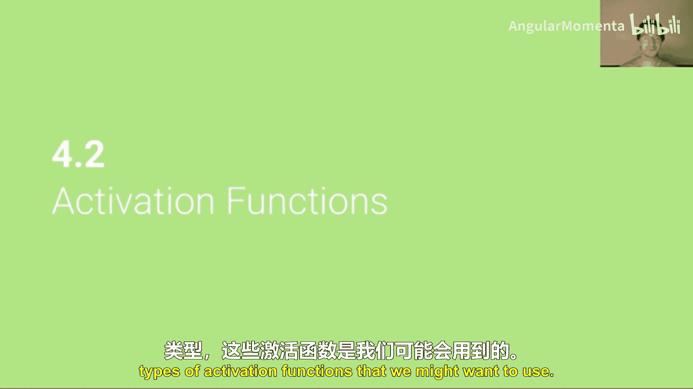
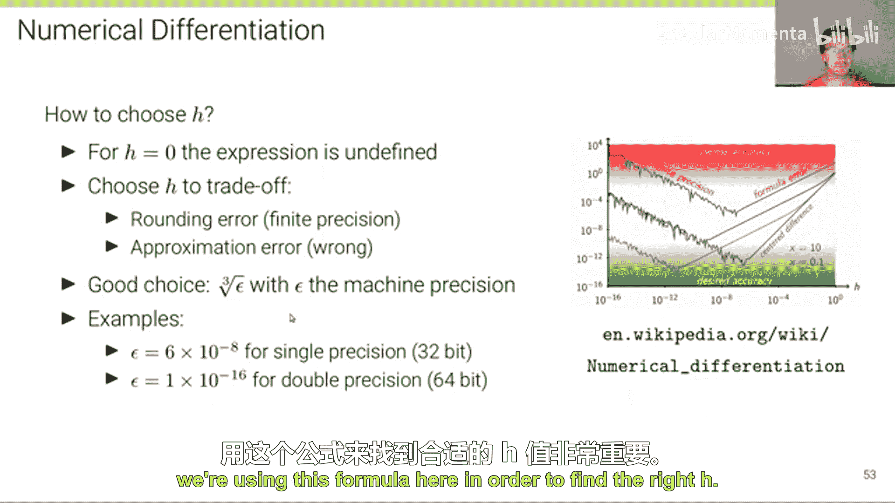

# 【精译】蒂宾根大学《深度学习》-p23-23--4.2-（深度神经网络-II：激活函数）--BV1eDbrzhENK_p23-

。In the second unit of this lecture， we're going to move on to the form and different types of activation functions that we might want to use。

So so far we have focused on the output and the loss function。

 now we're going to focus on the hidden layers。And。

The hypopermeters of the hidden layers are the number of nodes in each hidden layer and the number of hidden layers。

 but also the type of activation function that we are using in the hidden layer。

So remember back how MLP are defined。You can define a hidden layer as a transformation of the output of the previous hidden layer。

That's。Pass to a linear function represented by this A and B matrix and vector。

And then followed by a non linearity G， or often called activation function G， like a sigmoid。

The activation function is frequently applied element wise to the input。

 but not always we're going to see。One case to day where this is not happening。

But the activation function must be nonlinear， we have seen that alreadyium in order to learn nonlinear mappings in order to learn some useful representations。

Some of the activation functions are actually not differentiable everywhere。

 we're also going to see some of those activation functions today。

But this is still okay for training， if there are。Not differentiable only at very few locations。Okay。

So the first activation function we're going to look at is the sigmoid activation function that we've already seen in the context of logistic regression。

Yeah。Sigmma is defiant。With this equation here is1 over 1 plus x of minus x。

And it's illustrated here on the right。In this unit， we're gonna or in this lecture。

 we're gonna try to stick to the。Function name G for activation function。

 so we're plotting G of x over the input x。嗯。What is specialspec about the sigmoid is that it maps the input。

Which is on the real axis to the range 0 and 1。 So it's quaashes the input to the range0 and 1。

 and this can be interpreted as a probability， or it has this neuroscience interpretation as the saturating fire rate of neurons。

 So we have a。Low firing here， and then at some point we have to transition into high firing rates of neurons。

However， there are some problems with this activation function。

The first problem is that the federation here。Actually kills the gradients。

Because we have very small gradients here， this leads to problems in back propagation because we're back propagating this very small gradients and we'll see that on the next slide。

And the second problem is that the outputs are not0 centered。

 so the output is always between 0 and 1。 it's not between say minus1 and 1。 it's always positive。

And this introduces a bias。From the first layer on。

With every layer that we're introducing sigmoid non linearities we introducing this positivity bias。

And this is also harmful to training， as well see。So let's first look at the first problemm。

The first problem is that the sateration kills the gradients。

So let's consider the activation function in the context of its computation graph。

 it's a very simple computation graph where we have an activation function G that operates on an input X。

 and this is a sigmoid in this case。So we have the sigmoid of x。

And the output is then passed on to another compute node。Does some computation produces a Y。

This doesn't matter here what this exactly is。Now if we want to back propagate。嗯。Now what we do。

 of course we want to calculate the gradients of the lost function with respect to all nodes。

 let's assume there will be some parameters here so we need to compute the gradient of the loss function of respect to x and in order to do so we're back propagating gradients through this graph here along these blue arrows。

So we're going to use the chain rule for this。Back propagating the gradient to get the gradient of L with respect to G。

And then we are back propagating this gradient of L with respect to G by using the chain rule again and chaining it with the local gradient in blue here。

 G the of this activation function， the sigmoid function with respect to its inputs x。

And this is then the gradient of L with respect to x。Now， if。第一。If the input to G。

 if this x here is able very small or very large， so if we are in this area or in this regime here。

Then。We talk about the activation function being saturated。

 this means that the gradients is actually very small。

 so the gradient in this region and the gradient in this region is almost zero。And if this happens。

Then what happens to the back propagated gradient is that this back propagated gradient will simply stop at this point。

 so we have this gradient of G with respect to x being close to 0。

 which of course means that the product of this with respect to with the back propagated gradient。

 the upstream gradient L with respect to G coming from here。Is also。Very very small， close to 0。

So it kills the gradient flow we're having some nice gradients flowing backwards here and we need this gradients because otherwise we can' learn right we need to update the parameters of our model。

 but whenever we enter such a sigmoid，At is satated。

 the gradients will just stop flowing back and all the node that come before will not receive an update because the gradients will be0。

So that's the first problem。The second problem is。嗯。That's。The sigmoid is not zero centered。

And why is that a problem。So let's consider the sigmoid function here。

Which is operating on a linear layer。 or in other words。

 we have this representation here where we have G that operates on the input X and the parameters A and B。

 and we want to compute the loss function with respect to。Let's say a。

 the parameters a of this linear mapping here。Now if we have multiple of these。

Hidden layers as in an MLP stacked on top of each other where each of these layers has a sigmoid as an activation function。

 we know for sure that the output of each hidden layer is positive。

 is always positive because this is how the syigmoid is defined。

 it always output outputs a positive value。That means that the input to the next layer。

 this Xi that is input to the next layer is also positive。All of the inputs， in fact， are positive。嗯。

Furthermore， the gradient of the sigmoid function is also positive everywhere， as you can see here。

So this is always， the slope is always positive。 So this。It's always a positive gradient。嗯。

This means。That the gradient。what does that mean the gradient with respect to the for the gradient with respect to the parameters AI。

 let's consider one particular element of this。Permmeterum vector A。Ofice Fine transformation。

If you want to compute the gradient of L with respect to AI。

 this is the gradient of the upstream gradient L with respect to G， this is what's coming in here。

 which we have stored already here， times the local gradient that's sent from G to A。

 which is G with respect to AI。Now G with respect to AI。

So we can see from here is G with respect to x。Graient of dear。

Sigmoid times x with respect to AI times。This one here， which is。

If we compute the gradient of this with respect to AI， we obtain Xi， right all the other terms。

Vanish just X I is left。So the gradient of the derivative of a partial derivative of x with respect to AI is Xi。

Now， because both X I， all of the X's are positive， and because the gradient of the sigmoid。

 G with respect to x is also always positive， we know that these blue terms here are all positive。

However， the。An upstream gradient。 the gradient coming comes from the upstream node。

 the notes that come in in the computation graph after。The sigmoid G， this activation function。

Our scalar because we're back propagating to this activation function here。

And so that means that this sign here， the sign of this grade in determines。The sign of。

All the gradients。With respect to AI。So the sign of the gradient with of L with respect to。

AI is equal to the sine of the gradient of L with respect to G。That means that all gradients。

L with respect to AI have the same sign。 they are ever positive or negative。Okay。

So we have the same sign。What's the problem of that。Well， the problem。

 if all gradients have the same sign。Is that this restricts。

The space in which gradient updates can happen。And leads effectively to very inefficient optimization because we're removing a lot of the space where we could effect efficiently optimize and we have to optimize of very inefficient direction。

 So here's an example。This is a two dimensional example。

Well have A1 and A2 two of these dimensions of the peri vector a。Now。

 because the gradients can ever be all positive or all negative。

 we can only move in this direction or in this quadrant。

So we can own despite we want to go to this place here， right。

 this would be optimal update in blue here。 we have to first， we have to six sackack。

 we have to first go into this direction。 Then we have to go back into this direction。

 We have to go into this direction and then this direction。 It's a little bit like sailing， right？

 So it can't go straight。 You have to can't go straight again the wind。

 You have to sail in a six sack direction。 and this is very inefficient。Now this is a 2D example。

 but if we go to higher dimension， this problem becomes much more severe。So if we consider。

 for instance， three dimensions already， then we have only this red quadrant and this gray quadrant where we can actually move along and all the other regions。

 we can't move into these directions。And of course。

 the pro becomes more and more severe the larger A gets。

Now the problem is alleviate a little bit because we have mini batches。

 so we do this gradient updates over。Multiple data samples at the same time。

 but still the problem is there and it leads to inefficiency。In order to tackle this。

 the1 H function has been proposed， which is very similar to the sigmoid function you can see like this first expression you might recognize from the sigmoid。

 we just have a two here and here instead of a one， and then we have a minus one here。

But the output range is fundamentally different because of this2 n is -1。

 We have a mapping not to 0 and 1， but to -1 and 1。

This is an anti symmetric mapping from the input domain to the output。

And the advantage of this function is that this function now zero centered， right。

 so we have were passing through0 at0。And we have negative and positive output values of this tonage function。

So this alleviates this problem of non zero centeredness。

 but it's also a activation function that is satating and it also is killing the gradients therefore。

 right so this this gradient killing problem persists。

Another activation function thats that has been proposed is the rectified linear unit。

 And this is actually the most commonly used activation functions to date。

 is less inspired maybe by neuroscience， but it just works very well in practice， and it's simply。

The max of 0 and x。And it's illustrated here on the right。

 so it's a rectified linear unit because we have a linear component。

 but then we are capping all the values that are smaller than0， we're capping to0。

 we're setting them to0。So we see it's a non nonlinear function， it's not even differentiable at0。

But that doesn't matter for training because we are almost never， like with zero probability。

 we're going to query that function exactly at zero。Okay。

So this function does not separate saturate for all values that are larger than0 unlike the tonnage。

 for instance， which saturates， here we don't satate。

 we always increase the grade in this always one， no matter how big x is and this leads to very fast convergence so this function typically leads to much faster convergence than using a sigmoid or tonage activation function。

And it's also computational very efficient because we just have this max operator。

 so we don't need to evaluate any exponentials。A problem with thisist is also not zero centered and there is no learning for x smaller than0 so if we the input for some reason becomes smaller than0。

 then these relos are are called dead relos because they don't participate in learning and could be and often happens actually in practice that a portion of the network。

Some neurons， 10% of all the neurons in the neural network are dead。

 they don't participate in training， so it's kind of inefficient。

 but the relo itself itself leads to efficient gradienting updates because it doesn't saturate。

Yeah so here is an illustration of this real problem。

 whenever we have an input value that's smaller than 0， an x that's smaller than 0。

 then the gradient of this activation function of course。

 is exactly equal to 0 and so the loss of the gradients that are flowing downstream。

Flowing into this， into the left direction here and to all the。

Ancestral nodes are going to be also zero， so there is no learning happening。This is called dead Ras。

They neverever participate in learning， oh they might never participate in learning again。

And that's also the reason why often we initialize these res with some positive bias。 So in the aine。

Lairered it。That is in this eine layer that is coming in from just right before the raillu。

 we're using a slightly positive bias to make sure that。

The x are more likely to be positive than negative。

One way to prevent this dead rays is to use leaky railors。This is very similar to Relu。

 except that we have now also a slope for all the values that are smaller than0。

 except that this slope is much， much smaller than the slope on the right hand side。

So the advantage of the liy re is that it doesn't saturate。It will not die。

And it's closer to zero standard outputs because we have also a negative aspect here。

And it leads to fast convergence， and is also computationally efficient。

 So's a very popular function， as well。There's alternatives to this。 So， for instance。

 the parametric re has been introduced as a generalization of the leaky re where now this。

This factor here is itself a learnnable parameter， so we are also back propagating gradients with respect to the alpha and update the alpha itself。

The parameters can change。Again， this doesn't saturate leads to fast conversiongence insufficient。

 and the parameter now is learned from data。Yeah。Another unit that has been proposed is the exponential Line unit。

Which is defined with this's expression here and illustrated here on the right。

It's very similar to the leaky relo， except that it doesn't have this non differentfferiability here。

 and it has a saturation as we go towards larger negative values。

 which is claimed to add some robustness to noise for some problems。And otherwise。

 inherits the benefits of the leaky re。A generalization of the Relu activation function is the max out function that has been proposed by by Good F at all。

The max art function is is this example that I mentioned before， which is not。

Eleement wise application。But it's basically using。Well， if you will， it' also element bias。

 but it's using multiple aine predictions as an input so for instance we can use two aine predictions as an input so we have a1 x plus B and a2 x plus B2。

And we're now taking simply the max over these two， and we're back propagating gradients to A and B。

Right so there。Function itself doesn't have parameters。

 but we have now increased the number of parameters by a factor of two already。

 which just using the max out over two of these AN transformations。

So it's a generalization of the relo and the leaky relo because we can represent the relo and the leaky relo with this representation。

 as you can see here so we can， this is the case where we have these two aine transformations and the maximum。

 this is a relo can also represent the absolute。Acivation function。

 and we can even add more of these linear layers here and approximate something like a quadratic if we like to。

But this is also the disadvantage of this function。

 it increases the number of parameters per neuroum。So in summary。

 there is unfortunately no size fits all， the choice of activation function highly depends on the problem。

And in this unit， we've only looked at the most common ones。There exists many， many more。

And the best activation function model is often found using trial and error in practice。

In general it's good to think about gradient flow， it's important to ensure a good gradient flow during optimization。

 we must ensure that gradient flows backwards to all the parameters where we want to have updates。

And as a rule of thumb， we should use relo by default， it's the most common one。

 it's the most generic one， it's efficient and fast。But we can try liyum。

 max out or Ium for some small additional gains， potentially depending on the problem。In general。

 we should prefer tenage over sigoid and tennnage is often used in recurrent models。

But the relo is a good and default choice in deep neural networks today。

One last comment I have here in this unit is on implementation if you're implementing。

Any compute node actually in a computation graph such as an activation function。

Murphy's rule tells you that anything that can go wrong will actually go wrong。

So when implementing the backward path of an activation function or an output or loss function。

 it's really important to ensure that all the gradients are implemented correctly if you implement the gradients by yourself and you're not using the auto differentiation。

 utilities that are also available these days， sometimes it makes sense to still implement gradients yourself。

 even in modern frameworks to achieve more efficient efficient optimization。

And one way or the standard way of making sure the gradients are correct is to plot them and to verify them via computing numerical differences using Newton's difference quotient or even better the symmetric difference quotient so you know this from school that the gradient can be computed as the limit of this。

Difference quotient where H goes to 0。 So for a particular H。

 we can now evaluate this expression and compare it to the analytic gradient that we have implement and see if they are the same。

And that's what we should always do。 but the question is， of course， how should we choose the H？Well。

For H equals0， this expression is obviously undefined， so we need to choose H。Bigger than zero。

 but small enough。 And there's really this trade off。If we are choosing H2 small。

 we get rounding errors due to the finite precision of the data types。

 and if we're choosing it too large， then we get approximation errors because this approximation of the second here is wrong。

it's a wrong approximation to the true gradient。It's getting too wrong。

A good choice is to use the cube root of Epsilon where epsilon is meshing precision and for example。

 for single precision 32 bit data types。Epsilon is roughly 6 times 10 to the power of -8。

 So if we take the cube root of this。Then you're in a regime where。You can estimate。

The numerical gradients。Pretty well。So here's an example。

I've plotted the sigmoid and I've calculated with pen and paper。Derivative of the sigmoid。

 which is shown here on the right。Can be expressed as。A combination of the sigmite itself。

And then I've plotted this here in blue and I want to know if this is correct or not。

And what happens if I'm using a H equals1 that an H that's too large。

 I get this numeric gradient that you can see here on the bottom。In orange。

Which is has this approximation error。If I'm choosing h as 10 to the power of minus4。

 I'm getting a very very good approximation to the true gradient and you can see that from this you can see that the analytic gradient that I have implemented is actually correct。

Now， if we choose H2 small， we see that we get these rounding  errorss due to the finite precision of our data type。

So it's really important that when we do numerical differences。

 we're using this formula here in order to find the right H。

。