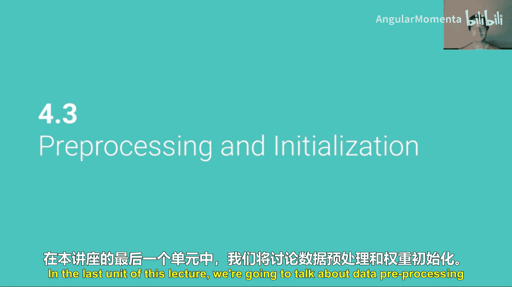
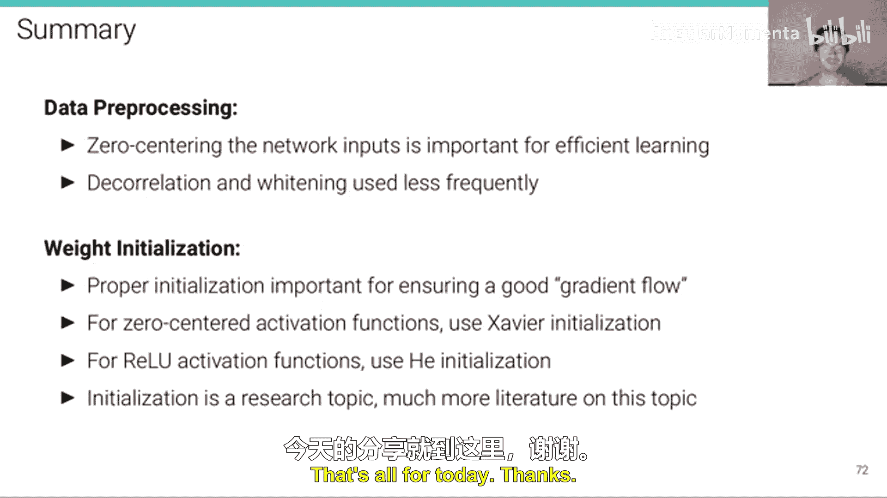

# 【精译】蒂宾根大学《深度学习》-p24-24--4.3-（深度神经网络-II：预处理与初始化）--BV1eDbrzhENK_p24-

In the last unit of this lecture， we're going to talk about data preproces and weight initialization。

Let's start with data preprocessing。Remember again， what happens for positive inputs X。系。

So here we have an activation function G of a linear layer。And if。You know。

 the activation function is the gradient of the activation function。Is positive。

 which it is for most activation functions。And all the x are positive。

 This means that these blue terms here are positive， and that means that all gradients。

Here have the same sign， which is the sign of the upstream gradient L with respect to G。Right。

We've seen that this leads to the requirement for the activation function for being zero centered。

 but it at the same time leads to requirement for the input to be also zero centered。

 right same should hold not only within each individual layer but also for the input itself。

And that's why the data set is typically preprocessed before being fed into a neural network。

 and the most common preprocessing is the zero centering。

 where we just take each element and subtract the mean。So we compute the mean。嗯。

For each data element along each dimension， in this case it's a two dimensional data set so we compute the mean over x1 and over x2。

It might be here， and then we are subtracting the mean to0 center the data set now this。

Data set has the mean at 0，0。We can further normalize the datum。

Which is also also sometimes done if the input is in a very。Exotic range。

 and we can normalize the data such that the standard deviation is one by dividing by the standard deviation。

YeahSo you do this after you have zero centered， the data that you apply is normalization。

You can also derelate the data by multiplying with the eigenvectors of the empirical covariance matrix。

Or you can whiten the data by。usingsing the square root of the eigenvalues of the covariance matrix for dividing the elements of the data set。

You can see this is kind of applying PCI to the data。

 You can see that in this case the data is very well distributed， it's zero centered。

There is no correlation visible anymore because the correlations have been like has the data set has been de correlatedrelated。

And。It has the same variance or standard deviation in each dimension。Okay。

So here's another intuitive explanation of why serial centering or preprocessing of the data is actually a good idea。

In this case， we want to distinguish the red from the green class here in this two dimensional domain。

And as you can see， if the data set is not zero centered。

 and I do a little change to the decision boundary， let's say I rotated by five degrees。

I suddenly make a very strong mistake。A large mistake on the classification。

 but if the data is zero centered and I change the decision boundary slightly。

 then this does not happen as much right and this is how you I it's just an illustration。

 but it' is how you can think about it。Okay。So。While whitening can be used is actually quite uncommon to use。

 people found its not really necessary， what's really necessary is to use zero centering。

And that's why， for instance， Alexnett， which is one of the networks that we're going to see in later lectures。

 is subtracting the mean image， computing the mean image over all the input images in subtracting the mean image。

VGGnet subtracts only the per channel means is only three numbers that are calculated the three mean values and subtracting those Resnet subtracts the per channel mean and divides by the per channel standard deviation。

 so there is some differences amongst different deep learning architectures。

 but in general they are doing some form of zero centering。嗯。Okay。

The second important thing that we need to take into account is how we should actually initialize the weights for training。

Let's recap quickly how we do the training， so we have learned this stochastic grade and decentcent algorithm。

 which is the standard algorithm for training neural networks。S， for instance， an MOP。

While we initialize the weights W， we pick a learning rate on the mini batchsh size。

And then we draw random mini batches and then for all elements of the mini batch。We do forward。

 propagate。the inputs to calculate all the activations and the output。

 and then we back propagate the gradients from the loss function again to obtain the gradient of the loss functions with respect to the permids W。

And we update the gradients。Based on the average of the mini batch gradients。

And then we iterate until the validation error。嗯。Increases again。Now the question of course is well。

 this algorithm is simple and easy， but how do we initialalize the weights and there is really many of them so in an MLP。

 depending on how many neurons you have， if you have 100 neurons，In each layer。

 And even if you just have two hidden layers， you have already 100 times 100。嗯。Yeah。ACons or weights。

So it can be a huge number， can be in the order of millions or hundreds of millions of weights that need you initialize。

 and it's actually quite important that you initialize and correctly otherwise training will not proceed。

Yeah。So。Let's look at this。A neuralural network again that we've seen many times throughout this lecture。

 and we are now concerned with these red boxes here。

 these are the layers of the neural network to hidden layers and the output layer and they all have parameters and we want to initialize these parameters。

The simplest solution for initializing these parameters is to set all the network parameters to a constant。

 say zero。Or some upper constant。What happens in this case？Well。

 if we set all of them to zero or to some constant。

 then learning is not possible and the reason for this is that all units of each layer are learning exactly the same so if I forward propagate information through this network。

 then all of the layers are actually doing exactly the same because we have been initialized the same and if I then backproagate the gradients they will change but they will change exactly the same way such in the next such that in the next forward pass。

 they will again do all the same each neuron in each layer。

 all of these 100 neurons here will do exactly the same。So this is not useful。

 There is not some interesting。Model appearing that is doing some interesting representation learning。

This doesn't work unfortunately， it would be convenient， it would be nice if it would work。

 but it doesn't work。Yeah so now let's consider in the following slides。

 let's always consider a multilayer perceptron where we specify a single layer as a composition of an aine transformation with parameterss A and B and an activation function G。

And as we've seen on previous slides， the gradient with respect to AI is given by the gradient of the loss with respect to AI is given by the loss with respect to G。

 this is the upstream gradient coming in。And the local gradient from G sent to AI。

 which is G with respect to x。 and then this inner term here is x X with respect to。AI。

 which is just X， so I've just directly written Xi here。

This is the same equation from the previous slide。And for G。

 we will consider only the tonage and the radiolu activation functions in the following。嗯。

So let's start with the10 H activation function。The simplest。

Nive most naive thing we could do that goes beyond setting all the weights to the same constant value is to sample them randomly。

 for instance， from a Gausian distribution with a small standard deviation， let's say sigma equals 0。

01。The problem of this is that the activations in deeper layers will tend towards 0。

 I've plotted this here on the top。You can see this is the histogram of the frequency of the activations。

 So this is just plotting all the activations。 This activation means the。嗯。The function。

 the activation function outputs of the first layer。

 plotting all of the activation function outputs I'm using。I think 100 or 200 neurons here per layer。

So I'm plotting this for a random data set with 500 samples。

 I'm plotting all these activations in a histogram， and this is what comes out can see， as expected。

 it looks like a gaustion。Now， when I， when I take this and I pass it to the next layer。

 then as you can see， the standard deviation of this。Distribution。Decreases。

And it decreases very quickly。 Al after the fourth layer， it has all collapsed to one point。

 and reason is。That are that we have drawn all of the weights with a small standard deviation。

 which means that they are going to be multiplied over and over again with small numbers。

 And so the values that were initially large are going to decrease and decrease and decrease with every layer because we are multiplying small values in the linear layers。

Okay。In other words， this is what's， what I've illustrated here。

 the loss function with respect to AI if we think now about the backward pass。Is also。

Attending towards0， because we have now。This you know， for one particular layer。

 the upstream gradient times the local gradient。But because here in the last layers， the x values。

 the inputs or the outputs of the last layer are so small that we can consider them to be equal to0。

 we are not even propagating the gradients furtherorm。

 so the gradients are stopping already at the penultimate layers here。

So we're not propagating any furthervor。So there is no learning happening。So that doesn't work。

What happens if we increase the standard deviations in this case I've plotted the same thing。

 but now I am drawing the weights from a Gaussian with a large standard deviation， sigma 0。2。

What you can see in this case is that all activation functions actually saturate。

 and the reason is that Ive I've basically。Used a linear layer that now increases the spread of the data。

And it increases in a way such that the sigmoid functions they saturate there。

 the values are so large that were ending up in this satation regime over negative or positive of the sigmoid and that's also what you can see here in the activation outputs we have most of the weight focus on minus1 and plus1。

 so most of the activations happen at -1 and plus1。Right。Now what is the problem with this， well。

 again， no learning can happen because what happens now is that the gradient of the activation function with respect to x is close to 0。

Because we are in the saturated regime where we know that the gradient of the activation function is zero or close to zero。

So if I'm now back propagating gradients backwards through these layers。In each step。

 I'm basically multiplying a very small number here for the gradient of the activation function。

 and so the gradient of the loss with respect to all of the parameters。嗯。Will not get updated。

So what should we do instead， Well， what we should do is we should draw the weights still from a Gaussian distribution with。

 but with a properly set。Standard deviation or variance。 And how should we set the variance， Well。

 Gro et al are proposed to draw these weights。From and also they draw them independently。

 so each value is drawn independently as before。But the draw such that they are anti proportional to the number of。

Input neurons。So the standard deviation or the variance is one over D in。

 where D N denotes the dimension of the input to the layer， which may vary across layers， right。

 So maybe we have。A hidden layer with 100 neurons and then one with 200 neurons。

 and so the input to the 200 neuron layer is D in equals 100。

 and then the input to the next layer is D in equals 200 and so on。But what happens now is。

 as you can see is that the activation distribution is now well scaled across all layers and it stabilizes。

 If I would plot more layers here on the layer of five layer 6， you would see that they would all。

Show a very nice bell shape curve。That stabilizes in a nice regime it' never saturated。

 is all in the non saturated region of the tonage function， nor is it collapsing to a very small。

area around 0。So why is this sigma equal 1 over square root of DN or the variance equals 1 over DN a good choice？

In order to see this， let us consider y equals G of WTx。

 so a single layer in the neural network and assume。That all。

Xi and WI are independent and identically distributed with seroine。

And that further the derivative of the activation function at 0 be equal to1。

 and this is something that's true for most activation functions。Think about the raylu， it's one。

 think about the well okay， it's one for slightly positive values。

 but think about the tenh function is also one， for instance。So the slope at。

In the central region of the tonnage， where we want to operate is one can be considered as a linear function there。

So what happens then to the variance if we consider the variance of the output。

 then the variance of y， because we have G as a roughly linear function with slope 1。

Is roughly equal to the variance of its argument， W T X。

 because we assume this linear slope 1 relationship。

Now because we have assumedood that all of the Ws and x's are independent and identically distributed。

We can rewrite this as the variance of one individual element XI WI times D IN。

 well just basically after sum over WI， but because they are the same， we can consider a single one。

Multiplied with the input dimension。Yeah， now we can rewrite this variance。As such。

And because x and W are independent， we can we can basically separate the expectation here。

 so this is just manipulation using the assumptions here and the definition of the variance。And then。

 because the。We've assumed that the X's and WIs are0 mean， these two expressions here are 0。

So we are left with this expression here。And again， because we assume a zero mean distribution。

 then the expectation of Xi squared is equal to the variance of Xi。

 and the expectation of Wi square is equal to the variance of WI。

And so what we can see here now is that in the case where the variance of W I。

It's equal to 1 over DN， so it cancels this term here。That in this case。

 the variance of y is equal to the variance of X I。 This is what we want。

 We want the variance the spread to not change across layers。

 We want it to stabilize to stay constant。 And that's the reason why we choose the variance of W I equal to1 over D I N。

Now， if we do this for the1nh， this works very well， but if you do it for the relo， it does not。

So here we have used this so called saver initialization。Also for the relu， but the raillu。

 the sr Englishization assumes zero centered activation functions， which the raillu is not。

And so for the raillu， the activations again start collapsing， as you can see here。

 so the distribution gets more and more skewed， it doesn't collapse as quickly as we've seen before。

 but it gets more and more skewed。And so what has been proposed in this paper by a He all is that instead of using this。

This expression that we've seen before， we are just doubling the expression。

 so instead of one over DIN， we use two over DIN。And the intuition behind this is very simple because the res are restricted to positive outputs。

 the variance。Must be doubled， right， because it doesn't capture the left half plane。

So all of these elements here。Our zero frequency right， there's no activation。

It's over zero or something positive。And now the activation distribution is well scaled across all layers。

 as you can see here from the illustration over histograms over different layers。So in summary。

It's important to do data preprocessing and weight initialitization。For data preprocessing。

 Ser centering the network is important for efficient learning。

And decocorlation and whitening are used less frequently。Regarding weight initialerization。

 this is really important， proper initialitization is really important for ensuring a good gradient flow。

 ensuring that the gradients are flowing back to all the parameters that we want to update。

And for zero standarded activation functions， we can use the saver initialization for re activation functions we use he initialization。

And initialitization is actually a research topic on its own with much more literature on this topic which we are not able to cover in this lecture。

That's all for today。Thanks。