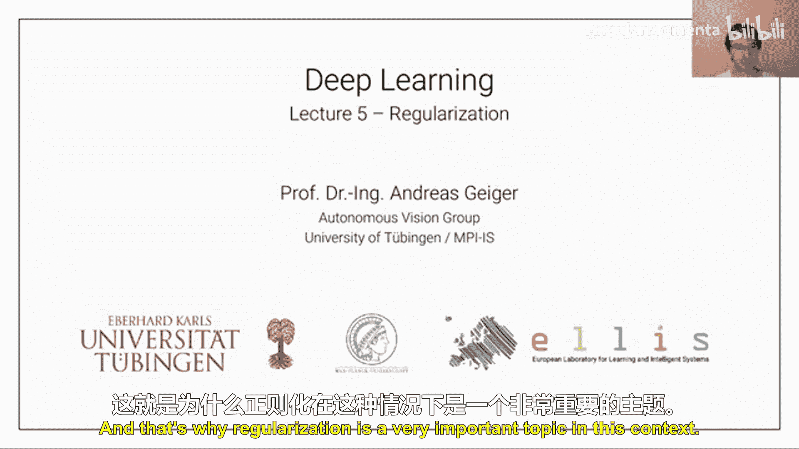
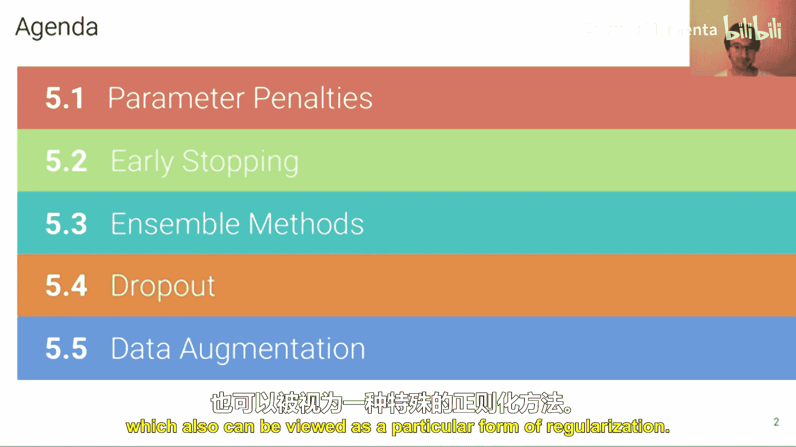
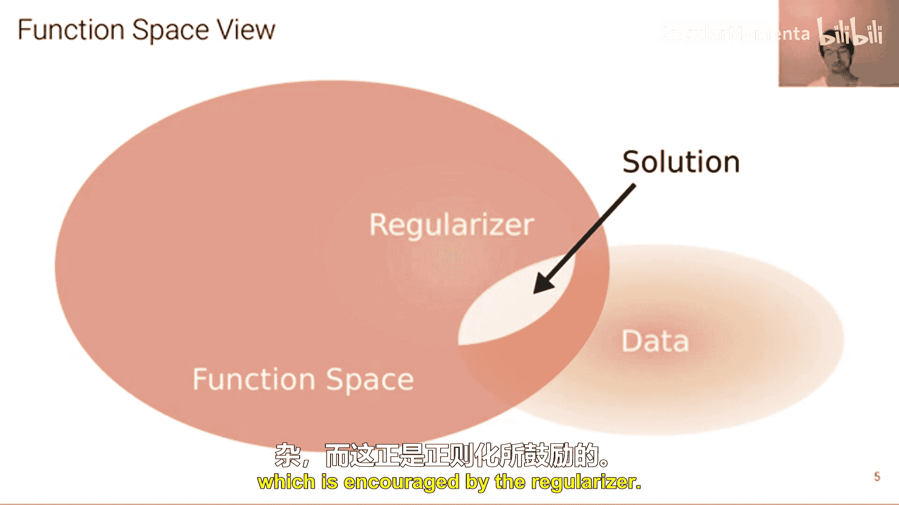
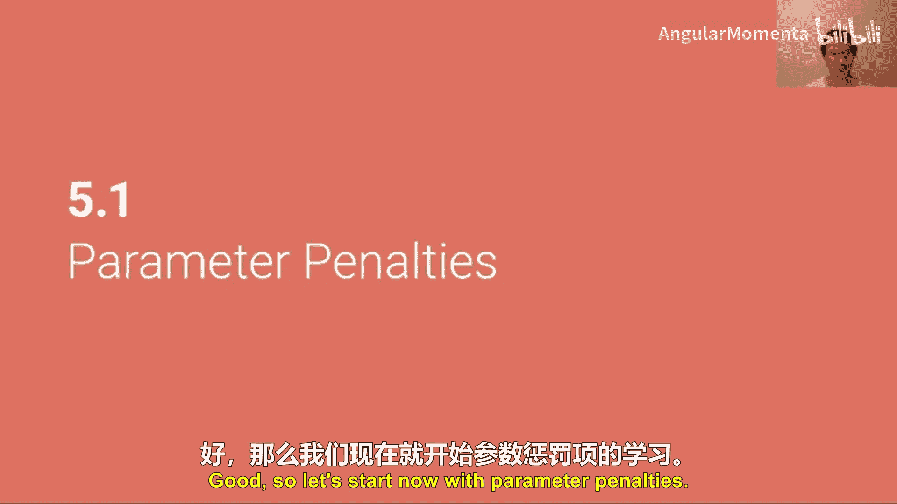
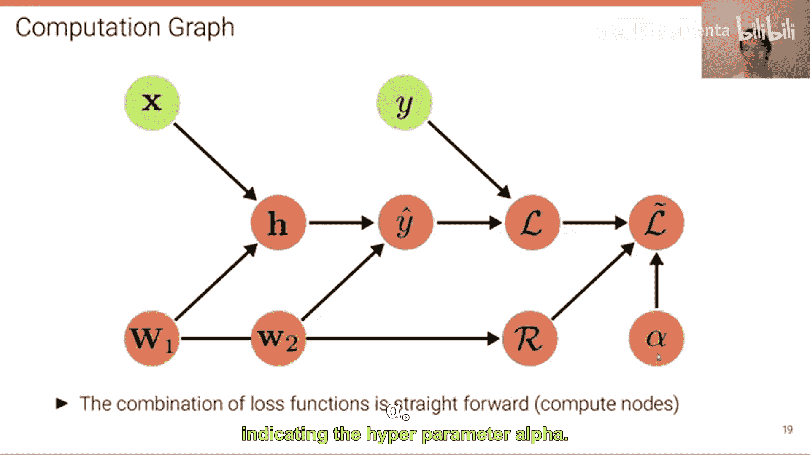

# 【精译】蒂宾根大学《深度学习》-p25-25--5.1-（正则化：参数惩罚）--BV1eDbrzhENK_p25-

Hi and welcome to the fifth lecture of this deep learning course。

Today we're going to talk about regularization。We've already briefly touched upon this topic in the first lecture。

 but only in the context of very simple linear regression problems。Today。

 we're going to cover the topic of regularization。More broadly and with a specific focus on deep neural networks。

Why is regularization important for deep neural networks？Well。

 it's particularly important for deep neural networks， actually because。Typically。

 deep neural networks。Have a large number of peri， sometimes。

And the number of parameters is even larger than the number of training samples。

And that's why regularization is a very important topic in this context。

This lecture is structured into five units。In the first unit。

 we're going to talk about permit penalties。In the second unit we're going to cover early stopping and then we're going to talk about ensemble methods and one particular ensemble method that's popular in the context of deep learning。

 which is called dropout。AndFinally， we're going to talk about data augmentation。

 which also can be viewed as a。Particular form of regularization。

But before we start， let's briefly recap。From the first lecture where we talked about model capacity。

 model overfitting and underfitting。These are three plots from the first lecture where we have fitted a polynomial of various degrees to a data set here in green。

Green dots are the training points。On the left， we see a polynomial of degree1。

On the middle we see the fit of the polynomial of degree3 and on the right。

 a polynomial fit with degree 9。And we can see that if the。Model capac is too low。 In other words。

 if the model is not flexible enough。It has too few parameters。

Both the training error and the test error are high。We never we never fit the test status us。

 nor the。Training points well in this case， and this is called underfitting。On the other side。

 if the model capacity is too high， if we have too many parameters。In this case， we have。

10 parameters for a polynomial of degree 9。Then we can fit the training set very well in this case we minimize the training error to0 even like this red curve goes precisely through all the green training points。

However， the test arrow or generalization arrow is very large， the model doesn't generalize well。

 for instance this point here is very badly， very poorly approximated through this red curve。

And this is called overfitting。Now when we talk about regularization in the context of deep neural networks。

What we want to do is we want to take a model from the third regime。A model that's too flexible。

And bring it to this second regime where the capacity is about right。

And why do we want to go from the third to the second regime， Well。

 the reason is that for any real world problems it's very hard to specify。By hand。

 the right representation， the right number of。Permeterters in the right representation that has a few。

 only few， a small number of parameters。That it's much easier to specify a larger model class。

 larger。A class or a model that is able to represent the larger class of functions。Such as a。

M neuralural network of many layers。And then to restrict this class of functions again。

 using soft constraints such that。Journalization is obtained。

That's why we're going from the third to the second regime because it's easier to specify a more generic model and then apply these regularizers as a soft constraint。

 as we'll see today。Yeah so here's two more plots from the first lecture on the left we see the training and generalization errors for and this polynomial fit of various degrees。

 we see that the minimum terms of generalization error is attained here in the middle。

So what we effectively do if we go from this over permeized from this overfitting regime here on the right。

To the point where we achieve good generalization is that we are effectively reducing we are effectively paying a price。

 we're increasing the bias。For reducing the variance。Remember again that。In this overfitting regime。

 the estimator， parametermeter estimator has a large。Varance， but a low bias。In practice， we want。

 of course， both to be small。Or have small variances and small bias。

But our hope is that if we are willing to pay slightly higher。Price is slightly higher bias us。

And we can significantly reduce the variance， and this leads to better generalization。

 So the goal is always to minimize the generalization error。Despite using this large model family。

 neural deep neural networks that specify very flexibly a large function class。嗯。

I think this is another diagram that illustrates this at a very high level and a very intuitive level quite well。

So what this should illustrate here is that both the data。

 as well as the regularizer are constraints。On the space of functions。

And so they both constrain the possible outcome of our estimator， the possible solution space。

So in right here we have the function space let's say we are considering a feet forward neural network of three layers。

 certain number of hidden units per layer， and in this red area these are all the mappings that this neural network can represent all the functions for any possible combination of perimeter W this of course an infinitely large set it's just a 2D illustration here。

Now， the regularizer constrains the space by putting a soft constraint on on this function space。

 such that functions that are close to some particular。

Location in that function space are more likely。Similarly， the data。

 the training data is also constrained because we are minimizing some。Negative lock likelihood error。

Maximizing the likelihood of the data。And so this can also be viewed as a constraint on the function space。

And the solution that we're seeking really lies here somewhere at the intersection of the function space and the regular ra and the data。

嗯。The data is not necessarily or the training or the data distribution is not necessarily overlapping with the function space。

 because even for we're using。Very large， deep networks。

 Nature is still complex enough to be more complicated than all the functions that we can represent。

 So we're always making an approximation， but we're trying to make an approximation that is。

That is good in terms of fits the data well， but at the same time is not too complicated。

 which is encouraged by the regularizer。

嗯。Good， so let's start now with periramal penalties。

Let's use the common notation that we've used before， calligraphic x for denoting a data set X Y。

 so this is again in all the rows of x are the inputs and all the rows of y are the outputs here we have one dimensional outputs in this example that could be more。

And let W denote the model parameters。 So this is a generic notion of model parameters in a。

Multi layerer perceptron， This would be a big vector that concatednateates all the flattened。

Wight matrices， a。We called them before。 And so we take all the mat。

 the weight matrices A of all these layers。 We flatten each of them。

 and we stack them together into a big vector。 This is what we generically call W here。

We can then limit the effective model capacity by adding a parameter norm penalty R to the loss。hel。

So the total loss on。Of the dataset set x and the parameters W equals the original unregularized loss。

On the dataset set X parameters W plus a regularizer on the Per W。

Where Al is a hyperparameter that controls the strength of this regularizer and can be chosen in using cross validation。

 for instance。🎼NowYou can already see from this equation why this is called a perimeter non penaltyal。

 It's because we're penalizing here， not like this， this term does not depend on the data set。

 It just depends on the peri。 and it's effectively implemented it。

 You can't see it from this slide here yet。 but you will see on the next slide that it's。

Effectively implement as a simple norm on the peri W。

So our dis regulargizer should quantify the size of the parameters or the model capacity。

 we want to have few parameters。That are active。 We have a small model capacity that still fits the data well。

And minimizing L Tilda， this total loss will decrease both L and R。

 So we have this competition between L and R here。 We want to have。A model that fits the data well。

 but at the same time is not too complex。And this is encouraged by。

Optimizing both of these terms simultaneously by having them both as a single objective。

 combined with。Addition here。Typically r is only applied to the weights and not to the bias of the affine layers。

 remember again， the only parameters of a simple multilayer perceptron are in the affine layers and they are the weights called it the matrix A and the bias vector B。

And the reason why we typically only apply R to the weights is that we want the bias to be flexible applying a regular riser that。

Encourage the bias to be close to0 is typically not a good idea because the bias wants to be not close to0。

 and the second argument is that there's much more weights than there is biases right we have much fewer biases。

 so we it's not so important to constrain the bias and we don't know as much about the bias as about the weights but。

What we want to do is we want to drive the weights closer to the origin。

 We want to make the weight vector w closer to 0， and why do we want to make it closer to 0 Well。

 in the absence of any prior knowledge about the problem。

This is the best we can do if we have prior knowledge， we can of course。

 incorporate this into our regularizerizer。But if we don't have prior knowledge。

 then this is the best we can do because if we have small weights。

 we have seen this already in the first lecture。For the case of linear regression。

 if you have small weights， this leads to less complicated solutions。

 also for deeper neural networks。TheOkay。So it's a very simple regularizer to encourage simplicity of the model。

Here's a small。Intuition about this， it's a very hand wy and high level example。

 but maybe can help a little bit with this intuition。 So suppose there's。

Two very simple networks that make predictions on。Inputs x and y。So it's two dimensional input。

And let's suppose these two networks are fed with nearly identical x1 and x2。

That are identical nearly identical and close to。And one， for instance。Then。Here on the left。

 we're going to predict two and on right we're also going to predict two。

 so the output is roughly the same。However， the second networkhead has much higher weights。

So it is much more。Brittle， in a sense， if the test distribution is slightly different from the train distribution。

 this means that the prediction will be worse。So it's。It's representing the same thing。

 but of a more complex function。And here's another illustration。

 and we're going to look at some of these plots in the following slides as well。

This is a geometric view on the problem where we're looking at the peri space now here we have a two dimensional parameter space。

 of course， we have much more parameters typically in practice， but。For the sake of simplicity。

 we draw two parameters W1 and W2。And we have the cont plots of the objective functioning green and the regularizer in red。

Now what is a contour plot， a contour plot is a plot of curves。

Where every point on the same curve corresponds to。

A location where the function takes the same value and so for instance。Here on this ellipsoid here。

 we have the same functions of the objective。And then the value increases with increasing ellipsoids here。

So you can think of this a little bit as a。As the heightline。On a hiking map。So in this case here。

 for instance， you can think about this as。诶。Qudratic in two dimensions where or parabola in two dimensions where we have a minimum here。

 and then the slope is upwards， it's increasing more in this direction because the height liness are closer together。

It's increasing less slowly。In this direction here。So this is the objective function。

This is the minimum here and because in this simple case it's convex。

 if we would apply gradient based optimization to it， we would end up at this point at the minimum。

Now， what we do when we。嗯。Apply permit penalties。 we add a regularizer in this case here in the simple illustration。

 we have an L2 regular riseizer where this counter plot looks like this we have。Concentric circles。

As this control lines。Where we pay an increasingly high price。

 if we go further and further away from00， which is where this regularizer is zero。

And now because we have these two competing objectives， if we optimize。The joint objective。

 the summation of the objective function with the regularizer。So this。This expression here。

Then the optimum is no longer here， but it's somewhere here because these two objectives are competing with each other。

 You can see that。Now， in this case， the value of W2 has been significantly reduced by this regularizer。

While the value of W1 has increased a little bit， but overall。

 this regularizer ensures that the loss function added that the norm。

 the L2 norm of this perimeter vector is small。So we have these two competing objectives here where the optimum is then somewhere in the middle。

Okay， so now let's look at L2 regularization， which I already mentioned in a little bit more detail。

 more formally。L2 regularization is one of the most common forms of regularization in deep learning and also in machine learning in general。

In deep learning it's often also called weight decay， if you hear out the term weight decay。

 and it typically refers to L2 penalties， L2 perimeter penalties。

And we have also used the term rich regression for L2 regularization in the context of linear regression。

So this weight decay K or L2 regularization is simply a L2 panel team。 So R of w is a。I'm squared。

Expression of the L2 is a squared L2 loss here on the Permids W。So H。Element of the vector here。嗯。

Squared and added up。So we can then write this total objective。

 which comprises the unregularized loss and the regularizer as such， yeah。

 this is just a different form of writing the squared L2 norm inner product of w of itself。Now。

Let's try to get some intuition about this。 What does this do to our gradient descent optimization。

 The perimeter updates during a gradient descent algorithms such as stochastic gradient descent are given by this equation here。

 So the。Permeterters at the next iteration are the parametersmeter at the current iteration minus some step size eta。

 we've called it。Times the gradient of the objective function with respect to the peri W。

We use the combined objective function， L tiller。Now we can plug in this expression here and the gradient of this is the gradient of the original objective function here。

 which we haven't ever specified at this point。Plus。

 the gradient of the regularizer which is simply alpha w。At the previous iteration。Okay。

 now we can slightly rewrite this by。嗯。Pulling this alpha Eta out， so we get one minus Eta alpha。

 this is this Eta alpha here。W。T。Minus Eta and the gradient of the unregorized objective。

And what we can see now is that this is very intuitive。

The weight decays doing is very intuitive because what we're effectively doing here is we are decaying the weights of the previous iteration before。

The gradient update， and we're doing this at every iteration of the optimization algorithm。

We're taking the previous weights。Eta and alpha are small， so this is a this expression here。

 they are small and positive。 So this expression here is a well is a number that's slightly below1。

 So we're taking this。Permeterters at previous time or iteration。And we're making that。These permits。

Slightly smaller， slightly closer to the origin。It's closer to0。

And then we're doing our grading update， so we are effectively decaying decaying making these weights smaller。

Duringring every iteration of the gradient update tab。Now this was for a single gradient update step。

 but what happens over the entire course of training？Can we also make。A statement about。

The overall training。嗯。In order to do this， let's。Make a simplification。

 Let's consider W star as the。Optimal value， the optimum of the unregularized objective or loss function。

So W star is the solution to the unregized objective。f。S this split again， this will be here。Okay。

And let's consider a quadratic approximation。E hat。

Don't be confused with L tildes and now we're having L hat。

 this is just indicating the head is indicating that this is an approximation。

Of the unregized loss around。W star。Around the optimum。So what does this look like， well。

 if we have a quadratic approximation， this is basically just a multivariate Taylor series expansion。

Which I have written down here。So， here's the。Quretic approximation is equal to the。Loss function。

At W star， the optimum。嗯。Plus。A linear component， the gradient vector。Times W minus W start。Plus。

 the quadratic contribution here in this Taylor seriesius expansion， which is。

W minus W star transpose H， which is the Hasian matrix matrix with the entries being the second order derivative of the objective with the gradient in vector here and the hassian matrix here。

So this is a second。Contributions are the second order derivative。

And so we have a quadratic term here， so it's w minus W star H W minus W star。

So I have a linear and a quadratic。Term with respect to W。Now。

 because we have assumed that W star is the solution to the unregularized objective。

We know that the gradient of the unregularized objective。Is 0。Because it's the optimum。

 it's at the minimum。So this term here vanishes。So we're left with this term and this term。

 this is this expression here。So when now adding the this is the quadratic approximation to the unregularized laws。

 when adding to this expression here， the regularization term， this approximation becomes。

This term here So in this case here I've highlighted the new term here， this is the recognizing term。

 which we don't need to approximate， it's already quatic， it's already simple。

 we don't need to do anything about it。So we have now this quadratic approximation on the left of the unregularized loss。

Plus， the regularism。And we just also call this L hat。Okay。

So this is just copied from the previous slide。Okay。

 this is the same equation as the equation on the previous slide。

Now what we know is that the minimum， let's call this minimum of the regularized objective。

 not W star to not confuse ourselves， but let's call it W tilda。

Let the minimum w tilde of the regularized objective。Of the regularized。Apprimated objective， L hat。

嗯。This is attained， this minimum is attained where the grade in is0 and because it's a quadratic objective now we can find that location。

Okay， so what is the gradient of this expression with respect to W？Well。

The first expression here does not depend on W， just depends on W star， which is constant。

So this goes away。This expression here。The right with respect to W is H。W。

Now we have using W tilde as the solution already， so this is replaced by W tilda。

 so it's Hw tilda minus w star because it's just linear algebra。

 it's the gradient of this expression。And plus alpha w tilda now here we have also again。

 like the quadratic， the derivative of the quadratic term here is a linear term， a alpha w tilda。

This is the second expression here。So we got this。Now， we can。

Take this HW star and put it on the other side。And then we are left with H。Plus alpha I。

 so we've put this alpha into this brackets here， H plus alpha I。I here is the identity matrix。

 nothing has changed its just like。Writing it took ever into one bracket。

Times w tilde because both H and alpha are multiplied with W tilde。

And now we can take this matrix here。On the other side by inverting it。So W tilda， the solution is。

H plus alpha identity matrix。Inverted times H。Times W star。

And therefore we see that as alpha approaches0。Ass this term here， the regularization here。

Approach is zero， which means effectively we are not regularizing anymore， we're removing this term。

The solution W Tilda approaches W star because we have H。Inverse times H， which is the identity。

So we have W tilda。Approach is W star and this is intuitive right if we remove the regularizer successively for making this alpha smaller and smaller。

Then， of course， the regular solution comes closer to the。

A solutionution of the unregorized objective。 So this point doesn't lie here anymore， but it is。

It's closerlo to the solution of the unregularized objective function。

 If we make this regular riseizer smaller。And the influence of this regular's model。Okay。

So this is what happens if alpha approaches zero now what happens if alpha grows instead grows to large values。

In order to get a better understanding of this， we're gonna。

Apply the eigenvalue decomposition on the Hesian matrix H。The Hessian matrix。

Is a symmetric matrix of real values， because due to Schchwartz theem， we can swap the。

Partial derivatives of each element that matrix， which means that the matrix becomes symmetric。

 and it's a matrix of real values， which means that the eig and decomposition has a particularly simple form。

 it just。A product of the。Auttonal basis of eigenvectors Q with a diagonal matrix where at each element of the diagonal。

 we have the eigenvalues。And then we have Q trans post。And Qton's post is the same as Q inverse。

 because this is an autonal basis in the case of a symmetric matrix with real values。

And we also know that the eigenvalues and the eigenvectors are real in this case。

So it's all very simple。嗯。Now we can take this icon decomposition of this matrix H and plug it into this expression here。

What happens if we do that Well， so this is the expression from the previous slide we plug in for H。

 we plug in Q， lambda Q transpose on both places here。

Then what we can do here on the right is because we have the identity matrix here is we we can of course also multiply Q identity Q transpose because Q and Q transpose cancel。

So this is equal to this expression here， so we have Q and then multiplied with lambta plus alpha I。

Q transpo。Yeah and。And then we can apply this inverse operator on these three matrices。

And we do the algebra， then  Q and Qrons pro swap。And they become inverse。

 but the inverse of Q is just Q transpose。So we're left with Q and then the inverse now of lambda plus alpha I。

Times lambda。Because Q and Q transpose have canceled， they are the identity。Times Q transpose W star。

So this is the expression that we end up with。And if we closely inspect this。

Expression we see that the component of W star that is aligned with the if ing vector of the Hesian H is effectively rescaled by a factor of Lata I over Lata I plus alpha。

Why is that well？Q transpo and Q they are。Autonormal basis。

 which means they are simply rotation matrices。 So we are。

 we are effectively rotating W star onto the。Ive eigenvector。And then we are applying。

 So this is all diagonal matrices， right， So what we have here is effectively lumpta I in for the if。

Een Ve。Of Lada I。Divided by Lada i plus alpha here。So this is the elements。

 these are the elements on the diagonal of this matrix here。Lada plus alpha I inverse Lambda。

So we are now rescaling by this vector。And then we are rotating the vector back。Listen Q again。没有。

If you have。Difficult is understanding this general concept here。

 I highly recommend that you go back step and have a look at the Good fellow book。

 I think it's in chapter two or so where the Ag decom is described very well。Okay， so。

The component of W star that is aligned with the if eigenvector of H is therefore rescaled by this vector。

And what we can also see is that the regularization affects directions with small eigenvalues。

Not with large eigenvalues。 So if the eigenvalues lambda I are much smaller than alpha。

 then this term here。Let's say alphapha is 1 and lambta is 0。1。

Then this term here becomes very small， so the rescaling。Takes effect。

But if we have eenvalue that are very large。And directions of eigenbactors。

Where the angles are very large， then this recal does not happen as much。

 let's say Lada is significantly larger than alpha then this alpha doesn't play a role here。

 so we are effectively getting a scaling factor that's close to one。

 so the recal is not really taking place。What does this mean visually？Okay。

 let's look at the diagram as the one that we've seen before。

 we see here the contours of the unreorized objective。嗯。

In green again and the L2 regularg rise in red。U。And we have this point， W Tilda。

Where the competing objectives of the regularization and the unregularized objective reach an equilibrium。

 is is the solution to the regularized loss。And what we can see is that along the W1。

 like this direction here， this direction here。The eigenvalue of H is small because we have a low curvature here in this direction。

 so this function slopes more slowly。In this direction。

 which means that the eigenvalues of H in this direction are small。And therefore， in this direction。

 the regularizer has a very strong effect。 It pulls this value here。

 this optimal value of the unregized objective。Far away， closer to 0 in this direction。However。

 in this upper direction where。The eigenvalue of H is large。And where we have a high object。

 a high curvature。Okay。We are paying a much higher price when we move into this direction with respect to this。

Original objective in green。So the effect of the L2 regular riseor。

 which has this isotropic behavior where we have this concentric circles is much smaller。

 and we can see that in this direction here。W star changes much less。Compared to this direction。

Have have a smaller effect of the regularizizer。We can also look at a different type of regularizer。

For instance， the L1 regularizizer。Here we see in red the contours of the L1 regularizer。

Which look different from the L2 regularizer。And the L1 regularizer is simply adding a penalty。

A Per norm penalty where the norm is actually the L1 norm。

 So basically every element of this vector W。Ting the absolute value of each element and then summing them up。

And the L1 regularizer results in a solution which is more sparse compared to L2 regularizer we can already see this from this plot here。

You can see that compared to the al2 regular horizon now in this case。

The W1 parameter is becoming even smaller， so it's trying to squeeze this perm to W0。

IW1 too close to 0， right so it's becoming smaller。

While the other parameter is more flexible and free。

 so this parameter doesn't change but it becomes even a little bit bigger。

 but the L1 regularizer tries to make one of these parameters closer to0。So let's look at this。

Phenomeom using a very simple， concrete example with numbers。

So here we have an example where we assume free input features x， and these features are1， two， and1。

And then we consider two different linear classifiers。

 so these are simple logistic regression models in this case。For simplicity。And this。

Linear classifiers have the weight 00。75，0 and 025，05 and 025。And if we multiply W1 and W2 with x。

 we see that they have the same effect， they yield exactly the same result。So 0 times 1 is 0， 0。

75 times 2 is 1。5 and 0 so we get 1。5。And similarly， we get 1。5 when we multiply this vector with x。

So， the result is the same。But now， the L1 and the L2 regularizer prefer。

Each of these solutions vary differently。So let's look at the L1。

 the L2 regular is regularizer first。 So the L2 regularizer of W1 is。Well， taking each element。

Computing the square and then summing them up， so it's basically 0。75 square， which is 0。56。

And in the second case， we have 0。25 squared， 0。5 squared and 0。25 squared， which is 0。375。

And we can see that in for this， this regular riseizer prefers。The model2 over Model 1。

 which both have the same prediction。 so in this case。

 optimizing the joint objective would lead to perimeter vectors that are closer to W2 rather than W1。

Yeah。In contrast， the L1 regularizer yields。For W1， a value of 0。75 and for W2， a value of 1。

 so the L1 regularizer prefers to sparse solutions where a lot of the values are close to0 over a solution with more homogeneous values。

 that's the difference between the L1 and the L2 regularizer。And here is a very simple。

Graphal example that I took from the introduction to a deep learning course from Minnich。

So if we want to classify this picture here as a doc。

 the classifier might take different features such as it's furry， it has two eyes。

 has a tail has paws， has two ears， and you can think of these features as some representations inside your deep neural network。

 maybe in the penult layer of your deep neural network。

 it comes up with representations that model these different attributes。

Now the L2 regularizer will take all information into account to make decisions。

And the L1 regularizerizer will focus all the attention to a few key features。

Tryries to classify this image by focusing on little features。

And depending on the application at hand。It's preferable to have a or L2 or L1 regularization。

And finally， I also want to show you the connection of。

Perrameterter penalties to Bayesian map inference。Because this L2 regular has an interpretation as maximumim or posttuory inference。

For instance。When we consider L2 regularization。This can be interpreted as map estimation of the network pers W with a Gausian prior applied to W。

Why is that Well， here is the maximum upper posttuory objective。

 so we are trying to maximize now the distribution over the parameters given the data。Now， we can。

We can apply base rule here， so we have the likelihood。Does is。If we would only maximize this term。

 we would have the maximum likelihood solution。Times the prior。So this is equivalent。And then we can。

 of course， take the logarithm， so we get the log likelihood and the log prior。

And then if you plug in for the lock prior， the Gaussian distribution width。0ero mean。

And a covariance matrix， which is the identity matrix multiplied with alpha。

 this regularization strength。Inverse。And we applied a logarithm to it。

 We see that this ends up in the regularizer that we've seen on previous light Al over2 W transpose W。

 So here again， we have converted the maximum the maximization problem into a minimization problem by。

Taking the negative of this expression。So we see that L2 regularization can be interpreted as patient maximum upperstuory estimation of the network parameterss with a gausian prior applied to W。

And similarly， L1 regularization， as you can imagine， can be interpreted as。

Map inference of W with a Laplace prior。Finally。I'm want to also briefly show how this could be integrated into a computation graph that you want to implement in terms of source code on。

 for instance， the educational framework。Well， because loss functions are just compute nodes。

 the combination of loss functions really straightforward。

 its a straightforward combination of compute nodes。

 so in this case we have the unregized objective or loss function L。

 and we have the regularizer that depends on both the parameters， W1 and W2。And then we have the。

Total loss function， which is simply the weighted combination of these two where I have used this。

Orange symbol here for indicating the hyperpermeter alpha。

