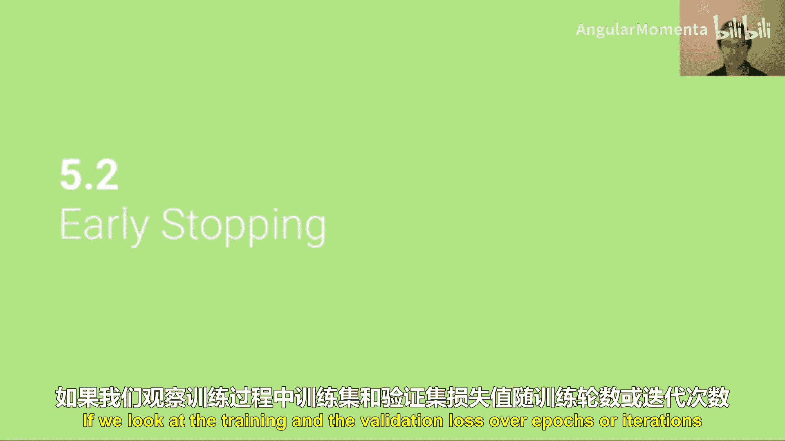
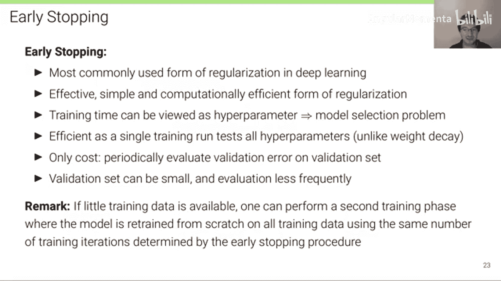

# 【精译】蒂宾根大学《深度学习》-p26-26--5.2（正则化：早停法）--BV1eDbrzhENK_p26-

。In the second unit， we're going to talk about another regular strategy。

 which is called early stopping。It's very effective。It's very simple。

 it's computationally very efficient， and it's used almost always in deep learning。

If we look at the training and the validation loss over epochs。Or iterations during training。

Epoch is basically when we have iterated。One complete time over the entire data set。

 this is what we call an epoch。An iteration is a single mini batch。

 and then if we have completed all mini batches of the data set。

Then this is called what we call one epoch and then we do multiple of these epochs until the training error goes down。

 so we see how the training error is the negative log likelihood loss here。Yeah。

Continuously approaches smaller and smaller values。However。

 what we also observe is that while the training error decreases over time。

 the validation error starts increasing again。Here we see the validation arrow。You can see that。

While it initially decreases。Very rapidly and then a little bit further。

 it starts increasing again at some point， you can see this upward slope of this green curve here。

 say。Figureed that I've taken from the Good fellow book。So， of course。

 we're interested in the best journalism performance， which is。

Can be which we approximate using the validation error and therefore。We do not want to train forever。

Because in many cases the validation error increases we what we want to do is we want to train for some time until the validation error increases and then return the parameters with the lowest validation error so we want to basically store all these intermediate results such that we can come back to the best results after training has completed。

And that's called early stopping where。Not waiting until the training error becomes arbitrarily small。

 but we are stopping。training。At an earlier point in time when the validation error hasn't decreased for a while。

Beyond the best value that we had observed so far。没有。Of course。

 during training we need to at every apoco， how often we want to do it。

 we need to evaluate on the validation set， so we need to run a forward pass on the validation set that we have held out that's not part of the training set in order to compute this number。

日是。Simple early stopping strategy has an analogy to L2 railization。In fact， under some assumptions。

 both are actually equivalent。So here on the left， we can see an illustration of what early stopping does。

 So we can see the perimeter trajectory in this case， we assume it's know it's。

Permeters are initialized to0， which is not possible。

 so it's like something close to0 with some noise。But this dash trajectory is than the trajectory that takes us via SGD via gradientd descent closer to the。

Solution of the unregized objective in this case。Or of the objective in this case。

 there is only one objective， which is an unregorized objective。 Of course。

 you can also combine this strategy with the regularization strategy， but in this case。

 it's the unregorized objective。Now， the trajectory stops in this case， a W Tilde。

Before actually reaching the minimum W star。Because this is the point where the trainingarrow becomes very small。

 but this is the point why we have determined that the validation error starts increasing again。

 so we effectively stop here。As we've seen before in L2 regularization。

 we have this competition of de regulargizing the unregularized objective。Okay。

Here in red and in green。By the penalty M this， regular riseer forces the minimum of the regularized loss w。

Tilda to be closer to the origin than W star， the minimum of the unregorized objective。

So as you can see both of these。嗯。Regularization strategies have a very similar effect， and in fact。

 under some assumptions， both are actually equivalent。To see this。

mRecommend to have a look at chapter 7。8 of the deep learning textbook。Okay。

So here's a summary of the simple early stopping strategy。

 It's the most commonly used form of regularization in deep learning。Is very effective。

 simple and computationally efficient， and that's also one reason of for its popularity。

In early stopping， the training time。The number of iterations or the number of epochs can be viewed as a hypoperameter。

 so we have a model selection problem over this hyperpermeter。

 But what's quite unique about the early stopping approach is that it's super efficient。

 as it requires only a single training run to test all hypopermeters， because at every iteration。

 whenever we benchmark whenever we evaluate on the validation set，We obtain the validationarrow。

 we just need a single training run。This is unlike all the other hyperparmeters， so for instance。

 in weight decay， why we have this alpha。We need to， in order to cross validate。

 we need to train the model。Again and again for different alpha values to determine the best alpha value。

 this is not the case for early stopping， so it's very efficient。

The only cost that is incurred is that we need to periodically evaluate the validation error on the validation set。

Right but it's something that's very common in machine learning。s the first thing you should do。

 you should always do this， you should look at your tensor board or whatever you use to monitor performance and look at the validation error and see if if it starts increasing again。

 it's not true for all problems， if you have an abundance of data and for some problems。

Even you know， the tests are continuous decreasing for days and weeks of training time。

But if you have a small amount of data compared to the model complexity。And for many problems。

 it's actually true that we have this behavior that the validation error starts increasing actually quite soon。

Now。嗯。This additional cost that is incurred by this additional forward pass and a validation set can be reduced by making the validation set smaller than the training set which is typically done。

 so this forward pass doesn't matter or evaluating less frequently so for instance evaluating only after every apoC where we have done maybe00 durationerations in between so it's really this additional cost doesn't matter compared to all these forward and backward passes that we have done in between。

A little remark if little training data is available。

 one can perform also a second training phase to take advantage of this held out。U。

Validation set that refused to evaluate the validation error。 So what we would do then is basically。

 we would。Do a first run to see how many steps are needed。

 how many iterations or how many epochs are needed。

And then run a second training phase from scratch again。

 where we initialize the parameters from scratch again， where the model is then retrained。

On all the training data， including the validation set， using the same number of training iterations。

That are determined by the early stopping procedure， of course。

 then we have to conduct two training runs。And this is only worth if we really have little data so that this validation data is actually needed to get good performance on the benchmark that we consider。

。