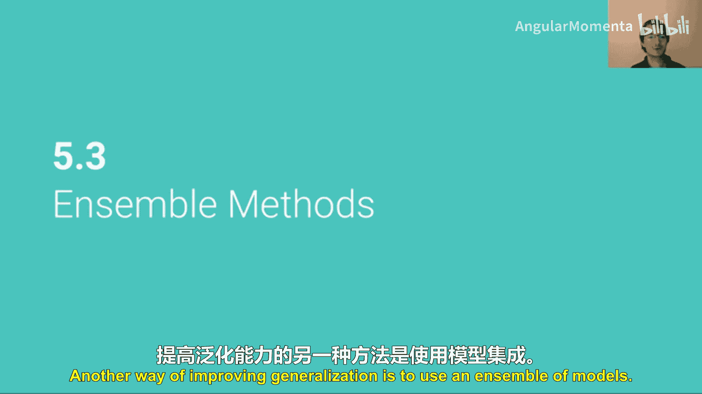
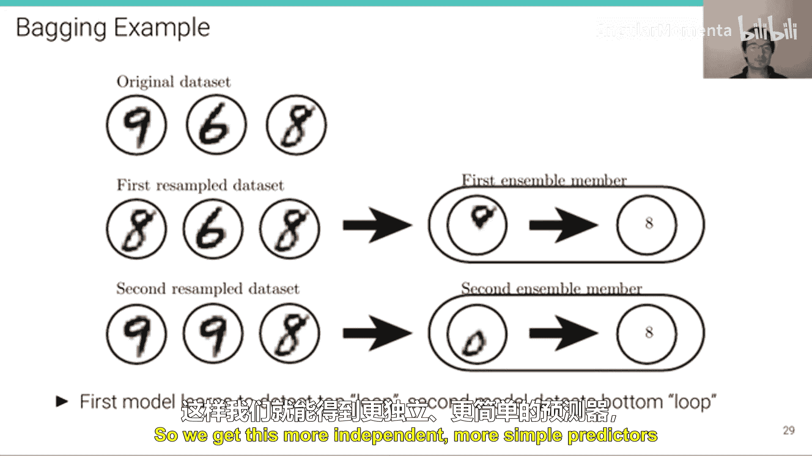

# 【精译】蒂宾根大学《深度学习》-p27-27--5.3（正则化：集成方法）--BV1eDbrzhENK_p27-

Another way of improving generalization is to use an ensemble of models。

Yeah。The idea here is to train several models separately for the same task。

And then at inference time to average the results。Therefore， this。Technique of。

Methho ensembles is often also called model averaging。

The intuition behind is that different models make slightly different errors on the tester。

And by averaging these predictions， we obtain an overall more robust estimate without actually requiring。

To develop a better model so we can use the same model。can you use it as an ensemble。

By squeezing out this。2 or3% of additional performance。For instance， by。

Starting with different random initializations and doing stochastic gradientding des five times for the same model。

We obtain five slightly different predictors。Which we can then average in the end。

This works best if the models are maximally uncorrelated， as we will see in the following slide。

And the winning entries of。Most bigger challenges of benchmarks are actually often ensembles。

For instance， in the case of the Netflix charge。With these ensembles。

 you are able to squeeze out this additional one or2% of performance without actually developing a better model。

The drawback of ensems is that it requires evaluation of multiple models at inference time in the case of。

De learning， we need to run at inference time， the forward pass through all of these models before we can actually average the result of these predictors。

Now， why are ensembles a good idea。Let's consider as an example here， K。Different。Regression models。

Each of which has an of or makes anarrow of epsilon K。Epsilon K。That's the error of。

Each of these K regression models。And the variance， let's assume the variance of this。R K is V。

So assume this is a zero centered arrow and the covariance is C。So it's just。

Define V and C as the variance in the covariance of this。Eras。The covariance between。

 the covariance is here， between。Different regression models， K and L。

Or the errors of different regression models。Now the expected squarearrow of the ensemble predictor is joint ensemble predictor。

 which is。Everaging by。Assuming the same weight for each model。As given as follows。So here we have。嗯。

The error that each individual model does， So the。Ensemble does。The average of of this error， right？

And so the。Expect it' square。Average error。The expected square ensemblearrow is written as this。

You can already see that this， this error here can be positive or negative。

 It can already imagine from this that if they are。嗯。Uncorrelated than this。Errrs might cancel out。

 actually。And this is what。Makes ensembles work。Okay。So we can rewrite this expression。We can。

 for instance， pull out the。1 over k is squared constant here。And then we can write this。Some。嗯。

Square of sums， as this。Summation here。So we have a summer room。All case of。

A squared term and then the cross terms here where L is not equal k。闹。This is equal to， well。

 the expectation is linear operator so we can push it through the summation。

 so we have to sum over the expectation of。Epsilon K square plus。sum over K。

 sum over L not equal K expectation of Epsilon K， Epsilon L。

We know or we have defined the variance in the covaris as V and C。

 so we plug in V and C here for these two terms。And because。

All of them here are the same we can simply write down the cardinality。

 so here we have a sum over K elements， so we have k here we have a sum over k and K minus1 elements。

 we have k times k minus1 here。And now we can divide by 1 k to arrive at this expression。

 so we have 1 over k V。Plus， K -1 over K C。1 over k times the variance plus k minus1 over k。

 the covariance。What does this mean？So this is， again， the same equation from the previous slide。

 the assemble error is given by 1 over k， the variance plus k minus 1 over k times the covariance。

What does this mean？Well， if the  errors are correlated， if they are maximally correlated。

 which means that the correlation is equal to the variance C equals B。

 then the ensemble error becomes B because if we have we here then we have 1 minus1 plus k so K over k is 1。

 so we end up with B。And there is basically no gain。 V is the variance of。

And one of these individual models， so we haven't gained anything。However。

 if the errors are uncorrelated， so if c equals 0， the ensemble error reduces to 1 over k times b。嗯。

So in this case， we have a huge gain， we have reduced。The the ensemble arrow significantly。Okay。嗯。

Therefore， the ensemble is maximally effective if these errors are maximally anchor。Now。

 how can we construct these ensembles， well there's multiple strategies。

 the simplest is to simply use different initializations。

Our different stoholasticity during training， so we train networks。

Starting from different random initialerization on the same data set。

Or using a different order of the mini batches in stochastic gradient descent。

And even for very simple， this often already introduces some independence and that independence can be directly exploited by this ensemble technique。

As soon as we start to introduce some independence， even if it's not that much independence。

 we were not going to get this huge gain here， we're getting some gain。The second。

Idea is to use different models simply right so we can have slightly different model architectures。

 we can use more layers or less layers or different number of hidden units。

 we can use slightly different loss functions or hyperparameters。

Like different alpha values for the peri penalties。And then finally aim。We have bagging。

Begging refers to training networks on different random draws with replacement from the original dataset。

So， we're creating。K in new data sets。Where we create each of these data sets by randomly drawing elements from the original data。

The replacement。That means that in these new data sets。

 there is likely missing some of the examples in the original data sets because we are not going to by chance draw each element exactly。

 and there is likely also some duplicates in these dataset sets。

 but the dataset sets are the same size， that's called peing。

So here's an example or an intuition behind bagging。 So we have a。I this classification problem here。

Where we want to classify the number 8， and we have。This data set here on top with9， six and  eight。

And assume that during bagging the first data set to draw is this dataset we have drawn 8， 6 and8。

 and the second data set is this one here where we've drawn a 9 and 9 and 8 can already see some of the elements are duplicates of the original dataset。

 some elements of the original dataset are not present in the resampled dataset。

And now what we do here is that this first element or this first member of the ensemble。

has a simpler task right it just needs to decide is it you know8 versus 6。

 so basically it learns to detect a top loop here。It learns that if there is no loop here on the top。

 then it must be 8 if there is。No， if there is no loop here on the top， it can be an8。

 if there is a loop here on the top， then it's likely that there is an 8。 Similarly。

 the second ensemble member learns that if there is。A loop or no loop at the bottom。

 Then it cant be an 8。 If there is a loop at the bottom， then it's likely to be an 8。 So we get this。

More independent。More simple predictors that we can then average in the end。

