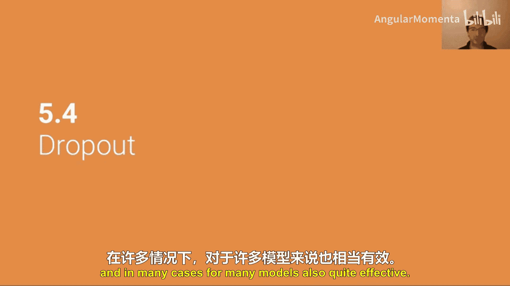
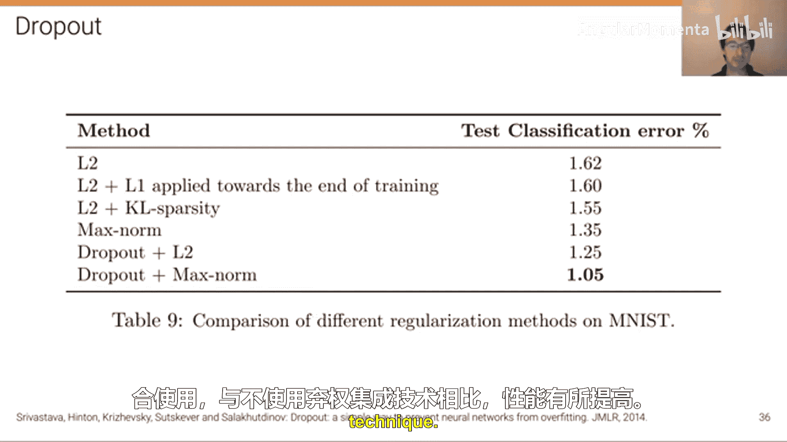

# 【精译】蒂宾根大学《深度学习》-p28-28--5.4（正则化：Dropout）--BV1eDbrzhENK_p28-

A very specific type of ensemble method is dropout。It's。

Also an extremely popular method in modern deep learning as it's very simple and efficient and in many cases for many models also quite effective。

So the idea of dropout is that during training。We create an ensemble on the fly by setting neurons to 0 with some probability。

 Ty 0。5。 Consider this example here on top。 This is a。

A simple multi layerop perceptron where we have the inputs at the bottom and the outputs at the top。

Now with probability 0。5， we're removing a neuron， which means。

That we remove all of its incoming and outgoing connections。So here on the right。

 we see the neurons that have been removed。And therefore， the connections that have been removed。

Yeah。So this can be expressed with a binary mask， if a binary mask is basically a binary vector。

As long as we have overall units in our multi layerer perceptron or。

Our type of model that we consider。And this mask。Changes randomly with every iteration during training。

 every iteration during training， we are randomly drawing with probability 0。

5 if a neuron is active or if it is removed。And then we do the backward and the forward pass on this。

Simplified model。And then the next training iteration。

 we remove a different set of neurons and we do a forward and a backward pass。

So effectively what this does is it creates an ensemble on the fly from a single network with shared parameters。

Before in the classical ensemble methods， the parameters were not shared， but here。

 the perimeter stayed the same。 It's just that。In some cases。

 a neuron with its parameters participates in training and in some iterations it doesn't participate。

A nice thing about this is that the ensemble that is created is exponentially large。

It grows with the number of training iterations because were。

 were with very low probability drawing exactly the same。Model from this ensemble twice。

 a model or an element in this ensemble or a member of this ensemble is one particular mask vector。

 one particular binary mask vector， one particular constellation of dropped out neurons。

 This is one model in this ensemble。So why is this a good idea？So here's our example from before。

First of all。This。Dropout technique forces the network to learn a redundant representation。

 so it's another way effective way of regularization。

The model has to be redundant because it cannot rely on certain features to make a prediction。

 because these features might be dropped out in a particular forward and backward pass。

 so it must learn you must represent information。In a distributed and redundant way in the network。

And therefore， it reduces the effect of model capacity。 right， So we need。

And this is maybe the downside of this technique， we need larger models and longer training。But。

At the same time， we gain generalization performance。1。

Our aspect why this is a good idea or another intuition。

 why this is a good idea is that it prevents co adaptation of features。In classical deep learning。

As we've seen before， units can learn to undo the effect of other units。so you can create。

A zero value by having one unit responding。highlyighly。

 and another one responding very low and then combining them。So this core adaptation。

 which is actually。Something unwanted， because it's not。A real。Effects that we want to model。

Can be prevented by dropout because if we randomly drop out neurons。

Then the representation that a model learns must be robust to this。

Rely on some specific neurons being active in order to change the effect of other nearby neurons。

This is called co adaptation。And another reason why this's a good idea is that in contrast to these ensemble methods that we've seen before。

 it， as we will see， requires only a single forward pass at inference time。嗯。So， why。

Let's first look at the problem at inference time。 Well。

 dropout makes the output random because we have this random mask。 So formally we have or we can。

 we can write this。Drop out model as a neural network with Per W， which depends on the input X。

 but also now on this binary mask C that specifies0 and 1， which neurons are active and which not。

And this is our prediction。so C is a binary mask with one element per unit drawn ID from a benoulli distribution because it's binary。

Well。CI equals0 if neuroni is removed from the network。And so this is the drop out probability。

At inference time， we then' want to calculate the ensemble prediction。

That's also what we did before for the ensembles， before it was a small number of K ensembles now in this case。

 it's actually intractable because。The number of oems is exponential in the number of neurons for M neurons。

 we have2 to power of M。Terms in this expression here atius。s。UCates like the sum of all possible Cs。

Creates this exponential growth。In the terms of this expression here。

So we we simply can't calculate the ensemble prediction by averaging。So what do we do？

Let's consider a simple linear model。Which you can think of also as one layer in a neural network。

 a fine layer。So。The linear model can be written as such a linear model with。Two inputs。

 two weights that produce an output。F parameters W of x。

Now we can write the dropout equivalent as FW of x comma binary vector C。As CWX plus Cwx。

 where C is ever 0 or1， depending on if this connection has been dropped or not。

Now assume mu this dropout probability to be 0。5。During training。

 what we do is we optimize the expectation over the ensemble。

 so we're optimizing this expectation over all possible combinations of binary mask vectors。

 each with probability 1 over4 because we have in this simple case of four possible combinations of C1 and C2 taking value 01。

So what is that？In the case that C1 and C2 are above 0， we get0。If C1 or C2 are 0。

 but not both of them， then we get。嗯。E this expression or this expression here。

And if C1 and C2 are both one， then we get this expression now we sum them all up。

 multiplied with the probability of occurrence， which is one over four。

 because we have four different。Events。And we if we sum all of these up。

 we obtain one over two because we have。W1 x1， both here and here and W2 x2 both here and here。

 So we have1 over 2， W1 x1， W2 x2。Which is one half。Of the original FW of x。

So with this little argument。We can see that at test time。

 when we do inference with the entire model， where we do not apply any dropout。

What we can do is in order to make a approximately correct prediction is to multiply the trained weights with the or by the dropout probability mu。

Because what we're did training is we predicted1/2 f。

 which means that the weights must be twice as large in order to attain the same value。

Now if the weights are twice as large as they should be， we simply need to divide them by two。

In the case， mu being 0。5。Oh。As little remarked， this weight scaling inference。

 this is what's called weight scaling inference， because at inference time。

 we need to scale the weights to take into account that we have done this dropout during training。

Is only an approximation for nonlinear models， but it works quite well empirically in practice。

Here is an example of what this does so here is a simple auto encoder we're going to talk about this type of models later in the lecture on MNIS with a single hidden layer of 20 of 256 relo and what is shown here are the activations of these units。

Feature visualization and on left we have a standard auto encoder on the right we have this autoenr drain with dropout and we see that on the left we have a lot of co adaptation there' is a lot of noise here there's a lot of units that respond because theres other units responding and they need to undo their errors etc on the right we have much less co adaptation and we are having features that are。

Somewhat more meaningful that appear in different places in the image and that react to different kinds of。

Input signals， and therefore the model on the right leads to better generalization。

This can be also seen from this plot， there this test classification error on this data set。

Where these last two models have used dropout in combination with some other regular station techniques and lead to improved performance compared to not using the dropout。

嗯。Ensemble technique。

